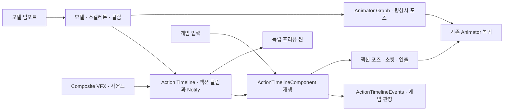

# 애니메이션 제작·실행 파이프라인 개선 계획

- 작성일 2026-11-19
- 상태 · 현재 코드와 저장 에셋을 확인한 구현 계획. 변경 적용과 통합 실행 검증은 대기 중이다.
- 관련 기준 · [에디터·클라이언트 지침](EngineEditorClientGuidelines.md) · [에디터 UX 검증](EditorUXTestGuidelines.md) · [Reflection·Archive 지침](ReflectionArchiveGuidelines.md)

## 1. 목표와 현재 흐름

임포트한 캐릭터에 평상시 Animator Controller를 연결하고, 별도로 만든 VFX·사운드를 액션 클립에 배치한다. 제작자는 Action Timeline에서 발동 위치와 타이밍을 확인하고, 같은 에셋을 PIE와 독립 Client에서 게임 입력으로 재생한다. 첫 완료 기준은 공격 한 번의 **입력 → 액션 클립 → 무기 본 VFX와 사운드 → 게임 판정 1회 → 이동 상태 복귀**다.



- 모델 임포트가 모델·스켈레톤·클립을 각각 저장하고, Animator Graph와 Action Timeline이 임포트 결과를 소비한다. Animator Graph의 상태 Notify는 시간·이름·페이로드를 담고 `AnimatorComponent` 콜백으로 전달된다. Action Timeline의 Notify는 VFX·사운드·게임 이벤트의 시간과 소켓을 지정한다. 복합 VFX 에셋은 그 안에서 재생할 개별 연출을 소유한다. 이 책임 분리를 유지한다. [모델 임포트](InteractiveModelImportPreviewPlan.md) · [Animator Graph](AnimatorGraphPlan.md) · [Action Timeline](AnimationTimelineEditorPlan.md) · [Composite VFX](CompositeVisualEffectPlan.md)
- `BaselineVerification`의 Rogue는 Controller 경로가 비어 있고 타임라인이 자동 재생된다. 기존 검증은 PIE에서 `OnAttackHit` 1회 수신, 루프당 1회 수신, Presentation에서 이벤트 로그 없음, 모듈 핫리로드 뒤 단일 수신을 확인했다. `GameModule` 예제는 받은 이벤트를 로그로 남긴다. 입력에 의한 재생, 상태 머신 복귀, 편집 씬 데이터 보존, 독립 Client는 아래 단계에서 검증한다. [대표 씬](../Assets/Scenes/BaselineVerification.bamscene.json) · [C++ 예제](../Projects/GameModule/Source/GameModule.cpp) · [기존 검증 기록](AnimationTimelineEditorPlan.md#85-1단계-c-게임-모듈-수신-2026-11-19)

## 2. 편집 씬 격리와 Animator 복원

### 2.1 편집 모드의 부작용 차단

**우선순위 높음.** 씬 뷰의 Realtime은 `Presentation` 업데이트를 실행하고 `ActionTimelineSystem`은 여기에 참여한다. `CustomEvent` 발행만 Gameplay 페이즈로 제한한다. 활성 편집 씬의 타임라인이 재생되면 VFX 엔티티가 생성되거나 메인 카메라 FOV가 변경될 수 있다. 인스펙터의 `Play`는 컴포넌트에 직접 요청한다. [에디터 프레임 루프](../Editor/Source/Application/Private/Application.cpp) · [ActionTimelineSystem](../Engine/Source/Animation/Timeline/Private/ActionTimelineSystem.cpp) · [인스펙터](../Editor/Source/ImGui/InspectorPanel/Private/InspectorPanel.cpp)

- 실제 씬의 타임라인 진행과 부작용을 Gameplay 실행 경계에 둔다. 편집 모드 인스펙터의 재생은 기존 `AnimationTimelinePanel`의 독립 프리뷰로 연결한다. 대상 문서를 바꿀 때 공용 미저장 확인을 통과한 뒤 재생한다. 전환을 취소하면 현재 프리뷰·문서·편집 씬을 보존한다.
- [ ] **완료 기준.** VFX와 카메라 샷이 들어 있는 에셋으로 편집 모드 Realtime과 인스펙터 재생을 확인한다. 편집 씬의 엔티티 수, 메인 카메라 FOV, Animator·타임라인 상태와 문서의 미저장 표시가 그대로다. 독립 프리뷰는 로컬 연출을 재생하고 게임 이벤트는 보내지 않는다. PIE에서는 기존 이벤트가 정상 발행된다.

### 2.2 액션 세션 종료와 복원

**우선순위 높음.** 현재 타임라인은 `AnimatorComponent::isPlaying`을 끄고 원래 클립·시간·재생 여부를 타임라인 컴포넌트에 보관한다. 타임라인 컴포넌트만 제거하면 이후 갱신 대상에서 빠져 복원할 수 없다. 자신과 자식에서 Animator를 찾는 기존 `AnimationSceneQuery`는 재사용하되, 세션이 실제로 넘겨받은 Animator를 추적한다. [현재 복원과 한계](AnimationTimelineEditorPlan.md#11-animator-넘겨받기복원과-계층-탐색-2026-11-19) · [AnimationSceneQuery](../Engine/Source/Animation/Private/AnimationSceneQuery.cpp)

- 먼저 기존 복원 처리를 정상 종료·정지·에셋 교체·컴포넌트 제거에서 공통으로 실행할 수 있게 연결한다. 인스펙터 삭제 외의 제거에서도 복원되도록 수명을 다룬다. 일시정지·재개는 같은 세션으로 유지한다. 중복 재생 요청이나 Animator 공유가 가능한 경우 이전 요청의 복원이 새 요청을 덮어쓰지 않게 한다. 지속형 VFX는 기존 해제와 잔상 정리 정책을 따른다.
- [ ] **완료 기준.** Controller가 재생 중인 캐릭터에서 액션의 정상 종료, `Stop()`, 재생 중 새 타임라인, 컴포넌트만 제거, 소유자 제거를 확인한다. 살아 있는 Animator는 원래 재생 상태로 한 번 복원된다. 일시정지·재개 중에는 복원하지 않는다. Animator가 자식에 있는 구성에서도 같은 결과가 나온다.

이 단계에서는 기존 블렌드 아웃을 검증한다. 액션 중에도 하체 이동을 유지하거나 상체만 합성해야 하는 요구가 생기면 Animator가 액션 포즈 입력을 소유하는 구조를 검토한다.

## 3. 프리뷰와 게임의 Notify 규칙 일치

**우선순위 높음.** `AnimationTimelinePanel::Update()`는 마커를 발동한 뒤 본 포즈를 계산한다. `oldTime < TriggerTime` 조건이라 시작과 루프 직후의 0초 마커를 건너뛴다. 런타임은 포즈를 계산한 뒤 마커를 검사하고 첫 틱과 루프의 0초를 포함한다. 빠르게 움직이는 본에 붙이지 않고 순간 생성하는 VFX는 프리뷰에서 이전 프레임의 소켓 위치를 사용할 수 있다. [패널 재생](../Editor/Source/ImGui/TimelinePanel/Private/AnimationTimelinePanel.cpp) · [런타임 재생](../Engine/Source/Animation/Timeline/Private/ActionTimelineSystem.cpp)

- `ActionTimelineAsset`의 시간 진행과 마커 구간 판정을 순수 로직으로 추출해 패널과 런타임에서 사용한다. 기본 구간은 `(이전, 현재]`로 두고 새 세션과 루프의 시작만 0초를 포함한다. 이전·현재 시간이 같을 때, 여러 루프를 한 틱에 넘을 때, 스크럽할 때의 규칙을 명시한다. 스크럽으로 게임 이벤트나 오디오를 다시 발생시키지 않는다.
- 양쪽에서 시간 진행과 루프 처리 후 포즈를 갱신하고, 같은 포즈에서 소켓을 조회해 발동한다. 지속형 VFX는 저작한 발동 시점과 지속 시간, 취소·종료 기준을 일치시킨다. 패널은 독립 씬과 테스트 표시를 처리하고, 런타임은 실제 씬의 연출과 `ActionTimelineEvents` 발행을 담당한다. Animator Graph의 상태 Notify는 이 단계에서 이동시키지 않는다.
- [ ] **완료 기준.** 시작 0초·중간 틱 경계·마지막 프레임·루프 첫 프레임에서 같은 마커 순서와 횟수를 확인한다. Pause·Resume 후 중복 발동이 없고 스크럽 중 이벤트 수신이 없다. 같은 클립과 시간에서 빠르게 움직이는 본의 순간 VFX 위치 및 지속형 VFX 해제 결과를 패널과 PIE에서 비교한다.

## 4. 모델·클립 참조와 재임포트 검증

**우선순위 높음.** 패널은 작성 모델의 `GetPath()`와 클립 이름·길이를 저장한다. `Survey` 등 저장 에셋에 체크아웃의 절대 경로가 남아 있다. 런타임은 씬 모델에서 동명 클립을 우선 찾고 작성 모델로 폴백한다. 모델 간 동명 클립이 있거나 재임포트로 길이가 바뀌면 다른 데이터로 연출할 수 있다. [타임라인 저장](../Editor/Source/ImGui/TimelinePanel/Private/AnimationTimelinePanel.cpp) · [Survey 예제](../Assets/Data/Animation/Timeline/Survey.bamtimeline.json) · [클립 해석](../Engine/Source/Animation/Timeline/Private/ActionTimelineSystem.cpp)

1. **작성 모델 경로.** 기존 에셋 피커의 `PlatformPath::ToVirtualUri()`를 활용해 프로젝트·엔진 마운트 URI로 저장한다. 기존 절대 경로는 읽기 호환을 유지한다. 현재 체크아웃의 마운트에 속하는 경로는 다시 저장할 때 정규화한다. 파일이 이미 사라졌거나 경로를 확정할 수 없으면 재지정을 안내한다. 이전 필드를 읽을 수 있는지부터 확인하고 기존 에셋은 작은 묶음으로 갱신한다. [에셋 피커](../Editor/Source/ImGui/Private/AssetPathPicker.cpp)
2. **클립과 대상 스켈레톤.** 기존 `ResourceHandle<Animation>`의 직렬화 방식으로 클립 정체성을 보존할 수 있는지 검증한다. 기존 `ClipName`은 이전 문서나 명시적 재매핑에서 사용하고, 동명 클립이 여러 개이거나 대상 스켈레톤이 호환되지 않으면 알린다. `GetSkinBindingSignature()`와 뼈 매핑이 지원하는 호환 범위를 확인한 뒤 비교 기준을 정한다. [리소스 핸들 직렬화](../Engine/Source/Resource/Public/ResourceHandleArchiveAdapter.h) · [Skeleton](../Engine/Source/Animation/Skeleton/Public/Skeleton.h)
3. **에셋 변경 후 진단.** 클립 누락, 소켓 본 누락, 바뀐 클립 길이, 범위를 벗어난 마커·지속 구간을 열기·저장 시 확인한다. 진단에는 문서와 문제 트랙을 표시하고 저작 값을 보존한다. 의존성 검사에 모델·클립·사운드·VFX가 잡히는지 확인하고 이동·이름 변경 경로도 함께 검증한다. [참조 검사](../Editor/Source/AssetManager/Private/AssetReferenceValidator.cpp)
4. [ ] **완료 기준.** 이전 문서의 정상 읽기, URI로 다시 저장한 문서의 재열기, 모델·클립 이동, 원본 클립의 이름과 길이 변경, 동명 클립을 가진 다른 모델에서의 오류 표시를 확인한다. 다른 경로의 체크아웃과 패키지에서도 같은 모델과 클립을 찾는다.

## 5. 대표 액션 통합 검증

2~4절을 통과한 뒤 기존 모델 임포트·Animator Graph·Composite VFX·Action Timeline으로 타임라인 하나를 만든다. 대표 캐릭터에는 실제 이동 Controller를 설정한다. 게임 입력을 `ActionTimelineComponent::Play()`에 연결하고 `ActionTimelineEvents::Subscribe()`로 판정을 받는다. 로그와 함께 판정 카운터 등 확인 가능한 게임 상태를 한 번만 바꾼다. 모듈 언로드 시 기존 구독 해제 방식을 사용한다. 제작 단계와 사용 에셋 이름은 구현 기록에 남긴다.

- [ ] **패널.** 클립을 선택하고 본 선택기에서 소켓을 정한 뒤 VFX·사운드·`CustomEvent`를 배치한다. 저장·재열기와 한·영 언어 전환 후 클립·시간·소켓 선택이 유지된다. 지원하지 않는 Notify 유형이나 필드는 사용 가능한 결과와 구분해 안내한다. 고정 문구는 기존 로캘 키를 우선 사용하고, 추가할 키는 그룹별 CSV에 한·영 값을 등록한다. 입력과 단축키는 기존 `InputManager`·`ShortcutManager` 경로를 따른다.
- [ ] **PIE.** 이동 중 액션을 시작하고 포즈, 소켓 VFX, 사운드, 판정 1회, 이동 복귀를 확인한다. 중도 정지·삭제·재생 반복과 모듈 핫리로드에서 복원과 구독이 중복되지 않는다. 부모에 타임라인을, 자식에 모델과 Animator를 둔 사례도 확인한다.
- [ ] **Windows Client.** 같은 씬을 시작 씬으로 지정해 Release를 내보낸다. 원본 체크아웃에 기대지 않는 다른 위치나 머신에서 Client를 실행해 같은 입력·클립·연출·이벤트·복귀를 확인한다. 에디터 및 Client 버전·설정과 사용한 에셋을 기록한다. [빌드 및 패키징 계획](BuildAndPackagingPlan.md)

## 6. 통합 검증 후 다룰 항목

- **제작 도구 사이 이동.** 대표 액션을 만드는 동안 모델·클립 선택과 VFX 미세조정에 드는 왕복을 기록한다. 반복 비용이 큰 곳에 현재 클립으로 타임라인을 열기, 타임라인의 VFX 참조에서 VFX 편집기를 열기 같은 연결을 추가한다. 기존 에셋 피커와 문서 교체 확인부터 활용한다.
- **게임플레이 연결 확장.** 먼저 C++ 예제로 실행 계약을 검증한다. 그래프 제작이 필요하면 같은 재생·이벤트 계약을 사용하는 타임라인 재생 및 `On Action Event(Tag)` 노드를 추가한다. 상태 Notify와 액션 Notify의 구독 통합은 기존 사용처와 DLL 수명을 확인한 뒤 판단한다.
- **미완성 연출과 첫 발동 비용.** 직접 `Particle` Notify는 런타임에서 위치만 계산하며, 기본 카메라 샷 경로는 FOV만 갱신한다. 첫 통합 샘플은 동작이 연결된 Composite VFX·사운드·이벤트로 구성한다. VFX·사운드 발동의 `LoadFile()` 비용은 최초·재생 반복에서 비교하고, 프레임 지연이 확인되면 의존 리소스 준비를 재생 전으로 옮긴다. [런타임 처리](../Engine/Source/Animation/Timeline/Private/ActionTimelineSystem.cpp)

## 7. 빌드와 회귀 검사

구현 후 사용자가 저장소 루트에서 실행할 기존 검사다. 2~4절의 시간 구간·복원·이전 데이터와 신규 참조 동작은 헤드리스 검사에 추가한다. 기존 씬·에셋·편집 이력 검사는 회귀를 확인하고, 프리뷰 화면과 독립 Client는 5절의 시나리오로 검증한다.

```powershell
cmake --preset x64-debug -DBUILD_TESTING=ON
cmake --build --preset x64-debug --config Debug --target Editor AuditLocalization SceneArchiveCheck AssetReferenceCheck EditorHistoryCheck BlendTree2DCheck
ctest --preset x64-debug --output-on-failure -R "SceneArchiveCheck|AssetReferenceCheck|EditorHistoryCheck|BlendTree2DCheck|LocalizationAuditUtility"
```

- **이번 문서 검증 범위.** 호출 경로, 예제 씬·타임라인, 기존 사용자 검증 기록과 테스트 타깃을 대조했다. 개선 코드 작성, 빌드, CTest, PIE와 독립 Client 실행은 이후 단계에 남아 있다.
