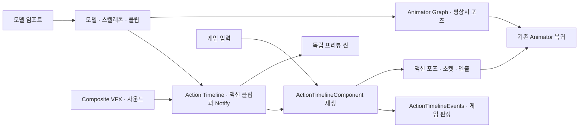

# 애니메이션 제작·실행 파이프라인 개선 계획

- 작성일 2026-11-19
- 상태 · 1~3절의 코드 변경과 헤드리스 회귀 사례를 반영했다. 빌드·CTest·로캘 생성·PIE·독립 Client 검증은 실행하지 않았으므로 통합 완료 판정은 대기 중이다.
- 관련 기준 · [에디터·클라이언트 지침](EngineEditorClientGuidelines.md) · [에디터 UX 검증](EditorUXTestGuidelines.md) · [Reflection·Archive 지침](ReflectionArchiveGuidelines.md)

## 1. 목표와 현재 흐름

임포트한 캐릭터에 평상시 Animator Controller를 연결하고, 별도로 만든 VFX·사운드를 액션 클립에 배치한다. 제작자는 Action Timeline에서 발동 위치와 타이밍을 확인하고, 같은 에셋을 PIE와 독립 Client에서 게임 입력으로 재생한다. 첫 완료 기준은 공격 한 번의 **입력 → 액션 클립 → 무기 본 VFX와 사운드 → 게임 판정 1회 → 이동 상태 복귀**다.



- 모델 임포트가 모델·스켈레톤·클립을 각각 저장하고, Animator Graph와 Action Timeline이 임포트 결과를 소비한다. Animator Graph의 상태 Notify는 시간·이름·페이로드를 담고 `AnimatorComponent` 콜백으로 전달된다. Action Timeline의 Notify는 VFX·사운드·게임 이벤트의 시간과 소켓을 지정한다. 복합 VFX 에셋은 그 안에서 재생할 개별 연출을 소유한다. 이 책임 분리를 유지한다. [모델 임포트](InteractiveModelImportPreviewPlan.md) · [Animator Graph](AnimatorGraphPlan.md) · [Action Timeline](AnimationTimelineEditorPlan.md) · [Composite VFX](CompositeVisualEffectPlan.md)
- `BaselineVerification`의 Rogue는 Controller 경로를 `BaselineVerification_Simple.animator`에 연결한다. 타임라인은 자동 재생하지 않으며 인스펙터에서 재생할 수 있다. 이전 구성에서 PIE의 `OnAttackHit` 수신 및 핫리로드 후 단일 구독을 확인했으나 새 구성은 실환경 검증 전이다. `GameModule` 예제는 받은 이벤트를 로그로 남긴다. [대표 씬](../Assets/Scenes/BaselineVerification.bamscene.json) · [C++ 예제](../Projects/GameModule/Source/GameModule.cpp) · [기존 검증 기록](AnimationTimelineEditorPlan.md#85-1단계-c-게임-모듈-수신-2026-11-19)

### Baseline 점프와 이동 변주 예시

- Idle A/B, Walk A/B/C, Run A/B를 각각 2D 블렌드로 연결한다. `GameModule`의 샘플 시스템이 `VariationX/Y`를 천천히 변경한다. 별도 `GameModule`이 없는 그래프 프리뷰에서는 기본값이나 사용자가 입력한 값으로 블렌드한다.
- KCC의 `Jump` 트리거로 어느 이동 상태에서든 비루프 `Jump_Full_Short`에 진입하고, 클립이 85% 이상 진행되고 접지하면 Idle로 복귀한다. 이동 중에는 기존 `Speed` 전이가 다시 Walk/Run을 선택한다. 씬에서 속도에 따른 전체 Animator 재생률 변경은 꺼서 점프 속도가 이동 속도에 따라 바뀌지 않게 했다.
- 샘플 시스템은 해당 컨트롤러의 점프 전이를 감지해 기존 `BaselineVerification_Hit` 복합 이펙트를 캐릭터 위치에 한 번 생성한다. Animator의 상태 Notify나 Action Timeline을 재생하는 방식은 아니며, 효과는 생성 위치에 남는다. 점프 진입 감지는 시스템 순서에 따라 프레임 단위 지연이 있을 수 있다. 게임 모듈이 필요하고 그래프 프리뷰에서는 발생하지 않는다.
- **확인 필요:** Editor와 GameModule 빌드 후 PIE에서 정지·이동·달리기 중 점프, 착지 복귀, 연속 점프와 이펙트 잔존·소멸을 확인한다. 2D 코너와 중간 값의 포즈 호환성, 점프 클립과 실제 체공 시간의 정렬, 타임라인 수동 재생 후 복귀 및 모듈 핫리로드도 확인한다. 에셋은 Git 무시 대상이고 빌드·실행 검증은 하지 않았다.

### 구현 반영 상태

- **1절**: Action Timeline 시스템을 Gameplay 페이즈에 제한하고, 편집 모드 인스펙터 재생을 독립 프리뷰로 라우팅했다. Animator의 원래 상태를 Animator가 소유하고, 세션 소유권·serial로 정상 종료·정지·교체·비활성화·컴포넌트 제거 시 복원 및 지속형 VFX 해제를 연결했다.
- **2절**: 프리뷰와 런타임이 `ActionTimelinePlayback`의 시간 진행 및 Notify 교차 계산을 공유한다. 포즈·스키닝 행렬 갱신 후 Notify를 검사하며 시작 시각, 구간 경계, 루프 경계와 다중 루프를 검사하는 `ActionTimelinePlaybackCheck`를 추가했다.
- **3절**: 모델 참조는 저장 시 확인 가능한 `Engine://` 또는 `Project://` URI로 정규화하고, 이전 절대 경로는 읽을 수 있게 유지한다. 클립 누락·동명 클립·스켈레톤 불일치·없는 소켓·범위 밖 Notify를 진단한다. 기본 스프라이트·파티클 머티리얼은 `Resources/Shader/GBufferSpriteVS`의 논리 키를 보존하면서 바이너리 `AssetPath`를 `Engine://` URI로 정규화했다.
- 위 항목은 코드 반영 상태이며 실행 검증 결과가 아니다. 5절의 수동 체크리스트와 7절의 사용자 실행 검증을 통과하기 전에는 통합 완료로 판정하지 않는다.

## 2. 편집 씬 격리와 Animator 복원

### 2.1 편집 모드의 부작용 차단

**우선순위 높음.** 씬 뷰의 Realtime은 `Presentation` 업데이트를 실행하고 `ActionTimelineSystem`은 여기에 참여한다. `CustomEvent` 발행만 Gameplay 페이즈로 제한한다. 활성 편집 씬의 타임라인이 재생되면 VFX 엔티티가 생성되거나 메인 카메라 FOV가 변경될 수 있다. 인스펙터의 `Play`는 컴포넌트에 직접 요청한다. [에디터 프레임 루프](../Editor/Source/Application/Private/Application.cpp) · [ActionTimelineSystem](../Engine/Source/Animation/Timeline/Private/ActionTimelineSystem.cpp) · [인스펙터](../Editor/Source/ImGui/InspectorPanel/Private/InspectorPanel.cpp)

- 실제 씬의 타임라인 진행과 부작용을 Gameplay 실행 경계에 둔다. 편집 모드 인스펙터의 재생은 기존 `AnimationTimelinePanel`의 독립 프리뷰로 연결한다. 대상 문서를 바꿀 때 공용 미저장 확인을 통과한 뒤 재생한다. 전환을 취소하면 현재 프리뷰·문서·편집 씬을 보존한다.
- [ ] **실환경 확인 대기.** VFX와 카메라 샷이 들어 있는 에셋으로 편집 모드 Realtime과 인스펙터 재생을 확인한다. 편집 씬의 엔티티 수, 메인 카메라 FOV, Animator·타임라인 상태와 문서의 미저장 표시가 그대로다. 독립 프리뷰는 로컬 연출을 재생하고 게임 이벤트는 보내지 않는다. PIE에서는 기존 이벤트가 정상 발행된다.

### 2.2 액션 세션 종료와 복원

**우선순위 높음.** 현재 타임라인은 `AnimatorComponent::isPlaying`을 끄고 원래 클립·시간·재생 여부를 타임라인 컴포넌트에 보관한다. 타임라인 컴포넌트만 제거하면 이후 갱신 대상에서 빠져 복원할 수 없다. 자신과 자식에서 Animator를 찾는 기존 `AnimationSceneQuery`는 재사용하되, 세션이 실제로 넘겨받은 Animator를 추적한다. [현재 복원과 한계](AnimationTimelineEditorPlan.md#11-animator-넘겨받기복원과-계층-탐색-2026-11-19) · [AnimationSceneQuery](../Engine/Source/Animation/Private/AnimationSceneQuery.cpp)

- 먼저 기존 복원 처리를 정상 종료·정지·에셋 교체·컴포넌트 제거에서 공통으로 실행할 수 있게 연결한다. 인스펙터 삭제 외의 제거에서도 복원되도록 수명을 다룬다. 일시정지·재개는 같은 세션으로 유지한다. 중복 재생 요청이나 Animator 공유가 가능한 경우 이전 요청의 복원이 새 요청을 덮어쓰지 않게 한다. 지속형 VFX는 기존 해제와 잔상 정리 정책을 따른다.
- [ ] **실환경 확인 대기.** Controller가 재생 중인 캐릭터에서 액션의 정상 종료, `Stop()`, 재생 중 새 타임라인, 컴포넌트만 제거, 소유자 제거를 확인한다. 살아 있는 Animator는 원래 재생 상태로 한 번 복원된다. 일시정지·재개 중에는 복원하지 않는다. Animator가 자식에 있는 구성에서도 같은 결과가 나온다.

이 단계에서는 기존 블렌드 아웃을 검증한다. 액션 중에도 하체 이동을 유지하거나 상체만 합성해야 하는 요구가 생기면 Animator가 액션 포즈 입력을 소유하는 구조를 검토한다.

## 3. 프리뷰와 게임의 Notify 규칙 일치

**우선순위 높음.** `AnimationTimelinePanel::Update()`는 마커를 발동한 뒤 본 포즈를 계산한다. `oldTime < TriggerTime` 조건이라 시작과 루프 직후의 0초 마커를 건너뛴다. 런타임은 포즈를 계산한 뒤 마커를 검사하고 첫 틱과 루프의 0초를 포함한다. 빠르게 움직이는 본에 붙이지 않고 순간 생성하는 VFX는 프리뷰에서 이전 프레임의 소켓 위치를 사용할 수 있다. [패널 재생](../Editor/Source/ImGui/TimelinePanel/Private/AnimationTimelinePanel.cpp) · [런타임 재생](../Engine/Source/Animation/Timeline/Private/ActionTimelineSystem.cpp)

- `ActionTimelineAsset`의 시간 진행과 마커 구간 판정을 순수 로직으로 추출해 패널과 런타임에서 사용한다. 기본 구간은 `(이전, 현재]`로 두고 새 세션과 루프의 시작만 0초를 포함한다. 이전·현재 시간이 같을 때, 여러 루프를 한 틱에 넘을 때, 스크럽할 때의 규칙을 명시한다. 스크럽으로 게임 이벤트나 오디오를 다시 발생시키지 않는다.
- 양쪽에서 시간 진행과 루프 처리 후 포즈를 갱신하고, 같은 포즈에서 소켓을 조회해 발동한다. 지속형 VFX는 저작한 발동 시점과 지속 시간, 취소·종료 기준을 일치시킨다. 패널은 독립 씬과 테스트 표시를 처리하고, 런타임은 실제 씬의 연출과 `ActionTimelineEvents` 발행을 담당한다. Animator Graph의 상태 Notify는 이 단계에서 이동시키지 않는다.
- [ ] **실환경 확인 대기.** 시작 0초·중간 틱 경계·마지막 프레임·루프 첫 프레임에서 같은 마커 순서와 횟수를 확인한다. Pause·Resume 후 중복 발동이 없고 스크럽 중 이벤트 수신이 없다. 같은 클립과 시간에서 빠르게 움직이는 본의 순간 VFX 위치 및 지속형 VFX 해제 결과를 패널과 PIE에서 비교한다.

## 4. 모델·클립 참조와 재임포트 검증

**우선순위 높음.** 패널은 작성 모델의 `GetPath()`와 클립 이름·길이를 저장한다. `Survey` 등 저장 에셋에 체크아웃의 절대 경로가 남아 있다. 런타임은 씬 모델에서 동명 클립을 우선 찾고 작성 모델로 폴백한다. 모델 간 동명 클립이 있거나 재임포트로 길이가 바뀌면 다른 데이터로 연출할 수 있다. [타임라인 저장](../Editor/Source/ImGui/TimelinePanel/Private/AnimationTimelinePanel.cpp) · [Survey 예제](../Assets/Data/Animation/Timeline/Survey.bamtimeline.json) · [클립 해석](../Engine/Source/Animation/Timeline/Private/ActionTimelineSystem.cpp)

1. **작성 모델 경로.** 기존 에셋 피커의 `PlatformPath::ToVirtualUri()`를 활용해 프로젝트·엔진 마운트 URI로 저장한다. 기존 절대 경로는 읽기 호환을 유지한다. 현재 체크아웃의 마운트에 속하는 경로는 다시 저장할 때 정규화한다. 파일이 이미 사라졌거나 경로를 확정할 수 없으면 재지정을 안내한다. 이전 필드를 읽을 수 있는지부터 확인하고 기존 에셋은 작은 묶음으로 갱신한다. [에셋 피커](../Editor/Source/ImGui/Private/AssetPathPicker.cpp)
2. **클립과 대상 스켈레톤.** 기존 `ResourceHandle<Animation>`의 직렬화 방식으로 클립 정체성을 보존할 수 있는지 검증한다. 기존 `ClipName`은 이전 문서나 명시적 재매핑에서 사용하고, 동명 클립이 여러 개이거나 대상 스켈레톤이 호환되지 않으면 알린다. `GetSkinBindingSignature()`와 뼈 매핑이 지원하는 호환 범위를 확인한 뒤 비교 기준을 정한다. [리소스 핸들 직렬화](../Engine/Source/Resource/Public/ResourceHandleArchiveAdapter.h) · [Skeleton](../Engine/Source/Animation/Skeleton/Public/Skeleton.h)
3. **에셋 변경 후 진단.** 클립 누락, 소켓 본 누락, 바뀐 클립 길이, 범위를 벗어난 마커·지속 구간을 열기·저장 시 확인한다. 진단에는 문서와 문제 트랙을 표시하고 저작 값을 보존한다. 의존성 검사에 모델·클립·사운드·VFX가 잡히는지 확인하고 이동·이름 변경 경로도 함께 검증한다. [참조 검사](../Editor/Source/AssetManager/Private/AssetReferenceValidator.cpp)
4. [ ] **실환경 확인 대기.** 이전 문서의 정상 읽기, URI로 다시 저장한 문서의 재열기, 모델·클립 이동, 원본 클립의 이름과 길이 변경, 동명 클립을 가진 다른 모델에서의 오류 표시를 확인한다. 다른 경로의 체크아웃과 패키지에서도 같은 모델과 클립을 찾는다.

## 5. 대표 액션 통합 검증

`BaselineVerification` 씬에서 Rogue를 이동·점프시키고 Q로 타임라인을 재생한다. `BaselineChallengeSystem`은 `OnAttackHit`가 발생했을 때 Rogue와 표적의 거리를 확인하고 재생 한 번에 적중을 최대 한 번 기록한다. 수평 2.5m와 수직 2m 이내에서 적중하며 HUD 세 칸이 차면 완료된다. R로 점수를 초기화한다. 점수와 HUD는 씬에 귀속되며 모듈 언로드 시 이벤트 구독과 함께 정리한다. [샘플 시스템](../Projects/GameModule/Source/BaselineChallengeSystem.cpp) · [입력 설정](../Config/InputActions.json)

다른 씬에서는 캐릭터에 활성 `ActionTimelineComponent`와 **공격 챌린지** 컴포넌트를 추가하고, 같은 씬의 표적과 목표 적중 횟수(1~12), 수평·수직 거리를 지정한다. 씬마다 유효한 활성 챌린지 한 개를 사용한다. 타임라인에는 `OnAttackHit` Custom Event를 배치한다. 기본 공격 입력은 `Gameplay/Attack`이다. **그래프 공격 입력 사용**을 켜면 그래프의 입력 이벤트를 `Play Action Timeline`에 연결하고, 챌린지는 타임라인에서 발행한 적중만 처리한다. 초기화는 두 모드 모두 `Gameplay/Restart`를 사용한다. 설정은 씬 데이터로 저장되며, 게임 판정과 HUD는 GameModule에서 처리한다. [공격 챌린지 컴포넌트](../Engine/Source/Gameplay/Public/AttackChallengeComponent.h) · [타임라인 그래프 노드](GraphExecution.md#액션-타임라인-노드)

표적은 씬의 영속 엔티티 ID로 저장한다. 프리팹 저장, 복제 또는 붙여넣기는 씬 간에 같은 ID가 다른 엔티티를 가리키지 않도록 표적을 비우고, 인스펙터에서 다시 지정하도록 한다. 일반 씬에서 표적을 삭제하면 속성이 비워지고, 외부 챌린지가 참조하는 프리팹 하위 엔티티는 Revert All의 기존 참조 검사에 포함된다.

2026-11-22 사용자는 공격 챌린지 인스펙터와 그래프의 타임라인 재생·Notify 수신이 동작한다고 확인했다.

샘플 씬과 타임라인은 Git에서 제외되는 로컬 `Assets`에 있다. 다른 체크아웃에서는 샘플을 복사하거나 기준 씬에서 Rogue(Archive ID 5)의 입력을 활성화하고 표적(Archive ID 56)을 준비한다. Rogue 타임라인을 `Project://Data/Animation/Timeline/BaselineVerification_Hit.bamtimeline.json`에 연결한다. 타임라인은 `Idle_A` 시험 클립을 사용하며 0.4초에 `handslot.r` 소켓 Composite VFX, `OnAttackHit`, `Project://Audio/media/swish.wav` 효과음을 재생한다. [샘플 씬](../Assets/Scenes/BaselineVerification.bamscene.json) · [타임라인](../Assets/Data/Animation/Timeline/BaselineVerification_Hit.bamtimeline.json)

- [ ] **편집 씬 격리.** Realtime 상태에서 씬 엔티티 수·카메라 FOV·Animator 포즈·타임라인 시간을 기록하고, Inspector Preview 재생 뒤 값이 바뀌지 않는지 확인한다. 독립 프리뷰에서 VFX·오디오가 재생되되 `CustomEvent` 구독자는 호출되지 않아야 한다.
- [ ] **복원 수명.** Animator Controller가 재생 중인 구성에서 정상 종료, Pause/Resume, Stop, 새 타임라인 재생, 타임라인 컴포넌트만 제거, 소유 엔티티 제거를 각각 확인한다. 원래 클립·시간·재생 상태 복원이 한 번만 발생해야 하며, Animator를 자식 모델 엔티티에 둔 경우도 반복한다.
- [ ] **Notify 경계.** 시작 0초, 프레임 구간 끝, 클립/타임라인 마지막 시각, 루프 0초 및 여러 루프를 한 프레임에 넘기는 조건에서 패널과 PIE의 발동 횟수를 비교한다. Pause/Resume은 중복 발동하지 않고 스크럽은 게임 이벤트·오디오를 발행하지 않아야 한다.
- [ ] **패널·참조.** 클립을 선택하고 본 선택기에서 소켓을 정한 뒤 VFX·사운드·`CustomEvent`를 배치한다. 저장·재열기와 한·영 언어 전환 후 클립·시간·소켓 선택이 유지되는지 확인한다. 기존 절대 경로 타임라인을 열어 URI로 다시 저장하고, 모델·클립 누락·동명 클립·없는 본·범위 밖 마커 진단을 확인한다. 기본 스프라이트·파티클 머티리얼이 다른 체크아웃에서도 `Engine://` 셰이더를 찾는지 확인한다.
- [ ] **PIE.** 표적 범위 밖과 안에서 Q를 각각 눌러 점수가 유지되거나 한 칸만 올라가는지 확인한다. 이동 중 액션을 시작해 포즈, 손 소켓 VFX, 소리, Animator 복귀를 확인한다. 세 칸이 차면 완료 색상이 표시되고 R 또는 PIE 재진입 후 점수가 초기화된다. 중도 정지·삭제·재생 반복과 모듈 핫리로드에서 복원과 구독이 중복되지 않는다.
- [ ] **Windows Client.** 같은 씬을 시작 씬으로 지정해 Release를 내보낸다. 원본 체크아웃에 기대지 않는 다른 위치나 머신에서 Client를 실행해 같은 입력·클립·연출·이벤트·복귀를 확인한다. 에디터 및 Client 버전·설정과 사용한 에셋을 기록한다. [빌드 및 패키징 계획](BuildAndPackagingPlan.md)

### 첫 액션에서 발생한 프레임 지연

2026-11-21 사용자 확인에서 PIE와 독립 Client의 Play 및 Q/R 동작은 정상이고, 두 호스트 모두 첫 Q에서 짧은 멈춤이 있었다. 씬을 열 때 타임라인 리소스를 준비하도록 변경한 뒤 사용자는 첫 Q 멈춤이 사라졌다고 보고했다. Q를 누른 프레임의 재생 시작과 타임라인의 0.4초 노티파이는 각각 비용을 확인할 수 있다. 기존 Editor 로그의 스켈레톤 바인딩 경고는 작성 모델 폴백을 거친 기록이다. [클립 조회와 노티파이](../Engine/Source/Animation/Timeline/Private/ActionTimelineSystem.cpp)

- **재생 시작.** 연결 모델에 `Idle_A`가 없으면 작성 모델 `Rig_Medium_General.bammodel`을 `ResourceManager::LoadFile()`로 조회한다. 캐시에 없으면 그 자리에서 로더가 실행된다.
- **0.4초 노티파이.** VFX 및 `swish.wav`도 같은 방법으로 조회했다. 캐시에 없는 사운드는 `AudioClip::Initialize()`에서 FMOD가 샘플을 동기로 생성한다. VFX는 리소스 로드 뒤에도 런타임 생성과 첫 렌더 제출이 이어진다. [리소스 로드](../Engine/Source/Resource/Private/ResourceManager.cpp) · [오디오 초기화](../Engine/Source/Audio/Private/AudioClip.cpp)
- **변경.** 씬을 열 때 활성화된 타임라인 컴포넌트의 타임라인, 필요한 작성 모델, 음소거되지 않은 사운드·복합 VFX를 기존 리소스 매니저로 준비한다. 같은 요청 경로는 한 번 조회한다. 준비 비용은 씬 열기에 포함된다. 런타임 중 추가하거나 경로를 수정한 타임라인은 재생 중에 의존 리소스를 로드할 수 있다. [씬 진입](../Engine/Source/World/Scene/Private/SceneManager.cpp) · [리소스 준비 및 재생](../Engine/Source/Animation/Timeline/Private/ActionTimelineSystem.cpp)
- **확인.** Editor와 새로 내보낸 Client를 각각 새 프로세스로 실행하고, 첫 Q와 두 번째 Q의 입력 직후와 0.4초 지점 프레임을 비교한다. 2ms 이상인 `Scene preparation load`, `Playback load`, `FMOD playSound` 로그에서 경로와 시간을 확인한다. 노티파이 프레임이 여전히 길고 로드·오디오 시간이 짧으면 복합 VFX의 첫 생성과 D3D12 첫 제출을 측정한다. 새 빌드의 성능 결과는 확인 대기다.

## 6. 통합 검증 후 다룰 항목

- **제작 도구 사이 이동.** `SpawnCompositeVFX` Notify에서 참조 VFX를 편집하려면 에셋 필드의 컨텍스트 메뉴에서 **편집기에서 열기**를 선택한다. 모델·클립 선택에서 타임라인으로 이동하는 연결은 제작 중 왕복 비용을 확인한 뒤 다룬다.
- **게임플레이 그래프.** `Play Action Timeline`으로 그래프 소유 엔티티의 타임라인을 재생하고 `On Action Timeline Event`에 태그를 지정해 같은 엔티티의 Notify에 연결한다. [그래프 실행 순서와 사용법](GraphExecution.md#액션-타임라인-노드)
- **미완성 연출.** (2026-11-22 확장 · 정적 구현 완료, 빌드/CTest 실행 검증 대기) 직접 `Particle` Notify는 소켓 월드 위치를 계산해 `ResourceManager`에 캐싱된 단발 버스트 `ParticleEffect`/`CompositeEffect`를 스폰하고 `ActionVFXLifecycleComponent`로 자동 소멸하도록 `ActionTimelineSystem`에 연결했다. `ActionTimelinePlaybackCheck`에는 `Particle` 노티파이 버스트 스폰/캐시 재사용/자동 소멸, `Animator` 오버라이드 복원 수명(자연 종료·컴포넌트 제거 훅·소유권 인계 시 중복 복원 차단), `ActionVFXHoldComponent` 일시정지/만료/소유자 제거 해제 회귀 테스트를 추가했다. 기본 카메라 샷 경로는 FOV를 갱신하며 대표 샘플의 연출은 Composite VFX·사운드·이벤트를 사용한다. [런타임 처리](../Engine/Source/Animation/Timeline/Private/ActionTimelineSystem.cpp) · [회귀 테스트](../Engine/examples/ActionTimelinePlaybackCheck.cpp)

## 7. 빌드와 회귀 검사

구현 후 사용자가 저장소 루트에서 실행할 기존 검사다. 2~4절의 시간 구간·복원·이전 데이터와 신규 참조 동작은 헤드리스 검사에 추가한다. 기존 씬·에셋·편집 이력 검사는 회귀를 확인하고, 프리뷰 화면과 독립 Client는 5절의 시나리오로 검증한다.

```powershell
cmake --preset x64-debug -DBUILD_TESTING=ON
cmake --build --preset x64-debug --config Debug --target Editor ActionTimelinePlaybackCheck AuditLocalization GenerateLocalization
ctest --preset x64-debug --output-on-failure -R "ActionTimelinePlaybackCheck|LocalizationAuditUtility"
```

- **이번 작업의 검증 상태.** `git diff --check`는 통과했다. 빌드, CTest, 로캘 생성, Editor, PIE와 독립 Client는 실행하지 않았다. 위 CMake·CTest 명령과 수동 체크리스트는 사용자가 실행할 검증 절차다.
