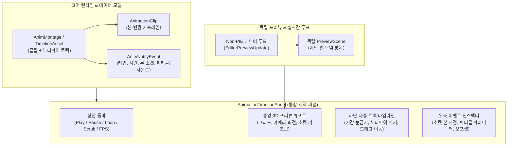
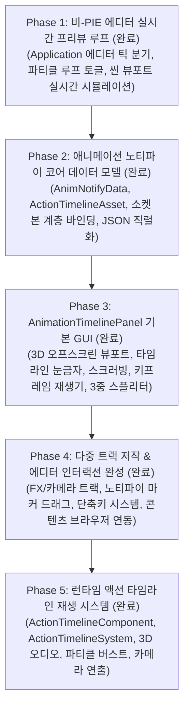

# 애니메이션·이펙트·노티파이 통합 타임라인 에디터 개발 계획 (Animation & FX Timeline Editor Plan)

- 작성일: 2026-11-03 (갱신일: 2026-11-04)
- 상태: Phase 1 ~ Phase 5 구현 완료 / 검증 완료
- 공통 기준: [EngineEditorClientGuidelines.md](EngineEditorClientGuidelines.md), [SourceOrganizationGuidelines.md](SourceOrganizationGuidelines.md)
- 연계 계획: [AnimatorGraphPlan.md](AnimatorGraphPlan.md) (Phase 5 AnimNotify 및 독립 프리뷰), [EngineDevelopmentPlan.md](EngineDevelopmentPlan.md) 4절(파티클 시스템), [DevelopmentPriorities.md](DevelopmentPriorities.md) (P3/P4)

---

## 1. 목적과 필요성

캐릭터 액션(공격, 점프, 스킬 등)과 게임플레이 비주얼을 제작할 때, 애니메이션의 특정 타격 순간에 칼날의 궤적 파티클(Slash FX), 발디딤 먼지 파티클, 타격 사운드가 프레임 단위로 정확하게 일치해야 합니다.

현재 BamEngine은:
1. **PIE 종속성:** 에디터가 정지(Non-PIE) 상태일 때는 `m_Runtime->Update`가 호출되지 않아 파티클과 애니메이션이 실시간으로 재생되거나 루프를 돌지 못합니다.
2. **이펙트-애니메이션 연동 도구 부재:** 애니메이션 클립의 특정 시간(Time/Frame)에 파티클 이펙트나 사운드를 시각적으로 배치하고, 타임라인을 마우스로 앞뒤로 긁어가며(Scrubbing) 확인할 수 있는 전용 에디터 창이 없습니다.

본 계획의 목표는 언리얼 엔진의 **Persona / Montage Editor**와 유니티의 **Animation Window**를 벤치마크하여, **비-PIE 상태에서도 실시간 시뮬레이션이 가능한 프리뷰 루프**를 구축하고, 애니메이션 타임라인 위에서 키프레임·노티파이·파티클 이펙트를 한눈에 편집할 수 있는 **통합 애니메이션 & FX 타임라인 에디터(`AnimationTimelinePanel`)**를 구축하는 것입니다.

---

## 2. 핵심 아키텍처 및 설계 원칙

### 2.1 비-PIE 실시간 프리뷰 파이프라인 (Non-PIE Realtime Preview)
- **메인 씬 격리:** 에디터에서 파티클이나 애니메이션을 루프 재생할 때, 편집 중인 메인 씬(`ActiveScene`)의 오브젝트 상태(Transform, 컴포넌트 데이터)가 변형되거나 저장되지 않은 변경사항으로 오염되면 안 됩니다.
- **`PreviewScene` 기반 독립 시뮬레이션:**
  - 에디터 전용 오프스크린 씬(`PreviewScene`)을 생성하고, 여기에 대상 모델과 파티클 이미터를 인스턴스화합니다.
  - `Application.cpp` 메인 루프에서 PIE가 꺼져 있더라도, 타임라인 패널이 열려 있거나 에디터 뷰포트의 "실시간 프리뷰(Realtime)" 토글이 켜져 있으면 `PreviewScene`에 대해 독립적인 `Update(dt)` 및 파티클/애니메이션 틱을 수행합니다.

### 2.2 노티파이 데이터 모델 (`AnimNotify`)
- **`AnimNotifyEvent` 구조체:**
  - `f32 triggerTime`: 애니메이션 클립 내 격발 시간 (초 단위 또는 0.0~1.0 정규화 비율).
  - `EAnimNotifyType type`: 
    - `Particle`: 특정 본(Bone) 소켓 위치에 파티클 이미터 스폰/활성화.
    - `Sound`: 특정 오디오 클립 재생.
    - `CustomEvent`: 비주얼 스크립팅/C++ 게임플레이 이벤트 브로드캐스트.
  - `std::string socketBoneName`: 부착할 본의 명칭 (예: `"Hand_R"`, `"Foot_L"`, 빈 문자열이면 루트 위치).
  - `vec3 localOffset`, `vec3 localRotation`: 소켓 기준 위치/회전 오프셋.
  - `ResourceHandle<Texture>` / `ResourceHandle<MaterialInterface>` 또는 파티클 프리셋 핸들.
  - `f32 duration`: 지속 시간 (0이면 1회성 버스트 스폰, 0보다 크면 해당 시간 동안 활성화 후 정지).

### 2.3 에디터 창 레이아웃 (`AnimationTimelinePanel`)
- **상단 툴바 (Control Bar):**
  - 재생(`Play`), 일시정지(`Pause`), 정지(`Stop`), 루프 토글(`Loop`).
  - 첫 프레임으로 이동(`|<`), 이전 키프레임(`<`), 다음 키프레임(`>`), 끝으로 이동(`>|`).
  - 현재 시간 및 프레임 표시 (예: `01:24 (Frame 42 / 90)`), 재생 속도 슬라이더 (`0.1x` ~ `2.0x`).
- **중앙 3D 프리뷰 뷰포트 (`PreviewViewport`):**
  - **공통 디퍼드 파이프라인(`ViewportDeferredPipeline`) 기반:** 메인 씬 뷰포트(`SceneViewportPanel`)와 동일한 G-Buffer 생성, PBR 디퍼드 라이팅, SkyAtmosphere/IBL, ACES 톤매핑 후처리를 적용하여 렌더링 퀄리티 및 룩 디벨롭먼트 일관성 유지.
  - **G-Buffer 채널 뷰 지원:** `BaseViewportPanel`의 채널 필터(Albedo, Normal, Roughness, Metallic, Depth 등)를 지원하여 캐릭터 및 머티리얼 디버깅 가능.
  - **에디터 표준 카메라(`EditorCameraController`) 적용:** 자체적인 궤도 계산 대신 표준 카메라 컨트롤러를 탑재하여 `Alt+LMB` 궤도 회전(Orbit), `Alt+MMB` 팬(Pan), `Alt+RMB`/`휠` 줌(Zoom), 우클릭+`WASD` 플라이, `F` 키 모델 중심 자동 포커싱을 완벽히 지원.
  - **독립 프리뷰 씬(`PreviewScene`):** 메인 월드 오염을 방지하기 위해 격리된 경량 `Scene`을 소유하고, 여기에 모델, 바닥 그리드, 노티파이 파티클 이미터를 배치하여 렌더링.
  - **본 소켓 기즈모 및 파티클 위치 시각화:** 캐릭터 본 계층, 부착 소켓 위치 및 파티클 발생 지점 실시간 시각화.
- **하단 다중 트랙 타임라인 (Multi-Track Timeline):**
  - **헤더 눈금자 (Time Ruler):** 프레임/초 눈금 표시 및 타임라인 스크러버(Scrubber) 드래그 바.
  - **트랙 0 (Animation Pose):** 클립 전체 길이, 키프레임 위치 마커.
  - **트랙 1 (FX Track - Particles):** 파티클 스폰 이벤트 마커 (클릭 시 우측 인스펙터에 파라미터 표시, 좌우 드래그로 발생 시점 조절).
  - **트랙 2 (Audio Track):** 효과음 재생 이벤트 마커.
  - **트랙 3 (Notify Events):** 게임플레이 타격 판정/무적 시간 등의 노티파이 마커.
- **우측 디테일 패널 (Event Inspector):**
  - 선택한 노티파이/파티클 이벤트의 상세 속성 편집.

---

## 3. 단계별 개발 로드맵

---

### Phase 1. 비-PIE 에디터 실시간 프리뷰 루프 (Editor Realtime Simulation)
- **목적:** PIE를 실행하지 않고도 에디터 편집 상태에서 파티클이 지속적으로 방출되고 루프를 돌 수 있는 기반 마련.
- **세부 내용:**
  - `ParticleEmitterComponent`에 `bPreviewInEditor` (에디터 프리뷰 활성화) 플래그 지원.
  - `Application.cpp` 메인 루프 개선:
    - PIE가 꺼져 있을 때(`!PIEManager::Get().IsPlaying()`)에도, `ParticleSystem`과 같은 시각적 프리뷰가 필요한 시스템을 안전하게 업데이트하는 `EditorUpdate(dt)` 진입점 분리.
    - 에디터 메인 뷰포트 상단에 `Realtime (Ctrl+R)` 토글 버튼 추가: 켜져 있으면 에디터 상태에서도 매 프레임 파티클이 자연스럽게 시뮬레이션됨.
- **완료 기준:** PIE 버튼을 누르지 않은 에디터 기본 상태에서 파티클 이미터가 정지해 있지 않고 실시간으로 연속 방출·소멸을 반복한다.

---

### Phase 2. 애니메이션 노티파이 및 몽타주 데이터 모델 (AnimNotify Core)
- **목적:** 애니메이션의 특정 시점에 파티클/사운드/이벤트를 결합하여 저장할 수 있는 에셋 구조 구축.
- **세부 내용:**
  - `AnimNotifyEvent` 구조체 정의 및 리플렉션 등록.
  - `AnimMontage` (또는 `AnimTimelineAsset`, 확장자 `.montage` / `.animtimeline.json`):
    - 베이스 `AnimationClip` 참조.
    - 노티파이 트랙 목록(`std::vector<AnimNotifyTrack>`).
    - 본 소켓 정의(`SocketDefinition`: 대상 본 인덱스/이름 + 오프셋 변환).
  - `AnimationEvaluator` 확장: 특정 시간 `t`를 스크러빙할 때, 직전 시간과 현재 시간 사이에 위치한 노티파이 이벤트를 검출하여 콜백/트리거 발생.
- **완료 기준:** C++ 단위 코드 또는 스크립트에서 애니메이션 재생 시 지정한 프레임(예: 0.5초)에 파티클 스폰 노티파이 콜백이 정확히 1회 호출된다.

---

### Phase 3. `AnimationTimelinePanel` GUI 토대 구축
- **목적:** 애니메이션 클립을 로드하고, 타임라인을 스크러빙하며 공통 표준 3D 뷰포트에서 캐릭터 포즈를 확인하는 전용 창 구축.
- **세부 내용:**
  - 패널 등록: [ImGuiDevelopmentPlan.md](ImGuiDevelopmentPlan.md) 규격에 따라 `Editor/Source/ImGui/TimelinePanel/`에 구축.
  - 공통 디퍼드 뷰포트 및 표준 카메라 연동:
    - [EngineEditorClientGuidelines.md](EngineEditorClientGuidelines.md) 16절 준수.
    - `ViewportDeferredPipeline` 인스턴스(`Timeline_` 접두사)를 소유하여 PBR 디퍼드 라이팅, G-Buffer 채널 분리 뷰, ACES 톤매핑 후처리 지원.
    - `EditorCameraController`를 탑재하여 `F` 키 모델 포커싱, `Alt+LMB` 궤도 회전, `Alt+MMB` 패닝 등 메인 뷰포트와 100% 동일한 조작감 제공.
  - 하단 타임라인 렌더러: ImGui 커스텀 드로우(`ImDrawList`) 기반의 눈금자, 초/프레임 텍스트, 시간 커서(오렌지-레드 스크러빙 라인).
  - 마우스 스크러빙: 타임라인을 드래그하면 즉각 캐릭터의 포즈가 해당 프레임으로 갱신됨.
- **완료 기준:** 패널에서 애니메이션 클립을 선택하면 디퍼드 3D 뷰포트에 PBR 조명을 받는 캐릭터가 나타나고, `F` 키로 포커스되며 타임라인을 마우스로 드래그하는 속도에 맞춰 캐릭터 모션이 전/후진한다.

---

### Phase 4. 다중 트랙 저작 & 에디터 인터랙션 완성 - [완료]
- **목적:** 타임라인 위에서 파티클 이펙트와 사운드를 자유롭게 배치하고, 키보드 단축키 및 콘텐츠 브라우저 연동 완성.
- **세부 내용:**
  - 트랙 UI: 우클릭 컨텍스트 메뉴로 `Add FX Track`, `Add Audio Track`, `Add Camera Shot Track` 지원.
  - 노티파이 마커 및 카메라 샷 블록 드래그 앤 이동:
    - 그랩 시간 오프셋(`m_DragTimeOffset`) 보존으로 마우스 클릭 시 커서 점프 방지.
    - 트랙 캔버스 영역에 `ImGui::InvisibleButton` 배치 및 `NoMove` 동적 플래그로 마커 드래그 시 패널 창 전체가 끌려다니는 버그 원천 해결.
  - `ShortcutManager` 중앙 단축키 등록 (`Timeline.PlayPause`, `Timeline.PrevFrame`, `Timeline.NextFrame`, `Timeline.FirstFrame`, `Timeline.LastFrame`, `Timeline.ToggleLoop`, `Timeline.ZoomReset`, `Timeline.DeleteSelected`).
  - `ResourceEditorInterface` 상속 및 구현: 콘텐츠 브라우저에서 `.actiontimeline.json` 파일 더블 클릭 시 자동 열기 및 로드.
  - 씬 선택 엔티티 동기화 (`SyncFromSelectedEntity`): 씬에서 선택한 캐릭터 엔티티의 모델과 타임라인 에셋을 툴바 버튼으로 즉시 연동.
- **완료 검증:** 에디터에서 타임라인 마커를 자유롭게 이동·삭제하고, 콘텐츠 브라우저 더블클릭 및 씬 동기화 정상 작동 확인.

---

### Phase 5. 런타임 액션 타임라인 재생 시스템 (Action Timeline Runtime System) - [완료]
- **목적:** 에디터에서 저작한 `.actiontimeline.json` 에셋을 인게임(PIE 또는 런타임) 게임플레이 엔티티에서 실시간 재생.
- **세부 내용:**
  - `ActionTimelineComponent`: 엔티티 부착용 ECS 컴포넌트 (`timelinePath`, `playRate`, `isLooping`, `isPlaying`, `currentTime`, 콜백 델리게이트).
  - `ActionTimelineSystem`: 매 프레임 `dt`에 따라 타임라인 진행 및 인게임 연동.
    - `AnimatorComponent` 클립 및 재생 시간 강제 동기화.
    - 본 소켓 기반 3D 월드 좌표 산출 (`ComputeSocketWorldPos`).
    - `prevTime` ~ `currentTime` 구간 내 노티파이 누락 없는 검출 및 3D 사운드(`AudioManager`), 파티클 버스트(`ParticleEmitterComponent`) 트리거.
    - 카메라 샷 연출: 메인 카메라(`CameraComponent`)의 목표 FOV 스무스 줌인, `ShakeIntensity` 화면 흔들림 오프셋 적용, 샷 종료 후 원래 FOV로 자연스러운 복원.
  - `Systems.h`, `Application.cpp`, `Client/Main.cpp`에 런타임 시스템 등록 완료.
  - 로캘 원본 CSV(`Engine.csv`, `Editor.csv`) 및 JSON 번역 파일 완벽 동기화.
- **완료 검증:** 인게임 엔티티에서 타임라인 재생 시 지정된 프레임에 정확히 사운드가 출력되고 본 소켓 위치에서 파티클이 발생하며, 카메라 샷 연출이 종료 후 원래 화각으로 깔끔히 복원됨.

---

## 4. 완료 현황 요약

1. **파티클 시스템 기초 (P3, 완료):** 단일 CPU 이미터, 빌보드 렌더러, 파티클 수명/적분 코어 완료.
2. **Phase 1 ~ Phase 4 (에디터 통합 저작 도구, 완료):** 비-PIE 실시간 프리뷰 루프, 다중 트랙 GUI, 스플리터, 마커 드래그, 단축키, 에셋 브라우저 연동 완료.
3. **Phase 5 (인게임 런타임 재생 시스템, 완료):** 액션 타임라인 컴포넌트, 런타임 시스템, 소켓 파티클, 3D 사운드, 카메라 샷 줌인/복원/셰이크 완료.

## 5. 이펙트 편집기와 공통 UI (2026-11-09)

시간 좌표, 확대·이동, 눈금자, 재생 헤드와 재생 툴바를 `EffectTimelineView`로 옮겨 Particle 및 Composite Effect와 공유한다. ActionTimeline의 노티파이 마커·카메라 샷 편집과 에셋 재생은 기존 패널이 담당한다. 사용자 검증에는 세 창에서 휠·패닝·재생 헤드 위치, 확대 상태에서 포인터 시간 유지, 매우 좁은 폭의 헤더 경계, ActionTimeline의 마커/샷 이동과 기존 파일 재열기를 포함한다.
