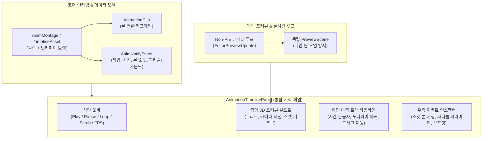
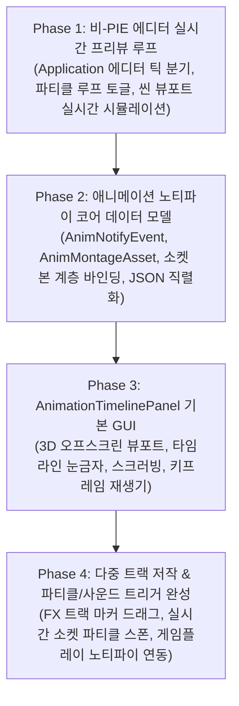

# 애니메이션·이펙트·노티파이 통합 타임라인 에디터 개발 계획 (Animation & FX Timeline Editor Plan)

- 작성일: 2026-11-03
- 상태: 계획 수립 / 개발 대기
- 공통 기준: [EngineEditorClientGuidelines.md](EngineEditorClientGuidelines.md), [SourceOrganizationGuidelines.md](SourceOrganizationGuidelines.md)
- 연계 계획: [AnimatorGraphPlan.md](AnimatorGraphPlan.md) (Phase 5 AnimNotify 및 독립 프리뷰), [EngineDevelopmentPlan.md](EngineDevelopmentPlan.md) 4절(파티클 시스템), [DevelopmentPriorities.md](DevelopmentPriorities.md) (P3/P4)

---

## 1. 목적과 필요성

캐릭터 액션(공격, 점프, 스킬 등)과 게임플레이 비주얼을 제작할 때, 애니메이션의 특정 타격 순간에 칼날의 궤적 파티클(Slash FX), 발디딤 먼지 파티클, 타격 사운드가 프레임 단위로 정확하게 일치해야 합니다.

현재 BamEngine은:
1. **PIE 종속성:** 에디터가 정지(Non-PIE) 상태일 때는 `m_Runtime->Update`가 호출되지 않아 파티클과 애니메이션이 실시간으로 재생되거나 루프를 돌지 못합니다.
2. **이펙트-애니메이션 연동 도구 부재:** 애니메이션 클립의 특정 시간(Time/Frame)에 파티클 이펙트나 사운드를 시각적으로 배치하고, 타임라인을 마우스로 앞뒤로 긁어가며(Scrubbing) 확인할 수 있는 전용 에디터 창이 없습니다.

본 계획의 목표는 언리얼 엔진의 **Persona / Montage Editor**와 유니티의 **Animation Window**를 벤치마크하여, **비-PIE 상태에서도 실시간 시뮬레이션이 가능한 프리뷰 루프**를 구축하고, 애니메이션 타임라인 위에서 키프레임·노티파이·파티클 이펙트를 한눈에 편집할 수 있는 **통합 애니메이션 & FX 타임라인 에디터(`AnimationTimelinePanel`)**를 구축하는 것입니다.

---

## 2. 핵심 아키텍처 및 설계 원칙

### 2.1 비-PIE 실시간 프리뷰 파이프라인 (Non-PIE Realtime Preview)
- **메인 씬 격리:** 에디터에서 파티클이나 애니메이션을 루프 재생할 때, 편집 중인 메인 씬(`ActiveScene`)의 오브젝트 상태(Transform, 컴포넌트 데이터)가 변형되거나 저장되지 않은 변경사항으로 오염되면 안 됩니다.
- **`PreviewScene` 기반 독립 시뮬레이션:**
  - 에디터 전용 오프스크린 씬(`PreviewScene`)을 생성하고, 여기에 대상 모델과 파티클 이미터를 인스턴스화합니다.
  - `Application.cpp` 메인 루프에서 PIE가 꺼져 있더라도, 타임라인 패널이 열려 있거나 에디터 뷰포트의 "실시간 프리뷰(Realtime)" 토글이 켜져 있으면 `PreviewScene`에 대해 독립적인 `Update(dt)` 및 파티클/애니메이션 틱을 수행합니다.

### 2.2 노티파이 데이터 모델 (`AnimNotify`)
- **`AnimNotifyEvent` 구조체:**
  - `f32 triggerTime`: 애니메이션 클립 내 격발 시간 (초 단위 또는 0.0~1.0 정규화 비율).
  - `EAnimNotifyType type`: 
    - `Particle`: 특정 본(Bone) 소켓 위치에 파티클 이미터 스폰/활성화.
    - `Sound`: 특정 오디오 클립 재생.
    - `CustomEvent`: 비주얼 스크립팅/C++ 게임플레이 이벤트 브로드캐스트.
  - `std::string socketBoneName`: 부착할 본의 명칭 (예: `"Hand_R"`, `"Foot_L"`, 빈 문자열이면 루트 위치).
  - `vec3 localOffset`, `vec3 localRotation`: 소켓 기준 위치/회전 오프셋.
  - `ResourceHandle<Texture>` / `ResourceHandle<MaterialInterface>` 또는 파티클 프리셋 핸들.
  - `f32 duration`: 지속 시간 (0이면 1회성 버스트 스폰, 0보다 크면 해당 시간 동안 활성화 후 정지).

### 2.3 에디터 창 레이아웃 (`AnimationTimelinePanel`)
- **상단 툴바 (Control Bar):**
  - 재생(`Play`), 일시정지(`Pause`), 정지(`Stop`), 루프 토글(`Loop`).
  - 첫 프레임으로 이동(`|<`), 이전 키프레임(`<`), 다음 키프레임(`>`), 끝으로 이동(`>|`).
  - 현재 시간 및 프레임 표시 (예: `01:24 (Frame 42 / 90)`), 재생 속도 슬라이더 (`0.1x` ~ `2.0x`).
- **중앙 3D 프리뷰 뷰포트 (`PreviewViewport`):**
  - [ThumbnailRenderer](file:///i:/BamtoliyaGithub/BamEngine/Editor/Source/Rendering/Thumbnail/Private/ThumbnailRenderer.cpp) 및 [MaterialPreviewRenderer](file:///i:/BamtoliyaGithub/BamEngine/Editor/Source/ImGui/ResourceEditor/Private/MaterialPreviewRenderer.cpp)의 오프스크린 파이프라인(`ViewportDeferredPipeline`)을 활용.
  - 바닥 격자 그리드, 마우스 드래그 궤도 회전(Orbit)/팬(Pan)/줌(Zoom), 라이팅 지원.
  - 본 소켓 시즈모 및 파티클 부착 위치 실시간 시각화.
- **하단 다중 트랙 타임라인 (Multi-Track Timeline):**
  - **헤더 눈금자 (Time Ruler):** 프레임/초 눈금 표시 및 타임라인 스크러버(Scrubber) 드래그 바.
  - **트랙 0 (Animation Pose):** 클립 전체 길이, 키프레임 위치 마커.
  - **트랙 1 (FX Track - Particles):** 파티클 스폰 이벤트 마커 (클릭 시 우측 인스펙터에 파라미터 표시, 좌우 드래그로 발생 시점 조절).
  - **트랙 2 (Audio Track):** 효과음 재생 이벤트 마커.
  - **트랙 3 (Notify Events):** 게임플레이 타격 판정/무적 시간 등의 노티파이 마커.
- **우측 디테일 패널 (Event Inspector):**
  - 선택한 노티파이/파티클 이벤트의 상세 속성 편집.

---

## 3. 단계별 개발 로드맵

---

### Phase 1. 비-PIE 에디터 실시간 프리뷰 루프 (Editor Realtime Simulation)
- **목적:** PIE를 실행하지 않고도 에디터 편집 상태에서 파티클이 지속적으로 방출되고 루프를 돌 수 있는 기반 마련.
- **세부 내용:**
  - `ParticleEmitterComponent`에 `bPreviewInEditor` (에디터 프리뷰 활성화) 플래그 지원.
  - `Application.cpp` 메인 루프 개선:
    - PIE가 꺼져 있을 때(`!PIEManager::Get().IsPlaying()`)에도, `ParticleSystem`과 같은 시각적 프리뷰가 필요한 시스템을 안전하게 업데이트하는 `EditorUpdate(dt)` 진입점 분리.
    - 에디터 메인 뷰포트 상단에 `Realtime (Ctrl+R)` 토글 버튼 추가: 켜져 있으면 에디터 상태에서도 매 프레임 파티클이 자연스럽게 시뮬레이션됨.
- **완료 기준:** PIE 버튼을 누르지 않은 에디터 기본 상태에서 파티클 이미터가 정지해 있지 않고 실시간으로 연속 방출·소멸을 반복한다.

---

### Phase 2. 애니메이션 노티파이 및 몽타주 데이터 모델 (AnimNotify Core)
- **목적:** 애니메이션의 특정 시점에 파티클/사운드/이벤트를 결합하여 저장할 수 있는 에셋 구조 구축.
- **세부 내용:**
  - `AnimNotifyEvent` 구조체 정의 및 리플렉션 등록.
  - `AnimMontage` (또는 `AnimTimelineAsset`, 확장자 `.montage` / `.animtimeline.json`):
    - 베이스 `AnimationClip` 참조.
    - 노티파이 트랙 목록(`std::vector<AnimNotifyTrack>`).
    - 본 소켓 정의(`SocketDefinition`: 대상 본 인덱스/이름 + 오프셋 변환).
  - `AnimationEvaluator` 확장: 특정 시간 `t`를 스크러빙할 때, 직전 시간과 현재 시간 사이에 위치한 노티파이 이벤트를 검출하여 콜백/트리거 발생.
- **완료 기준:** C++ 단위 코드 또는 스크립트에서 애니메이션 재생 시 지정한 프레임(예: 0.5초)에 파티클 스폰 노티파이 콜백이 정확히 1회 호출된다.

---

### Phase 3. `AnimationTimelinePanel` GUI 토대 구축
- **목적:** 애니메이션 클립을 로드하고, 타임라인을 스크러빙하며 독립 3D 뷰포트에서 캐릭터 포즈를 확인하는 전용 창 구축.
- **세부 내용:**
  - 패널 등록: [ImGuiDevelopmentPlan.md](ImGuiDevelopmentPlan.md) 규격에 따라 `Editor/Source/ImGui/TimelinePanel/`에 구축.
  - 독립 오프스크린 렌더링: `ThumbnailRenderer`의 설계를 계승하여 `PreviewScene`과 `CameraBuffer`, 그리드 바닥을 렌더링.
  - 하단 타임라인 렌더러: ImGui 커스텀 드로우(`ImDrawList`) 기반의 눈금자, 초/프레임 텍스트, 시간 커서(붉은색 스크러빙 라인).
  - 마우스 스크러빙: 타임라인을 드래그하면 즉각 캐릭터의 포즈가 해당 프레임으로 갱신됨.
- **완료 기준:** 패널에서 애니메이션 클립을 선택하면 3D 뷰포트에 캐릭터가 나타나고, 타임라인을 마우스로 드래그하는 속도에 맞춰 캐릭터 모션이 전/후진한다.

---

### Phase 4. 다중 트랙(FX/Sound/Notify) 저작 및 실시간 프리뷰 완성
- **목적:** 타임라인 위에서 파티클 이펙트와 사운드를 자유롭게 배치하고, 재생 시 소켓 본에서 파티클이 터져 나오는 최종 통합 환경 완성.
- **세부 내용:**
  - 트랙 UI: 우클릭 컨텍스트 메뉴로 `Add FX Track`, `Add Notify Marker` 제공.
  - 이벤트 마커 상호작용: 마커 클릭 선택, 좌우 드래그로 시간 변경, Delete 키로 삭제.
  - 소켓 본 바인딩: 선택한 노티파이의 소켓 본(예: `"RightHand"`) 위치에 파티클 이미터가 런타임에 동적으로 생성 및 부착(`HierarchyComponent` 또는 월드 변환 동기화).
  - 파일 저장/불러오기: `ReflectionArchive` 기반 원자적 저장 및 에셋 브라우저 연동.
- **완료 기준:** 캐릭터가 검을 휘두르는 30번째 프레임에 검기 파티클 마커를 배치하고 Play를 누르면, 검을 휘두르는 순간 손에 부착된 검기 파티클이 화려하게 방출되는 모습을 에디터 창에서 실시간으로 확인할 수 있다.

---

## 4. 선행 조건 및 개발 순서 연계

1. **파티클 시스템 기초 (P3, 완료):** 단일 CPU 이미터, 빌보드 렌더러, 파티클 수명/적분 코어 완료.
2. **Phase 1 (비-PIE 실시간 프리뷰):** 가장 적은 수정으로 즉시 체감할 수 있는 1단계 작업으로 우선 착수.
3. **Phase 2 ~ 4 (몽타주/노티파이 타임라인 에디터):** [AnimatorGraphPlan.md](AnimatorGraphPlan.md) Phase 5와 연계하여 단계적으로 진행.
