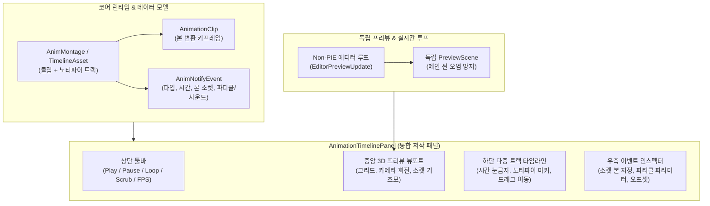
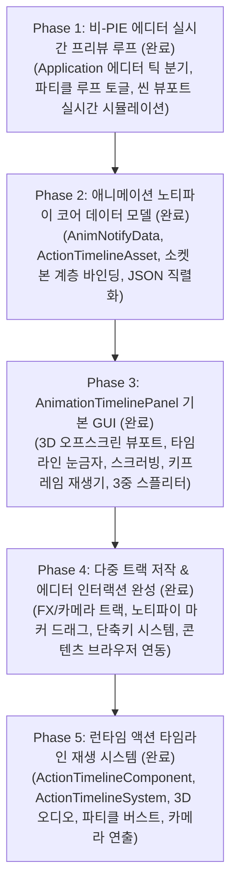

# 애니메이션·이펙트·노티파이 통합 타임라인 에디터 개발 계획 (Animation & FX Timeline Editor Plan)

- 작성일: 2026-11-03 (갱신일: 2026-11-19)
- 상태: Phase 1~5 기본 기능 구현. 확인한 동작과 미검증 항목은 8.5~11절에 기록한다. 편집 씬 격리, Animator 복원, 프리뷰 발동 규칙과 독립 Client 통합 검증은 [파이프라인 개선 계획](AnimationPipelineIntegrationPlan.md)을 따른다.
- 공통 기준: [EngineEditorClientGuidelines.md](EngineEditorClientGuidelines.md), [SourceOrganizationGuidelines.md](SourceOrganizationGuidelines.md)
- 연계 계획: [AnimatorGraphPlan.md](AnimatorGraphPlan.md) (Phase 5 AnimNotify 및 독립 프리뷰), [EngineDevelopmentPlan.md](EngineDevelopmentPlan.md) 4절(파티클 시스템), [DevelopmentPriorities.md](DevelopmentPriorities.md) (P3/P4)

---

## 1. 목적과 필요성

캐릭터 액션(공격, 점프, 스킬 등)과 게임플레이 비주얼을 제작할 때, 애니메이션의 특정 타격 순간에 칼날의 궤적 파티클(Slash FX), 발디딤 먼지 파티클, 타격 사운드가 프레임 단위로 정확하게 일치해야 합니다.

현재 BamEngine은:
1. **PIE 종속성:** 에디터가 정지(Non-PIE) 상태일 때는 `m_Runtime->Update`가 호출되지 않아 파티클과 애니메이션이 실시간으로 재생되거나 루프를 돌지 못합니다.
2. **이펙트-애니메이션 연동 도구 부재:** 애니메이션 클립의 특정 시간(Time/Frame)에 파티클 이펙트나 사운드를 시각적으로 배치하고, 타임라인을 마우스로 앞뒤로 긁어가며(Scrubbing) 확인할 수 있는 전용 에디터 창이 없습니다.

본 계획의 목표는 언리얼 엔진의 **Persona / Montage Editor**와 유니티의 **Animation Window**를 벤치마크하여, **비-PIE 상태에서도 실시간 시뮬레이션이 가능한 프리뷰 루프**를 구축하고, 애니메이션 타임라인 위에서 키프레임·노티파이·파티클 이펙트를 한눈에 편집할 수 있는 **통합 애니메이션 & FX 타임라인 에디터(`AnimationTimelinePanel`)**를 구축하는 것입니다.

---

## 2. 핵심 아키텍처 및 설계 원칙

### 2.1 비-PIE 실시간 프리뷰 파이프라인 (Non-PIE Realtime Preview)
- **메인 씬 격리:** 에디터에서 파티클이나 애니메이션을 루프 재생할 때, 편집 중인 메인 씬(`ActiveScene`)의 오브젝트 상태(Transform, 컴포넌트 데이터)가 변형되거나 저장되지 않은 변경사항으로 오염되면 안 됩니다.
- **`PreviewScene` 기반 독립 시뮬레이션:**
  - 에디터 전용 오프스크린 씬(`PreviewScene`)을 생성하고, 여기에 대상 모델과 파티클 이미터를 인스턴스화합니다.
  - `Application.cpp` 메인 루프에서 PIE가 꺼져 있더라도, 타임라인 패널이 열려 있거나 에디터 뷰포트의 "실시간 프리뷰(Realtime)" 토글이 켜져 있으면 `PreviewScene`에 대해 독립적인 `Update(dt)` 및 파티클/애니메이션 틱을 수행합니다.

### 2.2 노티파이 데이터 모델 (`AnimNotify`)
- **`AnimNotifyEvent` 구조체:**
  - `f32 triggerTime`: 애니메이션 클립 내 격발 시간 (초 단위 또는 0.0~1.0 정규화 비율).
  - `EAnimNotifyType type`: 
    - `Particle`: 특정 본(Bone) 소켓 위치에 파티클 이미터 스폰/활성화.
    - `Sound`: 특정 오디오 클립 재생.
    - `CustomEvent`: 비주얼 스크립팅/C++ 게임플레이 이벤트 브로드캐스트.
  - `std::string socketBoneName`: 부착할 본의 명칭 (예: `"Hand_R"`, `"Foot_L"`, 빈 문자열이면 루트 위치).
  - `vec3 localOffset`, `vec3 localRotation`: 소켓 기준 위치/회전 오프셋.
  - `ResourceHandle<Texture>` / `ResourceHandle<MaterialInterface>` 또는 파티클 프리셋 핸들.
  - `f32 duration`: 지속 시간 (0이면 1회성 버스트 스폰, 0보다 크면 해당 시간 동안 활성화 후 정지).

### 2.3 에디터 창 레이아웃 (`AnimationTimelinePanel`)
- **상단 툴바 (Control Bar):**
  - 재생(`Play`), 일시정지(`Pause`), 정지(`Stop`), 루프 토글(`Loop`).
  - 첫 프레임으로 이동(`|<`), 이전 키프레임(`<`), 다음 키프레임(`>`), 끝으로 이동(`>|`).
  - 현재 시간 및 프레임 표시 (예: `01:24 (Frame 42 / 90)`), 재생 속도 슬라이더 (`0.1x` ~ `2.0x`).
- **중앙 3D 프리뷰 뷰포트 (`PreviewViewport`):**
  - **공통 디퍼드 파이프라인(`ViewportDeferredPipeline`) 기반:** 메인 씬 뷰포트(`SceneViewportPanel`)와 동일한 G-Buffer 생성, PBR 디퍼드 라이팅, SkyAtmosphere/IBL, ACES 톤매핑 후처리를 적용하여 렌더링 퀄리티 및 룩 디벨롭먼트 일관성 유지.
  - **G-Buffer 채널 뷰 지원:** `BaseViewportPanel`의 채널 필터(Albedo, Normal, Roughness, Metallic, Depth 등)를 지원하여 캐릭터 및 머티리얼 디버깅 가능.
  - **에디터 표준 카메라(`EditorCameraController`) 적용:** 자체적인 궤도 계산 대신 표준 카메라 컨트롤러를 탑재하여 `Alt+LMB` 궤도 회전(Orbit), `Alt+MMB` 팬(Pan), `Alt+RMB`/`휠` 줌(Zoom), 우클릭+`WASD` 플라이, `F` 키 모델 중심 자동 포커싱을 완벽히 지원.
  - **독립 프리뷰 씬(`PreviewScene`):** 메인 월드 오염을 방지하기 위해 격리된 경량 `Scene`을 소유하고, 여기에 모델, 바닥 그리드, 노티파이 파티클 이미터를 배치하여 렌더링.
  - **본 소켓 기즈모 및 파티클 위치 시각화:** 캐릭터 본 계층, 부착 소켓 위치 및 파티클 발생 지점 실시간 시각화.
- **하단 다중 트랙 타임라인 (Multi-Track Timeline):**
  - **헤더 눈금자 (Time Ruler):** 프레임/초 눈금 표시 및 타임라인 스크러버(Scrubber) 드래그 바.
  - **트랙 0 (Animation Pose):** 클립 전체 길이, 키프레임 위치 마커.
  - **트랙 1 (FX Track - Particles):** 파티클 스폰 이벤트 마커 (클릭 시 우측 인스펙터에 파라미터 표시, 좌우 드래그로 발생 시점 조절).
  - **트랙 2 (Audio Track):** 효과음 재생 이벤트 마커.
  - **트랙 3 (Notify Events):** 게임플레이 타격 판정/무적 시간 등의 노티파이 마커.
- **우측 디테일 패널 (Event Inspector):**
  - 선택한 노티파이/파티클 이벤트의 상세 속성 편집.

---

## 3. 단계별 개발 로드맵

---

### Phase 1. 비-PIE 에디터 실시간 프리뷰 루프 (Editor Realtime Simulation)
- **목적:** PIE를 실행하지 않고도 에디터 편집 상태에서 파티클이 지속적으로 방출되고 루프를 돌 수 있는 기반 마련.
- **세부 내용:**
  - `ParticleEmitterComponent`에 `bPreviewInEditor` (에디터 프리뷰 활성화) 플래그 지원.
  - `Application.cpp` 메인 루프 개선:
    - PIE가 꺼져 있을 때(`!PIEManager::Get().IsPlaying()`)에도, `ParticleSystem`과 같은 시각적 프리뷰가 필요한 시스템을 안전하게 업데이트하는 `EditorUpdate(dt)` 진입점 분리.
    - 에디터 메인 뷰포트 상단에 `Realtime (Ctrl+R)` 토글 버튼 추가: 켜져 있으면 에디터 상태에서도 매 프레임 파티클이 자연스럽게 시뮬레이션됨.
- **완료 기준:** PIE 버튼을 누르지 않은 에디터 기본 상태에서 파티클 이미터가 정지해 있지 않고 실시간으로 연속 방출·소멸을 반복한다.

---

### Phase 2. 애니메이션 노티파이 및 몽타주 데이터 모델 (AnimNotify Core)
- **목적:** 애니메이션의 특정 시점에 파티클/사운드/이벤트를 결합하여 저장할 수 있는 에셋 구조 구축.
- **세부 내용:**
  - `AnimNotifyEvent` 구조체 정의 및 리플렉션 등록.
  - `AnimMontage` (또는 `AnimTimelineAsset`, 확장자 `.montage` / `.animtimeline.json`):
    - 베이스 `AnimationClip` 참조.
    - 노티파이 트랙 목록(`std::vector<AnimNotifyTrack>`).
    - 본 소켓 정의(`SocketDefinition`: 대상 본 인덱스/이름 + 오프셋 변환).
  - `AnimationEvaluator` 확장: 특정 시간 `t`를 스크러빙할 때, 직전 시간과 현재 시간 사이에 위치한 노티파이 이벤트를 검출하여 콜백/트리거 발생.
- **완료 기준:** C++ 단위 코드 또는 스크립트에서 애니메이션 재생 시 지정한 프레임(예: 0.5초)에 파티클 스폰 노티파이 콜백이 정확히 1회 호출된다.

---

### Phase 3. `AnimationTimelinePanel` GUI 토대 구축
- **목적:** 애니메이션 클립을 로드하고, 타임라인을 스크러빙하며 공통 표준 3D 뷰포트에서 캐릭터 포즈를 확인하는 전용 창 구축.
- **세부 내용:**
  - 패널 등록: [ImGuiDevelopmentPlan.md](ImGuiDevelopmentPlan.md) 규격에 따라 `Editor/Source/ImGui/TimelinePanel/`에 구축.
  - 공통 디퍼드 뷰포트 및 표준 카메라 연동:
    - [EngineEditorClientGuidelines.md](EngineEditorClientGuidelines.md) 16절 준수.
    - `ViewportDeferredPipeline` 인스턴스(`Timeline_` 접두사)를 소유하여 PBR 디퍼드 라이팅, G-Buffer 채널 분리 뷰, ACES 톤매핑 후처리 지원.
    - `EditorCameraController`를 탑재하여 `F` 키 모델 포커싱, `Alt+LMB` 궤도 회전, `Alt+MMB` 패닝 등 메인 뷰포트와 100% 동일한 조작감 제공.
  - 하단 타임라인 렌더러: ImGui 커스텀 드로우(`ImDrawList`) 기반의 눈금자, 초/프레임 텍스트, 시간 커서(오렌지-레드 스크러빙 라인).
  - 마우스 스크러빙: 타임라인을 드래그하면 즉각 캐릭터의 포즈가 해당 프레임으로 갱신됨.
- **완료 기준:** 패널에서 애니메이션 클립을 선택하면 디퍼드 3D 뷰포트에 PBR 조명을 받는 캐릭터가 나타나고, `F` 키로 포커스되며 타임라인을 마우스로 드래그하는 속도에 맞춰 캐릭터 모션이 전/후진한다.

---

### Phase 4. 다중 트랙 저작 & 에디터 인터랙션 완성 - [완료]
- **목적:** 타임라인 위에서 파티클 이펙트와 사운드를 자유롭게 배치하고, 키보드 단축키 및 콘텐츠 브라우저 연동 완성.
- **세부 내용:**
  - 트랙 UI: 우클릭 컨텍스트 메뉴로 `Add FX Track`, `Add Audio Track`, `Add Camera Shot Track` 지원.
  - 노티파이 마커 및 카메라 샷 블록 드래그 앤 이동:
    - 그랩 시간 오프셋(`m_DragTimeOffset`) 보존으로 마우스 클릭 시 커서 점프 방지.
    - 트랙 캔버스 영역에 `ImGui::InvisibleButton` 배치 및 `NoMove` 동적 플래그로 마커 드래그 시 패널 창 전체가 끌려다니는 버그 원천 해결.
  - `ShortcutManager` 중앙 단축키 등록 (`Timeline.PlayPause`, `Timeline.PrevFrame`, `Timeline.NextFrame`, `Timeline.FirstFrame`, `Timeline.LastFrame`, `Timeline.ToggleLoop`, `Timeline.ZoomReset`, `Timeline.DeleteSelected`).
  - `ResourceEditorInterface` 상속 및 구현: 콘텐츠 브라우저에서 `.actiontimeline.json` 파일 더블 클릭 시 자동 열기 및 로드.
  - 씬 선택 엔티티 동기화 (`SyncFromSelectedEntity`): 씬에서 선택한 캐릭터 엔티티의 모델과 타임라인 에셋을 툴바 버튼으로 즉시 연동.
- **완료 검증:** 에디터에서 타임라인 마커를 자유롭게 이동·삭제하고, 콘텐츠 브라우저 더블클릭 및 씬 동기화 정상 작동 확인.

---

### Phase 5. 런타임 액션 타임라인 재생 시스템 (기본 구현)

- `ActionTimelineComponent`가 에셋 경로와 재생 상태를 관리한다. `ActionTimelineSystem`은 재생 시간을 진행하고 작성 클립이 있을 때 Animator 포즈를 구동한다. Editor와 Client가 이 시스템을 등록한다. [시스템 구현](../Engine/Source/Animation/Timeline/Private/ActionTimelineSystem.cpp) · [Client 등록](../Client/Source/Execution/Private/ClientGameRuntime.cpp)
- 런타임은 사운드 `PlayOneShot`, 본 소켓 기반 Composite VFX 생성, Gameplay의 `CustomEvent` 발행을 처리한다. 직접 `Particle` Notify는 좌표 계산까지 구현돼 있다. 카메라 샷의 기본 동작은 목표 FOV 보간까지이며, 본 포커스·셰이크·종료 시 FOV 복원은 후속이다.
- 8.5절은 PIE의 이벤트 수신과 모듈 핫리로드 검증 결과를 기록한다. 편집 씬 격리, 패널과 런타임의 발동 일치, 참조 검증과 Client 실행의 완료 기준은 [파이프라인 개선 계획](AnimationPipelineIntegrationPlan.md)에 둔다.

---

## 4. 완료 현황 요약

1. **파티클 시스템 기초 (P3, 완료):** 단일 CPU 이미터, 빌보드 렌더러, 파티클 수명/적분 코어 완료.
2. **Phase 1 ~ Phase 4 (에디터 통합 저작 도구, 완료):** 비-PIE 실시간 프리뷰 루프, 다중 트랙 GUI, 스플리터, 마커 드래그, 단축키, 에셋 브라우저 연동 완료.
3. **Phase 5 (인게임 런타임 재생 시스템, 기본 구현):** 액션 클립 구동, 소켓 Composite VFX, 사운드, C++ 이벤트 발행과 카메라 FOV 보간을 연결했다. 기존 확인 범위와 후속 검증은 Phase 5 및 8.5~11절에 기록한다.

## 5. 이펙트 편집기와 공통 UI (2026-11-09)

시간 좌표, 확대·이동, 눈금자, 재생 헤드와 재생 툴바를 `EffectTimelineView`로 옮겨 Particle 및 Composite Effect와 공유한다. ActionTimeline의 노티파이 마커·카메라 샷 편집과 에셋 재생은 기존 패널이 담당한다. 사용자 검증에는 세 창에서 휠·패닝·재생 헤드 위치, 확대 상태에서 포인터 시간 유지, 매우 좁은 폭의 헤더 경계, ActionTimeline의 마커/샷 이동과 기존 파일 재열기를 포함한다.

## 6. 타임라인 시각 규격 통일과 고정 머리 (2026-11-17)

애니메이션 타임라인과 이펙트(통합 VFX·파티클) 타임라인이 같은 규격으로 보이고 같은 규칙으로 조작되도록 공통 기능을 정리했다.

- **공통 모듈 분리:** 시간 축·눈금자·재생 헤드·줌/이동, 트랙 행 시각 규격(배경·그리드·이름 칸·막대·마커), 트랙 머리 칸(`DrawTimelineCorner`), 휠 규칙(`SplitTimelineWheel`), 재생 버튼(`DrawTimelineAction`/`DrawTimelineTransport`)을 `TimelineView.h/.cpp`로 옮겼다. `EffectTimelineView`에는 이펙트 전용 위젯과 편집기 배치만 남긴다.
- **트랙 이름 칸:** 트랙마다 종류 아이콘 하나를 고정 폭 칸 가운데에 두어 모든 행의 이름 시작 위치를 맞췄다. 이름 색은 보통·선택·비활성(음소거·꺼짐) 3단계이며, 노티파이 음소거와 카메라 샷 활성 전환은 행 우클릭 메뉴에서 한다.
- **고정 머리:** 두 타임라인 모두 눈금자와 "트랙" 칸은 바깥 창에 고정하고 트랙 행만 아래 자식 창에서 세로로 스크롤한다. 행은 자식 창이 열려 있는 동안 그려야 그 창의 잘라내기 영역이 적용된다(닫은 뒤 그리면 행이 눈금자를 덮는다).
- **이름 칸 폭 스플리터:** `Editor::SplitterHandle`(자식 창 위에서도 판정, 겹침 비허용)을 눈금자와 행 영역에 걸쳐 먼저 제출하고, `DrawVerticalSplitterLine`으로 창마다 막대를 그린다.
- **입력 규칙:** 막대 칸 휠은 줌, Shift+휠은 좌우 이동, 이름 칸 휠과 Alt+휠은 행 세로 스크롤이다. 트랙 머리 칸의 `+` 버튼으로 트랙 추가 메뉴를 열 수 있어 빈 공간이 없을 때도 트랙을 추가할 수 있다(파티클 편집기는 버튼 없음).
- **재생 바:** 애니메이션 재생 버튼은 등록된 `Timeline.*` 단축키 액션을 실행해, 툴팁 로캘·단축키 힌트·루프 활성 표시가 이펙트 편집기와 같다.
- **남은 한계:** 패널 폭이 매우 좁으면 상단 세 영역의 최소 폭 때문에 가로로 넘칠 수 있다. 이름 칸 폭 조절은 ESC로 취소되지 않는다.

## 7. 콘텐츠 브라우저에서 타임라인과 의존 에셋 이동

- 지원 형식은 프로젝트의 JSON 타임라인(`.bamtimeline.json`, `.actiontimeline.json`, `.actiontimeline`)이다. 씬·프리팹 JSON의 명시적 `ActionTimelineComponent.timelinePath`와 타임라인의 모델·노티파이 사운드·VFX 경로를 참조 검사, 빌드 씬 의존성 수집, 이동 및 이름 변경에 연결한다. 노티파이 이름이나 이벤트 태그에 적힌 경로 문자열은 참조로 취급하지 않는다.
- 파일·저장 참조가 함께 갱신되면 로드된 타임라인과 편집기의 내부 경로, 씬 컴포넌트의 설정/로드 경로와 씬 편집 스냅샷을 갱신한다. 현재 로드된 객체와 핸들 및 재생 상태를 유지한다. 콘텐츠 브라우저 Undo/Redo에도 같은 순서를 사용한다.
- 바이너리 타임라인 내부와 프로젝트 밖 문서를 재작성하는 기능은 후속이다. 그런 타임라인을 로드한 상태에서 내부 의존 경로가 영향받으면 이동을 거부한다. 저장되지 않은 편집과 기존 대상 충돌도 보호한다.
- 완료 확인은 `AssetReferenceCheck`, `EditorHistoryCheck`와 [에디터 실환경 점검](EditorUXTestGuidelines.md#52-tier-3-대화형-ui-점검-체크리스트)에서 판단한다.

## 8. 이벤트 노티파이 수신 경로 (1단계 C++ 모듈 경로 완료 · 2026-11-19)

이벤트 노티파이(`EAnimNotifyType::CustomEvent`, `EventTag`)는 에디터에서 배치·편집할 수 있지만, 게임플레이 쪽에서 받는 경로가 비어 있었다. 8.1~8.4는 착수 전 조사와 권장 방향이고, 8.5가 1단계(C++ 게임 모듈 수신) 구현과 완료 기준이다.

### 8.1 착수 전 상태 (2026-11-19 코드 확인)

- `ActionTimelineSystem`은 노티파이 시점을 지날 때 `ActionTimelineComponent::notifyCallbacks`의 모든 함수를 `(entity, notify)`로 호출한다. 유형과 관계없이 모든 노티파이에 대해 호출하며, 이벤트 노티파이는 콜백 안에서 `Type`·`EventTag`로 구분하는 데이터 표식이다.
- `RegisterNotifyCallback`을 호출하는 코드가 엔진·에디터·GameModule에 없다. 그래프 스크립트에도 이 이벤트를 받는 노드가 없다(그래프 이벤트 전달은 물리 트리거 Enter·Stay·Exit만 있다). 따라서 현재 이벤트 노티파이는 런타임에서 아무 효과가 없고, 에디터 테스트 발동은 이름 토스트만 표시한다.
- 엔진에 구독 핸들로 해제할 수 있는 `EventBus`(`Engine/Source/Core/Event/Public/EventBus.h`)가 있으나 인스턴스와 사용처가 없다.

### 8.2 현재 콜백 방식의 문제

- **해제 수단이 없다.** `notifyCallbacks`는 핸들 없는 `std::function` 벡터다. 핫리로드되는 GameModule DLL이 등록하면 모듈 언로드 뒤에도 내려간 코드를 가리키는 콜백이 남아, 다음 노티파이에서 충돌할 수 있다.
- **등록 시점이 불분명하다.** 콜백이 컴포넌트에 저장되므로 새로 생긴 엔티티마다 등록해야 하고, 중복 등록을 막는 장치가 없다.
- **순회 중 호출된다.** 시스템이 `ActionTimelineComponent` 뷰를 순회하는 도중에 콜백을 호출하므로, 콜백에서 엔티티를 파괴하거나 컴포넌트를 추가하면 순회가 깨질 수 있다.
- `AnimatorComponent::notifyCallbacks`(애니메이션 클립 노티파이)도 같은 구조이므로 같은 결정을 적용한다.

### 8.3 권장 방향

콜백을 컴포넌트에 저장하지 않고, 엔진이 이벤트를 발행하고 받는 쪽이 구독하거나 처리한다. 받는 쪽에 따라 구현이 달라진다.

| 받는 쪽 | 방법 | 장점 | 비용 |
|---|---|---|---|
| C++ 게임 모듈 | 씬 단위로 이벤트를 큐에 쌓고(또는 `EventBus`), 모듈 시스템이 `OnLoad`에서 구독하고 `OnUnload`에서 해제한다. 이벤트 데이터는 `{소유 엔티티, EventTag, 노티파이 이름}`이다. | 핫리로드에 안전하다. 큐로 처리하면 순회 중 구조 변경 문제도 사라진다. | 엔진에 이벤트 타입과 발행 지점을 추가해야 한다. |
| 그래프 스크립트 | 물리 트리거와 같은 패턴으로 `On Action Event(Tag)` 그래프 이벤트 노드를 만들고, `ActionTimelineSystem`이 해당 엔티티 그래프로 전달한다. | 기획자가 코드 없이 "공격 판정 시점"을 연결할 수 있다. | 그래프 노드 등록, 런타임 노드 목록, 에디터 노드 UI가 필요하다. |

- 두 경로를 모두 지원하더라도 **발행 지점은 `ActionTimelineSystem` 한 곳**으로 둔다. 시스템이 이벤트를 한 번 만들고, 모듈 구독자와 그래프 전달이 그것을 받는다.
- 새 경로로 옮긴 뒤 기존 `notifyCallbacks`는 제거하거나 사용 중단으로 표시한다.

### 8.4 착수 전 결정할 사항

- 게임플레이 이벤트를 주로 받는 곳(C++ 게임 모듈 또는 그래프 스크립트)과 먼저 구현할 경로.
- 이벤트를 즉시 전달할지, 프레임 끝에 큐로 모아 전달할지(순회 안전성과 지연 1프레임의 교환).
- 에디터 프리뷰에서 이벤트 노티파이 테스트 발동 시 구독자·그래프까지 전달할지, 표시만 할지.

### 8.5 1단계: C++ 게임 모듈 수신 (2026-11-19)

결정: 먼저 C++ 게임 모듈 경로를 만든다. 순회 중에는 모으기만 하고, 같은 프레임에 씬 갱신이 끝난 뒤 발행한다(지연 없음, 순회 안전). 에디터 프리뷰 테스트 발동은 지금처럼 표시만 한다.

- **구독 창구:** `ActionTimelineEvents::Subscribe/Unsubscribe/Publish/GetSubscriberCount` (`Engine/Source/Animation/Timeline/Public/ActionTimelineEvents.h`). 이벤트 데이터는 `{scene, 소유 엔티티, EventTag, 노티파이 이름, TriggerTime}`이고 핸들러 호출 동안만 유효하다.
- **리스너 소유:** 리스너 목록은 엔진 DLL의 `.cpp`가 소유한다. 범용 `EventBus`를 모듈에서 직접 쓰면 저장소 객체가 모듈 DLL에서 템플릿으로 만들어져, 언로드 뒤 그 저장소를 정리할 코드가 사라진다. 그래서 이 경로에는 쓰지 않았다.
- **발행 지점:** `ActionTimelineSystem`만 발행한다. 씬마다 타임라인 순회 → 지속형 VFX 해제를 마친 뒤 발행하고, 발행 직전에 소유 엔티티가 유효한지 확인한다.
- **발행 조건:** `SystemManager::GetUpdatePhaseMask()`에 Gameplay 페이즈가 있을 때만 발행한다. 에디터 편집 모드의 실시간 프리뷰는 Presentation만 돌리므로 이벤트가 나가지 않는다. PIE와 Client는 발행한다.
- **한 번만 발동:** 노티파이 검출 구간을 `(이전 시간, 현재 시간]`으로 바꿨다. 이전에는 양 끝을 모두 포함해, 시점이 틱 경계에 정확히 걸리거나 일시정지 후 재개하면 같은 노티파이가 두 번 발동할 수 있었다(모든 노티파이 유형 공통). 세션 첫 틱만 0을 포함하고, 루프한 틱은 0부터 다시 포함한다.
- **모듈 수명주기:** `GameModule::OnLoad`에서 구독하고 구독자 수를 로그로 남긴다. `OnUnload`의 첫 단계에서 해제한다. 핫리로드는 `OnUnload → FreeLibrary → LoadLibrary → OnLoad` 순서이므로 리로드 뒤에도 구독은 하나다.
- **기존 콜백:** `ActionTimelineComponent::notifyCallbacks`는 호출 경로를 유지하되 사용 중단 예정으로 표시했다. `AnimatorComponent::notifyCallbacks`는 이번 범위가 아니다.
- **완료 기준과 실행 결과(2026-11-19, `BaselineVerification` 씬 Rogue 엔티티, `x64-ninja-debug`):**
  1. PIE에서 `CustomEvent` 노티파이(0.40초)가 있는 타임라인을 재생하면 지정 시점을 지날 때 `GameModule/ActionEvent` 로그가 한 번 남는다. 루프 타임라인은 한 바퀴에 한 번이다. — 통과(일회·루프 모두 한 줄).
  2. 편집 모드에서 뷰포트 실시간 프리뷰를 켜도 로그가 남지 않는다. — 통과.
  3. GameModule을 핫리로드한 뒤 구독자 수 로그가 `1`이고, 다시 재생할 때 이벤트 로그가 한 번만 남는다. — 통과(로그 문구를 두 번 바꿔 리로드, 최신 문구로 한 줄).
- **핫리로드 빌드 환경:** VS에서 실행한 에디터는 MSVC 환경 변수(`INCLUDE` 등)가 없어 Ninja 빌드 트리의 모듈 자동 빌드가 표준 헤더를 찾지 못했다. `ModuleBuildManager`가 이 경우 `CMakeCache.txt`의 컴파일러 경로에서 VS 설치 경로와 MSVC 버전을 읽어 `VsDevCmd.bat`을 먼저 적용하도록 고쳤고, 위 3번이 이 경로로 통과했다.
- **확인하지 않은 것:** 일시정지 후 재개 시 경계 시점 이중 발동 방지(에디터 UI로는 같은 세션을 재개할 수 없음), Client 실행.
- **남은 범위:** 그래프 스크립트 `On Action Event(Tag)` 노드, 에디터 테스트 발동의 구독자 전달, `AnimatorComponent` 노티파이 이관, 기존 `notifyCallbacks` 제거.

## 9. 지속형 VFX 노티파이와 트랙 종류 (2026-11-19)

- **순간과 지속:** VFX 노티파이의 `Duration`이 0이면 발동 시 에셋을 한 번 재생하고 끝나면 제거한다. 0보다 크면 `TriggerTime`부터 `Duration` 동안 유지한 뒤 해제한다. 트랙에서는 막대로 표시되고 오른쪽 끝을 드래그해 길이를 바꾼다.
- **유지 중 그려지는 것:** 유지 구간에는 `loop`가 켜진 트랙만 계속 활성이다. 무기 트레일처럼 계속 그려야 하는 트랙은 VFX 에셋에서 `loop`를 켠다. `loop`가 꺼진 트랙은 자기 구간에서 끝난다.
- **해제 후:** 새 파티클 방출과 이벤트 연쇄를 중단하고 기존 입자와 트레일은 각 수명까지 갱신한다. 모두 사라진 뒤 완료된다. 조명·사운드·셰이크는 해제 시 정리한다. 이 동작은 일반 1회성 복합 VFX의 종료에도 적용된다.
- **해제 시점:** 에디터는 재생 중 `TriggerTime + Duration`을 지날 때(즉시 발동 테스트는 실제 시간 기준)이며, 되감기·루프 시 모두 정리한다. 런타임은 해제 시간 경과, `Play()`·`Stop()`·타임라인 교체(공격 취소), 소유 엔티티 소멸·비활성, 비루프 타임라인 종료 시 해제하고 일시정지 중에는 유지한다.
- **소켓 대상 소멸:** 기본 `SocketAttachmentComponent`는 대상 엔티티가 사라지거나 Dead가 되면 부착 VFX 엔티티를 파괴하므로, 이 경우 잔존 입자의 자연 소멸이 보장되지 않는다.
- **재생 동기화:** 프리뷰 타임라인의 일시정지·배속은 재생 중 발동한 복합 VFX 시뮬레이션에 반영하며, 즉시 발동 테스트는 독립 시간으로 진행한다. 런타임에서는 지속형만 소유 타임라인의 일시정지·배속을 따른다. 복합 VFX 내부의 재생 중인 사운드 채널은 일시정지·재개하지만 배속에 따른 피치 변경은 지원하지 않는다. 별도의 순간형 Sound Notify는 추적하지 않는다.
- **탐색과 시간 경계:** 타임라인 프레임 이동이나 눈금자 스크럽은 기존 프리뷰 VFX를 지운다. 해당 시각의 과거 파티클·트레일을 재구성하지 않으므로 효과를 확인하려면 시작 전으로 이동해 재생해야 한다. 파티클 트랙의 시작·끝과 복합 효과의 종료를 한 프레임에서 넘어가면 활성 구간과 잔존 구간을 나누어 갱신한다. Notify 해제와 루프 경계는 여전히 프레임 단위이며 정확한 부분 시간 시뮬레이션을 보장하지 않는다.
- **검증 상태:** 위 동기화·잔존 처리와 PIE 인스펙터 재개 버튼은 코드 반영만 했으며 빌드·실행 및 기존 VFX 회귀 검증은 하지 않았다. PIE 전체 일시정지(F6)에서 Realtime Presentation이 켜진 경우의 효과 동기화는 별도 확인이 필요하다.
- **트랙 종류:** 노티파이 트랙은 이펙트·오디오·이벤트 종류를 저장하며 아이콘과 더블클릭으로 만드는 노티파이 유형을 정한다. 종류가 없던 이전 파일은 로드할 때 이름(`Audio`·`Sound`·`Event` 포함 여부)으로 한 번 판정한다.
- **편집 이력:** 저장되는 문서 내용(트랙, 작성 모델, 클립, 길이, 블렌드 아웃)을 스냅샷으로 비교해 조작이 끝날 때마다 한 건으로 기록한다. Ctrl+Z·Ctrl+Y, 편집 메뉴, 퀵액세스 버튼으로 되돌린다. 저장 시점과 같은 상태로 돌아오면 미저장 표시가 사라진다.
- **남은 한계:** 카메라 샷 막대는 선택 시 핸들이 보이지만 길이 조절이 없다.

## 10. 작성 모델·클립 바인딩 (2026-11-19)

소켓 노티파이와 클립 타이밍을 쓰는 타임라인에서 실제로 필요한 것은 스켈레톤(소켓 본)과 애니메이션 클립의 바인딩이다. 작성 모델은 그 바인딩을 저작·확인하는 수단이며, 같은 스켈레톤을 쓰는 다른 캐릭터에도 타임라인을 쓸 수 있다.

- **저장 정책:** 모델·클립이 없어도 저장할 수 있다(카메라 샷·사운드만 있는 타임라인, 모델을 나중에 붙이는 작업 순서). 대신 저장 시 모델 없음, 클립 없음, 스켈레톤에 없는 소켓 본을 알림으로 경고한다.
- **에디터:** 모델이 없으면 뷰포트에 안내를 띄우고 소켓 본 선택을 비활성화한다. 현재 스켈레톤에 없는 소켓 본은 인스펙터에서 경고한다.
- **엔티티에서 열기:** 인스펙터 `ActionTimelineComponent`의 타임라인 경로 필드를 더블클릭하면 공용 리소스 편집기 경로로 타임라인 패널이 열린다. 패널에 미저장 변경이 있으면 버릴지 먼저 확인한다. 같은 일을 하던 "타임라인 에디터에서 열기" 버튼은 `LoadFromFile`을 직접 불러 이 확인을 건너뛰었으므로 제거했다(2026-11-19).
- **런타임:** 재생 세션마다 `ClipName`을 Animator 엔티티(모델 루트)의 연결 모델, 없으면 작성 모델에서 찾아 Animator에 걸고, 타임라인 시간으로 포즈를 계산한다. 클립을 찾지 못하면 경고하고 Animator를 건드리지 않는다. 스켈레톤에 없는 소켓 본은 타임라인을 불러올 때 경고하고 타임라인 엔티티 원점에서 발동한다.
- **남은 한계:** 작성 모델 경로를 실제 경로(`Resource::GetPath()`)로 저장한다. 다른 경로의 저장소나 패키징한 Client에서는 작성 모델을 찾지 못하므로 가상 경로로 바꿔야 한다.

## 11. Animator 넘겨받기·복원과 계층 탐색 (2026-11-19)

- **넘겨받기:** 작성 클립과 스켈레톤이 있을 때만 타임라인이 Animator를 넘겨받는다. 처음 넘겨받을 때 원래 `currentClip`·`currentTime`·`isPlaying`을 보관하고, 재생 중 다시 `Play()`해도 처음 보관한 값을 유지한다. 클립이 없는 타임라인(카메라·사운드 전용)은 Animator를 멈추지 않는다(이전에는 클립 유무와 관계없이 `isPlaying = false`로 만들었다).
- **복원:** `Stop()`, 비루프 종료, 에셋 해제, 새 세션에 클립 없음일 때 보관한 상태로 되돌린다. `Pause()`(같은 세션, 끝나기 전)는 마지막 포즈를 유지한다.
- **블렌드 아웃:** 복원할 때 타임라인의 마지막 로컬 포즈를 `AnimatorComponent::BeginBlendFromPose`로 넘기고, `UpdateAnimatorSkinning`이 기본 포즈를 계산한 직후(레이어 합성 전) smoothstep으로 섞는다. 시간은 타임라인 에셋의 `m_BlendOutTime`(기본 0.2초, 이전 파일은 기본값)이며 타임라인 패널 트랜스포트 바에서 편집한다. 원래 Animator가 정지 상태였으면 섞지 않는다.
- **계층 탐색:** `FindAnimatorEntityInHierarchy`(자신 → 자식 깊이 우선)를 `AnimationSceneQuery`에 두고 타임라인 구동·복원·클립 찾기·소켓, 그래프 `Animator.*` 노드, 캐릭터 이동 시스템의 파라미터 주입이 함께 쓴다. 소켓 위치는 스킨드 렌더링과 같이 Animator 엔티티의 월드 행렬로 계산하므로 루트(이동·타임라인)의 자식에 모델을 둔 구성도 동작한다.
- **남은 한계:** 블렌드 인은 없다(공격 시작 시 즉시 전환). 넘겨받은 동안 상태 머신 시간은 멈춘다. `ActionTimelineComponent`만 제거하면 Animator가 멈춘 채 남는다. 자식에 Animator가 둘 이상이면 처음 찾은 것을 쓴다. 블렌드 인과 하체 이동이 필요해지면 Animator 덮어쓰기 슬롯(타임라인은 클립·시간만 요청하고 `AnimationSystem`이 섞음)으로 옮긴다.
- **실행 확인:** 빌드는 통과했다. 블렌드 아웃의 실제 전환, 자식 모델 구성의 소켓·구동·복원은 PIE에서 확인하지 않았다.

## 12. 종료 정책과 재생 종료 이벤트 (2026-11-23)

- **배경:** 새 타임라인은 길이 3초로 만들어지고, 클립이 없으면 끝나는 조건이 이 길이뿐이었다. 마지막 노티파이가 0.4초여도 3초가 지나야 끝났고, `ActionTimeline.Play`는 재생 중 재실행을 거부하므로 다음 공격이 그만큼 늦었다([DevelopmentPriorities.md](DevelopmentPriorities.md) 11.7절 1-B).
- **종료 정책(`ETimelineEndPolicy`, 에셋 `m_EndPolicy`):** 값이 없던 이전 파일은 `Fixed`로 읽어 기존처럼 끝난다.
  - `Fixed`(고정 길이): 저장한 길이에서 끝난다.
  - `ClipLength`(클립 길이): 런타임에서 찾은 작성 클립의 길이에서 끝난다. 클립을 찾지 못하면 저장한 길이를 쓴다.
  - `LastTrackEnd`(마지막 트랙 끝): 작성 클립과 모든 트랙 항목 중 가장 늦게 끝나는 시점에서 끝난다. 항목의 끝은 노티파이 `TriggerTime + Duration`, 카메라 샷 `StartTime + Duration`, 컷·스플라인 `EndTime`이다. 음소거·비활성 항목도 작성된 내용이므로 포함한다(음소거로 길이가 바뀌지 않게).
  - 재생 길이의 하한은 0.05초(`MinPlaybackDuration`)다. 런타임은 매 틱 `ActionTimelineAsset::ResolvePlaybackDuration`으로 길이를 정하고, 편집기 프리뷰도 같은 함수를 쓴다.
- **편집기:** 트랜스포트 바에 `종료 시점` 콤보를 두었다. 고정 길이가 아니면 `x초에 종료`를 표시하고, 끝이 편집 범위보다 앞이면 트랙 영역에 파란 세로선을 그린다. 길이 값(`m_Duration`)은 고정 길이에서만 재생 길이이고, 그 외에는 눈금자 편집 범위다. 프리뷰 재생·끝 판정·마지막 프레임 이동은 재생 길이를 쓴다. 정책은 저장되는 문서 값이라 편집 이력과 미저장 표시에 포함된다.
- **새 타임라인 기본값:** 콘텐츠 브라우저에서 만든 타임라인은 편집 범위 3초, 정책 `LastTrackEnd`다.
- **종료 판정:** 시스템이 재생 중으로 본 세션 번호를 추적한다.
  - `Completed`: 끝 시점에 도달했다. 그 틱의 마지막 노티파이를 처리한 뒤 판정한다.
  - `Stopped`: 세션 번호가 바뀌었고 재생 중이 아니다(`Stop()`).
  - `Interrupted`: 세션 번호가 바뀌었고 재생 중이다(재생 중 `Play()`, 타임라인 경로 교체). 다른 타임라인이 Animator를 넘겨받아 끊긴 세션도 여기에 속한다.
  - 일시정지와 컴포넌트·엔티티 비활성은 종료가 아니다(다시 켜면 이어서 재생한다). `Dead` 표시나 컴포넌트 제거는 종료 이벤트를 보내지 않으며, Animator·카메라·VFX 복원과 해제는 기존 규칙을 따른다.
  - `Stopped`·`Interrupted`는 다음 타임라인 갱신 틱에 판정한다.
- **수신:** C++ 모듈은 `ActionTimelineEvents::SubscribeEnd`로 받고 `UnsubscribeEnd`로 해제한다(노티파이 구독과 핸들을 섞지 않는다). 로직 그래프는 `Event.OnActionTimelineEnded` 노드로 받으며, 출력은 `reason`(정수: 0 완료, 1 정지, 2 중단)과 `completed`(완료 여부)다. 같은 프레임의 노티파이 이벤트를 먼저 보낸 뒤 종료를 보낸다. 끝난 세션의 알림이므로 세션 번호를 비교하지 않고, 엔티티와 그래프 바인딩이 그대로일 때만 전달한다.
- **편집 반영:** 타임라인 패널은 자기 사본을 저장하므로, 씬이 이미 불러온 에셋은 에셋 핫 리로드(`AssetHotReloadManager::ProcessModifiedTimeline`)가 파일 변경을 감지해 제자리에서 다시 읽는다(2026-11-24 추가). 재생 중인 컴포넌트는 다음 틱부터 새 정책·트랙을 따른다.
- **지속형 노티파이 해제:** `HitboxOn`이 연 창은 `HitboxOff`, 노티파이 `Duration` 끝, 세션 종료(사유 무관) 중 먼저 오는 시점에 닫는다. 이전에는 `Stop()`·중단·끝에서 창이 열린 채 남았다. 지속형 VFX 해제는 9절 규칙 그대로다.
- **남은 한계:** `ActionTimeline.Play` 노드는 여전히 재생 중 재실행을 거부한다(공격 캔슬이 필요하면 재시작 노드를 별도로 검토). 완료 후 `Resume()`하면 바로 다시 끝나며 `Completed`를 한 번 더 보낸다(인스펙터는 이 경우 재개 버튼을 막는다).
- **검증:** `ActionTimelinePlaybackCheck`에 정책별 길이 계산, 마지막 트랙 끝 계산, 클립 없는 `LastTrackEnd` 타임라인의 0.4초 종료·`Completed`·히트박스 창 닫힘, `Stop`→`Stopped`, 재생 중 재시작→`Interrupted`, 일시정지 비종료, 정책 직렬화 왕복과 이전 파일 기본값을 추가했다. 빌드·실행은 하지 않았다([ImplementationLog.md](ImplementationLog.md) 2026-11-23 1-B 기록).
