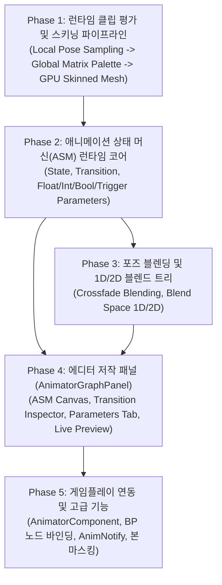

# 애니메이터 그래프와 애니메이션 상태 머신 개발 계획

- 작성일: 2026-11-01 (갱신: 2026-11-02)
- 상태: Phase 1~4 기본 구현·계층 연결 반영 / 파일 보호·재생 정확성·고급 기능 미완료 (2026-11-02 정적 대조)
- 공통 기준: [EngineEditorClientGuidelines.md](EngineEditorClientGuidelines.md), [SourceOrganizationGuidelines.md](SourceOrganizationGuidelines.md)
- 선행 기반: [EngineDevelopmentPlan.md](EngineDevelopmentPlan.md) 9·10절, [GraphFoundation.md](GraphFoundation.md), [GraphPanel.md](GraphPanel.md), [VisualScriptingBlueprintPlan.md](VisualScriptingBlueprintPlan.md)
- 통합 우선순위 연결: [DevelopmentPriorities.md](DevelopmentPriorities.md) (P2-D 및 P3/P4 애니메이션 및 콘텐츠 확장)
- 최신 근거: [코드·문서 점검](CodeDocumentationAudit-2026-11-02.md) F01·F06·F07·F11. 이번 갱신에서 빌드·UI·GPU 검증은 하지 않았다.

---

## 1. 목적과 비전

현재 BamEngine에는 본·키프레임 데이터와 스프라이트 재생 외에 3D 클립 평가·상태 머신·1D 블렌드·저작 패널의 기본 경로가 있다.
이 계획은 기존 경로의 정확성·파일 보호·검증을 마무리하고 고급 애니메이션 기능으로 확장하는 목표를 관리한다.

본 계획의 목표는 언리얼 엔진의 **애니메이션 블루프린트(Animation Blueprint / State Machine)** 및 유니티의 **애니메이터 컨트롤러(Animator Controller)** 와 동등한 수준으로, 캐릭터의 상태 전이 로직과 포즈 블렌딩을 시각적으로 저작하고 런타임에서 안정적으로 구동하는 통합 애니메이션 시스템을 구축하는 것이다.

> [!IMPORTANT]
> **설계 핵심 원칙:**
> 1. **에셋 정의와 런타임 상태의 엄격한 분리:** 그래프 에셋(`AnimatorGraphAsset`)은 상태·전이 조건·블렌드 트리 구조 등 불변 데이터만 정의하며, 재생 시간·현재 활성 상태·파라미터 값은 엔티티별 `AnimatorComponent`(`AnimatorRuntimeState`)가 완전히 독립적으로 소유한다. 동일 에셋을 수백 마리의 몬스터 엔티티가 공유해도 상태 오염이 발생하지 않아야 한다.
> 2. **이원화 평가 구조 (상태 머신 vs 포즈 그래프):** 상위 제어 흐름(어떤 상태에서 어떤 상태로 언제 전이하는가)을 다루는 **상태 머신(Animation State Machine, ASM)** 과, 상태 내부에서 최종 본 트랜스폼 행렬을 계산하는 **포즈 블렌드 트리(Pose Blend Tree)** 의 책임을 명확히 분리한다.
> 3. **기존 엔진 생태계와의 완전한 일체화:** `imgui-node-editor` 기반 UI 캔버스 재사용, `ReflectionArchive` 기반 JSON 에셋 직렬화, `VisualScriptingBlueprintPlan`과의 게임플레이 파라미터 연동, 그리고 지침 14절에 따른 로캘 키(`AnimatorGraph.*`) 일원화를 준수한다.

---

## 2. 현재 상태와 갭 분석 (Gap Analysis)

### 2.1 이미 구축된 기반 (2026-11-02 정적 대조 / 전체 완료 기준과 구분)
- **애니메이션 원천 데이터:** `Engine/Source/Resource/Model/Public/Animation.h`, `Skeleton.h`, `Bone.h`에 뼈 계층, 포지션/로테이션/스케일 키프레임, 지속 시간(`Duration`), `TicksPerSecond` 정의 완비.
- **런타임 포즈 평가 및 GPU 스키닝 (Phase 1 기본 구현):** `AnimationEvaluator`, `AnimatorComponent`, `AnimationSystem`, `MeshRenderSystem`과 Renderer의 스키닝 제출이 있다. `InstantiateModel()`은 루트에 Animator, 하위 메시 노드에 SkinnedMeshRenderer를 생성한다. 재생 경계·부분 트랙 정확성은 별도 잔여다.
- **애니메이션 상태 머신 및 1D 블렌드 트리 (Phase 2~3 기본 구현):** `AnimatorParameters`, `AnimTransition`, `AnimState`, `AnimatorStateMachine`, `BlendTree1D` 및 `.animator` JSON 읽기/쓰기가 있다. `AnimState::blendTree`는 힙 동적 할당과 타입별 특수화 직렬화 코덱을 배제하기 위해 값 타입(`BlendTree1D blendTree;`, 방안 B)으로 소유하며, 향후 스마트 포인터 일반화 직렬화(방안 C)는 `ReflectionArchiveGuidelines.md` 8절의 장기 아키텍처 계획으로 분리한다. 파일 보호·ASM 제어 의미와 2D 블렌드는 미완료다.
- **에디터 시각 저작 패널 (`AnimatorGraphPanel`, Phase 4 기본 UI):** 메뉴바/퀵툴바, 파라미터·상태·전이 편집과 활성 상태 표시 코드가 있다. 현재 캔버스는 ImGui/ImDrawList 기반 자체 구현이며, 저장/교체 보호·입력 일원화·독립 프리뷰는 남아 있다.
- **비주얼 스크립팅 연동 인프라:** `GraphGameplayLibrary`에 `Animator.Play/Pause/Stop/SetPlayRate/SetTime/IsPlaying/GetCurrentTime` 및 `Animator.SetFloat/SetInt/SetBool/SetTrigger/GetFloat/GetBool` 노드가 등록되었고, `EGraphPinType::String` 지원(`d3fc6bd2`)을 통해 블루프린트에서 문자열 파라미터 이름을 직접 전달할 수 있음.
- **2D 프레임 애니메이션:** 독립 `SpriteAnimation` 에셋(`.spriteanim`), `SpriteAnimationComponent`/`System`, 전용 `SpriteAnimationEditor` 구축 완료.

### 2.2 애니메이터 그래프 완성을 위해 남은 핵심 과제 (2026-11-02 정적 갱신)
1. **기존 계층 연결 검증·파일 보호·재생 정확성:**
   - `Scene::InstantiateModel()`은 모델 루트 엔티티(`rootHandle`)에 `AnimatorComponent`를 부착하고, 하위 노드 엔티티(`handle`/`meshEntity`)에 `SkinnedMeshRendererComponent`를 부착한다.
   - 현재 `AnimationSystem`은 Animator의 하위 Skeleton을 검색하고 `MeshRenderSystem`은 자신/부모의 Animator를 찾는다. 직렬화되는 `controllerPath` 변경 시 자동 로드를 시도한다. 이 연결을 새로 구현할 필요는 없다.
   - 남은 문제는 상대 컨트롤러 경로·실패 후 재시도, 비반복 종료·부분 트랙·ASM 제어, 패널의 저장/로드 실패 및 미저장 교체 보호다. 상세 근거·확인 조건은 점검 문서 F01·F06·F07을 따른다.
2. **2D 블렌드 트리 (2D Blend Space):**
   - 현재 1D 블렌드 트리(`BlendTree1D`)까지 구현되어 있으며, 이동 방향(`Direction`)과 속도(`Speed`) 2축을 조합하는 2D 블렌드 노드는 후속 확장 대상이다.
3. **고급 게임플레이 연동 및 패널 내 3D 프리뷰 뷰포트 (Phase 5):**
   - 특정 프레임 도달 시 사운드/이펙트를 발송하는 애니메이션 노티파이(`AnimNotify`).
   - 상체/하체 분리 재생을 위한 레이어드 애니메이션 및 본 마스킹(`BoneMask`).
   - `AnimatorGraphPanel` 내부의 독립 3D 모델 실시간 프리뷰 뷰포트.

---

## 3. 단계별 개발 로드맵

아래 세부 목록은 목표를 포함한다. 예시 타입명·imgui-node-editor 재사용·독립 프리뷰 등 모든 항목이 현재 구현되었다는 뜻은 아니다.
현재 구현은 2.1절, 미완료 결함과 검증 범위는 2.2절 및 연결한 점검 문서를 따른다.

2026-11-02 실행 순서 조정: 파일 저장 결과/미저장 교체 보호 → 상대 경로·재시도 → 비반복/부분 트랙·ASM 제어 → 다중 인스턴스/지원 실행 경로 확인 → 고급 기능으로 진행한다.
로캘·InputManager는 해당 패널 수정과 함께 적용한다. 이미 있는 계층 연결을 다시 구현하지 않으며,
전체 배포·머티리얼 그래프 완성을 이 경로의 필수 조건으로 두지 않는다. 전역 선택은 [통합 우선순위 10절](DevelopmentPriorities.md)을 따른다.



---

### Phase 1. 런타임 클립 평가 및 스키닝 파이프라인 (기본 구현 / 경계 검증 잔여)
- **목적:** 3D 메시가 단일 애니메이션 클립을 시간에 맞춰 올바르게 재생하고 화면에 렌더링되도록 한다.
- **세부 내용:**
  - `SkeletonPose`: 본 인덱스별 로컬 변환(Position, Rotation, Scale) 배열 구조체 정의.
  - `ClipEvaluator`: 시간 `t`에서 키프레임 탐색(이진 탐색/캐싱) 및 선형(LERP)/구면선형(SLERP) 보간 수행.
  - `SkeletonEvaluator`: 로컬 본 포즈를 부모-자식 계층 순서로 누적하여 모델 공간 행렬 도출 후, `InverseBindPoseMatrix`와 곱해 최종 스키닝 행렬 팔레트(`std::vector<Matrix4x4>`) 생성.
  - RHI 스키닝 버퍼 바인딩: `BINDING_LAYOUT.md`의 스키닝 버퍼 규약과 대조하여 정점 셰이더로 행렬 배열 전달.
  - `SceneModel.cpp`의 `InstantiateModel()`에서 스켈레탈 메시 생성 지원 연결.
- **완료 기준:** 에디터 씬에 배치된 단일 3D 캐릭터가 T-포즈에서 벗어나 지정된 단일 클립(예: Walk)을 지정 속도와 루프로 지속 재생한다.

---

### Phase 2. 애니메이션 상태 머신(ASM) 런타임 코어 (기본 구현 / 제어 의미·검증 잔여)
- **목적:** 엔티티가 파라미터 값에 따라 여러 애니메이션 상태를 오갈 수 있는 순수 C++ 런타임 엔진을 구축한다.
- **세부 내용:**
  - **파라미터 시스템 (`AnimatorParameter`):**
    - 지원 타입: `Float`, `Int`, `Bool`, `Trigger` (1회 전이 후 자동 소모).
    - 해시 기반 식별자(`ParamId` 또는 `std::string`) 및 기본값 보관.
  - **상태 (`AnimState`):**
    - 재생할 모션(단일 클립 핸들 또는 추후 블렌드 트리).
    - 재생 속도 배율, 루프 여부, 상태 진입/퇴장 알림 이벤트.
  - **전이 (`AnimTransition`):**
    - 소스 상태(`SourceState`) → 타깃 상태(`TargetState`).
    - 전이 지속 시간(`TransitionDuration`), 크로스페이드 보간 방식(Linear / SmoothStep).
    - 종료 시간 전이(`HasExitTime`, `ExitTime` 0.0~1.0): 조건 없이 클립이 일정 비율 재생되면 자동 전이.
    - 조건 목록(`std::vector<TransitionCondition>`): 비교 연산자(`Greater`, `Less`, `Equal`, `NotEqual`)와 파라미터 비교.
  - **인스턴스 격리 (`AnimatorRuntimeState`):**
    - 현재 상태 포인터/ID, 현재 재생 시간, 전이 중인 경우 소스/타깃 상태 및 전이 진행도(0.0~1.0), 파라미터 현재 값 맵.
    - 틱 갱신 함수: `Update(float deltaTime)`에서 파라미터 평가 → 전이 조건 검사 → 상태 전이 개시 → 포즈 크로스페이드 샘플링.
- **완료 기준:** C++ 단위 테스트 또는 작은 씬에서 `Speed` 파라미터가 0이면 Idle, 0보다 커지면 Walk로 0.25초에 걸쳐 부드럽게 크로스페이드 전이되며, `Jump` 트리거 발동 시 Jump 상태로 전환된다.

---

### Phase 3. 포즈 블렌딩 및 1D/2D 블렌드 트리 (1D 구현 / 2D 미구현)
- **목적:** 불연속적인 상태 전이뿐 아니라, 속도나 방향과 같은 연속적인 파라미터에 따라 복수의 클립 포즈를 가중치로 합성한다.
- **세부 내용:**
  - **포즈 합성기 (`PoseBlender`):**
    - 두 본 포즈 `PoseA`, `PoseB`를 가중치 `alpha`(0~1)로 LERP/SLERP 합성.
    - 본 회전 합성 시 쿼터니언 최단 경로 정규화 보장.
  - **1D Blend Tree (Blend Space 1D):**
    - 단일 파라미터(예: `Speed`) 축에 여러 클립 배치 (예: 0=Idle, 2=Walk, 6=Run).
    - 입력값 위치에 인접한 두 클립을 찾아 정규화된 가중치로 실시간 합성.
  - **2D Blend Tree (Blend Space 2D):**
    - 두 개 파라미터(예: `Direction`, `Speed`) 축에 2D 삼각망(Delaunay Triangulation) 또는 사각 보간을 구성하여 전방/후방/좌/우 이동 클립 합성.
- **완료 기준:** 캐릭터가 멈춰 있다가 달릴 때 Idle → Walk → Run이 끊김 없이 매끄럽게 가속도에 맞춰 보간되어 재생된다.

---

### Phase 4. 에디터 저작 패널 (`AnimatorGraphPanel`) (파일 보호·모달·입력 정합성 완료 / 캔버스 UI 일원화·독립 프리뷰 후속)
- **목적:** 기획자 및 아티스트가 코드를 작성하지 않고도 시각적으로 상태 머신과 파라미터를 저작하는 전문 GUI를 제공한다.
- **2026-11-02 구현 완료:**
  - 원자적 파일 저장/로드 및 실패 결과 전파(F01 단계 1), `AnimState::blendTree` 값 타입(방안 B) 직렬화 안정화.
  - New/Open/종료 시 미저장 변경사항 보호 모달(`Save/Discard/Cancel`) 및 포커스 기반 단축키(Ctrl+S, Ctrl+N, Ctrl+O) 연동(F01 단계 2).
  - ESC 취소, 마우스 좌표/드래그/패닝의 `InputManager` 일원화 및 표시 문자열 `Editor.csv` 로캘 키 연동(F11 단계 3).
- **후속 계획 과제 (사용자 확정):**
  - **캔버스 UI 토대 일원화 (`imgui-node-editor` 전환):** 현재의 자체 `ImDrawList` 수동 렌더링을 `GraphPanel`과 동일한 `imgui-node-editor` 프레임워크로 마이그레이션.
    - 데이터 모델(`AnimatorStateMachine`)은 독립적으로 보존하면서, 무한 줌/패닝, 다중 노드 마퀴(Marquee) 선택, 박스 드래그, 정렬 단축키 등 블루프린트와 일관된 조작감 제공.
  - 특별 노드: `Any State`(어느 상태에서든 조건 만족 시 전이).
  - 런타임 전이 진행률 게이지 또는 파티클 펄스 시각화.
  - 독립 3D 모델 실시간 프리뷰 뷰포트 (`PreviewViewport`).

---

### Phase 5. 게임플레이 연동 및 고급 기능 (기본 컴포넌트·노드·계층 연결 반영 / 정확성·고급 기능 대기)
- **목적:** 비주얼 스크립팅 및 C++ 게임플레이 코드에서 애니메이터를 자유자재로 제어하고, 계층형 모델 참조·사운드/이펙트 트리거·상체/하체 분리 재생을 지원한다.
- **세부 내용:**
  - **컴포넌트 및 시스템 연동 (계층 연결 포함 기본 구현 / 검증 잔여):**
    - `AnimatorComponent` 및 `AnimationSystem`(`Editor`·`Client` 등록 완료) 구축 완료.
    - **남은 검증 과제**: 기존 계층 조회·컨트롤러 로드를 다중 인스턴스·PIE·Client에서 검증한다. 파일 실패·재생 경계·Stop/SetTime/GetCurrentTime의 ASM 의미를 마무리한다.
  - **비주얼 스크립팅 노드 (`GraphGameplayLibrary` — 구현 완료):**
    - `Animator.Play/Pause/Stop/SetPlayRate/SetTime/IsPlaying/GetCurrentTime` 및 `Animator.SetFloat`, `Animator.SetInt`, `Animator.SetBool`, `Animator.SetTrigger`, `Animator.GetFloat`, `Animator.GetBool` 노드 등록 및 `EGraphPinType::String` 핀 연동 완료.
  - **애니메이션 노티파이 (`AnimNotify` — 대기):**
    - 특정 프레임에 도달했을 때 발송되는 이벤트(발소리 사운드, 칼 휘두르는 궤적 파티클 등).
    - 비주얼 스크립팅 커스텀 이벤트 또는 C++ 델리게이트 수신.
  - **레이어드 애니메이션 & 본 마스킹 (`Layered Animation & Bone Mask` — 대기):**
    - 베이스 레이어(하체: 이동 애니메이션) + 상위 레이어(상체: 사격/공격 애니메이션) 분리 재생.
    - 스켈레톤의 특정 본(`Spine` 등) 이하 계층만 오버라이드하는 본 마스크 에셋.
- **완료 기준:** 플레이어가 W 키를 누르면 비주얼 스크립트가 `Speed`를 올려 계층형 3D 캐릭터가 걷고, 마우스 클릭 시 상체만 공격 모션을 취하며 발자국 프레임에 맞춰 사운드 노티파이가 콘솔에 로깅된다.

---

## 4. 데이터 모델 및 아키텍처 계약

### 4.1 에셋 구조 (`AnimatorGraphAsset`)
```cpp
// 직렬화 대상 불변 에셋
struct AnimatorTransitionAsset
{
    std::string SourceStateName;
    std::string TargetStateName;
    float Duration = 0.25f;
    bool HasExitTime = false;
    float ExitTime = 1.0f;
    std::vector<TransitionCondition> Conditions;
};

struct AnimatorStateAsset
{
    std::string Name;
    std::string MotionClipGuid; // Animation Resource GUID
    float Speed = 1.0f;
    bool IsLooping = true;
    ImVec2 EditorPosition; // 캔버스 노드 위치
};

struct AnimatorGraphAsset
{
    std::string EntryStateName;
    std::vector<AnimatorParameterDef> Parameters;
    std::vector<AnimatorStateAsset> States;
    std::vector<AnimatorTransitionAsset> Transitions;
};
```

### 4.2 런타임 인스턴스 상태 (`AnimatorRuntimeState`)
```cpp
// 엔티티별 가변 런타임 상태
struct AnimatorRuntimeState
{
    const AnimatorGraphAsset* Asset = nullptr;
    const AnimatorStateAsset* CurrentState = nullptr;
    const AnimatorTransitionAsset* ActiveTransition = nullptr;

    float StateTime = 0.0f;
    float TransitionTime = 0.0f;

    std::unordered_map<std::string, float> FloatParams;
    std::unordered_map<std::string, int32_t> IntParams;
    std::unordered_map<std::string, bool> BoolParams;
    std::unordered_set<std::string> ActiveTriggers;

    SkeletonPose EvaluatedPose; // 최종 평가된 로컬 본 포즈
};
```

---

## 5. 지침 준수 및 품질 기준

- **로캘 및 입력 규칙 (`EngineEditorClientGuidelines.md` 14절):**
  - UI 텍스트, 노드 이름, 파라미터 타입명, 툴팁, 경고 메시지는 모두 `AnimatorGraph.*` 로캘 키를 사용하며 `Editor.csv`에 한국어 및 영어 원본을 등록한다.
  - 캔버스 조작(패닝, 줌, 선택)은 프로젝트의 통합 `InputManager`를 따른다.
- **안전성 및 메모리 관리:**
  - 존재하지 않는 클립, 삭제된 파라미터 참조 시 크래시 없이 안전하게 에러 진단(`LogWarning`)을 기록하고 기본 상태(T-포즈 또는 정지)를 유지한다.
  - 매 프레임 동적 힙 할당(`new`/`malloc`)을 원천 차단하고, 포즈 버퍼(`SkeletonPose`)는 인스턴스별로 재사용한다.

---

## 6. 완료 검증 체크리스트

- [x] **런타임 클립 재생:** 3D 캐릭터 모델에 단일 클립을 적용했을 때 관절 왜곡 없이 정확한 포즈로 스키닝 렌더링되는가? (`AnimationEvaluator`, `MeshRenderSystem` GPU 스키닝 구조화 버퍼 바인딩 완료)
- [x] **상태 전이 및 크로스페이드:** Idle에서 Walk로 전이할 때 관절이 튀지 않고 지정된 시간 동안 부드럽게 보간되는가? (로컬 TRS 최단 경로 쿼터니언 slerp 크로스페이드 완료)
- [x] **파라미터 및 트리거:** Trigger 파라미터가 1회 전이 후 즉각 소모(Consume)되어 무한 루프가 발생하지 않는가? (`ConsumeTriggers()` 및 전이 후 자동 리셋 완료)
- [x] **다중 인스턴스 격리:** 동일한 에셋을 공유하는 두 엔티티가 서로 다른 파라미터를 가질 때 간섭 없이 독립 동작하는가? (`AnimatorRuntimeState` 독립 인스턴스 격리 완료)
- [x] **에디터 UI 및 직렬화:** 노드 배치와 트랜지션 연결이 JSON으로 정상 저장·로드되며, 실행 중 활성 상태가 시각적으로 모니터링되는가? (`AnimatorGraphPanel` 18절 메뉴바/툴바/파라미터독/트랜지션인스펙터 및 네온 하이라이트 디버깅 완료)
- [ ] **비주얼 스크립팅 및 계층형 모델 완전 연동:** 블루프린트 그래프에서 캐릭터 속도에 따라 `SetFloat("Speed", value)`를 호출하여 계층형 3D 캐릭터의 애니메이션 상태를 통제할 수 있는가? (`NODE_ANIMATOR_*` 노드 및 `EGraphPinType::String` 지원 완료, 루트 `AnimatorComponent` ↔ 자식 `SkinnedMeshRendererComponent` 계층 참조 연결 및 `.animator` 에셋 자동 로드 검증 대기)
