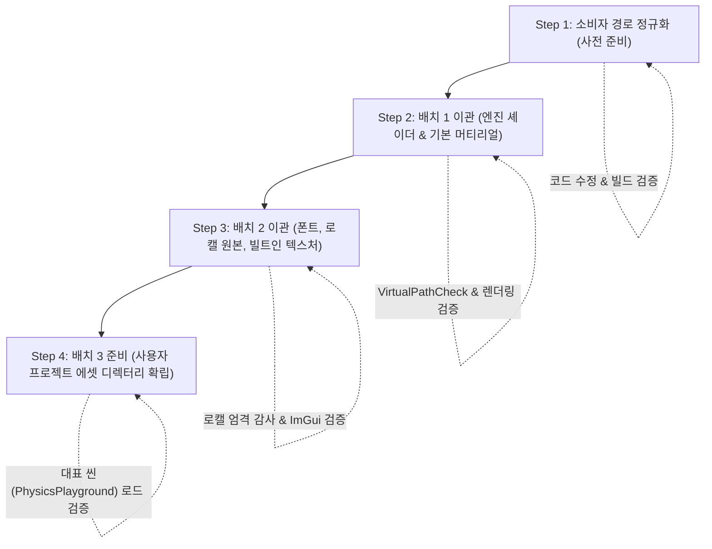

# Phase 3-B: 작은 묶음의 물리 이관 및 점진적 에셋 디렉터리 분리 세부 계획

- **작성일**: 2026-11-08
- **상위 계획**: [ResourceAndAssetSeparationPlan.md](ResourceAndAssetSeparationPlan.md) (Phase 3-B)
- **근거 및 원칙**: [CodeDocumentationAudit-2026-11-06.md](CodeDocumentationAudit-2026-11-06.md) (항목 A10), [DevelopmentPriorities.md](DevelopmentPriorities.md) (11절)
- **상태**: Phase 3-B 전 단계(Step 1~4) 구현 완료 (검증 대기)

---

## 1. 배경 및 핵심 원칙

### 1.1 배경
BamEngine은 Phase 1~3을 거치며 `Engine://` 및 `Project://` 가상 마운트 URI 해석 계층(`PlatformPath`, `ResourceManager`)과 에디터 콘텐츠 브라우저 분리 및 읽기 전용 보호 시스템을 구축했습니다. 현재는 모든 자원이 루트의 단일 `Resources/` 디렉터리에 공존하는 과도기(Transitional) 상태입니다.

### 1.2 핵심 원칙 (A10 감사 지침 준수)
1. **대규모 일괄 이동 금지 (No Big-Bang Migration)**:
   - 전체 폴더를 한 번에 이동하면 기존 씬, 머티리얼, 시작 설정, 감시자, 패키징 스크립트 등에서 동시다발적 참조 단절이 발생합니다.
   - 반드시 **작은 묶음(Pilot Batch)** 단위로 물리 이관하며, 각 단계마다 저장/재열기/핫리로드/피커/썸네일/단위 테스트를 검증합니다.
2. **소비자 경로 호출 정규화 선행 (Normalize Consumer Paths First)**:
   - 물리 파일을 옮기기 전에, `PlatformPath::ResolveUri`를 거치지 않고 `projectRoot / "Resources/..."`를 직접 결합하던 레거시 코드들을 먼저 `PlatformPath::ResolveUri`로 일원화합니다.
   - 이렇게 하면 파일이 기존 `Resources/`에 있든, 신규 `Engine/Resources/`로 이관되든 양쪽 모두 투명하게 작동합니다.
3. **완전한 롤백 안전성 (Rollback Safety)**:
   - 모든 파일 이동은 `git mv`로 추적성을 보존하며, 각 배치 단위로 독립 커밋을 분할하여 문제 발생 시 즉각 롤백 가능하게 합니다.
4. **전역 선행 조건화 배제**:
   - 에셋 분리 작업이 2D/3D 게임플레이나 렌더링 신규 기능의 진행을 막는 전역 장애물이 되지 않도록 독립적인 안전 단계로 진행합니다.

---

## 2. 하드코딩 소비자 경로 분석 및 사전 교정 대상

물리 이관 시 경로 단절을 유발할 수 있는 직접 경로 결합부를 사전에 파악했습니다:

| 위치 | 기존 코드 | 문제점 | 교정 방안 |
|---|---|---|---|
| `Editor/Source/Application/Private/Application.cpp` | `projectRoot / "Resources/Data/Localization/English.json"` | 디렉터리 분리 시 경로 단절 | `PlatformPath::ResolveUri("Engine://Data/Localization/English.json")` |
| `Editor/Source/ImGui/Private/ImGuiManager.cpp` | `projectRoot / "Resources/Fonts/..."` | 폰트 파일 이관 시 로드 실패 | `PlatformPath::ResolveUri("Engine://Fonts/...")` |
| `Editor/Source/HotReload/Private/ShaderHotReloadManager.cpp` | `ResolveProjectRelative("Resources/Shader/hlsl")` | 셰이더 이관 시 핫리로드 실패 | `PlatformPath::ResolveUri("Engine://Shader/hlsl")` |
| `Editor/Source/HotReload/Private/AssetHotReloadManager.cpp` | `ResolveProjectRelative("Resources")` | 단일 폴더만 감시 | `ProjectAssetRoot` 및 `EngineResourceRoot` 멀티 감시 |
| `Editor/CMake/LocalizationBuild.cmake` | `"${CMAKE_SOURCE_DIR}/Resources/Data/Localization"` | CMake 동기화 타깃 경로 고정 | `Engine/Resources` 및 `Resources` 폴백 지원 |
| `Tools/Audit/LocalizationAuditor/audit_localization.py` | 기본 탐색 디렉터리 | CSV 원본 위치 불일치 가능성 | `--engine-root` 및 멀티 루트 지원 확인 |

---

## 3. 단계별 세부 구현 순서



### Step 1: 소비자 경로 호출부의 `PlatformPath::ResolveUri` 일원화 (코드 수정)
- **작업 내용**:
  1. `Application.cpp`: 로캘 데이터 로드 시 `PlatformPath::ResolveUri(L"Engine://Data/Localization/...")` 사용.
  2. `ImGuiManager.cpp`: Font Awesome 폰트 로드 시 `PlatformPath::ResolveUri(L"Engine://Fonts/...")` 사용.
  3. `ShaderHotReloadManager.cpp`: `ResolveShaderSourceDirectory()`를 `PlatformPath::ResolveUri("Engine://Shader/hlsl")`로 갱신.
  4. `AssetHotReloadManager.cpp`: `m_EngineRootPath`와 `m_RootPath`를 모두 등록하여 물리 분리 환경에서도 텍스처 핫리로드가 상시 작동하도록 멀티 감시(`addWatch`) 적용.
- **완료 기준**:
  - 기존 `Resources/` 단일 구조 상태에서도 빌드 및 에디터 구동 시 폰트, 로캘, 셰이더 감시가 100% 정상 작동함을 확인.

---

### Step 2: 배치 1 이관 — 엔진 코어 셰이더 & 기본 머티리얼 (Pilot Batch)
- **이관 대상**:
  - `Resources/Shader/` 전체 $\rightarrow$ `Engine/Resources/Shader/`
  - 코어 기본 머티리얼 4종:
    - `Resources/Material/DefaultMaterial.bammat.json` $\rightarrow$ `Engine/Resources/Material/DefaultMaterial.bammat.json`
    - `Resources/Material/SkinningMaterial.bammat.json` $\rightarrow$ `Engine/Resources/Material/SkinningMaterial.bammat.json`
    - `Resources/Material/SkyMaterial.bammat.json` $\rightarrow$ `Engine/Resources/Material/SkyMaterial.bammat.json`
    - `Resources/Material/PostProcessDefaultMaterial.bammat.json` $\rightarrow$ `Engine/Resources/Material/PostProcessDefaultMaterial.bammat.json`
- **구현 및 연동**:
  1. `git mv`로 대상 디렉터리/파일 이동.
  2. `PlatformPath::GetEngineResourceRoot()`가 `Engine/Resources`를 즉시 인식하는지 검증.
  3. `ModelImporter.cpp`, `ModelEditor.cpp`, `SceneViewportPanel.cpp` 등의 기본 머티리얼 참조가 `PlatformPath::ResolveUri`를 통해 정상 해석되는지 확인.
- **검증 기준**:
  - `VirtualPathCheck` 단위 테스트 통과 (물리 분리 환경 검증 케이스 추가).
  - 에디터 실행 시 G-Buffer, 스카이박스, 섀도우 맵, 포스트프로세스 셰이더가 정상 로드 및 컴파일되는지 확인.
  - HLSL 파일 수정 시 `ShaderHotReloadManager` 핫리로드 트리거 검증.

---

### Step 3: 배치 2 이관 — 엔진 폰트, 로캘 원본 및 빌트인 텍스처
- **이관 대상**:
  - `Resources/Fonts/` $\rightarrow$ `Engine/Resources/Fonts/`
  - `Resources/Data/Localization/Engine.csv` $\rightarrow$ `Engine/Resources/Data/Localization/Engine.csv` (주의: 에디터/프로젝트 로캘과 분리 검토)
  - 빌트인 1x1 텍스처 및 기본 격자/Gizmo 텍스처
- **구현 및 연동**:
  1. 폰트 및 빌트인 에셋 디렉터리 이동.
  2. `audit_localization.py` 및 `localizationcsvtojson.py` 도구가 분리된 `Engine/Resources/Data/Localization`을 정상 인식하도록 인자/경로 보완.
- **검증 기준**:
  - `python Tools/Audit/LocalizationAuditor/audit_localization.py --strict` 무결성 100% 통과.
  - ImGui UI 폰트 및 아이콘(`Font Awesome`) 정상 렌더링 확인.

---

### Step 4: 배치 3 준비 — 사용자 프로젝트 에셋 디렉터리(`Assets/`) 확립
- **작업 내용**:
  - 저장소 루트에 `Assets/` 디렉터리 생성.
  - `Resources/`에 남아 있는 사용자 에셋(씬 `Scenes/`, 모델 `Model/`, 오디오 `Audio/`, 파티클 `Effect/`, 사용자 머티리얼)을 `Assets/`로의 이전 계획 수립.
  - 대표 씬(`PhysicsPlayground.json`, `ActionTimelineDemo.json` 등)을 열었을 때 참조가 가상 URI(`Project://...`, `Engine://...`)로 온전히 복원되는지 확인.
- **완료 기준**:
  - `ContentBrowserPanel` 좌측 트리에 `Project Content`(`Assets/`)와 `Engine Content`(`Engine/Resources/`)가 각각 독립 루트로 표시됨.
  - `Show Engine Content` 토글에 따라 뷰 전환이 완벽하게 일치함.

---

## 4. 검증 체크리스트 및 성공 기준

| 단계 | 검증 항목 | 검증 방법 | 성공 기준 |
|---|---|---|---|
| **사전** | 경로 정규화 | `cmake --build`, 단위 테스트 | 빌드 오류 없음, 기존 테스트 통과 |
| **배치 1** | 가상 URI 해석 | `ctest -R VirtualPathCheck` | 물리 분리 테스트 통과 (100%) |
| **배치 1** | 셰이더 핫리로드 | HLSL 주석 수정 저장 | 셰이더 리컴파일 로그 출력 확인 |
| **배치 1** | 머티리얼 렌더링 | 에디터 실행 & 뷰포트 확인 | 기본 큐브/스피어/스카이박스 정상 렌더링 |
| **배치 2** | 로캘 무결성 | `audit_localization.py --strict` | 결함 0건 (Passed) |
| **배치 2** | UI 폰트 렌더링 | 에디터 실행 & 텍스트 확인 | Font Awesome 아이콘 깨짐 없음 |
| **배치 3** | 씬 저장/재열기 | 대표 씬 로드 $\rightarrow$ 저장 $\rightarrow$ 재오픈 | 참조 누락 및 크래시 없음 |

---

## 5. 비상 롤백 절차 (Rollback Plan)

파일 이동 과정에서 예상치 못한 컴파일 실패나 런타임 크래시가 발생할 경우 다음 절차로 즉시 복구합니다:

```powershell
# 1. 파일 이동 롤백 (Git 워킹 트리 초기화)
git reset HEAD --hard
git clean -fd

# 2. 캐시 정리 및 재빌드
cmake --build out/build/x64-debug --config Debug --target VirtualPathCheck ReflectionInspectorCheck Editor
```
각 단계가 끝날 때마다 정상 검증 후 즉시 커밋을 생성하여 롤백 지점을 보존합니다.
