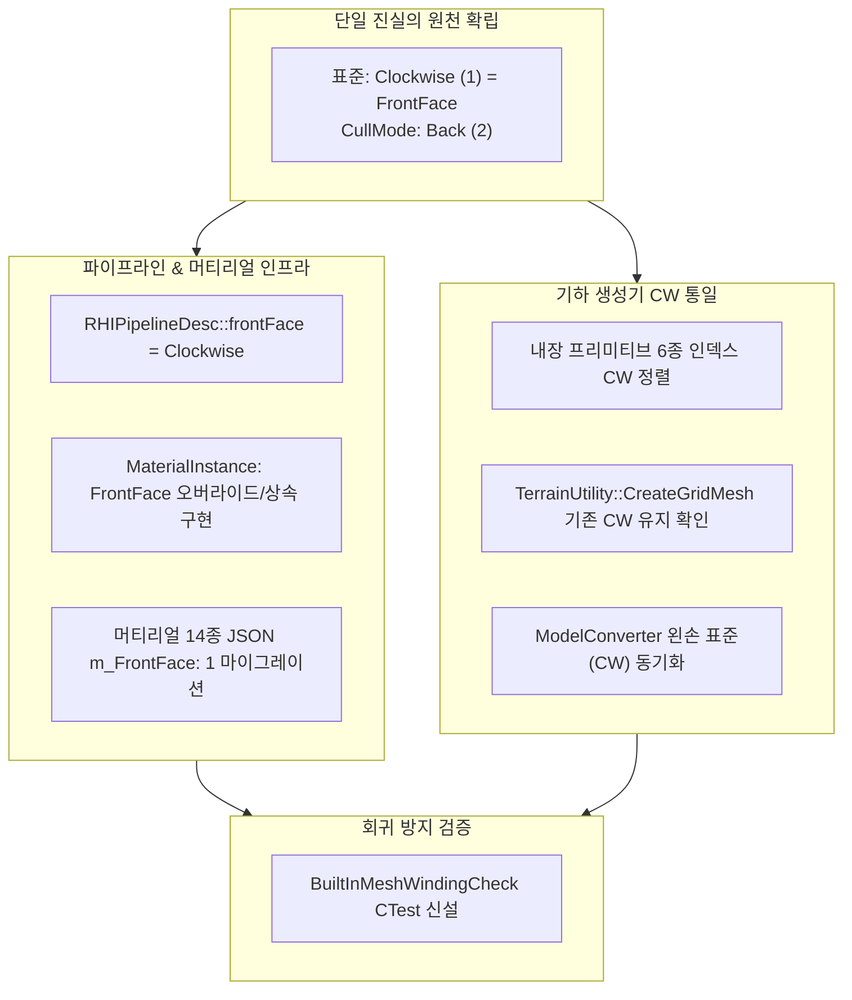
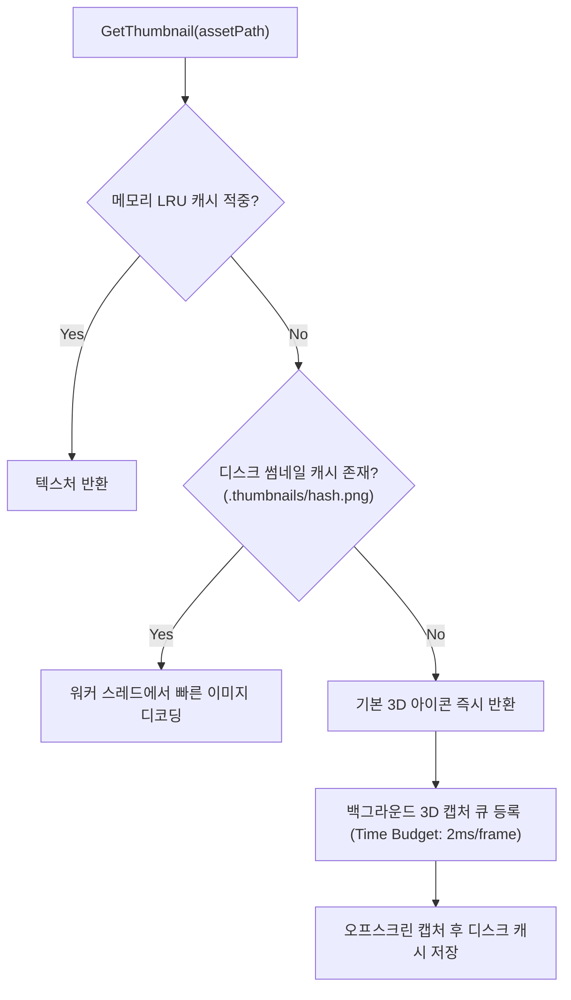
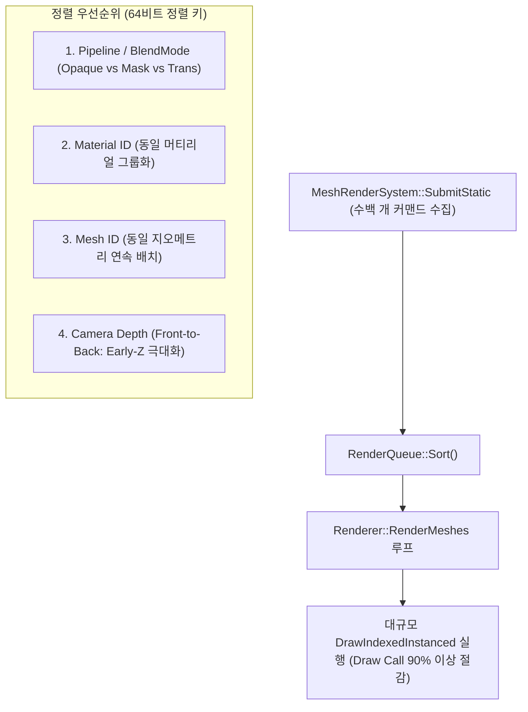

# 에셋 파이프라인 및 렌더링 최적화 조치 계획서
(Asset Pipeline & Rendering Optimization Plan)

- **작성일**: 2026-11-16
- **상태**: 조치 1(와인딩 CW 표준화) 구현 및 실행 검증 완료 (2026-11-16) / 조치 2~4 구현 대기
- **우선순위**: [DevelopmentPriorities.md](DevelopmentPriorities.md) P1 (에셋 파이프라인 & 렌더링 성능)
- **관련 문서**:
  - [ResourceAndAssetSeparationPlan.md](ResourceAndAssetSeparationPlan.md)
  - [InteractiveModelImportPreviewPlan.md](InteractiveModelImportPreviewPlan.md)
  - [Shader/BINDING_LAYOUT.md](Shader/BINDING_LAYOUT.md)
  - [EngineEditorClientGuidelines.md](EngineEditorClientGuidelines.md)

---

## 1. 개요 및 문제 정의

엔진 및 에디터 사용 과정에서 확인된 4가지 핵심 결함 및 성능 병목 현상에 대해 심층 원인을 규명하고, 단계적 조치 계획을 수립합니다.

| 번호 | 결함 현상 | 영향 영역 | 심각도 |
| :--- | :--- | :--- | :--- |
| **이슈 1** | 모델 임포트 시 CW/CCW 와인딩 순서가 반전되는 현상 | `ModelConverter`, `ModelImporter` | **높음** (렌더링 결함) |
| **이슈 2** | `ModelImporter` 모달 뷰포트에서 카메라가 자유 조작되지 않는 현상 | `PreviewViewportWidget`, `EditorCameraController` | **높음** (사용성 장애) |
| **이슈 3** | 다수의 모델/머티리얼이 포함된 폴더 진입 시 극심한 프레임 드랍 | `AssetCache`, `ContentBrowserPanel` | **보통** (에디터 스터터링) |
| **이슈 4** | Sponza 등 복합 모델 씬 배치 시 프레임 대폭 저하 현상 | `Renderer`, `MeshRenderSystem`, 렌더 파이프라인 | **심각** (렌더링 성능 병목) |

---

## 2. 세부 원인 분석 및 기술적 진단

### 2.1 [이슈 1] 모델 임포트 및 기하 와인딩/컬링 불일치 현상

#### (1) 발생 위치
- `Tools/Converters/ModelConverter/Private/ModelConverter.cpp`
- `Engine/Source/Render/RHI/Public/RHIPipeline.h`
- `Engine/Source/Render/Material/Public/MaterialInterface.h`
- `Engine/Source/Render/Material/Public/MaterialInstance.h`
- `Engine/Source/Render/Mesh/Private/BuiltInPrimitiveMeshes.cpp`
- `Engine/Source/Terrain/Private/TerrainUtility.cpp`
- `Engine/Resources/Material/*.bammat.json` 및 `Assets/Material/*.bammat.json`

#### (2) 심층 원인 전수 규명
1. **Assimp 왼손 좌표계 변환과 출력 와인딩 규격**:
   - Assimp의 `aiProcess_ConvertToLeftHanded` 매크로는 `aiProcess_MakeLeftHanded | aiProcess_FlipWindingOrder | aiProcess_FlipUVs` 세트로 구성되어 있습니다.
   - 이는 오른손 좌표계(OpenGL CCW) 모델을 DirectX 왼손 좌표계 표준인 **시계 방향(Clockwise, CW)** 모델로 변환하는 정상 파이프라인입니다.
   - 실제로 임포트된 `.bammesh` 파일들은 정상적으로 CW 와인딩으로 베이킹되고 있었습니다.
2. **파이프라인 기본값 및 머티리얼 직렬화 불일치**:
   - `RHIPipeline.h`의 `RHIPipelineDesc::frontFace` 기본값이 `CounterClockwise` (0)로 선언되어 있었습니다.
   - 디스크의 빌트인 및 에셋 머티리얼 14종 전체에 `"m_FrontFace": 0` (CCW) 및 `"m_CullMode": 2` (`Back`)가 기록되어 있어, CW로 임포트된 모델을 바인딩하면 앞면이 뒷면으로 판정되어 백페이스 컬링에 의해 소실되었습니다.
3. **`MaterialInstance`의 FrontFace 상속 단절 결함**:
   - `MaterialInstance`의 `EPipelineOverrideFlag`에 `FrontFace` 열거형 비트와 관련 가상 함수 오버라이드가 누락되어, 부모 `Material`이 변경되어도 `MaterialInstance`는 C++ 기본값(`Clockwise`)만 반환하는 동작 불일치가 존재했습니다.
4. **내장 프리미티브 메시와 지형 메시의 와인딩 불일치** (2026-11-16 정정: 스크립트 계산 및 `BuiltInMeshWindingCheck`로 확인):
   - `QuadMesh`, `PlaneMesh`: 시계 방향 (CW)
   - `CubeMesh`: 6면 모두 반시계 방향 (CCW). 최초 기재한 "윗/아랫면만 CW인 혼종"은 잘못된 부호의 불변식으로 판정한 오류다.
   - `SphereMesh`, `CapsuleMesh`: 반시계 방향 (CCW)
   - `CylinderMesh`: 측면은 CW, 상단/하단 캡은 CCW (혼종)
   - `TerrainUtility::CreateGridMesh`(기본값): `(i0, i2, i1)`, `(i1, i2, i3)` 배치로 시계 방향 (CW). 변경 불필요.
   - 결과적으로 "CCW 메시 + 기본 머티리얼(CCW)"과 "CW 임포트 메시 + 코드 생성 `MaterialInstance`(C++ 기본값 CW)"의 두 기준이 공존했고, 짝이 어긋난 조합(예: 머티리얼 인스턴스를 쓴 CubeMesh 바닥)에서만 면이 뒤집혀 보였다.
5. **임시 컬링 비활성화 땜질의 존재**:
   - 앞면 소실 문제를 회피하기 위해 `SkinningMaterial.bammat.json`과 `TerrainMaterial.bammat.json`의 `"m_CullMode"`가 `0` (`None`)으로 꺼져 있어 백페이스 컬링 기능이 무력화되어 있었습니다.

---

### 2.2 [이슈 2] `ModelImporter` 모달에서 카메라 조작 불능 현상

#### (1) 발생 위치
- `Editor/Source/ImGui/ViewportPanel/Private/PreviewViewportWidget.cpp` (492~496행, 517~518행)

#### (2) 심층 원인
```cpp
// PreviewViewportWidget.cpp (492~496행)
const bool canNavigate = !io.WantTextInput && !io.AppFocusLost &&
    !ImGui::IsPopupOpen(nullptr, ImGuiPopupFlags_AnyPopupId | ImGuiPopupFlags_AnyPopupLevel);

if (!canNavigate || !m_IsFocused)
    m_CameraDragButton.reset();
...
if (m_CameraController && canNavigate && (m_IsHovered || m_CameraDragButton))
    m_CameraController->HandleInput(io.DeltaTime, m_IsHovered, m_CameraDragButton);
```
1. **모달 팝업 상태 판정의 구조적 모순**:
   - `ModelImportModal`은 `ImGui::BeginPopupModal`로 열리는 최상위 모달 팝업입니다.
   - 모달 팝업 내부에서 실행되는 `PreviewViewportWidget`은 `ImGui::IsPopupOpen(nullptr, ...)`을 평가할 때 **항상 `true`**를 반환받습니다.
   - 따라서 `canNavigate`가 **무조건 `false`**로 고정됩니다.
2. **결과**:
   - 마우스 좌/우/휠 클릭 시 드래그 상태가 즉시 강제 리셋(`m_CameraDragButton.reset()`)되며, `m_CameraController->HandleInput`이 단 한 프레임도 실행되지 않아 프리뷰 카메라가 완전히 동결(Freeze)됩니다.

---

### 2.3 [이슈 3] 대량 에셋 폴더 오픈 시 프레임 드랍 현상

#### (1) 발생 위치
- `Editor/Source/AssetManager/AssetCache/Private/AssetCache.cpp` (652~774행)
- `Editor/Source/ImGui/ContentBrowserPanel/Private/ContentBrowserPanel.cpp` (694~702행)

#### (2) 심층 원인
1. **메인 렌더 스레드에서의 동기 대용량 파일 파싱**:
   ```cpp
   // AssetCache.cpp (689~774행)
   else if (isModel)
   {
       auto handle = rm.GetResourceHandle<Engine::Model>(relPath);
       if (!handle.IsValid())
       {
           auto loaded = rm.LoadFile(relPath); // 메인 스레드 동기 파일 IO 및 전체 파싱!
           if (loaded.IsValid()) handle = Engine::ResourceHandle<Engine::Model>(loaded);
       }
       if (handle.IsValid() && handle.Get()) submitSuccess = thumbRenderer->SubmitModel(handle.Get());
   }
   ```
   - 3D 모델 및 머티리얼의 썸네일 생성을 위해 `AssetCache::Update3DCapture`가 호출될 때, 메인 스레드에서 `rm.LoadFile(relPath)`를 동기 실행합니다.
   - 수십~수백 개의 모델/머티리얼이 있는 폴더에 진입하면 수십 MB에 달하는 버텍스/인덱스 버퍼 파싱과 GPU 리소스 생성이 프레임마다 메인 루프를 블로킹하여 수백 ms 단위의 극심한 스터터링(프레임 드랍)을 유발합니다.
2. **사전 생성 썸네일 캐시(Disk Cache) 부재**:
   - 에셋을 임포트할 때 사전 렌더링된 소형 썸네일 이미지(`.thumb.png`)를 디스크에 보관하지 않고, 폴더를 열 때마다 런타임에 전체 3D 지오메트리를 처음부터 다시 로드하여 렌더링합니다.

---

### 2.4 [이슈 4] Sponza 모델 씬 배치 시 프레임 대폭 저하 현상

#### (1) 발생 위치
- `Engine/Source/Render/Mesh/Private/MeshRenderSystem.cpp` (179~330행)
- `Engine/Source/Render/Private/Renderer.cpp` (506~660행, `RenderMeshes`)
- `Engine/Resources/RenderPipelines/Deferred.bamrenderpipeline.json`

#### (2) 심층 원인
1. **렌더 큐의 머티리얼/메시 정렬(Sorting) 부재로 인한 인스턴싱 완전 실패**:
   ```cpp
   // Renderer.cpp (644~657행)
   // commands가 엔티티 순서대로 들어옴 (비정렬)
   if (material != batchMaterial || mesh != batchMesh)
   {
       if (IsFailure(flushBatch())) return EResult::Fail;
       batchMaterial = material;
       batchMesh = mesh;
   }
   instanceBatch.push_back(inst);
   ```
   - Sponza는 수십 개의 분할 서브메시와 수십 종의 머티리얼(커튼, 기둥, 바닥, 벽돌 등)로 구성되어 있습니다.
   - `MeshRenderSystem`이 엔티티를 순회하며 `commands`를 수집할 때 **머티리얼 및 메시 기준으로 사전 정렬하지 않고 씬 그래프 순서대로** 제출합니다.
   - 결과적으로 매 커맨드마다 `material != batchMaterial`이 발생하여 배칭 크기가 1인 상태로 `flushBatch()`가 호출되고, **인스턴싱이 0%로 무력화된 채 수백 회의 독립 Draw Call과 파이프라인 리바인딩(State Churn)**이 발생합니다.
2. **그림자 패스(Directional Shadow) 4096 해상도에서의 드로우 중복**:
   - `Deferred.bamrenderpipeline.json`에서 Directional Shadow 해상도가 `4096 x 4096`으로 설정되어 있습니다.
   - 섀도우 맵 렌더링 시에도 비정렬된 수백 개의 서브메시가 동일하게 풀 드로우되며, 상태 전환 오버헤드가 2배로 가중됩니다.
3. **Front-to-Back 정렬 부재로 인한 높은 깊이 복잡도(Depth Complexity) 오버드로**:
   - 복잡한 내부 구조를 가진 스폰자에서 카메라 시점 기준 전면 $\rightarrow$ 후면 정렬이 수행되지 않아, G-Buffer 패스에서 조기 깊이 판정(Early-Z)의 이점을 얻지 못하고 픽셀 셰이더가 중복 실행됩니다.

---

## 3. 세부 조치 및 해결 계획

### 3.1 [조치 1] 엔진 전반 와인딩 표준화 (CW = FrontFace, Back = CullMode)

1. **RHI 파이프라인 기본값 동기화**:
   - `RHIPipeline.h`의 `RHIPipelineDesc::frontFace` 기본값을 `EFrontFace::Clockwise` (1)로 수정.
2. **머티리얼 인스턴스 상속 무결성 확보**:
   - `MaterialInstance.h` 및 `MaterialInstance.cpp`에 `EPipelineOverrideFlag::FrontFace`를 추가하고, `GetFrontFace()` / `SetFrontFace()` / `ClearFrontFaceOverride()` 구현.
3. **디스크 머티리얼 JSON 14종 전수 마이그레이션**:
   - `Engine/Resources/Material/` (11종) 및 `Assets/Material/` (3종)의 `"m_FrontFace": 0` $\rightarrow$ `"m_FrontFace": 1` 일괄 변경.
   - `SkinningMaterial.bammat.json` 및 `TerrainMaterial.bammat.json`의 임시 `"m_CullMode": 0` $\rightarrow$ `"m_CullMode": 2` (`Back`)로 정상화.
4. **내장 프리미티브 메시 CW 정렬** (정점 데이터는 유지하고 삼각형의 2·3번째 인덱스만 교환):
   - `CubeMesh`: 6면 전체 `(s+0, s+2, s+1)`, `(s+0, s+3, s+2)`.
   - `SphereMesh`, `CapsuleMesh`: `(first, first+1, second)`, `(second, first+1, second+1)`.
   - `CylinderMesh`: 상/하단 원형 캡만 반전. 측면은 기존 CW 유지.
   - `QuadMesh`, `PlaneMesh`: 기존 CW 유지.
5. **지형 그리드 메시**:
   - 기본 경로는 이미 CW이므로 변경하지 않는다. `reverseWinding=true`로 생성하는 `SplineTestStrip`(`Editor/Source/Application/Private/Application.cpp`)은 CCW이며 실행 확인 대기.
6. **기하 무결성 CTest 신설**:
   - `Engine/examples/BuiltInMeshWindingCheck.cpp`가 내장 메시 6종과 지형 그리드에 대해 $\text{dot}(\text{cross}(v_1 - v_0, v_2 - v_0), \mathbf{N}) > 0$을 검사한다. RHI 없이 CPU 원본 데이터(`GetRawStreamData`, `GetRawIndexData`)를 읽으며, 면적 0 삼각형(구·캡슐 극점)은 별도로 집계하고 실패로 보지 않는다.
7. **모델 임포트 플래그는 유지**:
   - `MakeLeftHanded`+`FlipWindingOrder`+`FlipUVs` 조합은 Assimp `ConvertToLeftHanded`와 같은 정상 변환이다. `FlipWindingOrder`를 제거하면 정상인 CW 임포트 모델이 뒤집힌다.

### 3.2 [조치 2] `PreviewViewportWidget` 모달 입력 허용 패치
1. **네비게이션 조건식 개선**:
   ```cpp
   // 기존: 전체 모달 팝업이 하나라도 열려 있으면 무조건 차단
   const bool canNavigate = !io.WantTextInput && !io.AppFocusLost &&
       !ImGui::IsPopupOpen(nullptr, ImGuiPopupFlags_AnyPopupId | ImGuiPopupFlags_AnyPopupLevel);

   // 개선: 현재 윈도우가 포커스/호버되어 있다면 상위 모달 팝업 내부라도 네비게이션 허용
   const bool isCurrentWindowOrChildFocused = ImGui::IsWindowFocused(ImGuiFocusedFlags_RootAndChildWindows);
   const bool canNavigate = !io.WantTextInput && !io.AppFocusLost && isCurrentWindowOrChildFocused;
   ```
2. **모달 뷰포트 단축키 및 마우스 드래그 활성화**:
   - `ModelImportModal` 내부의 뷰포트에서도 `EditorCameraController`의 Alt+LMB(Orbit), MMB(Pan), RMB(Fly), 마우스 휠 줌이 일반 뷰포트와 100% 동일하게 작동하도록 보장.

### 3.3 [조치 3] 콘텐츠 브라우저 3D 썸네일 비동기화 및 디스크 캐싱

1. **디스크 썸네일 캐시 도입**:
   - 프로젝트 디렉터리(`Projects/<Project>/.bam/thumbnails/`)에 에셋 해시 기반의 128x128 PNG 썸네일을 영속 저장.
   - 폴더 오픈 시 3D 모델 원본을 파싱하지 않고 사전 저장된 PNG 이미지만 워커 스레드에서 비동기 로드.
2. **메인 스레드 타임 버짓(Time Budget) 적용**:
   - `AssetCache::Update3DCapture`에서 1프레임당 소모할 수 있는 최대 시간을 2.0ms로 제한하여 프레임 드랍 원천 방지.
3. **가시 영역(Viewport Frustum) 기반 요청 컬링**:
   - `ContentBrowserPanel`의 가시 렉트(`ImGui::IsRectVisible`)에 들어오는 아이템만 썸네일 생성을 요청하도록 쿼리 최적화.

### 3.4 [조치 4] 렌더러 정렬(Sorting) 및 인스턴싱 극대화

1. **`RenderQueue` 정렬 단계 도입**:
   - `Renderer::RenderMeshes` 실행 직전에 커맨드 버퍼를 `(Pipeline/Shader -> Material -> Mesh -> Front-to-Back Depth)` 순으로 정렬.
   - 동일한 메시와 머티리얼을 사용하는 서브메시들이 연속 배치되어 `instanceBatch` 크기가 극대화되고 드로우콜이 극적으로 감소.
2. **섀도우 패스 전용 경량 렌더링**:
   - 섀도우 패스에서는 텍스처/PBR 상수 바인딩을 생략하고 순수 깊이 버텍스 셰이더만 바인딩하여 상태 변경 비용 제거.
3. **Early-Z 컬링 활성화**:
   - 불투명 지오메트리를 카메라 앞쪽부터 뒤쪽 순서(Front-to-Back)로 렌더링하여 복잡한 스폰자 내부의 픽셀 셰이더 오버드로 억제.

---

## 4. 단계별 실행 로드맵 및 검증 기준

| 단계 | 작업 내용 | 대상 파일 | 검증 기준 |
| :--- | :--- | :--- | :--- |
| **Step 1** | 엔진 와인딩 CW 표준화 **(완료: 2026-11-16)**. 임포트 플래그는 정상 변환이므로 유지 | `BuiltInPrimitiveMeshes.cpp`, `MaterialInstance.*`, `RHIPipeline.h`, 머티리얼 JSON, `BuiltInMeshWindingCheck.cpp` | `BuiltInMeshWindingCheck` 및 전체 CTest 38/38 통과, 기본 도형·정적/스킨드 임포트 모델·프리뷰·썸네일·VFX 바닥·지형 실행 확인 (`SplineTestStrip` 미확인) |
| **Step 2** | `PreviewViewportWidget` 모달 입력 네비게이션 가드 패치 | `PreviewViewportWidget.cpp` | `ModelImportModal`에서 Alt+LMB(Orbit), MMB(Pan), 휠줌 정상 작동 확인 |
| **Step 3** | `Renderer` 정적 메시 렌더 큐 정렬 및 인스턴싱 최적화 | `Renderer.cpp`, `MeshRenderSystem.cpp` | Sponza 씬 로드 시 드로우콜 수 측정 및 프레임 레이트 안정성 검증 |
| **Step 4** | 3D 썸네일 디스크 캐싱 및 메인 스레드 프레임 버짓 적용 | `AssetCache.cpp`, `ContentBrowserPanel.cpp` | 대량 에셋 폴더 진입 시 60 FPS 유지 및 스터터링 소멸 검증 |

---

## 5. 변경 이력

- **2026-11-16**: 4대 핵심 결함(와인딩 반전, 프리뷰 카메라 동결, 콘텐츠 브라우저 스터터링, 스폰자 드로우콜 병목) 심층 분석 및 통합 조치 계획서 신규 작성.
- **2026-11-16**: 조치 1 구현·검증 완료. 불변식 부호, 큐브·지형 와인딩 판정, Step 1의 `FlipWindingOrder` 제거 방향을 정정했다.
