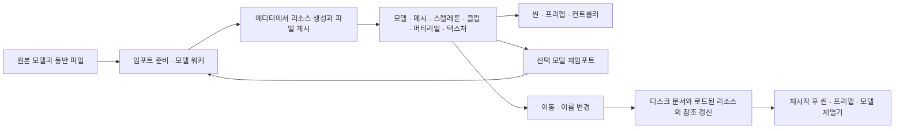

# 모델 임포트·재임포트·에셋 이동 흐름 점검 및 개선 계획

- 작성일 2026-11-19
- 상태 · 현재 소스와 기존 검증 기록을 대조한 정적 점검. 개선 구현과 실환경 검증은 대기 중이다.
- 범위 · 모델 임포트, 기존 모델 재임포트, 생성물·원본 이동 및 이름 변경, 씬·프리팹의 에셋 참조와 재시작 후 재로드.

## 1. 평가와 현재 흐름

**임포트와 파일 이동은 각각 보호 장치를 갖추고 있다. 두 작업을 이어서 쓰려면 선택한 재임포트 대상의 경로, 생성물 전체의 복구 범위, 디스크에 남는 바이너리 참조를 먼저 정리해야 한다.** 목표는 같은 모델을 씬·프리팹에서 사용하는 동안 이동이나 재임포트를 해도 편집값과 참조가 유지되고, 작업 실패 뒤에는 이전 상태로 열 수 있게 하는 것이다.



1. **임포트.** `AssetManager`가 요청을 만들고 모델 변환을 `BamAssetWorker`에 맡긴다. 워커를 사용할 수 없으면 기존 백그라운드 준비 경로를 사용한다. `ModelImporter::FinalizeStep()`은 에디터에서 리소스와 파일을 확정한다. 모델은 프로젝트 안 원본의 URI와 생성물 하위 폴더 설정을 보유한다. [AssetManager](../Editor/Source/AssetManager/Private/AssetManager.cpp) · [에셋 워커 계획](OutOfProcessAssetPipelinePlan.md) · [임포트 계획 Phase 6](InteractiveModelImportPreviewPlan.md)
2. **재임포트.** 모델의 콘텐츠 브라우저 메뉴는 로드된 `ImportSourceUri` 또는 동명 원본을 찾고 임포트 모달을 연다. 현재 출력 경로에서 기존 리소스를 찾으면 파일·메모리 갱신에서 해당 핸들을 재사용한다. 기존 머티리얼 인스턴스는 출력 키와 타입이 맞을 때 기본적으로 재사용하며, 머티리얼 덮어쓰기는 별도 옵션이다. 도끼의 머티리얼 보존·덮어쓰기와 분리된 원본에서의 재임포트는 기존 사용자 확인 기록이 있다. [콘텐츠 브라우저 재임포트](../Editor/Source/ImGui/ContentBrowserPanel/Private/ContentBrowserGridItem.cpp) · [ModelImporter](../Editor/Source/AssetManager/Importer/Private/ModelImporter.cpp) · [사용자 확인 기록](InteractiveModelImportPreviewPlan.md#2026-11-17-검증-기록)
3. **이동·이름 변경.** 콘텐츠 브라우저는 프로젝트 문서의 지원하는 참조를 조사하고 실행 직전 사용처와 원문을 다시 검사한다. 파일 이동과 참조 기록이 성공한 뒤 로드된 리소스의 검색 키·경로, 지원하는 문서·씬 이력을 갱신한다. 파일 작업의 Undo/Redo도 같은 경계를 사용한다. [콘텐츠 브라우저 파일 작업](ImGuiDevelopmentPlan.md) · [파일 이동 실행](../Editor/Source/ImGui/ContentBrowserPanel/Private/ContentBrowserPanel.cpp) · [리소스 경로 갱신](../Engine/Source/Resource/Private/ResourceRelocation.cpp)

## 2. 결함과 개선 순서

### 2.1 선택한 모델과 생성물을 기준으로 재임포트

**높음 · 이름 변경 후 재임포트 단절.** `.bammodel`의 메뉴는 유효한 원본 URI를 찾은 뒤에도 원본과 모델의 파일명이 다르면 실패한다. `ModelImportModal::Open()`에 넘기는 값은 원본과 출력 폴더이며, `FinalizeOneStep()`은 원본 파일명으로 새 `.bammodel` 경로를 계산한다. 따라서 이름 검사만 제거해도 변경된 모델을 갱신하지 못한다. `.bammodel.json`도 선택한 확장자를 그대로 쓰는 경로가 없다. 같은 폴더의 동명 원본을 먼저 검사하는 경로에서는 모델 로드 여부에 따라 저장된 원본 URI보다 동명 파일을 고를 수도 있다. [재임포트 메뉴](../Editor/Source/ImGui/ContentBrowserPanel/Private/ContentBrowserGridItem.cpp) · [임포트 모달](../Editor/Source/AssetManager/Importer/Private/ModelImportModal.cpp) · [출력 경로 계산](../Editor/Source/AssetManager/Importer/Private/ModelImporter.cpp)

**높음 · 이동한 생성물과 기존 편집값의 연결이 약함.** 모델은 기존 하위 폴더 설정을 이어받지만, 메시·머티리얼·클립의 출력 키는 이름과 폴더로 다시 계산한다. 생성물만 다른 곳으로 이동하거나 DCC에서 이름을 바꾸면 기존 산출물을 이어받지 못할 수 있다. 파일 이동은 경로 기반 키를 새 URI로 기록하며, 재임포트의 기존 객체 조회는 `FindHandleByKey()` 위주다. 프로젝트 상대 경로와 URI처럼 다른 표기가 같은 파일을 가리킬 때 물리 경로 비교까지 필요하다. 모달의 옵션 초기화와 생성물 이름 변경도 별도 검증 대상이다. [ModelImporter](../Editor/Source/AssetManager/Importer/Private/ModelImporter.cpp) · [키와 파일 경로 조회](../Engine/Source/Resource/Private/ResourceManager.cpp) · [경로 변경 후 키 갱신](../Engine/Source/Resource/Private/ResourceRelocation.cpp)

- **첫 수정.** 재임포트 요청에 선택한 기존 모델의 파일 경로를 전달한다. 기존 모델의 원본 URI를 로드 여부와 관계없이 우선 확인하고, 정보가 없는 구형 파일만 동명 후보를 검사한다. 원본이 누락되거나 후보가 여럿이면 대상과 후보를 보여주고 원본을 다시 지정하게 한다. 원본 모델의 최초 임포트는 사용자가 선택한 출력 폴더에서 경로를 정한다.
- 기존 파일의 포맷과 실제 경로를 유지하면서 기존 객체는 `ResourceManager`의 파일 경로 조회도 이용해 찾는다. 재임포트 전에 대표 모델과 생성물 목록을 비교해 유지·갱신·신규 생성·연결 해제 예정 항목을 구분한다. 기존 모델의 의존 핸들과 모델 파트에 이미 있는 `SourceNodeKey` 등 사용 가능한 식별 정보부터 검토한다. 동명·중복이나 원본 구조 변경으로 일대일 대응을 확인할 수 없으면 사용자에게 표시한다. 참조 중일 수 있는 기존 생성물은 별도의 확인을 거쳐 정리한다. [연결된 모델 파트](../Engine/Source/World/Scene/Private/SceneModel.cpp)
- 배치 회전과 하위 폴더, 머티리얼의 사용자 수정값, 옵션을 끈 스켈레톤·클립의 기존 연결에 대해 각각 보존·변경 규칙을 정한다. 모달에서 결과에 영향을 주는 기존 설정을 확인할 수 있게 하고, 현재 데이터에 저장된 설정부터 복원한다.
- [ ] **완료 기준.** 모델만 이름을 바꾼 경우, 모델·생성물 폴더를 통째로 옮긴 경우, 머티리얼·클립만 옮긴 경우, 기존 복합 확장자 파일에서 각각 재임포트한다. 기존 대상이 갱신되고 불필요한 형제 모델이나 중복 리소스가 생기지 않는다. 따뜻한 캐시와 재시작 후 같은 원본과 생성물을 찾고, 기존 핸들·씬과 프리팹 참조·머티리얼 편집값이 정책대로 유지된다.

### 2.2 파일과 메모리를 같은 범위에서 복구

**높음 · 실패한 작업의 파일과 메모리가 일부만 되돌아감.** 메시 파일은 임시 생성·백업·게시 후 실패 시 복구된다. 기존 메시의 메모리 상태도 스냅샷으로 되돌린다. 그러나 `CommitPreparedModel()`은 스켈레톤·애니메이션·텍스처·머티리얼·모델을 순서대로 쓰거나 기존 객체에 적용한다. 뒤쪽 모델 저장이 실패하면 앞서 갱신한 스켈레톤이나 클립이 남을 수 있다. 신규 등록 역순 제거는 기존 객체의 복원과 신규·기존 파일 정리까지 처리하지 않는다. 한 파일을 임시 파일로 교체하는 Archive 저장은 이미 제공된다. [임포트의 확정과 복구](../Editor/Source/AssetManager/Importer/Private/ModelImporter.cpp) · [Archive 저장](../Projects/Archive/src/ArchiveInterface.cpp)

- 모델 한 요청의 출력 목록과 기존 객체를 먼저 확정한다. 쓰기 권한·충돌·필수 부모 머티리얼·의존 에셋·경로 및 타입을 검사하고 생성물을 임시 파일에 준비한다. 재사용만 하는 자산과 이번 요청이 변경하는 자산을 구분한다.
- 기존 메시의 백업·복구 방식에서 확장한다. 게시 대상의 변경 전 파일과 필요할 때 변경 전 메모리 상태를 보관한다. 준비를 마친 뒤 파일과 메모리 반영을 진행하고, 중간 실패 시 신규 생성물 제거와 기존 값 복원을 함께 수행한다. 엔진 핸들과 참조를 유지하면서 롤백 시점의 파일·로드된 객체가 같은 내용을 보여야 한다. `SaveToFile=false`는 메모리 변경을 같은 범위에서 복구한다. 작업 후 경로·썸네일·참조 색인이 한 번의 성공 상태를 관측하도록 갱신 시점을 정한다.
- 정상 실패·취소·종료에 먼저 대응한다. 강제 종료 뒤에도 복구할 요구가 있으면 파일 교체 전에 변경 전후 경로와 단계 기록을 디스크에 남기고, 재시작 때 탐지·복구한다. 기존 파일을 외부에서 바꾼 상황에서 복구가 새 변경을 덮어쓰지 않게 재검증한다. UI의 취소는 워커 변환과 게시 단계에서 어디까지 가능한지 표시한다.
- [ ] **완료 기준.** 스켈레톤, 임베디드 텍스처, 머티리얼, 최종 모델 게시에서 각각 실패를 유도한다. 기존 파일 바이트·핸들·씬에서 보이는 값이 동일하고, 새 파일과 등록 객체가 남지 않는다. 복구 자체가 실패하면 남은 백업과 상태를 확인할 수 있다. 최초 임포트, 덮어쓰기, 메모리 전용 모드와 정상 종료를 같은 기준으로 확인한다.

### 2.3 이동 확인의 바이너리 참조 범위 보완

**높음 · 에디터 재시작 뒤 참조가 끊길 수 있음.** `ScanProject()`는 JSON·컨트롤러 등 텍스트 문서를 조사한다. 임포터가 쓰는 BEVE `.bammodel`·`.bammatinst` 내부 참조는 이 조사에 들어오지 않는다. 텍스처나 메시를 옮길 때 로드된 핸들이 남아 있으면 현재 화면은 정상으로 보일 수 있지만, 원래 경로를 기록한 바이너리를 재시작 후 열면 참조를 찾지 못할 수 있다. `Model::PrepareFilePathRelocation()`은 로드된 모델의 원본 URI가 영향받는 경우 이동을 거부한다. 모델을 로드하지 않은 상태에서는 같은 보호가 적용되는지 파일 검사 경로에서 별도로 확인해야 한다. [참조 검사 범위](../Editor/Source/AssetManager/Private/AssetReferenceValidator.cpp) · [Model 원본 경로 보호](../Engine/Source/Model/Public/Model.h) · [BEVE 파일 저장](../Engine/Source/Resource/Private/ResourceManager.cpp)

- **안전한 차단부터 적용.** `.bammodel`과 `.bammatinst`를 첫 대상으로 삼아 엔진 리소스를 로드하지 않고, 디스크에서 타입과 참조 필드를 확인한다. 모델의 `ImportSourceUri`를 제작용 참조로 분류해 패키징에 필요한 런타임 참조와 구분한다. 읽거나 갱신할 수 없는 영향 문서가 있으면 관련 파일·필드와 함께 차단 이유를 보여준다. 확인하지 않은 타입은 확인창에 검사 범위를 표시한다.
- **지원 타입만 재기록.** 기존 `AssetReferenceValidator`의 이동 계획, 원문 검증, 백업과 파일 Undo/Redo를 활용한다. 바이너리에 적용할 때는 원본 바이트를 확보하고 해당 타입의 지원하는 참조만 고친다. 디스크 게시 성공 후 메모리 경로·문서 경로·씬 이력 갱신을 유지한다. 작업 폴더와 제작 원본의 동반 파일을 옮기는 기능은 실제 참조를 모두 확인할 수 있을 때 확장한다. [참조 백업과 복원](../Editor/Source/AssetManager/Private/AssetReferenceMove.cpp) · [에셋 경로 분리 기준](ResourceAndAssetSeparationPlan.md)
- [ ] **완료 기준.** BEVE 모델을 참조하는 씬·프리팹과 BEVE 머티리얼이 참조하는 텍스처를 준비한다. 모델을 연 상태와 한 번도 로드하지 않은 상태에서 한글 폴더 이동·F2 이름 변경을 수행한다. 지원하는 이동은 재시작 후 같은 참조를 복원하고 파일 Undo/Redo에서 기존 바이트와 URI가 일치한다. 미지원 참조는 파일 이동 전에 차단한다. 원본 URI 이동은 재임포트 메뉴에서 다시 확인한다.

### 2.4 임포트 확정과 파일 작업의 충돌 방지

**높음 · 프레임 사이에 겹칠 수 있는 파일 작업.** `ModelFinalizeState::OutputReservation`은 모델 임포트끼리 동일 출력 디렉터리 사용을 막는다. `FinalizeStep()`은 메시 게시를 여러 프레임에 나눈다. 브라우저의 이동 검사는 씬·리소스 문서 상태와 파일·참조를 확인하지만 임포트 예약을 조회하지 않는다. 출력 폴더가 확정 도중 이동하면 다음 게시나 롤백이 기존 경로를 사용할 수 있다. [임포트 디렉터리 예약](../Editor/Source/AssetManager/Importer/Private/ModelImporter.cpp) · [열린 문서 사전 검사](../Editor/Source/ImGui/Private/ImGuiManager.cpp) · [파일 이동 사전 검사](../Editor/Source/ImGui/ContentBrowserPanel/Private/ContentBrowserPanel.cpp)

- 기존 예약을 바탕으로 진행 중인 작업의 원본·출력 경로와 상위 폴더 이동의 교차 여부를 검사한다. 파일 이동·이름 변경과 Undo/Redo에서 겹치는 요청만 거부하거나 작업 완료 후 다시 평가한다. 워커가 준비한 원본이 도중에 바뀌었는지도 게시 직전에 검증한다. UI에서는 막힌 파일과 진행 중인 작업을 표시한다.
- [ ] **완료 기준.** 메시 일부를 게시한 상태에서 출력 폴더 및 상위 폴더 이동·이름 변경을 요청하면 차단된다. 관계없는 폴더는 이동할 수 있다. 임포트 성공·실패·취소 뒤에는 예약이 해제되고 같은 작업을 다시 시도할 수 있다.

### 2.5 동반 파일과 대형 에셋 검증

**보통 · 변환 캐시와 메인 스레드 비용.** 모델 DDC 키는 원본 파일의 경로·메타데이터와 변환 옵션을 사용한다. `.gltf`의 외부 `.bin`이나 `.obj`의 `.mtl`만 수정하면 캐시 키가 유지될 수 있다. 또한 프레임 시간 예산은 `FinalizeOneStep()` 사이에서 적용되므로 큰 최종 확정 호출은 그 자체로 길어질 수 있다. 파일 이동도 확인 준비와 실행 직전에 전체 참조를 다시 조사한다. 실제 프레임 비용은 측정이 필요하다. [모델 DDC](../Tools/Converters/ModelConverter/Private/ModelConverter.cpp) · [확정 단계](../Editor/Source/AssetManager/Importer/Private/ModelImporter.cpp) · [이동 실행](../Editor/Source/ImGui/ContentBrowserPanel/Private/ContentBrowserPanel.cpp)

- 동반 파일만 변경하는 재현을 먼저 만든다. 변경을 놓치는 포맷부터 변환 결과에 영향을 주는 의존 파일과 옵션을 캐시 검증에 포함한다. 목록을 안전하게 확보하기 어려운 포맷은 명시적 재임포트에서 캐시를 우회하는 방안의 비용을 비교한다.
- 기존 `Model commit timing`, `Model mesh save timing`, 이동 준비·재검사 계측을 사용한다. 대형 프로젝트에서 프레임 최댓값과 단계별 소요 시간을 기록하고, 병목인 준비 작업부터 백그라운드나 분할 처리로 옮긴다. 최종 원문·충돌 재검사는 유지한다.

## 3. 통합 검증과 기존 검사

1. **준비.** 임베디드 텍스처가 있는 스킨드 모델과 외부 동반 파일을 쓰는 모델을 하나씩 사용한다. 모델을 씬에 배치하고 프리팹으로 저장하며, Controller 클립과 머티리얼 인스턴스에 직접 참조를 둔다. 변경 전 파일 해시, 원본·생성물 URI, 핸들, 씬·프리팹의 편집값을 기록한다.
2. **성공 경로.** 임포트 → 사용자 머티리얼 수정 → 재임포트 → 생성물 이동·이름 변경 → 씬과 프리팹 저장·재열기 → 에디터 재시작 → 재임포트를 이어서 확인한다. 원본과 출력을 다른 폴더에 두는 경우와 폴더 전체 이동을 포함한다. 열린 상태와 재시작 후 결과를 비교한다.
3. **실패 경로.** 출력 이름 충돌, 읽기 전용, 중간 저장 실패, 원본 누락·변경, 다른 작업과의 경로 충돌을 각각 확인한다. 취소·실패 후 원래 파일과 핸들·이력·실제 씬이 유지되는지 본다. 이동과 파일 Undo/Redo를 별도로 검증한다.
4. **확인 기록.** `AssetWorkerModelCheck`는 워커 변환 경로의 확인에 쓰고, `SceneArchiveCheck`는 모델 파트와 리소스 왕복, `AssetReferenceCheck`와 `EditorHistoryCheck`는 참조 이동과 이력 회귀에 사용한다. 묶음 복구, URI·상대 경로로 같은 핸들 갱신, 콜드 스타트의 바이너리 참조 검사에는 별도 회귀 사례가 필요하다. 에디터에서 열린 씬의 시각·조작 검증은 아래 기존 검사와 별도로 수행한다. [에디터 UX 검증](EditorUXTestGuidelines.md)

구현 후 사용자가 저장소 루트에서 실행할 기존 검사 명령이다.

```powershell
cmake --preset x64-debug -DBUILD_TESTING=ON
cmake --build --preset x64-debug --config Debug --target Editor BamAssetWorker AuditLocalization SceneArchiveCheck AssetReferenceCheck EditorHistoryCheck
ctest --preset x64-debug --output-on-failure -R "AssetWorkerModelCheck|SceneArchiveCheck|AssetReferenceCheck|EditorHistoryCheck|LocalizationAuditUtility"
```

추가 문구는 기존 `Editor.ModelImport.csv`·`Editor.ContentBrowser.csv`의 관련 키를 우선 사용하고 새 키에는 한·영 원본 값을 등록한다. 이동 확인과 취소, 파일 작업 단축키는 기존 `EditorUI`·`InputManager`·`ShortcutManager` 경로를 따른다. [에디터·클라이언트 지침](EngineEditorClientGuidelines.md)

이번 점검에서는 코드, 현재 검사 범위와 기존 재임포트 확인 기록을 대조했다. 변경 적용·빌드·CTest·실환경 재현과 성능 측정은 이후 단계에 남아 있다.
