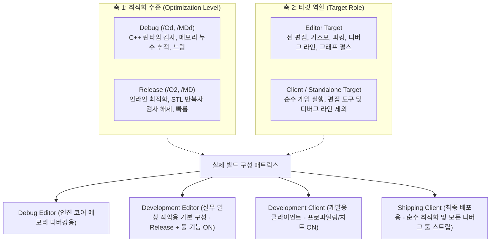

# 엔진·에디터·클라이언트 빌드 구성과 디버그 전처리기 지침

- 작성일: 2026-10-29
- 상태: 지침 / 클라이언트 빌드 및 패키징 선행 기준
- 관련 문서:
  - [BuildAndPackagingPlan.md](BuildAndPackagingPlan.md) (빌드·패키징 순서 및 실행 계약)
  - [EngineEditorClientGuidelines.md](EngineEditorClientGuidelines.md)의 3절, 12절 (Engine/Editor/Client 책임 및 패키징)
  - [SourceOrganizationGuidelines.md](SourceOrganizationGuidelines.md) (의존성 및 소스 배치)

---

## 1. 목적 및 배경

클라이언트 빌드 및 패키징(P2-E)을 본격적으로 진행하기 전, 엔진 코드베이스 전반에 걸쳐 **최적화 수준(`Debug` vs `Release`)**과 **타깃 역할(`Editor` vs `Client`)**의 구분을 명확히 하고, **디버그 전용 코드의 전처리기 처리 표준**을 수립한다.

초기 조사에서는 도구 기능의 `_DEBUG` 의존과 표준 스트림 직접 출력을 확인했다.
2026-11-02 현재 일부 매크로 격리와 로거 전환은 반영되어 있으므로 실제 잔여는 4절을 따른다.
아래는 구성과 타깃 역할을 혼동할 때의 위험 및 설계 기준이다:

1. **에디터 릴리스 빌드 파손**: 에디터를 빠른 속도로 사용하기 위해 Release 모드로 빌드할 때, 기즈모/디버그 렌더링 코드가 함께 증발하여 빌드 오류가 발생함.
2. **배포 바이너리 오염**: 최종 클라이언트 배포판에 불필요한 디버그 콘솔 출력, 디버그용 메모리 스냅샷, 피킹 버퍼 오버헤드가 그대로 잔존함.
3. **CRT/ABI 불일치 크래시**: Debug 실행 파일과 Release DLL의 혼용으로 인한 힙 손상 위험.

---

## 2. 핵심 설계 원칙: 두 축의 분리

빌드 구성을 판단할 때는 반드시 **최적화 수준**과 **타깃 역할**이라는 서로 다른 두 축을 분리해야 한다.

### "에디터도 릴리스 DLL을 사용해야 하는가?"에 대한 답
**네, 에디터도 일상적인 작업(레벨 디자인, 씬 편집, PIE 플레이)에서는 반드시 릴리스(Release 또는 RelWithDebInfo) 엔진 DLL을 사용해야 합니다.**

- **성능 이유**: Debug 빌드는 STL 반복자 검증과 최적화 해제로 인해 프레임레이트가 심각하게 낮아집니다.
- **실무 엔진 표준**: 언리얼 엔진의 `Development Editor`, 유니티의 에디터 구동 방식과 동일하게, 최적화(`/O2`)가 켜진 상태에서 에디터 도구(기즈모, 그래프 디버깅 등)가 정상 작동해야 합니다.
- **CRT 일치 규칙**: Windows/MSVC 환경에서는 **Debug EXE와 Release DLL을 섞어서 링크하면 즉시 힙 손상 크래시**가 발생합니다. 따라서 에디터를 Release로 구동할 때는 엔진 DLL도 반드시 Release 빌드여야 합니다.

---

## 3. 전처리기 매크로 정의 표준

엔진 내부 코드는 다음 매크로를 명확히 구분하여 적용한다.

| 전처리기 매크로 | 정의 조건 | 허용되는 사용처 | 금지되는 사용처 |
| :--- | :--- | :--- | :--- |
| **`_DEBUG`** (또는 `DEBUG`) | 컴파일러 디버그 빌드 시 자동 정의 | - C 런타임 메모리 누수 점검 (`_CrtSetDbgFlag`) - GPU RHI 디버그 레이어 활성화 - 실패 시 `__debugbreak()` 호출 | - 기즈모/디버그 라인 구조체 정의 - 에디터용 디버그 실행기 조회 API - 에디터 패널에 노출되는 편의 기능 |
| **`BAM_EDITOR`** (또는 `BAM_WITH_EDITOR`) | Editor 타깃 빌드 시 정의 (Debug, Release 모두) | - 뷰포트 기즈모/디버그 라인 (`DebugVertex`) - 그래프 노드 펄스 실행기 조회 (`GetDebugExecutor`) - 마우스 피킹 ID 버퍼 계산 (`pickingId`) - 리소스 메모리 스냅샷 (`GetDebugSnapshot`) | - 독립형 Client 전용 런타임 로직 |
| **`BAM_SHIPPING`** | 최종 배포용 Client 타깃 빌드 시 정의 | - 모든 치트, 콘솔 커맨드, 디버그 로깅 완전 스트립 | - 에디터 또는 개발용 클라이언트 |

---

## 4. 엔진 소스 내 디버그 코드 현황 및 정비 과제 (2026-11-02 정적 갱신)

클라이언트 빌드 및 패키징 작업 전에 정비해야 할 엔진(`Engine/Source`) 내의 세부 항목 목록과 반영 현황이다.

### 4.1. 콘솔 직접 출력 스트림 제거 (`std::cerr`, `std::cout`)
엔진 공식 로거(`BAM_LOG`, `ENGINE_LOG_ERROR`) 대신 C++ 표준 스트림을 직접 호출하는 코드는 에디터 콘솔 창에 수집되지 않으며, 배포판 GUI 실행 시 불필요한 I/O를 유발한다.

- [x] `Engine/Source/Core/Localization/Private/LocalizationManager.cpp`:
  과거 표준 스트림 출력 위치가 `BAM_LOG(Error/Warn, "Engine", "Localization", ...)`를 사용한다(정적 확인).
- [x] `Engine/Source/Core/Private/Reflection/ReflectionRegistry.cpp`:
  초기화 실패가 `BAM_LOG(Fatal, "Engine", "Reflection", ...)`를 사용한다(정적 확인).
- [x] `Engine/Source/Graph/Public/GraphGameplayLibrary.h` (20~38줄):
  블루프린트 `Debug.PrintFloat/PrintInt/PrintVector`의 `std::cout`을 `BAM_LOG(Info, "Engine", "BlueprintLog", ...)`로 전환 완료.

### 4.2. 저수준 디버그 API 및 강제 종료 개선 (완료 — 2026-11-01)
- [x] `Engine/Source/Render/RHI/Platform/DirectX12/Private/DirectX12RHI.cpp`:
  - `CreateBuffer`, `CreateTexture2D`, `CreateTextureCube` 내부 3곳의 `OutputDebugStringA` 및 `std::terminate()` 호출을 제거하고, `BAM_LOG_ERROR`로 원인을 남긴 뒤 `EResult::Fail`을 정상 반환하도록 개선 완료.

### 4.3. 디버그 전용 인터페이스 전처리기 정비
- [x] `Engine/Source/System/Graph/Public/GraphSystem.h` 및 `Private/GraphSystem.cpp`:
  - 비표준 문법이었던 `#ifdef(_DEBUG)`가 제거되어 Release 에디터에서도 `GetDebugExecutor`가 정상 링크되도록 조치 완료.
- [x] `Engine/Source/System/Graph/Public/GraphSystem.h` 및 `Private/GraphSystem.cpp`:
  - `BAM_EDITOR` 조건으로 디버그 실행기·노드 실행 훅 인터페이스/구현을 분리한다(정적 확인).

### 4.4. 릴리스 에디터 빌드 파손 방지 (완료 — 2026-10-31)
- [x] `Engine/Source/Core/Public/Structs/Vertex.h` (216줄) 및 `Editor/Source/ImGui/ViewportPanel/Private/SceneViewportPanel.cpp`:
  - `DebugVertex` 및 `m_DebugRenderer`를 감싸고 있던 `#ifdef _DEBUG` 분기를 제거하여 Release 에디터 빌드에서도 디버그 렌더링이 상시 정상 동작하도록 해결 완료.

### 4.5. 단언 매크로 및 디버그 스냅샷 격리
- [ ] `Engine/Source/Core/Public/Macro.h` (43줄):
  - 원시 C `assert()`를 엔진 표준 단언 체계로 정비 (남은 과제).
- [x] `Engine/Source/Resource/Public/ResourceManager.h` 및 `Private/ResourceManager.cpp`:
  - `GetDebugSnapshot()`에 `BAM_EDITOR` 가드가 있다(정적 확인). 최종 Client에서의 제거 여부는 아래 구성 검증과 별도다.

### 4.6. 빌드 옵션 반영과 잔여 검증

- [x] 루트의 `BAMENGINE_WITH_EDITOR` 옵션으로 Editor 하위 프로젝트 추가를 제어한다.
- [x] Engine은 옵션이 켜지면 `PUBLIC BAM_EDITOR=1`을 제공한다.
- [ ] 같은 구성에서 Engine을 링크하는 Client에도 정의가 전파된다. Client 타깃 이름만으로 Editor API가 빠졌다고 판단하지 않는다.
- [ ] 별도 Editor OFF 구성의 Engine·Client·프로젝트 모듈을 빌드하고 헤더/ABI 일치를 확인한다.
- [ ] `BAM_SHIPPING` 정의, Shipping의 디버그 코드/로깅 제거 범위를 확정하고 검증한다.
- [ ] `DebugVertex` 등 다른 도구 코드의 제거 범위는 실제 소비자 기준으로 결정한다.

2026-11-02 갱신은 소스 대조다. 새로운 빌드·테스트·최종 배포 바이너리 검사를 수행하지 않았다.
관련 한계는 [코드·문서 점검](CodeDocumentationAudit-2026-11-02.md) 2.3절을 따른다.

---

## 5. 클라이언트 빌드 및 패키징(P2-E) 진행 시 작업 절차

1. **현재 CMake 정의와 구성 경계 확인**:
   - `BAMENGINE_WITH_EDITOR=ON`인 Engine의 PUBLIC 정의를 Editor·Client·모듈이 함께 받는다.
   - Editor 없는 배포 검증은 별도 `BAMENGINE_WITH_EDITOR=OFF` 구성으로 수행한다.
   - 동일 Engine 헤더/바이너리를 소비하면서 타깃별 매크로만 다르게 정의하는 방식으로 ABI를 어긋나게 하지 않는다.
   - Shipping 구성과 `BAM_SHIPPING` 정책은 남은 작업이다.
2. **위 4절의 엔진 디버그 코드 정비 완료**:
   - 이미 가드가 있는 `GetDebugExecutor`와 아직 상시 제공되는 `DebugVertex`를 구분하고 필요한 제거 범위를 결정한다.
   - 표준 스트림 및 저수준 디버그 호출 정리.
3. **독립형 Client 릴리스 빌드 검증**:
   - 에디터 의존성이 완전히 제거된 상태에서 Client 실행 파일이 온전히 링크되는지 확인.
4. **패키징 검증**:
   - [BuildAndPackagingPlan.md](BuildAndPackagingPlan.md)의 4단계(Stage와 Package) 절차에 따라 배포 폴더를 구성하고 개발 저장소 외부에서 단독 실행 확인.
