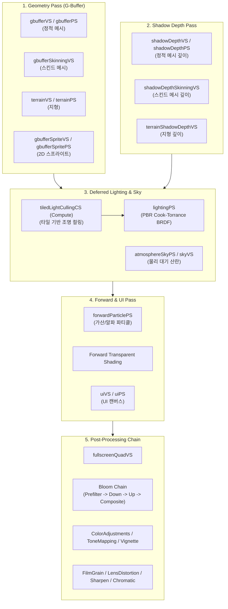

# BamEngine 기본 리소스 및 셰이더 명세서 (Built-in Resources & Shaders Specification)

- **최종 갱신일**: 2026-11-16
- **상태**: 공식 명세 확립 (Living Document)
- **관련 문서**:
  - [ResourceAndAssetSeparationPlan.md](ResourceAndAssetSeparationPlan.md) (리소스 및 애셋 분리 보관 계획)
  - [Shader/BINDING_LAYOUT.md](Shader/BINDING_LAYOUT.md) (셰이더 리소스 바인딩 레이아웃)
  - [EngineEditorClientGuidelines.md](EngineEditorClientGuidelines.md) (엔진·에디터·클라이언트 아키텍처 지침)

---

## 1. 개요 및 가상 경로(URI) 아키텍처

BamEngine은 엔진 코어 및 에디터 구동에 필수적인 불변(Immutable) 자원과 사용자가 생성·수정하는 프로젝트 가변(Mutable) 자원을 물리 디렉터리 및 가상 URI 스킴으로 엄격히 분리하여 관리합니다.

### 1.1 가상 URI 스키마 및 마운트 지점

| 가상 스킴 (URI) | 실제 물리 디렉터리 | 성격 및 권한 | 주요 포함 내용 |
| :--- | :--- | :--- | :--- |
| `Engine://` | `<ProjectRoot>/Engine/Resources/` | **시스템 빌트인 (Read-Only)** | 코어 셰이더, 기본 머티리얼, 시스템 텍스처, 기본 프리미티브 메시, UI 폰트, 엔진 로캘 |
| `Editor://` | `<ProjectRoot>/Editor/Resources/` | **에디터 전용 (Read-Only)** | 에디터 UI 로캘(`Editor.csv`), 에디터 전용 툴바 및 레이아웃 자원 |
| `Project://` (`Asset://`) | `<ProjectRoot>/Assets/` | **프로젝트 사용자 에셋 (Read-Write)** | 씬(`.bamscene.json`), 임포트된 모델, 사용자 텍스처/머티리얼, 오디오, 프리팹 |

### 1.2 하위 호환 폴백 (Legacy Fallback) 규칙

`PlatformPath::ResolveUri`는 가상 스키마가 없는 레거시 상대 경로(`Resources/...`)를 수신했을 때 `PlatformPath::IsBuiltInRelativeResourcePath`를 통해 빌트인 여부를 판별합니다.
- `shader/`, `shaders/`, `font/`, `fonts/`, `data/localization/`, 또는 `material/defaultmaterial.`, `texture/white1x1.` 등 빌트인 패턴과 일치하면 `Engine/Resources`를 최우선 조회합니다.
- 그렇지 않은 경우 `Assets/`를 먼저 확인한 뒤, 파일이 없으면 `Engine/Resources/`를 순차 폴백 검색합니다.
- **권장 사항**: 신규 코드 및 직렬화 파일에서는 암시적 폴백 대신 `Engine://` 접두사를 명시하여 불필요한 파일 시스템 I/O와 경고를 방지합니다.

---

## 2. 기본 제공 셰이더 (Built-in Shaders)

엔진은 **DirectX 12 (HLSL / DXIL)** 와 **Vulkan (GLSL / SPIR-V)** 듀얼 렌더링 백엔드를 지원합니다.
모든 빌트인 셰이더는 `Engine/Resources/Shader/`에 배치되어 있습니다.

- **HLSL 소스 및 공통 헤더**: `Engine/Resources/Shader/hlsl/`
- **GLSL 소스**: `Engine/Resources/Shader/glsl/`
- **DXIL 바이너리 (DirectX 12)**: `Engine/Resources/Shader/bin/dxil/*.cso`
- **SPIR-V 바이너리 (Vulkan)**: `Engine/Resources/Shader/bin/spirv/*.spv`

### 2.1 렌더링 파이프라인 흐름도



### 2.2 셰이더 스테이지별 상세 명세

#### (1) 지오메트리 패스 (G-Buffer & Skinned/Terrain)
| HLSL 파일명 | 스테이지 | 기능 및 특징 | 입력 바인딩 요약 |
| :--- | :--- | :--- | :--- |
| `gbufferVS.hlsl` | Vertex | 정적 메시 G-Buffer 변환, 월드 탄젠트/노멀 생성 | `b0, space0`(Camera), `b0, space2`(Object) |
| `gbufferPS.hlsl` | Pixel | Albedo, Normal, Roughness/Metallic, ShadingModel 등 MRT 출력 | `space1`(Material Textures `t0..t15`, Samplers `s0..s7`) |
| `gbufferSkinningVS.hlsl` | Vertex | 스켈레탈 메시 G-Buffer 변환 (인덱스/가중치 블렌딩) | `b0, space0`(Camera), `t0, space2`(Bone Matrices) |
| `gbufferSpriteVS.hlsl` | Vertex | 2D 스프라이트 G-Buffer 버텍스 변환 | `b0, space0`(Camera), `b0, space2`(Object) |
| `gbufferSpritePS.hlsl` | Pixel | 2D 스프라이트 MRT 출력 (알파 마스킹 지원) | `t0, space1`(Sprite Texture) |
| `staticMeshVS.hlsl` | Vertex | 범용 정적 메시 버텍스 셰이더 | 기본 변환 |
| `skinningVS.hlsl` | Vertex | 범용 스키닝 버텍스 셰이더 | `t0, space2`(Bone Matrices) |
| `terrainVS.hlsl` | Vertex | 터레인 높이맵 변환 및 정점 생성 | `b0, space0`(Camera), 터레인 청크 데이터 |
| `terrainPS.hlsl` | Pixel | 복합 스플랫 텍스처 블렌딩 G-Buffer 출력 | 멀티 레이어 텍스처 바인딩 |

#### (2) 섀도우 패스 (Shadow Depth)
| HLSL 파일명 | 스테이지 | 기능 및 특징 |
| :--- | :--- | :--- |
| `shadowDepthVS.hlsl` | Vertex | 방향성/포인트/스팟 라이트 뷰-프로젝션 깊이 투영 |
| `shadowDepthSkinningVS.hlsl` | Vertex | 스키닝 캐릭터의 라이트 공간 깊이 투영 (본 트랜스폼 적용) |
| `shadowDepthPS.hlsl` | Pixel | 알파 클립(마스킹) 머티리얼을 위한 그림자 뎁스 픽셀 셰이더 |
| `terrainShadowDepthVS.hlsl` | Vertex | 지형 표면의 라이트 공간 깊이 투영 |

#### (3) 라이팅 및 컴퓨트 패스 (Deferred Lighting & Sky)
| HLSL 파일명 | 스테이지 | 기능 및 특징 |
| :--- | :--- | :--- |
| `lightingPS.hlsl` | Pixel | 디퍼드 라이팅 픽셀 셰이더. MRT 텍스처를 읽어 PBR Cook-Torrance BRDF, 그림자 감쇄, IBL 환경광 계산 |
| `tiledLightCullingCS.hlsl` | Compute | 화면 공간을 타일(16x16)로 나누어 타일 Frustum과 교차하는 포인트/스팟 라이트 인덱스를 컬링하는 컴퓨트 셰이더 |
| `skyVS.hlsl` / `skyPS.hlsl` | VS / PS | 큐브맵 또는 기본 하늘 구체 렌더링 |
| `atmosphereSkyPS.hlsl` | Pixel | Rayleigh 및 Mie 산란을 기반으로 태양 위치에 따른 물리 대기 산란을 실시간 연산 |

#### (4) 포워드 및 UI 패스
| HLSL 파일명 | 스테이지 | 기능 및 특징 |
| :--- | :--- | :--- |
| `spriteVS.hlsl` / `spritePS.hlsl` | VS / PS | 포워드 렌더링 2D 스프라이트 셰이더 |
| `uiVS.hlsl` / `uiPS.hlsl` | VS / PS | 캔버스 UI, 이미지, 텍스트 렌더링 |
| `forwardParticlePS.hlsl` | Pixel | 파티클 렌더링 (Additive 및 AlphaBlend 파티클 공용 처리) |

#### (5) 포스트 프로세스 체인 (Post-Processing)
| HLSL 파일명 | 스테이지 | 기능 및 특징 |
| :--- | :--- | :--- |
| `fullscreenQuadVS.hlsl` | Vertex | 포스트 프로세스 패스 공용 풀스크린 삼각형/쿼드 생성 |
| `postprocessPS.hlsl` | Pixel | 기본 포스트 프로세스 컴포짓 |
| `postprocess_tonemappingPS.hlsl` | Pixel | ACES, Reinhard 등의 톤매핑 및 감마 보정 |
| `bloomPrefilterPS.hlsl` | Pixel | 임계값(Threshold) 이상의 고휘도 픽셀 추출 |
| `bloomDownsamplePS.hlsl` | Pixel | 13-tap 바이리니어 다운샘플링을 통한 밉 체인 블러 |
| `bloomUpsamplePS.hlsl` | Pixel | 텐트 필터를 이용한 점진적 업샘플링 및 누적 |
| `bloomCompositePS.hlsl` | Pixel | 원본 HDR 컬러 버퍼와 최종 블룸 버퍼 가산 합성 |
| `colorAdjustmentsPS.hlsl` | Pixel | 노출(Exposure), 대비(Contrast), 채도(Saturation), 화이트 밸런스 조정 |
| `chromaticAberrationPS.hlsl` | Pixel | 화면 가장자리 색수차 왜곡 효과 |
| `vignettePS.hlsl` | Pixel | 렌즈 주변부 감쇄(Vignetting) 효과 |
| `filmGrainPS.hlsl` | Pixel | 절차적 노이즈를 통한 아날로그 필름 입자 효과 |
| `lensDistortionPS.hlsl` | Pixel | 렌즈 곡률에 따른 배럴/핀쿠션 왜곡 효과 |
| `sharpenPS.hlsl` | Pixel | 언샤프 마스킹(Unsharp Masking) 기반 선명화 필터 |

#### (6) 에디터 및 디버그 셰이더
| HLSL 파일명 | 스테이지 | 기능 및 특징 |
| :--- | :--- | :--- |
| `editorGridVS.hlsl` / `editorGridPS.hlsl` | VS / PS | 에디터 뷰포트 지면 그리드 라인 렌더링 |
| `infiniteGridVS.hlsl` / `infiniteGridPS.hlsl` | VS / PS | 3D 무한 원근 격자 렌더링 |
| `infiniteGrid2DPS.hlsl` | Pixel | 2D 탑뷰 무한 격자 렌더링 |
| `debugLineVS.hlsl` / `debugLinePS.hlsl` | VS / PS | 콜라이더, 바운딩 박스, 기즈모 등 디버그 라인 와이어프레임 렌더링 |
| `viewport_channelPS.hlsl` | Pixel | 에디터 뷰포트에서 Albedo, Normal, Roughness, Metallic, Depth 채널을 단독 시각화 |
| `materialPreviewPS.hlsl` | Pixel | 머티리얼 에디터의 미리보기 구체 전용 PBR 라이팅 |
| `cubeVS.hlsl` / `cubePS.hlsl` | VS / PS | 디버그 큐브 렌더링 |
| `clientPresentPS.hlsl` | Pixel | 스탠드얼론 클라이언트의 최종 스왑체인 프레젠트 |

### 2.3 공통 인클루드 헤더 (`.hlsli` / `.glsl`)

- `common.hlsli` / `common.glsl`: 글로벌 카메라 버퍼(`CommonVSData`, `CameraBuffer`), 뷰/프로젝션 행렬 및 화면 크기
- `matrix.hlsli`: 행렬 전치, 역행렬 및 공간 변환 함수 모음
- `light.hlsli` / `light.glsl`: 조명 구조체(`DirectionalLight`, `PointLight`, `SpotLight`) 및 거리/각도 감쇄 계산
- `fog.hlsli`: 거리 기반 및 높이 기반 지수 포그(Exponential Height Fog) 공식
- `cloud.hlsli`: 볼류메트릭 클라우드 노이즈 텍스처(기본형상/디테일) 샘플링 로직
- `tonemapping.hlsli`: 색공간 변환 및 톤매핑 커브(ACES Film, Reinhard, Linear)
- `shading_flags.hlsli`: 셰이딩 모델 비트마스크(`SHADING_MODEL_UNLIT`, `DEFAULT_LIT` 등)
- `uiCommon.hlsli`: UI 버텍스 입력 레이아웃 및 클리핑 사각형 판정식

### 2.4 루트 시그니처 / 디스크립터 레이아웃 규약 (`BINDING_LAYOUT.md` 발췌)

| Space / Set | 갱신 주기 | D3D12 Root Parameter | 주요 리소스 바인딩 |
| :--- | :--- | :--- | :--- |
| `space0` | 글로벌 / 프레임 단위 | `[0]` Root CBV (`b0`) | `CameraBuffer` / `CommonVSData` |
| `space1` | 머티리얼 단위 | `[1]` SRV Table (`t0-t15`)<br>`[2]` Sampler Table (`s0-s7`) | 머티리얼 텍스처 (Albedo, Normal, Roughness, Metallic, Emissive 등) |
| `space2` | 오브젝트 / 드로우 단위 | `[3]` Root CBV (`b0`)<br>`[4]` Root SRV (`t0`) | `b0`: `ObjectData`<br>`t0`: `boneMatrices`(스켈레탈 애니메이션) 또는 `InstanceData`(정적 인스턴싱) |
| `space3` | 패스 단위 | `[5]` Root CBV (`b0`)<br>`[6]` Root CBV (`b1`)<br>`[7]` SRV Table (`t0-t15`)<br>`[8]` Sampler Table (`s0-s7`)<br>`[9]` Root UAV (`u0`)<br>`[10]` Root UAV (`u1`) | `b0`: 포스트프로세스/포그 파라미터<br>`b1`: 라이팅/그림자/스카이 데이터<br>`t0-t15`: G-Buffer, Shadow Map, IBL LUT<br>`u0-u1`: 컴퓨트 타일드 컬링 버퍼 |

---

## 3. 기본 제공 머티리얼 (Built-in Materials)

모든 빌트인 머티리얼은 `Engine/Resources/Material/*.bammat.json`에 정의되어 있으며 시스템의 기본 렌더링 속성을 담당합니다.

| 머티리얼 식별자 | 셰이더 바인딩 | 블렌드 모드 | 용도 및 기본 동작 |
| :--- | :--- | :--- | :--- |
| `DefaultMaterial` | `DefaultVS` / `DefaultPS` | Opaque (1) | 기본 불투명 머티리얼 (초기 텍스처: `magenta1x1.png`) |
| `SkinningMaterial` | `GBufferVS` / `GBufferPS`<br>Pass: `ShadowDepthSkinningVS` | Opaque (1) | 스켈레탈 애니메이션 캐릭터 전용 머티리얼 (그림자 패스 포함) |
| `SkyMaterial` | `SkyVS` / `atmosphereSkyPS` | Sky (32) | 대기 산란 스카이박스 (깊이 읽기 전용, 깊이 쓰기 비활성화) |
| `PostProcessDefaultMaterial` | `FullscreenQuadVS` / `PostProcess_ToneMappingPS` | Opaque (1) | 기본 톤매핑 포스트 프로세스 머티리얼 |
| `ParticleMaterial_Additive` | `GBufferSpriteVS` / `forwardParticlePS` | Additive (4) | 가산 혼합(Additive Blending) 파티클 머티리얼 |
| `ParticleMaterial_AlphaBlend` | `GBufferSpriteVS` / `forwardParticlePS` | AlphaBlend | 반투명 알파 블렌드 파티클 머티리얼 |
| `SpriteMaterial` | `GBufferSpriteVS` / `GBufferSpritePS` | Opaque (1) | 2D 디퍼드 스프라이트 머티리얼 |
| `SpriteMaterial_AlphaBlend` | `SpriteVS` / `SpritePS` | AlphaBlend | 2D 포워드 반투명 스프라이트 머티리얼 |
| `SpriteMaterialInstance` | `SpriteMaterial` 기반 | - | 기본 스프라이트 머티리얼 인스턴스 (`.bammatinst.json`) |
| `TransparentMaterial` | 포워드 투명 셰이더 | AlphaBlend | 포워드 렌더링 큐 반투명 오브젝트 머티리얼 |
| `UIMaterial` | `UIVS` / `UIPS` | AlphaBlend | 캔버스 UI 렌더링 머티리얼 |
| `MissingMaterial` | 오류 폴백 셰이더 | Opaque (1) | 누락된 에셋이나 머티리얼 로드 실패 시 적용되는 마젠타 폴백 |

---

## 4. 기본 제공 텍스처 (Built-in Textures)

`Engine/Resources/Texture/`에 위치하며, 머티리얼 텍스처 미지정 시 폴백이나 기본 파라미터로 사용됩니다.

| 파일명 | 해상도 / 포맷 | 규격 및 용도 |
| :--- | :--- | :--- |
| `white1x1.png` | 1x1 PNG | RGBA(255, 255, 255, 255) — 기본 알베도/디퓨즈 곱셈 텍스처 |
| `black1x1.png` | 1x1 PNG | RGBA(0, 0, 0, 255) — 기본 이미시브(Emissive) 0 텍스처 |
| `blue1x1.png` | 1x1 PNG | RGBA(0, 0, 255, 255) — 디버그/단색 텍스처 |
| `green1x1.png` | 1x1 PNG | RGBA(0, 255, 0, 255) — 디버그/단색 텍스처 |
| `magenta1x1.png` | 1x1 PNG | RGBA(255, 0, 255, 255) — 머티리얼 텍스처 누락 경고용 기본 텍스처 |
| `DefaultNormal.png` | 1x1 / 2D PNG | RGBA(128, 128, 255, 255) — 기울기 없는 Flat Normal ($+Z$) |
| `DefaultPBR.png` | 2D PNG | 기본 Metallic, Roughness, Ambient Occlusion 복합 텍스처 |
| `DefaultChecker.png` | 2D PNG | UV 매핑 및 스케일 검증용 흑백 체커보드 패턴 |
| `MissingTexture.png` | 2D PNG | 텍스처 파일 유실 시 시각적으로 결함을 알리는 에러 텍스처 |
| `Particle_Ring.png` | 2D PNG | 파티클 이펙트용 원형 링 텍스처 |
| `Particle_Smoke.png` | 2D PNG | 파티클 이펙트용 연기(Smoke) 텍스처 |
| `Particle_SoftCircle.png` | 2D PNG | 파티클 이펙트용 소프트 감쇄 원형 텍스처 |
| `Particle_Spark.png` | 2D PNG | 파티클 이펙트용 스파크/불꽃 텍스처 |

---

## 5. 기본 프리미티브 메시 (Built-in Primitive Meshes)

엔진 시작 시 `RegisterBuiltInPrimitiveMeshes(ResourceManager&)`(`BuiltInPrimitiveMeshes.cpp`)를 통해 메모리 상에 프로그래밍 방식으로 자동 등록되는 표준 기하 형상입니다.

| 메시 식별자 (Resource Key) | 정점 스트림 구성 | 형상 규격 및 특징 |
| :--- | :--- | :--- |
| `QuadMesh` | Position, Material | 2m x 2m 2D 쿼드 (XY 평면, $Z=-1$) |
| `CubeMesh` | Position, Material | 1m x 1m x 1m 정육면체 (6개 면, 면당 4정점 = 총 24정점 독립 노멀) |
| `SphereMesh` | Position, Material | 32 슬라이스 x 16 스택 UV 스피어 (반경 0.5m, 극점 왜곡 완화) |
| `PlaneMesh` | Position, Material | 10m x 10m 바닥 평면 (윗면 $+Y$ 노멀, 타일링 UV) |
| `CylinderMesh` | Position, Material | 32 분할 원기둥 (원통 측면 스무딩 노멀 + 윗면/아랫면 평면 캡) |
| `CapsuleMesh` | Position, Material | 반경 0.5m, 총 높이 2m 캡슐 (양 끝 반구 + 중간 원통) |

- **버텍스 스트림 레이아웃**:
  - `EMeshStream::Position`: `vec3 position`
  - `EMeshStream::Material`: `vec3 normal`, `vec2 texCoord`, `vec3 tangent`, `vec3 binormal`, `vec4 color`

---

## 6. 기타 시스템 리소스 (Fonts, Localization, Pipeline)

### 6.1 UI 폰트 (`Engine/Resources/Fonts/`)
- `fontawesome-free-7.1.0-desktop`: ImGui 에디터 툴바, 뷰포트 기즈모, 패널 헤더에 사용되는 Font Awesome 아이콘 폰트 (OTF 바이너리, SVG 벡터 원본, 유니코드 글리프 메타데이터).

### 6.2 로컬라이제이션 (`Engine/Resources/Data/Localization/`, `Editor/Resources/Data/Localization/`)
- `Engine.csv`: 엔진 코어 시스템, 그래픽 파이프라인, 로깅 에러 메시지 번역 원본.
- `Editor.csv`: 에디터 메뉴, 모달 창, 인스펙터 속성 라벨 번역 원본.
- **수정 원칙**: 번역 캐시 파일인 `English.json`, `Korean.json`은 직접 수정하지 않으며, 항상 원본 데이터인 `Engine.csv` 및 `Editor.csv`를 수정하고 빌드 도구를 통해 동기화합니다.

### 6.3 렌더 파이프라인 그래프 (`Engine/Resources/RenderPipelines/`)
- `Deferred.bamrenderpipeline.json`:
  - `DirectionalShadow` (4096) $\rightarrow$ `PointShadow` (1024) $\rightarrow$ `Geometry` (GBuffer) $\rightarrow$ `DeferredLighting` $\rightarrow$ `ForwardOpaque` $\rightarrow$ `ForwardTransparent` $\rightarrow$ `ScenePostProcess` 로 연결되는 전체 렌더 패스 DAG 명세.

---

## 7. C++ 자원 참조 및 신규 빌트인 자원 추가 가이드

### 7.1 C++ 코드에서 빌트인 자원 참조 방법

```cpp
// 1. 텍스처 참조 (PlatformPath 가상 스킴 사용)
auto whiteTex = ResourceManager::Get().GetResourceHandle<Texture>(L"Engine://Texture/white1x1.png");

// 2. 프리미티브 메시 참조
auto cubeMesh = ResourceManager::Get().GetResourceHandle<Mesh>(L"CubeMesh");

// 3. 머티리얼 참조
auto defaultMat = ResourceManager::Get().GetResourceHandle<Material>(L"Engine://Material/DefaultMaterial.bammat.json");
```

### 7.2 신규 빌트인 자원 추가 시 체크리스트

1. **디렉터리 배치**: 반드시 `Engine/Resources/` 하위의 적절한 카테고리(`Shader/`, `Material/`, `Texture/`, `Fonts/`)에 배치합니다.
2. **셰이더 추가 시**:
   - HLSL 소스 작성 시 `Engine/Resources/Shader/hlsl/`에 배치하고 `BINDING_LAYOUT.md`의 `space0`~`space3` 규약을 준수합니다.
   - Vulkan GLSL 소스(`glsl/`)를 함께 작성하여 백엔드 패리티를 유지합니다.
   - 컴파일 스크립트 또는 빌드 파이프라인을 통해 `bin/dxil/*.cso` 및 `bin/spirv/*.spv`를 생성합니다.
3. **스타트업 매니페스트 갱신**:
   - 기본 로드가 필요한 자원은 `Assets/Config/Startup/`의 매니페스트(`01_Textures.json`, `02_Shaders.json`, `04_Materials.json`)에 등록합니다.
   - 경로 등록 시 `Engine://` 접두사를 명시합니다.
4. **PlatformPath 검증**:
   - `PlatformPath::IsBuiltInRelativeResourcePath`에 등록된 패턴에 부합하는지 확인하고, 필요 시 판별 규칙을 갱신합니다.
