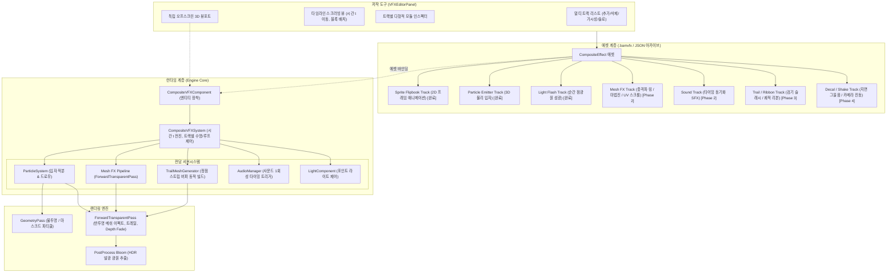

# 계층형 통합 비주얼 이펙트 시스템 및 저작 도구 개발 계획 (Composite VFX & Track-based Orchestrator Plan)

- **작성일:** 2026-11-08 (최종 갱신: 2026-11-09)
- **상태:**
  - **Phase 1 (복합 기반 구축):** 구현 및 검증 완료 (스프라이트 플립북, 파티클, 라이트 섬광 트랙 및 VFXEditorPanel)
  - **Phase 2 (메쉬 이펙트 런타임 & 사운드 연동):** 구현 및 검증 완료 (메쉬 트랙 스케일/회전 보간, UV 스크롤/컬러 페이드 렌더링 제출, 사운드 1회 트리거)
  - **Phase 3 (트레일 / 리본 FX):** 구현 완료 (정점 히스토리 기반 동적 스트립 생성, 테이퍼링, 포워드 렌더링 및 에디터 연동)
  - **Phase 4 (보조 연출 확장):** 구현 완료 (지면 투영 데칼 마크, 임팩트 카메라 셰이크 및 에디터 인스펙터 연동)
- **공통 기준:** [EngineEditorClientGuidelines.md](EngineEditorClientGuidelines.md), [SourceOrganizationGuidelines.md](SourceOrganizationGuidelines.md)
- **연계 문서:** [ParticleAndEffectSystemPlan.md](ParticleAndEffectSystemPlan.md), [AnimationTimelineEditorPlan.md](AnimationTimelineEditorPlan.md), [DevelopmentPriorities.md](DevelopmentPriorities.md)

---

## 1. 목적과 현황 (Motivation & Current Status)

### 1.1 배경 및 목적
하나의 스킬이나 폭발 연출(예: 파이어볼, 검기 슬래시, 마법진 소환)은 단일 파티클 입자만으로 완성되지 않으며, **2D 스프라이트 플립북, 3D 파티클, 3D 메쉬 이펙트(마법진, 충격파 링), 트레일/리본(무기 궤적), 조명 섬광(Light Flash), 사운드(SFX), 데칼(Decal)**이 단일 타임라인 시간축에서 정밀하게 동기화되어야 합니다.

### 1.2 현재 구현 상태 진단 (2026-11-09 기준)
1. **기반 완성 요소 (즉시 제작 가능):**
   - **복합 에셋 및 오케스트레이터:** `CompositeEffect`(`.bamvfx`), `CompositeVFXComponent`, `CompositeVFXSystem`.
   - **2D 스프라이트 플립북 트랙 (`SpriteTrack`):** 쿼드 변환, 빌보드 회전, 렌더링 제출 완비.
   - **3D 물리/기류 파티클 트랙 (`ParticleTrack`):** 다중 이미터, 물리 충돌, 컬 노이즈, HDR 블룸 렌더링 제출 완비.
   - **조명 섬광 트랙 (`LightTrack`):** 포인트 라이트 밝기/반경 어택-디케이 감쇠 완비.
   - **통합 저작 도구 (`VFXEditorPanel`):** 3D 뷰포트 프리뷰, 타임라인 스크러빙, 트랙 리스트 및 프로퍼티 인스펙터 기본 골격 완비.
2. **미완성 및 보완 필요 요소 (본 수정 계획의 대상):**
   - **3D 메쉬 이펙트 (`MeshTrack`):** 데이터 구조와 UI는 존재하나, `CompositeVFXSystem`에서 렌더러로의 메쉬 제출 로직이 누락되어 화면에 표시되지 않음. 전용 UV 스크롤/디졸브 셰이더 연동 필요.
   - **사운드 트랙 (`SoundTrack`, 2026-11-13 갱신):** 시작 시각, 재생 길이와 페이드아웃 편집, 실행 중 채널 추적을 코드에 반영했다. 기존 에셋 로드와 루프·프리뷰 탐색·정지는 실행 검증 대상이다.
   - **트레일 / 리본 이펙트 (`TrailTrack`):** 검기 슬래시 및 궤적 스트립 지오메트리 생성 시스템 신규 구축 필요.
   - **보조 연출 (`DecalTrack`, `CameraShakeTrack`):** 폭발 지면 그을음 및 카메라 충격 진동 연동 필요.

---

## 2. 아키텍처 및 시스템 흐름

---

## 3. 잔여 이펙트 세부 구현 사양

### 3.1 3D 메쉬 이펙트 (Mesh FX) 런타임 완성
- **목표:** 마법진 회전 메쉬, 급격히 팽창하는 충격파 링 메쉬, 에너지 구체 등 3D 형상 기반 이펙트를 뷰포트에 정상 렌더링.
- **핵심 작업:**
  1. **월드 변환 보간:**
     - 진행도 $\alpha = (t - startTime) / duration$ ($0.0 \sim 1.0$).
     - 크기 보간: $Scale(t) = \text{lerp}(scaleStart, scaleEnd, \alpha)$.
     - 회전 적분: $Rotation(t) = initialRotation + rotationRate \times (t - startTime)$.
     - 최종 월드 행렬: $W = EntityWorld \times LocalTranslate \times LocalRotate(t) \times LocalScale(t)$.
  2. **렌더러 제출 연동:**
     - `CompositeVFXSystem::SubmitSceneVFX`에 메쉬 트랙 순회 구현.
     - 메쉬 이펙트는 반투명/가산 합성이 기본이므로 `ForwardTransparentPass`로 `StaticDrawCommand` 제출.
  3. **머티리얼 & 셰이더 상수 전달:**
     - 시간에 따른 UV 오프셋: $UV(t) = uvScrollSpeed \times (t - startTime)$.
     - 시간에 따른 컬러/알파 페이드: $Color(t) = \text{lerp}(colorStart, colorEnd, \alpha)$.
     - 메쉬 이펙트 전용 머티리얼 파라미터(`VFXConstants` 구조체: UV 오프셋, 틴트 컬러, 디졸브 임계치)를 바인딩하여 HDR 블룸과 연동.

### 3.2 사운드 트랙 (SFX) 타이밍 트리거 연동
- **목표:** 폭발, 타격, 발사 사운드를 지정된 $startTime$에 정확히 1회 재생.
- **핵심 작업:**
  1. `CompositeVFXComponent`의 런타임 버퍼에 `soundPlayed` 불리언 배열 추가.
  2. `CompositeVFXSystem::UpdateVFXEntity`에서 `currentTime >= track.startTime && prevTime < track.startTime && !soundPlayed[i]` 조건을 검사하여 `AudioManager::Get().PlaySound(track.audioClip.Get(), track.volume, track.pitch)` 호출.
  3. 에펙트 루프 및 재시작 시 `soundPlayed` 상태 자동 초기화.

### 3.3 트레일 / 리본 이펙트 (Trail & Ribbon FX) 신설
- **목표:** 검기 슬래시 궤적, 투사체 연기 꼬리, 잔상 등 실시간 이동 궤적 지오메트리 렌더링.
- **핵심 사양:**
  1. **데이터 모델 (`VFXTrailTrack`):**
     - `trailWidth`, `lifetime`(세그먼트 유지 시간), `minVertexDistance`(정점 생성 최소 거리), `taperRatio`(끝부분 폭 축소율).
     - `colorStart`, `colorEnd`, `textureHandle`, `materialHandle`.
  2. **동적 스트립 지오메트리 빌더:**
     - 엔티티 또는 지정 소켓의 이전 프레임 위치 및 회전 히스토리 큐 관리.
     - 카메라 시선 벡터에 수직인 폭 방향 벡터를 계산하여 연속된 사각형 띠(Triangle Strip) 정점을 동적 GPU 버퍼로 구성.
     - 진행 방향을 따라 UV 좌표($0.0 \sim 1.0$) 매핑.
  3. **렌더링:** `ForwardTransparentPass`에 양면(Cull None) 반투명/가산 합성으로 제출.

### 3.4 보조 연출 (Decal & Camera Shake) 확장
1. **데칼 트랙 (`VFXDecalTrack`):**
   - 폭발 직후 지면에 그을음/크레이터 마크 투영.
   - 속성: `textureHandle`, `size`, `duration`, `fadeStartTime`.
2. **카메라 셰이크 트랙 (`VFXCameraShakeTrack`):**
   - 폭발/타격 순간 뷰포트 카메라를 흔들어 임팩트 전달.
   - 속성: `amplitude`(진폭), `frequency`(주파수), `duration`, `radius`(거리 감쇠).

---

## 4. 단계별 실행 로드맵

| 단계 | 작업 목표 | 세부 구현 내용 | 완료 기준 |
| :--- | :--- | :--- | :--- |
| **Phase 1** | 복합 기반 및 에디터 구축 | - `CompositeEffect` 에셋 및 `CompositeVFXComponent` 신설 - 스프라이트 플립북, 파티클, 라이트 섬광 트랙 연동 - `VFXEditorPanel` 3열 저작 도구 구축 | **[구현 완료]** (커밋 `b2afb4d3`) |
| **Phase 2** | 메쉬 이펙트 렌더링 & 사운드 연동 | - `CompositeVFXSystem::SubmitSceneVFX`에 메쉬 트랙 렌더링 추가 - 스케일/회전 보간 및 UV 스크롤/컬러 페이드 셰이더 상수 연동 - 사운드 트랙 1회성 타이밍 트리거 연결 | **[구현 완료]** (메쉬 회전·팽창·페이드아웃, UV 스크롤 및 사운드 트리거 완료) |
| **Phase 3** | 트레일 / 리본 (Trail FX) 신설 | - `VFXTrailTrack` 데이터 구조체 정의 및 직렬화 - 정점 히스토리 기반 동적 쿼드 스트립 생성기 구현 - 테이퍼링 및 텍스처 매핑 포워드 렌더링 연동 - `VFXEditorPanel` 트랙 편집 지원 | **[구현 완료]** (정점 히스토리 수집, 테이퍼링 폭 축소, 쿼드 세그먼트 제출 및 에디터 편집 완료) |
| **Phase 4** | 보조 연출 (데칼 & 카메라 셰이크) | - `VFXDecalTrack` 지면 그을음 데칼 투영 연동 - `VFXCameraShakeTrack` 임팩트 시점 카메라 진동 연동 | **[구현 완료]** (지면 쿼드 데칼 알파 페이드 투영, 다축 사인파 감쇠 카메라 셰이크 및 에디터 연동 완료) |

---

## 5. 검증 기준 및 확인 절차

1. **메쉬 이펙트 보간 검증:** 충격파 링 메쉬를 등록하고 재생했을 때 지정된 $startTime$에 나타나 $scaleStart \rightarrow scaleEnd$로 팽창하며 자연스럽게 알파 페이드아웃되는지 확인.
2. **UV 스크롤 검증:** 실린더 또는 쿼드 메쉬에 전방 UV 스크롤 속도를 주었을 때 텍스처가 매끄럽게 흐르는지 확인.
3. **복합 연출 동기화 검증:** 2D 플립북 + 3D 파티클 + 메쉬 이펙트 + 조명 섬광 + 사운드가 단일 에셋에서 시간 오차 없이 동시 재생되는지 확인.
4. **타임라인 스크러빙 무결성:** 에디터에서 재생 헤드를 마우스로 앞뒤로 드래그했을 때 모든 트랙의 상태가 즉각적으로 동기화되는지 확인.

## 6. ActionTimeline과 공통 시간축 적용 (2026-11-09)

- Composite Effect와 파티클의 레이아웃을 통일했다. ActionTimeline과 눈금자, 재생 헤드, 확대·이동과 재생 버튼을 공유한다. Composite의 좌측 목록 및 막대는 같은 트랙 종류별 색상과 아이콘을 사용한다.
- 막대와 라벨은 트랙 종류/인덱스로 선택과 카메라 포커스를 처리한다. 구간 밖에서 트랙을 선택하면 해당 시작 근처로 탐색한다. 사운드의 시작 마커는 길이 핸들이 없다.
- 막대의 양끝과 전체 길이 드래그는 놓는 순간 하나의 Undo 명령으로 반영한다. 전체 길이는 트랙 마지막 경계 아래로 줄일 수 없다. 탐색은 초기화 후 고정 스텝으로 재생하며 오디오를 억제한다. 툴바와 단축키는 동일한 명령을 호출한다.
- 사용자 검증은 8종 트랙, 같은 이름의 트랙 선택, 스크럽 후 트레일·파티클 상태, 사운드 중복 발화 여부, 시작/종료·전체 길이 드래그, Undo/Redo·저장/재열기, ActionTimeline과 편집기 사이 포커스 및 키 문맥 전환을 포함한다. 빌드·실행은 미실시다.
