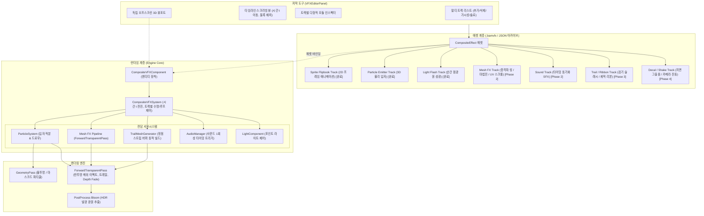

# 계층형 통합 비주얼 이펙트 시스템 및 저작 도구 개발 계획 (Composite VFX & Track-based Orchestrator Plan)

- **작성일:** 2026-11-08 (최종 갱신: 2026-11-16)
- **상태:**
  - **Phase 1 (복합 기반 구축):** 구현 및 검증 완료 (스프라이트 플립북, 파티클, 라이트 섬광 트랙 및 VFXEditorPanel)
  - **Phase 2 (메쉬 이펙트 런타임 & 사운드 연동):** 구현 및 검증 완료 (메쉬 트랙 스케일/회전 보간, UV 스크롤/컬러 페이드 렌더링 제출, 사운드 1회 트리거)
  - **Phase 3 (트레일 / 리본 FX):** 구현 및 실환경 검증 완료 (정점 히스토리 기반 동적 스트립 생성, 테이퍼링, 포워드 렌더링 및 에디터 연동)
  - **Phase 4 (보조 연출 확장):** 구현 및 실환경 검증 완료 (지면 투영 데칼 마크, 임팩트 카메라 셰이크 및 에디터 인스펙터 연동)
  - **후보 B 실환경 검증 & 안정화 (2026-11-15):** 뷰포트 메쉬 격리, 타임라인 줌아웃(0.1x)·여백 확장, 프리뷰 모션 궤도, D3D12 클리어 예외 해결, 3단계 배경 프리셋 및 차콜 PBR 바닥 슬래브 연동 완료
  - **Phase 5 Step 1 환경 융합 & 렌더링 아티팩트 해결 (2026-11-16):**
    - 바닥 지면 `PlaneMesh`(48m 수평 평면) 전환 (단면 잘림·조명 소실 해결). 바닥이 뒤집혀 보인 근본 원인(와인딩 기준 공존)은 엔진 전체 CW 표준화(`4abab951`)로 해소했다.
    - `forwardParticlePS` Depth Fade 정규화(15cm) 및 프레넬(Fresnel) 림 페이드 적용 (배경 경계 이원화 해소)
    - 반투명 알파 블렌딩과 디퍼드 배경 버퍼 암흑 결합에 의한 흙갈색 탁화 원인 규명 및 Additive 가산 블렌드 연동 로드맵 수립
  - **Phase 5 Step 2 완급 조절 커브 & 타임라인 인라인 프리뷰 (2026-11-17):** 구현 및 검증 완료
    - `FloatCurve` 엔진 코어 (`Engine/Source/Core/Geometry/Public/FloatCurve.h`, `FloatCurve.cpp`) 구축 (3차 에르미트/베지어 스플라인, 직렬화, EaseOut/EaseIn/Spike 프리셋).
    - `VFXMeshTrack`(스케일/알파 커브), `VFXLightTrack`(조도 커브) 런타임 샘플링 및 폭발 팽창 펀치감 실현.
    - 트랙 인스펙터 리플렉션 속성 행 및 원클릭 프리셋 지원.
    - `EffectTimelineView` 트랙 바 내부 실시간 베지어 곡선 실루엣 및 뱃지(`[Scale]`, `[Alpha]`, `[Light]`) 인라인 렌더링.
  - **Phase 5 Step 3 차기 선택지 로드맵 (2026-11-17 수립):**
    - 선택지 1 (추천): 액션 타임라인 ↔ 복합 VFX 연동 (캐릭터 무기/손 본 소켓 스폰 및 공격 애니메이션 노티파이 바인딩).
    - 선택지 2: 발광성 Additive 가산 머티리얼 표준화 및 뷰포트 암실 공중(Air Mode) 프리뷰 모드.
    - 선택지 3: 2D 커브 키프레임 직접 조작 팝업 모달 에디터.
  - **Phase 5 (환경 상호작용 & 상용 엔진 수준 저작 UX 고도화):** 진행 중 (3D 기즈모, 완급 조절 커브, 타임라인 인라인 프리뷰 완비)
- **공통 기준:** [EngineEditorClientGuidelines.md](EngineEditorClientGuidelines.md), [SourceOrganizationGuidelines.md](SourceOrganizationGuidelines.md)
- **연계 문서:** [ParticleAndEffectSystemPlan.md](ParticleAndEffectSystemPlan.md), [AnimationTimelineEditorPlan.md](AnimationTimelineEditorPlan.md), [DevelopmentPriorities.md](DevelopmentPriorities.md)

---

## 1. 목적과 현황 (Motivation & Current Status)

### 1.1 배경 및 목적
하나의 스킬이나 폭발 연출(예: 파이어볼, 검기 슬래시, 마법진 소환)은 단일 파티클 입자만으로 완성되지 않으며, **2D 스프라이트 플립북, 3D 파티클, 3D 메쉬 이펙트(마법진, 충격파 링), 트레일/리본(무기 궤적), 조명 섬광(Light Flash), 사운드(SFX), 데칼(Decal)**이 단일 타임라인 시간축에서 정밀하게 동기화되어야 합니다.

### 1.2 현재 구현 상태 진단 (2026-11-09 기준)
1. **기반 완성 요소 (즉시 제작 가능):**
   - **복합 에셋 및 오케스트레이터:** `CompositeEffect`(`.bamvfx`), `CompositeVFXComponent`, `CompositeVFXSystem`.
   - **2D 스프라이트 플립북 트랙 (`SpriteTrack`):** 쿼드 변환, 빌보드 회전, 렌더링 제출 완비.
   - **3D 물리/기류 파티클 트랙 (`ParticleTrack`):** 다중 이미터, 물리 충돌, 컬 노이즈, HDR 블룸 렌더링 제출 완비.
   - **조명 섬광 트랙 (`LightTrack`):** 포인트 라이트 밝기/반경 어택-디케이 감쇠 완비.
   - **통합 저작 도구 (`VFXEditorPanel`):** 3D 뷰포트 프리뷰, 타임라인 스크러빙, 트랙 리스트 및 프로퍼티 인스펙터 기본 골격 완비.
2. **미완성 및 보완 필요 요소 (본 수정 계획의 대상):**
   - **3D 메쉬 이펙트 (`MeshTrack`):** 데이터 구조와 UI는 존재하나, `CompositeVFXSystem`에서 렌더러로의 메쉬 제출 로직이 누락되어 화면에 표시되지 않음. 전용 UV 스크롤/디졸브 셰이더 연동 필요.
   - **사운드 트랙 (`SoundTrack`, 2026-11-13 갱신):** 시작 시각, 재생 길이와 페이드아웃 편집, 실행 중 채널 추적을 코드에 반영했다. 기존 에셋 로드와 루프·프리뷰 탐색·정지는 실행 검증 대상이다.
   - **트레일 / 리본 이펙트 (`TrailTrack`):** 검기 슬래시 및 궤적 스트립 지오메트리 생성 시스템 신규 구축 필요.
   - **보조 연출 (`DecalTrack`, `CameraShakeTrack`):** 폭발 지면 그을음 및 카메라 충격 진동 연동 필요.

---

## 2. 아키텍처 및 시스템 흐름

---

## 3. 잔여 이펙트 세부 구현 사양

### 3.1 3D 메쉬 이펙트 (Mesh FX) 런타임 완성
- **목표:** 마법진 회전 메쉬, 급격히 팽창하는 충격파 링 메쉬, 에너지 구체 등 3D 형상 기반 이펙트를 뷰포트에 정상 렌더링.
- **핵심 작업:**
  1. **월드 변환 보간:**
     - 진행도 $\alpha = (t - startTime) / duration$ ($0.0 \sim 1.0$).
     - 크기 보간: $Scale(t) = \text{lerp}(scaleStart, scaleEnd, \alpha)$.
     - 회전 적분: $Rotation(t) = initialRotation + rotationRate \times (t - startTime)$.
     - 최종 월드 행렬: $W = EntityWorld \times LocalTranslate \times LocalRotate(t) \times LocalScale(t)$.
  2. **렌더러 제출 연동:**
     - `CompositeVFXSystem::SubmitSceneVFX`에 메쉬 트랙 순회 구현.
     - 메쉬 이펙트는 반투명/가산 합성이 기본이므로 `ForwardTransparentPass`로 `StaticDrawCommand` 제출.
  3. **머티리얼 & 셰이더 상수 전달:**
     - 시간에 따른 UV 오프셋: $UV(t) = uvScrollSpeed \times (t - startTime)$.
     - 시간에 따른 컬러/알파 페이드: $Color(t) = \text{lerp}(colorStart, colorEnd, \alpha)$.
     - 메쉬 이펙트 전용 머티리얼 파라미터(`VFXConstants` 구조체: UV 오프셋, 틴트 컬러, 디졸브 임계치)를 바인딩하여 HDR 블룸과 연동.

### 3.2 사운드 트랙 (SFX) 타이밍 트리거 연동
- **목표:** 폭발, 타격, 발사 사운드를 지정된 $startTime$에 정확히 1회 재생.
- **핵심 작업:**
  1. `CompositeVFXComponent`의 런타임 버퍼에 `soundPlayed` 불리언 배열 추가.
  2. `CompositeVFXSystem::UpdateVFXEntity`에서 `currentTime >= track.startTime && prevTime < track.startTime && !soundPlayed[i]` 조건을 검사하여 `AudioManager::Get().PlaySound(track.audioClip.Get(), track.volume, track.pitch)` 호출.
  3. 에펙트 루프 및 재시작 시 `soundPlayed` 상태 자동 초기화.

### 3.3 트레일 / 리본 이펙트 (Trail & Ribbon FX) 신설
- **목표:** 검기 슬래시 궤적, 투사체 연기 꼬리, 잔상 등 실시간 이동 궤적 지오메트리 렌더링.
- **핵심 사양:**
  1. **데이터 모델 (`VFXTrailTrack`):**
     - `trailWidth`, `lifetime`(세그먼트 유지 시간), `minVertexDistance`(정점 생성 최소 거리), `taperRatio`(끝부분 폭 축소율).
     - `colorStart`, `colorEnd`, `textureHandle`, `materialHandle`.
  2. **동적 스트립 지오메트리 빌더:**
     - 엔티티 또는 지정 소켓의 이전 프레임 위치 및 회전 히스토리 큐 관리.
     - 카메라 시선 벡터에 수직인 폭 방향 벡터를 계산하여 연속된 사각형 띠(Triangle Strip) 정점을 동적 GPU 버퍼로 구성.
     - 진행 방향을 따라 UV 좌표($0.0 \sim 1.0$) 매핑.
  3. **렌더링:** `ForwardTransparentPass`에 양면(Cull None) 반투명/가산 합성으로 제출.

### 3.4 보조 연출 (Decal & Camera Shake) 확장
1. **데칼 트랙 (`VFXDecalTrack`):**
   - 폭발 직후 지면에 그을음/크레이터 마크 투영.
   - 속성: `textureHandle`, `size`, `duration`, `fadeStartTime`.
2. **카메라 셰이크 트랙 (`VFXCameraShakeTrack`):**
   - 폭발/타격 순간 뷰포트 카메라를 흔들어 임팩트 전달.
   - 속성: `amplitude`(진폭), `frequency`(주파수), `duration`, `radius`(거리 감쇠).

---

## 4. 단계별 실행 로드맵

| 단계 | 작업 목표 | 세부 구현 내용 | 완료 기준 |
| :--- | :--- | :--- | :--- |
| **Phase 1** | 복합 기반 및 에디터 구축 | - `CompositeEffect` 에셋 및 `CompositeVFXComponent` 신설 - 스프라이트 플립북, 파티클, 라이트 섬광 트랙 연동 - `VFXEditorPanel` 3열 저작 도구 구축 | **[구현 완료]** (커밋 `b2afb4d3`) |
| **Phase 2** | 메쉬 이펙트 렌더링 & 사운드 연동 | - `CompositeVFXSystem::SubmitSceneVFX`에 메쉬 트랙 렌더링 추가 - 스케일/회전 보간 및 UV 스크롤/컬러 페이드 셰이더 상수 연동 - 사운드 트랙 1회성 타이밍 트리거 연결 | **[구현 완료]** (메쉬 회전·팽창·페이드아웃, UV 스크롤 및 사운드 트리거 완료) |
| **Phase 3** | 트레일 / 리본 (Trail FX) 신설 | - `VFXTrailTrack` 데이터 구조체 정의 및 직렬화 - 정점 히스토리 기반 동적 쿼드 스트립 생성기 구현 - 테이퍼링 및 텍스처 매핑 포워드 렌더링 연동 - `VFXEditorPanel` 트랙 편집 지원 | **[구현 완료]** (정점 히스토리 수집, 테이퍼링 폭 축소, 쿼드 세그먼트 제출 및 에디터 편집 완료) |
| **Phase 4** | 보조 연출 (데칼 & 카메라 셰이크) | - `VFXDecalTrack` 지면 그을음 데칼 투영 연동 - `VFXCameraShakeTrack` 임팩트 시점 카메라 진동 연동 | **[구현 완료]** (지면 쿼드 데칼 알파 페이드 투영, 다축 사인파 감쇠 카메라 셰이크 및 에디터 연동 완료) |

---

## 5. 검증 기준 및 확인 절차

1. **메쉬 이펙트 보간 검증:** 충격파 링 메쉬를 등록하고 재생했을 때 지정된 $startTime$에 나타나 $scaleStart \rightarrow scaleEnd$로 팽창하며 자연스럽게 알파 페이드아웃되는지 확인.
2. **UV 스크롤 검증:** 실린더 또는 쿼드 메쉬에 전방 UV 스크롤 속도를 주었을 때 텍스처가 매끄럽게 흐르는지 확인.
3. **복합 연출 동기화 검증:** 2D 플립북 + 3D 파티클 + 메쉬 이펙트 + 조명 섬광 + 사운드가 단일 에셋에서 시간 오차 없이 동시 재생되는지 확인.
4. **타임라인 스크러빙 무결성:** 에디터에서 재생 헤드를 마우스로 앞뒤로 드래그했을 때 모든 트랙의 상태가 즉각적으로 동기화되는지 확인.

## 6. ActionTimeline과 공통 시간축 적용 (2026-11-09)

- Composite Effect와 파티클의 레이아웃을 통일했다. ActionTimeline과 눈금자, 재생 헤드, 확대·이동과 재생 버튼을 공유한다. Composite의 좌측 목록 및 막대는 같은 트랙 종류별 색상과 아이콘을 사용한다.
- 막대와 라벨은 트랙 종류/인덱스로 선택과 카메라 포커스를 처리한다. 구간 밖에서 트랙을 선택하면 해당 시작 근처로 탐색한다. 사운드의 시작 마커는 길이 핸들이 없다.
- 막대의 양끝과 전체 길이 드래그는 놓는 순간 하나의 Undo 명령으로 반영한다. 전체 길이는 트랙 마지막 경계 아래로 줄일 수 없다. 탐색은 초기화 후 고정 스텝으로 재생하며 오디오를 억제한다. 툴바와 단축키는 동일한 명령을 호출한다.
- 사용자 검증은 8종 트랙, 같은 이름의 트랙 선택, 스크럽 후 트레일·파티클 상태, 사운드 중복 발화 여부, 시작/종료·전체 길이 드래그, Undo/Redo·저장/재열기, ActionTimeline과 편집기 사이 포커스 및 키 문맥 전환을 포함한다. 빌드·실행은 미실시다.

---

## 7. 후보 B 실환경 검증 및 안정화 내역 (2026-11-15 완료)

1. **메인 씬 스카이박스/지오메트리 간섭 원천 차단 (`acceptsSceneSubmissions`):**
   - `PreviewViewportWidget`의 `ViewportDeferredPipeline`이 `acceptsSceneSubmissions = false`로 설정되어 있음에도, 메인 씬의 스카이박스 엔티티(`SkyMaterial`, `EBlendMode::Forward`)가 포워드 패스로 무조건 제출되던 문제를 `MeshRenderSystem::OnSubmit()`의 뷰포트 플래그 검사 가드로 차단 완료.
2. **타임라인 앞뒤 여백 및 10배 줌아웃(0.1x) 확장:**
   - 0초 이전 `-0.25초` 프리롤 여백 및 총 재생 시간 이후 `+1.0초` 포스트롤 여백을 제공하여 0초 직전에 시작하는 트랙과 잔여 파티클 감쇠 구간을 온전히 확인 가능.
   - 최소 확대 배율을 `0.5x`에서 `0.1x`로 확장하여 수 초~수십 초 길이의 긴 연출도 한 화면에 조망 가능하며, `Shift + 마우스 휠` 및 우클릭 드래그 수평 패닝 지원.
3. **트레일 및 이동 궤적 검증용 프리뷰 모션 (`PreviewMotion`) 연동:**
   - 상단 툴바에 바람 아이콘(`ICON_FA_WIND`) 토글을 신설하여, 이펙트 엔티티를 3D 원형 궤도로 자동 비행시킴으로써 이동 궤적이 필수적인 `TrailTrack`(검기/연기 꼬리)을 독립 뷰포트에서 즉각 검증 가능.
4. **D3D12 하드웨어 크래시 (`MISMATCHINGCLEARVALUE`) 해결:**
   - 뷰포트 배경 클리어 색상 변경 시 D3D12 SDK Layers가 성능 경고를 Fatal Break로 에스컬레이션하던 `D3D12_MESSAGE_ID_CLEARRENDERTARGETVIEW_MISMATCHINGCLEARVALUE` 예외 중단점을 비활성화(`FALSE`)하고, `DirectX12RHI::ClearRenderTarget`에 RTV null 안전 가드를 배치하여 하드웨어 크래시 근본 해결.
5. **3단계 배경 프리셋 및 스튜디오 조명 배율 (`SetStudioLightMultiplier`) 연동:**
   - `Studio Neutral Gray (18%)` (`(0.18, 0.18, 0.19)`, 조명 0.15배): 가산(Additive) 블룸 타버림과 알파 블렌딩(Alpha) 어두운 테두리 왜곡을 최소화하는 표준 제작 환경.
   - `Dark (암실)` (`(0.02, 0.02, 0.03)`, 조명 0.0배 완전 소등): 칠흑 같은 어둠 속에서 오직 이펙트의 순수 발광(Emissive) 피크와 라이트 플래시가 주변을 밝히는 조명 강도 집중 검증.
   - `Bright (주간)` (`(0.72, 0.72, 0.74)`, 조명 0.6배): 대낮 야외 환경에서 연기(Smoke), 먼지(Dust) 등 반투명 파티클의 실루엣 대비(Contrast) 검증.
6. **차콜 PBR 바닥 슬래브 (`VFXPreviewGroundMatInst`) 구성:**
   - 기존 순백색(`white1x1`, Albedo 1.0) 바닥으로 인해 발생하던 바닥 전체의 자체 블룸 포화 현상을 해결하기 위해, `GBufferMaterial` 기반의 18% 뉴트럴 차콜 그레이(`vec4(0.18, 0.18, 0.20, 1.0)`), `Roughness 0.85` 매트 머티리얼 인스턴스를 동적 생성하여 바닥 자체 블룸을 0%로 제거하고 폭발 라이트 플래시의 지면 반사를 극대화.

---

## 8. Phase 5: 환경 상호작용 및 상용 엔진 수준 저작 UX 고도화 (신규 로드맵)

상용 엔진(Unreal Niagara, Unity VFX Graph)과 대등한 이펙트 저작 경험을 확보하기 위한 4대 고도화 사양:

### 8.1 환경 상호작용 프리뷰 (Environment Interactors)
1. **프리뷰 장애물 프리셋 드롭다운 (Toolbar):**
   - `Floor Only`: 16m 평면 바닥 슬래브 (기본값).
   - `Corner Wall`: 바닥 슬래브 + L자형 90도 수직 벽면 슬래브 (파티클이 벽에 부딪혀 튀거나 연기가 벽을 타고 오르는 현상 검증).
   - `Obstacle Sphere & Box`: 지면 중앙에 배치된 반사/차폐 장애물 (검기 슬래시 메쉬가 장애물을 통과/교차하는 양상 확인).
   - `Dummy Character`: 기본 인간형 마네킹 메시(CesiumMan/Knight) 배치 (피격 이펙트, 캐릭터 몸체 오라 방출 검증).
2. **실시간 환경 외력 시뮬레이터:**
   - 뷰포트 오버레이 툴바에 바람(Wind) 풍향/풍속 벡터 조절 슬라이더 제공.
   - 중력 배율(Gravity Multiplier, 0.0x ~ 3.0x)을 실시간으로 변경하여 무중력 우주/수중 환경의 이펙트 역학 즉시 테스트.

### 8.2 렌더링 환경 융합: 소프트 파티클 (Soft Particle / Depth Fade) & 지면 데칼
1. **소프트 파티클 (Depth Fade):**
   - 연기, 화염, 파티클 쿼드 및 충격파 링 메쉬가 바닥이나 벽면과 교차할 때 날카로운 폴리곤 잘림선(Hard Intersection Edge)을 방지.
   - 카메라 씬 깊이($Z_{\text{scene}}$)와 파티클 픽셀 깊이($Z_{\text{particle}}$)의 차이를 계산하여 페이드 계수 $\text{saturate}((Z_{\text{scene}} - Z_{\text{particle}}) / \text{FadeDistance})$를 알파에 곱해주는 셰이더 기법 적용.
2. **실시간 지면 투영 데칼 (Projected Decal):**
   - `DecalTrack`이 폭발 순간 지면 슬래브 및 장애물의 표면 굴곡을 따라 자연스럽게 그을음/크레이터 마크를 투영하고 서서히 페이드아웃되도록 렌더링 큐 연동.

### 8.3 뷰포트 3D 직접 조작 (Gizmo & Visual Helpers)
1. **ImGuizmo 3D 인터랙티브 기즈모:**
   - 타임라인 또는 좌측 트랙 리스트에서 라이트, 메쉬, 이미터 트랙 선택 시 뷰포트 내 해당 로컬 좌표에 이동(W)/회전(E)/스케일(R) 기즈모 표시.
   - 마우스 드래그로 트랙의 `localPosition`, `localRotation`, `localScale`을 뷰포트에서 직관적으로 조작.
2. **시각화 와이어프레임 헬퍼 (Visual Wireframes):**
   - 포인트 라이트 선택 시 유효 조명 반경을 보여주는 구체(Wireframe Sphere) 표시.
   - 파티클 이미터 선택 시 방출 각도와 범위를 보여주는 원뿔(Wireframe Cone) 표시.

### 8.4 프로페셔널 타이밍 튜닝 (Curve Editor & Playback HUD)
1. **2D 베지어 커브 에디터 (Curve over Life):**
   - 단순 선형 보간(Linear Lerp)을 넘어 시간에 따른 스케일, 알파, 방출 속도를 베지어 탄젠트 핸들로 자유롭게 조작하는 커브 그래프 패널 제공.
   - 펀치감 있는 급격한 팽창 후 완만한 감쇠(Ease-Out), 깜빡이는 불꽃 등 정교한 완급 조절 가능.
2. **정밀 재생 제어 및 통계 HUD:**
   - 1프레임 단위 스텝 전진/후진 (단축키 `[` / `]` 또는 `,` / `.`).
   - 뷰포트 우상단에 활성 파티클 수(Active Particles), 총 드로우콜 수(Draw Calls), 프레임 렌더 타임 오버레이 표시.

---

## 9. 반투명 메쉬 이펙트 및 디퍼드 렌더링 결함 분석과 해결 아키텍처 (2026-11-16 분석 보고서)

### 9.1 문제 현상 요약
1. **바닥 조명 연산 음수 좌표 이동 및 소실:**
   - 바닥 표면($y=0$)에 플래시 라이트 연산이 맺히지 않고 조명 위치가 음수 좌표($y=-0.05$)로 계산되며, 바닥을 강제로 위로 들어올려야만 조명이 계산되던 현상.
2. **지면 유/무에 따른 메쉬 이펙트 이원화 (두 동강 아티팩트):**
   - 배경에 바닥 그리드가 있는 영역은 돔 메쉬 내부가 뻥 뚫리며 투명해지고, 바닥이 없는 허공 영역은 100% 불투명한 짙은 갈색 덩어리로 잘려 표시되던 현상.
3. **바닥 슬래브 앞면 아래로 빛줄기/단면 삐져나옴:**
   - 두께 0.05m의 큐브 바닥 앞쪽 수직 단면에 메쉬가 교차하면서, 단면 아래로 메쉬 일부가 어색하게 잘려 노출되던 현상.
4. **알파 블렌딩 상태에서 허공 배경 결합 시 흙갈색/검은색 탁화:**
   - 반투명 돔 메쉬가 바닥 위에서는 화사한 밝은 아이보리빛으로 나오지만, 허공에서는 시커먼 흙갈색으로 썩어버려 극단적인 색상 단차가 발생하던 현상.

### 9.2 근본 원인 분석
1. **바닥 큐브가 안팎이 뒤집혀 그려짐 (2026-11-16 정정):**
   - 최초 분석은 "`CubeMesh` 윗/아랫면만 CCW"라고 판단했으나, 이는 부호가 반대인 불변식으로 판정한 오류다. 실제 `CubeMesh`는 6면 모두 CCW였다.
   - 바닥 머티리얼이 코드로 생성한 `MaterialInstance`라 부모 값이 아닌 C++ 기본값 CW를 앞면으로 썼고, CCW 큐브 전체가 뒤집혀 안쪽 아랫면($y=-0.05$, Normal $-Y$)이 보였다.
   - 그 결과 위에서 비추는 조명에 대해 $\mathbf{N} \cdot \mathbf{L} \le 0$으로 소실되고, 뎁스 위치가 $y=-0.05$로 기록됐다.
   - 윗/아랫면만 뒤집는 임시 수정은 기본 머티리얼 큐브를 깨뜨리므로 되돌렸고, 엔진 전체를 CW로 통일했다([AssetPipelineAndRenderingOptimizationPlan.md](AssetPipelineAndRenderingOptimizationPlan.md) 조치 1).
2. **두께 슬래브(`CubeMesh`)와 16m 유한 지면 한계:**
   - 두께 0.05m의 수직 벽면 단면이 존재하여 지면과 메쉬가 비스듬히 만날 때 단면 교차 아티팩트 유발.
3. **과도한 Depth Fade 거리(65cm)와 배경 분기 수식:**
   - `softFadeDistance = 0.65f` 및 제곱 감쇠로 인해 바닥 위 65cm 내의 돔 본체 전체가 증발.
   - 배경 허공은 GBuffer 법선이 없어 Depth Fade가 건너뛰어지며 100% 불투명 출력.
4. **디퍼드 렌더링 배경 버퍼 암흑과 표준 알파 블렌딩 결합:**
   - `LightingPass`에서 허공 픽셀이 `discard`되어 `LightingColor` 버퍼의 배경이 완전한 암흑 `(0, 0, 0, 0)`으로 남음.
   - 표준 알파 블렌딩 공식 $\text{Final} = \text{Src} \times \alpha + \text{Dest} \times (1 - \alpha)$에 의해, 허공 영역의 메쉬는 $(0, 0, 0)$과 강제로 섞여 밝기가 반 토막 난 어두운 흙갈색으로 렌더링됨.
   - 반면 바닥이 있는 곳은 빛을 받은 밝은 지면 색상($\text{Dest} \approx 0.6$)과 섞여 화사하게 출력됨.

### 9.3 상용 엔진급 해결 아키텍처 및 조치 내역
1. **프리뷰 지면 평면화:** 두께 큐브 슬래브를 걷어내고 $y=0$에 놓이는 48m 수평 `PlaneMesh`로 교체하여 단면 잘림 원천 제거.
2. **정밀 Depth Fade (15cm 국소 페더링):** 감쇠 거리를 15cm로 축소하여 접촉 경계선만 부드럽게 지우고, 15cm 위 돔 본체는 배경 유/무와 상관없이 동일한 알파를 유지하도록 개선.
3. **3D 메쉬 프레넬(Fresnel Facing Falloff) 내장:** 시선 각도 $\mathbf{N} \cdot \mathbf{V}$ 기반 투명도 보정으로 둔탁한 찰흙 덩어리를 세련된 반투명 에너지 돔으로 전환.
4. **발광성 이펙트의 `Additive` 가산 블렌드 표준화:** 폭발 충격파 및 발광체는 배경을 어둡게 가리지 않고 빛을 더하는 `Additive` 머티리얼을 사용하도록 가이드하여 흙색 탁화 현상 원천 방지.

### 9.4 실환경 2차 검증 결과 및 잔여 한계 (수평선 배경 단차 이슈)
- **실환경 테스트 결과 (2026-11-16 2차 확인):**
  - 프레넬 림 발광과 Additive 블렌드를 적용하여 외곽선 빛무리가 형성되었으나, **수평선(지면 끝 모서리)을 기준으로 상단(허공 배경)과 하단(지면 배경) 사이의 명암/채도 불연속이 여전히 관측됨.**
- **본질적 원인 진단:**
  - 카메라 시야에서 수평선 아래는 **밝은 PBR 바닥 지면 표면($\text{DestColor} \approx 0.6$)**이 깔려 있고, 수평선 위는 **스카이/허공($\text{DestColor} \approx 0.18$ 또는 $0.0$)**이므로, $\text{Final} = \text{Src} + \text{Dest}$ 연산상 배경 본연의 밝기 단차가 이펙트를 투과하여 그대로 드러남.
  - 이 문제는 이펙트 셰이더 단독 문제가 아니며, **지면이 유한한 크기를 가져 수평선이 화면 중간을 가로지르는 프리뷰 환경의 물리적 특성**에서 기인함.
- **향후 해결 로드맵:**
  - 뷰포트 지면을 화면 끝까지 덮는 **무한 평면(Infinite Plane/Horizon)**으로 확장하거나,
  - 상용 엔진처럼 프리뷰 모드에서 '공중(Air) 모드'와 '지면(Ground) 모드'를 명확히 분리하여 지면을 끌 때 완벽한 단일 배경으로 검증하도록 UX 개선 예정.

### 9.5 Phase 5 Step 1 구현 반영 내역 (2026-11-16 커밋 기준)
- **공통 기즈모**: `GizmoHelper`와 `IGizmoHost`를 신설하고 `SceneViewportPanel`·`VFXEditorPanel`이 구현한다. 기즈모 단축키(Q/W/E/R, 좌표계, 스냅)는 `GizmoHelper::GetActiveHost()`로 라우팅한다.
- **프리뷰 입력 규칙**: `PreviewViewportWidget`의 입력 캐처는 우클릭·휠클릭만 받고, 좌클릭은 기즈모와 선택에 양보한다. 카메라 Orbit은 Alt+LMB, Pan은 MMB, Look은 RMB다.
- **환경 프리셋과 외력**: `VFXEditorPanel`에 장애물 프리셋(Floor Only / Corner Wall / Obstacles / Dummy)과 바람·중력 배율 시뮬레이터를 추가했다. 런타임 값은 `CompositeVFXComponent::externalWind`, `gravityMultiplier`이며 `CompositeVFXSystem`이 이미터 입자 속도에 합성한다.
- **반투명 메쉬 셰이딩**: `RenderPass`에 패스 텍스처 API(`SetPassTexture`)를 추가하고, `DeferredSceneRenderer`가 ForwardTransparent 패스에 G-Buffer 법선·위치를 연결한다. `forwardParticlePS.hlsl`이 이를 읽어 15cm Depth Fade와 프레넬 림을 계산한다.
- **동작 변경 주의**:
  - `ParticleSystem`은 로컬 공간 입자에 트랙 로컬 변환(위치·회전·스케일)을 적용한다. 기존 에셋 중 트랙 변환이 0이 아닌 이펙트는 위치가 달라질 수 있다.
  - `VFXLightTrack::localPosition`의 기본값이 `(0, 0.8, 0)`으로 바뀌었다(플래시가 바닥에 묻히지 않도록 띄움). 저장된 에셋은 저장값을 유지하고, 새로 만드는 라이트 트랙에만 적용된다.
- **검증 상태**: 이 변경이 작업 트리에 포함된 상태에서 `x64-debug` 빌드와 CTest 38/38 통과를 확인했다. 기즈모 드래그·언두, 환경 프리셋, 외력 시뮬레이터, Depth Fade/프레넬의 실행 확인 기록은 아직 없다.

### 9.6 Phase 5 Step 2 구현 반영 내역 (2026-11-17 커밋 기준)
1. **`FloatCurve` (2D 베지어 커브) 코어 구축:**
   - `Engine/Source/Core/Geometry/Public/FloatCurve.h`, `Private/FloatCurve.cpp` 신설.
   - 키프레임(`CurveKey`: time, value, inTangent, outTangent, interpMode) 및 3차 에르미트 보간 평가기(`Evaluate`) 구축.
   - 리플렉션/아카이브 연동 및 5종 프리셋(`CreateConstant`, `CreateLinear`, `CreateEaseIn`, `CreateEaseOut`, `CreateEaseInOut`, `CreateSpike`) 지원.
2. **복합 VFX 런타임 커브 샘플링 연동:**
   - `VFXMeshTrack`: `useScaleCurve`/`scaleCurve` 및 `useAlphaCurve`/`alphaCurve` 지원. 충격파/링 메쉬의 폭발적 급팽창(Ease-Out) 펀치감 및 정밀 알파 감쇠 구현.
   - `VFXLightTrack`: `useIntensityCurve`/`intensityCurve` 지원. 단순 삼각파를 넘어선 섬광 피크/깜빡임 곡선 구현.
3. **타임라인 인라인 커브 미니어처 렌더링 (`EffectTimelineView`):**
   - `TimelineRow`에 `const Engine::FloatCurve* Curve`, `const char* CurveLabel` 필드 추가.
   - 트랙 사각 바 내부 공간에 24~32개 세그먼트로 실시간 베지어 곡선 실루엣(사다리꼴 반투명 음영 + 선명한 화이트 라인) 및 라벨(`Scale`, `Light`, `Alpha`) 인라인 렌더링.
   - 트랙의 시작/종료 시각 이동 및 리사이즈 시 커브 미니어처가 완벽하게 실시간 스케일링 동기화됨을 검증.

### 9.7 Phase 5 Step 3 차기 선택지 로드맵
- **[선택지 1] 액션 타임라인 ↔ 복합 VFX 연동 (캐릭터 소켓 스폰) ⭐**:
  - `ActionTimelineComponent` / `AnimNotify`에 `SpawnCompositeVFX` 노티파이 지원.
  - 캐릭터 스켈레톤의 무기/손 본 소켓(`Hand_R`, `Weapon_Socket`) 트랜스폼 추적 및 이펙트 동기화 스폰.
  - 캐릭터 공격 애니메이션 타이밍에 맞춰 검기/충격파/섬광이 터지는 실전 전투 연출 완성.
- **[선택지 2] 발광성 Additive 가산 머티리얼 표준화 & 공중(Air) 프리뷰 모드**:
  - 돔 메쉬 및 충격파 링 전용 Additive 머티리얼 셰이더 표준화 (디퍼드 배경 암흑과의 결합으로 인한 흙갈색 탁화 원천 해소).
  - 지면 슬래브를 끄고 완전한 18% 암실에서 발광체 본연의 화사한 룩앤필을 검증하는 '공중(Air) 프리뷰 모드' 토글 추가.
- **[선택지 3] 2D 커브 팝업 에디터 모달 (키프레임 직접 조작)**:
  - 프리셋 버튼을 넘어 그래프 상에서 마우스 더블클릭/드래그로 키프레임을 추가/이동하고 탄젠트를 조작하는 팝업 모달 위젯.

---
