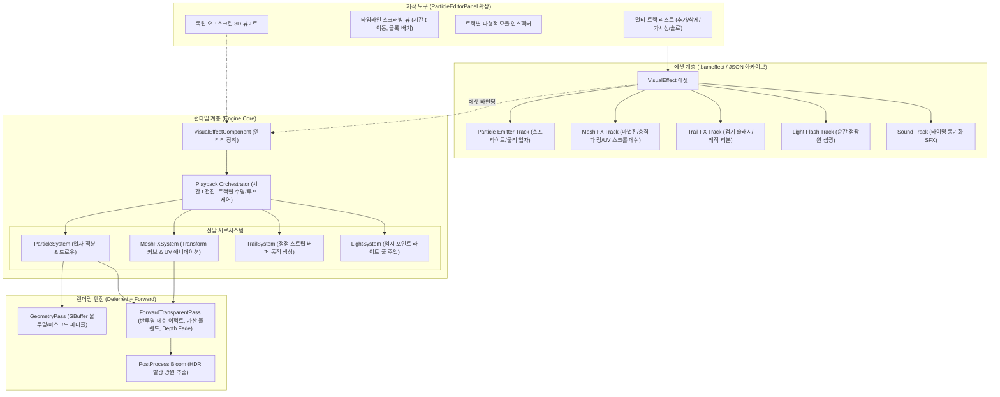

# 계층형 통합 비주얼 이펙트 시스템 및 저작 도구 개발 계획 (Composite VFX & Track-based Orchestrator Plan)

- **작성일:** 2026-11-08
- **상태:** 설계 완료 및 대기 (Pending / Hold — 2D 스프라이트 애니메이션 작업 완료 후 착수 예정)
- **공통 기준:** [EngineEditorClientGuidelines.md](EngineEditorClientGuidelines.md), [SourceOrganizationGuidelines.md](SourceOrganizationGuidelines.md)
- **연계 문서:** [ParticleAndEffectSystemPlan.md](ParticleAndEffectSystemPlan.md)(파티클 코어 Phase 1~5 완료), [AnimationTimelineEditorPlan.md](AnimationTimelineEditorPlan.md), [DevelopmentPriorities.md](DevelopmentPriorities.md)

---

## 1. 목적과 배경 (Motivation & Goals)

1. **단일 파티클 입자 시뮬레이션의 한계 극복:**
   - 기존의 파티클 시스템은 점/스프라이트 입자를 대량으로 방출·시뮬레이션하는 데 최적화되어 있습니다.
   - 그러나 실제 게임 내 비주얼 연출(예: 파이어볼, 마법진 소환, 검기 슬래시, 지면 폭발)은 단순 파티클뿐만 아니라 **3D 메쉬 이펙트(회전하는 마법진 평면, 팽창하는 충격파 링, 왜곡 구체)**, **트레일/리본(무기 궤적)**, **순간 점광원(라이트 섬광)**, **사운드(SFX)**가 유기적으로 결합된 복합 연출입니다.
2. **저작 및 런타임 워크플로우의 파편화 방지:**
   - 파티클과 일반 메쉬 이펙트를 별개의 에디터와 별개의 씬 컴포넌트로 분리하면, 기획자/이펙터가 연출 타이밍을 맞추기 위해 여러 창을 오가야 하고 씬에서 수동으로 스크립트 동기화를 수행해야 합니다.
   - 본 계획은 상용 엔진(Unreal Niagara, Unity VFX Graph & Timeline)의 표준 패러다임을 따라, **하나의 복합 에셋(`.bameffect`)과 런타임 오케스트레이터(`VisualEffectComponent`) 안에서 시간축(타임라인)을 따라 다종의 이펙트 트랙을 일원화 제어**하는 것을 목표로 합니다.

---

## 2. 아키텍처 및 시스템 흐름

---

## 3. 핵심 데이터 구조 및 모듈 사양

### 3.1 트랙 엘리먼트 데이터 모델
`VisualEffectAsset`은 다형적 트랙 데이터를 순회 가능한 컨테이너 형태로 소유합니다.

1. **`ParticleEmitterData` (기존 완성본 수용):**
   - 방출률, 수명, 속도, 부력, 컬 노이즈, 물리 충돌 반발, 지면 정렬 디스크 렌더러.
2. **`MeshFXData` (메쉬 이펙트 트랙):**
   - **기본 리소스:** `meshHandle`(`ResourceHandle<Mesh>`), `materialHandle`(`ResourceHandle<MaterialInterface>`).
   - **시간 및 재생:** `startTime`(지연 시작), `duration`(수명), `loop`(반복), `alignToCamera`(빌보드 여부).
   - **Transform 애니메이션 커브:**
     - `scaleStart`, `scaleEnd`, `scaleEasing`(선형, 지수 팽창 등).
     - `rotationRate`(초당 회전 각도 벡터), `initialRotation`.
   - **머티리얼 & 셰이더 동적 파라미터:**
     - `uvTiling`, `uvScrollSpeed`(전방/회전 스크롤 속도).
     - `colorStart`, `colorEnd`(알파 페이드아웃).
     - `dissolveSpeed`, `dissolveThresholdCurve`(디졸브 텍스처 연동 컷오프).
     - `emissiveIntensity`(HDR 블룸 발광 배율).
3. **`LightFlashData` (조명 섬광 트랙):**
   - `startTime`, `duration`, `color`, `peakIntensity`, `radius`, `decayType`(선형, 지수 감쇠).
4. **`SoundFXData` (사운드 트랙):**
   - `audioClipHandle`(`ResourceHandle<AudioClip>`), `startTime`, `volume`, `pitch`, `playProbability`.

### 3.2 렌더링 파이프라인 규약
- 메쉬 이펙트는 반투명 블렌딩(`AlphaBlend`), 가산 합성(`Additive`), 그리고 지면/배경 메쉬와 맞닿는 경계면이 딱딱하게 잘리지 않는 **Depth Fade(Soft Mesh)** 처리가 필수적입니다.
- 따라서 모든 메쉬 이펙트 드로우콜은 디퍼드 GBuffer가 아닌 **포워드 투명 패스(`ForwardTransparentPass`, ID: 120)**로 제출됩니다.

---

## 4. 에디터 UI/UX 확장 설계

현재 완성된 `ParticleEditorPanel`의 견고한 기반(독립 3D 뷰포트, 실행 취소/다시 실행 이력, 상단 재생 제어기)을 그대로 계승하여 확장합니다.

1. **좌측 멀티 트랙 패널:**
   - 상단 헤더에 `[ + ]` 팝업 메뉴 제공 (`Add Particle Emitter`, `Add Mesh FX`, `Add Light Flash`, `Add Sound`).
   - 트랙별 식별 아이콘(입자, 입체 큐브, 전구, 음표) 및 활성화 체크박스, 삭제 버튼 일원화.
2. **우측 인스펙터 패널:**
   - 선택된 트랙 타입에 따라 전용 프로퍼티 드로어를 다형적으로 전환 표시.
   - 메쉬 이펙트 선택 시: 메쉬 리소스 피커, 머티리얼 피커, UV 스크롤 속도, 스케일 커브 슬라이더.
3. **하단 타임라인 스크러빙 뷰 (단계적 고도화):**
   - 전체 수명(Duration) 기준 각 트랙의 `startTime`과 `duration`을 가로 블록(Bar)으로 시각화.
   - 타임라인 헤드를 마우스로 앞뒤로 드래그(Scrubbing)할 때 모든 메쉬 애니메이션과 파티클 시뮬레이션 상태가 결정론적으로 동기화.

---

## 5. 단계별 개발 로드맵 (Phase 1 ~ Phase 4)

- **Phase 1: 메쉬 이펙트(`MeshFX`) 런타임 코어 및 포워드 셰이더 연동**
  - `MeshFXData` 구조체 정의.
  - 메쉬 이펙트 전용 머티리얼(`MeshFX_Additive`, `MeshFX_AlphaBlend`) 및 UV 스크롤/디졸브 셰이더 구축.
  - `ForwardTransparentPass` 제출 연동.
- **Phase 2: 복합 에셋화(`VisualEffectAsset`) 및 런타임 오케스트레이터 구축**
  - 단일 파일(`.bameffect` / JSON) 내 다중 트랙 직렬화/역직렬화 지원.
  - `VisualEffectComponent` 신설: 씬 엔티티에서 단일 컴포넌트로 파티클과 메쉬 이펙트를 동시 재생/정리.
- **Phase 3: 전용 저작 에디터(`VFXEditorPanel`) 멀티 트랙 및 타임라인 연동**
  - `ParticleEditorPanel`을 멀티 트랙 저작 도구로 확장.
  - 3D 뷰포트에서 파티클과 메쉬 이펙트 실시간 동시 프리뷰 및 스크러빙 제어.
- **Phase 4: 부가 트랙(조명 섬광 `LightFlash`, 사운드 `SoundFX`, 트레일 `TrailFX`) 통합**
  - 폭발 조명 섬광 및 타이밍 사운드 트리거 연동.
  - 검기 슬래시용 동적 정점 스트립 트레일 렌더러 추가.

---

## 6. 완료 및 검증 기준 (Verification Criteria)

1. **복합 연출 재생 검증:** 마법진 회전 메쉬 + 지면 팽창 링 메쉬 + 화염 파티클 + 조명 섬광이 지정된 시간차에 맞춰 단일 인스턴스에서 오차 없이 동시 렌더링되는지 확인.
2. **스크러빙 결정론성 검증:** 타임라인을 $t=0.2\text{s}$ 위치로 역방향/정방향 스크러빙했을 때 메쉬의 스케일과 UV 위치가 정확히 일치하는지 확인.
3. **직렬화 무손실 검증:** 복합 에셋 저장 후 에디터를 재시작하거나 씬에 배치했을 때 모든 트랙 데이터가 완벽히 복원되는지 확인.
