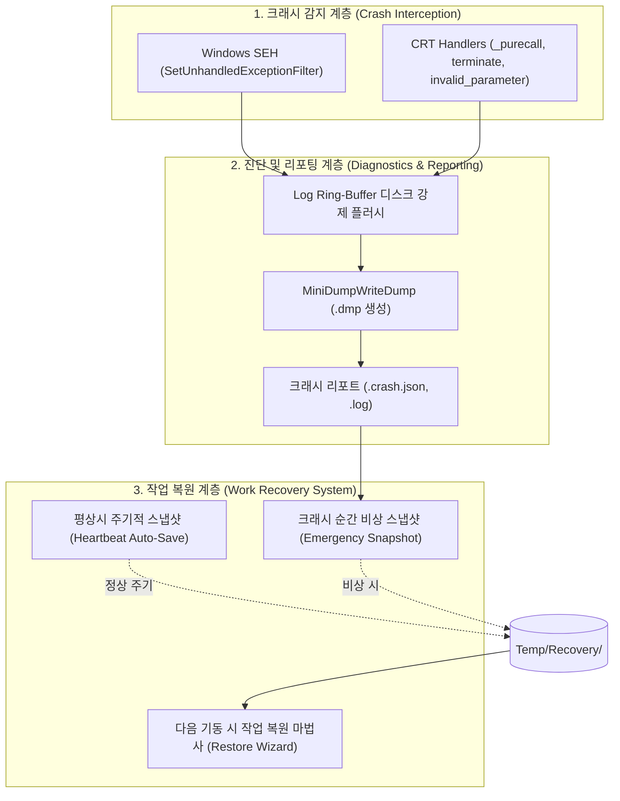
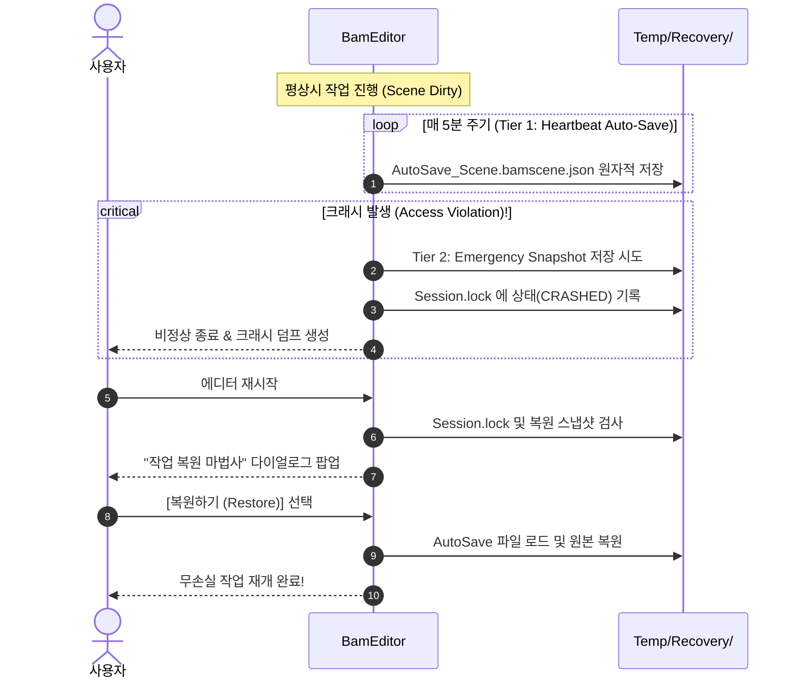

# 비정상 종료 진단(크래시 리포터) 및 에디터 작업 복원 시스템 설계서
(Crash Handling, Diagnostics & Work Recovery System Plan)

- **작성일**: 2026-11-08
- **상태**: Windows 핸들러 및 Editor 복원 경로 반영. 실행 검증 대기.
- **연계 문서**:
  - [엔진·에디터·클라이언트 개발 지침 (EngineEditorClientGuidelines.md)](EngineEditorClientGuidelines.md) 3절, 12절
  - [빌드 구성 및 전처리기 지침 (BuildConfigurationAndPreprocessing.md)](BuildConfigurationAndPreprocessing.md) 3.1절
  - [개발 우선순위 (DevelopmentPriorities.md)](DevelopmentPriorities.md) 11절
- **목표**: 에디터 및 독립 클라이언트의 비정상 종료(Crash/Panic) 시 정확한 진단 데이터(미니덤프, 심볼릭 콜스택, 크래시 리포트)를 영속화하고, 에디터 재시작 시 손실된 작업을 안전하게 복원하는 2단계 방어 체계를 구축한다.

---

## 1. 배경 및 문제 정의

1. **원인 규명의 한계**:
   - 널 포인터 역참조(`0xC0000005`), 스택 오버플로, GPU 디바이스 소실(`DXGI_ERROR_DEVICE_REMOVED`) 등으로 엔진이 크래시될 때, 현재는 터미널이나 에디터가 예고 없이 즉각 증발(Crash-to-Desktop)하여 원인 추적이 극도로 어렵다.
   - 버퍼링된 로그가 디스크에 플러시(Flush)되지 못하고 메모리에 머물다 유실되어 크래시 직전의 마지막 동작을 파악할 수 없다.
2. **아티스트 및 개발자의 작업 손실**:
   - 씬 배치, 머티리얼 튜닝, 비주얼 스크립트 작성 도중 크래시가 발생하면 마지막 저장 이후의 모든 수정 사항이 영구 소실되어 생산성이 크게 저하된다.
3. **타깃별 요구사항 차이**:
   - **Editor**: 디버깅을 위한 최대 상세 정보(미니덤프, 모듈 오프셋, 작업 복원)가 필요하다.
   - **Client**: 게이머에게 복잡한 크래시 창을 노출하지 않고 안전하게 미니덤프를 수집한 뒤 친절한 안내를 제공해야 한다.

---

## 2. 전체 아키텍처 개요



---

## 3. 세부 설계: 크래시 진단 및 리포팅 시스템

### 3.1 예외 가로채기 (Exception Interception)
Windows 플랫폼의 모든 비정상 종료 벡터를 누락 없이 수집한다:
1. **SEH (Structured Exception Handling)**:
   - `::SetUnhandledExceptionFilter(&BamCrashFilter)` 등록.
   - 포착 대상: `EXCEPTION_ACCESS_VIOLATION`(0xC0000005), `EXCEPTION_STACK_OVERFLOW`, `EXCEPTION_ILLEGAL_INSTRUCTION`, `EXCEPTION_INT_DIVIDE_BY_ZERO`.
2. **C++ CRT 런타임 핸들러**:
   - `std::set_terminate(&BamTerminateHandler)`: 처리되지 않은 C++ `throw` 포착.
   - `_set_purecall_handler(&BamPurecallHandler)`: 순수 가상 함수 호출 방어.
   - `_set_invalid_parameter_handler(&BamInvalidParameterHandler)`: CRT 함수 잘못된 인자 전달 방어.

### 3.2 미니덤프 생성 (`DbgHelp.dll`)
크래시 발생 순간 Visual Studio나 WinDbg로 열 수 있는 `.dmp` 파일을 생성한다:
- **저장 위치**: `<ProjectRoot>/Logs/Crashes/BamEngine_Crash_YYYYMMDD_HHMMSS.dmp`
- **덤프 옵션 플래그**:
  ```cpp
  MINIDUMP_TYPE dumpType = static_cast<MINIDUMP_TYPE>(
      MiniDumpNormal |
      MiniDumpWithDataSegs |
      MiniDumpWithUnloadedModules |
      MiniDumpWithProcessThreadData |
      MiniDumpWithThreadInfo
  );
  ```
- **효과**: 개발자가 해당 `.dmp`를 VS에서 열고 [네이티브 전용 디버그]를 누르면, 크래시가 난 정확한 소스 코드 줄번호, 스택 트레이스, 당시 로컬 변수 값을 즉각 확인할 수 있다.

### 3.3 블랙박스 로그 플러시 & 크래시 리포트 (`.crash.json`)
크래시 순간 메모리에 남아 있는 로그를 즉시 비우고, 구조화된 진단 리포트를 생성한다:
1. **로그 버퍼 강제 동기화**:
   - `Logger::DrainPendingEntries()`를 즉각 호출하고 파일 스트림의 `flush()`를 실행.
2. **크래시 리포트 파일 포맷 (`.crash.json`)**:
   ```json
   {
     "CrashReportVersion": "1.0",
     "Timestamp": "2026-11-08T14:45:10Z",
     "Target": "Editor",
     "Configuration": "Release",
     "EngineVersion": "0.1.0-alpha",
     "GitCommit": "a1b2c3d",
     "Exception": {
       "Code": "0xC0000005",
       "Name": "EXCEPTION_ACCESS_VIOLATION",
       "Address": "0x00007FF712345678",
       "AccessMode": "Read",
       "FaultingModule": "BamEngine.dll"
     },
     "Environment": {
       "OS": "Windows 11 (10.0.26100)",
       "CPU": "AMD Ryzen 9 / Intel Core i7 (16 Logical Cores)",
       "PhysicalMemoryAvailableMB": 18432,
       "PhysicalMemoryTotalMB": 32768,
       "GPU": "NVIDIA GeForce RTX 4070 (Driver: 560.81)"
     },
     "Context": {
       "ActiveScene": "Project://Scenes/PhysicsPlayground.bamscene.json",
       "ActiveWorkspace": "DefaultLayout",
       "LastEditedResource": "Project://Materials/Hero_mat.bammatinst.json",
       "UpTimeSeconds": 1420.5
     },
     "Callstack": [
       "BamEngine.dll!Engine::Mesh::Render + 0x1A4",
       "BamEngine.dll!Engine::MeshRenderSystem::Execute + 0x2BC",
       "Editor.exe!Editor::SceneViewportPanel::Draw + 0x48A"
     ]
   }
   ```

---

## 4. 세부 설계: 에디터 작업 비상 저장 및 복원 (Two-Tier Recovery)

> [!CAUTION]
> **크래시 핸들러(SEH) 내부에서의 대규모 힙 할당 금지**  
> 프로세스가 메모리 오염(`Access Violation`)으로 죽는 순간에는 C++ 힙(`malloc`/`new`)이 이미 파손되어 있을 확률이 높습니다.  
> 크래시 핸들러 안에서 복잡한 동적 할당과 대규모 직렬화를 시도하면 2차 크래시(Double Fault)가 발생하여 덤프와 로그마저 날아갑니다.

따라서 작업 복원은 **사전 예방(Tier 1)**과 **비상 스냅샷(Tier 2)**의 2단계 방어 체계로 설계합니다.



### 4.1 Tier 1: 주기적 하트비트 자동 저장 (Heartbeat Auto-Save — 기본 축)
* **동작 주기**: 사용자가 에디터를 조작하는 동안 5분 간격(설정에서 1~15분 조정 가능)으로 동작.
* **조건**: 현재 씬 또는 서브 에셋에 수정 플래그(`m_IsDirty == true`)가 켜져 있을 때만 실행.
* **저장 위치**: `<ProjectRoot>/Temp/Recovery/AutoSave_<SceneName>.bamscene.json`
* **원자적 저장 (Atomic Write)**:
  - 직접 파일에 쓰지 않고 `.tmp` 파일로 먼저 직렬화 완료 후 `filesystem::rename`으로 교체하여, 자동 저장 도중 크래시가 나더라도 기존 복원 파일이 깨지지 않도록 보호.

### 4.2 Tier 2: 크래시 순간 비상 스냅샷 (Emergency Crash Snapshot)
* **원리**: 크래시 핸들러 진입 시, 힙 할당을 최소화하여 사전 할당된 버퍼(Pre-allocated Static Buffer)를 통해 활성 씬의 최소 엔티티 스냅샷을 `<ProjectRoot>/Temp/Recovery/Emergency_<SceneName>.bamscene.json`으로 신속히 덤프.
* 실패하더라도 Tier 1의 5분 전 자동 저장본이 이미 존재하므로 작업 손실이 최대 5분 이내로 제한됨.

### 4.3 세션 잠금 파일 및 복원 마법사 (Session Lock & Restore Wizard)
1. **세션 추적 (`Temp/Session.lock`)**:
   - 에디터 실행 시 `Temp/Session.lock` 생성 (`Status: Running, PID: 1234, Time: ...`).
   - 정상 종료 시 `Session.lock` 삭제.
   - 비정상 종료 시 `Session.lock`이 잔존하거나 `Status: Crashed`가 기록됨.
2. **에디터 시작 시 복원 마법사 모달 표시**:
   - 에디터 부팅 시 `Session.lock`이 남아있고 `Temp/Recovery/`에 유효한 스냅샷이 발견되면 복원 창을 즉시 띄운다:
   ```text
   +------------------------------------------------------------------------+
   | ⚠️ 비정상 종료 감지 및 작업 복원 (Crash Recovery)                      |
   +------------------------------------------------------------------------+
   | 이전 세션이 예기치 않게 종료되었습니다.                               |
   | 복원 가능한 작업 스냅샷이 발견되었습니다:                              |
   |                                                                        |
   |   - 씬 이름: MainCity.bamscene.json                                    |
   |   - 스냅샷 시각: 2026-11-08 14:42:15 (크래시 3분 전 자동 저장본)      |
   |   - 변경된 엔티티 수: 14개                                             |
   |                                                                        |
   | 이 작업을 복원하시겠습니까?                                            |
   |                                                                        |
   | [ 복원하여 열기 (Restore) ]      [ 무시하고 새 작업 (Discard) ]        |
   +------------------------------------------------------------------------+
   ```

---

## 5. 클라이언트(Client)와 에디터(Editor)의 분기 처리

| 구분 | Editor 타깃 (`BAM_EDITOR = 1`) | Client 타깃 (`BAM_EDITOR = 0`) |
| :--- | :--- | :--- |
| **미니덤프 생성** | 상세 정보 포함 (`MiniDumpWithDataSegs` 등, ~15MB) | 표준 경량 미니덤프 (`MiniDumpNormal`, ~2MB) |
| **크래시 리포트** | `.crash.json` 및 심볼릭 콜스택 상세 파일 저장 | 기본 크래시 텍스트 로그만 저장 |
| **UI 안내** | 크래시 리포터 다이얼로그 (덤프 폴더 열기, 재시작 버튼) | 친절한 에러 팝업 ("오류가 발생하여 프로그램을 종료합니다.") |
| **작업 복원** | 2단계 자동 저장 및 시작 시 복원 마법사 활성화 | 복원 기능 완전 제외 (No-Op 인라인 처리) |

---

## 6. 단계별 구현 로드맵

### Phase 1: 기반 크래시 핸들러 및 미니덤프 연동 [완료]
- [x] `Engine/Source/Core/Diagnostics/Public/CrashHandler.h` 및 `Private/CrashHandler_Win32.cpp` 신설.
- [x] `SetUnhandledExceptionFilter`, `std::set_terminate`, `_set_purecall_handler`, `_set_invalid_parameter_handler` 등록 및 `DbgHelp.dll` `MiniDumpWriteDump` 연동.
- [x] 크래시 시 `Logger::Flush()` 강제 호출 파이프라인 연결.
- [x] 에디터 및 엔진 시작/종료점 연동 (`Application::Initialize`, `Application::Free`).

### Phase 2: 크래시 리포트 및 콜스택 추출 [완료]
- [x] `StackWalk64` / `SymFromAddr` 기반 심볼릭 스택 워커 구현.
- [x] 시스템/메모리 정보 및 활성 씬 경로를 포함하는 `.crash.json` 직렬화 구현.
- [x] `Logs/Crashes/` 디렉터리에 타임스탬프 기반 `.dmp` 및 `.crash.json` 저장.

### Phase 3: 에디터 하트비트 자동 저장 (Tier 1) [완료]
- [x] `Editor/Source/Recovery/`에 `RecoveryManager` 신설 (`Public/RecoveryManager.h`, `Private/RecoveryManager.cpp`).
- [x] 씬 수정 감지(`HasUnsavedChanges`) 및 5분 주기 원자적 스냅샷(`Temp/Recovery/AutoSave_...`) `.tmp` 임시 파일 안전 교체 저장 구현.
- [x] 자동 저장 주기 및 활성화 제어 지원.

### Phase 4: 시작 시 복원 마법사 모달 (Recovery Wizard) [완료]
- [x] `Temp/Session.lock` 세션 라이프사이클 관리 (시작 시 생성, 정상 종료 시 삭제, 크래시 시 상태 마킹).
- [x] 에디터 초기화 시 비정상 종료 감지 및 ImGui 모달 다이얼로그(`DrawRecoveryModal`) 연동.
- [x] 복원 선택 시 안전한 스냅샷 씬 로드 및 dirty 상태 원본 씬 문서 재채택 경로 연결.
- [x] 에디터 `Help -> Trigger Crash (Diagnostics Test)` 메뉴 항목 연동을 통한 즉각 검증 경로 제공.

---

## 7. 완료 기준 (Acceptance Criteria)

1. **미니덤프 및 진단 정확성**:
   - 의도적 널 포인터 크래시(`*reinterpret_cast<volatile int*>(0) = 1;`) 발생 시 프로그램이 즉각 증발하지 않고, `Logs/Crashes/`에 유효한 `.dmp`와 `.crash.json`이 누락 없이 생성되어야 한다.
   - 생성된 `.dmp` 파일을 Visual Studio에서 열었을 때 정확한 크래시 발생 소스 라인과 콜스택이 잡혀야 한다.
2. **로그 유실 방지**:
   - 크래시 직전 호출된 `BAM_LOG(Fatal, ...)` 또는 `BAM_LOG(Error, ...)`가 로그 파일에 온전히 기록되어 있어야 한다.
3. **무손실 작업 복원**:
   - 씬에 새 큐브를 배치하고 저장하지 않은 상태에서 에디터를 강제 종료(`Taskkill /F`)하거나 크래시를 유발한 뒤 재실행했을 때, 복원 마법사가 뜨고 [복원] 클릭 시 큐브가 배치된 상태 그대로 열려야 한다.
4. **빌드 안정성 (Client Strip)**:
   - 클라이언트 빌드(`BAM_EDITOR = 0`) 시 복원 관련 로직이 완전히 제외되며, No-Op 및 경량 크래시 덤프만 작동해야 한다.

## 8. 현재 연결 범위 (2026-11-10)

정적 확인에서 Editor의 초기화·종료·갱신과 복원 모달에 연결되어 있다. 독립 Client 진입점의 핸들러 등록과 Client 전용 정책은 실행 경로를 별도로 연결하고 확인해야 한다. 덤프 생성, 로그 기록, 강제 종료 후 복원, 원본 씬 저장·폐기 동작은 사용자 확인 항목이다.
