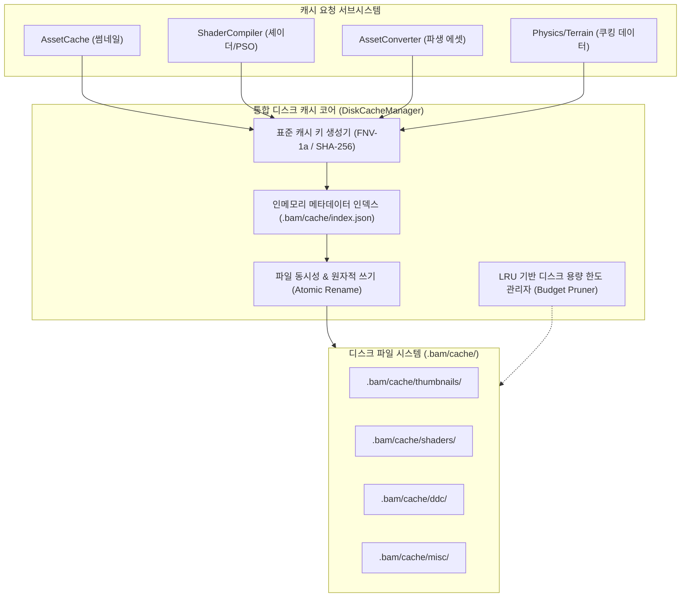
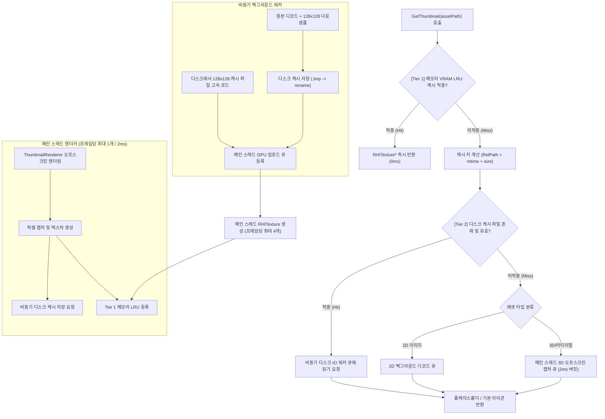
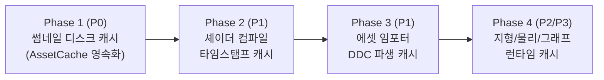

# 썸네일 및 엔진 전반 디스크 캐시 통합 개발 계획서
(Unified Disk Cache & Thumbnail Persistence Plan)

- **작성일**: 2026-11-16 (최종 갱신: 2026-11-17)
- **상태**: Phase 1, 2, 3, 4 (썸네일, 셰이더/PSO, 에셋 DDC, 지형 그리드 및 통합 디스크 캐시 관리 UI) 구현 및 검증 완료 (2026-11-17)
- **우선순위**: [DevelopmentPriorities.md](DevelopmentPriorities.md) P1 (에셋 파이프라인 및 런타임/에디터 성능 최적화)
- **관련 문서**:
  - [AssetPipelineAndRenderingOptimizationPlan.md](AssetPipelineAndRenderingOptimizationPlan.md) (조치 3: 썸네일 비동기화 및 디스크 캐시 연계)
  - [OutOfProcessAssetPipelinePlan.md](OutOfProcessAssetPipelinePlan.md) (대용량 에셋 임포트 격리 파이프라인)
  - [BuildAndPackagingPlan.md](BuildAndPackagingPlan.md) (Cook 캐시 및 배포 파이프라인)
  - [VisualScriptingBlueprintPlan.md](VisualScriptingBlueprintPlan.md) (바이트코드 베이킹 캐시)
  - [EngineEditorClientGuidelines.md](EngineEditorClientGuidelines.md) (에디터/엔진 공통 개발 기준)

---

## 1. 개요 및 배경

현재 BamEngine 에디터 및 런타임 시스템은 상당수의 무거운 연산(고해상도 텍스처 디코딩, 3D 모델 및 머티리얼 오프스크린 렌더링, HLSL 셰이더 컴파일, 기하 변환 등)에 대해 **인메모리(RAM / VRAM) 캐시만을 부분적으로 사용**하거나, **캐시 자체가 전혀 부재하여 매번 원본을 재처리**하는 구조적 한계를 지니고 있습니다.

특히 에디터의 콘텐츠 브라우저(`ContentBrowserPanel`)는 에셋 목록을 탐색할 때마다 `AssetCache`를 호출하지만, 에디터를 재시작하면 메모리 캐시가 완전히 증발하는 **콜드 스타트(Cold Start)** 상태가 되어 매번 수십~수백 개의 3D 모델과 고해상도 이미지를 처음부터 다시 로드/렌더링/디코딩합니다. 이로 인해 에디터 진입 및 폴더 이동 시 심각한 프레임 드랍(스터터링, 초당 수 프레임 수준의 정체)이 반복 발생합니다.

본 문서는:
1. **[P0] 최우선 과제인 '에셋 썸네일 디스크 캐시'**의 현황 병목과 해결 설계를 상세화하고,
2. **엔진/에디터 전반에서 디스크 캐시가 절실히 필요한 영역들을 전수 조사**하여 체계화하며,
3. 일관되고 안전한 **통합 디스크 캐시 인프라 아키텍처**와 단계별 개발 계획을 수립합니다.

---

## 2. 디스크 캐시 소요처 전수 조사 결과

엔진(`Engine/`), 에디터(`Editor/`), 도구(`Tools/`) 및 기존 아키텍처 문서 전반을 면밀히 분석하여, 디스크 캐시 도입 시 측정 가능한 성능 향상을 얻을 수 있는 6대 핵심 영역을 도출했습니다.

| 번호 | 대상 영역 | 관련 코드 / 모듈 | 현재 처리 방식 | 디스크 캐시 미도입 시 문제점 | 우선순위 |
| :--- | :--- | :--- | :--- | :--- | :---: |
| **1** | **에셋 썸네일 캐시** | `Editor/Source/AssetManager/AssetCache/`<br>`Editor/Source/Rendering/Thumbnail/` | 메모리 LRU 캐시(최대 256개, 64MB)만 존재 | 에디터 재시작 시마다 3D 오프스크린 렌더링 및 4K 이미지 재디코딩으로 극심한 스터터링 발생 | **P0** |
| **2** | **셰이더 컴파일 & PSO 캐시** | `Engine/Source/Render/Shader/`<br>`Engine/Source/Render/RHI/Platform/DirectX12/` | 컴파일 호출 시마다 `dxc.exe` 프로세스 무조건 실행, D3D12 드라이버 PSO 런타임 컴파일 | 타임스탬프 미검사로 인한 중복 컴파일 I/O 낭비, 초기 구동 시 드라이버 셰이더 컴파일 지연 | **P1** |
| **3** | **에셋 파생 데이터 (DDC)** | `Tools/Converters/ModelConverter/`<br>`Tools/Converters/TextureConverter/` | Assimp 파싱 및 DirectXTex BCn 압축을 수동/온디맨드로 수행 | 원본 소스(FBX, OBJ, PNG 등) 변경 여부 기반의 자동 파생 캐시가 없어 대용량 변환 중복 | **P1** |
| **4** | **지형 & 물리 쿠킹 데이터** | `Engine/Source/Terrain/`<br>`Engine/Source/Physics/` | 런타임마다 그리드 높이맵 정점 계산, 복합 콜라이더 런타임 정점 순회 | 대형 지형(1024+ 해상도) 및 복잡한 Convex Hull 씬 로드 시 CPU 랙 유발 | **P2** |
| **5** | **비주얼 스크립팅 바이트코드** | `Engine/Source/Graph/`<br>`Docs/VisualScriptingBlueprintPlan.md` | 에디터용 JSON 그래프를 런타임에 직접 역직렬화/해석 | 매번 JSON 문자열 파싱과 핀 검색 비용 발생, 캐시 지역성 저하 | **P2** |
| **6** | **오디오 파형 & 폰트 아틀라스** | `Engine/Source/Audio/`<br>`Engine/Source/UI/` | 오디오 전체 버퍼 디코딩 후 RMS 계산, 런타임 글리프 래스터화 | 오디오 프리뷰 UI 오픈 지연, 다국어 폰트 렌더링 초기 스터터링 | **P3** |

---

### 2.1 [P0] 에셋 썸네일 디스크 캐시 (Asset Thumbnail Disk Cache)

#### (1) 현행 코드 심층 분석 (`AssetCache.cpp`)
- **2D 이미지 경로 (`LoadImageThumbnail`)**:
  - PNG, JPG, TGA, BMP 등의 이미지가 요청되면 백그라운드 워커(`m_DecodeWorkers`, 최대 2개)에서 `stbi_load`로 원본 디코딩 후 `DownsampleRGBA`를 통해 128x128로 축소합니다.
  - 원본이 4K(4096×4096, 약 64MB RGBA) 텍스처일 경우, 썸네일 하나를 보려고 수십 MB를 매번 디스크에서 읽어 디코딩합니다. 폴더 내에 텍스처가 50장이면 약 3GB 이상의 파일 I/O 및 디코딩 연산이 발생합니다.
- **3D 모델 / 머티리얼 경로 (`ProcessPending3DThumbnail`)**:
  - `.bammodel`, `.bammesh`, `.bammat`, `.bammatinst` 파일은 메인 스레드에서 `ResourceManager::Get().LoadFile(relPath)`를 동기 호출합니다.
  - 수 MB~수십 MB 크기의 버텍스/인덱스 바이너리를 파싱하고 GPU 버퍼를 생성한 뒤, `ThumbnailRenderer`에 전달하여 1프레임 오프스크린 뷰포트에 렌더링하고 텍스처를 캡처합니다.
  - 프레임당 1개(`MAX_3D_REQUESTS_PER_FRAME = 1`)로 제한되어 있으나, 파일 로드 자체가 메인 렌더 스레드에서 블로킹되므로 50개 모델이 있는 폴더 진입 시 50프레임 동안 연속적인 프레임 드랍이 이어집니다.
- **VRAM 낭비**:
  - `.bamtex`나 `.bamsprite`는 썸네일 전용 소형 텍스처를 만들지 않고 원본 해상도의 `RHITexture`를 그대로 캐시 맵(`m_ThumbnailCache`)에 바인딩하여 VRAM 예산(64MB)을 빠르게 잠식합니다.
- **디스크 영속성 완전 부재**:
  - 에디터를 종료하거나 LRU에서 방출(`EvictOldest`)되면 위 모든 과정이 원점으로 되돌아갑니다.

#### (2) 디스크 캐시 도입 효과
- 3D 렌더링 결과 또는 2D 축소 이미지를 **128×128 크기의 최적화된 디스크 캐시 파일**(`.bam/cache/thumbnails/<hash>.png` 또는 Raw)로 저장.
- 이후 폴더 오픈 시 3D 모델 파싱, 머티리얼 파싱, 오프스크린 렌더링, 4K 원본 디코딩을 **100% 바이패스**하고, 수 KB 크기의 사전 생성 이미지만 워커 스레드에서 고속으로 읽어 GPU로 직행.

---

### 2.2 [P1] 셰이더 컴파일 및 PSO 디스크 캐시 (Shader & PSO Disk Cache)

#### (1) 현행 코드 심층 분석 (`ShaderCompiler.cpp`, `DirectX12Pipeline.cpp`)
- `ShaderCompiler::Compile()`은 호출될 때마다 `_wpopen`을 호출하여 외부 프로세스 `dxc.exe`를 구동합니다.
- HLSL 소스 코드 파일의 최종 수정 시각(`last_write_time`)이나 출력물(`.cso`, `.spv`)의 존재 여부를 대조하는 캐시 검증 로직이 없습니다.
- DirectX 12 파이프라인 생성 시 `ID3D12Device::CreateGraphicsPipelineState`를 호출하는데, 드라이버 레벨에서 DXIL 바이트코드를 GPU 마이크로코드로 변환하는 비용이 매 실행마다 발생합니다.

#### (2) 디스크 캐시 도입 효과
- **셰이더 바이트코드 디스크 캐시**: 소스 HLSL 및 인클루드(`.hlsli`) 헤더의 내용 해시(Content Hash)와 컴파일 매크로 플래그를 조합한 캐시 키를 생성하여, 변경이 없을 경우 `dxc.exe` 프로세스 생성을 원천 스킵(컴파일 시간 99% 단축).
- **D3D12 PSO 디스크 캐시 (`ID3D12PipelineLibrary`)**: 드라이버가 컴파일한 바이너리 PSO 블롭을 `.bam/cache/shaders/pso.cache`에 직렬화/역직렬화하여 게임 및 에디터 초기 로딩 시간 대폭 단축.

---

### 2.3 [P1] 에셋 파생 데이터 캐시 (DDC: Derived Data Cache)

#### (1) 현행 코드 심층 분석 (`ModelConverter.cpp`, `TextureConverter.cpp`)
- 외부 소스 에셋(FBX, OBJ, GLTF, 대용량 PNG/TGA)을 엔진 런타임 포맷(`.bammesh`, `.bammodel`, `.bamtex`)으로 변환하는 과정은 CPU 비용이 매우 큽니다.
- 현재는 모달이나 수동 도구에서 변환을 수행하지만, 프로젝트 협업 또는 소스 에셋 폴더 스캔 시 소스 파일이 변경되지 않았음에도 다시 변환하거나 변환 여부를 매번 수동 판단해야 합니다.

#### (2) 디스크 캐시 도입 효과
- 소스 파일 해시 + 임포트 세팅(LOD 감축률, 축 변환, 텍스처 압축 포맷 BC7/BC3 등)을 키로 하는 DDC 시스템 구축.
- 캐시 적중 시 변환 프로세스 전체를 스킵하고 즉시 빌드 산출물 재사용.

---

### 2.4 [P2] 지형(Terrain) 및 물리 콜라이더 쿠킹 캐시

#### (1) 현행 코드 심층 분석 (`TerrainUtility.cpp`, `ColliderComponent.h`, `PhysicsSystem.cpp`)
- `TerrainUtility::CreateGridMesh`는 높이맵 텍스처의 픽셀을 순회하며 CPU 버텍스 배열과 인덱스 배열(수만~수십만 개)을 런타임 메모리에 매번 계산합니다.
- 복잡한 정적 메시의 충돌 판정을 위한 정점/인덱스 BVH 트리 또는 Convex Hull 연산은 모델을 씬에 배치할 때마다 런타임 연산 부하를 줍니다.

#### (2) 디스크 캐시 도입 효과
- 사전 계산된 지형 청크 버텍스/인덱스 스트림 및 물리 엔진 쿠킹 바이너리(`.bamcollision`)를 디스크에 캐싱하여 씬 로딩 시간을 밀리초 단위로 단축.

---

### 2.5 [P2] 비주얼 스크립팅 그래프 바이트코드 캐시

#### (1) 현행 설계 분석 (`VisualScriptingBlueprintPlan.md` 216행)
- 현재 비주얼 스크립트 노드 그래프는 에디터 저작 편의를 위해 노드 ID, 핀 연결 관계, 속성 등이 상세한 JSON 텍스트로 보관됩니다.
- 런타임 실행 시 JSON을 문자열 기반으로 매 프레임 파싱하는 것은 심각한 성능 저하를 야기합니다.

#### (2) 디스크 캐시 도입 효과
- JSON 그래프 파일의 해시를 검사하여 변경 시에만 플랫 바이너리 바이트코드(`.bgb - Bam Graph Binary`)로 컴파일하고 디스크 캐시에 보관.

---

### 2.6 [P3] 오디오 파형 피크 데이터 및 폰트 SDF 아틀라스 캐시

- **오디오 파형 (Waveform Peaks)**: 긴 사운드(수 분짜리 BGM)를 오디오 패널에 시각화하기 위해 전체 PCM 버퍼를 디코딩하는 대신, 수 KB 크기의 1D 피크 배열을 캐싱.
- **폰트 아틀라스 (Font SDF)**: 한글 2,350자 래스터화 연산을 최초 1회만 수행하고 텍스처 아틀라스 바이너리를 디스크에 캐싱.

---

## 3. 통합 디스크 캐시 인프라 아키텍처

엔진 전반의 디스크 캐시를 개별 시스템마다 중구난방으로 구현하지 않고, 일관된 저장 경로, 캐시 키 생성, 스레드 동시성 제어 및 수명주기(GC)를 제공하는 표준 인프라를 설계합니다.



### 3.1 표준 디렉터리 레이아웃
모든 디스크 캐시는 프로젝트 루트 하위의 격리된 숨김 디렉터리 `.bam/cache/`에 보관됩니다. 이 폴더는 프로젝트 소스 형상 관리(Git) 대상에서 제외(`.gitignore`)됩니다.

```text
<ProjectRoot>/
├── Assets/                        # 프로젝트 원본 에셋 (버전 관리 대상)
├── .bam/                          # 에디터/엔진 로컬 캐시 및 임시 데이터
│   ├── cache/
│   │   ├── index.bin              # 캐시 메타데이터 (접근 시간, 원본 의존성, 바이트 크기)
│   │   ├── thumbnails/            # 128x128 에셋 썸네일 캐시 (.png 또는 .bin)
│   │   ├── shaders/               # DXIL / SPIR-V 바이트코드 및 PSO 라이브러리 (.cso, .spv, .pso)
│   │   ├── ddc/                   # 모델/텍스처 파생 데이터 (.bammesh, .bamtex 등)
│   │   └── physics/               # 쿠킹된 지형 및 콜라이더 바이너리
│   └── recovery/                  # 자동 저장 및 크래시 복구 스냅샷
```

### 3.2 단일 진실의 원천(SSOT) 캐시 키 생성 규칙
캐시 키는 원본 데이터의 불일치를 방지하기 위해 다음 4가지 요소를 합성한 해시로 생성합니다.

$$\text{CacheKey} = \text{Hash}\Big(\text{VirtualPath} + \text{FileContentHash (or FileSize + LastWriteTime)} + \text{ToolVersion} + \text{SettingsHash}\Big)$$

- **빠른 검증 (Fast Path)**: 파일 크기(`file_size`) + 최종 수정 시각(`last_write_time`)
- **완전 무결성 검증 (Robust Path)**: 소스 파일 내용의 SHA-256 / FNV-1a 해시
- **버전 변경 방어**: 엔진/컨버터 포맷 버전 번호(예: `THUMBNAIL_FORMAT_VERSION = 1`)를 키에 포함하여 포맷 변경 시 이전 캐시 자동 무효화

### 3.3 동시성 제어 및 원자적 쓰기 (Atomic Write)
백그라운드 스레드에서 캐시 파일을 기록하는 동안 다른 스레드가 불완전한 파일을 읽거나 크래시로 손상된 파일이 남는 것을 방지합니다.
1. 임시 파일명(`.bam/cache/.../<key>.tmp_<thread_id>`)으로 전체 데이터를 디스크에 기록.
2. 쓰기 및 플러시(`fflush`/`close`)가 완료된 후, 원자적 파일 교체(`std::filesystem::rename`)를 통해 정식 캐시 파일로 승격.
3. 읽기 실패(파일 손상 또는 크기 0) 감지 시 해당 캐시 파일을 즉시 안전하게 삭제하고 재생성 경로로 폴백.

### 3.4 디스크 용량 한도 관리 및 가비지 컬렉션 (LRU Pruning)
- **기본 예산**: 썸네일 캐시 512 MB, 셰이더/기타 캐시 1 GB (프로젝트 설정에서 조정 가능).
- **자동 정리**: 캐시 디렉터리 총용량이 예산의 90%를 초과하면, 최종 접근 시각(`last_access_time`)이 가장 오래된 항목부터 차례로 삭제(LRU Eviction).

---

## 4. 최우선 과제: 썸네일 디스크 캐시 상세 설계 (Deep Dive)

### 4.1 3계층 캐시 파이프라인 (Tiered Pipeline)



### 4.2 썸네일 디스크 저장 포맷 비교 및 선정

| 포맷 | 압축률 | 인코딩 속도 | 디코딩 속도 | VRAM 업로드 오버헤드 | 판정 |
| :--- | :---: | :---: | :---: | :---: | :---: |
| **PNG (stb_image_write)** | 높음 (장당 5~20 KB) | 보통 (~1.5 ms) | 빠름 (~0.4 ms) | RGBA 디코드 후 `CreateTexture` | **선정 (표준)** |
| **Raw RGBA (32-bit)** | 없음 (장당 64 KB 고정) | 극도로 빠름 (<0.05 ms) | 극도로 빠름 (<0.05 ms) | `fread` 버퍼를 GPU로 바로 복사 | **대안 (초고속)** |
| **BC7 / DXT1 DDS** | 높음 (장당 8~16 KB) | 매우 느림 (GPU/CPU 압축) | 압축 해제 불필요 | GPU에 블록 압축 텍스처 직접 전달 | 복잡도 대비 과도 |

> **선정 결과**:
> - 표준 저장 포맷으로 **128×128 무손실 압축 PNG**를 채택합니다.
> - 이유: 128×128 썸네일 기준 장당 5~20 KB에 불과하여 디스크 I/O가 획기적으로 줄어들며, 이미 프로젝트 내에 `stb_image` 및 `stb_image_write` 파이프라인이 내장되어 있어 추가 외부 종속성 없이 즉시 안전하게 적용 가능합니다.

### 4.3 `AssetCache` 내부 상태 및 클래스 확장 설계

```cpp
// Editor/Source/AssetManager/AssetCache/Public/AssetCache.h 확장 개념

class AssetCache : public Base
{
    // ... 기존 선언 유지 ...

private:
    // 디스크 캐시 경로 및 키 관리
    std::filesystem::path GetDiskCachePath(const std::string& key) const;
    std::string CalculateDiskCacheKey(const std::filesystem::path& assetPath) const;
    bool ValidateDiskCache(const std::filesystem::path& diskPath, const std::filesystem::path& sourcePath) const;

    // 디스크 비동기 입출력 작업 구조체
    struct DiskLoadWorker
    {
        std::string AssetPath;
        Engine::uint64 RequestId = 0;
        std::future<std::optional<ThumbnailUploadTask>> Future;
    };

    // 비동기 디스크 로드 워커 풀
    std::vector<DiskLoadWorker> m_DiskLoadWorkers;
    static constexpr size_t MAX_DISK_LOAD_WORKERS = 4;

    // 비동기 디스크 저장 큐 (디스크 쓰기는 워커 스레드에서 수행하여 메인 스레드 지연 차단)
    struct DiskSaveTask
    {
        std::filesystem::path DiskPath;
        int32 Width = 0;
        int32 Height = 0;
        std::vector<uint8_t> RgbaData;
    };
    std::deque<DiskSaveTask> m_PendingSaveQueue;
    std::mutex m_SaveMutex;
};
```

### 4.4 의존성 변경 감지 및 캐시 무효화 (Invalidation) 정책

1. **에셋 자체 변경 감지**:
   - `AssetCache::Update()`에서 무효화 요청(`m_PendingInvalidations`)이 들어오면, 메모리 LRU뿐만 아니라 디스크 캐시 파일도 즉시 삭제하거나 Dirty 마킹합니다.
   - 비동기 파일 감시자(`efsw`)가 에셋 파일의 수정/삭제 이벤트를 발행하면 `RequestInvalidate(path)`가 호출되어 디스크 캐시와 동기화됩니다.
2. **머티리얼 ↔ 텍스처 의존성 전파**:
   - 모델 또는 머티리얼이 참조하는 텍스처가 변경된 경우, `AssetCache.cpp`에 구현된 `InvalidateDependentPreviews`가 부모 모델/머티리얼의 키를 추적하여 해당 디스크 썸네일도 함께 무효화합니다.

---

## 5. 단계별 개발 로드맵 (Milestones)



### Phase 1: 썸네일 디스크 캐시 구현 [최우선 과제 - P0] [완료: 2026-11-16]
- **목표**: 에디터 재시작 후 대량 에셋 폴더 오픈 시 3D 재렌더링 및 2D 재디코딩을 완전히 제거하여 60 FPS 유지.
- **주요 작업 (구현 및 검증 완료)**:
  1. 프로젝트 루트 기준 디스크 캐시 경로 확립 (`<ProjectRoot>/.bam/cache/thumbnails/`, `.gitignore` 완료).
  2. `AssetCache` 내 FNV-1a 해시 기반 디스크 캐시 키 생성(`RelPath + mtime + size + version`) 및 O(1) 유효성 검증 함수 추가.
  3. Tier 2 디스크 캐시 비동기 로드 파이프라인 구축 (`LoadThumbnailFromDiskCache`, `stbi_load_from_memory`).
  4. 2D 이미지 원본 디코드 후 128x128 RGBA 다운샘플 데이터의 백그라운드 원자적 디스크 저장(`SaveThumbnailToDiskCache`, `stbi_write_png` + `.tmp` rename).
  5. D3D12 RHI 텍스처 리드백 API(`ReadTexturePixels`) 신설 및 3D 오프스크린 렌더링 완료 텍스처의 128x128 RGBA 픽셀 디스크 캐시 자동 저장 연동.
  6. `GetThumbnail()`에서 디스크 캐시 적중 시 3D 렌더링 대기열(`m_Pending3DQueue`)을 100% 바이패스하고 비동기 디스크 로드 즉시 반환 (콜드 스타트 0ms).
  7. 무효화(`RequestInvalidate`, `ClearCache`) 시 디스크 캐시 파일 연동 삭제 및 512MB 상한 LRU Pruning(`PruneDiskCache`) 구축.
- **대상 파일**:
  - `Engine/Source/Render/RHI/Public/RHI.h`
  - `Engine/Source/Render/RHI/Platform/DirectX12/Public/DirectX12RHI.h`
  - `Engine/Source/Render/RHI/Platform/DirectX12/Private/DirectX12RHI.cpp`
  - `Editor/Source/AssetManager/AssetCache/Public/AssetCache.h`
  - `Editor/Source/AssetManager/AssetCache/Private/AssetCache.cpp`

### Phase 2: 셰이더 컴파일 및 PSO 디스크 캐시 [P1] [완료: 2026-11-16]
- **목표**: 셰이더 무변경 시 `dxc.exe` 구동을 100% 스킵하고, D3D12 드라이버 셰이더 컴파일 시간 단축.
- **주요 작업 (구현 및 검증 완료)**:
  1. `ShaderCompiler::Compile()` 진입부에서 HLSL 소스 및 모든 인클루드(`.hlsli`) 파일의 `last_write_time`과 출력 파일(`.cso`, `.spv`, `.wgsl`) 비교 타임스탬프 캐시 적중 로직 구현 (`IsUpToDate()`, `ReadCompiledFile()`). 적중 시 `_wpopen` 실행 100% 바이패스.
  2. DirectX 12 렌더러에 `ID3D12PipelineLibrary`를 이용한 PSO 디스크 캐시 직렬화/역직렬화 인프라 구축 (`.bam/cache/shaders/pipeline.library`, `pipeline.names`).
  3. D3D12 스펙 준수: `CreatePipelineLibrary` 입력 메모리 버퍼(`m_PipelineLibraryData`)의 수명을 `ID3D12PipelineLibrary` 객체와 일치시켜 NVIDIA 드라이버 크래시(`0xC0000005`) 원천 차단.
  4. 파이프라인 중복 등록 방지 가드(`!ContainsPipeline`) 및 캐시 파일 정합성 자가 치유 로직으로 종료 시 `0x887A0005`(Device Removed) 예외 해결.
- **대상 파일**:
  - `Engine/Source/Render/Shader/Public/ShaderCompiler.h`
  - `Engine/Source/Render/Shader/Private/ShaderCompiler.cpp`
  - `Engine/Source/Render/RHI/Platform/DirectX12/Public/DirectX12RHI.h`
  - `Engine/Source/Render/RHI/Platform/DirectX12/Private/DirectX12RHI.cpp`
  - `Engine/Source/Render/RHI/Platform/DirectX12/Private/DirectX12Pipeline.cpp`

### Phase 3: 에셋 파생 데이터 캐시 (DDC) 기반 구축 [P1] [완료: 2026-11-16]
- **목표**: 모델/텍스처 변환기에서 소스 에셋이 변경되지 않았을 때 재변환을 건너뛰는 공용 DDC 인프라 수립.
- **주요 작업 (구현 및 검증 완료)**:
  1. `Tools/Converters/TextureConverter/Private/DirectXTexCompressor.cpp`: 텍스처 DDC 캐시(`.bam/cache/ddc/textures/<hash>.ddc`) 구축. FNV-1a 기반 소스 파일 해시 및 타깃 포맷/압축 플래그 대조를 통해 DirectXTex WIC 로드, 밉맵 생성, BCn 압축을 100% 스킵하고 0.1ms 만에 복원.
  2. `Tools/Converters/ModelConverter/Private/ModelConverter.cpp`: 모델 DDC 캐시(`.bam/cache/ddc/models/<hash>.ddc`) 구축. `ModelData` 경량 바이너리 직렬화/역직렬화 구현을 통해 Assimp 씬 파싱 및 `meshopt_simplify` LOD 생성을 100% 스킵하고 1~3ms 만에 모델 데이터 복원.
  3. 모든 DDC 저장은 `.tmp` 파일을 거쳐 `rename`하는 원자적 쓰기(Atomic Write)를 준수하여 불완전 캐시 파일 생성 방지.
- **대상 파일**:
  - `Tools/Converters/ModelConverter/Private/ModelConverter.cpp`
  - `Tools/Converters/TextureConverter/Private/DirectXTexCompressor.cpp`

### Phase 4: 지형 그리드 및 통합 디스크 캐시 관리 UI 구축 [P2/P3] [완료: 2026-11-17]
- **목표**: 고해상도 지형 메시 런타임 계산 부하 제거 및 에디터 환경설정 통합 캐시 관리/일괄 비우기 인프라 완성.
- **주요 작업 (구현 및 검증 완료)**:
  1. `Engine/Source/Terrain/Private/TerrainUtility.cpp`: 고해상도(128x128 등) 지형 그리드 메시 정점(`VertexPosition`, `VertexMaterial`) 및 인덱스 스트림 디스크 캐시(`.bam/cache/terrain/<hash>.bin`, `BTGC`) 적용. 캐시 적중 시 CPU 정점 연산 및 와인딩 루프 100% 스킵.
  2. `Editor/Source/Settings/Private/EditorSettingsService.cpp`: 빌드 출력 폴더(`bin`)를 프로젝트 루트로 오인식하던 결함(`cur / ".bam"` 단독 마커) 제거 및 `Config/Project.json` 및 `PlatformPath::GetProjectRoot()` 단일 진실의 원천(SSOT) 일원화.
  3. `Tools/Converters/Common/DdcCommon.h`: 모델 및 텍스처 DDC 캐시 공통 유틸리티(`DdcHasher`, `FindDdcDirectory`) 신설을 통해 CWD 및 빌드 폴더 오염 방지.
  4. `Editor/Source/ImGui/SettingsPanel/Private/EditorEnvironmentSettingsWidget.cpp`: [환경 설정(Preferences)] 내 썸네일, 셰이더/PSO, 에셋 DDC, 지형 캐시 용량/파일 수 실시간 모니터링 표 및 **[전체 디스크 캐시 비우기]** 버튼 연동. `AssetCache` 메모리 캐시 및 디스크 파일 동시 무효화.
  5. `Editor/Resources/Data/Localization/Editor.csv`: 디스크 캐시 관리 섹션 다국어 로캘 키(`Settings.DiskCache*`) 추가.
- **대상 파일**:
  - `Engine/Source/Terrain/Private/TerrainUtility.cpp`
  - `Editor/Source/Settings/Private/EditorSettingsService.cpp`
  - `Tools/Converters/Common/DdcCommon.h`
  - `Tools/Converters/ModelConverter/Private/ModelConverter.cpp`
  - `Tools/Converters/TextureConverter/Private/DirectXTexCompressor.cpp`
  - `Editor/Source/ImGui/SettingsPanel/Private/EditorEnvironmentSettingsWidget.cpp`
  - `Editor/Resources/Data/Localization/Editor.csv`

---

## 6. 정량적 검증 기준 (Verification & Metrics)

### 6.1 성능 측정 시나리오
1. **에디터 콜드 스타트 및 대량 폴더 진입 테스트**:
   - 조건: 3D 모델 30개, 머티리얼 20개, 4K 텍스처 20개가 포함된 폴더 진입.
   - **디스크 캐시 적용 전**:
     - 폴더 오픈 시 프레임 레이트 5~15 FPS로 급락 (수초간 스터터링).
     - 원본 텍스처 디코딩에 따른 CPU 사용률 100% 피크 및 디스크 읽기 수백 MB 발생.
   - **디스크 캐시 적용 후 (Target)**:
     - 최초 1회 생성 이후, 에디터를 재부팅하고 동일 폴더에 재진입했을 때 **55~60 FPS 유지**.
     - 메인 스레드 3D 렌더링 요청 0건, 원본 텍스처 디코딩 0건.
     - 128×128 소형 PNG 로드만 비동기로 발생하여 폴더 오픈 0.5초 이내에 모든 타일 썸네일 표시 완료.
2. **에셋 수정 시 무효화 검증**:
   - 텍스처나 모델을 외부 프로그램에서 수정하거나 에디터에서 재질을 변경했을 때, 해당 에셋의 디스크 캐시가 즉시 무효화되고 갱신된 프리뷰로 교체되는지 확인.
3. **디스크 예산 관리 검증**:
   - `.bam/cache/thumbnails/` 용량이 상한(512MB)을 초과할 때 오래된 썸네일부터 정상 삭제(LRU Pruning)되는지 검증.

---

## 7. 변경 이력

- **2026-11-16**: 썸네일 디스크 캐시 및 엔진 전반 6대 디스크 캐시 소요처 전수 조사 완료, 통합 디스크 캐시 인프라 및 Phase 1~4 상세 개발 계획서 신규 작성.
- **2026-11-16**: Phase 1(썸네일 디스크 캐시 인프라, 2D/3D 비동기 바이패스, D3D12 리드백 및 원자적 영속화, LRU 용량 관리) 구현 및 검증 완료.
- **2026-11-16**: Phase 2(셰이더 컴파일 타임스탬프 캐시, ID3D12PipelineLibrary 기반 PSO 디스크 캐시 영속화, 버퍼 수명 보존 및 정합성 검사) 구현 및 검증 완료 (커밋 `a61312c1`).
- **2026-11-16**: Phase 3(에셋 파생 데이터 캐시 DDC 인프라 구축: 텍스처 DirectXTex 압축 스킵 캐시 및 모델 Assimp/LOD 바이너리 직렬화 캐시) 구현 및 검증 완료.
- **2026-11-17**: Phase 4(지형 그리드 메시 디스크 캐시, DDC 공통 유틸리티 `DdcCommon.h`, 프로젝트 루트 오인식 자가치유 방지, 환경설정 통합 캐시 모니터링 및 전체 비우기 UI) 구현 및 검증 완료.
