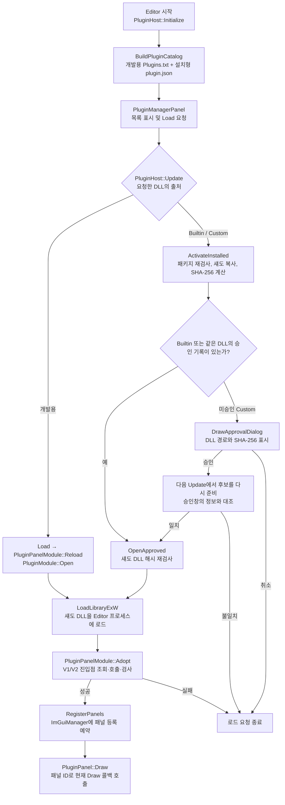
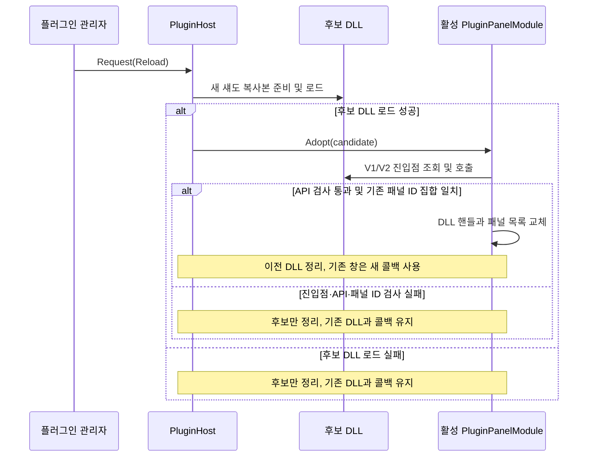

# 에디터 플러그인 아키텍처 설계

- 작성일: 2026-11-10
- 상태: Editor 공용 발견·수동 활성화·DLL 교체와 Custom 승인 저장 구현. Console·Metrics·Network Profiler는 V2 개발용 패널 DLL로 분리하고 자동 로드하도록 연결했으며, 새 패널 DLL 빌드와 Editor 실환경 검증은 대기 중. [현재 진행 상태](#8-현재-진행-상태-2026-11-20)
- 대상: Windows x64 네이티브 Editor·Runtime 확장과 코드 없는 콘텐츠 패키지. Builtin과 Custom을 같은 발견·활성화 경로에서 다룬다.
- 관련 문서: [엔진·에디터·클라이언트 기준](EngineEditorClientGuidelines.md), [소스 구성 기준](SourceOrganizationGuidelines.md), [에디터 UI 계획](ImGuiDevelopmentPlan.md), [개발 우선순위](DevelopmentPriorities.md).

## 1. 현재 구현과 전환 목표

- 일반 창 예제와 게임 기능 예제가 각각 DLL 로드와 공개 API 호출을 검증하는 출발점이다. 공용 호스트의 흐름은 **패키지 발견·활성화 → 환경에 맞는 모듈 로드 → 제공 기능 등록 또는 API 연결**이다.
- 에디터 패널 API는 V1 진단 Probe와 V2 인스턴스 기반 계약을 함께 지원한다. Console·Metrics·Network Profiler는 V2 개발용 DLL로 이전했으며, 리소스 열기·저장은 실제 사용처를 옮길 때 패널에 붙이는 선택 기능이다.
- 로컬 개발은 모듈 타깃 빌드와 코드 교체를 다룬다. 설치된 패키지는 메타데이터와 바이너리로 발견·활성화한다. 두 경로는 로더와 기능 계약을 공유하며, 빌드 타깃 이름과 배포용 플러그인 ID는 따로 관리한다.

## 2. 플러그인, 모듈, 등록 기능

- **플러그인**은 관리자에 표시되고 설치·활성화되는 단위다. 안정적인 플러그인 ID, 버전, 호환 범위와 DLL 위치를 선언한다.
- **모듈**은 빌드와 코드 교체의 단위다. 패키지 형식은 모듈 목록을 표현한다. 현재 Editor 호스트는 Editor 모듈 선언이 하나인 패키지를 처리하고, DLL 하나로 여러 패널을 등록할 수 있다. 콘텐츠 전용 활성화와 Runtime 모듈 선택은 후속 범위다.
- **등록 기능**은 Editor가 사용할 구체적인 동작이다. 패널, 액션, 속성 편집기, 임포터처럼 호출 시점과 소유권이 다른 기능을 각각 등록한다. 리소스 편집은 일반 패널에 붙이는 선택 기능이다.
- **Builtin Plugin**은 에디터 설치본이 제공하는 확장이다. **Custom Plugin**은 사용자가 명시적으로 설치하거나 연결한 확장이다. 두 출처는 같은 패키지 형식과 기능 등록 계약을 사용한다. 네이티브 모듈은 공용 SDK를 사용한다. 에디터의 기본 도킹·문서·입력 기반은 본체가 소유한다. 관리자에 표시되는 GameModule, 셰이더 재컴파일, 에셋 변경 감시는 각 서비스의 기존 수명 주기를 사용한다. [게임 모듈 로더](../Editor/Source/HotReload/Private/ModuleHotReloadManager.cpp)

## 3. 발견, 활성화와 빌드

### 패키지 메타데이터

패키지 루트에 `plugin.json`을 둔다. 첫 예시는 현재 호스트에서 확인할 수 있는 Probe용 매니페스트다. `sdkCompatibility`는 DLL과 Editor를 빌드한 구성에 맞게 [`PluginSdkCompatibility`](../Editor/Source/HotReload/Public/EditorPanelPluginApi.h) 값으로 바꾼다. 두 번째는 콘텐츠 전용 패키지의 계획 형식이다.

```json
{
  "manifestVersion": 1,
  "id": "bam.panel-lifecycle-probe",
  "name": "Panel Lifecycle Probe",
  "version": "1.0.0",
  "modules": [
    {
      "id": "panel-lifecycle-probe-editor",
      "environment": "Editor",
      "apiVersion": 1,
      "sdkCompatibility": "<SDK가 제공한 호환 식별자>",
      "binary": "Binaries/Win64/EditorPanelLifecycleProbe.dll"
    }
  ]
}
```

```json
{
  "manifestVersion": 1,
  "id": "sample.desert-encounters",
  "name": "Desert Encounters",
  "version": "1.0.0",
  "modules": [],
  "contentRoot": "Content"
}
```

- `manifestVersion`은 패키지 파일 형식, `version`은 배포 버전이다. 모듈의 `environment`는 `Editor` 또는 `Runtime`이고, `apiVersion`과 `sdkCompatibility`는 해당 환경에서 로드할 계약을 확인한다. 네이티브 Builtin과 Custom에는 같은 SDK 호환 기준을 적용한다.
- `binary`, `contentRoot` 및 선택적인 모듈별 실행 의존 DLL 경로는 패키지 기준 상대 경로다. 심볼릭 링크와 정션을 해석한 실제 경로가 패키지 밖이면 거부한다. 로더는 확인된 절대 경로로만 DLL을 연다.
- 출처와 신뢰 여부는 호스트가 정한다. 패키지 파일의 값으로 Builtin 권한을 선언할 수 없다. 기본 활성화 정책도 설치본 목록이나 사용자 설정에 둔다.
- 의존 모듈이 아직 로드되지 않아도 목록에서 상태를 표시할 수 있다. 첫 버전은 SDK 의존만 다룬다. 플러그인 간 의존성이 필요해지면 버전 범위, 활성화 순서, 순환 검사를 같은 패키지 형식의 후속 버전에 추가한다.

### Builtin과 Custom 정책

- **Builtin**은 실행 파일 옆 `BuiltinPlugins`에서 발견한다. 현재 관리자의 수동 로드·언로드를 사용한다. 설치본 목록에서 기본 활성화 여부를 지정하는 정책은 후속 범위다.
- **Custom**은 프로젝트 루트의 `Plugins`에서 발견한다. 처음 로드할 때 사용자가 승인하며, 프로젝트·패키지·DLL 식별 정보와 SHA-256이 일치하면 이후 수동 로드에서 승인을 재사용한다. 외부 폴더 등록은 후속 범위다. 로컬 개발 타깃의 빌드와 반복 교체는 `Plugins.txt` 경로에서 다룬다.
- 동일한 ID의 Custom이 Builtin을 덮어쓸 수 없다. Custom끼리 ID가 겹치면 충돌 상태로 표시하고, 사용자가 출처를 하나 선택하기 전에는 둘 다 실행하지 않는다. 활성화 후 기능 ID 충돌이 발견되면 신규 등록 전체를 거부한다.
- Custom DLL은 Editor 프로세스에서 실행된다. 신뢰 설정은 로드 여부를 제어하며, DLL 실행 중의 접근 권한은 Editor 프로세스와 같다.
- 프로젝트별 활성화 설정과 설치본의 기본값은 별개로 보관한다. 로드된 모듈 세대, 빌드 진행 및 인스턴스 포인터는 런타임 상태로 관리한다.

### 실행 중 설치형 패널 추가

1. 에디터를 켠 상태에서 프로젝트 루트 `Plugins/<패키지 폴더>/`에 위 형식의 `plugin.json`과 그 파일에 지정된 상대 경로의 DLL을 배치한다. 상단 툴바의 정보 아이콘에서 폴더 경로와 `sdkCompatibility`에 넣을 Editor 빌드의 호환 식별자를 확인할 수 있다. 식별자를 맞추는 것만으로 DLL의 실제 ABI 호환성이 보장되는 것은 아니다.
2. 플러그인 및 모듈 관리자에서 **패키지 새로고침**을 누르고 추가된 항목을 선택해 **로드**한다. Custom은 DLL의 출처와 해시를 확인하고 승인해야 한다. 재검색만으로 DLL을 실행하지 않는다.
3. 변경된 매니페스트와 DLL도 새로고침한 뒤 로드 또는 리로드한다. 삭제된 패키지는 현재 세션에서 누락 상태로 남으며, 이미 로드된 패널은 자동 종료되지 않는다. 필요하면 직접 언로드한다. 중복 ID가 발생해도 기존에 로드된 패널은 유지하며 새 로드·리로드는 차단한다.

이 경로는 **기존 패널 API와 호환되는 설치형 패키지**를 대상으로 한다. 임의 DLL을 선택해 자동으로 패키징하지 않는다. 개발용 `Plugins.txt`와 리소스 편집기용 목록은 시작 시 구성되므로 이 버튼으로 새 빌드 타깃을 추가할 수 없다. 실행 중 재검색·승인·로드는 아직 사용자 실환경 검증이 필요하다.

### 에디터 패널 템플릿 생성

관리자 상단 **새 패널 플러그인** 아이콘에서 영문 식별자, 표시 이름, 버전과 초기 창 크기를 입력한다. 생성 창에는 입력한 식별자에 따른 전체 예상 경로가 표시된다. `Plugins/UserPanel_<식별자>/`에 `Panel.cpp`, 독립 `CMakeLists.txt`, `plugin.json`을 생성하며 기존 폴더는 덮어쓰지 않는다. 생성 실패 시 남은 경로를 표시한다. 생성 직후 패키지는 DLL 누락 상태이며 아직 빌드되거나 로드된 것이 아니다. 선택한 패키지의 상세 정보에서 전체 폴더 경로와 Windows 탐색기 열기 아이콘을 사용할 수 있다.

이 템플릿은 소스 트리에서 실행한 Windows x64 MSVC Editor용 V2 독립 패널이다. 표시 이름은 사용자가 입력한 값이며 현재 패널의 제목 키로도 사용한다. 키가 Editor 로캘에 존재하지 않으면 입력 문자열로 표시되므로, 같은 이름의 기존 로캘 키가 있으면 그 번역이 우선한다. 플러그인별 번역 등록·아이콘 선택은 아직 제공하지 않는다. 템플릿에는 인스턴스 생성·파괴와 빈 상태/워크스페이스 콜백, ImGui 컨텍스트 바인딩이 포함되며 저장할 상태가 생기면 직접 구현해야 한다.

생성된 소스는 **현재 Editor와 같은 소스 버전, MSVC 도구 집합, x64, Debug/Release 구성과 ImGui 의존성**으로 별도 빌드한다. 생성 소스의 SDK 식별자 정적 검사는 컴파일러 버전·아키텍처·구성 불일치를 막지만 ImGui 버전이나 소스 버전까지 증명하지는 않는다. 아래는 이 저장소의 `x64-ninja-debug` 환경 예시이며 `Example`은 입력한 식별자로 바꾼다. 에디터를 열어둔 채 Developer PowerShell에서 실행한다.

```powershell
$plugin = Join-Path (Get-Location) 'Plugins\UserPanel_Example'
$installed = Join-Path (Get-Location) 'out\build\x64-ninja-debug\vcpkg_installed'
cmake -S $plugin -B "$plugin\build" -G Ninja "-DCMAKE_BUILD_TYPE=Debug" "-DCMAKE_TOOLCHAIN_FILE=I:\vcpkg\scripts\buildsystems\vcpkg.cmake" "-DVCPKG_MANIFEST_MODE=OFF" "-DVCPKG_INSTALLED_DIR=$installed" "-DVCPKG_TARGET_TRIPLET=x64-windows"
cmake --build "$plugin\build" --config Debug
```

빌드 후 관리자에서 **패키지 새로고침 → 로드 → 승인**을 사용한다. 소스 변경 후에도 별도로 다시 빌드하고 **패키지 새로고침 → 리로드**해야 한다. 사용자 소스 플러그인의 관리자 내 빌드·자동 감시, 독립 배포용 SDK, Blank/Runtime 모듈과 임의 저장 위치는 아직 구현하지 않았다.

### 사용자 소스 패키지 빌드·로드 계획

**상태: 계획.** 현재 생성된 패널은 DLL이 없어도 매니페스트로 발견되지만, `MissingBinary` 상태에서는 관리자에 빌드 버튼이 없다. `ModuleBuildManager`는 이미 구성된 빌드 트리의 타깃을 빌드하며, 설치형 사용자 패키지의 최초 CMake 구성과 연결되지 않았다. [관리자](../Editor/Source/ImGui/PluginManager/Private/PluginManagerPanel.cpp) · [빌더](../Editor/Source/HotReload/Private/ModuleBuildManager.cpp)

현재 생성 템플릿은 DLL을 매니페스트의 `Binaries/Win64` 경로에 직접 출력하므로 사용자가 빌드한 뒤 별도 복사는 필요하지 않다. 다만 직접 출력은 빌드 실패나 기존 산출물 교체를 안전하게 격리하기 어렵다. 목표는 수동 복사를 자동화하는 것에 그치지 않고, **신뢰한 소스를 구성·빌드하고 검증된 산출물을 게시한 뒤 기존 패키지 로드 경로로 연결**하는 것이다. 첫 적용 범위는 소스 트리에서 실행하는 Windows x64 MSVC Editor와 생성된 V2 Editor 패널이다.

#### 진행 순서

1. **기준 확인.** 사용자가 기존 생성 패널을 수동으로 구성·빌드하고 재검색·승인·로드한다. 현재 Editor와 일치하는 도구 집합, 구성과 ImGui 의존성 및 출력 경로를 확인한다. Console 핫 리로드와 관리자 툴바의 현재 동작도 함께 확인한다. 실패 결과는 자동화 전제 조건과 구분해 기록한다.
2. **발견과 신뢰.** 패키지별 `plugin.json`, 패키지 경로와 소스 빌드 정보를 확인하고 DLL 존재 여부와 빌드 가능 여부를 별도로 표시한다. CMake 구성 자체가 임의 명령을 실행할 수 있으므로 소스 경로와 작업을 사용자에게 보여 주고 **구성 전** 명시적으로 승인받는다. 패키지 재검색만으로 구성·빌드하지 않는다. 소스 빌드 승인과 산출된 DLL의 기존 해시 기반 로드 승인은 별개다. 승인된 CMake도 사용자 권한으로 임의 작업을 할 수 있으며 이 승인은 샌드박스가 아니다.
3. **독립 구성·빌드.** 패키지별 독립 빌드 디렉터리에서 Editor와 일치하는 MSVC 도구 집합, 아키텍처, Debug/Release, 소스 버전과 의존성을 사용한다. 타깃 이름은 파일명에서 추측하거나 CMake 텍스트를 임의 파싱하지 않는다. 생성 템플릿의 명시적 빌드 정보와 구성 결과를 대조하고 불일치는 오류로 표시한다. 기존 빌더의 비동기 실행·출력 수집·환경 탐색은 재사용 가능성을 검토하되 최초 구성과 빌드는 별도 단계로 처리한다. 중복 요청, 빌드 중 재요청, 패키지 변경·삭제와 Editor 종료 시 작업 소유권을 정한다.
4. **후보 산출물과 게시.** 새 템플릿은 별도 후보 위치에 DLL을 출력하고 매니페스트 대상 경로·파일·SDK 및 ID를 재검사한 뒤 게시한다. 복사·교체 실패나 잘못된 후보는 기존 게시 DLL과 활성 패널을 보존한다. 로드 실패 시에도 마지막 정상 DLL과 활성 패널을 유지하도록 게시·승인·후보 채택의 순서와 복구를 설계한다. 승인 대기 중 파일이 변경되면 해시를 다시 확인한다. 기존 생성 템플릿은 최종 경로에 직접 출력하므로 사용자의 CMake를 무단 변경하지 않고, 후보 출력 설정을 지원하도록 명시적 마이그레이션한 경우에만 안전 게시 흐름을 사용한다. 안전한 출력 경로를 보장할 수 없는 패키지는 이유를 표시하고 이 흐름에서 빌드하지 않는다.
5. **관리자 연결.** DLL이 없는 소스 패키지에도 빌드 액션을 제공하고, 기존 패널은 **다시 빌드 및 리로드**할 수 있게 한다. 구성·빌드·게시·승인·로드의 상태와 실패 원인, 빌드 로그 및 출력 경로를 구분해 표시한다. 성공 후 기존 재검색·매니페스트 검사·섀도 복사·승인·호스트 등록 경로를 사용한다. 기존 패키지·선택·로드 상태를 유지하고, 갱신된 결과를 오래된 패키지 항목이나 취소된 승인에 연결하지 않는다.
6. **후속 확장.** 소스 저장 시 자동 빌드는 명시적으로 활성화하고 동일한 신뢰·실패 보존 규칙을 적용한다. 패널 없는 Blank Editor 모듈과 Runtime 모듈은 현재 패널 호스트의 지원 대상이 아니다. 패널 경로 검증 후 각 모듈의 진입점·수명·등록 및 교체 계약을 별도 설계해 빌드 기반에 연결한다. 독립 배포용 SDK와 임의 저장 위치도 별도 범위다.

#### 완료 및 검증 기준

- DLL 없는 생성 패널을 사용자가 승인한 뒤 관리자에서 구성·빌드·게시·로드할 수 있고, 소스 수정 후 Editor 재시작 없이 리로드된다. 기존 패널의 상태와 Workspace 복원이 유지된다.
- CMake 구성·컴파일·복사/게시·승인·로드 실패를 구분한다. 기존 DLL과 활성 패널을 보존하고, 취소·종료·패키지 교체·빌드 중 재요청에서도 오래된 결과를 적용하지 않는다.
- 소스 빌드 승인 전 구성되지 않으며, DLL 해시가 변경되면 기존 승인 정책을 따른다. 중복 ID, SDK 불일치, 경로 이탈, 누락된 도구·의존성과 잠긴 DLL/PDB를 명시적으로 처리한다.
- 관리자 동작은 공용 아이콘 툴바와 기존 로캘·입력 기준을 따른다. 새 문구는 `Editor.PluginManager.csv`에 추가하고 생성 JSON은 직접 수정하지 않는다. 한·영, 좁은 폭과 배율별 상태·오류 표시를 [UI/UX 검증 기준](EditorUXTestGuidelines.md)에 따라 확인한다.
- `PanelPluginGeneratorCheck`와 관련 검사에 최초 빌드 정보, 경로·실패·기존 파일 보존 사례를 추가한다. 실제 CMake 구성·빌드, Editor 실행·승인·핫 리로드와 PDB 잠금은 사용자가 직접 검증한다. 자동 검사만으로 외부 프로세스와 실환경 동작을 완료로 판단하지 않는다.

### 새 플러그인 생성 템플릿

장기적으로 생성 화면에서 아래 네 가지를 제공할 계획이다. 현재는 위의 V2 패널 시작 템플릿만 생성한다. 템플릿은 처음 생성할 파일과 예제 동작을 정한다. 생성 후 모듈과 등록 기능의 조합은 개발자가 결정한다.

1. **Blank** — Editor 또는 Runtime 모듈을 선택한다. 공용 진입점과 빈 등록 또는 초기화 함수를 생성한다. 창 없이 실행하는 액션이나 `GameplayScore` 같은 런타임 서비스의 출발점이다.
2. **Editor Standalone Window** — 메뉴에 나타나는 창과 공용 UI로 그리는 예제 버튼을 생성한다. 같은 창을 독립 창과 도킹 패널 사이에서 옮길 수 있다. 에셋 편집이 필요하면 이 창에 열기·저장 기능을 추가한다.
3. **Third Party Library** — 외부 라이브러리를 호출하는 래퍼 모듈을 생성한다. 헤더와 링크 라이브러리는 개발용 빌드 설정으로 관리하고, 실행에 필요한 외부 DLL은 패키지의 실행 의존성으로 선언한다. 정적 라이브러리를 사용하는 경우에는 링크 입력만 필요하다.
4. **Game Feature (Content Only)** — 모듈이 비어 있는 `plugin.json`과 콘텐츠 폴더를 생성한다. 관리자에서 활성화하면 등록된 에셋을 프로젝트에서 찾고 사용할 수 있다. 첫 범위는 콘텐츠 연결과 해제까지다. 자동 컴포넌트 주입이나 실행 중 게임 규칙 전환은 런타임 기능이 실제로 필요해질 때 설계한다.

### 소스가 있는 개발 환경

다음 항목은 목표이며 현재 설치형 사용자 소스 패키지의 관리자 내 빌드·자동 감시는 구현되지 않았다. 구체적인 단계와 제약은 [사용자 소스 패키지 빌드·로드 계획](#사용자-소스-패키지-빌드로드-계획)을 따른다.

- 생성 화면에서 이름과 템플릿을 선택하면 Editor가 패키지 파일과 시작용 소스를 만든다. SDK의 공용 CMake 틀이 타깃·출력·PDB 설정을 준비한다. 플러그인마다 독립 타깃이 생기며, 기본 작성 흐름에서는 CMake 파일을 직접 작성할 필요가 없다. 코드 없는 패키지는 빌드 구성도 만들지 않는다.
- CMake 타깃, 감시 폴더, 빌드 트리 경로는 **개발용 목록**에만 둔다. Builtin 소스는 저장소의 빌드 트리에서, Custom 소스는 공용 SDK를 참조하는 별도 빌드 트리에서 구성한다. 설치형 Editor의 소스 빌드에는 호환 SDK 헤더·링크 라이브러리와 C++ 툴체인이 필요하다. 배포용 바이너리 패키지는 소스 경로 없이 설치할 수 있다.
- 승인된 소스 플러그인에는 **빌드 후 다시 로드**와 **소스 저장 시 자동 빌드**를 제공한다. 바이너리 패키지는 설치·활성화·비활성화 및 호환되는 새 바이너리 로드 경로를 사용한다. 같은 관리자에서 출처와 빌드 가능 여부를 표시한다.
- DLL의 패널 코드만 바꾸면 해당 타깃만 빌드한다. SDK 계약이나 호스트 서비스 변경은 호스트와 관련 DLL을 함께 빌드한다. 플러그인 폴더 밖의 기존 CMake·호스트 소스를 개발용 목록에서 임의로 지정해 실행하지 않는다. 빌드 버튼은 로컬 빌드 구성에서 생성한 타깃 정보만 사용한다.

## 4. 개발자가 사용하는 SDK

DLL은 버전이 있는 공용 진입점 `BamGetPluginV1` 또는 `BamGetPluginV2`를 제공한다. SDK는 고정 크기 값, 크기·버전이 있는 구조체, 함수 포인터와 불투명 핸들을 사용한다. C++ 작성용 래퍼는 구현에 필요한 호출을 줄이고, STL 객체나 Editor 내부 클래스의 소유권은 모듈 경계를 넘기지 않는다. ImGui 등 엔진과 공유하는 타입은 호환 식별자가 일치하는 내부 SDK 범위에서 사용한다.

Window와 Panel은 공용 등록 계약을 사용한다. V1 진단 샘플은 **고정 ID, 제목 로캘 키, Draw 콜백**을, V2 패널은 인스턴스 수명·Update/Draw·선택적 상태와 Workspace 콜백을 반환한다. 메뉴 위치는 호스트가 정한다. 아래 `RegisterPanel()` 표기는 작성용 SDK 구상이다. Editor는 독립 창과 도킹 상태, 포커스와 Workspace 복원을 관리한다. 콘텐츠 브라우저와 연결할 때 파일 열기 기능을 추가하고, 편집 가능한 도구는 미저장 확인과 저장을 함께 추가한다. 향후 Sprite를 옮길 때 창 ID, `SpriteAnimation.Save`와 Workspace 키의 유지 또는 이전 규칙을 정한다.

```text
RegisterPanel(진단 패널)
RegisterPanel(Sprite 패널 + 리소스 편집 기능)
RegisterAction(창 없이 실행하는 명령)
```

### 기능별 계약과 적용 순서

- **일반 패널** — 공용 호스트가 창, 도킹과 포커스를 관리한다. DLL은 UI와 필요 시 업데이트를 제공한다. 최초 검증 대상은 프레임 진단 샘플이다.
- **패널의 리소스 편집 기능** — 지원 형식과 열기 콜백을 등록한다. 쓰기를 지원하면 저장 가능 여부, 미저장 확인과 저장도 함께 제공한다. 에셋 전환과 닫기는 호스트의 기존 문서 흐름으로 연결한다. 최초 대상은 Sprite Animation이다. [ResourceEditorInterface](../Editor/Source/ImGui/ResourceEditor/Public/ResourceEditorInterface.h)
- **메뉴·단축키 액션** — 고정 액션 ID, 로캘 키, 문맥, 실행 조건과 함수를 등록한다. 호스트는 기존 `ShortcutManager`에서 충돌 검사와 사용자 바인딩을 처리한다. 다음 확장 후보로 창 없는 진단 명령을 사용한다. [ShortcutManager](../Editor/Source/Shortcut/Private/ShortcutManager.cpp)
- **인스펙터 속성 편집기** — 지원하는 리플렉션 타입과 그리기 콜백을 등록한다. 편집 결과는 호스트의 편집·Undo 경로에 전달한다. DLL 함수 포인터가 Undo 이력에 남는 설계는 언로드를 제한하므로 값과 호스트 명령으로 기록한다. 기본 그리기와 동작이 다른 구체 사례를 고른 뒤 API를 확정한다. [속성 그리기 진입점](../Editor/Source/ImGui/InspectorPanel/Public/ReflectionPropertyDrawer.h)
- **에셋 임포터** — 지원 형식과 변환 작업을 등록한다. 출력 검증과 게시 정책은 기존 임포트 경로에 연결한다. 실행 중인 작업은 DLL 세대를 참조한다. 해당 작업이 종료되거나 취소가 완료될 때까지 세대를 해제하지 않는다. [IImporter](../Editor/Source/AssetManager/Importer/Public/ImporterInterface.h)
- **그래프 노드** — Editor에만 필요한 검색·표현 정보와 실행 시 필요한 노드 동작을 구분한다. 게임에서 실행되는 노드 함수는 런타임 확장 계약에서 제공한다. 에디터 플러그인 관리자에서 노드 실행 DLL을 임의로 교체하는 기능은 별도 설계로 다룬다. [GraphRegistry](../Engine/Source/Graph/Public/GraphRegistry.h) · [그래프 실행 기준](EngineEditorClientGuidelines.md#8-visual-scripting)

## 5. 수명과 교체

- **공용 호스트**는 메타데이터, 모듈 핸들, 빌드 요청·결과와 등록 소유권을 관리한다. `ImGuiManager`와 플러그인 관리 화면은 이 목록을 소비한다. 패널·액션·임포터 호출자는 안정적인 등록 ID를 사용한다.
- **등록 준비**는 후보 세대 전용 목록에서 진행한다. 새 DLL의 ID, 호환 식별자, API 버전, 필수 콜백과 ID 충돌을 검사한다. 준비 중에는 활성 목록이나 편집 중인 에셋에 쓰기 부작용을 일으키지 않는다.
- **교체**는 소스 감지 → 대상 타깃 빌드 → DLL·PDB 복사 → 새 DLL 검증 → 모든 활성 세션 복원 → 메인 스레드에서 연결 교체 순으로 진행한다. 복사와 컴파일은 프레임 밖의 작업으로 처리한다. 같은 타깃을 빌드하는 도중 다시 저장하면 후속 요청을 유지하고, 빌드가 끝난 산출물만 교체 후보로 사용한다.
- **세션 복원**은 호스트가 임시 보관한 버전 있는 값으로 수행한다. Sprite는 엔진 리소스 핸들과 미저장 편집 상태를 새 세션에 넘긴다. 새 세션이 엔진 핸들을 확보할 때까지 이전 세션을 유지한다. 여러 기능을 제공하는 DLL은 모든 복원이 성공했을 때 한 번에 연결을 교체한다.
- **복구**는 빌드, 복사, 진입점 검증, 세션 생성 실패를 구분해 표시한다. 후보만 정리하고 기존 세대와 미저장 상태를 유지한다. 첫 버전에서는 활성 기능 ID, 저장 액션 ID, 상태 계약이 호환되지 않으면 재시작이 필요한 상태를 표시한다.
- **비활성화**는 미저장 편집을 확인한 뒤 새 호출을 차단하고, 등록·콜백·세션을 정리한다. 이전 DLL을 쓰는 호출이나 작업이 끝난 뒤 해당 세대를 해제한다. DLL에서 생성한 객체는 같은 DLL의 파괴 함수로 정리한다.

### 외부 라이브러리와 콘텐츠 패키지

- **Third Party Library** — 래퍼와 외부 실행 DLL을 같은 후보 세대에 준비한다. 승인된 패키지 안에서 해석한 절대 경로와 제한된 DLL 탐색 경로를 사용한다. 헤더·라이브러리의 아키텍처, ABI와 빌드 구성이 맞는지 확인하고, 실행 의존성이 빠져 있으면 후보 활성화를 취소한다. 첫 버전의 핫리로드는 래퍼 코드 변경만 지원한다. 외부 라이브러리의 교체와 전역 상태 정리는 라이브러리별 조건을 확인한 뒤 지원한다.
- **Content Only** — 활성화가 승인되면 콘텐츠 루트를 에셋 목록에 연결한다. 파일을 프로젝트 `Assets`에 덮어쓰지 않으며, 저장된 참조는 플러그인 ID와 루트 상대 경로로 식별한다. `Plugin://<id>/<path>`는 이 기능을 위한 제안이며, 현재 `PlatformPath`의 기존 가상 경로에 추가해야 한다. 콘텐츠 루트나 필수 데이터가 잘못됐으면 활성화를 취소한다. [현재 가상 경로 설계](ResourceAndAssetSeparationPlan.md#3-세부-설계)
- 콘텐츠 전용 패키지에서는 **빌드**, **DLL 다시 로드** 대신 **활성화**, **콘텐츠 새로고침**을 제공한다. 비활성화는 프로젝트의 활성 상태를 먼저 검사한다. 첫 버전은 열린 문서나 실행 중인 세션이 패키지 자원을 사용하는 동안 해제를 보류한다. 프로젝트를 다시 열 때 필요한 패키지가 빠져 있으면 누락된 플러그인 ID와 참조를 표시하고, 기존 참조는 유지한다.

## 6. 구현 순서와 완료 기준

먼저 작은 Editor 모듈 하나로 본체 재링크 없이 도구를 수정하는 흐름을 검증한다. 이 단계에서 빌드·교체 시간과 에디터 시작 시간을 따로 비교한다. 범용 등록의 범위는 후속 예제로 확인한다. 창 없는 액션은 기능 등록의 확장성을, GameplayScore는 게임 측 모듈 수명과 공개 API를 검증하는 데 사용한다. 기존 내장 도구를 어디까지 DLL로 분리할지는 의존성, 상태 복원 비용과 실제 빌드 시간 차이를 보고 정한다.

1. **범용 Editor 모듈 발견과 수동 교체.** 먼저 공용 V1 진단 DLL을 개발용 목록에서 발견하고, 전용 버튼 없이 같은 경로로 로드·등록·리로드·언로드한다. 관리자 UI는 요청과 상태 표시를 맡고, 모듈 수명과 패널 등록은 호스트가 관리한다. 완료 기준은 두 창의 도킹·분리, 한 번의 리로드로 두 콜백 교체, 진입점이나 패널 ID 검증 실패 시 기존 창 유지, 언로드 후 두 등록 제거다. 별도 리소스 패널 실험은 이 단계의 검증 대상에서 제외한다.
2. **모듈별 빌드 연결과 패키지 발견.** 공용 경로가 검증되면 먼저 수동 빌드 후 리로드를 연결하고, 이어서 소스 저장 감시를 붙인다. 빌드 실패 시 기존 DLL이 유지되고, 에디터 본체를 다시 링크하지 않고 두 창에 코드 변경이 반영되는지 확인한다. 그다음 `plugin.json`으로 같은 예제를 Builtin과 Custom에서 발견·활성화하고 Blank와 Editor Standalone Window 생성 화면을 연결한다. 미승인 Custom, 중복 ID, 누락 DLL, SDK 불일치에서 활성 상태가 바뀌지 않아야 한다. Custom 작성 시 `Editor/Source`와 엔진의 CMake 목록을 수정할 필요가 없어야 한다.
3. **Blank의 Runtime 선택.** `GameplayScore`를 첫 사용 사례로 삼아 프로젝트가 선택한 런타임 모듈을 시작 시 연결한다. Editor의 PIE와 빌드 출력의 Client에서 함수 호출 결과를 확인하고, 선택 모듈을 끄면 기능이 호출되지 않는지 검증한다. Runtime 적용은 다음 게임 실행부터 처리한다.
4. **Third Party Library 생성.** 외부 정적 또는 동적 라이브러리를 부르는 작은 래퍼로 타깃 생성과 의존 파일 배치를 검증한다. 정상 호출, DLL 누락, 호환되지 않는 바이너리의 로드 실패를 구분해 보여주고, 실패 뒤 이전 모듈이 계속 동작해야 한다.
5. **Game Feature (Content Only) 생성.** 패키지 하나를 빌드 도구 없이 생성하고 활성화한다. 에셋 목록 노출, 저장한 참조의 재개방, 동일 파일 이름을 가진 패키지 간 경로 분리, 비활성화 후 누락 진단을 확인한다. 독립 Client 배포 패키징은 기존 보류 범위를 따른다.

각 템플릿은 생성 파일, 첫 빌드 또는 활성화, 수정 후 적용 절차를 문서화한다. 창이 없는 액션은 Blank의 다음 예제로 검증한다. 에셋 열기·저장, 속성 편집기와 임포터는 구체적인 도구를 붙일 때 소유권과 등록 해제 조건을 정한다. 기존 Sprite 이관 여부는 범용 기반을 검증한 뒤 결정한다.

## 7. GameModule에서 사용하는 런타임 플러그인

### 목표 구조

- 플러그인 패키지는 에디터 도구, 게임에서 실행되는 기능 또는 둘 다 표현할 수 있다. 모듈마다 실행 환경과 호환 계약을 선언한다. 예를 들어 대화 플러그인은 `DialogueRuntime.dll`로 대화를 실행하고, 같은 패키지의 `DialogueEditor.dll`로 대화 데이터를 편집할 수 있다. 첫 구현은 Blank에서 Editor와 Runtime을 각각 검증한 뒤 두 모듈을 한 패키지에서 함께 사용하는 경로로 확대한다.
- Builtin과 Custom 구분은 설치 출처와 활성화 정책에 적용한다. 게임에 필요한 런타임 모듈은 프로젝트가 명시적으로 선택한다. 게임 배포 목록은 선택한 런타임 모듈, 그 의존성 및 데이터를 포함한다. Editor 모듈과 소스 빌드 정보는 에디터 환경에 둔다.
- 의존 방향은 **GameModule → 런타임 기능의 공개 API → Engine**이다. 에디터 도구는 공개 API나 공용 에셋 형식을 사용한다. Client가 ImGui나 Editor 모듈을 요구하는 참조는 피한다.
- 정식 런타임 호스트는 시작 시 프로젝트의 필수·선택 모듈과 호환 버전을 검사하고, 의존 모듈을 먼저 초기화한다. 그래프나 씬 로딩에 등록 타입이 필요하면 해당 모듈을 먼저 로드한다. 종료는 역순으로 처리한다. 필수 모듈 로드에 실패하면 시작 단계에서 원인을 표시하고, 선택 모듈이 실패하면 연결된 기능을 사용할 수 없음을 표시한다.
- 첫 런타임 계약은 시작과 종료의 수명을 검증한다. 실행 중 교체는 시스템 실행, 등록 타입, 작업 큐, 살아 있는 컴포넌트와 핸들이 정리되거나 이전될 때 지원한다. 현재 `ModuleManager::ReloadModule()`은 이전 DLL을 먼저 언로드하므로, 에디터 플러그인의 후보 검증·실패 복구 절차를 보장하려면 런타임용 교체 설계가 별도로 필요하다. [IModule](../Engine/Source/Core/Module/Public/ModuleInterface.h) · [ModuleManager 구현](../Engine/Source/Core/Module/Private/ModuleManager.cpp)

### 학습 예제 · GameplayScore

현재 예제는 범용 런타임 패키지 발견을 구현하기 전에, **GameModule이 별도 DLL의 서비스를 호출하는 흐름**을 보여준다. `GameModule::OnLoad()`에서 실행 파일 옆의 `GameplayScore.dll`을 기존 `ModuleManager`로 로드하고, 기본 점수 100에 콤보 3을 적용해 결과를 로그에 남긴다. 기존 게임 점수나 씬 데이터는 수정하지 않는다. 예제 모듈이 없어도 GameModule 초기화는 계속된다. [호출부](../Projects/GameModule/Source/GameModule.cpp) · [DLL 구현](../Projects/Plugins/GameplayScore/Private/GameplayScoreModule.cpp)

1. **CMake 타깃** — `add_library(GameplayScore MODULE ...)`은 별도 DLL을 만든다. `add_dependencies(GameModule GameplayScore)`는 빌드 순서만 정한다. GameModule은 공개 헤더를 읽지만 GameplayScore의 import library에 링크하지 않는다.
2. **상속과 가상 함수** — `GameplayScoreModule : public Engine::IModule`은 기존 로더가 이해하는 모듈이다. `IMPLEMENT_MODULE`이 `CreateModule`과 `DestroyModule`을 내보낸다. 기존 로더는 그 함수로 객체를 만들고 `OnLoad()`와 `OnUnload()`를 호출한다. 이 예제에는 별도로 등록할 시스템이나 상태가 없어서 훅 본문이 비어 있다.
3. **내보내기** — `extern "C" __declspec(dllexport)`는 `BamGetGameplayScoreV1`을 Windows 로더가 이름으로 조회할 수 있게 한다. 이 함수는 모듈의 생성 진입점과 별개로, GameModule이 사용할 공개 서비스를 반환한다.
4. **함수 포인터와 API 테이블** — `using CalculateComboScoreFn = std::uint32_t (*)(std::uint32_t, std::uint32_t) noexcept;`는 두 정수를 받아 점수를 반환하는 함수 포인터 타입이다. `GetProcAddress`로 조회한 진입점을 같은 시그니처의 포인터로 해석하고 호출한다. 이어서 `ApiV1`의 크기와 콜백 유무를 확인하고 `api->CalculateComboScore(100, 3)`으로 DLL 안의 함수를 호출한다. 헤더는 인자와 반환 타입의 합의이고, 실제 구현은 DLL에 있다. [공개 API](../Projects/Plugins/GameplayScore/Public/GameplayScoreApi.h)
5. **수명과 소유권** — API 테이블과 함수 주소는 DLL이 로드된 동안 유효하다. 예제는 초기화 중에만 호출하고 주소를 보관하지 않는다. GameModule이 직접 로드한 경우에만 종료 시 해제를 요청하며, 이미 로드돼 있었던 모듈의 수명은 그 소유자가 관리한다. 현재 전체 종료 순서는 의존성 그래프로 정렬되지 않는다. 이 예제는 종료 중 다른 DLL의 함수를 호출하지 않는 상태 없는 서비스로 제한한다.

### 사용자 확인

```powershell
cmake --build out/build/x64-debug --config Debug --target Editor
```

Editor 타깃이 GameModule과 예제 DLL을 함께 빌드한다. 시작 후 로그에서 `Base score 100, combo 3: 300`을 찾는다. 다음 연습으로 호출부의 콤보를 `8`로 바꾸면, 예제의 최대 배율이 5이므로 결과는 `500`이다. Client를 확인할 때는 같은 빌드 트리에서 Client 타깃도 빌드한 뒤 두 DLL이 있는 출력 디렉터리의 실행 파일을 사용한다. 별도 배포 패키징은 기존 보류 범위에 둔다.

2026-11-10 사용자 Debug 로그에서 `GameplayScore`와 `GameModule`의 DLL 빌드를 확인했다. 시작·종료 로그와 실행 중 교체는 후속 검증 항목이다.

## 8. 현재 진행 상태 (2026-11-20)

### 코드에 있는 범위

- **개발용 패널.** CMake가 `Plugins.txt`에 기록한 개발 타깃을 `PluginHost`가 읽고 관리자가 로드·빌드 요청을 연결한다. `EditorPanelLifecycleProbe.dll`은 V1으로 두 패널을 등록하고, `EditorConsolePanel`, `EditorMetricsPanel`, `EditorNetworkProfilerPanel`은 V2 패널을 각각 등록한다. 세 도구 DLL은 개발 목록의 `auto` 옵션으로 시작 시 등록된다. Editor는 패널 창과 메뉴, 도킹을 소유하며, DLL은 인스턴스별 Update/Draw와 상태·Workspace 콜백을 제공한다. Console 로그·필터·세부 높이, Metrics 선택·일시정지, Network Profiler의 그래프·연결 입력·속도 기준값을 리로드 상태에 포함한다. [CMake](../Editor/Plugins/CMakeLists.txt) · [공용 API](../Editor/Source/HotReload/Public/EditorPanelPluginApi.h) · [패널 호스트](../Editor/Source/ImGui/PanelLifecycleProbe/Private/PluginPanel.cpp)
- **설치형 패널.** 실행 파일 옆 `BuiltinPlugins/<폴더>/plugin.json`과 프로젝트 루트의 `Plugins/<폴더>/plugin.json`을 시작 시 또는 관리자의 새로고침 요청 시 발견한다. 관리자가 요청하면 설치 위치·매니페스트·SDK·중복 ID를 다시 검사한 뒤 DLL을 섀도 복사한다. Builtin은 수동 로드할 수 있고, Custom은 프로젝트 경로·패키지 ID와 버전·패키지와 DLL 경로·DLL SHA-256이 기존 승인 기록과 일치하거나 사용자가 이번 로드를 승인해야 한다. [호스트](../Editor/Source/Plugin/Private/PluginHost.cpp) · [관리자](../Editor/Source/ImGui/PluginManager/Private/PluginManagerPanel.cpp)
- **패널 생성.** 관리자에서 설치형 Editor V2 패널의 시작 소스·매니페스트·독립 CMake 설정을 생성한다. 빌드는 사용자가 별도로 실행하며 생성·빌드·로드는 서로 다른 상태다. [생성 절차와 제한](#에디터-패널-템플릿-생성)
- **승인 기록.** Editor 로컬 환경설정 폴더의 `PluginApprovals.json`에 패널 등록 또는 교체가 성공한 뒤 저장한다. 확인창을 띄운 뒤 파일이 바뀌면 로드를 중단한다. 교체가 실패하면 기존 패널 모듈이 계속 사용된다. 시작 또는 새로고침 시에는 설치 목록을 구성하고 로드는 사용자의 요청으로 시작한다. [승인 저장](../Editor/Source/Plugin/Private/PluginApproval.cpp)
- **Sprite 리소스 패널.** `EditorSpriteAnimationTools`는 별도로 생성하는 `EditorResourcePlugins.txt`를 사용한다. `ImGuiManager`가 리소스 에디터를 등록하고 `HotReloadManager`가 빌더를 연결한다. [기존 목록 소비자](../Editor/Source/ImGui/Private/ImGuiManager.cpp) · [빌더](../Editor/Source/HotReload/Private/HotReloadManager.cpp)
- **Ninja 빌드 환경.** 캐시에 `cl.exe`만 기록되면 구성된 `CMakeCXXCompiler.cmake`에서 실제 컴파일러를 읽고 해당 VS 설치·MSVC 버전·호스트/대상 아키텍처의 개발자 환경을 사용한다. `INCLUDE`가 이미 있으면 기존 환경을 사용한다. 이 경로의 Editor 내 재빌드·리로드는 아직 실행 검증하지 않았다. [빌더](../Editor/Source/HotReload/Private/ModuleBuildManager.cpp)
- **Runtime 샘플.** `GameModule::OnLoad()`가 기존 `ModuleManager`를 통해 `GameplayScore.dll`을 직접 로드하고 `BamGetGameplayScoreV1`에서 점수 계산 API를 얻는다. 공개 API 내보내기에는 Editor 샘플과 같은 `EXPORT_PLUGIN_API_ENTRY` 매크로를 사용한다. 프로젝트가 활성화한 패키지 목록으로 Runtime 모듈을 선택하는 경로는 설계 단계다. [호출부](../Projects/GameModule/Source/GameModule.cpp) · [DLL 샘플](../Projects/Plugins/GameplayScore/Private/GameplayScoreModule.cpp)

### 확인한 범위와 재개 지점

- 이전 사용자 Debug 로그에서 Editor·진단 DLL·GameplayScore DLL 빌드를 확인했다. 사용자는 이후 진단 창의 수동 로드와 리로드가 동작한다고 보고했다.
- 사용자는 Visual Studio 디버거를 모두 분리한 뒤 Console 패널의 빌드와 핫 리로드가 완료됐다고 보고했다. 디버거가 연결된 상태에서는 PDB 쓰기 오류가 발생했으며 해결 여부는 확인되지 않았다. Metrics·Network Profiler, 자동 빌드, 상태 보존과 실패한 후보 교체의 회귀는 별도 검증이 필요하다.
- 사용자는 패널 템플릿 생성에 성공했다고 보고했다. 생성된 DLL의 독립 빌드·승인·로드와 설치형 패키지 재검색은 아직 실행 검증하지 않았다.
- **재개 지점.** 세 도구 패널과 설치형 패키지의 로드·리로드 및 상태 보존을 검증하고, 사용자 소스 플러그인의 관리자 내 빌드·자동 감시와 별도 배포용 SDK는 이후 작업으로 남긴다.

### 사용자 실행 검증

저장소 루트에서 기존 Debug 빌드 트리의 Editor 타깃을 빌드한다.

```powershell
cmake --build out/build/x64-debug --config Debug --target Editor
```

1. **도구 패널.** Editor 시작 시 Console, Metrics, Network Profiler가 각각 표시되고 기존 도킹 위치가 유지되는지 확인한다. 각 패널의 소스를 수정해 Auto Compile on Save를 켠 뒤 Editor 재시작 없이 변경이 반영되는지 확인한다. Console의 로그·필터·세부 높이도 리로드 뒤 보존되는지 확인한다.
2. **개발용 Probe.** 플러그인 관리자에서 `EditorPanelLifecycleProbe`를 로드한다. 두 창을 열고 빌드 후 리로드가 두 창에 적용되는지, 언로드 시 두 패널의 등록이 사라지는지 확인한다.
3. **Builtin.** Editor 실행 중 3절 매니페스트와 Probe DLL을 실행 파일 옆 `BuiltinPlugins/Probe` 아래에 배치하고 관리자의 패키지 새로고침을 누른다. 수동 로드하고 두 패널이 등록되는지 확인한다. 설치형 검증 전에는 같은 패널 ID를 사용하는 개발용 Probe를 언로드한다.
4. **Custom.** Builtin Probe를 언로드하고 패키지를 프로젝트의 `Plugins/Probe`로 옮긴 후 새로고침한다. 최초 로드에서 취소하면 패널이 등록되지 않아야 한다. 승인해 로드한 뒤 Editor를 재시작하고, 같은 DLL을 수동 로드할 때 승인을 재사용하는지 확인한다. 재검색 후 선택·기존 패널 유지, 누락·중복·잘못된 매니페스트와 수정 후 복구도 확인한다.
5. **교체 실패.** Custom이 활성 상태일 때 패키지 DLL을 같은 API 버전의 다른 빌드로 바꾼다. 리로드에서 재승인을 요구하는지, 확인창을 띄운 사이 DLL을 다시 교체하면 기존 패널을 유지하는지 확인한다. V1/V2 진입점 또는 패널 ID가 맞지 않는 후보도 기존 패널을 교체하지 않아야 한다.

## 9. DLL 플러그인 구현과 호출 흐름

BamEngine의 Editor 플러그인은 **실행 중에 DLL을 열고, DLL이 반환한 함수 테이블을 통해 패널을 그린다.** CMake는 DLL을 만들고, `PluginHost`는 언제 로드할지 결정하며, `PluginModule`은 Windows DLL 핸들을 관리한다. 패널 창, 도킹, 포커스, 로캘 처리는 Editor가 맡는다. 기존 V1 Probe와 함께 V2 인스턴스 기반 패널 계약을 사용한다.

설치형 **패키지**는 `plugin.json`으로 식별하는 배포 단위다. **DLL**은 로드하고 교체하는 실행 코드 단위다. **패널**은 DLL이 제공하는 기능이다. 현재 V1 Probe 하나가 서로 다른 ID를 가진 패널 두 개를 제공하고, V2 개발용 DLL은 Console·Metrics·Network Profiler를 각각 제공한다. 같은 DLL의 여러 패널은 한 번의 리로드로 함께 교체된다. [Probe DLL 구현](../Editor/Plugins/PanelLifecycleProbe/PanelLifecycleProbe.cpp)

### 9.1 발견부터 화면 표시까지



1. **목록을 만든다.** 개발용 DLL은 CMake가 실행 파일 옆에 생성한 `Plugins.txt`의 `타깃|소스 폴더`에서 찾는다. 설치형은 실행 파일 옆 `BuiltinPlugins`와 프로젝트의 `Plugins` 아래에서 `plugin.json`을 찾는다. `ReadPluginManifest()`가 형식을 읽고, `BuildPluginCatalog()`가 Editor 모듈 선언, SDK 식별자, 실제 DLL 경로, 중복 패키지 ID를 확인한다. 이 단계에서는 목록과 상태를 구성한다. [플러그인 CMake](../Editor/Plugins/CMakeLists.txt#L1) · [매니페스트 읽기](../Editor/Source/Plugin/Private/PluginDiscovery.cpp#L98) · [패키지 카탈로그](../Editor/Source/Plugin/Private/PluginCatalog.cpp#L171)
2. **사용자 요청을 처리한다.** `PluginManagerPanel`은 `Request()`로 로드·리로드·언로드를 예약한다. `ImGuiManager::Update()`가 호출하는 `PluginHost::Update()`에서 실제 작업을 수행한다. 패널 추가·제거도 예약하고, `ImGuiManager`가 기존 패널의 `Draw()` 순회를 마친 뒤 목록에 반영한다. [호스트 요청 처리](../Editor/Source/Plugin/Private/PluginHost.cpp#L82) · [ImGui 패널 목록 반영](../Editor/Source/ImGui/Private/ImGuiManager.cpp#L353)
3. **설치형 DLL을 승인한다.** `PrepareInstalled()`가 DLL을 별도 경로에 복사한다. Custom 승인은 프로젝트 경로, 패키지 ID와 버전, 패키지와 DLL 경로, SHA-256을 묶어서 기록한다. 승인창에서 확인한 뒤 후보를 다시 준비하므로, 창을 띄운 사이 파일이 바뀌면 로드를 중단한다. `OpenApproved()`는 열려 있는 복사본의 해시를 로드 직전에 다시 확인한다. 새 승인은 패널 등록 또는 교체가 성공한 뒤 Editor 로컬 설정 폴더의 `PluginApprovals.json`에 저장한다. [설치형 활성화](../Editor/Source/Plugin/Private/PluginHost.cpp#L223) · [해시 재검사](../Editor/Source/HotReload/Private/PluginModule.cpp#L178) · [승인 저장](../Editor/Source/Plugin/Private/PluginApproval.cpp#L60)

### 9.2 어떤 헤더를 왜 만들었는가

- **`EditorPanelPluginApi.h`**는 DLL 작성자와 Editor가 같이 읽는 호출 규격이다. V1은 패널 ID·제목 로캘 키·Draw 콜백을 제공한다. V2는 인스턴스 생성·파괴, 상태 캡처/복원, Update/Draw, 초기 창 크기와 플래그, Workspace 콜백을 제공한다. Draw 문맥은 호스트의 `ImGuiContext`와 메모리 할당 함수를 전달하고, 각 정적 링크 DLL은 ImGui 호출 전 이를 바인딩한다. 이는 DLL마다 ImGui 전역 상태와 allocator가 별도로 존재하는 제약을 처리한다. Host callback은 우클릭 입력과 고정 폭 숫자 DTO를 통한 Metrics 조회·초기화를 제공하므로 DLL이 Editor의 `AssetManager` 객체를 직접 소유하거나 넘겨받지 않는다. 양쪽이 같은 헤더를 공유해 메모리 배치와 시그니처를 맞춘다. `PluginSdkCompatibility`는 설치형 매니페스트용 Windows x64·MSVC·빌드 구성 식별자다. [공용 API 헤더](../Editor/Source/HotReload/Public/EditorPanelPluginApi.h)
- **`ModuleApiExport.h`**는 `EXPORT_PLUGIN_API_ENTRY(...)`로 DLL에 진입점을 내보낸다. `extern "C"`로 C 링크 이름을 사용하고 `__declspec(dllexport)`로 내보내므로 Editor가 `GetProcAddress`에 `BamGetPluginV1` 또는 `BamGetPluginV2`를 전달해 주소를 찾을 수 있다. Probe는 V1, 독립 도구 패널은 V2 진입점을 내보낸다. [내보내기 매크로](../Engine/Source/Core/Module/Public/ModuleApiExport.h#L3) · [Microsoft GetProcAddress 문서](https://learn.microsoft.com/en-us/windows/win32/api/libloaderapi/nf-libloaderapi-getprocaddress)
- **`PluginDiscovery.h`, `PluginCatalog.h`, `PluginApproval.h`**는 각각 **파일에 적힌 데이터**, **검사한 목록과 상태**, **승인할 DLL의 식별 정보**를 정의한다. 이 구분 덕분에 관리자는 DLL을 열기 전에 누락·호환 실패·중복 상태를 표시할 수 있다. 승인 구현에서는 Glaze로 JSON을 읽고 쓰며, 저장은 기존 `IArchive::SaveEncodedToFile()`을 사용한다. [발견 헤더](../Editor/Source/Plugin/Public/PluginDiscovery.h#L10) · [카탈로그 헤더](../Editor/Source/Plugin/Public/PluginCatalog.h#L11) · [승인 헤더](../Editor/Source/Plugin/Public/PluginApproval.h#L8)
- **`PluginHost.h`, `PluginModule.h`, `PluginPanel.h`**는 Editor 내부의 역할을 나눈다. `PluginHost`는 **언제** 로드할지, `PluginModule`은 Windows에서 **어떻게** 복사·로드·심볼 조회·해제할지, `PluginPanelModule`과 `PluginPanel`은 로드된 DLL의 함수를 **어떤 패널에서** 호출할지 담당한다. `PluginModule`은 복사를 금지하고 `Swap()`으로 핸들의 소유권을 교환한다. 내부 헤더는 Editor 구현에 필요하며, Probe 작성에는 위의 공용 API와 내보내기 헤더만 사용한다. [호스트 헤더](../Editor/Source/Plugin/Public/PluginHost.h#L41) · [로더 헤더](../Editor/Source/HotReload/Public/PluginModule.h#L10) · [패널 헤더](../Editor/Source/ImGui/PanelLifecycleProbe/Public/PluginPanel.h#L13)

DLL에서 콜백까지 연결하는 핵심은 진입점 조회 후 API 테이블을 얻는 것이다. `Adopt()`는 V1/V2 구조체 크기, 패널 배열, 필수 콜백과 패널 ID 중복을 검사한다. `PluginPanel`은 Editor가 소유하는 창에서 DLL의 콜백을 호출하고, V2 리로드는 호환되는 상태 버전을 새 인스턴스에 전달한다. [패널 모듈 구현](../Editor/Source/ImGui/PanelLifecycleProbe/Private/PluginPanel.cpp)

```cpp
const auto getApi = reinterpret_cast<GetPluginApiV1>(candidate.FindSymbol(PluginEntryV1));
const auto* api = getApi ? getApi() : nullptr;
```

`plugin.json`의 `manifestVersion`은 **JSON 형식 버전**, `version`은 **패키지 배포 버전**, `apiVersion`과 `BamGetPluginV1`/`BamGetPluginV2`는 **Editor와 DLL 사이의 호출 규격 버전**이다. 호출 규격의 구조체 배치나 함수 시그니처를 바꾸면 새 버전이 필요하다. 개발용 V2 패널 DLL은 Editor와 함께 빌드한다.

### 9.3 리로드가 기존 창을 유지하는 방식



- **섀도 복사**는 빌드 출력 DLL을 직접 열었을 때 생기는 파일 교체 문제를 피하고, 기존 DLL과 새 후보를 동시에 유지할 수 있게 한다. `PrepareShadowCopy()`로 복사하고, `LoadLibraryExW()`로 열고, `GetProcAddress()`로 진입점을 찾는다. `Close()`는 `FreeLibrary()`로 모듈 참조를 해제한 뒤 섀도 파일을 정리한다. 후보 로드는 코드가 Editor 프로세스에서 실행되는 시점이므로 Custom 승인 확인이 먼저다. [로더 구현](../Editor/Source/HotReload/Private/PluginModule.cpp#L49) · [Microsoft LoadLibraryExW 문서](https://learn.microsoft.com/en-us/windows/win32/api/libloaderapi/nf-libloaderapi-loadlibraryexw) · [Microsoft FreeLibrary 문서](https://learn.microsoft.com/en-us/windows/win32/api/libloaderapi/nf-libloaderapi-freelibrary)
- **개발용 빌드 후 리로드**는 `ModuleBuildManager::RequestBuild()`가 백그라운드에서 해당 CMake 타깃을 빌드하고, 성공 콜백이 이미 로드된 플러그인에만 `Request(Reload)`를 보낸다. 소스 저장 시 자동 빌드는 개발용 항목에서 켤 수 있으며 기본값은 꺼져 있다. [빌드 요청](../Editor/Source/HotReload/Private/ModuleBuildManager.cpp#L143) · [성공 후 리로드 연결](../Editor/Source/HotReload/Private/HotReloadManager.cpp#L91)
- **창과 DLL의 수명**은 분리돼 있다. 두 `PluginPanel`이 같은 `PluginPanelModule`을 공유하므로 교체 후에도 Editor가 소유한 창과 ID는 유지된다. DLL 안의 Probe 정적 카운터는 새 DLL에서 다시 시작한다. 언로드 시에는 호스트가 패널을 닫고 제거를 예약한다. 제거가 반영되어 마지막 소유권이 해제되면 DLL 핸들도 정리된다. [패널 모듈 소유권](../Editor/Source/ImGui/PanelLifecycleProbe/Public/PluginPanel.h#L32) · [언로드 처리](../Editor/Source/Plugin/Private/PluginHost.cpp#L292)

### 9.4 Sprite와 GameplayScore는 어디서 갈라지는가

- **Sprite Animation Tools**는 `PluginModule`로 DLL을 여는 부분을 공유한다. 발견에는 `EditorResourcePlugins.txt`, 호출에는 `ResourcePanelPluginApi.h`의 `BamGetResourcePanelPluginV3`을 쓴다. 이 경로는 일반 패널의 `Draw`에 더해 에셋 열기·저장·편집 세션을 다룬다. 리로드 시 `PluginResourceEditor::Reload()`가 이전 세션 상태를 캡처하고 새 세션을 준비한 뒤 교체한다. V3는 열기·버리기·닫기와 함께 Undo/Redo 실행 조건과 콜백을 제공한다. Sprite Animation은 프레임·FPS·재생 모드의 이력을 DLL 세션에서 관리한다. DLL 리로드는 현재 편집값과 미저장 상태를 넘기며 새 모듈의 이력은 새로 시작한다. 닫기 콜백은 편집 중인 에셋 핸들을 해제하며, 호스트가 공통 파일 메뉴의 닫기를 그린다. Editor와 플러그인 DLL을 같은 소스 버전에서 빌드한다. [리소스 패널 API](../Editor/Source/HotReload/Public/ResourcePanelPluginApi.h#L25) · [Sprite 세션 교체 경로](../Editor/Source/ImGui/ResourceEditor/Private/PluginResourceEditor.cpp#L48)
- **GameplayScore**는 `GameModule::OnLoad()`가 엔진의 `ModuleManager::LoadModule()`로 별도 DLL을 여는 런타임 예제다. `ModuleInterface.h`의 `IMPLEMENT_MODULE`이 객체 수명을 위한 `CreateModule`과 `DestroyModule`을 내보낸다. 게임 기능 호출은 `GameplayScoreApi.h`의 `BamGetGameplayScoreV1`으로 테이블을 얻고 `CalculateComboScore(100, 3)`을 호출하는 별도 단계다. CMake의 `add_dependencies`는 빌드 순서를 정하고, 실제 함수 주소는 실행 중에 얻는다. [GameModule 호출부](../Projects/GameModule/Source/GameModule.cpp#L79) · [모듈 인터페이스](../Engine/Source/Core/Module/Public/ModuleInterface.h#L36) · [GameplayScore API](../Projects/Plugins/GameplayScore/Public/GameplayScoreApi.h#L5)

### 9.5 구현과 검증 범위

이 문서는 현재 소스와 빌드 설정을 기준으로 작성했다. 앞선 사용자 보고와 최신 코드에 대한 확인 절차는 [8절](#8-현재-진행-상태-2026-11-20)에 구분해 기록한다.

## 10. Editor 기능별 이관 범위

- **현재 공용 패널 API로 가능한 기능.** DLL 내부의 계산이나 프레임 카운터를 정수 텍스트로 표시하는 독립 진단 창을 등록할 수 있다. 기존 패널을 이관하려면 각 패널이 사용하던 데이터·UI·입력 연결을 확인해야 한다. [공용 패널 API](../Editor/Source/HotReload/Public/EditorPanelPluginApi.h#L7)
- **읽기 중심의 선택 도구.** Metrics, Network Profiler, Console의 표시부는 이관 후보다. Metrics에는 통계와 갱신 시점, Network Profiler에는 연결 상태와 접속 명령, Console에는 로그 조회가 필요하다. 수집을 지속해야 하는 통계와 로그는 호스트에서 유지하고, DLL에는 필요한 값을 전달한다. [Metrics 갱신](../Editor/Source/ImGui/MetricsPanel/Private/MetricsPanel.cpp#L10) · [Network Profiler](../Editor/Source/ImGui/NetworkProfilerPanel/Private/NetworkProfilerPanel.cpp#L117) · [Console 로그 수집](../Editor/Source/ImGui/ConsolePanel/Private/ConsolePanel.cpp#L37)
- **에셋별 편집기.** Sprite Animation Tools는 별도 DLL 경로에서 열기·저장·미저장 상태·세션 교체를 제공한다. Texture는 썸네일 조회와 표시가 필요한 후보다. Material·Animator Graph·VFX는 저장과 편집 상태, 리소스 핸들의 수명을 함께 확인한다. [리소스 패널 API](../Editor/Source/HotReload/Public/ResourcePanelPluginApi.h#L25) · [TextureEditor](../Editor/Source/ImGui/ResourceEditor/Private/TextureEditor.cpp#L16)
- **등록 접점이 필요한 확장.** Inspector 속성 위젯, 파일 형식별 임포터, 단축키 명령, 그래프 노드는 각각 기존 레지스트리와 연결하고 DLL 교체 시 콜백을 해제하는 경로가 필요하다. 실행 중인 임포트 작업은 완료까지 해당 DLL을 유지한다. 게임에서 실행하는 노드는 Runtime 쪽 등록이 필요하다. [기능별 계약](#기능별-계약과-적용-순서)
- **Editor가 소유하는 기반.** 플러그인 관리자·호스트, DockSpace·Workspace, 씬 문서, 선택·Undo, 입력·단축키 처리는 Editor에 둔다. 기본 Viewport와 Hierarchy·Inspector 전체는 현재 구체 클래스 간 호출이 있으므로, 독립 확장부터 분리한다. PIE 입력은 `Application`에서 `GameViewportPanel`을 직접 조회한다. [PIE 입력 연결](../Editor/Source/Application/Private/Application.cpp#L709) · [Hierarchy 연동](../Editor/Source/ImGui/HierarchyPanel/Private/HierarchyPanel.cpp#L451)
