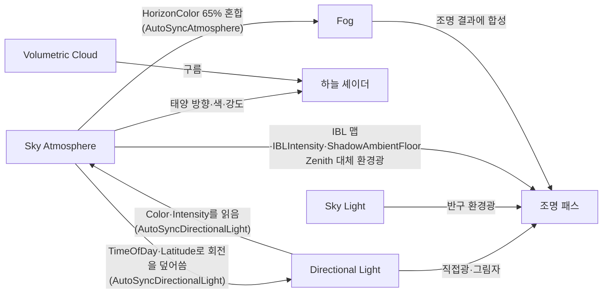

# 환경 조명 요소의 관계와 변수

- 작성일: 2026-11-22
- 근거: 현재 작업 트리의 코드 정적 확인과 `Assets/Scenes`의 저장 값. 화면 실측은 하지 않았다.
- 대상: Directional Light, Sky Light, Sky Atmosphere, Fog, Volumetric Cloud
- 관련: [RenderingDevelopmentPlan](RenderingDevelopmentPlan.md), [BINDING_LAYOUT](Shader/BINDING_LAYOUT.md), [BuiltInResourcesAndShaders](BuiltInResourcesAndShaders.md)

## 1. 한눈에 보는 관계

- 하늘은 `SkyMaterial`(`atmosphereSkyPS`)을 쓰는 **메시가 있어야** 그려진다. `SkyAtmosphereComponent`만 있으면 하늘은 보이지 않고 조명 값만 바뀐다.
- `SkyAtmosphereSystem`은 엔진이 아니라 **GameModule**에 있다. 모듈이 없으면 시간 흐름과 광원 회전 동기화가 동작하지 않는다. 구름 노이즈 텍스처는 엔진의 `CloudResources`가 구름을 처음 그릴 때 준비해 하늘 재질에 연결한다.
- 각 요소는 씬에서 **처음 찾은 활성 컴포넌트 하나**를 쓴다. 순서는 레지스트리 순회 순서이며 사용자가 정할 수 없다.

## 2. 태양 방향은 누가 정하는가

| 쓰는 곳 | 방향의 출처 | 코드 |
| --- | --- | --- |
| 하늘·구름 | 항상 `TimeOfDay`·`Latitude` | `DeferredSceneRenderer::BuildSkyAtmosphereData` |
| 직접광·그림자 | Directional Light의 트랜스폼 | `LightSystem::UpdateLights` |
| 광원 트랜스폼 | `AutoSyncDirectionalLight`가 켜져 있고 시스템이 실행될 때 위와 같은 식으로 덮어씀 | `SkyAtmosphereSystem::OnUpdate` |

같은 계산식이 두 곳에 있다. `AutoSyncDirectionalLight`를 끄거나 시스템이 실행되지 않으면 **하늘의 태양과 실제 광원 방향이 어긋난다**. 이 시스템은 기본 실행 단계(Gameplay)라 **편집 상태에서는 Realtime을 켜도 실행되지 않고** PIE와 모듈을 포함한 실행에서만 동작한다.

동기화는 양방향이다. 회전은 Sky Atmosphere → 광원, 색과 강도는 광원 → Sky Atmosphere로 흐른다. 대상은 첫 활성 Directional Light다.

## 3. 환경광의 우선순위

조명 패스(`lightingPS`)는 아래 순서로 **하나만** 선택한다.

1. `IrradianceMap`·`PrefilteredMap`이 있는 Sky Atmosphere의 IBL 맵
2. Sky Light (반구 보간)
3. Sky Atmosphere의 `ZenithColor` × `SkyIntensity` (지면은 천정색의 25%)

- `IBLIntensity`는 **세 경로 모두**에 곱한다. Sky Light만 써도 Sky Atmosphere의 값이 적용된다.
- IBL 맵이 있으면 Sky Light는 환경광에 영향을 주지 않는다.
- 마지막으로 `ShadowAmbientFloor`(최소 0.02)보다 어두운 확산 환경광을 끌어올린다. Sky Light를 0으로 낮춰도 이 값은 남는다.
- 하늘 화면의 색(대기 산란 결과)은 환경광에 쓰이지 않는다.

## 4. 변수 표

상태: **사용** 화면에 반영, **조건부** 특정 조건에서만 반영, **미사용** 현재 셰이더·코드에서 결과에 영향 없음.

### 4.1 Directional Light (`LightComponent`)

| 변수 | 상태 | 쓰임 |
| --- | --- | --- |
| `Color`, `Intensity` | 사용 | 직접광. `AutoSyncDirectionalLight`면 하늘·구름의 태양 색·강도로도 사용 |
| 트랜스폼 회전 | 사용 | 직접광·그림자 방향. 동기화 중에는 Sky Atmosphere가 덮어씀 |
| `Flags.CastShadows` | 사용 | 섀도맵과 레이트레이싱 그림자의 전제 |
| `ShadowStrength`, `ShadowBias`, `ShadowSlopeBias`, `ShadowNormalBias` | 사용 | 그림자 농도와 바이어스 |
| `ShadowMaxDistance`, `CascadeSplitLambda` | 사용 | 캐스케이드 범위(20~500m)와 분할. 시작 거리는 0.1m 고정이며 카메라 Near와 무관 |
| `RaytracedShadow` | 조건부 | 프로젝트·그래픽·뷰포트 설정이 덮어쓸 수 있음 |
| `ShadowRange` | 조건부 | 카메라가 없을 때의 대체 범위. 유효성 검사에는 항상 사용 |
| `GroundColor`, `IndirectIntensity`, `Range`, 감쇠, 스포트 각도 | 미사용 | 다른 광원 종류용 |

### 4.2 Sky Light (`LightComponent`, `LightType = Sky`)

| 변수 | 상태 | 쓰임 |
| --- | --- | --- |
| `Color` | 사용 | 위쪽 환경광 색 |
| `GroundColor` (아래쪽 환경광 색상) | 사용 | 아래쪽 환경광 색 (GPU에서는 감쇠 계수 자리에 저장) |
| `Intensity` × `IndirectIntensity` | 사용 | 환경광 강도 (`IndirectIntensity`는 `Range` 자리에 저장) |
| `Flags.AffectDiffuse/AffectSpecular` | 사용 | 확산·반사 환경광 구분 |
| 트랜스폼 회전 | 사용 | **엔티티의 위(+Y)를 하늘 쪽**으로 사용. 회전하지 않으면 월드 위쪽이며, Yaw는 영향이 없고 기울이면 반구도 기운다 |
| 그림자 관련 변수 | 미사용 | Sky Light는 그림자를 만들지 않음 |

### 4.3 Sky Atmosphere (`SkyAtmosphereComponent`)

| 변수 | 상태 | 쓰임 |
| --- | --- | --- |
| `TimeOfDay`, `Latitude` | 사용 | 태양 방향 |
| `EnableTimeProgression`, `DayCycleDuration` | 조건부 | `SkyAtmosphereSystem`이 실행될 때 시간 진행 |
| `AutoSyncDirectionalLight` | 사용 | 2절의 양방향 동기화 |
| `CustomSunColor`, `CustomSunIntensity` | 조건부 | 동기화를 끄거나 Directional Light가 없을 때 |
| `SunSize` | 사용 | 태양 원반 크기 |
| `SkyIntensity` | 사용 | 하늘 밝기, 구름 환경광, 대체 환경광 |
| `GroundColor` (지표 색상) | 조건부 | 지평선 아래로 지표를 볼 때 |
| `ZenithColor` (대체 환경광 색상) | 조건부 | 하늘에는 미사용. 3절의 대체 환경광(3번)에만 사용 |
| `HorizonColor` (안개 혼합 색상) | 조건부 | 하늘에는 미사용. Fog 색 혼합에만 사용 |
| `HorizonBlend` | 미사용 | 이전 하늘 셰이더(`skyPS`)용. 인스펙터에서 숨기고 저장 값만 유지 |
| 구름 | - | Sky Atmosphere에는 구름 변수가 없다(2026-11-22 Volumetric Cloud로 통일). 이전 문서는 불러올 때 변환한다(4.6절) |
| `IrradianceMap`, `PrefilteredMap`, `BRDFLutMap` | 사용 | IBL. Irradiance가 없으면 Prefiltered로, LUT가 없으면 기본 LUT로 대체 |
| `IBLIntensity` (환경광 강도), `ShadowAmbientFloor` | 사용 | 3절 |

### 4.4 Fog (`FogComponent`)

| 변수 | 상태 | 쓰임 |
| --- | --- | --- |
| `FogType` | 사용 | Linear / Exponential / ExponentialHeight |
| `FogColor`, `AutoSyncAtmosphere` | 사용 | 동기화하면 `FogColor` 35% + `HorizonColor` 65% |
| `FogStartDistance`, `FogMaxOpacity` | 사용 | 모든 종류 |
| `FogEndDistance` | 조건부 | Linear만 |
| `FogDensity` | 조건부 | Exponential 계열만 |
| `FogHeight`, `FogHeightFalloff` | 조건부 | ExponentialHeight만 |

Fog는 **G-Buffer에 그린 불투명 면에만** 적용된다. 하늘, 구름, 반투명, 파티클, Unlit에는 적용되지 않는다.

### 4.5 Volumetric Cloud (`VolumetricCloudComponent`)

| 변수 | 상태 | 쓰임 |
| --- | --- | --- |
| `LayerBottomAltitude`, `LayerHeight` | 사용 | 구름층 고도와 두께(m). 월드 Y=0이 지표 |
| `CloudCoverage`, `CloudDensity` | 사용 | 구름 양과 농도 |
| `WeatherMapSize`, `ShapeNoiseSize`, `DetailNoiseSize` | 사용 | 노이즈 크기(m). 역수로 변환 |
| `WindDirection`, `WindSpeed`, `MorphSpeed` | 사용 | 이동과 형태 변화 |
| `CloudAlbedo`, `ExtinctionFactor`, `PowderExtinction` | 사용 | 음영 |
| `TracingMaxDistance` | 조건부 | 셰이더가 25km로 제한하므로 그보다 큰 값은 효과 없음 |

구름은 하늘 셰이더 안에서 그려지므로 하늘 메시가 없으면 보이지 않는다.

### 4.6 인스펙터 표시와 이전 데이터

| 대상 | 표시 조건 |
| --- | --- |
| 광원 `Range`, 감쇠 | Point·Spot. 감쇠 계수는 계수 방식일 때만 |
| 광원 `ShadowStrength` | Sky가 아니고 `CastShadows`가 켜졌을 때 |
| 광원 `ShadowBias`, `ShadowSlopeBias`, `ShadowNormalBias` | Directional·Spot이고 `CastShadows`가 켜졌을 때. Point 그림자 셰이더는 고정 바이어스를 쓴다 |
| 광원 `ShadowRange`, `ShadowMaxDistance`, `CascadeSplitLambda`, `RaytracedShadow` | Directional이고 `CastShadows`가 켜졌을 때 |
| 광원 `GroundColor`, `IndirectIntensity` | Sky |
| 광원 `LightingLayerMask`, 플래그 `UseInForwardRendering`·`Volumetric` | 숨김. 읽는 코드가 없음 |
| Sky Atmosphere `CustomSunColor`, `CustomSunIntensity` | `AutoSyncDirectionalLight`가 꺼졌을 때. 동기화 중이지만 Directional Light가 없으면 이 값이 쓰인다 |
| Sky Atmosphere `DayCycleDuration` | `EnableTimeProgression` |
| Fog `FogDensity` / `FogEndDistance` / `FogHeight`·`FogHeightFalloff` | Linear가 아닐 때 / Linear / ExponentialHeight |

`Flags`의 `CastShadows`는 Sky Light에도 표시되지만 효과가 없다. 항목별 조건부 표시는 지원하지 않는다.

이전 씬·프리팹의 Sky Atmosphere 구름 값은 불러올 때 `SceneArchive`가 옮긴다. 활성 Volumetric Cloud가 없고 첫 활성 Sky Atmosphere의 `EnableClouds`가 켜져 있으면 같은 엔티티에 Volumetric Cloud를 붙인다(`CloudSpeed`는 ×100). 다른 구름 값은 기존 렌더러의 기본값과 같다. 노이즈 배율은 이전에 반올림한 상수(0.00067, 0.0067)를 썼으므로 무늬가 약 0.5% 다를 수 있다. 저장하기 전에는 파일이 바뀌지 않는다.

## 5. GPU로 전달되는 값

| 버퍼 | 슬롯 | 내용 | 쓰는 셰이더 |
| --- | --- | --- | --- |
| `SkyAtmosphereData` (256B) | `b1, space3` Forward | 태양, 하늘 색, 구름 | `atmosphereSkyPS` |
| `FogData` (48B) | `b0, space3` Lighting | Fog | `lightingPS` |
| `LightingPassData` (528B) | `b1, space3` Lighting | 그림자, 구름, 태양 방향, 환경광 | `lightingPS` |
| 광원 버퍼 | `t6, space3` Lighting | Directional·Sky Light 포함 전체 광원 | `lightingPS` |

- `SkyAtmosphereData`의 앞쪽 `CloudCoverage`~`EnableClouds`(32바이트)는 채우지 않는 이전 필드다. 실제 값은 뒤의 `Cloud`에 있다.
- 태양 강도의 배율이 경로마다 다르다. 표면은 1배, 하늘은 ×20, 구름은 ×24다.
- 에디터 카메라의 Near·Far는 하늘과 구름에 영향을 주지 않는다. 하늘은 깊이를 최댓값에 고정하고 구름은 광선으로 계산한다.

## 6. 발견한 문제

실행 재현은 하지 않았다. 코드 경로로 확인했다.

| 번호 | 등급 | 문제 | 위치와 영향 |
| --- | --- | --- | --- |
| 1 | 높음 | 하늘이 자체 ACES 톤매핑을 하고 후처리 톤매핑을 한 번 더 거침 | `atmosphereSkyPS` 끝부분. 후처리 톤매핑이 켜진 씬에서 하늘의 밝기·대비가 물체와 다른 기준으로 처리되고 HDR 값이 잘려 Bloom에도 영향 |
| 2 | 수정함 (2026-11-22) | Sky Light의 반구 '위쪽'이 엔티티 전방(+Z)이던 문제 | `LightSystem`이 Sky Light에 엔티티의 위를 넘긴다. Scene View의 방향 표시도 하늘에서 내려오는 쪽으로 바꿨다. 셰이더는 그대로다 |
| 3 | 높음 | 하늘의 태양과 광원 방향이 어긋날 수 있음 | 2절. 동기화를 껐을 때, 편집 상태에서 `TimeOfDay`를 바꿀 때, GameModule이 없을 때 |
| 4 | 보통 | Sky Atmosphere가 둘 이상일 때 선택 규칙이 다름 | 하늘·Fog는 첫 항목, 환경광은 IBL 맵이 있는 항목을 찾을 때까지 순회하므로 맵이 없으면 **마지막** 항목의 `IBLIntensity`·`ShadowAmbientFloor`를 사용. 현재 Sponza에 두 개가 있음 |
| 5 | 보통 | 구름의 지면 그림자가 연결되지 않음 | `CalcCloudShadowFactor`를 호출하는 곳이 없음. `cloudSunLightIndex`는 계산만 하고 쓰지 않아 픽셀마다 광원을 순회하는 비용만 남음 |
| 6 | 보통 | Fog 색이 하늘과 맞지 않음 | 실제 하늘 색이 아니라 고정 `HorizonColor`를 섞음. 시간이 바뀌어도 그대로이고 하늘에는 Fog가 없어 지평선에서 경계가 보일 수 있음 |
| 7 | 보통 | 해가 진 뒤에도 Directional Light 강도가 그대로 | 동기화는 회전만 바꿈. 광원이 지면 아래에서 비춤 |
| 8 | 수정함 (2026-11-22) | 캐스케이드가 첫 Geometry 카메라 하나만 기준 | 그림자 패스와 조명 패스가 자기 뷰의 카메라로 캐스케이드를 만든다. 카메라를 옮길 때 가장자리가 떨리지 않게 하던 텍셀 맞춤이 효과가 없던 문제도 고쳤다. 바운딩 구보다 태양 쪽에 있는 캐스터는 잘릴 수 있다 |
| 9 | 보통 | Sky Atmosphere·Fog·Cloud가 엔티티의 활성·숨김 상태를 확인하지 않음 | 컴포넌트 활성만 검사. 광원은 계층 활성 상태를 검사 |
| 10 | 낮음 | 태양 계산 중복 | `SkyAtmosphereSystem`과 `BuildSkyAtmosphereData` |
| 11 | 수정함 (2026-11-22) | 이름·편집 항목 혼동 | 표시 이름을 실제 쓰임에 맞추고, 광원 종류와 `CastShadows`에 따라 관련 없는 항목을 숨긴다. `HorizonBlend`도 숨긴다 |
| 12 | 수정함 (2026-11-22) | 구름 값이 두 컴포넌트에 중복 | Volumetric Cloud로 통일하고 이전 문서를 변환한다 (4.6절) |
| 13 | 일부 수정 (2026-11-22) | 엔진 기능이 GameModule에 있음 | 구름 텍스처 준비는 엔진 `CloudResources`로 옮겼다. `SkyAtmosphereSystem`은 GameModule에 남아 있다 |
| 14 | 수정함 (2026-11-22) | Volumetric Cloud를 추가해도 구름이 보이지 않음 | 시작 시 로드한 하늘 재질의 키는 `Engine://Material/SkyMaterial.bammat.json`인데 GameModule은 `Resources/...` 키로 찾아 텍스처를 연결하지 못했다. 구름 텍스처도 같은 이유로 실행할 때마다 다시 만들었다 |

## 7. 현재 구조에서의 권장 설정

1. Sky Atmosphere는 씬에 **하나만** 두고 `SkyMaterial`을 쓰는 구(하늘 메시)와 같은 엔티티에 둔다.
2. Directional Light는 하나만 켜고 `AutoSyncDirectionalLight`를 유지한다. 방향은 `TimeOfDay`로, 색과 강도는 광원에서 조절한다.
3. 환경광은 IBL 맵과 Sky Light 중 하나만 쓴다. 둘 다 두면 Sky Light는 무시된다.
4. Sky Light는 보통 회전하지 않는다. 하늘 쪽을 기울여야 할 때만 회전한다.
5. 구름은 Volumetric Cloud에서만 설정한다. Sky Atmosphere만 추가하면 구름이 없다.
6. Fog는 `HorizonColor`를 화면의 지평선 색에 맞춘다.

## 8. 수정 순서 제안

1. **화면이 바뀌지 않는 정리:** 10, 5의 사용하지 않는 계산 제거 (11, 12는 수정함)
2. **규칙 통일:** 4, 9, 3 (태양 방향의 출처를 하나로)
3. **화면이 바뀌는 수정:** 1 → 6 → 7 (2는 수정함). 항목마다 기준 화면을 비교한다.
4. **기능 연결과 이전:** 5의 구름 그림자, 13의 엔진 이전
