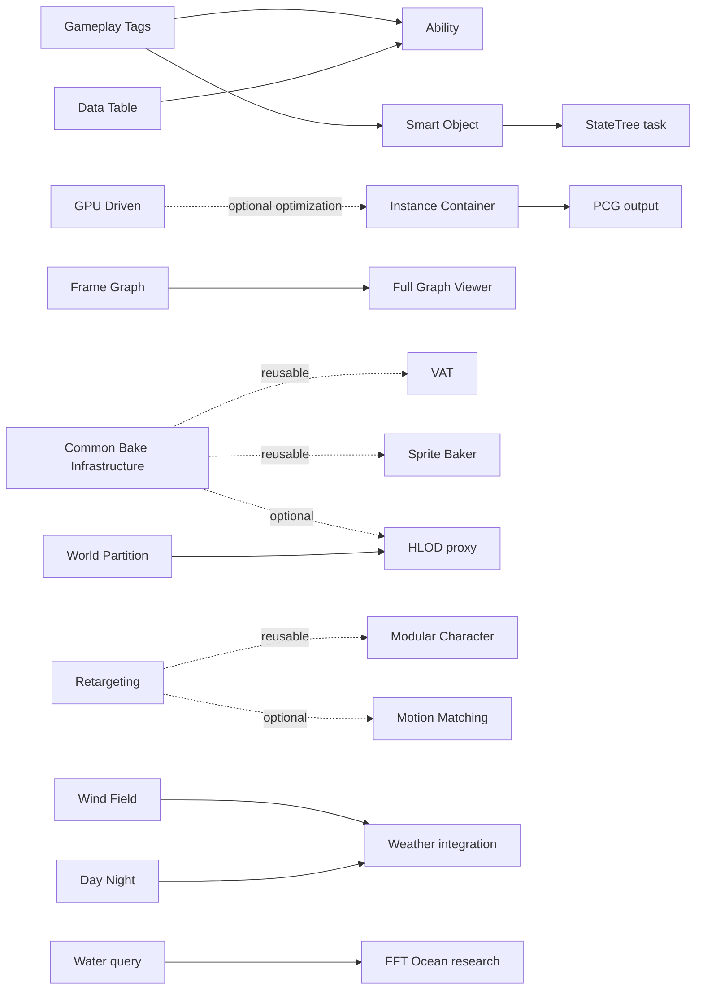

# BamEngine 기능 확장 계획 색인

- 작성일: 2026-11-26
- 기준 브랜치: main / [`2a9a7e0`](https://github.com/Bamtoliya/BamEngine/tree/2a9a7e09378de3b3d6aac6f90d989c233811c1a9)
- 범위: 앞서 추천한 기술·시스템을 **41개 개별 기능 계획서**로 구분. Animation Budget/Sharing, StateTree/Smart Objects, Gameplay Tags/Data Table, World Partition/HLOD, Water/Weather/Wind처럼 독립 구현·검증이 가능한 기능을 분리했다.
- 상태: 조사 기반 제안. 기존 계획을 대체하지 않으며 실행·성능 확인은 하지 않았다.
- 함께 제공하는 기존 문서: `../StylizedRenderingAndSpriteBakingPlan.md` (앞서 작성한 NPR·카툰·3D Pixel Art·Sprite Baker·HD-2D 계획 원본, 이번에 재조사하거나 수정하지 않음).

## 1. 읽는 방법

각 문서는 외부 기술 사례, BamEngine 재사용 후보, 책임 경계, 데이터/실행 알고리즘, 단계별 작업 ID, 검증 기준, **추가 조사 필요 사항**, 출처, 연계 계획을 포함한다. `P1~P4`는 기존 프로젝트 우선순위의 의미를 참고한 제안이며 실제 작업 순서를 확정하지 않는다. 소스 전체 전수 조사나 구현이 아닌 설계 검토이며 명칭은 제안이다.

## 2. 전체 기능 목록

| ID | 기능 계획서 | 분류 | 추천 우선순위·기존 상태 |
| --- | --- | --- | --- |
| FP-01 | [PCG — 절차적 콘텐츠 생성](#fp-01) | 제작·월드 | P2 / 신규 |
| FP-02 | [Foliage / Scatter 브러시 및 인스턴스 컨테이너](#fp-02) | 제작·월드 | P1 / 신규 |
| FP-03 | [Gameplay Ability System — 스킬·속성·상태 효과](#fp-03) | 게임플레이 | P2 / 신규 |
| FP-04 | [GPU Driven Rendering — GPU 컬링 및 간접 드로우](#fp-04) | 렌더링·성능 | P3 / 기존 M1 확장 |
| FP-05 | [Tween / Sequence — 범용 프로퍼티 애니메이션](#fp-05) | 게임플레이·UI | P1 / 기존 요구 구체화 |
| FP-06 | [GPU Particle / VFX Graph](#fp-06) | 렌더링·VFX | P3 / 기존 GPU 파티클 목표 확장 |
| FP-07 | [VAT — Vertex Animation Texture 베이킹](#fp-07) | 애니메이션·렌더링 | P2 / 신규 |
| FP-08 | [Animation Budget Allocator — 포즈 평가 예산](#fp-08) | 애니메이션·성능 | P2 / 신규 |
| FP-09 | [Animation Sharing — 군중 포즈 공유](#fp-09) | 애니메이션·성능 | P3 / 신규 |
| FP-10 | [Modular Character — 조합형 캐릭터·장비](#fp-10) | 제작·애니메이션 | P2 / 신규 |
| FP-11 | [StateTree — 계층형 AI 상태·태스크](#fp-11) | 게임플레이·AI | P2 / 신규 |
| FP-12 | [Smart Objects — 상호작용 슬롯·예약](#fp-12) | 게임플레이·AI | P2 / 신규 |
| FP-13 | [Motion Matching — 포즈 검색 기반 이동](#fp-13) | 애니메이션 | P4 / 신규 연구 |
| FP-14 | [Frame Graph — 렌더 패스·GPU 자원 의존성](#fp-14) | 렌더링·성능 | P3 / 기존 프로필 확장 |
| FP-15 | [Temporal Upscaling — FSR/DLSS 연동](#fp-15) | 렌더링·성능 | P3 / 신규 |
| FP-16 | [Water Interaction — 수면·부력·흔적](#fp-16) | 월드·물리 | P2 / 기존 S6 확장 |
| FP-17 | [Weather System — 날씨·강수·표면 상태](#fp-17) | 월드·그래픽스 | P2 / 신규 통합 |
| FP-18 | [Global Wind Field — 전역·국소 바람](#fp-18) | 월드·그래픽스 | P2 / 기존 파티클 바람 확장 |
| FP-19 | [World Partition — 공간 단위 씬 스트리밍](#fp-19) | 월드·성능 | P3 / 기존 씬 스트리밍 확장 |
| FP-20 | [HLOD — 월드 클러스터와 원거리 프록시](#fp-20) | 렌더링·성능 | P3 / 신규 |
| FP-21 | [Data Table / Curve Table — 게임 데이터 저작](#fp-21) | 게임플레이·제작 | P1 / 기존 실전 보강 요구 |
| FP-22 | [Gameplay Tags — 계층형 태그 및 쿼리](#fp-22) | 게임플레이 | P1 / 신규 |
| FP-23 | [Animation Retargeting / IK Rig — 골격 간 모션 재사용](#fp-23) | 애니메이션·제작 | P2 / 기존 IK·리타게팅 목표 |
| FP-24 | [GPU Texture / Material Baking — 공통 베이커](#fp-24) | 제작·렌더링 | P2 / 신규 |
| FP-25 | [Day/Night Cycle — 시간·환경 조명](#fp-25) | 월드·그래픽스 | P2 / 신규 통합 |
| FP-26 | [Destruction — 사전 파쇄 및 물리 파편](#fp-26) | 월드·물리 | P3 / 신규 |
| FP-27 | [Virtual Texture — 타일 기반 스트리밍](#fp-27) | 렌더링·성능 | P4 / 신규 연구 |
| FP-28 | [Interactive Mesh Deformation — 눈·모래·풀 흔적](#fp-28) | 월드·렌더링 | P3 / 신규 |
| FP-29 | [SDF Collision — 거리장 충돌 및 VFX](#fp-29) | 월드·렌더링 | P3 / 신규 |
| FP-30 | [FFT Ocean — 대규모 스펙트럼 파도](#fp-30) | 월드·렌더링 | P4 / 조건부 연구 |
| FP-31 | [Command Palette — 검색 기반 에디터 명령 실행](#fp-31) | 에디터·UX | P1 / 신규 |
| FP-32 | [Multi-Object Inspector — 다중 선택 일괄 속성 편집](#fp-32) | 에디터·UX | P1 / 기존 다중 선택 확장 |
| FP-33 | [Property Binding — UI 및 게임 데이터 연결](#fp-33) | 에디터·게임플레이 | P1 / 신규 |
| FP-34 | [Preset System — 설정 저장·재사용](#fp-34) | 에디터·제작 | P1 / 신규 통합 |
| FP-35 | [Prefab Variant — 상속형 프리팹 및 오버라이드](#fp-35) | 에디터·제작 | P2 / 기존 Prefab 확장 |
| FP-36 | [Batch Asset Processing — 에셋 일괄 작업](#fp-36) | 에디터·제작 | P1 / 기존 AssetWorker 확장 |
| FP-37 | [Visual Debugger / Visual Logger — 상태 및 공간 정보 시각화](#fp-37) | 에디터·디버깅 | P1 / 기존 Metrics·디버그 확장 |
| FP-38 | [Runtime Inspector — PIE·독립 Client 상태 검사](#fp-38) | 에디터·디버깅 | P1 / 기존 Inspector·PIE 확장 |
| FP-39 | [Replay / Time Travel — 실행 기록 및 재현](#fp-39) | 에디터·게임플레이 | P2 / 신규 |
| FP-40 | [Render Graph Viewer — 패스·자원 수명 시각화](#fp-40) | 에디터·렌더링 | P2 / Frame Graph 연계 |
| FP-41 | [Game Template — 장르별 시작 프로젝트](#fp-41) | 에디터·제작 | P1 / 신규 |

## 3. 추천 개발 묶음

### A. 즉시 활용 가능한 제작 생산성

기존 Reflection·Archive·Editor/Runtime을 재사용. 게임 템플릿과 디버거는 각 기능의 회귀를 검증하는 기반으로 병행.

[22 Gameplay Tags — 계층형 태그 및 쿼리](#fp-22) · [21 Data Table / Curve Table — 게임 데이터 저작](#fp-21) · [05 Tween / Sequence — 범용 프로퍼티 애니메이션](#fp-05) · [31 Command Palette — 검색 기반 에디터 명령 실행](#fp-31) · [32 Multi-Object Inspector — 다중 선택 일괄 속성 편집](#fp-32) · [34 Preset System — 설정 저장·재사용](#fp-34) · [33 Property Binding — UI 및 게임 데이터 연결](#fp-33) · [36 Batch Asset Processing — 에셋 일괄 작업](#fp-36) · [41 Game Template — 장르별 시작 프로젝트](#fp-41) · [37 Visual Debugger / Visual Logger — 상태 및 공간 정보 시각화](#fp-37) · [38 Runtime Inspector — PIE·독립 Client 상태 검사](#fp-38)

### B. 콘텐츠 자동 생성 및 캐릭터 제작

Foliage의 instance container부터 검증하고 PCG를 연결. 베이커/리타게팅은 각각 독립 MVP 가능. 기존 NPR/Sprite Baker 계획을 재사용.

[02 Foliage / Scatter 브러시 및 인스턴스 컨테이너](#fp-02) · [01 PCG — 절차적 콘텐츠 생성](#fp-01) · [35 Prefab Variant — 상속형 프리팹 및 오버라이드](#fp-35) · [24 GPU Texture / Material Baking — 공통 베이커](#fp-24) · [07 VAT — Vertex Animation Texture 베이킹](#fp-07) · [23 Animation Retargeting / IK Rig — 골격 간 모션 재사용](#fp-23) · [10 Modular Character — 조합형 캐릭터·장비](#fp-10)

### C. 게임플레이와 환경 통합

Tags/DataTable 기반 스킬, Smart Object 예약→StateTree 태스크. 날씨·수면은 기존 검증 경로를 확장.

[03 Gameplay Ability System — 스킬·속성·상태 효과](#fp-03) · [12 Smart Objects — 상호작용 슬롯·예약](#fp-12) · [11 StateTree — 계층형 AI 상태·태스크](#fp-11) · [25 Day/Night Cycle — 시간·환경 조명](#fp-25) · [18 Global Wind Field — 전역·국소 바람](#fp-18) · [17 Weather System — 날씨·강수·표면 상태](#fp-17) · [16 Water Interaction — 수면·부력·흔적](#fp-16) · [39 Replay / Time Travel — 실행 기록 및 재현](#fp-39)

### D. 규모가 커질 때 성능 최적화

Frame Graph는 기존 프로필 adapter부터; GPU Driven은 독립 prototype 가능. Viewer는 기존 pass 목록부터 구현 가능. HLOD는 셀 스트리밍과 연계.

[14 Frame Graph — 렌더 패스·GPU 자원 의존성](#fp-14) · [40 Render Graph Viewer — 패스·자원 수명 시각화](#fp-40) · [04 GPU Driven Rendering — GPU 컬링 및 간접 드로우](#fp-04) · [06 GPU Particle / VFX Graph](#fp-06) · [08 Animation Budget Allocator — 포즈 평가 예산](#fp-08) · [09 Animation Sharing — 군중 포즈 공유](#fp-09) · [15 Temporal Upscaling — FSR/DLSS 연동](#fp-15) · [19 World Partition — 공간 단위 씬 스트리밍](#fp-19) · [20 HLOD — 월드 클러스터와 원거리 프록시](#fp-20)

### E. 요구 기반 장기 연구

애니메이션 데이터 확보 및 실제 콘텐츠 병목을 확인한 후 채택. 다른 목표의 필수 선행 조건으로 삼지 않음.

[13 Motion Matching — 포즈 검색 기반 이동](#fp-13) · [26 Destruction — 사전 파쇄 및 물리 파편](#fp-26) · [27 Virtual Texture — 타일 기반 스트리밍](#fp-27) · [28 Interactive Mesh Deformation — 눈·모래·풀 흔적](#fp-28) · [29 SDF Collision — 거리장 충돌 및 VFX](#fp-29) · [30 FFT Ocean — 대규모 스펙트럼 파도](#fp-30)

## 4. 핵심 의존 관계와 도입 원칙

- 실전 게임 샘플을 먼저 만들고, 요구가 있는 기능만 선택한다. 현재 `DevelopmentPriorities.md`의 실패·검증 대기 항목을 새 기능이 덮어쓰지 않는다.
- GPU 기능은 DX12 기준 검증 후 SDL GPU 등 백엔드 지원 범위를 분리한다. CPU 폴백이 의미 있는 경우 유지한다.
- 작성 데이터와 생성 결과, 런타임 상태를 구분한다. 기존 Archive·Reflection·ResourceManager·AssetWorker를 우선 재사용한다.
- PCG/GAS/Frame Graph는 서로의 완료를 공통 선행 조건으로 삼지 않는다. 각 기능에 최소 독립 예제를 둔다.
- 기존 문서에 이미 있는 GPU Driven M1, GPU Particle, 리타게팅, UI Tween 요구, 데이터 테이블 요구, 수면 S6 등은 해당 기존 계획을 확장하는 제안이다. 특히 Gerstner 수면의 기존 구현 및 실행 확인을 다시 개발할 필요는 없다.

## 5. 추가 조사·진행 기록 방법

모든 개별 문서 5절에 구현 전 확인할 구체 항목을 남겼다. 범용 기능의 기술 원리만 확인한 경우 제품 수준 지원 여부, 데이터 포맷, 알고리즘의 수치 안정성, SDK 버전·라이선스, 성능·품질 기준은 확정하지 않는다. 현행 소스와 시연 콘텐츠를 먼저 대조한 뒤 계획 수정이 필요하면 원래 계획과 함께 반영한다.

| 상태 | 판정 |
| --- | --- |
| 제안 | 외부 기술 조사와 설계 초안 |
| 코드 반영 | 소스 및 에셋 구현 확인 |
| 빌드 확인 | 해당 구성 및 CTest 기록 |
| 실행 확인 | 대표 씬과 편집·Client 흐름 검증 |
| 성능 확인 | 기준 경로와 동일 조건의 측정 결과 기록 |
| 보류 | 도입 조건 미충족 또는 연구 필요 |

## 6. 문서 배치

별도 ZIP은 `Docs/FeaturePlans/`에 41개 계획서와 색인, `Docs/`에 앞서 작성한 스타일 렌더링 문서를 포함한다. 기존 동일 파일을 덮어쓰기 전에 변경사항을 비교한다. GitHub 저장소를 직접 수정하지 않았다.

---

# PCG — 절차적 콘텐츠 생성 개발 계획

- 작성일: 2026-11-26
- ID: `FP-01` · 분류: 제작·월드
- 상태: **조사 기반 제안 / 미구현 또는 기존 기능 확장 / 실행 검증 미수행**
- 추천 우선순위: P2 / 신규 (기존 `DevelopmentPriorities.md`를 변경하지 않는 제안)
- 기준: [BamEngine main 스냅샷 `2a9a7e0`](https://github.com/Bamtoliya/BamEngine/tree/2a9a7e09378de3b3d6aac6f90d989c233811c1a9)
- 관련 기존 계획: [TerrainSystemExpansionPlan](https://github.com/Bamtoliya/BamEngine/tree/2a9a7e09378de3b3d6aac6f90d989c233811c1a9/Docs/TerrainSystemExpansionPlan.md) · [GraphFoundation](https://github.com/Bamtoliya/BamEngine/tree/2a9a7e09378de3b3d6aac6f90d989c233811c1a9/Docs/GraphFoundation.md) · [PrefabSceneWorkflowPlan](https://github.com/Bamtoliya/BamEngine/tree/2a9a7e09378de3b3d6aac6f90d989c233811c1a9/Docs/PrefabSceneWorkflowPlan.md)
- 연계 신규 계획(필수 선행 조건은 아님): [02 Foliage / Scatter 브러시 및 인스턴스 컨테이너](#fp-02) · [04 GPU Driven Rendering — GPU 컬링 및 간접 드로우](#fp-04) · [19 World Partition — 공간 단위 씬 스트리밍](#fp-19)
- [전체 계획 색인](#bamengine-기능-확장-계획-색인)

## 1. 조사 결과와 도입 목적

Epic PCG는 포인트 데이터에 생성·필터·변환·출력 노드를 연결하고 GPU 실행도 제공한다. 단순 랜덤 배치보다 재현 가능한 규칙과 부분 재생성이 핵심이다.

### 현재 BamEngine 기반과 차이

- 재사용 후보: TerrainSystem, SplinePlacement, Prefab, GraphExecutor, 인스턴싱.
- 위 이름은 소스 트리·앞선 코드 검토·기존 계획에서 확인한 기반 또는 문서상 목표다. 현재 전체 호출 경로, 빌드·실행, ABI 호환을 다시 확인한 것은 아니다.
- 목표는 해당 기능의 최소 동작을 독립적으로 완성하고, 기존 엔진 경로를 깨지 않으면서 필요한 범위만 확장하는 것이다. 비교 엔진의 전체 API나 상용 기능 동등성은 완료 조건이 아니다.

## 2. 설계 제안

### 2.1 책임 및 모듈 경계

Engine: World/PCG 및 생성 결과 모델; Editor: PCG 그래프·볼륨 편집; Client: 선택적 생성 실행 및 baked 결과 로딩.

아래 명칭·데이터 구조는 설계 예시이며 실제 존재하는 클래스·파일 또는 확정 ABI를 뜻하지 않는다. 기존 타입과 중복되면 새 Manager보다 기존 책임 경계를 우선한다.

### 2.2 데이터·실행 흐름과 알고리즘

PCGGraphAsset, PCGVolumeComponent, PCGPoint{position, rotation, scale, density, seed, attributes}, PCGExecutionContext. CPU DAG는 순환을 거부하고 노드별 입력/출력 타입을 검사한다. 셀 좌표·그래프 ID·전역 seed를 조합해 안정적 ID를 생성한다. Terrain/Spline 샘플링 → Poisson/grid → 경사·높이·레이어 필터 → 가중 메시 선택 → Foliage 인스턴스 또는 Prefab 출력. 생성 결과는 작성 원본과 분리하고 Diff로 적용한다.

### 2.3 제작·배포 계약

- 새 작성 데이터가 필요한 경우 schema version, 안정적인 식별자, 의존 리소스 및 기본값을 정의한다. 런타임 전용 임시 상태는 작성 에셋과 분리한다. 기존 Engine://·Project://, Reflection/Archive 및 pak 계약에 맞춰 필요한 경우만 통합한다.
- 편집 UI는 기존 단축키·로캘·PropertyTable·피커·편집 이력을 재사용한다. 변경 취소, 대상 삭제, 씬 교체, 비동기 작업 취소 시 이전 정상 결과를 보존한다. 해당 기능이 에디터 전용이면 Client에 의존성을 추가하지 않는다.
- 런타임 기능은 필요한 경우 Editor 프리뷰·PIE·독립 Client에서 같은 데이터 및 공통 실행 코드를 사용한다. 지원하지 않는 백엔드에서는 명시적 fallback/비활성 또는 진단을 제공한다.

## 3. 단계별 구현 계획

- [ ] **01-01.** CPU 포인트 생성·결정적 난수, 거리 필터와 샘플링 구현
- [ ] **01-02.** Terrain/Spline 입력 및 인스턴스 출력, 볼륨 프리뷰와 생성 취소
- [ ] **01-03.** 노드 그래프 저작·오류 표시·셀별 dirty 재생성·Bake/Live 전환
- [ ] **01-04.** 측정 후 런타임 셀 스트리밍과 GPU 포인트 계산 도입

각 단계는 별도 기능 단위로 검증·커밋한다. 첫 단계의 작동 예제 없이 후속 고급 기능까지 한 번에 구현하지 않는다. 위 단계는 일정 추정치가 아니다.

## 4. 검증 및 완료 기준

- [ ] **01-V01.** 동일 seed/입력에서 점 ID와 위치 일치, 셀 경계 중복 없음, 지형 수정 셀만 재생성
- [ ] **01-V02.** 생성 취소 후 이전 결과 유지, Undo/Redo·pak 왕복
- [ ] **01-V03.** 1만/10만 점 생성 시간·메모리·프레임 히치, CPU/GPU 경로 비교

- [ ] 해당 기능의 대표 자동 검사(기존 CTest 또는 신규 `Check` 타깃 제안)와 최소 재현 씬/입력·기대 결과를 등록한다. GPU·UI는 별도로 실제 화면/상호작용을 확인한다.
- [ ] 적용 전 기준 경로를 보존하고 Debug/필요 시 Shipping 구성, 저장·로드·패키징 경계를 확인한다. 측정 장면, 빌드 설정, 해상도, GPU/드라이버, 표본 수 및 p50/p95를 기록한다. 성능 수치는 실행 후 기록하며 이 문서가 통과를 주장하지 않는다.
- [ ] 구현 반영 / 빌드 통과 / 실행 확인 / 성능 확인 / 미지원·보류를 따로 기록한다. 기존 구현과의 회귀가 확인되면 먼저 해결한다.

## 5. 추가 조사 필요 — 구현 착수 전 또는 해당 단계 이전

**추가 조사가 필요하다.** 다음은 이번 공개 자료·정적 대조만으로 확정하지 못한 항목이다.

Poisson disk의 타일 경계 합의·충돌 샘플 비용·PCG 그래프와 Logic Graph 데이터 모델 공유 범위·GPU readback 없이 출력하는 방식. 런타임 생성은 멀티플레이 결정성과 버전 변화 정책 조사.

- 위 항목을 실제 코드 경로·외부 SDK/알고리즘 원문·간단한 prototype 및 대표 콘텐츠로 검증한 다음 포맷/수치/인터페이스를 확정한다. 외부 SDK·에셋 채택 시 버전·지원 플랫폼·라이선스·재배포 가능 여부를 기록한다.

## 6. 참고 자료

외부 자료는 기술 비교 근거이며 BamEngine에 해당 기능이 구현됐다는 근거가 아니다. 아래 URL은 이번 조사에서 확인한 문서/자료 진입점이며 SDK 버전과 세부 계약은 구현 시 재확인한다.

1. <https://dev.epicgames.com/documentation/en-us/unreal-engine/procedural-content-generation-framework-in-unreal-engine>
2. <https://dev.epicgames.com/documentation/unreal-engine/using-pcg-with-gpu-processing-in-unreal-engine>

- 공통 기준: [EngineEditorClientGuidelines](https://github.com/Bamtoliya/BamEngine/tree/2a9a7e09378de3b3d6aac6f90d989c233811c1a9/Docs/EngineEditorClientGuidelines.md), [SourceOrganizationGuidelines](https://github.com/Bamtoliya/BamEngine/tree/2a9a7e09378de3b3d6aac6f90d989c233811c1a9/Docs/SourceOrganizationGuidelines.md), [DevelopmentPriorities](https://github.com/Bamtoliya/BamEngine/tree/2a9a7e09378de3b3d6aac6f90d989c233811c1a9/Docs/DevelopmentPriorities.md).

---

# Foliage / Scatter 브러시 및 인스턴스 컨테이너 개발 계획

- 작성일: 2026-11-26
- ID: `FP-02` · 분류: 제작·월드
- 상태: **조사 기반 제안 / 미구현 또는 기존 기능 확장 / 실행 검증 미수행**
- 추천 우선순위: P1 / 신규 (기존 `DevelopmentPriorities.md`를 변경하지 않는 제안)
- 기준: [BamEngine main 스냅샷 `2a9a7e0`](https://github.com/Bamtoliya/BamEngine/tree/2a9a7e09378de3b3d6aac6f90d989c233811c1a9)
- 관련 기존 계획: [TerrainSystemExpansionPlan](https://github.com/Bamtoliya/BamEngine/tree/2a9a7e09378de3b3d6aac6f90d989c233811c1a9/Docs/TerrainSystemExpansionPlan.md) · [RenderingDevelopmentPlan](https://github.com/Bamtoliya/BamEngine/tree/2a9a7e09378de3b3d6aac6f90d989c233811c1a9/Docs/RenderingDevelopmentPlan.md)
- 연계 신규 계획(필수 선행 조건은 아님): [04 GPU Driven Rendering — GPU 컬링 및 간접 드로우](#fp-04) · [18 Global Wind Field — 전역·국소 바람](#fp-18) · [20 HLOD — 월드 클러스터와 원거리 프록시](#fp-20)
- [전체 계획 색인](#bamengine-기능-확장-계획-색인)

## 1. 조사 결과와 도입 목적

UE Foliage는 정적 메시의 하드웨어 인스턴스 배치와 개별 Actor 배치를 구분한다. 풀처럼 상호작용이 없는 개체를 모두 ECS 엔티티로 만드는 비용을 피한다.

### 현재 BamEngine 기반과 차이

- 재사용 후보: TerrainSystem, TerrainLayerAsset, MeshRenderSystem, LODGroupComponent, SplinePlacement.
- 위 이름은 소스 트리·앞선 코드 검토·기존 계획에서 확인한 기반 또는 문서상 목표다. 현재 전체 호출 경로, 빌드·실행, ABI 호환을 다시 확인한 것은 아니다.
- 목표는 해당 기능의 최소 동작을 독립적으로 완성하고, 기존 엔진 경로를 깨지 않으면서 필요한 범위만 확장하는 것이다. 비교 엔진의 전체 API나 상용 기능 동등성은 완료 조건이 아니다.

## 2. 설계 제안

### 2.1 책임 및 모듈 경계

Engine: Render/World 인스턴스 컨테이너; Editor: Terrain·Scatter 브러시; Client: 인스턴스 실행·렌더링.

아래 명칭·데이터 구조는 설계 예시이며 실제 존재하는 클래스·파일 또는 확정 ABI를 뜻하지 않는다. 기존 타입과 중복되면 새 Manager보다 기존 책임 경계를 우선한다.

### 2.2 데이터·실행 흐름과 알고리즘

FoliageTypeAsset(mesh, material, density, radius, slope range, layer mask, scale, wind), FoliageChunkComponent의 packed transforms/IDs와 공간 인덱스. 브러시 stroke는 표면 Raycast/높이맵에서 후보를 샘플하고 minimum spacing 검사를 한다. 충돌이 필요한 나무만 프록시 collider 또는 Entity로 승격. 배치는 spatial cell 단위, 기존 렌더러에 batch 제출. picking은 group/instance ID를 구분.

### 2.3 제작·배포 계약

- 새 작성 데이터가 필요한 경우 schema version, 안정적인 식별자, 의존 리소스 및 기본값을 정의한다. 런타임 전용 임시 상태는 작성 에셋과 분리한다. 기존 Engine://·Project://, Reflection/Archive 및 pak 계약에 맞춰 필요한 경우만 통합한다.
- 편집 UI는 기존 단축키·로캘·PropertyTable·피커·편집 이력을 재사용한다. 변경 취소, 대상 삭제, 씬 교체, 비동기 작업 취소 시 이전 정상 결과를 보존한다. 해당 기능이 에디터 전용이면 Client에 의존성을 추가하지 않는다.
- 런타임 기능은 필요한 경우 Editor 프리뷰·PIE·독립 Client에서 같은 데이터 및 공통 실행 코드를 사용한다. 지원하지 않는 백엔드에서는 명시적 fallback/비활성 또는 진단을 제공한다.

## 3. 단계별 구현 계획

- [ ] **02-01.** 단일 타입 Paint/Erase/Single 및 Preview
- [ ] **02-02.** 다중 타입 가중 배치와 terrain layer/slope 필터·Undo stroke delta
- [ ] **02-03.** 셀별 AABB/LOD·frustum culling·저장/재로드
- [ ] **02-04.** 바람, 거리별 impostor, GPU culling 연결

각 단계는 별도 기능 단위로 검증·커밋한다. 첫 단계의 작동 예제 없이 후속 고급 기능까지 한 번에 구현하지 않는다. 위 단계는 일정 추정치가 아니다.

## 4. 검증 및 완료 기준

- [ ] **02-V01.** 동일 seed에서 배치 재현, 지형 레이어 제외·경사 경계 확인
- [ ] **02-V02.** 한 스트로크 Undo 후 인스턴스 ID와 개수 복구
- [ ] **02-V03.** 1만/10만 풀 배치의 draw count·CPU submit·VRAM·shadow 비용 측정

- [ ] 해당 기능의 대표 자동 검사(기존 CTest 또는 신규 `Check` 타깃 제안)와 최소 재현 씬/입력·기대 결과를 등록한다. GPU·UI는 별도로 실제 화면/상호작용을 확인한다.
- [ ] 적용 전 기준 경로를 보존하고 Debug/필요 시 Shipping 구성, 저장·로드·패키징 경계를 확인한다. 측정 장면, 빌드 설정, 해상도, GPU/드라이버, 표본 수 및 p50/p95를 기록한다. 성능 수치는 실행 후 기록하며 이 문서가 통과를 주장하지 않는다.
- [ ] 구현 반영 / 빌드 통과 / 실행 확인 / 성능 확인 / 미지원·보류를 따로 기록한다. 기존 구현과의 회귀가 확인되면 먼저 해결한다.

## 5. 추가 조사 필요 — 구현 착수 전 또는 해당 단계 이전

**추가 조사가 필요하다.** 다음은 이번 공개 자료·정적 대조만으로 확정하지 못한 항목이다.

인스턴스 picking ID ABI, terrain 수정 시 재투영/삭제 정책, static collision 프록시 예산, masked alpha overdraw 및 shadow LOD. 식생 에셋 라이선스와 LOD 데이터 조사.

- 위 항목을 실제 코드 경로·외부 SDK/알고리즘 원문·간단한 prototype 및 대표 콘텐츠로 검증한 다음 포맷/수치/인터페이스를 확정한다. 외부 SDK·에셋 채택 시 버전·지원 플랫폼·라이선스·재배포 가능 여부를 기록한다.

## 6. 참고 자료

외부 자료는 기술 비교 근거이며 BamEngine에 해당 기능이 구현됐다는 근거가 아니다. 아래 URL은 이번 조사에서 확인한 문서/자료 진입점이며 SDK 버전과 세부 계약은 구현 시 재확인한다.

1. <https://dev.epicgames.com/documentation/en-us/unreal-engine/foliage-mode-in-unreal-engine>

- 공통 기준: [EngineEditorClientGuidelines](https://github.com/Bamtoliya/BamEngine/tree/2a9a7e09378de3b3d6aac6f90d989c233811c1a9/Docs/EngineEditorClientGuidelines.md), [SourceOrganizationGuidelines](https://github.com/Bamtoliya/BamEngine/tree/2a9a7e09378de3b3d6aac6f90d989c233811c1a9/Docs/SourceOrganizationGuidelines.md), [DevelopmentPriorities](https://github.com/Bamtoliya/BamEngine/tree/2a9a7e09378de3b3d6aac6f90d989c233811c1a9/Docs/DevelopmentPriorities.md).

---

# Gameplay Ability System — 스킬·속성·상태 효과 개발 계획

- 작성일: 2026-11-26
- ID: `FP-03` · 분류: 게임플레이
- 상태: **조사 기반 제안 / 미구현 또는 기존 기능 확장 / 실행 검증 미수행**
- 추천 우선순위: P2 / 신규 (기존 `DevelopmentPriorities.md`를 변경하지 않는 제안)
- 기준: [BamEngine main 스냅샷 `2a9a7e0`](https://github.com/Bamtoliya/BamEngine/tree/2a9a7e09378de3b3d6aac6f90d989c233811c1a9)
- 관련 기존 계획: [AnimationTimelineEditorPlan](https://github.com/Bamtoliya/BamEngine/tree/2a9a7e09378de3b3d6aac6f90d989c233811c1a9/Docs/AnimationTimelineEditorPlan.md) · [VisualScriptingBlueprintPlan](https://github.com/Bamtoliya/BamEngine/tree/2a9a7e09378de3b3d6aac6f90d989c233811c1a9/Docs/VisualScriptingBlueprintPlan.md) · [NetworkFoundationPlan](https://github.com/Bamtoliya/BamEngine/tree/2a9a7e09378de3b3d6aac6f90d989c233811c1a9/Docs/NetworkFoundationPlan.md)
- 연계 신규 계획(필수 선행 조건은 아님): [21 Data Table / Curve Table — 게임 데이터 저작](#fp-21) · [22 Gameplay Tags — 계층형 태그 및 쿼리](#fp-22) · [05 Tween / Sequence — 범용 프로퍼티 애니메이션](#fp-05)
- [전체 계획 색인](#bamengine-기능-확장-계획-색인)

## 1. 조사 결과와 도입 목적

UE GAS는 Ability, Attribute, Effect, Cue를 분리하여 비용·쿨타임·태그와 실행 작업을 조정한다. 엔진 범용 계약만 구현하고 RPG 규칙은 게임 모듈에 둔다.

### 현재 BamEngine 기반과 차이

- 재사용 후보: ActionTimelineSystem, Animator, CompositeVFX, GraphExecutor, SaveGameManager, NetworkRpc.
- 위 이름은 소스 트리·앞선 코드 검토·기존 계획에서 확인한 기반 또는 문서상 목표다. 현재 전체 호출 경로, 빌드·실행, ABI 호환을 다시 확인한 것은 아니다.
- 목표는 해당 기능의 최소 동작을 독립적으로 완성하고, 기존 엔진 경로를 깨지 않으면서 필요한 범위만 확장하는 것이다. 비교 엔진의 전체 API나 상용 기능 동등성은 완료 조건이 아니다.

## 2. 설계 제안

### 2.1 책임 및 모듈 경계

Engine 또는 선택적 Gameplay 모듈: 능력 계약·효과; GameModule: 실제 스킬 규칙; Editor: 에셋/태그 편집.

아래 명칭·데이터 구조는 설계 예시이며 실제 존재하는 클래스·파일 또는 확정 ABI를 뜻하지 않는다. 기존 타입과 중복되면 새 Manager보다 기존 책임 경계를 우선한다.

### 2.2 데이터·실행 흐름과 알고리즘

AbilityDefinition과 AbilitySystemComponent, AttributeSet, ActiveEffect{source,target,stacks,expiry,nextTick}, GameplayCueEvent. TryActivate → validate tags/resources → commit cost/cooldown → timeline task → hit/effect → end/cancel. 활성화와 비용을 단일 트랜잭션으로 처리하고 실패 시 롤백. Instant/Duration/Infinite/Periodic 효과, Add/Multiply/Override 순서 및 stack/refresh 정책 명시. 실행 ID로 중복 Notify 및 취소를 제어한다.

### 2.3 제작·배포 계약

- 새 작성 데이터가 필요한 경우 schema version, 안정적인 식별자, 의존 리소스 및 기본값을 정의한다. 런타임 전용 임시 상태는 작성 에셋과 분리한다. 기존 Engine://·Project://, Reflection/Archive 및 pak 계약에 맞춰 필요한 경우만 통합한다.
- 편집 UI는 기존 단축키·로캘·PropertyTable·피커·편집 이력을 재사용한다. 변경 취소, 대상 삭제, 씬 교체, 비동기 작업 취소 시 이전 정상 결과를 보존한다. 해당 기능이 에디터 전용이면 Client에 의존성을 추가하지 않는다.
- 런타임 기능은 필요한 경우 Editor 프리뷰·PIE·독립 Client에서 같은 데이터 및 공통 실행 코드를 사용한다. 지원하지 않는 백엔드에서는 명시적 fallback/비활성 또는 진단을 제공한다.

## 3. 단계별 구현 계획

- [ ] **03-01.** Tags·DataTable 기반 단일 Dash/Fireball 구현
- [ ] **03-02.** Attribute modifier 계산·버프/디버프/면역·스택·쿨타임
- [ ] **03-03.** Timeline/LogicGraph 태스크, UI 상태 조회, VFX/audio cue 분리
- [ ] **03-04.** 서버 권위 검증·replication 및 예측은 단일 플레이 안정화 이후

각 단계는 별도 기능 단위로 검증·커밋한다. 첫 단계의 작동 예제 없이 후속 고급 기능까지 한 번에 구현하지 않는다. 위 단계는 일정 추정치가 아니다.

## 4. 검증 및 완료 기준

- [ ] **03-V01.** 마나 부족·쿨타임·기절 시 activation 불가, 비용 이중 차감 없음
- [ ] **03-V02.** 같은 스킬 중복·취소·사망·씬 전환 시 태스크 정리
- [ ] **03-V03.** 스택 만료·저장/복원·서버 요청 재전송에서 피해 중복 방지

- [ ] 해당 기능의 대표 자동 검사(기존 CTest 또는 신규 `Check` 타깃 제안)와 최소 재현 씬/입력·기대 결과를 등록한다. GPU·UI는 별도로 실제 화면/상호작용을 확인한다.
- [ ] 적용 전 기준 경로를 보존하고 Debug/필요 시 Shipping 구성, 저장·로드·패키징 경계를 확인한다. 측정 장면, 빌드 설정, 해상도, GPU/드라이버, 표본 수 및 p50/p95를 기록한다. 성능 수치는 실행 후 기록하며 이 문서가 통과를 주장하지 않는다.
- [ ] 구현 반영 / 빌드 통과 / 실행 확인 / 성능 확인 / 미지원·보류를 따로 기록한다. 기존 구현과의 회귀가 확인되면 먼저 해결한다.

## 5. 추가 조사 필요 — 구현 착수 전 또는 해당 단계 이전

**추가 조사가 필요하다.** 다음은 이번 공개 자료·정적 대조만으로 확정하지 못한 항목이다.

속성 수치 표현(부동소수점/정수), modifier 순서, 태그 상속, root motion과 KCC, 적중 권위·client prediction reconciliation, 스킬 데이터 버전 migration. Lyra 패턴과 기존 RPC 권한 체계 추가 대조.

- 위 항목을 실제 코드 경로·외부 SDK/알고리즘 원문·간단한 prototype 및 대표 콘텐츠로 검증한 다음 포맷/수치/인터페이스를 확정한다. 외부 SDK·에셋 채택 시 버전·지원 플랫폼·라이선스·재배포 가능 여부를 기록한다.

## 6. 참고 자료

외부 자료는 기술 비교 근거이며 BamEngine에 해당 기능이 구현됐다는 근거가 아니다. 아래 URL은 이번 조사에서 확인한 문서/자료 진입점이며 SDK 버전과 세부 계약은 구현 시 재확인한다.

1. <https://dev.epicgames.com/documentation/en-us/unreal-engine/understanding-the-unreal-engine-gameplay-ability-system>
2. <https://dev.epicgames.com/documentation/en-us/unreal-engine/gameplay-effects-for-the-gameplay-ability-system-in-unreal-engine>

- 공통 기준: [EngineEditorClientGuidelines](https://github.com/Bamtoliya/BamEngine/tree/2a9a7e09378de3b3d6aac6f90d989c233811c1a9/Docs/EngineEditorClientGuidelines.md), [SourceOrganizationGuidelines](https://github.com/Bamtoliya/BamEngine/tree/2a9a7e09378de3b3d6aac6f90d989c233811c1a9/Docs/SourceOrganizationGuidelines.md), [DevelopmentPriorities](https://github.com/Bamtoliya/BamEngine/tree/2a9a7e09378de3b3d6aac6f90d989c233811c1a9/Docs/DevelopmentPriorities.md).

---

# GPU Driven Rendering — GPU 컬링 및 간접 드로우 개발 계획

- 작성일: 2026-11-26
- ID: `FP-04` · 분류: 렌더링·성능
- 상태: **조사 기반 제안 / 미구현 또는 기존 기능 확장 / 실행 검증 미수행**
- 추천 우선순위: P3 / 기존 M1 확장 (기존 `DevelopmentPriorities.md`를 변경하지 않는 제안)
- 기준: [BamEngine main 스냅샷 `2a9a7e0`](https://github.com/Bamtoliya/BamEngine/tree/2a9a7e09378de3b3d6aac6f90d989c233811c1a9)
- 관련 기존 계획: [RenderingDevelopmentPlan](https://github.com/Bamtoliya/BamEngine/tree/2a9a7e09378de3b3d6aac6f90d989c233811c1a9/Docs/RenderingDevelopmentPlan.md) · [BINDING_LAYOUT](https://github.com/Bamtoliya/BamEngine/tree/2a9a7e09378de3b3d6aac6f90d989c233811c1a9/Docs/Shader/BINDING_LAYOUT.md)
- 연계 신규 계획(필수 선행 조건은 아님): [14 Frame Graph — 렌더 패스·GPU 자원 의존성](#fp-14) · [02 Foliage / Scatter 브러시 및 인스턴스 컨테이너](#fp-02)
- [전체 계획 색인](#bamengine-기능-확장-계획-색인)

## 1. 조사 결과와 도입 목적

D3D12 ExecuteIndirect는 GPU가 작성한 인자 버퍼와 command signature를 이용해 간접 draw를 실행한다. PSO 및 렌더 타깃 상태를 임의로 명령마다 전환하는 기능은 아니므로 batch별로 그룹화한다.

### 현재 BamEngine 기반과 차이

- 재사용 후보: DirectX12RHI, Renderer, MeshRenderSystem, LODGroupComponent, RHIFrameMetrics, RenderPipelineProfile.
- 위 이름은 소스 트리·앞선 코드 검토·기존 계획에서 확인한 기반 또는 문서상 목표다. 현재 전체 호출 경로, 빌드·실행, ABI 호환을 다시 확인한 것은 아니다.
- 목표는 해당 기능의 최소 동작을 독립적으로 완성하고, 기존 엔진 경로를 깨지 않으면서 필요한 범위만 확장하는 것이다. 비교 엔진의 전체 API나 상용 기능 동등성은 완료 조건이 아니다.

## 2. 설계 제안

### 2.1 책임 및 모듈 경계

Engine: Render/RHI 및 GPU scene; Editor: Metrics와 기능 토글; Client: 동일 공용 렌더링 경로.

아래 명칭·데이터 구조는 설계 예시이며 실제 존재하는 클래스·파일 또는 확정 ABI를 뜻하지 않는다. 기존 타입과 중복되면 새 Manager보다 기존 책임 경계를 우선한다.

### 2.2 데이터·실행 흐름과 알고리즘

GPUSceneBuffer에 transform/bounds/mesh/material/picking ID. Compute frustum cull → LOD binning → visible index compaction → per-bin indirect args/count → UAV 및 INDIRECT_ARGUMENT transition → ExecuteIndirect. 기존 CPU 경로를 oracle/fallback으로 유지. Hi-Z는 깊이 convention에 맞는 보수적 reduction, 이전 프레임 기반 시 새 객체/카메라 컷에서 occlusion 무효화. shadow·viewport별 visibility를 독립 관리한다.

### 2.3 제작·배포 계약

- 새 작성 데이터가 필요한 경우 schema version, 안정적인 식별자, 의존 리소스 및 기본값을 정의한다. 런타임 전용 임시 상태는 작성 에셋과 분리한다. 기존 Engine://·Project://, Reflection/Archive 및 pak 계약에 맞춰 필요한 경우만 통합한다.
- 편집 UI는 기존 단축키·로캘·PropertyTable·피커·편집 이력을 재사용한다. 변경 취소, 대상 삭제, 씬 교체, 비동기 작업 취소 시 이전 정상 결과를 보존한다. 해당 기능이 에디터 전용이면 Client에 의존성을 추가하지 않는다.
- 런타임 기능은 필요한 경우 Editor 프리뷰·PIE·독립 Client에서 같은 데이터 및 공통 실행 코드를 사용한다. 지원하지 않는 백엔드에서는 명시적 fallback/비활성 또는 진단을 제공한다.

## 3. 단계별 구현 계획

- [ ] **04-01.** 정적 opaque 단일 PSO indirect draw와 capability 조회
- [ ] **04-02.** 다중 mesh/material batch·LOD·피킹·shadow parity
- [ ] **04-03.** Hi-Z 및 disocclusion 안전 경로, 용량 초과 fallback
- [ ] **04-04.** CPU/GPU 프로파일 비교 후 Foliage/Particle 연결

각 단계는 별도 기능 단위로 검증·커밋한다. 첫 단계의 작동 예제 없이 후속 고급 기능까지 한 번에 구현하지 않는다. 위 단계는 일정 추정치가 아니다.

## 4. 검증 및 완료 기준

- [ ] **04-V01.** 0/1/최대/overflow count, UAV hazard, frustum 경계·camera cut·reverse-Z 검사
- [ ] **04-V02.** CPU 결과 대비 누락·중복 draw 및 picking 오류 없음
- [ ] **04-V03.** 1천/1만/10만 instance에서 submit ms/GPU cull ms/draw count/VRAM p95 비교

- [ ] 해당 기능의 대표 자동 검사(기존 CTest 또는 신규 `Check` 타깃 제안)와 최소 재현 씬/입력·기대 결과를 등록한다. GPU·UI는 별도로 실제 화면/상호작용을 확인한다.
- [ ] 적용 전 기준 경로를 보존하고 Debug/필요 시 Shipping 구성, 저장·로드·패키징 경계를 확인한다. 측정 장면, 빌드 설정, 해상도, GPU/드라이버, 표본 수 및 p50/p95를 기록한다. 성능 수치는 실행 후 기록하며 이 문서가 통과를 주장하지 않는다.
- [ ] 구현 반영 / 빌드 통과 / 실행 확인 / 성능 확인 / 미지원·보류를 따로 기록한다. 기존 구현과의 회귀가 확인되면 먼저 해결한다.

## 5. 추가 조사 필요 — 구현 착수 전 또는 해당 단계 이전

**추가 조사가 필요하다.** 다음은 이번 공개 자료·정적 대조만으로 확정하지 못한 항목이다.

현재 RHI state transition·descriptor lifetime·ExecuteIndirect tier·root signature/command layout, multi-view shadow culling 정책, Hi-Z false-negative 검증, SDL GPU 미지원 fallback. PIX와 D3D12 debug layer로 실측 필요.

- 위 항목을 실제 코드 경로·외부 SDK/알고리즘 원문·간단한 prototype 및 대표 콘텐츠로 검증한 다음 포맷/수치/인터페이스를 확정한다. 외부 SDK·에셋 채택 시 버전·지원 플랫폼·라이선스·재배포 가능 여부를 기록한다.

## 6. 참고 자료

외부 자료는 기술 비교 근거이며 BamEngine에 해당 기능이 구현됐다는 근거가 아니다. 아래 URL은 이번 조사에서 확인한 문서/자료 진입점이며 SDK 버전과 세부 계약은 구현 시 재확인한다.

1. <https://learn.microsoft.com/en-us/windows/win32/direct3d12/indirect-drawing-and-gpu-culling->
2. <https://learn.microsoft.com/en-us/windows/desktop/api/d3d12/nf-d3d12-id3d12graphicscommandlist-executeindirect>
3. <https://learn.microsoft.com/en-us/windows/desktop/direct3d12/using-resource-barriers-to-synchronize-resource-states-in-direct3d-12>

- 공통 기준: [EngineEditorClientGuidelines](https://github.com/Bamtoliya/BamEngine/tree/2a9a7e09378de3b3d6aac6f90d989c233811c1a9/Docs/EngineEditorClientGuidelines.md), [SourceOrganizationGuidelines](https://github.com/Bamtoliya/BamEngine/tree/2a9a7e09378de3b3d6aac6f90d989c233811c1a9/Docs/SourceOrganizationGuidelines.md), [DevelopmentPriorities](https://github.com/Bamtoliya/BamEngine/tree/2a9a7e09378de3b3d6aac6f90d989c233811c1a9/Docs/DevelopmentPriorities.md).

---

# Tween / Sequence — 범용 프로퍼티 애니메이션 개발 계획

- 작성일: 2026-11-26
- ID: `FP-05` · 분류: 게임플레이·UI
- 상태: **조사 기반 제안 / 미구현 또는 기존 기능 확장 / 실행 검증 미수행**
- 추천 우선순위: P1 / 기존 요구 구체화 (기존 `DevelopmentPriorities.md`를 변경하지 않는 제안)
- 기준: [BamEngine main 스냅샷 `2a9a7e0`](https://github.com/Bamtoliya/BamEngine/tree/2a9a7e09378de3b3d6aac6f90d989c233811c1a9)
- 관련 기존 계획: [UIWidgetsAndLayoutPlan](https://github.com/Bamtoliya/BamEngine/tree/2a9a7e09378de3b3d6aac6f90d989c233811c1a9/Docs/UIWidgetsAndLayoutPlan.md) · [AnimationTimelineEditorPlan](https://github.com/Bamtoliya/BamEngine/tree/2a9a7e09378de3b3d6aac6f90d989c233811c1a9/Docs/AnimationTimelineEditorPlan.md)
- 연계 신규 계획(필수 선행 조건은 아님): [33 Property Binding — UI 및 게임 데이터 연결](#fp-33) · [34 Preset System — 설정 저장·재사용](#fp-34)
- [전체 계획 색인](#bamengine-기능-확장-계획-색인)

## 1. 조사 결과와 도입 목적

Godot Tween은 스크립트에서 값 보간과 콜백·순차/병렬 실행을 지원한다. 복잡한 저작 타임라인과 짧은 코드 주도 연출을 별개로 둔다.

### 현재 BamEngine 기반과 차이

- 재사용 후보: FloatCurve, ActionTimelineSystem, Reflection, UI widgets, Runtime Fixed/Update.
- 위 이름은 소스 트리·앞선 코드 검토·기존 계획에서 확인한 기반 또는 문서상 목표다. 현재 전체 호출 경로, 빌드·실행, ABI 호환을 다시 확인한 것은 아니다.
- 목표는 해당 기능의 최소 동작을 독립적으로 완성하고, 기존 엔진 경로를 깨지 않으면서 필요한 범위만 확장하는 것이다. 비교 엔진의 전체 API나 상용 기능 동등성은 완료 조건이 아니다.

## 2. 설계 제안

### 2.1 책임 및 모듈 경계

Engine: Tween 실행 및 값 보간; Editor: 프리뷰·프리셋; GameModule: 연출 호출.

아래 명칭·데이터 구조는 설계 예시이며 실제 존재하는 클래스·파일 또는 확정 ABI를 뜻하지 않는다. 기존 타입과 중복되면 새 Manager보다 기존 책임 경계를 우선한다.

### 2.2 데이터·실행 흐름과 알고리즘

TweenSystem의 generation handle, TweenTrack{target persistent ID, component/property stable key, start/end, duration, ease, timeDomain}. Sequence는 Append/Join/Interval/Callback, Loop/Yoyo, Cancel/Pause. 스칼라·벡터·색은 lerp, 회전은 shortest-path quaternion slerp. 바인딩은 매 평가 안전하게 resolve하고 대상 삭제 시 cancel. 동일 property의 경쟁 정책 replace/ignore 명시.

### 2.3 제작·배포 계약

- 새 작성 데이터가 필요한 경우 schema version, 안정적인 식별자, 의존 리소스 및 기본값을 정의한다. 런타임 전용 임시 상태는 작성 에셋과 분리한다. 기존 Engine://·Project://, Reflection/Archive 및 pak 계약에 맞춰 필요한 경우만 통합한다.
- 편집 UI는 기존 단축키·로캘·PropertyTable·피커·편집 이력을 재사용한다. 변경 취소, 대상 삭제, 씬 교체, 비동기 작업 취소 시 이전 정상 결과를 보존한다. 해당 기능이 에디터 전용이면 Client에 의존성을 추가하지 않는다.
- 런타임 기능은 필요한 경우 Editor 프리뷰·PIE·독립 Client에서 같은 데이터 및 공통 실행 코드를 사용한다. 지원하지 않는 백엔드에서는 명시적 fallback/비활성 또는 진단을 제공한다.

## 3. 단계별 구현 계획

- [ ] **05-01.** float/vector/color 및 easing 함수, unscaled UI clock
- [ ] **05-02.** sequence·callback·zero duration·cancel과 안전한 핸들
- [ ] **05-03.** Reflection property adapter 및 Logic Graph 노드
- [ ] **05-04.** Inspector 프리셋과 2D/3D 월드→UI 연출 예제

각 단계는 별도 기능 단위로 검증·커밋한다. 첫 단계의 작동 예제 없이 후속 고급 기능까지 한 번에 구현하지 않는다. 위 단계는 일정 추정치가 아니다.

## 4. 검증 및 완료 기준

- [ ] **05-V01.** 0/1 끝점, overshoot 허용, large delta에서 callback 한 번
- [ ] **05-V02.** pause/time scale·씬 unload·callback 중 재진입·삭제 시 UAF 없음
- [ ] **05-V03.** 1천 활성 tween 비용, UI transition에서 프레임 시간 측정

- [ ] 해당 기능의 대표 자동 검사(기존 CTest 또는 신규 `Check` 타깃 제안)와 최소 재현 씬/입력·기대 결과를 등록한다. GPU·UI는 별도로 실제 화면/상호작용을 확인한다.
- [ ] 적용 전 기준 경로를 보존하고 Debug/필요 시 Shipping 구성, 저장·로드·패키징 경계를 확인한다. 측정 장면, 빌드 설정, 해상도, GPU/드라이버, 표본 수 및 p50/p95를 기록한다. 성능 수치는 실행 후 기록하며 이 문서가 통과를 주장하지 않는다.
- [ ] 구현 반영 / 빌드 통과 / 실행 확인 / 성능 확인 / 미지원·보류를 따로 기록한다. 기존 구현과의 회귀가 확인되면 먼저 해결한다.

## 5. 추가 조사 필요 — 구현 착수 전 또는 해당 단계 이전

**추가 조사가 필요하다.** 다음은 이번 공개 자료·정적 대조만으로 확정하지 못한 항목이다.

Reflection writable 범위·quaternion/색 보간 공간·같은 property를 Animator/Timeline이 쓰는 우선순위·시간 스케일과 fixed step·callback 소유권 정책. UI 레이아웃이 매 프레임 재계산되는 비용 조사.

- 위 항목을 실제 코드 경로·외부 SDK/알고리즘 원문·간단한 prototype 및 대표 콘텐츠로 검증한 다음 포맷/수치/인터페이스를 확정한다. 외부 SDK·에셋 채택 시 버전·지원 플랫폼·라이선스·재배포 가능 여부를 기록한다.

## 6. 참고 자료

외부 자료는 기술 비교 근거이며 BamEngine에 해당 기능이 구현됐다는 근거가 아니다. 아래 URL은 이번 조사에서 확인한 문서/자료 진입점이며 SDK 버전과 세부 계약은 구현 시 재확인한다.

1. <https://docs.godotengine.org/en/stable/classes/class_tween.html>

- 공통 기준: [EngineEditorClientGuidelines](https://github.com/Bamtoliya/BamEngine/tree/2a9a7e09378de3b3d6aac6f90d989c233811c1a9/Docs/EngineEditorClientGuidelines.md), [SourceOrganizationGuidelines](https://github.com/Bamtoliya/BamEngine/tree/2a9a7e09378de3b3d6aac6f90d989c233811c1a9/Docs/SourceOrganizationGuidelines.md), [DevelopmentPriorities](https://github.com/Bamtoliya/BamEngine/tree/2a9a7e09378de3b3d6aac6f90d989c233811c1a9/Docs/DevelopmentPriorities.md).

---

# GPU Particle / VFX Graph 개발 계획

- 작성일: 2026-11-26
- ID: `FP-06` · 분류: 렌더링·VFX
- 상태: **조사 기반 제안 / 미구현 또는 기존 기능 확장 / 실행 검증 미수행**
- 추천 우선순위: P3 / 기존 GPU 파티클 목표 확장 (기존 `DevelopmentPriorities.md`를 변경하지 않는 제안)
- 기준: [BamEngine main 스냅샷 `2a9a7e0`](https://github.com/Bamtoliya/BamEngine/tree/2a9a7e09378de3b3d6aac6f90d989c233811c1a9)
- 관련 기존 계획: [ParticleAndEffectSystemPlan](https://github.com/Bamtoliya/BamEngine/tree/2a9a7e09378de3b3d6aac6f90d989c233811c1a9/Docs/ParticleAndEffectSystemPlan.md) · [CompositeVisualEffectPlan](https://github.com/Bamtoliya/BamEngine/tree/2a9a7e09378de3b3d6aac6f90d989c233811c1a9/Docs/CompositeVisualEffectPlan.md) · [RenderingDevelopmentPlan](https://github.com/Bamtoliya/BamEngine/tree/2a9a7e09378de3b3d6aac6f90d989c233811c1a9/Docs/RenderingDevelopmentPlan.md)
- 연계 신규 계획(필수 선행 조건은 아님): [04 GPU Driven Rendering — GPU 컬링 및 간접 드로우](#fp-04) · [14 Frame Graph — 렌더 패스·GPU 자원 의존성](#fp-14) · [18 Global Wind Field — 전역·국소 바람](#fp-18) · [29 SDF Collision — 거리장 충돌 및 VFX](#fp-29)
- [전체 계획 색인](#bamengine-기능-확장-계획-색인)

## 1. 조사 결과와 도입 목적

Unity VFX Graph는 GPU에서 이펙트를 시뮬레이션하는 저작 방식이다. 대량의 시각 파티클에 적합하지만 CPU 게임플레이 이벤트와 정확한 충돌 처리는 별도 경로가 필요하다.

### 현재 BamEngine 기반과 차이

- 재사용 후보: ParticleSystem, ParticleEffect, CompositeVFXSystem, FloatCurve, ShaderGraphCompiler, DX12 Compute.
- 위 이름은 소스 트리·앞선 코드 검토·기존 계획에서 확인한 기반 또는 문서상 목표다. 현재 전체 호출 경로, 빌드·실행, ABI 호환을 다시 확인한 것은 아니다.
- 목표는 해당 기능의 최소 동작을 독립적으로 완성하고, 기존 엔진 경로를 깨지 않으면서 필요한 범위만 확장하는 것이다. 비교 엔진의 전체 API나 상용 기능 동등성은 완료 조건이 아니다.

## 2. 설계 제안

### 2.1 책임 및 모듈 경계

Engine: VFX·Render/RHI; Editor: VFX 그래프·프리뷰; Client: CPU/GPU emitter 실행.

아래 명칭·데이터 구조는 설계 예시이며 실제 존재하는 클래스·파일 또는 확정 ABI를 뜻하지 않는다. 기존 타입과 중복되면 새 Manager보다 기존 책임 경계를 우선한다.

### 2.2 데이터·실행 흐름과 알고리즘

GPUEmitterAsset에 spawn/update/render 모듈, ParticleSoA(position,velocity,age,lifetime,color,size,seed), alive/dead index와 capacity. Compute spawn, integrate, compact, sort 선택, indirect draw. GPU append counter overflow 방지, ping-pong/UAV barrier, per-frame 자원 수명. CPU emitter와 같은 authoring 파라미터 계약을 재사용하되 지원 모듈을 명시.

### 2.3 제작·배포 계약

- 새 작성 데이터가 필요한 경우 schema version, 안정적인 식별자, 의존 리소스 및 기본값을 정의한다. 런타임 전용 임시 상태는 작성 에셋과 분리한다. 기존 Engine://·Project://, Reflection/Archive 및 pak 계약에 맞춰 필요한 경우만 통합한다.
- 편집 UI는 기존 단축키·로캘·PropertyTable·피커·편집 이력을 재사용한다. 변경 취소, 대상 삭제, 씬 교체, 비동기 작업 취소 시 이전 정상 결과를 보존한다. 해당 기능이 에디터 전용이면 Client에 의존성을 추가하지 않는다.
- 런타임 기능은 필요한 경우 Editor 프리뷰·PIE·독립 Client에서 같은 데이터 및 공통 실행 코드를 사용한다. 지원하지 않는 백엔드에서는 명시적 fallback/비활성 또는 진단을 제공한다.

## 3. 단계별 구현 계획

- [ ] **06-01.** GPU emitter 하나와 fixed capacity·spawn/kill·billboard
- [ ] **06-02.** curve/force/noise·texture flipbook·depth collision
- [ ] **06-03.** VFX graph 모듈 compiler, CPU fallback/지원표, timeline trigger
- [ ] **06-04.** mesh/trail·sort·vector field는 성능 측정 후

각 단계는 별도 기능 단위로 검증·커밋한다. 첫 단계의 작동 예제 없이 후속 고급 기능까지 한 번에 구현하지 않는다. 위 단계는 일정 추정치가 아니다.

## 4. 검증 및 완료 기준

- [ ] **06-V01.** 0/최대 capacity, lifetime 만료·reset·pause·씬 unload·GPU fence
- [ ] **06-V02.** 동일 조건 CPU와 기본 움직임 비교, additive/alpha/depth 올바름
- [ ] **06-V03.** 10만/100만 파티클에서 update/render/overdraw/VRAM 계측

- [ ] 해당 기능의 대표 자동 검사(기존 CTest 또는 신규 `Check` 타깃 제안)와 최소 재현 씬/입력·기대 결과를 등록한다. GPU·UI는 별도로 실제 화면/상호작용을 확인한다.
- [ ] 적용 전 기준 경로를 보존하고 Debug/필요 시 Shipping 구성, 저장·로드·패키징 경계를 확인한다. 측정 장면, 빌드 설정, 해상도, GPU/드라이버, 표본 수 및 p50/p95를 기록한다. 성능 수치는 실행 후 기록하며 이 문서가 통과를 주장하지 않는다.
- [ ] 구현 반영 / 빌드 통과 / 실행 확인 / 성능 확인 / 미지원·보류를 따로 기록한다. 기존 구현과의 회귀가 확인되면 먼저 해결한다.

## 5. 추가 조사 필요 — 구현 착수 전 또는 해당 단계 이전

**추가 조사가 필요하다.** 다음은 이번 공개 자료·정적 대조만으로 확정하지 못한 항목이다.

GPU spawn count·compact 알고리즘, blend sorting 방법, async compute 이득, depth collision에서 occluded geometry 제약, gameplay readback 지연, graph compiler 보안 및 DX12/SDL parity.

- 위 항목을 실제 코드 경로·외부 SDK/알고리즘 원문·간단한 prototype 및 대표 콘텐츠로 검증한 다음 포맷/수치/인터페이스를 확정한다. 외부 SDK·에셋 채택 시 버전·지원 플랫폼·라이선스·재배포 가능 여부를 기록한다.

## 6. 참고 자료

외부 자료는 기술 비교 근거이며 BamEngine에 해당 기능이 구현됐다는 근거가 아니다. 아래 URL은 이번 조사에서 확인한 문서/자료 진입점이며 SDK 버전과 세부 계약은 구현 시 재확인한다.

1. <https://docs.unity3d.com/kr/current/Manual/com.unity.visualeffectgraph.html>
2. <https://learn.microsoft.com/en-us/windows/desktop/direct3d12/using-resource-barriers-to-synchronize-resource-states-in-direct3d-12>

- 공통 기준: [EngineEditorClientGuidelines](https://github.com/Bamtoliya/BamEngine/tree/2a9a7e09378de3b3d6aac6f90d989c233811c1a9/Docs/EngineEditorClientGuidelines.md), [SourceOrganizationGuidelines](https://github.com/Bamtoliya/BamEngine/tree/2a9a7e09378de3b3d6aac6f90d989c233811c1a9/Docs/SourceOrganizationGuidelines.md), [DevelopmentPriorities](https://github.com/Bamtoliya/BamEngine/tree/2a9a7e09378de3b3d6aac6f90d989c233811c1a9/Docs/DevelopmentPriorities.md).

---

# VAT — Vertex Animation Texture 베이킹 개발 계획

- 작성일: 2026-11-26
- ID: `FP-07` · 분류: 애니메이션·렌더링
- 상태: **조사 기반 제안 / 미구현 또는 기존 기능 확장 / 실행 검증 미수행**
- 추천 우선순위: P2 / 신규 (기존 `DevelopmentPriorities.md`를 변경하지 않는 제안)
- 기준: [BamEngine main 스냅샷 `2a9a7e0`](https://github.com/Bamtoliya/BamEngine/tree/2a9a7e09378de3b3d6aac6f90d989c233811c1a9)
- 관련 기존 계획: [AnimationPipelineIntegrationPlan](https://github.com/Bamtoliya/BamEngine/tree/2a9a7e09378de3b3d6aac6f90d989c233811c1a9/Docs/AnimationPipelineIntegrationPlan.md) · [InteractiveModelImportPreviewPlan](https://github.com/Bamtoliya/BamEngine/tree/2a9a7e09378de3b3d6aac6f90d989c233811c1a9/Docs/InteractiveModelImportPreviewPlan.md)
- 연계 신규 계획(필수 선행 조건은 아님): [24 GPU Texture / Material Baking — 공통 베이커](#fp-24) · [08 Animation Budget Allocator — 포즈 평가 예산](#fp-08)
- [전체 계획 색인](#bamengine-기능-확장-계획-색인)

## 1. 조사 결과와 도입 목적

SideFX VAT는 정점/강체 변환 데이터를 텍스처로 저장해 GPU에서 복잡한 애니메이션을 재생한다. 정점별 VAT와 bone texture animation은 다른 메모리·품질 특성을 갖는다.

### 현재 BamEngine 기반과 차이

- 재사용 후보: AnimatorPoseUpdate, GPU skinning, ModelEditor, DirectXTex, HDR capture, Sprite Baker 계획.
- 위 이름은 소스 트리·앞선 코드 검토·기존 계획에서 확인한 기반 또는 문서상 목표다. 현재 전체 호출 경로, 빌드·실행, ABI 호환을 다시 확인한 것은 아니다.
- 목표는 해당 기능의 최소 동작을 독립적으로 완성하고, 기존 엔진 경로를 깨지 않으면서 필요한 범위만 확장하는 것이다. 비교 엔진의 전체 API나 상용 기능 동등성은 완료 조건이 아니다.

## 2. 설계 제안

### 2.1 책임 및 모듈 경계

Engine: VAT 재생·셰이더; Editor/Tools: 베이커; Client: 생성된 텍스처·메타데이터만 소비.

아래 명칭·데이터 구조는 설계 예시이며 실제 존재하는 클래스·파일 또는 확정 ABI를 뜻하지 않는다. 기존 타입과 중복되면 새 Manager보다 기존 책임 경계를 우선한다.

### 2.2 데이터·실행 흐름과 알고리즘

VATBakeAsset{mesh hash, clip, sample rate, frame count, bounds, texture layout, precision}. 고정 topology에서 포즈 샘플링 → CPU/GPU skinning → position delta/normal 또는 rotation 저장 → Texture.Load(vertexIndex,frame) → 두 프레임 보간. 데이터 텍스처는 linear, point load, mip 금지. 그림자/피킹/모션벡터도 동일 변형; bounds는 전 프레임 합집합. 별도 per-instance phase/time.

### 2.3 제작·배포 계약

- 새 작성 데이터가 필요한 경우 schema version, 안정적인 식별자, 의존 리소스 및 기본값을 정의한다. 런타임 전용 임시 상태는 작성 에셋과 분리한다. 기존 Engine://·Project://, Reflection/Archive 및 pak 계약에 맞춰 필요한 경우만 통합한다.
- 편집 UI는 기존 단축키·로캘·PropertyTable·피커·편집 이력을 재사용한다. 변경 취소, 대상 삭제, 씬 교체, 비동기 작업 취소 시 이전 정상 결과를 보존한다. 해당 기능이 에디터 전용이면 Client에 의존성을 추가하지 않는다.
- 런타임 기능은 필요한 경우 Editor 프리뷰·PIE·독립 Client에서 같은 데이터 및 공통 실행 코드를 사용한다. 지원하지 않는 백엔드에서는 명시적 fallback/비활성 또는 진단을 제공한다.

## 3. 단계별 구현 계획

- [ ] **07-01.** 고정 topology 단일 clip offline bake, position/normal과 bounds
- [ ] **07-02.** VAT shader·material/instance phase 및 shadow parity
- [ ] **07-03.** ModelEditor 베이킹 UI, atlas/page 및 pak
- [ ] **07-04.** crowd에서 bone texture 방식 비교, cloth/fracture는 별도 topology 제약 연구

각 단계는 별도 기능 단위로 검증·커밋한다. 첫 단계의 작동 예제 없이 후속 고급 기능까지 한 번에 구현하지 않는다. 위 단계는 일정 추정치가 아니다.

## 4. 검증 및 완료 기준

- [ ] **07-V01.** CPU skin reference와 최대 위치/법선 오차 비교, frame end/loop seam·vertex remap
- [ ] **07-V02.** 1천/1만 객체 CPU/GPU/VRAM 비교
- [ ] **07-V03.** 텍스처 수치 포맷·셰이더 디버그·재베이크 hash 확인

- [ ] 해당 기능의 대표 자동 검사(기존 CTest 또는 신규 `Check` 타깃 제안)와 최소 재현 씬/입력·기대 결과를 등록한다. GPU·UI는 별도로 실제 화면/상호작용을 확인한다.
- [ ] 적용 전 기준 경로를 보존하고 Debug/필요 시 Shipping 구성, 저장·로드·패키징 경계를 확인한다. 측정 장면, 빌드 설정, 해상도, GPU/드라이버, 표본 수 및 p50/p95를 기록한다. 성능 수치는 실행 후 기록하며 이 문서가 통과를 주장하지 않는다.
- [ ] 구현 반영 / 빌드 통과 / 실행 확인 / 성능 확인 / 미지원·보류를 따로 기록한다. 기존 구현과의 회귀가 확인되면 먼저 해결한다.

## 5. 추가 조사 필요 — 구현 착수 전 또는 해당 단계 이전

**추가 조사가 필요하다.** 다음은 이번 공개 자료·정적 대조만으로 확정하지 못한 항목이다.

정점 ID import 최적화 이후 안정성, RGBA16F/32F·양자화 오차, texture dimension 제한·paging, rigid fracture와 dynamic remesh VAT 규약, UV 채널 충돌. 20k 정점×120프레임×8B=약 18.3MiB/채널 예산 검토.

- 위 항목을 실제 코드 경로·외부 SDK/알고리즘 원문·간단한 prototype 및 대표 콘텐츠로 검증한 다음 포맷/수치/인터페이스를 확정한다. 외부 SDK·에셋 채택 시 버전·지원 플랫폼·라이선스·재배포 가능 여부를 기록한다.

## 6. 참고 자료

외부 자료는 기술 비교 근거이며 BamEngine에 해당 기능이 구현됐다는 근거가 아니다. 아래 URL은 이번 조사에서 확인한 문서/자료 진입점이며 SDK 버전과 세부 계약은 구현 시 재확인한다.

1. <https://www.sidefx.com/docs/houdini/nodes/out/labs--vertex_animation_textures-3.0.html>
2. <https://www.sidefx.com/docs/houdini/nodes/out/labs--vertex_animation_textures-4.0.html>

- 공통 기준: [EngineEditorClientGuidelines](https://github.com/Bamtoliya/BamEngine/tree/2a9a7e09378de3b3d6aac6f90d989c233811c1a9/Docs/EngineEditorClientGuidelines.md), [SourceOrganizationGuidelines](https://github.com/Bamtoliya/BamEngine/tree/2a9a7e09378de3b3d6aac6f90d989c233811c1a9/Docs/SourceOrganizationGuidelines.md), [DevelopmentPriorities](https://github.com/Bamtoliya/BamEngine/tree/2a9a7e09378de3b3d6aac6f90d989c233811c1a9/Docs/DevelopmentPriorities.md).

---

# Animation Budget Allocator — 포즈 평가 예산 개발 계획

- 작성일: 2026-11-26
- ID: `FP-08` · 분류: 애니메이션·성능
- 상태: **조사 기반 제안 / 미구현 또는 기존 기능 확장 / 실행 검증 미수행**
- 추천 우선순위: P2 / 신규 (기존 `DevelopmentPriorities.md`를 변경하지 않는 제안)
- 기준: [BamEngine main 스냅샷 `2a9a7e0`](https://github.com/Bamtoliya/BamEngine/tree/2a9a7e09378de3b3d6aac6f90d989c233811c1a9)
- 관련 기존 계획: [AnimatorGraphPlan](https://github.com/Bamtoliya/BamEngine/tree/2a9a7e09378de3b3d6aac6f90d989c233811c1a9/Docs/AnimatorGraphPlan.md) · [AnimationPipelineIntegrationPlan](https://github.com/Bamtoliya/BamEngine/tree/2a9a7e09378de3b3d6aac6f90d989c233811c1a9/Docs/AnimationPipelineIntegrationPlan.md)
- 연계 신규 계획(필수 선행 조건은 아님): [09 Animation Sharing — 군중 포즈 공유](#fp-09) · [07 VAT — Vertex Animation Texture 베이킹](#fp-07)
- [전체 계획 색인](#bamengine-기능-확장-계획-색인)

## 1. 조사 결과와 도입 목적

UE Animation Budget Allocator는 애니메이션 CPU 시간 예산에 따라 평가 빈도를 동적으로 조절한다. 모든 애니메이션을 같은 빈도로 평가하지 않는 것이 핵심이다.

### 현재 BamEngine 기반과 차이

- 재사용 후보: AnimatorPoseUpdate, AnimatorStateMachine, AnimationSystem, RHIFrameMetrics, MetricsPanel.
- 위 이름은 소스 트리·앞선 코드 검토·기존 계획에서 확인한 기반 또는 문서상 목표다. 현재 전체 호출 경로, 빌드·실행, ABI 호환을 다시 확인한 것은 아니다.
- 목표는 해당 기능의 최소 동작을 독립적으로 완성하고, 기존 엔진 경로를 깨지 않으면서 필요한 범위만 확장하는 것이다. 비교 엔진의 전체 API나 상용 기능 동등성은 완료 조건이 아니다.

## 2. 설계 제안

### 2.1 책임 및 모듈 경계

Engine: Animation 평가 스케줄; Editor: Metrics 및 우선순위 디버그.

아래 명칭·데이터 구조는 설계 예시이며 실제 존재하는 클래스·파일 또는 확정 ABI를 뜻하지 않는다. 기존 타입과 중복되면 새 Manager보다 기존 책임 경계를 우선한다.

### 2.2 데이터·실행 흐름과 알고리즘

AnimationBudgetManager: measured cost EMA, significance(거리/화면 비율/플레이어/가시성), target period, lastPose, nextPose, starvation counter. 매 프레임 budget에 따라 평가 대상을 고르고 pose interpolate. Notify·RootMotion·hitbox·gameplay state advancement는 포즈 평가 throttling과 분리. 보간이 불가능한 중요 캐릭터는 mandatory class.

### 2.3 제작·배포 계약

- 새 작성 데이터가 필요한 경우 schema version, 안정적인 식별자, 의존 리소스 및 기본값을 정의한다. 런타임 전용 임시 상태는 작성 에셋과 분리한다. 기존 Engine://·Project://, Reflection/Archive 및 pak 계약에 맞춰 필요한 경우만 통합한다.
- 편집 UI는 기존 단축키·로캘·PropertyTable·피커·편집 이력을 재사용한다. 변경 취소, 대상 삭제, 씬 교체, 비동기 작업 취소 시 이전 정상 결과를 보존한다. 해당 기능이 에디터 전용이면 Client에 의존성을 추가하지 않는다.
- 런타임 기능은 필요한 경우 Editor 프리뷰·PIE·독립 Client에서 같은 데이터 및 공통 실행 코드를 사용한다. 지원하지 않는 백엔드에서는 명시적 fallback/비활성 또는 진단을 제공한다.

## 3. 단계별 구현 계획

- [ ] **08-01.** 애니메이션 평가/스키닝 비용 계측과 우선순위 표시
- [ ] **08-02.** 60/30/15Hz tier와 hysteresis, pose interpolation
- [ ] **08-03.** adaptive ms budget·최대 starvation·PIE 설정
- [ ] **08-04.** Sharing/VAT 전환을 군중 테스트로 평가

각 단계는 별도 기능 단위로 검증·커밋한다. 첫 단계의 작동 예제 없이 후속 고급 기능까지 한 번에 구현하지 않는다. 위 단계는 일정 추정치가 아니다.

## 4. 검증 및 완료 기준

- [ ] **08-V01.** 플레이어 mandatory, 화면 밖 복귀 시 포즈 갱신, root motion·notify 횟수 유지
- [ ] **08-V02.** 1천 캐릭터 60/30/15Hz 비교에서 CPU p95·포즈 오차·메모리 측정
- [ ] **08-V03.** budget 변화 시 심한 oscillation 없음

- [ ] 해당 기능의 대표 자동 검사(기존 CTest 또는 신규 `Check` 타깃 제안)와 최소 재현 씬/입력·기대 결과를 등록한다. GPU·UI는 별도로 실제 화면/상호작용을 확인한다.
- [ ] 적용 전 기준 경로를 보존하고 Debug/필요 시 Shipping 구성, 저장·로드·패키징 경계를 확인한다. 측정 장면, 빌드 설정, 해상도, GPU/드라이버, 표본 수 및 p50/p95를 기록한다. 성능 수치는 실행 후 기록하며 이 문서가 통과를 주장하지 않는다.
- [ ] 구현 반영 / 빌드 통과 / 실행 확인 / 성능 확인 / 미지원·보류를 따로 기록한다. 기존 구현과의 회귀가 확인되면 먼저 해결한다.

## 5. 추가 조사 필요 — 구현 착수 전 또는 해당 단계 이전

**추가 조사가 필요하다.** 다음은 이번 공개 자료·정적 대조만으로 확정하지 못한 항목이다.

평가 비용의 측정 위치와 task threading, 동기화·skeleton pose buffer reuse, visibility가 shadow를 고려하는지, root motion 분리 가능 여부, 시각 품질 및 발 미끄러짐 기준.

- 위 항목을 실제 코드 경로·외부 SDK/알고리즘 원문·간단한 prototype 및 대표 콘텐츠로 검증한 다음 포맷/수치/인터페이스를 확정한다. 외부 SDK·에셋 채택 시 버전·지원 플랫폼·라이선스·재배포 가능 여부를 기록한다.

## 6. 참고 자료

외부 자료는 기술 비교 근거이며 BamEngine에 해당 기능이 구현됐다는 근거가 아니다. 아래 URL은 이번 조사에서 확인한 문서/자료 진입점이며 SDK 버전과 세부 계약은 구현 시 재확인한다.

1. <https://dev.epicgames.com/documentation/en-us/unreal-engine/animation-budget-allocator?application_version=4.27&lang=en-US>

- 공통 기준: [EngineEditorClientGuidelines](https://github.com/Bamtoliya/BamEngine/tree/2a9a7e09378de3b3d6aac6f90d989c233811c1a9/Docs/EngineEditorClientGuidelines.md), [SourceOrganizationGuidelines](https://github.com/Bamtoliya/BamEngine/tree/2a9a7e09378de3b3d6aac6f90d989c233811c1a9/Docs/SourceOrganizationGuidelines.md), [DevelopmentPriorities](https://github.com/Bamtoliya/BamEngine/tree/2a9a7e09378de3b3d6aac6f90d989c233811c1a9/Docs/DevelopmentPriorities.md).

---

# Animation Sharing — 군중 포즈 공유 개발 계획

- 작성일: 2026-11-26
- ID: `FP-09` · 분류: 애니메이션·성능
- 상태: **조사 기반 제안 / 미구현 또는 기존 기능 확장 / 실행 검증 미수행**
- 추천 우선순위: P3 / 신규 (기존 `DevelopmentPriorities.md`를 변경하지 않는 제안)
- 기준: [BamEngine main 스냅샷 `2a9a7e0`](https://github.com/Bamtoliya/BamEngine/tree/2a9a7e09378de3b3d6aac6f90d989c233811c1a9)
- 관련 기존 계획: [AnimatorGraphPlan](https://github.com/Bamtoliya/BamEngine/tree/2a9a7e09378de3b3d6aac6f90d989c233811c1a9/Docs/AnimatorGraphPlan.md) · [AnimationPipelineIntegrationPlan](https://github.com/Bamtoliya/BamEngine/tree/2a9a7e09378de3b3d6aac6f90d989c233811c1a9/Docs/AnimationPipelineIntegrationPlan.md)
- 연계 신규 계획(필수 선행 조건은 아님): [08 Animation Budget Allocator — 포즈 평가 예산](#fp-08) · [23 Animation Retargeting / IK Rig — 골격 간 모션 재사용](#fp-23)
- [전체 계획 색인](#bamengine-기능-확장-계획-색인)

## 1. 조사 결과와 도입 목적

UE Animation Sharing은 같은 상태의 캐릭터가 한 번 평가한 애니메이션을 여러 인스턴스에서 재사용하도록 한다. 시간 오프셋과 skeleton 호환성이 제약이다.

### 현재 BamEngine 기반과 차이

- 재사용 후보: AnimatorComponent, AnimatorStateMachine, GPU skinning, ModelInstance.
- 위 이름은 소스 트리·앞선 코드 검토·기존 계획에서 확인한 기반 또는 문서상 목표다. 현재 전체 호출 경로, 빌드·실행, ABI 호환을 다시 확인한 것은 아니다.
- 목표는 해당 기능의 최소 동작을 독립적으로 완성하고, 기존 엔진 경로를 깨지 않으면서 필요한 범위만 확장하는 것이다. 비교 엔진의 전체 API나 상용 기능 동등성은 완료 조건이 아니다.

## 2. 설계 제안

### 2.1 책임 및 모듈 경계

Engine: Animation pose cache 및 Render palette; Editor: 군중 벤치마크.

아래 명칭·데이터 구조는 설계 예시이며 실제 존재하는 클래스·파일 또는 확정 ABI를 뜻하지 않는다. 기존 타입과 중복되면 새 Manager보다 기존 책임 경계를 우선한다.

### 2.2 데이터·실행 흐름과 알고리즘

SharedPoseCache key=skeletonID, clip/state, quantized phase, blend params, rig revision. 소수 대표 포즈를 평가하고 instance는 palette handle을 참조한다. unique IK/aim/weapon/root motion은 공유 제외 또는 additive layer로 처리. refcount/generation 및 frame fences로 GPU palette 수명 관리.

### 2.3 제작·배포 계약

- 새 작성 데이터가 필요한 경우 schema version, 안정적인 식별자, 의존 리소스 및 기본값을 정의한다. 런타임 전용 임시 상태는 작성 에셋과 분리한다. 기존 Engine://·Project://, Reflection/Archive 및 pak 계약에 맞춰 필요한 경우만 통합한다.
- 편집 UI는 기존 단축키·로캘·PropertyTable·피커·편집 이력을 재사용한다. 변경 취소, 대상 삭제, 씬 교체, 비동기 작업 취소 시 이전 정상 결과를 보존한다. 해당 기능이 에디터 전용이면 Client에 의존성을 추가하지 않는다.
- 런타임 기능은 필요한 경우 Editor 프리뷰·PIE·독립 Client에서 같은 데이터 및 공통 실행 코드를 사용한다. 지원하지 않는 백엔드에서는 명시적 fallback/비활성 또는 진단을 제공한다.

## 3. 단계별 구현 계획

- [ ] **09-01.** 동일 skeleton/clip/phase 공유와 통계
- [ ] **09-02.** phase bucket·blend state sharing, per-instance gameplay clocks
- [ ] **09-03.** gpu palette indexing·LOD tier·pose cache eviction
- [ ] **09-04.** Animation Budget과 교차 벤치마크

각 단계는 별도 기능 단위로 검증·커밋한다. 첫 단계의 작동 예제 없이 후속 고급 기능까지 한 번에 구현하지 않는다. 위 단계는 일정 추정치가 아니다.

## 4. 검증 및 완료 기준

- [ ] **09-V01.** 공유/비공유 포즈 오차, 서로 다른 skeleton/phase에서 잘못된 공유 없음
- [ ] **09-V02.** Notify/root motion 중복·누락 없음
- [ ] **09-V03.** 100/1000 캐릭터 pose evaluation 수·CPU time·palette VRAM 측정

- [ ] 해당 기능의 대표 자동 검사(기존 CTest 또는 신규 `Check` 타깃 제안)와 최소 재현 씬/입력·기대 결과를 등록한다. GPU·UI는 별도로 실제 화면/상호작용을 확인한다.
- [ ] 적용 전 기준 경로를 보존하고 Debug/필요 시 Shipping 구성, 저장·로드·패키징 경계를 확인한다. 측정 장면, 빌드 설정, 해상도, GPU/드라이버, 표본 수 및 p50/p95를 기록한다. 성능 수치는 실행 후 기록하며 이 문서가 통과를 주장하지 않는다.
- [ ] 구현 반영 / 빌드 통과 / 실행 확인 / 성능 확인 / 미지원·보류를 따로 기록한다. 기존 구현과의 회귀가 확인되면 먼저 해결한다.

## 5. 추가 조사 필요 — 구현 착수 전 또는 해당 단계 이전

**추가 조사가 필요하다.** 다음은 이번 공개 자료·정적 대조만으로 확정하지 못한 항목이다.

Skeleton signature와 bone index mapping, shared pose immutable 여부, GPU structured buffer packing, phase 양자화 시 발 위치 오차, per-instance additive와 이벤트 지원 범위.

- 위 항목을 실제 코드 경로·외부 SDK/알고리즘 원문·간단한 prototype 및 대표 콘텐츠로 검증한 다음 포맷/수치/인터페이스를 확정한다. 외부 SDK·에셋 채택 시 버전·지원 플랫폼·라이선스·재배포 가능 여부를 기록한다.

## 6. 참고 자료

외부 자료는 기술 비교 근거이며 BamEngine에 해당 기능이 구현됐다는 근거가 아니다. 아래 URL은 이번 조사에서 확인한 문서/자료 진입점이며 SDK 버전과 세부 계약은 구현 시 재확인한다.

1. <https://dev.epicgames.com/documentation/en-us/unreal-engine/animation-sharing-plugin-in-unreal-engine>

- 공통 기준: [EngineEditorClientGuidelines](https://github.com/Bamtoliya/BamEngine/tree/2a9a7e09378de3b3d6aac6f90d989c233811c1a9/Docs/EngineEditorClientGuidelines.md), [SourceOrganizationGuidelines](https://github.com/Bamtoliya/BamEngine/tree/2a9a7e09378de3b3d6aac6f90d989c233811c1a9/Docs/SourceOrganizationGuidelines.md), [DevelopmentPriorities](https://github.com/Bamtoliya/BamEngine/tree/2a9a7e09378de3b3d6aac6f90d989c233811c1a9/Docs/DevelopmentPriorities.md).

---

# Modular Character — 조합형 캐릭터·장비 개발 계획

- 작성일: 2026-11-26
- ID: `FP-10` · 분류: 제작·애니메이션
- 상태: **조사 기반 제안 / 미구현 또는 기존 기능 확장 / 실행 검증 미수행**
- 추천 우선순위: P2 / 신규 (기존 `DevelopmentPriorities.md`를 변경하지 않는 제안)
- 기준: [BamEngine main 스냅샷 `2a9a7e0`](https://github.com/Bamtoliya/BamEngine/tree/2a9a7e09378de3b3d6aac6f90d989c233811c1a9)
- 관련 기존 계획: [AnimatorGraphPlan](https://github.com/Bamtoliya/BamEngine/tree/2a9a7e09378de3b3d6aac6f90d989c233811c1a9/Docs/AnimatorGraphPlan.md) · [InteractiveModelImportPreviewPlan](https://github.com/Bamtoliya/BamEngine/tree/2a9a7e09378de3b3d6aac6f90d989c233811c1a9/Docs/InteractiveModelImportPreviewPlan.md)
- 연계 신규 계획(필수 선행 조건은 아님): [23 Animation Retargeting / IK Rig — 골격 간 모션 재사용](#fp-23) · [34 Preset System — 설정 저장·재사용](#fp-34)
- [전체 계획 색인](#bamengine-기능-확장-계획-색인)

## 1. 조사 결과와 도입 목적

UE는 Leader Pose, Copy Pose, Skeletal Mesh Merge의 장단점을 구분한다. 공통 골격 공유는 CPU 비용을 줄이지만 개별 메시 draw call은 그대로 남을 수 있다.

### 현재 BamEngine 기반과 차이

- 재사용 후보: Animator, Skeleton, GPU skinning, MaterialInstance, SocketAttachmentComponent, ModelEditor.
- 위 이름은 소스 트리·앞선 코드 검토·기존 계획에서 확인한 기반 또는 문서상 목표다. 현재 전체 호출 경로, 빌드·실행, ABI 호환을 다시 확인한 것은 아니다.
- 목표는 해당 기능의 최소 동작을 독립적으로 완성하고, 기존 엔진 경로를 깨지 않으면서 필요한 범위만 확장하는 것이다. 비교 엔진의 전체 API나 상용 기능 동등성은 완료 조건이 아니다.

## 2. 설계 제안

### 2.1 책임 및 모듈 경계

Engine: Animation/World appearance; Editor: ModelEditor·조합 프리뷰; GameModule: 장비 규칙.

아래 명칭·데이터 구조는 설계 예시이며 실제 존재하는 클래스·파일 또는 확정 ABI를 뜻하지 않는다. 기존 타입과 중복되면 새 Manager보다 기존 책임 경계를 우선한다.

### 2.2 데이터·실행 흐름과 알고리즘

CharacterAssemblyAsset(base skeleton, slot definitions, compatible parts, hide-body sections, material overrides); CharacterAppearanceComponent에 선택 부품 ID. 공유 pose palette로 head/body/hair/armor skin. Socket 기반 무기 부착은 별도. garment 아래 body section mask, compatible bone remap과 bounds 갱신. 메시 병합은 나중에 오프라인/캐시 선택.

### 2.3 제작·배포 계약

- 새 작성 데이터가 필요한 경우 schema version, 안정적인 식별자, 의존 리소스 및 기본값을 정의한다. 런타임 전용 임시 상태는 작성 에셋과 분리한다. 기존 Engine://·Project://, Reflection/Archive 및 pak 계약에 맞춰 필요한 경우만 통합한다.
- 편집 UI는 기존 단축키·로캘·PropertyTable·피커·편집 이력을 재사용한다. 변경 취소, 대상 삭제, 씬 교체, 비동기 작업 취소 시 이전 정상 결과를 보존한다. 해당 기능이 에디터 전용이면 Client에 의존성을 추가하지 않는다.
- 런타임 기능은 필요한 경우 Editor 프리뷰·PIE·독립 Client에서 같은 데이터 및 공통 실행 코드를 사용한다. 지원하지 않는 백엔드에서는 명시적 fallback/비활성 또는 진단을 제공한다.

## 3. 단계별 구현 계획

- [ ] **10-01.** 공통 skeleton의 몸체+상의·하의 교체, 호환성 검증
- [ ] **10-02.** 머리/머리카락·소켓 장착, body hide mask·색상 설정
- [ ] **10-03.** ModelEditor 조합 프리뷰·Preset·SaveGame
- [ ] **10-04.** 필요시 merged mesh/material atlas 및 LOD 정책

각 단계는 별도 기능 단위로 검증·커밋한다. 첫 단계의 작동 예제 없이 후속 고급 기능까지 한 번에 구현하지 않는다. 위 단계는 일정 추정치가 아니다.

## 4. 검증 및 완료 기준

- [ ] **10-V01.** 장비 교체 시 pose 동기화·가려짐·shadow/picking 유지
- [ ] **10-V02.** bone 누락/불일치 명확히 거부, 저장/로드·pak
- [ ] **10-V03.** 부품 1/5/10개 draw call 및 CPU pose cost 비교

- [ ] 해당 기능의 대표 자동 검사(기존 CTest 또는 신규 `Check` 타깃 제안)와 최소 재현 씬/입력·기대 결과를 등록한다. GPU·UI는 별도로 실제 화면/상호작용을 확인한다.
- [ ] 적용 전 기준 경로를 보존하고 Debug/필요 시 Shipping 구성, 저장·로드·패키징 경계를 확인한다. 측정 장면, 빌드 설정, 해상도, GPU/드라이버, 표본 수 및 p50/p95를 기록한다. 성능 수치는 실행 후 기록하며 이 문서가 통과를 주장하지 않는다.
- [ ] 구현 반영 / 빌드 통과 / 실행 확인 / 성능 확인 / 미지원·보류를 따로 기록한다. 기존 구현과의 회귀가 확인되면 먼저 해결한다.

## 5. 추가 조사 필요 — 구현 착수 전 또는 해당 단계 이전

**추가 조사가 필요하다.** 다음은 이번 공개 자료·정적 대조만으로 확정하지 못한 항목이다.

공통 skeleton 제작 규격, 본 추가·cloth/secondary motion, morph 동기화, 몸체 section/UV 마스크와 clipping, 스켈레톤 재매핑·머티리얼 병합 라이선스.

- 위 항목을 실제 코드 경로·외부 SDK/알고리즘 원문·간단한 prototype 및 대표 콘텐츠로 검증한 다음 포맷/수치/인터페이스를 확정한다. 외부 SDK·에셋 채택 시 버전·지원 플랫폼·라이선스·재배포 가능 여부를 기록한다.

## 6. 참고 자료

외부 자료는 기술 비교 근거이며 BamEngine에 해당 기능이 구현됐다는 근거가 아니다. 아래 URL은 이번 조사에서 확인한 문서/자료 진입점이며 SDK 버전과 세부 계약은 구현 시 재확인한다.

1. <https://dev.epicgames.com/documentation/unreal-engine/working-with-modular-characters-in-unreal-engine?lang=en-US>

- 공통 기준: [EngineEditorClientGuidelines](https://github.com/Bamtoliya/BamEngine/tree/2a9a7e09378de3b3d6aac6f90d989c233811c1a9/Docs/EngineEditorClientGuidelines.md), [SourceOrganizationGuidelines](https://github.com/Bamtoliya/BamEngine/tree/2a9a7e09378de3b3d6aac6f90d989c233811c1a9/Docs/SourceOrganizationGuidelines.md), [DevelopmentPriorities](https://github.com/Bamtoliya/BamEngine/tree/2a9a7e09378de3b3d6aac6f90d989c233811c1a9/Docs/DevelopmentPriorities.md).

---

# StateTree — 계층형 AI 상태·태스크 개발 계획

- 작성일: 2026-11-26
- ID: `FP-11` · 분류: 게임플레이·AI
- 상태: **조사 기반 제안 / 미구현 또는 기존 기능 확장 / 실행 검증 미수행**
- 추천 우선순위: P2 / 신규 (기존 `DevelopmentPriorities.md`를 변경하지 않는 제안)
- 기준: [BamEngine main 스냅샷 `2a9a7e0`](https://github.com/Bamtoliya/BamEngine/tree/2a9a7e09378de3b3d6aac6f90d989c233811c1a9)
- 관련 기존 계획: [GraphExecution](https://github.com/Bamtoliya/BamEngine/tree/2a9a7e09378de3b3d6aac6f90d989c233811c1a9/Docs/GraphExecution.md) · [VisualScriptingBlueprintPlan](https://github.com/Bamtoliya/BamEngine/tree/2a9a7e09378de3b3d6aac6f90d989c233811c1a9/Docs/VisualScriptingBlueprintPlan.md) · [EngineDevelopmentPlan](https://github.com/Bamtoliya/BamEngine/tree/2a9a7e09378de3b3d6aac6f90d989c233811c1a9/Docs/EngineDevelopmentPlan.md)
- 연계 신규 계획(필수 선행 조건은 아님): [12 Smart Objects — 상호작용 슬롯·예약](#fp-12) · [22 Gameplay Tags — 계층형 태그 및 쿼리](#fp-22) · [03 Gameplay Ability System — 스킬·속성·상태 효과](#fp-03)
- [전체 계획 색인](#bamengine-기능-확장-계획-색인)

## 1. 조사 결과와 도입 목적

UE StateTree는 계층형 상태 선택과 상태 머신 전환을 결합한다. Behavior Tree의 매 tick 재평가와 단순 FSM 사이의 선택지이며 모든 AI에 강제하지 않는다.

### 현재 BamEngine 기반과 차이

- 재사용 후보: GraphExecutor, NavGrid/NavMesh, NavigationSystem, AIPerceptionComponent, AnimatorStateMachine.
- 위 이름은 소스 트리·앞선 코드 검토·기존 계획에서 확인한 기반 또는 문서상 목표다. 현재 전체 호출 경로, 빌드·실행, ABI 호환을 다시 확인한 것은 아니다.
- 목표는 해당 기능의 최소 동작을 독립적으로 완성하고, 기존 엔진 경로를 깨지 않으면서 필요한 범위만 확장하는 것이다. 비교 엔진의 전체 API나 상용 기능 동등성은 완료 조건이 아니다.

## 2. 설계 제안

### 2.1 책임 및 모듈 경계

Engine: Navigation/Gameplay AI 실행; Editor: 트리 편집 및 trace; GameModule: 태스크.

아래 명칭·데이터 구조는 설계 예시이며 실제 존재하는 클래스·파일 또는 확정 ABI를 뜻하지 않는다. 기존 타입과 중복되면 새 Manager보다 기존 책임 경계를 우선한다.

### 2.2 데이터·실행 흐름과 알고리즘

StateTreeAsset에 parent/children, enter conditions, tasks, transitions, priority. StateTreeInstance의 active path와 typed blackboard, task lifecycle Enter/Tick/Exit/Abort, 이벤트 큐. 부모→자식 선택, 활성 경로의 태스크 평가, 우선순위 전환과 LCA까지 exit/enter. tick budget 및 transition loop cap. Logic Graph는 태스크 구현으로 연동하되 상태 실행 의미는 분리.

### 2.3 제작·배포 계약

- 새 작성 데이터가 필요한 경우 schema version, 안정적인 식별자, 의존 리소스 및 기본값을 정의한다. 런타임 전용 임시 상태는 작성 에셋과 분리한다. 기존 Engine://·Project://, Reflection/Archive 및 pak 계약에 맞춰 필요한 경우만 통합한다.
- 편집 UI는 기존 단축키·로캘·PropertyTable·피커·편집 이력을 재사용한다. 변경 취소, 대상 삭제, 씬 교체, 비동기 작업 취소 시 이전 정상 결과를 보존한다. 해당 기능이 에디터 전용이면 Client에 의존성을 추가하지 않는다.
- 런타임 기능은 필요한 경우 Editor 프리뷰·PIE·독립 Client에서 같은 데이터 및 공통 실행 코드를 사용한다. 지원하지 않는 백엔드에서는 명시적 fallback/비활성 또는 진단을 제공한다.

## 3. 단계별 구현 계획

- [ ] **11-01.** Idle/Patrol/Chase/Attack의 typed task와 condition
- [ ] **11-02.** 계층 전환·이벤트·async path 요청 취소
- [ ] **11-03.** 그래프/트리 편집과 active path 디버그
- [ ] **11-04.** Smart Object·Ability 연동, 선택적 Behavior Tree 비교

각 단계는 별도 기능 단위로 검증·커밋한다. 첫 단계의 작동 예제 없이 후속 고급 기능까지 한 번에 구현하지 않는다. 위 단계는 일정 추정치가 아니다.

## 4. 검증 및 완료 기준

- [ ] **11-V01.** 동시에 참인 transition에서 결정적 priority
- [ ] **11-V02.** 상태 exit·사망·path fail에서 task 정리
- [ ] **11-V03.** 1천 NPC 평가 비용·예산 초과 지연
- [ ] **11-V04.** 저장/로드 또는 런타임 상태 초기화 계약 확인

- [ ] 해당 기능의 대표 자동 검사(기존 CTest 또는 신규 `Check` 타깃 제안)와 최소 재현 씬/입력·기대 결과를 등록한다. GPU·UI는 별도로 실제 화면/상호작용을 확인한다.
- [ ] 적용 전 기준 경로를 보존하고 Debug/필요 시 Shipping 구성, 저장·로드·패키징 경계를 확인한다. 측정 장면, 빌드 설정, 해상도, GPU/드라이버, 표본 수 및 p50/p95를 기록한다. 성능 수치는 실행 후 기록하며 이 문서가 통과를 주장하지 않는다.
- [ ] 구현 반영 / 빌드 통과 / 실행 확인 / 성능 확인 / 미지원·보류를 따로 기록한다. 기존 구현과의 회귀가 확인되면 먼저 해결한다.

## 5. 추가 조사 필요 — 구현 착수 전 또는 해당 단계 이전

**추가 조사가 필요하다.** 다음은 이번 공개 자료·정적 대조만으로 확정하지 못한 항목이다.

Blackboard lifetime 및 property binding, 동시 task 완료 semantics, event queue reentrancy, transition conflict, FSM/BT 대비 저작 편의 실험. AI 업데이트 스케줄링 검토.

- 위 항목을 실제 코드 경로·외부 SDK/알고리즘 원문·간단한 prototype 및 대표 콘텐츠로 검증한 다음 포맷/수치/인터페이스를 확정한다. 외부 SDK·에셋 채택 시 버전·지원 플랫폼·라이선스·재배포 가능 여부를 기록한다.

## 6. 참고 자료

외부 자료는 기술 비교 근거이며 BamEngine에 해당 기능이 구현됐다는 근거가 아니다. 아래 URL은 이번 조사에서 확인한 문서/자료 진입점이며 SDK 버전과 세부 계약은 구현 시 재확인한다.

1. <https://dev.epicgames.com/documentation/en-us/unreal-engine/overview-of-state-tree-in-unreal-engine?lang=en-US>
2. <https://dev.epicgames.com/documentation/en-us/unreal-engine/statetree-quick-start-guide>

- 공통 기준: [EngineEditorClientGuidelines](https://github.com/Bamtoliya/BamEngine/tree/2a9a7e09378de3b3d6aac6f90d989c233811c1a9/Docs/EngineEditorClientGuidelines.md), [SourceOrganizationGuidelines](https://github.com/Bamtoliya/BamEngine/tree/2a9a7e09378de3b3d6aac6f90d989c233811c1a9/Docs/SourceOrganizationGuidelines.md), [DevelopmentPriorities](https://github.com/Bamtoliya/BamEngine/tree/2a9a7e09378de3b3d6aac6f90d989c233811c1a9/Docs/DevelopmentPriorities.md).

---

# Smart Objects — 상호작용 슬롯·예약 개발 계획

- 작성일: 2026-11-26
- ID: `FP-12` · 분류: 게임플레이·AI
- 상태: **조사 기반 제안 / 미구현 또는 기존 기능 확장 / 실행 검증 미수행**
- 추천 우선순위: P2 / 신규 (기존 `DevelopmentPriorities.md`를 변경하지 않는 제안)
- 기준: [BamEngine main 스냅샷 `2a9a7e0`](https://github.com/Bamtoliya/BamEngine/tree/2a9a7e09378de3b3d6aac6f90d989c233811c1a9)
- 관련 기존 계획: [EngineDevelopmentPlan](https://github.com/Bamtoliya/BamEngine/tree/2a9a7e09378de3b3d6aac6f90d989c233811c1a9/Docs/EngineDevelopmentPlan.md) · [PrefabSceneWorkflowPlan](https://github.com/Bamtoliya/BamEngine/tree/2a9a7e09378de3b3d6aac6f90d989c233811c1a9/Docs/PrefabSceneWorkflowPlan.md)
- 연계 신규 계획(필수 선행 조건은 아님): [11 StateTree — 계층형 AI 상태·태스크](#fp-11) · [22 Gameplay Tags — 계층형 태그 및 쿼리](#fp-22) · [19 World Partition — 공간 단위 씬 스트리밍](#fp-19)
- [전체 계획 색인](#bamengine-기능-확장-계획-색인)

## 1. 조사 결과와 도입 목적

UE Smart Objects는 월드 활동을 슬롯으로 표현하고 예약 시스템으로 여러 AI의 사용을 조정한다. 오브젝트 자체의 AI 대신 이용자의 행동을 제공한다.

### 현재 BamEngine 기반과 차이

- 재사용 후보: Scene Entity, Prefab, NavigationSystem, ActionTimeline, GraphExecutor, Network.
- 위 이름은 소스 트리·앞선 코드 검토·기존 계획에서 확인한 기반 또는 문서상 목표다. 현재 전체 호출 경로, 빌드·실행, ABI 호환을 다시 확인한 것은 아니다.
- 목표는 해당 기능의 최소 동작을 독립적으로 완성하고, 기존 엔진 경로를 깨지 않으면서 필요한 범위만 확장하는 것이다. 비교 엔진의 전체 API나 상용 기능 동등성은 완료 조건이 아니다.

## 2. 설계 제안

### 2.1 책임 및 모듈 경계

Engine: World/Gameplay 슬롯·예약; Editor: 슬롯 기즈모; GameModule: 활동 정의.

아래 명칭·데이터 구조는 설계 예시이며 실제 존재하는 클래스·파일 또는 확정 ABI를 뜻하지 않는다. 기존 타입과 중복되면 새 Manager보다 기존 책임 경계를 우선한다.

### 2.2 데이터·실행 흐름과 알고리즘

SmartObjectDefinition{slots, local pose, action/tags, allowed user query}, SmartObjectComponent, world spatial index, ReservationHandle{slot, owner, generation, expiry}. Query→score→claim→navigate→align→use→release. 월드 파괴·unload·AI 중단 시 claim 자동 해제, 서버 권위 단일 claim. 슬롯의 위치와 nav projection 분리.

### 2.3 제작·배포 계약

- 새 작성 데이터가 필요한 경우 schema version, 안정적인 식별자, 의존 리소스 및 기본값을 정의한다. 런타임 전용 임시 상태는 작성 에셋과 분리한다. 기존 Engine://·Project://, Reflection/Archive 및 pak 계약에 맞춰 필요한 경우만 통합한다.
- 편집 UI는 기존 단축키·로캘·PropertyTable·피커·편집 이력을 재사용한다. 변경 취소, 대상 삭제, 씬 교체, 비동기 작업 취소 시 이전 정상 결과를 보존한다. 해당 기능이 에디터 전용이면 Client에 의존성을 추가하지 않는다.
- 런타임 기능은 필요한 경우 Editor 프리뷰·PIE·독립 Client에서 같은 데이터 및 공통 실행 코드를 사용한다. 지원하지 않는 백엔드에서는 명시적 fallback/비활성 또는 진단을 제공한다.

## 3. 단계별 구현 계획

- [ ] **12-01.** 의자/문/채집 슬롯과 쿼리·예약
- [ ] **12-02.** StateTree task 연동, timeout·접근 실패·씬 unload
- [ ] **12-03.** 편집 기즈모/디버그 overlay 및 Prefab
- [ ] **12-04.** 멀티플레이 예약과 스트리밍 복구

각 단계는 별도 기능 단위로 검증·커밋한다. 첫 단계의 작동 예제 없이 후속 고급 기능까지 한 번에 구현하지 않는다. 위 단계는 일정 추정치가 아니다.

## 4. 검증 및 완료 기준

- [ ] **12-V01.** 같은 슬롯 두 AI 경쟁에서 단일 claim
- [ ] **12-V02.** 오브젝트 삭제·소유자 사망·timeout 시 재예약 가능
- [ ] **12-V03.** nav 불가 슬롯 제외, 1천 슬롯 검색 시간
- [ ] **12-V04.** 저장 시 runtime claim 복구/초기화 정책

- [ ] 해당 기능의 대표 자동 검사(기존 CTest 또는 신규 `Check` 타깃 제안)와 최소 재현 씬/입력·기대 결과를 등록한다. GPU·UI는 별도로 실제 화면/상호작용을 확인한다.
- [ ] 적용 전 기준 경로를 보존하고 Debug/필요 시 Shipping 구성, 저장·로드·패키징 경계를 확인한다. 측정 장면, 빌드 설정, 해상도, GPU/드라이버, 표본 수 및 p50/p95를 기록한다. 성능 수치는 실행 후 기록하며 이 문서가 통과를 주장하지 않는다.
- [ ] 구현 반영 / 빌드 통과 / 실행 확인 / 성능 확인 / 미지원·보류를 따로 기록한다. 기존 구현과의 회귀가 확인되면 먼저 해결한다.

## 5. 추가 조사 필요 — 구현 착수 전 또는 해당 단계 이전

**추가 조사가 필요하다.** 다음은 이번 공개 자료·정적 대조만으로 확정하지 못한 항목이다.

공간 인덱스 선택, 예약 범위와 authority, 이동 중 슬롯 변경, nav obstacle과 interaction alignment, 태그 쿼리 및 multi-slot atomic claim.

- 위 항목을 실제 코드 경로·외부 SDK/알고리즘 원문·간단한 prototype 및 대표 콘텐츠로 검증한 다음 포맷/수치/인터페이스를 확정한다. 외부 SDK·에셋 채택 시 버전·지원 플랫폼·라이선스·재배포 가능 여부를 기록한다.

## 6. 참고 자료

외부 자료는 기술 비교 근거이며 BamEngine에 해당 기능이 구현됐다는 근거가 아니다. 아래 URL은 이번 조사에서 확인한 문서/자료 진입점이며 SDK 버전과 세부 계약은 구현 시 재확인한다.

1. <https://dev.epicgames.com/documentation/en-us/unreal-engine/smart-objects-in-unreal-engine---overview>

- 공통 기준: [EngineEditorClientGuidelines](https://github.com/Bamtoliya/BamEngine/tree/2a9a7e09378de3b3d6aac6f90d989c233811c1a9/Docs/EngineEditorClientGuidelines.md), [SourceOrganizationGuidelines](https://github.com/Bamtoliya/BamEngine/tree/2a9a7e09378de3b3d6aac6f90d989c233811c1a9/Docs/SourceOrganizationGuidelines.md), [DevelopmentPriorities](https://github.com/Bamtoliya/BamEngine/tree/2a9a7e09378de3b3d6aac6f90d989c233811c1a9/Docs/DevelopmentPriorities.md).

---

# Motion Matching — 포즈 검색 기반 이동 개발 계획

- 작성일: 2026-11-26
- ID: `FP-13` · 분류: 애니메이션
- 상태: **조사 기반 제안 / 미구현 또는 기존 기능 확장 / 실행 검증 미수행**
- 추천 우선순위: P4 / 신규 연구 (기존 `DevelopmentPriorities.md`를 변경하지 않는 제안)
- 기준: [BamEngine main 스냅샷 `2a9a7e0`](https://github.com/Bamtoliya/BamEngine/tree/2a9a7e09378de3b3d6aac6f90d989c233811c1a9)
- 관련 기존 계획: [AnimatorGraphPlan](https://github.com/Bamtoliya/BamEngine/tree/2a9a7e09378de3b3d6aac6f90d989c233811c1a9/Docs/AnimatorGraphPlan.md) · [KinematicCharacterControllerPlan](https://github.com/Bamtoliya/BamEngine/tree/2a9a7e09378de3b3d6aac6f90d989c233811c1a9/Docs/KinematicCharacterControllerPlan.md) · [ThirdPersonCharacterSystemPlan](https://github.com/Bamtoliya/BamEngine/tree/2a9a7e09378de3b3d6aac6f90d989c233811c1a9/Docs/ThirdPersonCharacterSystemPlan.md)
- 연계 신규 계획(필수 선행 조건은 아님): [23 Animation Retargeting / IK Rig — 골격 간 모션 재사용](#fp-23) · [08 Animation Budget Allocator — 포즈 평가 예산](#fp-08)
- [전체 계획 색인](#bamengine-기능-확장-계획-색인)

## 1. 조사 결과와 도입 목적

UE Game Animation Sample은 이동 모델의 궤적 및 포즈 히스토리로 애니메이션 데이터베이스를 조회한다. 양질의 clip set이 필수이고 작은 프로젝트에는 FSM이 더 경제적일 수 있다.

### 현재 BamEngine 기반과 차이

- 재사용 후보: AnimatorStateMachine, AnimatorPoseUpdate, KinematicCharacterSystem, ActionTimeline, AnimationIK.
- 위 이름은 소스 트리·앞선 코드 검토·기존 계획에서 확인한 기반 또는 문서상 목표다. 현재 전체 호출 경로, 빌드·실행, ABI 호환을 다시 확인한 것은 아니다.
- 목표는 해당 기능의 최소 동작을 독립적으로 완성하고, 기존 엔진 경로를 깨지 않으면서 필요한 범위만 확장하는 것이다. 비교 엔진의 전체 API나 상용 기능 동등성은 완료 조건이 아니다.

## 2. 설계 제안

### 2.1 책임 및 모듈 경계

Engine: Animation 검색/평가; Editor/Tools: 데이터베이스 생성 및 프리뷰.

아래 명칭·데이터 구조는 설계 예시이며 실제 존재하는 클래스·파일 또는 확정 ABI를 뜻하지 않는다. 기존 타입과 중복되면 새 Manager보다 기존 책임 경계를 우선한다.

### 2.2 데이터·실행 흐름과 알고리즘

PoseSearchSchema(feature bones, trajectory horizons, sample Hz, weights), offline PoseDatabase{normalized feature vectors, clip/time, contacts}. 입력은 root-local foot position/velocity, body pose, desired trajectory. weighted squared distance + continuation/transition penalty. brute force 기준 → ANN은 규모 필요 시. inertialization/crossfade 및 foot lock, gameplay root motion은 별도 정책.

### 2.3 제작·배포 계약

- 새 작성 데이터가 필요한 경우 schema version, 안정적인 식별자, 의존 리소스 및 기본값을 정의한다. 런타임 전용 임시 상태는 작성 에셋과 분리한다. 기존 Engine://·Project://, Reflection/Archive 및 pak 계약에 맞춰 필요한 경우만 통합한다.
- 편집 UI는 기존 단축키·로캘·PropertyTable·피커·편집 이력을 재사용한다. 변경 취소, 대상 삭제, 씬 교체, 비동기 작업 취소 시 이전 정상 결과를 보존한다. 해당 기능이 에디터 전용이면 Client에 의존성을 추가하지 않는다.
- 런타임 기능은 필요한 경우 Editor 프리뷰·PIE·독립 Client에서 같은 데이터 및 공통 실행 코드를 사용한다. 지원하지 않는 백엔드에서는 명시적 fallback/비활성 또는 진단을 제공한다.

## 3. 단계별 구현 계획

- [ ] **13-01.** 라이선스 확인한 walk/run/turn/stop 클립과 오프라인 feature bake
- [ ] **13-02.** 단일 locomotion query·brute force·디버그 cost
- [ ] **13-03.** Animator Graph 노드, hysteresis와 foot contact 보정
- [ ] **13-04.** retarget/terrain adaptation·ANN 및 다양한 방향 확장

각 단계는 별도 기능 단위로 검증·커밋한다. 첫 단계의 작동 예제 없이 후속 고급 기능까지 한 번에 구현하지 않는다. 위 단계는 일정 추정치가 아니다.

## 4. 검증 및 완료 기준

- [ ] **13-V01.** 기준 궤적의 RMS 오류·발 미끄러짐·transition 빈도
- [ ] **13-V02.** 30/60Hz 샘플링·데이터 크기·search ms 비교
- [ ] **13-V03.** 입력 급전환/stop/clip 부족 시 FSM fallback
- [ ] **13-V04.** Editor/Client 동일 pose

- [ ] 해당 기능의 대표 자동 검사(기존 CTest 또는 신규 `Check` 타깃 제안)와 최소 재현 씬/입력·기대 결과를 등록한다. GPU·UI는 별도로 실제 화면/상호작용을 확인한다.
- [ ] 적용 전 기준 경로를 보존하고 Debug/필요 시 Shipping 구성, 저장·로드·패키징 경계를 확인한다. 측정 장면, 빌드 설정, 해상도, GPU/드라이버, 표본 수 및 p50/p95를 기록한다. 성능 수치는 실행 후 기록하며 이 문서가 통과를 주장하지 않는다.
- [ ] 구현 반영 / 빌드 통과 / 실행 확인 / 성능 확인 / 미지원·보류를 따로 기록한다. 기존 구현과의 회귀가 확인되면 먼저 해결한다.

## 5. 추가 조사 필요 — 구현 착수 전 또는 해당 단계 이전

**추가 조사가 필요하다.** 다음은 이번 공개 자료·정적 대조만으로 확정하지 못한 항목이다.

애니메이션 데이터 확보와 라이선스, feature normalization/weight 튜닝, inertialization 수식·foot contact labeling, root motion과 KCC 책임, ANN 정확도 및 데이터 편향. 단순 FSM 대비 개선 검증 필요.

- 위 항목을 실제 코드 경로·외부 SDK/알고리즘 원문·간단한 prototype 및 대표 콘텐츠로 검증한 다음 포맷/수치/인터페이스를 확정한다. 외부 SDK·에셋 채택 시 버전·지원 플랫폼·라이선스·재배포 가능 여부를 기록한다.

## 6. 참고 자료

외부 자료는 기술 비교 근거이며 BamEngine에 해당 기능이 구현됐다는 근거가 아니다. 아래 URL은 이번 조사에서 확인한 문서/자료 진입점이며 SDK 버전과 세부 계약은 구현 시 재확인한다.

1. <https://dev.epicgames.com/documentation/en-us/unreal-engine/game-animation-sample-project-in-unreal-engine>
2. <https://dev.epicgames.com/documentation/ko-kr/unreal-engine/motion-matching-in-unreal-engine>

- 공통 기준: [EngineEditorClientGuidelines](https://github.com/Bamtoliya/BamEngine/tree/2a9a7e09378de3b3d6aac6f90d989c233811c1a9/Docs/EngineEditorClientGuidelines.md), [SourceOrganizationGuidelines](https://github.com/Bamtoliya/BamEngine/tree/2a9a7e09378de3b3d6aac6f90d989c233811c1a9/Docs/SourceOrganizationGuidelines.md), [DevelopmentPriorities](https://github.com/Bamtoliya/BamEngine/tree/2a9a7e09378de3b3d6aac6f90d989c233811c1a9/Docs/DevelopmentPriorities.md).

---

# Frame Graph — 렌더 패스·GPU 자원 의존성 개발 계획

- 작성일: 2026-11-26
- ID: `FP-14` · 분류: 렌더링·성능
- 상태: **조사 기반 제안 / 미구현 또는 기존 기능 확장 / 실행 검증 미수행**
- 추천 우선순위: P3 / 기존 프로필 확장 (기존 `DevelopmentPriorities.md`를 변경하지 않는 제안)
- 기준: [BamEngine main 스냅샷 `2a9a7e0`](https://github.com/Bamtoliya/BamEngine/tree/2a9a7e09378de3b3d6aac6f90d989c233811c1a9)
- 관련 기존 계획: [RenderPipelineProfilePlan](https://github.com/Bamtoliya/BamEngine/tree/2a9a7e09378de3b3d6aac6f90d989c233811c1a9/Docs/RenderPipelineProfilePlan.md) · [RenderingDevelopmentPlan](https://github.com/Bamtoliya/BamEngine/tree/2a9a7e09378de3b3d6aac6f90d989c233811c1a9/Docs/RenderingDevelopmentPlan.md) · [BINDING_LAYOUT](https://github.com/Bamtoliya/BamEngine/tree/2a9a7e09378de3b3d6aac6f90d989c233811c1a9/Docs/Shader/BINDING_LAYOUT.md)
- 연계 신규 계획(필수 선행 조건은 아님): [40 Render Graph Viewer — 패스·자원 수명 시각화](#fp-40) · [04 GPU Driven Rendering — GPU 컬링 및 간접 드로우](#fp-04) · [15 Temporal Upscaling — FSR/DLSS 연동](#fp-15)
- [전체 계획 색인](#bamengine-기능-확장-계획-색인)

## 1. 조사 결과와 도입 목적

Unity URP Render Graph는 프레임 자원 사용을 선언하고 최적화 결과를 표시한다. D3D12는 transition/UAV/aliasing barrier를 명시해야 한다.

### 현재 BamEngine 기반과 차이

- 재사용 후보: RenderPipelineProfile, DeferredSceneRenderer, RenderPassManager, RenderTargetManager, DirectX12RHI, RHIFrameMetrics.
- 위 이름은 소스 트리·앞선 코드 검토·기존 계획에서 확인한 기반 또는 문서상 목표다. 현재 전체 호출 경로, 빌드·실행, ABI 호환을 다시 확인한 것은 아니다.
- 목표는 해당 기능의 최소 동작을 독립적으로 완성하고, 기존 엔진 경로를 깨지 않으면서 필요한 범위만 확장하는 것이다. 비교 엔진의 전체 API나 상용 기능 동등성은 완료 조건이 아니다.

## 2. 설계 제안

### 2.1 책임 및 모듈 경계

Engine: Render/Pipeline 및 RHI; Editor: 프로필 저작 및 Viewer; Client: 동일 compiler 실행.

아래 명칭·데이터 구조는 설계 예시이며 실제 존재하는 클래스·파일 또는 확정 ABI를 뜻하지 않는다. 기존 타입과 중복되면 새 Manager보다 기존 책임 경계를 우선한다.

### 2.2 데이터·실행 흐름과 알고리즘

GraphResourceHandle(versioned), PassBuilder(Read/Write/ReadWrite, queue, side effect), compiler: validation → versioned dependency edges → topo sort → unreachable pass culling → first/last use → barrier plan → execute. imported backbuffer/history는 외부 소유로 표시. 초기에는 기존 RenderTarget 재사용·단일 graphics queue, aliasing은 안전성 검증 후.

### 2.3 제작·배포 계약

- 새 작성 데이터가 필요한 경우 schema version, 안정적인 식별자, 의존 리소스 및 기본값을 정의한다. 런타임 전용 임시 상태는 작성 에셋과 분리한다. 기존 Engine://·Project://, Reflection/Archive 및 pak 계약에 맞춰 필요한 경우만 통합한다.
- 편집 UI는 기존 단축키·로캘·PropertyTable·피커·편집 이력을 재사용한다. 변경 취소, 대상 삭제, 씬 교체, 비동기 작업 취소 시 이전 정상 결과를 보존한다. 해당 기능이 에디터 전용이면 Client에 의존성을 추가하지 않는다.
- 런타임 기능은 필요한 경우 Editor 프리뷰·PIE·독립 Client에서 같은 데이터 및 공통 실행 코드를 사용한다. 지원하지 않는 백엔드에서는 명시적 fallback/비활성 또는 진단을 제공한다.

## 3. 단계별 구현 계획

- [ ] **14-01.** 기존 profile의 pass를 읽기/쓰기 선언으로 adapter, 순환·미정의 read 검증
- [ ] **14-02.** topological scheduling 및 pass cull, transition plan
- [ ] **14-03.** transient resource pool·lifetime stats
- [ ] **14-04.** placed resource aliasing, async compute는 별도 fence 분석 후

각 단계는 별도 기능 단위로 검증·커밋한다. 첫 단계의 작동 예제 없이 후속 고급 기능까지 한 번에 구현하지 않는다. 위 단계는 일정 추정치가 아니다.

## 4. 검증 및 완료 기준

- [ ] **14-V01.** cycle/read-before-write/외부 side effect 보존
- [ ] **14-V02.** 기존 렌더 경로와 image parity, depth/RT/UAV state debug layer clean
- [ ] **14-V03.** resize·multi viewport·history·device reset
- [ ] **14-V04.** peak memory와 CPU compile time 측정

- [ ] 해당 기능의 대표 자동 검사(기존 CTest 또는 신규 `Check` 타깃 제안)와 최소 재현 씬/입력·기대 결과를 등록한다. GPU·UI는 별도로 실제 화면/상호작용을 확인한다.
- [ ] 적용 전 기준 경로를 보존하고 Debug/필요 시 Shipping 구성, 저장·로드·패키징 경계를 확인한다. 측정 장면, 빌드 설정, 해상도, GPU/드라이버, 표본 수 및 p50/p95를 기록한다. 성능 수치는 실행 후 기록하며 이 문서가 통과를 주장하지 않는다.
- [ ] 구현 반영 / 빌드 통과 / 실행 확인 / 성능 확인 / 미지원·보류를 따로 기록한다. 기존 구현과의 회귀가 확인되면 먼저 해결한다.

## 5. 추가 조사 필요 — 구현 착수 전 또는 해당 단계 이전

**추가 조사가 필요하다.** 다음은 이번 공개 자료·정적 대조만으로 확정하지 못한 항목이다.

기존 프로필 Inputs/Output 의미와 실제 RHI state tracking, subresource/plane·aliasing clear 규약, queue ownership/fence, descriptor lifetime, per-view history. RenderGraph와 authoring graph 분리.

- 위 항목을 실제 코드 경로·외부 SDK/알고리즘 원문·간단한 prototype 및 대표 콘텐츠로 검증한 다음 포맷/수치/인터페이스를 확정한다. 외부 SDK·에셋 채택 시 버전·지원 플랫폼·라이선스·재배포 가능 여부를 기록한다.

## 6. 참고 자료

외부 자료는 기술 비교 근거이며 BamEngine에 해당 기능이 구현됐다는 근거가 아니다. 아래 URL은 이번 조사에서 확인한 문서/자료 진입점이며 SDK 버전과 세부 계약은 구현 시 재확인한다.

1. <https://docs.unity.com/en-us/engine/6000.0/manual/render-pipelines/universal-render-pipeline/customizing-urp/render-graph>
2. <https://learn.microsoft.com/en-us/windows/desktop/direct3d12/using-resource-barriers-to-synchronize-resource-states-in-direct3d-12>
3. <https://learn.microsoft.com/en-us/windows/win32/direct3d12/memory-aliasing-and-data-inheritance>

- 공통 기준: [EngineEditorClientGuidelines](https://github.com/Bamtoliya/BamEngine/tree/2a9a7e09378de3b3d6aac6f90d989c233811c1a9/Docs/EngineEditorClientGuidelines.md), [SourceOrganizationGuidelines](https://github.com/Bamtoliya/BamEngine/tree/2a9a7e09378de3b3d6aac6f90d989c233811c1a9/Docs/SourceOrganizationGuidelines.md), [DevelopmentPriorities](https://github.com/Bamtoliya/BamEngine/tree/2a9a7e09378de3b3d6aac6f90d989c233811c1a9/Docs/DevelopmentPriorities.md).

---

# Temporal Upscaling — FSR/DLSS 연동 개발 계획

- 작성일: 2026-11-26
- ID: `FP-15` · 분류: 렌더링·성능
- 상태: **조사 기반 제안 / 미구현 또는 기존 기능 확장 / 실행 검증 미수행**
- 추천 우선순위: P3 / 신규 (기존 `DevelopmentPriorities.md`를 변경하지 않는 제안)
- 기준: [BamEngine main 스냅샷 `2a9a7e0`](https://github.com/Bamtoliya/BamEngine/tree/2a9a7e09378de3b3d6aac6f90d989c233811c1a9)
- 관련 기존 계획: [RenderPipelineProfilePlan](https://github.com/Bamtoliya/BamEngine/tree/2a9a7e09378de3b3d6aac6f90d989c233811c1a9/Docs/RenderPipelineProfilePlan.md) · [RenderingDevelopmentPlan](https://github.com/Bamtoliya/BamEngine/tree/2a9a7e09378de3b3d6aac6f90d989c233811c1a9/Docs/RenderingDevelopmentPlan.md) · [BuildConfigurationAndPreprocessing](https://github.com/Bamtoliya/BamEngine/tree/2a9a7e09378de3b3d6aac6f90d989c233811c1a9/Docs/BuildConfigurationAndPreprocessing.md)
- 연계 신규 계획(필수 선행 조건은 아님): [14 Frame Graph — 렌더 패스·GPU 자원 의존성](#fp-14)
- [전체 계획 색인](#bamengine-기능-확장-계획-색인)

## 1. 조사 결과와 도입 목적

AMD FSR2와 NVIDIA Streamline DLSS는 저해상도 컬러와 motion/depth/history를 이용하는 시간축 업스케일링이다. 입력 단위·색공간·jitter 규약이 중요하며 프레임 생성과는 별개다.

### 현재 BamEngine 기반과 차이

- 재사용 후보: TemporalAA, TemporalHistory, PostProcessPipeline, RuntimeSettingsManager, DX12 RHI.
- 위 이름은 소스 트리·앞선 코드 검토·기존 계획에서 확인한 기반 또는 문서상 목표다. 현재 전체 호출 경로, 빌드·실행, ABI 호환을 다시 확인한 것은 아니다.
- 목표는 해당 기능의 최소 동작을 독립적으로 완성하고, 기존 엔진 경로를 깨지 않으면서 필요한 범위만 확장하는 것이다. 비교 엔진의 전체 API나 상용 기능 동등성은 완료 조건이 아니다.

## 2. 설계 제안

### 2.1 책임 및 모듈 경계

Engine: Render/PostProcess 및 RHI SDK adapter; Editor/Client: 설정; SDK는 선택적 의존성.

아래 명칭·데이터 구조는 설계 예시이며 실제 존재하는 클래스·파일 또는 확정 ABI를 뜻하지 않는다. 기존 타입과 중복되면 새 Manager보다 기존 책임 경계를 우선한다.

### 2.2 데이터·실행 흐름과 알고리즘

IUpscaler interface QuerySupport/Create/Dispatch/Reset, input color/depth/motion/exposure/reactive mask, render/display sizes, jitter, delta time. 기존 TAA 대신 upscale 경로가 시간축 누적을 소유. 내부 해상도 변경 시 RT 재생성 및 history reset, tone mapping/UI 합성 위치는 SDK 계약에 맞춤. native TAA/bilinear fallback.

### 2.3 제작·배포 계약

- 새 작성 데이터가 필요한 경우 schema version, 안정적인 식별자, 의존 리소스 및 기본값을 정의한다. 런타임 전용 임시 상태는 작성 에셋과 분리한다. 기존 Engine://·Project://, Reflection/Archive 및 pak 계약에 맞춰 필요한 경우만 통합한다.
- 편집 UI는 기존 단축키·로캘·PropertyTable·피커·편집 이력을 재사용한다. 변경 취소, 대상 삭제, 씬 교체, 비동기 작업 취소 시 이전 정상 결과를 보존한다. 해당 기능이 에디터 전용이면 Client에 의존성을 추가하지 않는다.
- 런타임 기능은 필요한 경우 Editor 프리뷰·PIE·독립 Client에서 같은 데이터 및 공통 실행 코드를 사용한다. 지원하지 않는 백엔드에서는 명시적 fallback/비활성 또는 진단을 제공한다.

## 3. 단계별 구현 계획

- [ ] **15-01.** SDK 없이 render scale 및 native baseline·motion debug
- [ ] **15-02.** FSR temporal 단일 DX12 viewport 통합
- [ ] **15-03.** reactive mask·transparent/VFX·camera cut·dynamic resolution
- [ ] **15-04.** DLSS Streamline optional plugin/feature query, 설정·package dependency 검증

각 단계는 별도 기능 단위로 검증·커밋한다. 첫 단계의 작동 예제 없이 후속 고급 기능까지 한 번에 구현하지 않는다. 위 단계는 일정 추정치가 아니다.

## 4. 검증 및 완료 기준

- [ ] **15-V01.** 정지/이동/알파/얇은 물체/카메라 컷 ghosting 비교
- [ ] **15-V02.** 1080p→4K 등 입력/출력별 GPU ms·VRAM·latency
- [ ] **15-V03.** SDK 미설치/지원 불가 fallback, UI는 출력 해상도 유지

- [ ] 해당 기능의 대표 자동 검사(기존 CTest 또는 신규 `Check` 타깃 제안)와 최소 재현 씬/입력·기대 결과를 등록한다. GPU·UI는 별도로 실제 화면/상호작용을 확인한다.
- [ ] 적용 전 기준 경로를 보존하고 Debug/필요 시 Shipping 구성, 저장·로드·패키징 경계를 확인한다. 측정 장면, 빌드 설정, 해상도, GPU/드라이버, 표본 수 및 p50/p95를 기록한다. 성능 수치는 실행 후 기록하며 이 문서가 통과를 주장하지 않는다.
- [ ] 구현 반영 / 빌드 통과 / 실행 확인 / 성능 확인 / 미지원·보류를 따로 기록한다. 기존 구현과의 회귀가 확인되면 먼저 해결한다.

## 5. 추가 조사 필요 — 구현 착수 전 또는 해당 단계 이전

**추가 조사가 필요하다.** 다음은 이번 공개 자료·정적 대조만으로 확정하지 못한 항목이다.

채택 SDK 최신 버전·라이선스·DLL 재배포·지원 GPU, depth reverse/infinite flags와 motion vector scale, exposure/pre-exposure, resource state, frame generation 별도 범위. Pixel Art는 nearest profile 유지.

- 위 항목을 실제 코드 경로·외부 SDK/알고리즘 원문·간단한 prototype 및 대표 콘텐츠로 검증한 다음 포맷/수치/인터페이스를 확정한다. 외부 SDK·에셋 채택 시 버전·지원 플랫폼·라이선스·재배포 가능 여부를 기록한다.

## 6. 참고 자료

외부 자료는 기술 비교 근거이며 BamEngine에 해당 기능이 구현됐다는 근거가 아니다. 아래 URL은 이번 조사에서 확인한 문서/자료 진입점이며 SDK 버전과 세부 계약은 구현 시 재확인한다.

1. <https://gpuopen.com/manuals/fidelityfx_sdk/techniques/super-resolution-temporal/>
2. <https://github.com/NVIDIA-RTX/Streamline/blob/main/docs/ProgrammingGuideDLSS.md>

- 공통 기준: [EngineEditorClientGuidelines](https://github.com/Bamtoliya/BamEngine/tree/2a9a7e09378de3b3d6aac6f90d989c233811c1a9/Docs/EngineEditorClientGuidelines.md), [SourceOrganizationGuidelines](https://github.com/Bamtoliya/BamEngine/tree/2a9a7e09378de3b3d6aac6f90d989c233811c1a9/Docs/SourceOrganizationGuidelines.md), [DevelopmentPriorities](https://github.com/Bamtoliya/BamEngine/tree/2a9a7e09378de3b3d6aac6f90d989c233811c1a9/Docs/DevelopmentPriorities.md).

---

# Water Interaction — 수면·부력·흔적 개발 계획

- 작성일: 2026-11-26
- ID: `FP-16` · 분류: 월드·물리
- 상태: **조사 기반 제안 / 미구현 또는 기존 기능 확장 / 실행 검증 미수행**
- 추천 우선순위: P2 / 기존 S6 확장 (기존 `DevelopmentPriorities.md`를 변경하지 않는 제안)
- 기준: [BamEngine main 스냅샷 `2a9a7e0`](https://github.com/Bamtoliya/BamEngine/tree/2a9a7e09378de3b3d6aac6f90d989c233811c1a9)
- 관련 기존 계획: [RenderingDevelopmentPlan](https://github.com/Bamtoliya/BamEngine/tree/2a9a7e09378de3b3d6aac6f90d989c233811c1a9/Docs/RenderingDevelopmentPlan.md) · [KinematicCharacterControllerPlan](https://github.com/Bamtoliya/BamEngine/tree/2a9a7e09378de3b3d6aac6f90d989c233811c1a9/Docs/KinematicCharacterControllerPlan.md)
- 연계 신규 계획(필수 선행 조건은 아님): [18 Global Wind Field — 전역·국소 바람](#fp-18) · [30 FFT Ocean — 대규모 스펙트럼 파도](#fp-30)
- [전체 계획 색인](#bamengine-기능-확장-계획-색인)

## 1. 조사 결과와 도입 목적

UE Water System은 수면과 물리 상호작용을 연계하고 부력 예제에서 구체 pontoon으로 부피를 근사한다. BamEngine은 이미 평면 수면·거스트너 파도와 Client 검증 기록이 있으므로 재구현하지 않는다.

### 현재 BamEngine 기반과 차이

- 재사용 후보: 기존 Gerstner Wave, WaterGridMesh, Depth Fade/굴절, PhysicsSystem, SplineCurve.
- 위 이름은 소스 트리·앞선 코드 검토·기존 계획에서 확인한 기반 또는 문서상 목표다. 현재 전체 호출 경로, 빌드·실행, ABI 호환을 다시 확인한 것은 아니다.
- 목표는 해당 기능의 최소 동작을 독립적으로 완성하고, 기존 엔진 경로를 깨지 않으면서 필요한 범위만 확장하는 것이다. 비교 엔진의 전체 API나 상용 기능 동등성은 완료 조건이 아니다.

## 2. 설계 제안

### 2.1 책임 및 모듈 경계

Engine: Physics/World/Render 공통 수면 질의; Editor: 수역·부력 도구; GameModule: 물 gameplay.

아래 명칭·데이터 구조는 설계 예시이며 실제 존재하는 클래스·파일 또는 확정 ABI를 뜻하지 않는다. 기존 타입과 중복되면 새 Manager보다 기존 책임 경계를 우선한다.

### 2.2 데이터·실행 흐름과 알고리즘

WaterBodyComponent의 영역/깊이/유속과 WaterQueryService.SampleSurface(xz,t) → height/normal/velocity. 기존 셰이더와 파라미터·시간·좌표를 공유하는 CPU Gerstner 평가. BuoyancyComponent의 sample point별 submerged volume에 rho*g*V 힘과 상대 유속 drag 적용; FixedUpdate. 물 진입 이벤트 및 wake/ripple stamp는 시각 경로. 수면 메시/부피의 경계 분리.

### 2.3 제작·배포 계약

- 새 작성 데이터가 필요한 경우 schema version, 안정적인 식별자, 의존 리소스 및 기본값을 정의한다. 런타임 전용 임시 상태는 작성 에셋과 분리한다. 기존 Engine://·Project://, Reflection/Archive 및 pak 계약에 맞춰 필요한 경우만 통합한다.
- 편집 UI는 기존 단축키·로캘·PropertyTable·피커·편집 이력을 재사용한다. 변경 취소, 대상 삭제, 씬 교체, 비동기 작업 취소 시 이전 정상 결과를 보존한다. 해당 기능이 에디터 전용이면 Client에 의존성을 추가하지 않는다.
- 런타임 기능은 필요한 경우 Editor 프리뷰·PIE·독립 Client에서 같은 데이터 및 공통 실행 코드를 사용한다. 지원하지 않는 백엔드에서는 명시적 fallback/비활성 또는 진단을 제공한다.

## 3. 단계별 구현 계획

- [ ] **16-01.** CPU/GPU 수면 높이 일치 및 물 영역 query
- [ ] **16-02.** 정적/동적 부력, 진입·이탈·수중 상태
- [ ] **16-03.** 스플라인 하천/유속과 wake/발자국 ripple
- [ ] **16-04.** 물리/네트워크/날씨 연동

각 단계는 별도 기능 단위로 검증·커밋한다. 첫 단계의 작동 예제 없이 후속 고급 기능까지 한 번에 구현하지 않는다. 위 단계는 일정 추정치가 아니다.

## 4. 검증 및 완료 기준

- [ ] **16-V01.** 파도 높이·법선 CPU/GPU 비교, 박스 부력 평형·전복·유속 반응, 물 밖 힘 0
- [ ] **16-V02.** fixed timestep/scene unload
- [ ] **16-V03.** 파도 렌더링 회귀, 물체 10/100개 CPU cost

- [ ] 해당 기능의 대표 자동 검사(기존 CTest 또는 신규 `Check` 타깃 제안)와 최소 재현 씬/입력·기대 결과를 등록한다. GPU·UI는 별도로 실제 화면/상호작용을 확인한다.
- [ ] 적용 전 기준 경로를 보존하고 Debug/필요 시 Shipping 구성, 저장·로드·패키징 경계를 확인한다. 측정 장면, 빌드 설정, 해상도, GPU/드라이버, 표본 수 및 p50/p95를 기록한다. 성능 수치는 실행 후 기록하며 이 문서가 통과를 주장하지 않는다.
- [ ] 구현 반영 / 빌드 통과 / 실행 확인 / 성능 확인 / 미지원·보류를 따로 기록한다. 기존 구현과의 회귀가 확인되면 먼저 해결한다.

## 5. 추가 조사 필요 — 구현 착수 전 또는 해당 단계 이전

**추가 조사가 필요하다.** 다음은 이번 공개 자료·정적 대조만으로 확정하지 못한 항목이다.

Gerstner 수평 변위 역해법, 물리 엔진 힘/토크 API·수치 안정성, 물 경계/수중 fog 및 sound, splash·wake 구현, FFT 해양 query와 일관성. 대형 유체 시뮬레이션은 별도 연구.

- 위 항목을 실제 코드 경로·외부 SDK/알고리즘 원문·간단한 prototype 및 대표 콘텐츠로 검증한 다음 포맷/수치/인터페이스를 확정한다. 외부 SDK·에셋 채택 시 버전·지원 플랫폼·라이선스·재배포 가능 여부를 기록한다.

## 6. 참고 자료

외부 자료는 기술 비교 근거이며 BamEngine에 해당 기능이 구현됐다는 근거가 아니다. 아래 URL은 이번 조사에서 확인한 문서/자료 진입점이며 SDK 버전과 세부 계약은 구현 시 재확인한다.

1. <https://dev.epicgames.com/documentation/en-us/unreal-engine/water-system-in-unreal-engine?lang=en-US>
2. <https://dev.epicgames.com/documentation/en-us/unreal-engine/water-buoyancy-component-in-unreal-engine>

- 공통 기준: [EngineEditorClientGuidelines](https://github.com/Bamtoliya/BamEngine/tree/2a9a7e09378de3b3d6aac6f90d989c233811c1a9/Docs/EngineEditorClientGuidelines.md), [SourceOrganizationGuidelines](https://github.com/Bamtoliya/BamEngine/tree/2a9a7e09378de3b3d6aac6f90d989c233811c1a9/Docs/SourceOrganizationGuidelines.md), [DevelopmentPriorities](https://github.com/Bamtoliya/BamEngine/tree/2a9a7e09378de3b3d6aac6f90d989c233811c1a9/Docs/DevelopmentPriorities.md).

---

# Weather System — 날씨·강수·표면 상태 개발 계획

- 작성일: 2026-11-26
- ID: `FP-17` · 분류: 월드·그래픽스
- 상태: **조사 기반 제안 / 미구현 또는 기존 기능 확장 / 실행 검증 미수행**
- 추천 우선순위: P2 / 신규 통합 (기존 `DevelopmentPriorities.md`를 변경하지 않는 제안)
- 기준: [BamEngine main 스냅샷 `2a9a7e0`](https://github.com/Bamtoliya/BamEngine/tree/2a9a7e09378de3b3d6aac6f90d989c233811c1a9)
- 관련 기존 계획: [EnvironmentLightingReference](https://github.com/Bamtoliya/BamEngine/tree/2a9a7e09378de3b3d6aac6f90d989c233811c1a9/Docs/EnvironmentLightingReference.md) · [ParticleAndEffectSystemPlan](https://github.com/Bamtoliya/BamEngine/tree/2a9a7e09378de3b3d6aac6f90d989c233811c1a9/Docs/ParticleAndEffectSystemPlan.md)
- 연계 신규 계획(필수 선행 조건은 아님): [25 Day/Night Cycle — 시간·환경 조명](#fp-25) · [18 Global Wind Field — 전역·국소 바람](#fp-18) · [28 Interactive Mesh Deformation — 눈·모래·풀 흔적](#fp-28)
- [전체 계획 색인](#bamengine-기능-확장-계획-색인)

## 1. 조사 결과와 도입 목적

UE 환경 조명 기능은 하늘·대기·구름·안개를 서로 연계한다. 날씨는 각 셰이더를 따로 수정하기보다 월드 상태의 공통 소유권과 transition을 갖춰야 한다.

### 현재 BamEngine 기반과 차이

- 재사용 후보: SkyAtmosphere, VolumetricCloudComponent, ParticleSystem, fog shader, MaterialInstance, AudioMixer.
- 위 이름은 소스 트리·앞선 코드 검토·기존 계획에서 확인한 기반 또는 문서상 목표다. 현재 전체 호출 경로, 빌드·실행, ABI 호환을 다시 확인한 것은 아니다.
- 목표는 해당 기능의 최소 동작을 독립적으로 완성하고, 기존 엔진 경로를 깨지 않으면서 필요한 범위만 확장하는 것이다. 비교 엔진의 전체 API나 상용 기능 동등성은 완료 조건이 아니다.

## 2. 설계 제안

### 2.1 책임 및 모듈 경계

Engine: World environment snapshot·Render/VFX/Audio 연결; Editor: 프리셋 편집.

아래 명칭·데이터 구조는 설계 예시이며 실제 존재하는 클래스·파일 또는 확정 ABI를 뜻하지 않는다. 기존 타입과 중복되면 새 Manager보다 기존 책임 경계를 우선한다.

### 2.2 데이터·실행 흐름과 알고리즘

WeatherPresetAsset{cloudCoverage,fogDensity,precipitation,wind,wetness,temperature,ambientAudio}, WeatherSystem blends presets over time with curves, local volumes priority and fade. World environment state snapshot → render constants, precipitation emitters, material wetness overlay, audio. 물리적 적설/웅덩이는 시각적 wetness와 별도. 게임플레이 강수량은 authoritative state.

### 2.3 제작·배포 계약

- 새 작성 데이터가 필요한 경우 schema version, 안정적인 식별자, 의존 리소스 및 기본값을 정의한다. 런타임 전용 임시 상태는 작성 에셋과 분리한다. 기존 Engine://·Project://, Reflection/Archive 및 pak 계약에 맞춰 필요한 경우만 통합한다.
- 편집 UI는 기존 단축키·로캘·PropertyTable·피커·편집 이력을 재사용한다. 변경 취소, 대상 삭제, 씬 교체, 비동기 작업 취소 시 이전 정상 결과를 보존한다. 해당 기능이 에디터 전용이면 Client에 의존성을 추가하지 않는다.
- 런타임 기능은 필요한 경우 Editor 프리뷰·PIE·독립 Client에서 같은 데이터 및 공통 실행 코드를 사용한다. 지원하지 않는 백엔드에서는 명시적 fallback/비활성 또는 진단을 제공한다.

## 3. 단계별 구현 계획

- [ ] **17-01.** Clear/Rain/Snow/Fog 프리셋과 시간 전환
- [ ] **17-02.** 카메라 주변 precipitation, 실내 volume 제외, wetness material parameter
- [ ] **17-03.** local weather zones·audio crossfade·day/night 통합
- [ ] **17-04.** accumulation map/환경 반응은 확장

각 단계는 별도 기능 단위로 검증·커밋한다. 첫 단계의 작동 예제 없이 후속 고급 기능까지 한 번에 구현하지 않는다. 위 단계는 일정 추정치가 아니다.

## 4. 검증 및 완료 기준

- [ ] **17-V01.** transition 끝점·save/load·time scale·seed, 실내 입자 제외 및 카메라 전환
- [ ] **17-V02.** PBR/NPR/PixelArt profile fallback
- [ ] **17-V03.** 강수·구름·fog 개별 GPU cost, wetness에 따른 material regression

- [ ] 해당 기능의 대표 자동 검사(기존 CTest 또는 신규 `Check` 타깃 제안)와 최소 재현 씬/입력·기대 결과를 등록한다. GPU·UI는 별도로 실제 화면/상호작용을 확인한다.
- [ ] 적용 전 기준 경로를 보존하고 Debug/필요 시 Shipping 구성, 저장·로드·패키징 경계를 확인한다. 측정 장면, 빌드 설정, 해상도, GPU/드라이버, 표본 수 및 p50/p95를 기록한다. 성능 수치는 실행 후 기록하며 이 문서가 통과를 주장하지 않는다.
- [ ] 구현 반영 / 빌드 통과 / 실행 확인 / 성능 확인 / 미지원·보류를 따로 기록한다. 기존 구현과의 회귀가 확인되면 먼저 해결한다.

## 5. 추가 조사 필요 — 구현 착수 전 또는 해당 단계 이전

**추가 조사가 필요하다.** 다음은 이번 공개 자료·정적 대조만으로 확정하지 못한 항목이다.

구름·fog 현재 품질/성능, 강수량 단위 및 indoor mask(roof ray/volume/depth), 적설과 wetness 시뮬레이션, 전역 머티리얼 override 비용, 네트워크 시간 동기. 실제 기후 시뮬레이션은 비목표.

- 위 항목을 실제 코드 경로·외부 SDK/알고리즘 원문·간단한 prototype 및 대표 콘텐츠로 검증한 다음 포맷/수치/인터페이스를 확정한다. 외부 SDK·에셋 채택 시 버전·지원 플랫폼·라이선스·재배포 가능 여부를 기록한다.

## 6. 참고 자료

외부 자료는 기술 비교 근거이며 BamEngine에 해당 기능이 구현됐다는 근거가 아니다. 아래 URL은 이번 조사에서 확인한 문서/자료 진입점이며 SDK 버전과 세부 계약은 구현 시 재확인한다.

1. <https://dev.epicgames.com/documentation/en-us/unreal-engine/environmental-light-with-fog-clouds-sky-and-atmosphere-in-unreal-engine>
2. <https://dev.epicgames.com/documentation/en-us/unreal-engine/volumetric-cloud-component-in-unreal-engine>

- 공통 기준: [EngineEditorClientGuidelines](https://github.com/Bamtoliya/BamEngine/tree/2a9a7e09378de3b3d6aac6f90d989c233811c1a9/Docs/EngineEditorClientGuidelines.md), [SourceOrganizationGuidelines](https://github.com/Bamtoliya/BamEngine/tree/2a9a7e09378de3b3d6aac6f90d989c233811c1a9/Docs/SourceOrganizationGuidelines.md), [DevelopmentPriorities](https://github.com/Bamtoliya/BamEngine/tree/2a9a7e09378de3b3d6aac6f90d989c233811c1a9/Docs/DevelopmentPriorities.md).

---

# Global Wind Field — 전역·국소 바람 개발 계획

- 작성일: 2026-11-26
- ID: `FP-18` · 분류: 월드·그래픽스
- 상태: **조사 기반 제안 / 미구현 또는 기존 기능 확장 / 실행 검증 미수행**
- 추천 우선순위: P2 / 기존 파티클 바람 확장 (기존 `DevelopmentPriorities.md`를 변경하지 않는 제안)
- 기준: [BamEngine main 스냅샷 `2a9a7e0`](https://github.com/Bamtoliya/BamEngine/tree/2a9a7e09378de3b3d6aac6f90d989c233811c1a9)
- 관련 기존 계획: [ParticleAndEffectSystemPlan](https://github.com/Bamtoliya/BamEngine/tree/2a9a7e09378de3b3d6aac6f90d989c233811c1a9/Docs/ParticleAndEffectSystemPlan.md) · [TerrainSystemExpansionPlan](https://github.com/Bamtoliya/BamEngine/tree/2a9a7e09378de3b3d6aac6f90d989c233811c1a9/Docs/TerrainSystemExpansionPlan.md)
- 연계 신규 계획(필수 선행 조건은 아님): [02 Foliage / Scatter 브러시 및 인스턴스 컨테이너](#fp-02) · [06 GPU Particle / VFX Graph](#fp-06) · [17 Weather System — 날씨·강수·표면 상태](#fp-17)
- [전체 계획 색인](#bamengine-기능-확장-계획-색인)

## 1. 조사 결과와 도입 목적

Unity Wind Zone은 방향성 및 국소 바람을 제공하고 식생·파티클과 결합한다. 바람 데이터 계약을 CPU와 GPU에서 공유해 서로 다른 시스템이 일관되게 반응하게 한다.

### 현재 BamEngine 기반과 차이

- 재사용 후보: ParticleEffectData의 바람 외력 계획, Spline, Terrain, ShaderGraph, Water wave.
- 위 이름은 소스 트리·앞선 코드 검토·기존 계획에서 확인한 기반 또는 문서상 목표다. 현재 전체 호출 경로, 빌드·실행, ABI 호환을 다시 확인한 것은 아니다.
- 목표는 해당 기능의 최소 동작을 독립적으로 완성하고, 기존 엔진 경로를 깨지 않으면서 필요한 범위만 확장하는 것이다. 비교 엔진의 전체 API나 상용 기능 동등성은 완료 조건이 아니다.

## 2. 설계 제안

### 2.1 책임 및 모듈 경계

Engine: 환경 field 및 CPU/GPU snapshot; Editor: zone gizmo.

아래 명칭·데이터 구조는 설계 예시이며 실제 존재하는 클래스·파일 또는 확정 ABI를 뜻하지 않는다. 기존 타입과 중복되면 새 Manager보다 기존 책임 경계를 우선한다.

### 2.2 데이터·실행 흐름과 알고리즘

WindFieldService.Sample(position,time) with global velocity + bounded local zone falloff + seeded gust noise. WindZoneComponent(sphere/box/directional, strength, radius, turbulence), frame immutable GPU snapshot. foliage vertex weight로 root 고정 bending, particle drag는 상대 속도, cloud advection은 저주파 성분, water는 별도 파라미터 전환. physics force는 선택적 opt-in.

### 2.3 제작·배포 계약

- 새 작성 데이터가 필요한 경우 schema version, 안정적인 식별자, 의존 리소스 및 기본값을 정의한다. 런타임 전용 임시 상태는 작성 에셋과 분리한다. 기존 Engine://·Project://, Reflection/Archive 및 pak 계약에 맞춰 필요한 경우만 통합한다.
- 편집 UI는 기존 단축키·로캘·PropertyTable·피커·편집 이력을 재사용한다. 변경 취소, 대상 삭제, 씬 교체, 비동기 작업 취소 시 이전 정상 결과를 보존한다. 해당 기능이 에디터 전용이면 Client에 의존성을 추가하지 않는다.
- 런타임 기능은 필요한 경우 Editor 프리뷰·PIE·독립 Client에서 같은 데이터 및 공통 실행 코드를 사용한다. 지원하지 않는 백엔드에서는 명시적 fallback/비활성 또는 진단을 제공한다.

## 3. 단계별 구현 계획

- [ ] **18-01.** global wind + CPU/GPU analytic gust
- [ ] **18-02.** local zones와 overlap priority, foliage/particle adapter
- [ ] **18-03.** debug vector arrows·timeline/weather control
- [ ] **18-04.** 3D vector field texture 및 cloth 연동은 측정 후

각 단계는 별도 기능 단위로 검증·커밋한다. 첫 단계의 작동 예제 없이 후속 고급 기능까지 한 번에 구현하지 않는다. 위 단계는 일정 추정치가 아니다.

## 4. 검증 및 완료 기준

- [ ] **18-V01.** 풍속 0/경계/중첩/시간 변경, CPU/GPU sample 오차
- [ ] **18-V02.** 식생 뿌리 고정, 그림자/피킹 변형 일치
- [ ] **18-V03.** 100 zones/10만 foliage에서 CPU/GPU cost

- [ ] 해당 기능의 대표 자동 검사(기존 CTest 또는 신규 `Check` 타깃 제안)와 최소 재현 씬/입력·기대 결과를 등록한다. GPU·UI는 별도로 실제 화면/상호작용을 확인한다.
- [ ] 적용 전 기준 경로를 보존하고 Debug/필요 시 Shipping 구성, 저장·로드·패키징 경계를 확인한다. 측정 장면, 빌드 설정, 해상도, GPU/드라이버, 표본 수 및 p50/p95를 기록한다. 성능 수치는 실행 후 기록하며 이 문서가 통과를 주장하지 않는다.
- [ ] 구현 반영 / 빌드 통과 / 실행 확인 / 성능 확인 / 미지원·보류를 따로 기록한다. 기존 구현과의 회귀가 확인되면 먼저 해결한다.

## 5. 추가 조사 필요 — 구현 착수 전 또는 해당 단계 이전

**추가 조사가 필요하다.** 다음은 이번 공개 자료·정적 대조만으로 확정하지 못한 항목이다.

noise frequency와 공간 단위, GPU zone buffer/cluster culling, vertex normal/tangent deformation, cloth simulation coupling, 기존 ParticleSystem 외력의 단위와 중복 제거.

- 위 항목을 실제 코드 경로·외부 SDK/알고리즘 원문·간단한 prototype 및 대표 콘텐츠로 검증한 다음 포맷/수치/인터페이스를 확정한다. 외부 SDK·에셋 채택 시 버전·지원 플랫폼·라이선스·재배포 가능 여부를 기록한다.

## 6. 참고 자료

외부 자료는 기술 비교 근거이며 BamEngine에 해당 기능이 구현됐다는 근거가 아니다. 아래 URL은 이번 조사에서 확인한 문서/자료 진입점이며 SDK 버전과 세부 계약은 구현 시 재확인한다.

1. <https://docs.unity.com/en-us/engine/6000.0/manual/creating-environments/script-terrain/terrain-trees/wind-zones/terrain-wind-reference>

- 공통 기준: [EngineEditorClientGuidelines](https://github.com/Bamtoliya/BamEngine/tree/2a9a7e09378de3b3d6aac6f90d989c233811c1a9/Docs/EngineEditorClientGuidelines.md), [SourceOrganizationGuidelines](https://github.com/Bamtoliya/BamEngine/tree/2a9a7e09378de3b3d6aac6f90d989c233811c1a9/Docs/SourceOrganizationGuidelines.md), [DevelopmentPriorities](https://github.com/Bamtoliya/BamEngine/tree/2a9a7e09378de3b3d6aac6f90d989c233811c1a9/Docs/DevelopmentPriorities.md).

---

# World Partition — 공간 단위 씬 스트리밍 개발 계획

- 작성일: 2026-11-26
- ID: `FP-19` · 분류: 월드·성능
- 상태: **조사 기반 제안 / 미구현 또는 기존 기능 확장 / 실행 검증 미수행**
- 추천 우선순위: P3 / 기존 씬 스트리밍 확장 (기존 `DevelopmentPriorities.md`를 변경하지 않는 제안)
- 기준: [BamEngine main 스냅샷 `2a9a7e0`](https://github.com/Bamtoliya/BamEngine/tree/2a9a7e09378de3b3d6aac6f90d989c233811c1a9)
- 관련 기존 계획: [EngineDevelopmentPlan](https://github.com/Bamtoliya/BamEngine/tree/2a9a7e09378de3b3d6aac6f90d989c233811c1a9/Docs/EngineDevelopmentPlan.md) · [ClientAssetCookingAndPackingPlan](https://github.com/Bamtoliya/BamEngine/tree/2a9a7e09378de3b3d6aac6f90d989c233811c1a9/Docs/ClientAssetCookingAndPackingPlan.md) · [ResourceAndAssetSeparationPlan](https://github.com/Bamtoliya/BamEngine/tree/2a9a7e09378de3b3d6aac6f90d989c233811c1a9/Docs/ResourceAndAssetSeparationPlan.md)
- 연계 신규 계획(필수 선행 조건은 아님): [20 HLOD — 월드 클러스터와 원거리 프록시](#fp-20) · [01 PCG — 절차적 콘텐츠 생성](#fp-01) · [12 Smart Objects — 상호작용 슬롯·예약](#fp-12)
- [전체 계획 색인](#bamengine-기능-확장-계획-색인)

## 1. 조사 결과와 도입 목적

UE World Partition은 월드를 공간 셀로 나누고 streaming source에 따라 로드하며 HLOD와 연결한다. BamEngine의 소규모 씬 전환과는 별개로 큰 월드의 부분 상주를 관리한다.

### 현재 BamEngine 기반과 차이

- 재사용 후보: SceneManager, SceneArchive, Persistent ID, ResourceStreamer, SaveGame, PakArchive.
- 위 이름은 소스 트리·앞선 코드 검토·기존 계획에서 확인한 기반 또는 문서상 목표다. 현재 전체 호출 경로, 빌드·실행, ABI 호환을 다시 확인한 것은 아니다.
- 목표는 해당 기능의 최소 동작을 독립적으로 완성하고, 기존 엔진 경로를 깨지 않으면서 필요한 범위만 확장하는 것이다. 비교 엔진의 전체 API나 상용 기능 동등성은 완료 조건이 아니다.

## 2. 설계 제안

### 2.1 책임 및 모듈 경계

Engine: World/Scene·Resource 스트리밍; Editor: 셀 저작; Client: cell load.

아래 명칭·데이터 구조는 설계 예시이며 실제 존재하는 클래스·파일 또는 확정 ABI를 뜻하지 않는다. 기존 타입과 중복되면 새 Manager보다 기존 책임 경계를 우선한다.

### 2.2 데이터·실행 흐름과 알고리즘

WorldPartitionAsset(grid level, cell descriptors, dependencies, bounds), PartitionRuntime state Unloaded/Requested/Loading/Ready/Active/Unloading. 카메라/플레이어 source별 거리·priority·hysteresis, IO worker read → main thread activation budget. cross-cell references는 persistent ID resolver와 unresolved state, global entity 별도 cell. streaming unload와 영속 gameplay state 저장 분리.

### 2.3 제작·배포 계약

- 새 작성 데이터가 필요한 경우 schema version, 안정적인 식별자, 의존 리소스 및 기본값을 정의한다. 런타임 전용 임시 상태는 작성 에셋과 분리한다. 기존 Engine://·Project://, Reflection/Archive 및 pak 계약에 맞춰 필요한 경우만 통합한다.
- 편집 UI는 기존 단축키·로캘·PropertyTable·피커·편집 이력을 재사용한다. 변경 취소, 대상 삭제, 씬 교체, 비동기 작업 취소 시 이전 정상 결과를 보존한다. 해당 기능이 에디터 전용이면 Client에 의존성을 추가하지 않는다.
- 런타임 기능은 필요한 경우 Editor 프리뷰·PIE·독립 Client에서 같은 데이터 및 공통 실행 코드를 사용한다. 지원하지 않는 백엔드에서는 명시적 fallback/비활성 또는 진단을 제공한다.

## 3. 단계별 구현 계획

- [ ] **19-01.** 정적 grid와 editor 셀 overlay·수동 load
- [ ] **19-02.** 비동기 로딩·활성화 budget·멀티 source
- [ ] **19-03.** cross-cell refs, SaveGame delta, pak cell index
- [ ] **19-04.** HLOD·NavGrid·network 관심 영역 통합

각 단계는 별도 기능 단위로 검증·커밋한다. 첫 단계의 작동 예제 없이 후속 고급 기능까지 한 번에 구현하지 않는다. 위 단계는 일정 추정치가 아니다.

## 4. 검증 및 완료 기준

- [ ] **19-V01.** 셀 경계 왕복/teleport/빠른 이동/cancel, duplicate ID 없음
- [ ] **19-V02.** unloaded 참조 및 재로드 state 복구
- [ ] **19-V03.** 10×10 셀 이동에서 IO/activation p95, RAM/VRAM peak 및 hitch

- [ ] 해당 기능의 대표 자동 검사(기존 CTest 또는 신규 `Check` 타깃 제안)와 최소 재현 씬/입력·기대 결과를 등록한다. GPU·UI는 별도로 실제 화면/상호작용을 확인한다.
- [ ] 적용 전 기준 경로를 보존하고 Debug/필요 시 Shipping 구성, 저장·로드·패키징 경계를 확인한다. 측정 장면, 빌드 설정, 해상도, GPU/드라이버, 표본 수 및 p50/p95를 기록한다. 성능 수치는 실행 후 기록하며 이 문서가 통과를 주장하지 않는다.
- [ ] 구현 반영 / 빌드 통과 / 실행 확인 / 성능 확인 / 미지원·보류를 따로 기록한다. 기존 구현과의 회귀가 확인되면 먼저 해결한다.

## 5. 추가 조사 필요 — 구현 착수 전 또는 해당 단계 이전

**추가 조사가 필요하다.** 다음은 이번 공개 자료·정적 대조만으로 확정하지 못한 항목이다.

Scene archive 부분 로드·global entity 및 참조 정책, 셀 편집과 one-file-per-object 선택, 내비게이션 경계, 리소스 공유·GPU fence, 패키지 chunk I/O, 대규모 좌표 정밀도. 목표 월드 크기부터 결정.

- 위 항목을 실제 코드 경로·외부 SDK/알고리즘 원문·간단한 prototype 및 대표 콘텐츠로 검증한 다음 포맷/수치/인터페이스를 확정한다. 외부 SDK·에셋 채택 시 버전·지원 플랫폼·라이선스·재배포 가능 여부를 기록한다.

## 6. 참고 자료

외부 자료는 기술 비교 근거이며 BamEngine에 해당 기능이 구현됐다는 근거가 아니다. 아래 URL은 이번 조사에서 확인한 문서/자료 진입점이며 SDK 버전과 세부 계약은 구현 시 재확인한다.

1. <https://dev.epicgames.com/documentation/en-us/unreal-engine/world-partition-in-unreal-engine>

- 공통 기준: [EngineEditorClientGuidelines](https://github.com/Bamtoliya/BamEngine/tree/2a9a7e09378de3b3d6aac6f90d989c233811c1a9/Docs/EngineEditorClientGuidelines.md), [SourceOrganizationGuidelines](https://github.com/Bamtoliya/BamEngine/tree/2a9a7e09378de3b3d6aac6f90d989c233811c1a9/Docs/SourceOrganizationGuidelines.md), [DevelopmentPriorities](https://github.com/Bamtoliya/BamEngine/tree/2a9a7e09378de3b3d6aac6f90d989c233811c1a9/Docs/DevelopmentPriorities.md).

---

# HLOD — 월드 클러스터와 원거리 프록시 개발 계획

- 작성일: 2026-11-26
- ID: `FP-20` · 분류: 렌더링·성능
- 상태: **조사 기반 제안 / 미구현 또는 기존 기능 확장 / 실행 검증 미수행**
- 추천 우선순위: P3 / 신규 (기존 `DevelopmentPriorities.md`를 변경하지 않는 제안)
- 기준: [BamEngine main 스냅샷 `2a9a7e0`](https://github.com/Bamtoliya/BamEngine/tree/2a9a7e09378de3b3d6aac6f90d989c233811c1a9)
- 관련 기존 계획: [TerrainSystemExpansionPlan](https://github.com/Bamtoliya/BamEngine/tree/2a9a7e09378de3b3d6aac6f90d989c233811c1a9/Docs/TerrainSystemExpansionPlan.md) · [RenderingDevelopmentPlan](https://github.com/Bamtoliya/BamEngine/tree/2a9a7e09378de3b3d6aac6f90d989c233811c1a9/Docs/RenderingDevelopmentPlan.md)
- 연계 신규 계획(필수 선행 조건은 아님): [19 World Partition — 공간 단위 씬 스트리밍](#fp-19) · [24 GPU Texture / Material Baking — 공통 베이커](#fp-24) · [04 GPU Driven Rendering — GPU 컬링 및 간접 드로우](#fp-04)
- [전체 계획 색인](#bamengine-기능-확장-계획-색인)

## 1. 조사 결과와 도입 목적

UE World Partition HLOD는 셀·레이어 기반으로 인스턴싱/병합/프록시를 생성하여 원거리 draw 비용을 낮춘다. 개별 메시 LOD와 그룹 단위 HLOD는 해결하는 문제가 다르다.

### 현재 BamEngine 기반과 차이

- 재사용 후보: LODGroupComponent, meshoptimizer, ModelEditor, ResourceStreamer, Terrain, Material baking 후보.
- 위 이름은 소스 트리·앞선 코드 검토·기존 계획에서 확인한 기반 또는 문서상 목표다. 현재 전체 호출 경로, 빌드·실행, ABI 호환을 다시 확인한 것은 아니다.
- 목표는 해당 기능의 최소 동작을 독립적으로 완성하고, 기존 엔진 경로를 깨지 않으면서 필요한 범위만 확장하는 것이다. 비교 엔진의 전체 API나 상용 기능 동등성은 완료 조건이 아니다.

## 2. 설계 제안

### 2.1 책임 및 모듈 경계

Engine: Render LOD·proxy runtime; Editor/Tools: cluster bake.

아래 명칭·데이터 구조는 설계 예시이며 실제 존재하는 클래스·파일 또는 확정 ABI를 뜻하지 않는다. 기존 타입과 중복되면 새 Manager보다 기존 책임 경계를 우선한다.

### 2.2 데이터·실행 흐름과 알고리즘

HLODLayerAsset{cluster size, distance, simplify policy, material policy}, ClusterNode{bounds, children, proxy asset, source hash}. 오프라인 spatial clustering → same material mesh merge → simplify → optional atlas bake. runtime screen error + hysteresis로 child/proxy 상호 배타적 표시; collider/nav는 시각 proxy로 대체하지 않음. cell unloaded 상태에서도 proxy load 가능.

### 2.3 제작·배포 계약

- 새 작성 데이터가 필요한 경우 schema version, 안정적인 식별자, 의존 리소스 및 기본값을 정의한다. 런타임 전용 임시 상태는 작성 에셋과 분리한다. 기존 Engine://·Project://, Reflection/Archive 및 pak 계약에 맞춰 필요한 경우만 통합한다.
- 편집 UI는 기존 단축키·로캘·PropertyTable·피커·편집 이력을 재사용한다. 변경 취소, 대상 삭제, 씬 교체, 비동기 작업 취소 시 이전 정상 결과를 보존한다. 해당 기능이 에디터 전용이면 Client에 의존성을 추가하지 않는다.
- 런타임 기능은 필요한 경우 Editor 프리뷰·PIE·독립 Client에서 같은 데이터 및 공통 실행 코드를 사용한다. 지원하지 않는 백엔드에서는 명시적 fallback/비활성 또는 진단을 제공한다.

## 3. 단계별 구현 계획

- [ ] **20-01.** 정적 동일 머티리얼 cluster merge와 bounds
- [ ] **20-02.** meshoptimizer simplification·distance transition
- [ ] **20-03.** material atlas/texture baking, build invalidation
- [ ] **20-04.** World Partition과 proxy streaming·GPU Driven 연계

각 단계는 별도 기능 단위로 검증·커밋한다. 첫 단계의 작동 예제 없이 후속 고급 기능까지 한 번에 구현하지 않는다. 위 단계는 일정 추정치가 아니다.

## 4. 검증 및 완료 기준

- [ ] **20-V01.** 근/원거리 전환에서 hole/duplicate/큰 silhouette 오류 없음
- [ ] **20-V02.** shadow, picking 정책 검증
- [ ] **20-V03.** 동일 원거리 장면 draw calls/triangles/GPU ms/VRAM 비교
- [ ] **20-V04.** 소스 수정시 대상 cluster만 재생성

- [ ] 해당 기능의 대표 자동 검사(기존 CTest 또는 신규 `Check` 타깃 제안)와 최소 재현 씬/입력·기대 결과를 등록한다. GPU·UI는 별도로 실제 화면/상호작용을 확인한다.
- [ ] 적용 전 기준 경로를 보존하고 Debug/필요 시 Shipping 구성, 저장·로드·패키징 경계를 확인한다. 측정 장면, 빌드 설정, 해상도, GPU/드라이버, 표본 수 및 p50/p95를 기록한다. 성능 수치는 실행 후 기록하며 이 문서가 통과를 주장하지 않는다.
- [ ] 구현 반영 / 빌드 통과 / 실행 확인 / 성능 확인 / 미지원·보류를 따로 기록한다. 기존 구현과의 회귀가 확인되면 먼저 해결한다.

## 5. 추가 조사 필요 — 구현 착수 전 또는 해당 단계 이전

**추가 조사가 필요하다.** 다음은 이번 공개 자료·정적 대조만으로 확정하지 못한 항목이다.

cluster metric(공간/화면오차), material atlas 및 lightmap UV, alpha/animated 객체 제외 규칙, impostor와 crossfade, HLOD 캐시/라이선스, 거대 coordinate precision.

- 위 항목을 실제 코드 경로·외부 SDK/알고리즘 원문·간단한 prototype 및 대표 콘텐츠로 검증한 다음 포맷/수치/인터페이스를 확정한다. 외부 SDK·에셋 채택 시 버전·지원 플랫폼·라이선스·재배포 가능 여부를 기록한다.

## 6. 참고 자료

외부 자료는 기술 비교 근거이며 BamEngine에 해당 기능이 구현됐다는 근거가 아니다. 아래 URL은 이번 조사에서 확인한 문서/자료 진입점이며 SDK 버전과 세부 계약은 구현 시 재확인한다.

1. <https://dev.epicgames.com/documentation/unreal-engine/world-partition-hierarchical-level-of-detail-in-unreal-engine>

- 공통 기준: [EngineEditorClientGuidelines](https://github.com/Bamtoliya/BamEngine/tree/2a9a7e09378de3b3d6aac6f90d989c233811c1a9/Docs/EngineEditorClientGuidelines.md), [SourceOrganizationGuidelines](https://github.com/Bamtoliya/BamEngine/tree/2a9a7e09378de3b3d6aac6f90d989c233811c1a9/Docs/SourceOrganizationGuidelines.md), [DevelopmentPriorities](https://github.com/Bamtoliya/BamEngine/tree/2a9a7e09378de3b3d6aac6f90d989c233811c1a9/Docs/DevelopmentPriorities.md).

---

# Data Table / Curve Table — 게임 데이터 저작 개발 계획

- 작성일: 2026-11-26
- ID: `FP-21` · 분류: 게임플레이·제작
- 상태: **조사 기반 제안 / 미구현 또는 기존 기능 확장 / 실행 검증 미수행**
- 추천 우선순위: P1 / 기존 실전 보강 요구 (기존 `DevelopmentPriorities.md`를 변경하지 않는 제안)
- 기준: [BamEngine main 스냅샷 `2a9a7e0`](https://github.com/Bamtoliya/BamEngine/tree/2a9a7e09378de3b3d6aac6f90d989c233811c1a9)
- 관련 기존 계획: [EngineReflectionIntegration](https://github.com/Bamtoliya/BamEngine/tree/2a9a7e09378de3b3d6aac6f90d989c233811c1a9/Docs/EngineReflectionIntegration.md) · [ReflectionArchiveGuidelines](https://github.com/Bamtoliya/BamEngine/tree/2a9a7e09378de3b3d6aac6f90d989c233811c1a9/Docs/ReflectionArchiveGuidelines.md)
- 연계 신규 계획(필수 선행 조건은 아님): [22 Gameplay Tags — 계층형 태그 및 쿼리](#fp-22) · [03 Gameplay Ability System — 스킬·속성·상태 효과](#fp-03) · [33 Property Binding — UI 및 게임 데이터 연결](#fp-33)
- [전체 계획 색인](#bamengine-기능-확장-계획-색인)

## 1. 조사 결과와 도입 목적

UE DataTable은 타입이 정해진 행 구조와 외부 스프레드시트 import를 연계한다. BamEngine에서는 Reflection으로 row schema를 재사용하되 임의 문자열을 C++ 주소로 바꾸지 않는다.

### 현재 BamEngine 기반과 차이

- 재사용 후보: Reflection, Archive, Localization CSV parser, ResourceManager, SaveGame, Inspector.
- 위 이름은 소스 트리·앞선 코드 검토·기존 계획에서 확인한 기반 또는 문서상 목표다. 현재 전체 호출 경로, 빌드·실행, ABI 호환을 다시 확인한 것은 아니다.
- 목표는 해당 기능의 최소 동작을 독립적으로 완성하고, 기존 엔진 경로를 깨지 않으면서 필요한 범위만 확장하는 것이다. 비교 엔진의 전체 API나 상용 기능 동등성은 완료 조건이 아니다.

## 2. 설계 제안

### 2.1 책임 및 모듈 경계

Engine: typed data resource; Editor: 행 편집/검증; GameModule: row schema.

아래 명칭·데이터 구조는 설계 예시이며 실제 존재하는 클래스·파일 또는 확정 ABI를 뜻하지 않는다. 기존 타입과 중복되면 새 Manager보다 기존 책임 경계를 우선한다.

### 2.2 데이터·실행 흐름과 알고리즘

DataTableAsset{schemaId,schemaVersion, rows keyed by stable RowId}, typed RowHandle(table URI,row key), row type registry와 field validators. CSV/JSON staging parse → type validation/duplicate/reference check → atomic publish. Runtime immutable snapshot, hot reload at safe point with version. CurveTable은 FloatCurve 기반 별도 타입.

### 2.3 제작·배포 계약

- 새 작성 데이터가 필요한 경우 schema version, 안정적인 식별자, 의존 리소스 및 기본값을 정의한다. 런타임 전용 임시 상태는 작성 에셋과 분리한다. 기존 Engine://·Project://, Reflection/Archive 및 pak 계약에 맞춰 필요한 경우만 통합한다.
- 편집 UI는 기존 단축키·로캘·PropertyTable·피커·편집 이력을 재사용한다. 변경 취소, 대상 삭제, 씬 교체, 비동기 작업 취소 시 이전 정상 결과를 보존한다. 해당 기능이 에디터 전용이면 Client에 의존성을 추가하지 않는다.
- 런타임 기능은 필요한 경우 Editor 프리뷰·PIE·독립 Client에서 같은 데이터 및 공통 실행 코드를 사용한다. 지원하지 않는 백엔드에서는 명시적 fallback/비활성 또는 진단을 제공한다.

## 3. 단계별 구현 계획

- [ ] **21-01.** typed JSON rows/lookup, CSV import/export와 diagnostics
- [ ] **21-02.** grid editor·sort/filter·row insert/rename·Undo
- [ ] **21-03.** references/picker, schema migration 및 pak dependency
- [ ] **21-04.** CurveTable와 ability/item/balance 예제

각 단계는 별도 기능 단위로 검증·커밋한다. 첫 단계의 작동 예제 없이 후속 고급 기능까지 한 번에 구현하지 않는다. 위 단계는 일정 추정치가 아니다.

## 4. 검증 및 완료 기준

- [ ] **21-V01.** 중복 키·잘못된 enum·UTF8/quoted CSV·NaN·누락 열 거부
- [ ] **21-V02.** row rename 시 참조 정책
- [ ] **21-V03.** roundtrip, pak 로딩, 실패 import 후 기존 데이터 보존
- [ ] **21-V04.** 1만 rows load/lookup 비용

- [ ] 해당 기능의 대표 자동 검사(기존 CTest 또는 신규 `Check` 타깃 제안)와 최소 재현 씬/입력·기대 결과를 등록한다. GPU·UI는 별도로 실제 화면/상호작용을 확인한다.
- [ ] 적용 전 기준 경로를 보존하고 Debug/필요 시 Shipping 구성, 저장·로드·패키징 경계를 확인한다. 측정 장면, 빌드 설정, 해상도, GPU/드라이버, 표본 수 및 p50/p95를 기록한다. 성능 수치는 실행 후 기록하며 이 문서가 통과를 주장하지 않는다.
- [ ] 구현 반영 / 빌드 통과 / 실행 확인 / 성능 확인 / 미지원·보류를 따로 기록한다. 기존 구현과의 회귀가 확인되면 먼저 해결한다.

## 5. 추가 조사 필요 — 구현 착수 전 또는 해당 단계 이전

**추가 조사가 필요하다.** 다음은 이번 공개 자료·정적 대조만으로 확정하지 못한 항목이다.

Reflection stable schema ID와 field alias, CSV list/nested/locale 숫자 처리, RowHandle rename/migration, hot reload가 런타임 state를 바꾸는 정책, 외부 spreadsheet 왕복 검증.

- 위 항목을 실제 코드 경로·외부 SDK/알고리즘 원문·간단한 prototype 및 대표 콘텐츠로 검증한 다음 포맷/수치/인터페이스를 확정한다. 외부 SDK·에셋 채택 시 버전·지원 플랫폼·라이선스·재배포 가능 여부를 기록한다.

## 6. 참고 자료

외부 자료는 기술 비교 근거이며 BamEngine에 해당 기능이 구현됐다는 근거가 아니다. 아래 URL은 이번 조사에서 확인한 문서/자료 진입점이며 SDK 버전과 세부 계약은 구현 시 재확인한다.

1. <https://dev.epicgames.com/documentation/en-us/unreal-engine/data-driven-gameplay-elements-in-unreal-engine>

- 공통 기준: [EngineEditorClientGuidelines](https://github.com/Bamtoliya/BamEngine/tree/2a9a7e09378de3b3d6aac6f90d989c233811c1a9/Docs/EngineEditorClientGuidelines.md), [SourceOrganizationGuidelines](https://github.com/Bamtoliya/BamEngine/tree/2a9a7e09378de3b3d6aac6f90d989c233811c1a9/Docs/SourceOrganizationGuidelines.md), [DevelopmentPriorities](https://github.com/Bamtoliya/BamEngine/tree/2a9a7e09378de3b3d6aac6f90d989c233811c1a9/Docs/DevelopmentPriorities.md).

---

# Gameplay Tags — 계층형 태그 및 쿼리 개발 계획

- 작성일: 2026-11-26
- ID: `FP-22` · 분류: 게임플레이
- 상태: **조사 기반 제안 / 미구현 또는 기존 기능 확장 / 실행 검증 미수행**
- 추천 우선순위: P1 / 신규 (기존 `DevelopmentPriorities.md`를 변경하지 않는 제안)
- 기준: [BamEngine main 스냅샷 `2a9a7e0`](https://github.com/Bamtoliya/BamEngine/tree/2a9a7e09378de3b3d6aac6f90d989c233811c1a9)
- 관련 기존 계획: [EngineReflectionIntegration](https://github.com/Bamtoliya/BamEngine/tree/2a9a7e09378de3b3d6aac6f90d989c233811c1a9/Docs/EngineReflectionIntegration.md) · [NetworkFoundationPlan](https://github.com/Bamtoliya/BamEngine/tree/2a9a7e09378de3b3d6aac6f90d989c233811c1a9/Docs/NetworkFoundationPlan.md)
- 연계 신규 계획(필수 선행 조건은 아님): [03 Gameplay Ability System — 스킬·속성·상태 효과](#fp-03) · [11 StateTree — 계층형 AI 상태·태스크](#fp-11) · [12 Smart Objects — 상호작용 슬롯·예약](#fp-12)
- [전체 계획 색인](#bamengine-기능-확장-계획-색인)

## 1. 조사 결과와 도입 목적

UE Gameplay Tags는 계층적 이름을 dictionary에 등록하고 container/query로 조건을 판단한다. 단순 string 비교를 모든 gameplay에 반복하는 대신 명시적인 ID와 match semantics를 둔다.

### 현재 BamEngine 기반과 차이

- 재사용 후보: Reflection enum/property, SceneArchive, GraphExecutor, NetworkRpc, Resource picker.
- 위 이름은 소스 트리·앞선 코드 검토·기존 계획에서 확인한 기반 또는 문서상 목표다. 현재 전체 호출 경로, 빌드·실행, ABI 호환을 다시 확인한 것은 아니다.
- 목표는 해당 기능의 최소 동작을 독립적으로 완성하고, 기존 엔진 경로를 깨지 않으면서 필요한 범위만 확장하는 것이다. 비교 엔진의 전체 API나 상용 기능 동등성은 완료 조건이 아니다.

## 2. 설계 제안

### 2.1 책임 및 모듈 경계

Engine: tag registry/query; Editor: tag picker; GameModule: 태그 사전.

아래 명칭·데이터 구조는 설계 예시이며 실제 존재하는 클래스·파일 또는 확정 ABI를 뜻하지 않는다. 기존 타입과 중복되면 새 Manager보다 기존 책임 경계를 우선한다.

### 2.2 데이터·실행 흐름과 알고리즘

GameplayTagRegistry string→stable ID, parent IDs, GameplayTagContainer explicit tags/counts, TagQuery All/Any/None tree. 정확 일치와 조상 포함 match를 API에서 분리. 런타임 cache index는 serialize하지 않고 canonical string/stable ID 저장. 여러 effect의 동일 tag는 refcount/owner token으로 관리. dictionary 변경 시 versioning.

### 2.3 제작·배포 계약

- 새 작성 데이터가 필요한 경우 schema version, 안정적인 식별자, 의존 리소스 및 기본값을 정의한다. 런타임 전용 임시 상태는 작성 에셋과 분리한다. 기존 Engine://·Project://, Reflection/Archive 및 pak 계약에 맞춰 필요한 경우만 통합한다.
- 편집 UI는 기존 단축키·로캘·PropertyTable·피커·편집 이력을 재사용한다. 변경 취소, 대상 삭제, 씬 교체, 비동기 작업 취소 시 이전 정상 결과를 보존한다. 해당 기능이 에디터 전용이면 Client에 의존성을 추가하지 않는다.
- 런타임 기능은 필요한 경우 Editor 프리뷰·PIE·독립 Client에서 같은 데이터 및 공통 실행 코드를 사용한다. 지원하지 않는 백엔드에서는 명시적 fallback/비활성 또는 진단을 제공한다.

## 3. 단계별 구현 계획

- [ ] **22-01.** tag dictionary 및 validation, exact/hierarchical match
- [ ] **22-02.** container/query·Reflection picker와 graph nodes
- [ ] **22-03.** rename redirect, duplicate owner count, serialization
- [ ] **22-04.** network dictionary hash와 Ability/AI integration

각 단계는 별도 기능 단위로 검증·커밋한다. 첫 단계의 작동 예제 없이 후속 고급 기능까지 한 번에 구현하지 않는다. 위 단계는 일정 추정치가 아니다.

## 4. 검증 및 완료 기준

- [ ] **22-V01.** 부모/자식 match 방향, 빈 All/Any/None semantics
- [ ] **22-V02.** 두 owner 중 하나 제거해도 tag 유지, unknown/rename/cycle 오류
- [ ] **22-V03.** save/pak/replication dictionary 불일치 검증, query benchmark

- [ ] 해당 기능의 대표 자동 검사(기존 CTest 또는 신규 `Check` 타깃 제안)와 최소 재현 씬/입력·기대 결과를 등록한다. GPU·UI는 별도로 실제 화면/상호작용을 확인한다.
- [ ] 적용 전 기준 경로를 보존하고 Debug/필요 시 Shipping 구성, 저장·로드·패키징 경계를 확인한다. 측정 장면, 빌드 설정, 해상도, GPU/드라이버, 표본 수 및 p50/p95를 기록한다. 성능 수치는 실행 후 기록하며 이 문서가 통과를 주장하지 않는다.
- [ ] 구현 반영 / 빌드 통과 / 실행 확인 / 성능 확인 / 미지원·보류를 따로 기록한다. 기존 구현과의 회귀가 확인되면 먼저 해결한다.

## 5. 추가 조사 필요 — 구현 착수 전 또는 해당 단계 이전

**추가 조사가 필요하다.** 다음은 이번 공개 자료·정적 대조만으로 확정하지 못한 항목이다.

ID collision/rename redirect·parent 정의, bitset vs sorted vector 규모, network index handshake, tag source plugin lifetime, localized display와 canonical 이름 분리.

- 위 항목을 실제 코드 경로·외부 SDK/알고리즘 원문·간단한 prototype 및 대표 콘텐츠로 검증한 다음 포맷/수치/인터페이스를 확정한다. 외부 SDK·에셋 채택 시 버전·지원 플랫폼·라이선스·재배포 가능 여부를 기록한다.

## 6. 참고 자료

외부 자료는 기술 비교 근거이며 BamEngine에 해당 기능이 구현됐다는 근거가 아니다. 아래 URL은 이번 조사에서 확인한 문서/자료 진입점이며 SDK 버전과 세부 계약은 구현 시 재확인한다.

1. <https://dev.epicgames.com/documentation/en-us/unreal-engine/using-gameplay-tags-in-unreal-engine>

- 공통 기준: [EngineEditorClientGuidelines](https://github.com/Bamtoliya/BamEngine/tree/2a9a7e09378de3b3d6aac6f90d989c233811c1a9/Docs/EngineEditorClientGuidelines.md), [SourceOrganizationGuidelines](https://github.com/Bamtoliya/BamEngine/tree/2a9a7e09378de3b3d6aac6f90d989c233811c1a9/Docs/SourceOrganizationGuidelines.md), [DevelopmentPriorities](https://github.com/Bamtoliya/BamEngine/tree/2a9a7e09378de3b3d6aac6f90d989c233811c1a9/Docs/DevelopmentPriorities.md).

---

# Animation Retargeting / IK Rig — 골격 간 모션 재사용 개발 계획

- 작성일: 2026-11-26
- ID: `FP-23` · 분류: 애니메이션·제작
- 상태: **조사 기반 제안 / 미구현 또는 기존 기능 확장 / 실행 검증 미수행**
- 추천 우선순위: P2 / 기존 IK·리타게팅 목표 (기존 `DevelopmentPriorities.md`를 변경하지 않는 제안)
- 기준: [BamEngine main 스냅샷 `2a9a7e0`](https://github.com/Bamtoliya/BamEngine/tree/2a9a7e09378de3b3d6aac6f90d989c233811c1a9)
- 관련 기존 계획: [AnimationPipelineIntegrationPlan](https://github.com/Bamtoliya/BamEngine/tree/2a9a7e09378de3b3d6aac6f90d989c233811c1a9/Docs/AnimationPipelineIntegrationPlan.md) · [AnimatorGraphPlan](https://github.com/Bamtoliya/BamEngine/tree/2a9a7e09378de3b3d6aac6f90d989c233811c1a9/Docs/AnimatorGraphPlan.md) · [EngineDevelopmentPlan](https://github.com/Bamtoliya/BamEngine/tree/2a9a7e09378de3b3d6aac6f90d989c233811c1a9/Docs/EngineDevelopmentPlan.md)
- 연계 신규 계획(필수 선행 조건은 아님): [10 Modular Character — 조합형 캐릭터·장비](#fp-10) · [13 Motion Matching — 포즈 검색 기반 이동](#fp-13)
- [전체 계획 색인](#bamengine-기능-확장-계획-색인)

## 1. 조사 결과와 도입 목적

UE IK Rig Retargeting은 골격명·본 수·방향이 다른 모델 사이에 chain mapping과 IK 보정을 사용한다. 기존 IK 코드 존재를 완전 리타게팅 지원으로 해석하지 않는다.

### 현재 BamEngine 기반과 차이

- 재사용 후보: AnimationIK.h, AnimatorPoseUpdate, ModelEditor, Skeleton data, AnimatorGraphPlan.
- 위 이름은 소스 트리·앞선 코드 검토·기존 계획에서 확인한 기반 또는 문서상 목표다. 현재 전체 호출 경로, 빌드·실행, ABI 호환을 다시 확인한 것은 아니다.
- 목표는 해당 기능의 최소 동작을 독립적으로 완성하고, 기존 엔진 경로를 깨지 않으면서 필요한 범위만 확장하는 것이다. 비교 엔진의 전체 API나 상용 기능 동등성은 완료 조건이 아니다.

## 2. 설계 제안

### 2.1 책임 및 모듈 경계

Engine: Animation rig·retarget evaluation; Editor/Tools: mapping·bake.

아래 명칭·데이터 구조는 설계 예시이며 실제 존재하는 클래스·파일 또는 확정 ABI를 뜻하지 않는다. 기존 타입과 중복되면 새 Manager보다 기존 책임 경계를 우선한다.

### 2.2 데이터·실행 흐름과 알고리즘

IKRigAsset{bone chains, goals, retargetRoot, restPose}, RetargetProfile{source/target, chain map, scale policy, offsets}. source pose relative rest transform → target rest space conversion → root/pelvis translation scaling → chain FK → two-bone IK contact correction. offline clip export 우선, runtime retarget optional. bone length/handedness/unit checks.

### 2.3 제작·배포 계약

- 새 작성 데이터가 필요한 경우 schema version, 안정적인 식별자, 의존 리소스 및 기본값을 정의한다. 런타임 전용 임시 상태는 작성 에셋과 분리한다. 기존 Engine://·Project://, Reflection/Archive 및 pak 계약에 맞춰 필요한 경우만 통합한다.
- 편집 UI는 기존 단축키·로캘·PropertyTable·피커·편집 이력을 재사용한다. 변경 취소, 대상 삭제, 씬 교체, 비동기 작업 취소 시 이전 정상 결과를 보존한다. 해당 기능이 에디터 전용이면 Client에 의존성을 추가하지 않는다.
- 런타임 기능은 필요한 경우 Editor 프리뷰·PIE·독립 Client에서 같은 데이터 및 공통 실행 코드를 사용한다. 지원하지 않는 백엔드에서는 명시적 fallback/비활성 또는 진단을 제공한다.

## 3. 단계별 구현 계획

- [ ] **23-01.** 동일 구조 다른 비율의 root/FK 매핑
- [ ] **23-02.** 체인 기반 팔·다리, rest pose 보정·foot IK
- [ ] **23-03.** dual preview 및 mapping editor, clip bake
- [ ] **23-04.** runtime retarget·VRM humanoid mapping 및 full-body IK 연구

각 단계는 별도 기능 단위로 검증·커밋한다. 첫 단계의 작동 예제 없이 후속 고급 기능까지 한 번에 구현하지 않는다. 위 단계는 일정 추정치가 아니다.

## 4. 검증 및 완료 기준

- [ ] **23-V01.** T/A pose 기준 오차, 발/손 goal distance, root displacement 비율
- [ ] **23-V02.** missing bone/axis 차이 명확한 진단, loop seam
- [ ] **23-V03.** source 불변 및 저장/로드, pose eval ms

- [ ] 해당 기능의 대표 자동 검사(기존 CTest 또는 신규 `Check` 타깃 제안)와 최소 재현 씬/입력·기대 결과를 등록한다. GPU·UI는 별도로 실제 화면/상호작용을 확인한다.
- [ ] 적용 전 기준 경로를 보존하고 Debug/필요 시 Shipping 구성, 저장·로드·패키징 경계를 확인한다. 측정 장면, 빌드 설정, 해상도, GPU/드라이버, 표본 수 및 p50/p95를 기록한다. 성능 수치는 실행 후 기록하며 이 문서가 통과를 주장하지 않는다.
- [ ] 구현 반영 / 빌드 통과 / 실행 확인 / 성능 확인 / 미지원·보류를 따로 기록한다. 기존 구현과의 회귀가 확인되면 먼저 해결한다.

## 5. 추가 조사 필요 — 구현 착수 전 또는 해당 단계 이전

**추가 조사가 필요하다.** 다음은 이번 공개 자료·정적 대조만으로 확정하지 못한 항목이다.

엔진 행렬/quaternion convention, import bind/rest pose 차이, scale/retarget root, twist bones·nonuniform scale, IK constraint 및 pelvis 보정, morph/VRM 연계. Full-body solver 비교 추가 조사.

- 위 항목을 실제 코드 경로·외부 SDK/알고리즘 원문·간단한 prototype 및 대표 콘텐츠로 검증한 다음 포맷/수치/인터페이스를 확정한다. 외부 SDK·에셋 채택 시 버전·지원 플랫폼·라이선스·재배포 가능 여부를 기록한다.

## 6. 참고 자료

외부 자료는 기술 비교 근거이며 BamEngine에 해당 기능이 구현됐다는 근거가 아니다. 아래 URL은 이번 조사에서 확인한 문서/자료 진입점이며 SDK 버전과 세부 계약은 구현 시 재확인한다.

1. <https://dev.epicgames.com/documentation/en-us/unreal-engine/ik-rig-animation-retargeting-in-unreal-engine>
2. <https://dev.epicgames.com/documentation/unreal-engine/unreal-engine-ik-rig?lang=en-US>

- 공통 기준: [EngineEditorClientGuidelines](https://github.com/Bamtoliya/BamEngine/tree/2a9a7e09378de3b3d6aac6f90d989c233811c1a9/Docs/EngineEditorClientGuidelines.md), [SourceOrganizationGuidelines](https://github.com/Bamtoliya/BamEngine/tree/2a9a7e09378de3b3d6aac6f90d989c233811c1a9/Docs/SourceOrganizationGuidelines.md), [DevelopmentPriorities](https://github.com/Bamtoliya/BamEngine/tree/2a9a7e09378de3b3d6aac6f90d989c233811c1a9/Docs/DevelopmentPriorities.md).

---

# GPU Texture / Material Baking — 공통 베이커 개발 계획

- 작성일: 2026-11-26
- ID: `FP-24` · 분류: 제작·렌더링
- 상태: **조사 기반 제안 / 미구현 또는 기존 기능 확장 / 실행 검증 미수행**
- 추천 우선순위: P2 / 신규 (기존 `DevelopmentPriorities.md`를 변경하지 않는 제안)
- 기준: [BamEngine main 스냅샷 `2a9a7e0`](https://github.com/Bamtoliya/BamEngine/tree/2a9a7e09378de3b3d6aac6f90d989c233811c1a9)
- 관련 기존 계획: [InteractiveModelImportPreviewPlan](https://github.com/Bamtoliya/BamEngine/tree/2a9a7e09378de3b3d6aac6f90d989c233811c1a9/Docs/InteractiveModelImportPreviewPlan.md) · [MaterialShaderGraphIntegrationPlan](https://github.com/Bamtoliya/BamEngine/tree/2a9a7e09378de3b3d6aac6f90d989c233811c1a9/Docs/MaterialShaderGraphIntegrationPlan.md) · [OutOfProcessAssetPipelinePlan](https://github.com/Bamtoliya/BamEngine/tree/2a9a7e09378de3b3d6aac6f90d989c233811c1a9/Docs/OutOfProcessAssetPipelinePlan.md)
- 연계 신규 계획(필수 선행 조건은 아님): [07 VAT — Vertex Animation Texture 베이킹](#fp-07) · [20 HLOD — 월드 클러스터와 원거리 프록시](#fp-20) · [36 Batch Asset Processing — 에셋 일괄 작업](#fp-36)
- [전체 계획 색인](#bamengine-기능-확장-계획-색인)

## 1. 조사 결과와 도입 목적

Adobe Substance의 mesh map baking은 메시 정보를 텍스처로 옮기며 high→low projection, normal/AO/ID 등을 제공한다. 일반 화면 캡처와 UV-space bake를 구분한다.

### 현재 BamEngine 기반과 차이

- 재사용 후보: HDR environment capture, RenderTargetManager, ModelEditor, MaterialEditor, DirectXTex, SpriteAtlas.
- 위 이름은 소스 트리·앞선 코드 검토·기존 계획에서 확인한 기반 또는 문서상 목표다. 현재 전체 호출 경로, 빌드·실행, ABI 호환을 다시 확인한 것은 아니다.
- 목표는 해당 기능의 최소 동작을 독립적으로 완성하고, 기존 엔진 경로를 깨지 않으면서 필요한 범위만 확장하는 것이다. 비교 엔진의 전체 API나 상용 기능 동등성은 완료 조건이 아니다.

## 2. 설계 제안

### 2.1 책임 및 모듈 경계

Engine: 공유 렌더링/Readback 계약; Editor/Tools: UV baking 및 결과 게시; Client: 결과만 사용.

아래 명칭·데이터 구조는 설계 예시이며 실제 존재하는 클래스·파일 또는 확정 ABI를 뜻하지 않는다. 기존 타입과 중복되면 새 Manager보다 기존 책임 경계를 우선한다.

### 2.2 데이터·실행 흐름과 알고리즘

BakeJobDesc{source meshes, target mesh, UV set, maps, resolution, cage, padding, samples, colorSpace}. 공통 offline queue와 isolated scene, UV raster writes position/normal/id then optional ray query/BVH projection to high mesh, tangent space conversion. GPU readback fence, dilation, atomic texture/manifest publish. Sprite/VAT/HLOD는 job infrastructure 공유하되 계산 kernel 분리.

### 2.3 제작·배포 계약

- 새 작성 데이터가 필요한 경우 schema version, 안정적인 식별자, 의존 리소스 및 기본값을 정의한다. 런타임 전용 임시 상태는 작성 에셋과 분리한다. 기존 Engine://·Project://, Reflection/Archive 및 pak 계약에 맞춰 필요한 경우만 통합한다.
- 편집 UI는 기존 단축키·로캘·PropertyTable·피커·편집 이력을 재사용한다. 변경 취소, 대상 삭제, 씬 교체, 비동기 작업 취소 시 이전 정상 결과를 보존한다. 해당 기능이 에디터 전용이면 Client에 의존성을 추가하지 않는다.
- 런타임 기능은 필요한 경우 Editor 프리뷰·PIE·독립 Client에서 같은 데이터 및 공통 실행 코드를 사용한다. 지원하지 않는 백엔드에서는 명시적 fallback/비활성 또는 진단을 제공한다.

## 3. 단계별 구현 계획

- [ ] **24-01.** UV-space position/normal/material ID raster + readback
- [ ] **24-02.** high-to-low normal projection/cage, AO/curvature sampling
- [ ] **24-03.** gutter dilation, texture import/format color semantics, UI preview and batch
- [ ] **24-04.** impostor views/depth/normal, lightmap은 별도 GI bake 연구

각 단계는 별도 기능 단위로 검증·커밋한다. 첫 단계의 작동 예제 없이 후속 고급 기능까지 한 번에 구현하지 않는다. 위 단계는 일정 추정치가 아니다.

## 4. 검증 및 완료 기준

- [ ] **24-V01.** UV overlap/degenerate/mirrored island 진단, normal tangent orientation, padding/mip bleed
- [ ] **24-V02.** GPU fence·cancel·failed publish rollback
- [ ] **24-V03.** 512/1k/2k bake time and error vs reference

- [ ] 해당 기능의 대표 자동 검사(기존 CTest 또는 신규 `Check` 타깃 제안)와 최소 재현 씬/입력·기대 결과를 등록한다. GPU·UI는 별도로 실제 화면/상호작용을 확인한다.
- [ ] 적용 전 기준 경로를 보존하고 Debug/필요 시 Shipping 구성, 저장·로드·패키징 경계를 확인한다. 측정 장면, 빌드 설정, 해상도, GPU/드라이버, 표본 수 및 p50/p95를 기록한다. 성능 수치는 실행 후 기록하며 이 문서가 통과를 주장하지 않는다.
- [ ] 구현 반영 / 빌드 통과 / 실행 확인 / 성능 확인 / 미지원·보류를 따로 기록한다. 기존 구현과의 회귀가 확인되면 먼저 해결한다.

## 5. 추가 조사 필요 — 구현 착수 전 또는 해당 단계 이전

**추가 조사가 필요하다.** 다음은 이번 공개 자료·정적 대조만으로 확정하지 못한 항목이다.

MikkTSpace/engine tangent convention, cage ray direction/front/back policy, curvature/thickness 정의, DXR ray query vs CPU BVH, lightmap unwrap/UV packing·indirect lighting, EXR/PNG/DDS precision and licensing.

- 위 항목을 실제 코드 경로·외부 SDK/알고리즘 원문·간단한 prototype 및 대표 콘텐츠로 검증한 다음 포맷/수치/인터페이스를 확정한다. 외부 SDK·에셋 채택 시 버전·지원 플랫폼·라이선스·재배포 가능 여부를 기록한다.

## 6. 참고 자료

외부 자료는 기술 비교 근거이며 BamEngine에 해당 기능이 구현됐다는 근거가 아니다. 아래 URL은 이번 조사에서 확인한 문서/자료 진입점이며 SDK 버전과 세부 계약은 구현 시 재확인한다.

1. <https://experienceleague.adobe.com/en/docs/substance-3d-painter/using/baking/baking>
2. <https://experienceleague.adobe.com/en/docs/substance-3d-painter/using/baking/mesh-map-settings>

- 공통 기준: [EngineEditorClientGuidelines](https://github.com/Bamtoliya/BamEngine/tree/2a9a7e09378de3b3d6aac6f90d989c233811c1a9/Docs/EngineEditorClientGuidelines.md), [SourceOrganizationGuidelines](https://github.com/Bamtoliya/BamEngine/tree/2a9a7e09378de3b3d6aac6f90d989c233811c1a9/Docs/SourceOrganizationGuidelines.md), [DevelopmentPriorities](https://github.com/Bamtoliya/BamEngine/tree/2a9a7e09378de3b3d6aac6f90d989c233811c1a9/Docs/DevelopmentPriorities.md).

---

# Day/Night Cycle — 시간·환경 조명 개발 계획

- 작성일: 2026-11-26
- ID: `FP-25` · 분류: 월드·그래픽스
- 상태: **조사 기반 제안 / 미구현 또는 기존 기능 확장 / 실행 검증 미수행**
- 추천 우선순위: P2 / 신규 통합 (기존 `DevelopmentPriorities.md`를 변경하지 않는 제안)
- 기준: [BamEngine main 스냅샷 `2a9a7e0`](https://github.com/Bamtoliya/BamEngine/tree/2a9a7e09378de3b3d6aac6f90d989c233811c1a9)
- 관련 기존 계획: [EnvironmentLightingReference](https://github.com/Bamtoliya/BamEngine/tree/2a9a7e09378de3b3d6aac6f90d989c233811c1a9/Docs/EnvironmentLightingReference.md) · [RenderingDevelopmentPlan](https://github.com/Bamtoliya/BamEngine/tree/2a9a7e09378de3b3d6aac6f90d989c233811c1a9/Docs/RenderingDevelopmentPlan.md)
- 연계 신규 계획(필수 선행 조건은 아님): [17 Weather System — 날씨·강수·표면 상태](#fp-17) · [18 Global Wind Field — 전역·국소 바람](#fp-18)
- [전체 계획 색인](#bamengine-기능-확장-계획-색인)

## 1. 조사 결과와 도입 목적

UE Sky Atmosphere 및 Sky Light 실시간 캡처는 태양 방향 변화와 환경 조명을 연동한다. 실시간 IBL 재생성은 GPU 비용이 있어 시간별 캐시/분할 갱신이 필요하다.

### 현재 BamEngine 기반과 차이

- 재사용 후보: SkyAtmosphereComponent, IBLManager, VolumetricCloudComponent, Directional light, HDR capture, PostProcess.
- 위 이름은 소스 트리·앞선 코드 검토·기존 계획에서 확인한 기반 또는 문서상 목표다. 현재 전체 호출 경로, 빌드·실행, ABI 호환을 다시 확인한 것은 아니다.
- 목표는 해당 기능의 최소 동작을 독립적으로 완성하고, 기존 엔진 경로를 깨지 않으면서 필요한 범위만 확장하는 것이다. 비교 엔진의 전체 API나 상용 기능 동등성은 완료 조건이 아니다.

## 2. 설계 제안

### 2.1 책임 및 모듈 경계

Engine: 월드 시간 및 환경 상태; Editor: 타임 커브·프리뷰; Client: 시간 상태 실행.

아래 명칭·데이터 구조는 설계 예시이며 실제 존재하는 클래스·파일 또는 확정 ABI를 뜻하지 않는다. 기존 타입과 중복되면 새 Manager보다 기존 책임 경계를 우선한다.

### 2.2 데이터·실행 흐름과 알고리즘

WorldClockComponent(day length,time of day, latitude optional, timeScale), DayNightProfileAsset curves for sun angle/intensity/color, moon, sky, fog, exposure. fixed authoritative time, visual interpolation. Sun direction from configurable cycle; astronomical accuracy optional. IBL update only threshold/time budget; double buffer maps and fence swap. Weather composes modifiers.

### 2.3 제작·배포 계약

- 새 작성 데이터가 필요한 경우 schema version, 안정적인 식별자, 의존 리소스 및 기본값을 정의한다. 런타임 전용 임시 상태는 작성 에셋과 분리한다. 기존 Engine://·Project://, Reflection/Archive 및 pak 계약에 맞춰 필요한 경우만 통합한다.
- 편집 UI는 기존 단축키·로캘·PropertyTable·피커·편집 이력을 재사용한다. 변경 취소, 대상 삭제, 씬 교체, 비동기 작업 취소 시 이전 정상 결과를 보존한다. 해당 기능이 에디터 전용이면 Client에 의존성을 추가하지 않는다.
- 런타임 기능은 필요한 경우 Editor 프리뷰·PIE·독립 Client에서 같은 데이터 및 공통 실행 코드를 사용한다. 지원하지 않는 백엔드에서는 명시적 fallback/비활성 또는 진단을 제공한다.

## 3. 단계별 구현 계획

- [ ] **25-01.** 24h curve와 태양/달 방향, 시간 제어·save
- [ ] **25-02.** 하늘/그림자/노출/별 텍스처 동기
- [ ] **25-03.** IBL cache or time-sliced capture and transition
- [ ] **25-04.** weather/local environment integration

각 단계는 별도 기능 단위로 검증·커밋한다. 첫 단계의 작동 예제 없이 후속 고급 기능까지 한 번에 구현하지 않는다. 위 단계는 일정 추정치가 아니다.

## 4. 검증 및 완료 기준

- [ ] **25-V01.** 23:59→00:00 loop continuity, pause/time warp/save
- [ ] **25-V02.** lighting/shadow/environment consistency, IBL swap no black frame
- [ ] **25-V03.** 24h scene GPU p95 and capture spikes

- [ ] 해당 기능의 대표 자동 검사(기존 CTest 또는 신규 `Check` 타깃 제안)와 최소 재현 씬/입력·기대 결과를 등록한다. GPU·UI는 별도로 실제 화면/상호작용을 확인한다.
- [ ] 적용 전 기준 경로를 보존하고 Debug/필요 시 Shipping 구성, 저장·로드·패키징 경계를 확인한다. 측정 장면, 빌드 설정, 해상도, GPU/드라이버, 표본 수 및 p50/p95를 기록한다. 성능 수치는 실행 후 기록하며 이 문서가 통과를 주장하지 않는다.
- [ ] 구현 반영 / 빌드 통과 / 실행 확인 / 성능 확인 / 미지원·보류를 따로 기록한다. 기존 구현과의 회귀가 확인되면 먼저 해결한다.

## 5. 추가 조사 필요 — 구현 착수 전 또는 해당 단계 이전

**추가 조사가 필요하다.** 다음은 이번 공개 자료·정적 대조만으로 확정하지 못한 항목이다.

물리적 천문 모델 필요 여부, sky/IBL capture pipeline current constraints, exposure adaptation vs fixed art exposure, moon texture/lunar phase, probe GI update budget. 야간 조명 자동 정책은 게임별.

- 위 항목을 실제 코드 경로·외부 SDK/알고리즘 원문·간단한 prototype 및 대표 콘텐츠로 검증한 다음 포맷/수치/인터페이스를 확정한다. 외부 SDK·에셋 채택 시 버전·지원 플랫폼·라이선스·재배포 가능 여부를 기록한다.

## 6. 참고 자료

외부 자료는 기술 비교 근거이며 BamEngine에 해당 기능이 구현됐다는 근거가 아니다. 아래 URL은 이번 조사에서 확인한 문서/자료 진입점이며 SDK 버전과 세부 계약은 구현 시 재확인한다.

1. <https://dev.epicgames.com/documentation/en-us/unreal-engine/sky-atmosphere-component-in-unreal-engine>
2. <https://dev.epicgames.com/documentation/en-us/unreal-engine/sky-lights-in-unreal-engine>

- 공통 기준: [EngineEditorClientGuidelines](https://github.com/Bamtoliya/BamEngine/tree/2a9a7e09378de3b3d6aac6f90d989c233811c1a9/Docs/EngineEditorClientGuidelines.md), [SourceOrganizationGuidelines](https://github.com/Bamtoliya/BamEngine/tree/2a9a7e09378de3b3d6aac6f90d989c233811c1a9/Docs/SourceOrganizationGuidelines.md), [DevelopmentPriorities](https://github.com/Bamtoliya/BamEngine/tree/2a9a7e09378de3b3d6aac6f90d989c233811c1a9/Docs/DevelopmentPriorities.md).

---

# Destruction — 사전 파쇄 및 물리 파편 개발 계획

- 작성일: 2026-11-26
- ID: `FP-26` · 분류: 월드·물리
- 상태: **조사 기반 제안 / 미구현 또는 기존 기능 확장 / 실행 검증 미수행**
- 추천 우선순위: P3 / 신규 (기존 `DevelopmentPriorities.md`를 변경하지 않는 제안)
- 기준: [BamEngine main 스냅샷 `2a9a7e0`](https://github.com/Bamtoliya/BamEngine/tree/2a9a7e09378de3b3d6aac6f90d989c233811c1a9)
- 관련 기존 계획: [EngineDevelopmentPlan](https://github.com/Bamtoliya/BamEngine/tree/2a9a7e09378de3b3d6aac6f90d989c233811c1a9/Docs/EngineDevelopmentPlan.md) · [CompositeVisualEffectPlan](https://github.com/Bamtoliya/BamEngine/tree/2a9a7e09378de3b3d6aac6f90d989c233811c1a9/Docs/CompositeVisualEffectPlan.md)
- 연계 신규 계획(필수 선행 조건은 아님): [06 GPU Particle / VFX Graph](#fp-06) · [39 Replay / Time Travel — 실행 기록 및 재현](#fp-39)
- [전체 계획 색인](#bamengine-기능-확장-계획-색인)

## 1. 조사 결과와 도입 목적

UE Chaos Destruction은 Geometry Collection에 파편과 시뮬레이션 데이터를 보관한다. 자체 엔진에서는 처음부터 범용 실시간 파쇄 대신 미리 파쇄한 에셋과 클러스터 분리로 시작한다.

### 현재 BamEngine 기반과 차이

- 재사용 후보: PhysicsSystem, Mesh/Model, Prefab, CompositeVFX, Audio, SaveGame.
- 위 이름은 소스 트리·앞선 코드 검토·기존 계획에서 확인한 기반 또는 문서상 목표다. 현재 전체 호출 경로, 빌드·실행, ABI 호환을 다시 확인한 것은 아니다.
- 목표는 해당 기능의 최소 동작을 독립적으로 완성하고, 기존 엔진 경로를 깨지 않으면서 필요한 범위만 확장하는 것이다. 비교 엔진의 전체 API나 상용 기능 동등성은 완료 조건이 아니다.

## 2. 설계 제안

### 2.1 책임 및 모듈 경계

Engine: Physics/World fracture runtime; Editor/Tools: 파쇄 자산; GameModule: damage 규칙.

아래 명칭·데이터 구조는 설계 예시이며 실제 존재하는 클래스·파일 또는 확정 ABI를 뜻하지 않는다. 기존 타입과 중복되면 새 Manager보다 기존 책임 경계를 우선한다.

### 2.2 데이터·실행 흐름과 알고리즘

FractureAsset{chunks, bonds/thresholds, collision proxies, interior material, mass}, DestructibleComponent tracks active clusters. damage event accumulates bond damage, threshold break creates bounded rigidbody fragments using precomputed convex proxies; physics authoritative; visual micro debris CPU/GPU VFX. sleeping/pooling/removal and SaveGame broken set.

### 2.3 제작·배포 계약

- 새 작성 데이터가 필요한 경우 schema version, 안정적인 식별자, 의존 리소스 및 기본값을 정의한다. 런타임 전용 임시 상태는 작성 에셋과 분리한다. 기존 Engine://·Project://, Reflection/Archive 및 pak 계약에 맞춰 필요한 경우만 통합한다.
- 편집 UI는 기존 단축키·로캘·PropertyTable·피커·편집 이력을 재사용한다. 변경 취소, 대상 삭제, 씬 교체, 비동기 작업 취소 시 이전 정상 결과를 보존한다. 해당 기능이 에디터 전용이면 Client에 의존성을 추가하지 않는다.
- 런타임 기능은 필요한 경우 Editor 프리뷰·PIE·독립 Client에서 같은 데이터 및 공통 실행 코드를 사용한다. 지원하지 않는 백엔드에서는 명시적 fallback/비활성 또는 진단을 제공한다.

## 3. 단계별 구현 계획

- [ ] **26-01.** prefractured model import and single break, interior material
- [ ] **26-02.** bond graph/cluster splitting and impacts
- [ ] **26-03.** VFX/audio, editor fracture preview, save state
- [ ] **26-04.** Voronoi/real-time fracture only after robustness study

각 단계는 별도 기능 단위로 검증·커밋한다. 첫 단계의 작동 예제 없이 후속 고급 기능까지 한 번에 구현하지 않는다. 위 단계는 일정 추정치가 아니다.

## 4. 검증 및 완료 기준

- [ ] **26-V01.** 파편 합성 원본 bounds/volume 근사, 질량/운동량 정책, 같은 damage 중복 없음
- [ ] **26-V02.** stack/sleep/cleanup·100/1000 fragments cost
- [ ] **26-V03.** save/pak and net authority

- [ ] 해당 기능의 대표 자동 검사(기존 CTest 또는 신규 `Check` 타깃 제안)와 최소 재현 씬/입력·기대 결과를 등록한다. GPU·UI는 별도로 실제 화면/상호작용을 확인한다.
- [ ] 적용 전 기준 경로를 보존하고 Debug/필요 시 Shipping 구성, 저장·로드·패키징 경계를 확인한다. 측정 장면, 빌드 설정, 해상도, GPU/드라이버, 표본 수 및 p50/p95를 기록한다. 성능 수치는 실행 후 기록하며 이 문서가 통과를 주장하지 않는다.
- [ ] 구현 반영 / 빌드 통과 / 실행 확인 / 성능 확인 / 미지원·보류를 따로 기록한다. 기존 구현과의 회귀가 확인되면 먼저 해결한다.

## 5. 추가 조사 필요 — 구현 착수 전 또는 해당 단계 이전

**추가 조사가 필요하다.** 다음은 이번 공개 자료·정적 대조만으로 확정하지 못한 항목이다.

물리 엔진 convex hull/compound body·constraint API, Voronoi clipping robust mesh, collision tunneling, debris budget, deterministic damage ordering, fracture asset source license. 일반 cloth/fluid 제외.

- 위 항목을 실제 코드 경로·외부 SDK/알고리즘 원문·간단한 prototype 및 대표 콘텐츠로 검증한 다음 포맷/수치/인터페이스를 확정한다. 외부 SDK·에셋 채택 시 버전·지원 플랫폼·라이선스·재배포 가능 여부를 기록한다.

## 6. 참고 자료

외부 자료는 기술 비교 근거이며 BamEngine에 해당 기능이 구현됐다는 근거가 아니다. 아래 URL은 이번 조사에서 확인한 문서/자료 진입점이며 SDK 버전과 세부 계약은 구현 시 재확인한다.

1. <https://dev.epicgames.com/documentation/unreal-engine/destruction-overview>
2. <https://dev.epicgames.com/documentation/en-us/unreal-engine/geometry-collections-user-guide>

- 공통 기준: [EngineEditorClientGuidelines](https://github.com/Bamtoliya/BamEngine/tree/2a9a7e09378de3b3d6aac6f90d989c233811c1a9/Docs/EngineEditorClientGuidelines.md), [SourceOrganizationGuidelines](https://github.com/Bamtoliya/BamEngine/tree/2a9a7e09378de3b3d6aac6f90d989c233811c1a9/Docs/SourceOrganizationGuidelines.md), [DevelopmentPriorities](https://github.com/Bamtoliya/BamEngine/tree/2a9a7e09378de3b3d6aac6f90d989c233811c1a9/Docs/DevelopmentPriorities.md).

---

# Virtual Texture — 타일 기반 스트리밍 개발 계획

- 작성일: 2026-11-26
- ID: `FP-27` · 분류: 렌더링·성능
- 상태: **조사 기반 제안 / 미구현 또는 기존 기능 확장 / 실행 검증 미수행**
- 추천 우선순위: P4 / 신규 연구 (기존 `DevelopmentPriorities.md`를 변경하지 않는 제안)
- 기준: [BamEngine main 스냅샷 `2a9a7e0`](https://github.com/Bamtoliya/BamEngine/tree/2a9a7e09378de3b3d6aac6f90d989c233811c1a9)
- 관련 기존 계획: [DiskCacheDevelopmentPlan](https://github.com/Bamtoliya/BamEngine/tree/2a9a7e09378de3b3d6aac6f90d989c233811c1a9/Docs/DiskCacheDevelopmentPlan.md) · [RenderingDevelopmentPlan](https://github.com/Bamtoliya/BamEngine/tree/2a9a7e09378de3b3d6aac6f90d989c233811c1a9/Docs/RenderingDevelopmentPlan.md) · [ClientAssetCookingAndPackingPlan](https://github.com/Bamtoliya/BamEngine/tree/2a9a7e09378de3b3d6aac6f90d989c233811c1a9/Docs/ClientAssetCookingAndPackingPlan.md)
- 연계 신규 계획(필수 선행 조건은 아님): [19 World Partition — 공간 단위 씬 스트리밍](#fp-19) · [14 Frame Graph — 렌더 패스·GPU 자원 의존성](#fp-14)
- [전체 계획 색인](#bamengine-기능-확장-계획-색인)

## 1. 조사 결과와 도입 목적

UE Runtime Virtual Texturing은 월드 표면을 페이지로 생성하고 샘플링한다. Streaming Virtual Texture(파일 타일 로드)와 Runtime VT(렌더링 생성)는 구분하며 첫 구현은 파일 기반 소프트웨어 page table 권장.

### 현재 BamEngine 기반과 차이

- 재사용 후보: ResourceStreamer, Texture mipmaps, DirectX12 descriptor/heap management, TerrainLayerAsset.
- 위 이름은 소스 트리·앞선 코드 검토·기존 계획에서 확인한 기반 또는 문서상 목표다. 현재 전체 호출 경로, 빌드·실행, ABI 호환을 다시 확인한 것은 아니다.
- 목표는 해당 기능의 최소 동작을 독립적으로 완성하고, 기존 엔진 경로를 깨지 않으면서 필요한 범위만 확장하는 것이다. 비교 엔진의 전체 API나 상용 기능 동등성은 완료 조건이 아니다.

## 2. 설계 제안

### 2.1 책임 및 모듈 경계

Engine: Resource/Render virtual texture; Editor/Tools: 타일 생성·진단; Client: 페이지 소비.

아래 명칭·데이터 구조는 설계 예시이며 실제 존재하는 클래스·파일 또는 확정 ABI를 뜻하지 않는다. 기존 타입과 중복되면 새 Manager보다 기존 책임 경계를 우선한다.

### 2.2 데이터·실행 흐름과 알고리즘

VirtualTextureAsset with mip tile manifest/border, PhysicalTileCache atlas, page table maps virtual tile to physical slot and resident mip. feedback buffer readback delayed, request prioritization and LRU/fence-safe reuse. shader calculates derivative mip and samples resident parent fallback. RVT는 terrain/material producer pass가 dirty page를 생성.

### 2.3 제작·배포 계약

- 새 작성 데이터가 필요한 경우 schema version, 안정적인 식별자, 의존 리소스 및 기본값을 정의한다. 런타임 전용 임시 상태는 작성 에셋과 분리한다. 기존 Engine://·Project://, Reflection/Archive 및 pak 계약에 맞춰 필요한 경우만 통합한다.
- 편집 UI는 기존 단축키·로캘·PropertyTable·피커·편집 이력을 재사용한다. 변경 취소, 대상 삭제, 씬 교체, 비동기 작업 취소 시 이전 정상 결과를 보존한다. 해당 기능이 에디터 전용이면 Client에 의존성을 추가하지 않는다.
- 런타임 기능은 필요한 경우 Editor 프리뷰·PIE·독립 Client에서 같은 데이터 및 공통 실행 코드를 사용한다. 지원하지 않는 백엔드에서는 명시적 fallback/비활성 또는 진단을 제공한다.

## 3. 단계별 구현 계획

- [ ] **27-01.** 오프라인 tile+gutter 생성, CPU page table reference
- [ ] **27-02.** shader lookup and parent fallback, small streaming cache
- [ ] **27-03.** GPU feedback/counter dedup+budget, metrics
- [ ] **27-04.** runtime tile rendering, optional D3D12 tiled resources/sampler feedback research

각 단계는 별도 기능 단위로 검증·커밋한다. 첫 단계의 작동 예제 없이 후속 고급 기능까지 한 번에 구현하지 않는다. 위 단계는 일정 추정치가 아니다.

## 4. 검증 및 완료 기준

- [ ] **27-V01.** tile/mip seams, anisotropic edge, rapid camera pan, feedback latency
- [ ] **27-V02.** evict/reuse GPU in-flight page 금지
- [ ] **27-V03.** cache hit rate/IO/GPU ms/VRAM vs existing mip streaming, package integrity

- [ ] 해당 기능의 대표 자동 검사(기존 CTest 또는 신규 `Check` 타깃 제안)와 최소 재현 씬/입력·기대 결과를 등록한다. GPU·UI는 별도로 실제 화면/상호작용을 확인한다.
- [ ] 적용 전 기준 경로를 보존하고 Debug/필요 시 Shipping 구성, 저장·로드·패키징 경계를 확인한다. 측정 장면, 빌드 설정, 해상도, GPU/드라이버, 표본 수 및 p50/p95를 기록한다. 성능 수치는 실행 후 기록하며 이 문서가 통과를 주장하지 않는다.
- [ ] 구현 반영 / 빌드 통과 / 실행 확인 / 성능 확인 / 미지원·보류를 따로 기록한다. 기존 구현과의 회귀가 확인되면 먼저 해결한다.

## 5. 추가 조사 필요 — 구현 착수 전 또는 해당 단계 이전

**추가 조사가 필요하다.** 다음은 이번 공개 자료·정적 대조만으로 확정하지 못한 항목이다.

tile size/gutter/BC block alignment, page table format, derivative gradients/anisotropic, sampler feedback tier and hardware reserved resources, thread/fence ownership, RVT producer invalidation. 실 콘텐츠 VRAM 병목이 없으면 보류.

- 위 항목을 실제 코드 경로·외부 SDK/알고리즘 원문·간단한 prototype 및 대표 콘텐츠로 검증한 다음 포맷/수치/인터페이스를 확정한다. 외부 SDK·에셋 채택 시 버전·지원 플랫폼·라이선스·재배포 가능 여부를 기록한다.

## 6. 참고 자료

외부 자료는 기술 비교 근거이며 BamEngine에 해당 기능이 구현됐다는 근거가 아니다. 아래 URL은 이번 조사에서 확인한 문서/자료 진입점이며 SDK 버전과 세부 계약은 구현 시 재확인한다.

1. <https://dev.epicgames.com/documentation/en-us/unreal-engine/runtime-virtual-texturing-in-unreal-engine>
2. <https://learn.microsoft.com/en-us/windows/desktop/direct3d12/using-resource-barriers-to-synchronize-resource-states-in-direct3d-12>

- 공통 기준: [EngineEditorClientGuidelines](https://github.com/Bamtoliya/BamEngine/tree/2a9a7e09378de3b3d6aac6f90d989c233811c1a9/Docs/EngineEditorClientGuidelines.md), [SourceOrganizationGuidelines](https://github.com/Bamtoliya/BamEngine/tree/2a9a7e09378de3b3d6aac6f90d989c233811c1a9/Docs/SourceOrganizationGuidelines.md), [DevelopmentPriorities](https://github.com/Bamtoliya/BamEngine/tree/2a9a7e09378de3b3d6aac6f90d989c233811c1a9/Docs/DevelopmentPriorities.md).

---

# Interactive Mesh Deformation — 눈·모래·풀 흔적 개발 계획

- 작성일: 2026-11-26
- ID: `FP-28` · 분류: 월드·렌더링
- 상태: **조사 기반 제안 / 미구현 또는 기존 기능 확장 / 실행 검증 미수행**
- 추천 우선순위: P3 / 신규 (기존 `DevelopmentPriorities.md`를 변경하지 않는 제안)
- 기준: [BamEngine main 스냅샷 `2a9a7e0`](https://github.com/Bamtoliya/BamEngine/tree/2a9a7e09378de3b3d6aac6f90d989c233811c1a9)
- 관련 기존 계획: [TerrainSystemExpansionPlan](https://github.com/Bamtoliya/BamEngine/tree/2a9a7e09378de3b3d6aac6f90d989c233811c1a9/Docs/TerrainSystemExpansionPlan.md) · [MaterialShaderGraphIntegrationPlan](https://github.com/Bamtoliya/BamEngine/tree/2a9a7e09378de3b3d6aac6f90d989c233811c1a9/Docs/MaterialShaderGraphIntegrationPlan.md)
- 연계 신규 계획(필수 선행 조건은 아님): [02 Foliage / Scatter 브러시 및 인스턴스 컨테이너](#fp-02) · [18 Global Wind Field — 전역·국소 바람](#fp-18) · [27 Virtual Texture — 타일 기반 스트리밍](#fp-27)
- [전체 계획 색인](#bamengine-기능-확장-계획-색인)

## 1. 조사 결과와 도입 목적

UE의 render target drawing과 RVT는 월드 표면에 동적 정보를 기록하는 접근의 비교 사례다. 영구 지형 변경과 일시적 시각 변형은 분리한다.

### 현재 BamEngine 기반과 차이

- 재사용 후보: TerrainSystem, Material Graph, Compute, DecalComponent, Particle collision, Water.
- 위 이름은 소스 트리·앞선 코드 검토·기존 계획에서 확인한 기반 또는 문서상 목표다. 현재 전체 호출 경로, 빌드·실행, ABI 호환을 다시 확인한 것은 아니다.
- 목표는 해당 기능의 최소 동작을 독립적으로 완성하고, 기존 엔진 경로를 깨지 않으면서 필요한 범위만 확장하는 것이다. 비교 엔진의 전체 API나 상용 기능 동등성은 완료 조건이 아니다.

## 2. 설계 제안

### 2.1 책임 및 모듈 경계

Engine: Terrain/Render field; Editor: field authoring/preview; GameModule: stamp 발행.

아래 명칭·데이터 구조는 설계 예시이며 실제 존재하는 클래스·파일 또는 확정 ABI를 뜻하지 않는다. 기존 타입과 중복되면 새 Manager보다 기존 책임 경계를 우선한다.

### 2.2 데이터·실행 흐름과 알고리즘

SurfaceInteractionField component per cell/clipmap: R16F height/compaction, RG velocity optional. world→tile UV, StampEvent(position,radius,depth,direction,time), compute splat plus decay/recovery ping-pong. vertex displacement/normal derivative reads same field in geometry/shadow; foliage bend from gradient. gameplay height/collision update optional separate sparse CPU map.

### 2.3 제작·배포 계약

- 새 작성 데이터가 필요한 경우 schema version, 안정적인 식별자, 의존 리소스 및 기본값을 정의한다. 런타임 전용 임시 상태는 작성 에셋과 분리한다. 기존 Engine://·Project://, Reflection/Archive 및 pak 계약에 맞춰 필요한 경우만 통합한다.
- 편집 UI는 기존 단축키·로캘·PropertyTable·피커·편집 이력을 재사용한다. 변경 취소, 대상 삭제, 씬 교체, 비동기 작업 취소 시 이전 정상 결과를 보존한다. 해당 기능이 에디터 전용이면 Client에 의존성을 추가하지 않는다.
- 런타임 기능은 필요한 경우 Editor 프리뷰·PIE·독립 Client에서 같은 데이터 및 공통 실행 코드를 사용한다. 지원하지 않는 백엔드에서는 명시적 fallback/비활성 또는 진단을 제공한다.

## 3. 단계별 구현 계획

- [ ] **28-01.** 2D field on terrain, footprint stamp & decay
- [ ] **28-02.** normal/height material shader and shadow parity, bounds
- [ ] **28-03.** cell/clipmap streaming and multiple actors
- [ ] **28-04.** persistent deformation and physics query only if needed

각 단계는 별도 기능 단위로 검증·커밋한다. 첫 단계의 작동 예제 없이 후속 고급 기능까지 한 번에 구현하지 않는다. 위 단계는 일정 추정치가 아니다.

## 4. 검증 및 완료 기준

- [ ] **28-V01.** stamp world mapping, overlap/clamp/decay consistency, camera/clipmap shift no jump
- [ ] **28-V02.** shadow/picking, field outside bounds safe
- [ ] **28-V03.** 100 stamps/frame cost and memory
- [ ] **28-V04.** visual-only vs actual collider distinguished

- [ ] 해당 기능의 대표 자동 검사(기존 CTest 또는 신규 `Check` 타깃 제안)와 최소 재현 씬/입력·기대 결과를 등록한다. GPU·UI는 별도로 실제 화면/상호작용을 확인한다.
- [ ] 적용 전 기준 경로를 보존하고 Debug/필요 시 Shipping 구성, 저장·로드·패키징 경계를 확인한다. 측정 장면, 빌드 설정, 해상도, GPU/드라이버, 표본 수 및 p50/p95를 기록한다. 성능 수치는 실행 후 기록하며 이 문서가 통과를 주장하지 않는다.
- [ ] 구현 반영 / 빌드 통과 / 실행 확인 / 성능 확인 / 미지원·보류를 따로 기록한다. 기존 구현과의 회귀가 확인되면 먼저 해결한다.

## 5. 추가 조사 필요 — 구현 착수 전 또는 해당 단계 이전

**추가 조사가 필요하다.** 다음은 이번 공개 자료·정적 대조만으로 확정하지 못한 항목이다.

terrain tessellation/mesh density, clipmap scroll copy, negative height/volume conservation, material normals, GPU field readback latency vs CPU collision, multiplayer stamp replication/storage;true deformable mesh solver separate.

- 위 항목을 실제 코드 경로·외부 SDK/알고리즘 원문·간단한 prototype 및 대표 콘텐츠로 검증한 다음 포맷/수치/인터페이스를 확정한다. 외부 SDK·에셋 채택 시 버전·지원 플랫폼·라이선스·재배포 가능 여부를 기록한다.

## 6. 참고 자료

외부 자료는 기술 비교 근거이며 BamEngine에 해당 기능이 구현됐다는 근거가 아니다. 아래 URL은 이번 조사에서 확인한 문서/자료 진입점이며 SDK 버전과 세부 계약은 구현 시 재확인한다.

1. <https://dev.epicgames.com/documentation/en-us/unreal-engine/blueprint-and-render-targets-reference?application_version=4.27>
2. <https://dev.epicgames.com/documentation/en-us/unreal-engine/runtime-virtual-texturing-in-unreal-engine>

- 공통 기준: [EngineEditorClientGuidelines](https://github.com/Bamtoliya/BamEngine/tree/2a9a7e09378de3b3d6aac6f90d989c233811c1a9/Docs/EngineEditorClientGuidelines.md), [SourceOrganizationGuidelines](https://github.com/Bamtoliya/BamEngine/tree/2a9a7e09378de3b3d6aac6f90d989c233811c1a9/Docs/SourceOrganizationGuidelines.md), [DevelopmentPriorities](https://github.com/Bamtoliya/BamEngine/tree/2a9a7e09378de3b3d6aac6f90d989c233811c1a9/Docs/DevelopmentPriorities.md).

---

# SDF Collision — 거리장 충돌 및 VFX 개발 계획

- 작성일: 2026-11-26
- ID: `FP-29` · 분류: 월드·렌더링
- 상태: **조사 기반 제안 / 미구현 또는 기존 기능 확장 / 실행 검증 미수행**
- 추천 우선순위: P3 / 신규 (기존 `DevelopmentPriorities.md`를 변경하지 않는 제안)
- 기준: [BamEngine main 스냅샷 `2a9a7e0`](https://github.com/Bamtoliya/BamEngine/tree/2a9a7e09378de3b3d6aac6f90d989c233811c1a9)
- 관련 기존 계획: [ParticleAndEffectSystemPlan](https://github.com/Bamtoliya/BamEngine/tree/2a9a7e09378de3b3d6aac6f90d989c233811c1a9/Docs/ParticleAndEffectSystemPlan.md) · [RenderingDevelopmentPlan](https://github.com/Bamtoliya/BamEngine/tree/2a9a7e09378de3b3d6aac6f90d989c233811c1a9/Docs/RenderingDevelopmentPlan.md)
- 연계 신규 계획(필수 선행 조건은 아님): [06 GPU Particle / VFX Graph](#fp-06) · [24 GPU Texture / Material Baking — 공통 베이커](#fp-24) · [28 Interactive Mesh Deformation — 눈·모래·풀 흔적](#fp-28)
- [전체 계획 색인](#bamengine-기능-확장-계획-색인)

## 1. 조사 결과와 도입 목적

UE Mesh Distance Fields는 정적 메시의 거리장을 이용하는 렌더링 기술이다. SDF를 GPU 파티클 충돌에 쓰는 설계는 이 원리를 응용한 제안이며 일반 물리 엔진의 정확한 접촉 해법을 대신하지 않는다.

### 현재 BamEngine 기반과 차이

- 재사용 후보: PhysicsSystem raycast/overlap, GPU Particle 계획, DX12 Compute, ResourceManager.
- 위 이름은 소스 트리·앞선 코드 검토·기존 계획에서 확인한 기반 또는 문서상 목표다. 현재 전체 호출 경로, 빌드·실행, ABI 호환을 다시 확인한 것은 아니다.
- 목표는 해당 기능의 최소 동작을 독립적으로 완성하고, 기존 엔진 경로를 깨지 않으면서 필요한 범위만 확장하는 것이다. 비교 엔진의 전체 API나 상용 기능 동등성은 완료 조건이 아니다.

## 2. 설계 제안

### 2.1 책임 및 모듈 경계

Engine: VFX/Render distance query; Editor/Tools: SDF bake/preview; Client: GPU 충돌.

아래 명칭·데이터 구조는 설계 예시이며 실제 존재하는 클래스·파일 또는 확정 ABI를 뜻하지 않는다. 기존 타입과 중복되면 새 Manager보다 기존 책임 경계를 우선한다.

### 2.2 데이터·실행 흐름과 알고리즘

SDFVolumeAsset{bounds, grid size, signed distance samples, transform, margin}. 우선 analytic sphere/box/capsule then offline voxel SDF via nearest triangle and sign test. Sample d, central gradient n, particle radius r: penetration=max(r-d,0), project outward and velocity restitution/friction. fixed substeps or swept sphere for tunneling; nonuniform scale conservative policy.

### 2.3 제작·배포 계약

- 새 작성 데이터가 필요한 경우 schema version, 안정적인 식별자, 의존 리소스 및 기본값을 정의한다. 런타임 전용 임시 상태는 작성 에셋과 분리한다. 기존 Engine://·Project://, Reflection/Archive 및 pak 계약에 맞춰 필요한 경우만 통합한다.
- 편집 UI는 기존 단축키·로캘·PropertyTable·피커·편집 이력을 재사용한다. 변경 취소, 대상 삭제, 씬 교체, 비동기 작업 취소 시 이전 정상 결과를 보존한다. 해당 기능이 에디터 전용이면 Client에 의존성을 추가하지 않는다.
- 런타임 기능은 필요한 경우 Editor 프리뷰·PIE·독립 Client에서 같은 데이터 및 공통 실행 코드를 사용한다. 지원하지 않는 백엔드에서는 명시적 fallback/비활성 또는 진단을 제공한다.

## 3. 단계별 구현 계획

- [ ] **29-01.** analytic SDF shapes + compute particle collision
- [ ] **29-02.** offline static mesh SDF baker and preview slices
- [ ] **29-03.** world tile/list broadphase, resolution tiers
- [ ] **29-04.** dynamic/global SDF clipmap only after measurement

각 단계는 별도 기능 단위로 검증·커밋한다. 첫 단계의 작동 예제 없이 후속 고급 기능까지 한 번에 구현하지 않는다. 위 단계는 일정 추정치가 아니다.

## 4. 검증 및 완료 기준

- [ ] **29-V01.** inside/outside sign for closed mesh, open mesh rejected/unsigned mode, gradient near zero
- [ ] **29-V02.** collision plane/sphere reference & high velocity tunneling
- [ ] **29-V03.** 1k colliders/100k particles GPU ms/VRAM

- [ ] 해당 기능의 대표 자동 검사(기존 CTest 또는 신규 `Check` 타깃 제안)와 최소 재현 씬/입력·기대 결과를 등록한다. GPU·UI는 별도로 실제 화면/상호작용을 확인한다.
- [ ] 적용 전 기준 경로를 보존하고 Debug/필요 시 Shipping 구성, 저장·로드·패키징 경계를 확인한다. 측정 장면, 빌드 설정, 해상도, GPU/드라이버, 표본 수 및 p50/p95를 기록한다. 성능 수치는 실행 후 기록하며 이 문서가 통과를 주장하지 않는다.
- [ ] 구현 반영 / 빌드 통과 / 실행 확인 / 성능 확인 / 미지원·보류를 따로 기록한다. 기존 구현과의 회귀가 확인되면 먼저 해결한다.

## 5. 추가 조사 필요 — 구현 착수 전 또는 해당 단계 이전

**추가 조사가 필요하다.** 다음은 이번 공개 자료·정적 대조만으로 확정하지 못한 항목이다.

mesh sign robust winding vs flood fill, non-watertight mesh behavior, quantization/bandwidth, transform scaling, global SDF update/invalidation, physics vs visual collision responsibilities. Mesh SDF is not exact for thin geometry.

- 위 항목을 실제 코드 경로·외부 SDK/알고리즘 원문·간단한 prototype 및 대표 콘텐츠로 검증한 다음 포맷/수치/인터페이스를 확정한다. 외부 SDK·에셋 채택 시 버전·지원 플랫폼·라이선스·재배포 가능 여부를 기록한다.

## 6. 참고 자료

외부 자료는 기술 비교 근거이며 BamEngine에 해당 기능이 구현됐다는 근거가 아니다. 아래 URL은 이번 조사에서 확인한 문서/자료 진입점이며 SDK 버전과 세부 계약은 구현 시 재확인한다.

1. <https://dev.epicgames.com/documentation/en-us/unreal-engine/mesh-distance-fields-in-unreal-engine>

- 공통 기준: [EngineEditorClientGuidelines](https://github.com/Bamtoliya/BamEngine/tree/2a9a7e09378de3b3d6aac6f90d989c233811c1a9/Docs/EngineEditorClientGuidelines.md), [SourceOrganizationGuidelines](https://github.com/Bamtoliya/BamEngine/tree/2a9a7e09378de3b3d6aac6f90d989c233811c1a9/Docs/SourceOrganizationGuidelines.md), [DevelopmentPriorities](https://github.com/Bamtoliya/BamEngine/tree/2a9a7e09378de3b3d6aac6f90d989c233811c1a9/Docs/DevelopmentPriorities.md).

---

# FFT Ocean — 대규모 스펙트럼 파도 개발 계획

- 작성일: 2026-11-26
- ID: `FP-30` · 분류: 월드·렌더링
- 상태: **조사 기반 제안 / 미구현 또는 기존 기능 확장 / 실행 검증 미수행**
- 추천 우선순위: P4 / 조건부 연구 (기존 `DevelopmentPriorities.md`를 변경하지 않는 제안)
- 기준: [BamEngine main 스냅샷 `2a9a7e0`](https://github.com/Bamtoliya/BamEngine/tree/2a9a7e09378de3b3d6aac6f90d989c233811c1a9)
- 관련 기존 계획: [RenderingDevelopmentPlan](https://github.com/Bamtoliya/BamEngine/tree/2a9a7e09378de3b3d6aac6f90d989c233811c1a9/Docs/RenderingDevelopmentPlan.md) · [EnvironmentLightingReference](https://github.com/Bamtoliya/BamEngine/tree/2a9a7e09378de3b3d6aac6f90d989c233811c1a9/Docs/EnvironmentLightingReference.md)
- 연계 신규 계획(필수 선행 조건은 아님): [16 Water Interaction — 수면·부력·흔적](#fp-16) · [18 Global Wind Field — 전역·국소 바람](#fp-18) · [14 Frame Graph — 렌더 패스·GPU 자원 의존성](#fp-14)
- [전체 계획 색인](#bamengine-기능-확장-계획-색인)

## 1. 조사 결과와 도입 목적

Tessendorf의 스펙트럼 방식은 주파수 영역 파도 성분을 시간에 따라 진화시키고 역 FFT로 공간 높이장을 만든다. 작은 수면에서 기존 Gerstner보다 항상 유리하지는 않다.

### 현재 BamEngine 기반과 차이

- 재사용 후보: Gerstner water verified path, DX12 compute, WaterQueryService 제안, environment wind.
- 위 이름은 소스 트리·앞선 코드 검토·기존 계획에서 확인한 기반 또는 문서상 목표다. 현재 전체 호출 경로, 빌드·실행, ABI 호환을 다시 확인한 것은 아니다.
- 목표는 해당 기능의 최소 동작을 독립적으로 완성하고, 기존 엔진 경로를 깨지 않으면서 필요한 범위만 확장하는 것이다. 비교 엔진의 전체 API나 상용 기능 동등성은 완료 조건이 아니다.

## 2. 설계 제안

### 2.1 책임 및 모듈 경계

Engine: Render/Compute ocean 및 water query; Editor: 스펙트럼·수면 프리뷰.

아래 명칭·데이터 구조는 설계 예시이며 실제 존재하는 클래스·파일 또는 확정 ABI를 뜻하지 않는다. 기존 타입과 중복되면 새 Manager보다 기존 책임 경계를 우선한다.

### 2.2 데이터·실행 흐름과 알고리즘

OceanSpectrumAsset{patch length,N,wind,spectrum seed}, h0(k) and conjugate pair, dispersion omega(k)=sqrt(g*abs(k)) deep water. compute evolve H(k,t)=h0(k)e^(iωt)+conj(h0(-k))e^(-iωt), horizontal/vertical inverse FFT ping-pong, slope/displacement and foam, projected grid or clipmap LOD. Render GPU height; CPU approximate query or delayed sample explicitly separate.

### 2.3 제작·배포 계약

- 새 작성 데이터가 필요한 경우 schema version, 안정적인 식별자, 의존 리소스 및 기본값을 정의한다. 런타임 전용 임시 상태는 작성 에셋과 분리한다. 기존 Engine://·Project://, Reflection/Archive 및 pak 계약에 맞춰 필요한 경우만 통합한다.
- 편집 UI는 기존 단축키·로캘·PropertyTable·피커·편집 이력을 재사용한다. 변경 취소, 대상 삭제, 씬 교체, 비동기 작업 취소 시 이전 정상 결과를 보존한다. 해당 기능이 에디터 전용이면 Client에 의존성을 추가하지 않는다.
- 런타임 기능은 필요한 경우 Editor 프리뷰·PIE·독립 Client에서 같은 데이터 및 공통 실행 코드를 사용한다. 지원하지 않는 백엔드에서는 명시적 fallback/비활성 또는 진단을 제공한다.

## 3. 단계별 구현 계획

- [ ] **30-01.** CPU small FFT/reference height
- [ ] **30-02.** single 128/256² compute spectrum and inverse FFT, normal map
- [ ] **30-03.** multi cascade/foam/LOD, water material integration
- [ ] **30-04.** buoyancy approximation and performance comparison

각 단계는 별도 기능 단위로 검증·커밋한다. 첫 단계의 작동 예제 없이 후속 고급 기능까지 한 번에 구현하지 않는다. 위 단계는 일정 추정치가 아니다.

## 4. 검증 및 완료 기준

- [ ] **30-V01.** Hermitian symmetry/real output, FFT impulse and sinusoid, periodic seams and deterministic seed
- [ ] **30-V02.** Gerstner baseline compare GPU time/VRAM/visual
- [ ] **30-V03.** wave query error and large-time precision

- [ ] 해당 기능의 대표 자동 검사(기존 CTest 또는 신규 `Check` 타깃 제안)와 최소 재현 씬/입력·기대 결과를 등록한다. GPU·UI는 별도로 실제 화면/상호작용을 확인한다.
- [ ] 적용 전 기준 경로를 보존하고 Debug/필요 시 Shipping 구성, 저장·로드·패키징 경계를 확인한다. 측정 장면, 빌드 설정, 해상도, GPU/드라이버, 표본 수 및 p50/p95를 기록한다. 성능 수치는 실행 후 기록하며 이 문서가 통과를 주장하지 않는다.
- [ ] 구현 반영 / 빌드 통과 / 실행 확인 / 성능 확인 / 미지원·보류를 따로 기록한다. 기존 구현과의 회귀가 확인되면 먼저 해결한다.

## 5. 추가 조사 필요 — 구현 착수 전 또는 해당 단계 이전

**추가 조사가 필요하다.** 다음은 이번 공개 자료·정적 대조만으로 확정하지 못한 항목이다.

Phillips/JONSWAP spectrum parameterization, Stockham FFT implementation, shallow-water limits, foam Jacobian, multi-cascade aliasing, CPU query sync, wave interaction with shores/boats. Original course notes full derivation and licensing review pending.

- 위 항목을 실제 코드 경로·외부 SDK/알고리즘 원문·간단한 prototype 및 대표 콘텐츠로 검증한 다음 포맷/수치/인터페이스를 확정한다. 외부 SDK·에셋 채택 시 버전·지원 플랫폼·라이선스·재배포 가능 여부를 기록한다.

## 6. 참고 자료

외부 자료는 기술 비교 근거이며 BamEngine에 해당 기능이 구현됐다는 근거가 아니다. 아래 URL은 이번 조사에서 확인한 문서/자료 진입점이며 SDK 버전과 세부 계약은 구현 시 재확인한다.

1. <https://paperswelove.org/papers/simulating-ocean-water-4b0ac3c0/>
2. <https://dev.epicgames.com/documentation/en-us/unreal-engine/water-system-in-unreal-engine?lang=en-US>

- 공통 기준: [EngineEditorClientGuidelines](https://github.com/Bamtoliya/BamEngine/tree/2a9a7e09378de3b3d6aac6f90d989c233811c1a9/Docs/EngineEditorClientGuidelines.md), [SourceOrganizationGuidelines](https://github.com/Bamtoliya/BamEngine/tree/2a9a7e09378de3b3d6aac6f90d989c233811c1a9/Docs/SourceOrganizationGuidelines.md), [DevelopmentPriorities](https://github.com/Bamtoliya/BamEngine/tree/2a9a7e09378de3b3d6aac6f90d989c233811c1a9/Docs/DevelopmentPriorities.md).

---

# Command Palette — 검색 기반 에디터 명령 실행 개발 계획

- 작성일: 2026-11-26
- ID: `FP-31` · 분류: 에디터·UX
- 상태: **조사 기반 제안 / 미구현 또는 기존 기능 확장 / 실행 검증 미수행**
- 추천 우선순위: P1 / 신규 (기존 `DevelopmentPriorities.md`를 변경하지 않는 제안)
- 기준: [BamEngine main 스냅샷 `2a9a7e0`](https://github.com/Bamtoliya/BamEngine/tree/2a9a7e09378de3b3d6aac6f90d989c233811c1a9)
- 관련 기존 계획: [EditorWorkflowAndInteractionPlan](https://github.com/Bamtoliya/BamEngine/tree/2a9a7e09378de3b3d6aac6f90d989c233811c1a9/Docs/EditorWorkflowAndInteractionPlan.md) · [EditorPluginArchitecturePlan](https://github.com/Bamtoliya/BamEngine/tree/2a9a7e09378de3b3d6aac6f90d989c233811c1a9/Docs/EditorPluginArchitecturePlan.md)
- 연계 신규 계획(필수 선행 조건은 아님): [34 Preset System — 설정 저장·재사용](#fp-34) · [41 Game Template — 장르별 시작 프로젝트](#fp-41)
- [전체 계획 색인](#bamengine-기능-확장-계획-색인)

## 1. 조사 결과와 도입 목적

Godot EditorCommandPalette는 에디터 명령 검색·등록의 진입점을 제공한다. 메뉴, 단축키, 검색 결과가 동일 명령을 실행하도록 통일하는 것이 핵심이다.

### 현재 BamEngine 기반과 차이

- 재사용 후보: ShortcutManager, ImGuiManager, EditorPlugin, Localization, ProjectHub.
- 위 이름은 소스 트리·앞선 코드 검토·기존 계획에서 확인한 기반 또는 문서상 목표다. 현재 전체 호출 경로, 빌드·실행, ABI 호환을 다시 확인한 것은 아니다.
- 목표는 해당 기능의 최소 동작을 독립적으로 완성하고, 기존 엔진 경로를 깨지 않으면서 필요한 범위만 확장하는 것이다. 비교 엔진의 전체 API나 상용 기능 동등성은 완료 조건이 아니다.

## 2. 설계 제안

### 2.1 책임 및 모듈 경계

Editor 전용: command registry·palette; plugin API; Client 의존성 없음.

아래 명칭·데이터 구조는 설계 예시이며 실제 존재하는 클래스·파일 또는 확정 ABI를 뜻하지 않는다. 기존 타입과 중복되면 새 Manager보다 기존 책임 경계를 우선한다.

### 2.2 데이터·실행 흐름과 알고리즘

EditorCommandRegistry{stable ID, localization key, keywords, category, canExecute(context), execute(context), shortcut}. Ctrl+Shift+P modal fuzzy score prefix/subsequence, 최근 실행 history local only. 명령은 실행 직전에 context/권한 재검증하고 삭제·배포 등 파괴적 동작의 기존 확인 대화 재사용. 플러그인 unload 시 등록 해제.

### 2.3 제작·배포 계약

- 새 작성 데이터가 필요한 경우 schema version, 안정적인 식별자, 의존 리소스 및 기본값을 정의한다. 런타임 전용 임시 상태는 작성 에셋과 분리한다. 기존 Engine://·Project://, Reflection/Archive 및 pak 계약에 맞춰 필요한 경우만 통합한다.
- 편집 UI는 기존 단축키·로캘·PropertyTable·피커·편집 이력을 재사용한다. 변경 취소, 대상 삭제, 씬 교체, 비동기 작업 취소 시 이전 정상 결과를 보존한다. 해당 기능이 에디터 전용이면 Client에 의존성을 추가하지 않는다.
- 런타임 기능은 필요한 경우 Editor 프리뷰·PIE·독립 Client에서 같은 데이터 및 공통 실행 코드를 사용한다. 지원하지 않는 백엔드에서는 명시적 fallback/비활성 또는 진단을 제공한다.

## 3. 단계별 구현 계획

- [ ] **31-01.** 기존 메뉴 10개 등록 및 검색·키보드 이동
- [ ] **31-02.** ShortcutManager/toolbar/menu 공통 실행 경로
- [ ] **31-03.** plugin registration token, 한영 검색·최근 항목
- [ ] **31-04.** command arguments는 typed picker 기반 선택 확장

각 단계는 별도 기능 단위로 검증·커밋한다. 첫 단계의 작동 예제 없이 후속 고급 기능까지 한 번에 구현하지 않는다. 위 단계는 일정 추정치가 아니다.

## 4. 검증 및 완료 기준

- [ ] **31-V01.** 검색 결과 정렬 결정적, IME 입력·ESC·focus 복원
- [ ] **31-V02.** 비활성 명령 실행 금지, plugin unload 후 stale callback 없음
- [ ] **31-V03.** 1000개 명령 검색 p95, localization switch

- [ ] 해당 기능의 대표 자동 검사(기존 CTest 또는 신규 `Check` 타깃 제안)와 최소 재현 씬/입력·기대 결과를 등록한다. GPU·UI는 별도로 실제 화면/상호작용을 확인한다.
- [ ] 적용 전 기준 경로를 보존하고 Debug/필요 시 Shipping 구성, 저장·로드·패키징 경계를 확인한다. 측정 장면, 빌드 설정, 해상도, GPU/드라이버, 표본 수 및 p50/p95를 기록한다. 성능 수치는 실행 후 기록하며 이 문서가 통과를 주장하지 않는다.
- [ ] 구현 반영 / 빌드 통과 / 실행 확인 / 성능 확인 / 미지원·보류를 따로 기록한다. 기존 구현과의 회귀가 확인되면 먼저 해결한다.

## 5. 추가 조사 필요 — 구현 착수 전 또는 해당 단계 이전

**추가 조사가 필요하다.** 다음은 이번 공개 자료·정적 대조만으로 확정하지 못한 항목이다.

기존 shortcut context 충돌, 한국어 초성/유니코드 normalization, command registry 소유권·plugin unload, destructive confirmation, 최근 명령 저장 위치. 실행 명령 자동화 범위는 별도.

- 위 항목을 실제 코드 경로·외부 SDK/알고리즘 원문·간단한 prototype 및 대표 콘텐츠로 검증한 다음 포맷/수치/인터페이스를 확정한다. 외부 SDK·에셋 채택 시 버전·지원 플랫폼·라이선스·재배포 가능 여부를 기록한다.

## 6. 참고 자료

외부 자료는 기술 비교 근거이며 BamEngine에 해당 기능이 구현됐다는 근거가 아니다. 아래 URL은 이번 조사에서 확인한 문서/자료 진입점이며 SDK 버전과 세부 계약은 구현 시 재확인한다.

1. <https://docs.godotengine.org/en/stable/classes/class_editorcommandpalette.html>

- 공통 기준: [EngineEditorClientGuidelines](https://github.com/Bamtoliya/BamEngine/tree/2a9a7e09378de3b3d6aac6f90d989c233811c1a9/Docs/EngineEditorClientGuidelines.md), [SourceOrganizationGuidelines](https://github.com/Bamtoliya/BamEngine/tree/2a9a7e09378de3b3d6aac6f90d989c233811c1a9/Docs/SourceOrganizationGuidelines.md), [DevelopmentPriorities](https://github.com/Bamtoliya/BamEngine/tree/2a9a7e09378de3b3d6aac6f90d989c233811c1a9/Docs/DevelopmentPriorities.md).

---

# Multi-Object Inspector — 다중 선택 일괄 속성 편집 개발 계획

- 작성일: 2026-11-26
- ID: `FP-32` · 분류: 에디터·UX
- 상태: **조사 기반 제안 / 미구현 또는 기존 기능 확장 / 실행 검증 미수행**
- 추천 우선순위: P1 / 기존 다중 선택 확장 (기존 `DevelopmentPriorities.md`를 변경하지 않는 제안)
- 기준: [BamEngine main 스냅샷 `2a9a7e0`](https://github.com/Bamtoliya/BamEngine/tree/2a9a7e09378de3b3d6aac6f90d989c233811c1a9)
- 관련 기존 계획: [EditorUndoRedo](https://github.com/Bamtoliya/BamEngine/tree/2a9a7e09378de3b3d6aac6f90d989c233811c1a9/Docs/EditorUndoRedo.md) · [PrefabSceneWorkflowPlan](https://github.com/Bamtoliya/BamEngine/tree/2a9a7e09378de3b3d6aac6f90d989c233811c1a9/Docs/PrefabSceneWorkflowPlan.md) · [EngineReflectionIntegration](https://github.com/Bamtoliya/BamEngine/tree/2a9a7e09378de3b3d6aac6f90d989c233811c1a9/Docs/EngineReflectionIntegration.md)
- 연계 신규 계획(필수 선행 조건은 아님): [34 Preset System — 설정 저장·재사용](#fp-34) · [35 Prefab Variant — 상속형 프리팹 및 오버라이드](#fp-35)
- [전체 계획 색인](#bamengine-기능-확장-계획-색인)

## 1. 조사 결과와 도입 목적

Unity SerializedObject의 다중 편집은 mixed value와 Undo/Redo 및 prefab override를 함께 처리한다. 기존 BamEngine 다중 선택에서 모든 프로퍼티 일괄 편집이 지원되는지는 추가 소스 점검 대상이다.

### 현재 BamEngine 기반과 차이

- 재사용 후보: SelectionManager, ReflectionPropertyDrawer, SceneEditHistory, Prefab overrides.
- 위 이름은 소스 트리·앞선 코드 검토·기존 계획에서 확인한 기반 또는 문서상 목표다. 현재 전체 호출 경로, 빌드·실행, ABI 호환을 다시 확인한 것은 아니다.
- 목표는 해당 기능의 최소 동작을 독립적으로 완성하고, 기존 엔진 경로를 깨지 않으면서 필요한 범위만 확장하는 것이다. 비교 엔진의 전체 API나 상용 기능 동등성은 완료 조건이 아니다.

## 2. 설계 제안

### 2.1 책임 및 모듈 경계

Editor 전용: Inspector·SceneEditHistory adapter; Engine: 기존 Reflection 계약.

아래 명칭·데이터 구조는 설계 예시이며 실제 존재하는 클래스·파일 또는 확정 ABI를 뜻하지 않는다. 기존 타입과 중복되면 새 Manager보다 기존 책임 경계를 우선한다.

### 2.2 데이터·실행 흐름과 알고리즘

Selection snapshot of persistent IDs, intersection of component type and stable property path, MixedValue<T> state. scalar/enum/color/reference 필드 공통값 또는 mixed 표시, 명시적 absolute apply vs relative delta. 전체 대상의 writable/type/range 사전 검증 후 SceneEditScope 단일 transaction, 실패 시 rollback. prefab override per instance. 배열/구조체는 후속.

### 2.3 제작·배포 계약

- 새 작성 데이터가 필요한 경우 schema version, 안정적인 식별자, 의존 리소스 및 기본값을 정의한다. 런타임 전용 임시 상태는 작성 에셋과 분리한다. 기존 Engine://·Project://, Reflection/Archive 및 pak 계약에 맞춰 필요한 경우만 통합한다.
- 편집 UI는 기존 단축키·로캘·PropertyTable·피커·편집 이력을 재사용한다. 변경 취소, 대상 삭제, 씬 교체, 비동기 작업 취소 시 이전 정상 결과를 보존한다. 해당 기능이 에디터 전용이면 Client에 의존성을 추가하지 않는다.
- 런타임 기능은 필요한 경우 Editor 프리뷰·PIE·독립 Client에서 같은 데이터 및 공통 실행 코드를 사용한다. 지원하지 않는 백엔드에서는 명시적 fallback/비활성 또는 진단을 제공한다.

## 3. 단계별 구현 계획

- [ ] **32-01.** 공통 컴포넌트·scalar mixed state
- [ ] **32-02.** vector axis별 mixed, transform absolute/relative·drag merge
- [ ] **32-03.** resource picker/enum·prefab override·Undo/Redo
- [ ] **32-04.** 컴포넌트 add/remove 및 heterogeneous selection 정책

각 단계는 별도 기능 단위로 검증·커밋한다. 첫 단계의 작동 예제 없이 후속 고급 기능까지 한 번에 구현하지 않는다. 위 단계는 일정 추정치가 아니다.

## 4. 검증 및 완료 기준

- [ ] **32-V01.** 3 entity 서로 다른 값에서 혼합 표시·일괄 수정·Undo 원복
- [ ] **32-V02.** 중간 대상 삭제/read-only에서 부분 수정 없음
- [ ] **32-V03.** 100/1000 selection UI cost·scene snapshot overhead
- [ ] **32-V04.** prefab revert/override 정확성

- [ ] 해당 기능의 대표 자동 검사(기존 CTest 또는 신규 `Check` 타깃 제안)와 최소 재현 씬/입력·기대 결과를 등록한다. GPU·UI는 별도로 실제 화면/상호작용을 확인한다.
- [ ] 적용 전 기준 경로를 보존하고 Debug/필요 시 Shipping 구성, 저장·로드·패키징 경계를 확인한다. 측정 장면, 빌드 설정, 해상도, GPU/드라이버, 표본 수 및 p50/p95를 기록한다. 성능 수치는 실행 후 기록하며 이 문서가 통과를 주장하지 않는다.
- [ ] 구현 반영 / 빌드 통과 / 실행 확인 / 성능 확인 / 미지원·보류를 따로 기록한다. 기존 구현과의 회귀가 확인되면 먼저 해결한다.

## 5. 추가 조사 필요 — 구현 착수 전 또는 해당 단계 이전

**추가 조사가 필요하다.** 다음은 이번 공개 자료·정적 대조만으로 확정하지 못한 항목이다.

기존 Inspector 다중 선택 코드 상세 확인, Reflection WriteValue 실패 롤백, SceneEditHistory의 partial snapshot, nested array/property path, drag 중 selection change, 큰 선택 집합 clipping.

- 위 항목을 실제 코드 경로·외부 SDK/알고리즘 원문·간단한 prototype 및 대표 콘텐츠로 검증한 다음 포맷/수치/인터페이스를 확정한다. 외부 SDK·에셋 채택 시 버전·지원 플랫폼·라이선스·재배포 가능 여부를 기록한다.

## 6. 참고 자료

외부 자료는 기술 비교 근거이며 BamEngine에 해당 기능이 구현됐다는 근거가 아니다. 아래 URL은 이번 조사에서 확인한 문서/자료 진입점이며 SDK 버전과 세부 계약은 구현 시 재확인한다.

1. <https://docs.unity.com/en-us/engine/6000.7/script-reference/unityeditor/serializedobject>
2. <https://docs.unity.com/en-us/engine/6000.7/script-reference/unityeditor/editor>

- 공통 기준: [EngineEditorClientGuidelines](https://github.com/Bamtoliya/BamEngine/tree/2a9a7e09378de3b3d6aac6f90d989c233811c1a9/Docs/EngineEditorClientGuidelines.md), [SourceOrganizationGuidelines](https://github.com/Bamtoliya/BamEngine/tree/2a9a7e09378de3b3d6aac6f90d989c233811c1a9/Docs/SourceOrganizationGuidelines.md), [DevelopmentPriorities](https://github.com/Bamtoliya/BamEngine/tree/2a9a7e09378de3b3d6aac6f90d989c233811c1a9/Docs/DevelopmentPriorities.md).

---

# Property Binding — UI 및 게임 데이터 연결 개발 계획

- 작성일: 2026-11-26
- ID: `FP-33` · 분류: 에디터·게임플레이
- 상태: **조사 기반 제안 / 미구현 또는 기존 기능 확장 / 실행 검증 미수행**
- 추천 우선순위: P1 / 신규 (기존 `DevelopmentPriorities.md`를 변경하지 않는 제안)
- 기준: [BamEngine main 스냅샷 `2a9a7e0`](https://github.com/Bamtoliya/BamEngine/tree/2a9a7e09378de3b3d6aac6f90d989c233811c1a9)
- 관련 기존 계획: [UIWidgetsAndLayoutPlan](https://github.com/Bamtoliya/BamEngine/tree/2a9a7e09378de3b3d6aac6f90d989c233811c1a9/Docs/UIWidgetsAndLayoutPlan.md) · [UIInteraction](https://github.com/Bamtoliya/BamEngine/tree/2a9a7e09378de3b3d6aac6f90d989c233811c1a9/Docs/UIInteraction.md) · [EngineReflectionIntegration](https://github.com/Bamtoliya/BamEngine/tree/2a9a7e09378de3b3d6aac6f90d989c233811c1a9/Docs/EngineReflectionIntegration.md)
- 연계 신규 계획(필수 선행 조건은 아님): [21 Data Table / Curve Table — 게임 데이터 저작](#fp-21) · [05 Tween / Sequence — 범용 프로퍼티 애니메이션](#fp-05)
- [전체 계획 색인](#bamengine-기능-확장-계획-색인)

## 1. 조사 결과와 도입 목적

Unity UI Toolkit은 runtime binding과 editor serialized binding을 분리한다. 값 읽기와 사용자 입력에 의한 쓰기 경로는 서로 다른 안전 계약이 필요하다.

### 현재 BamEngine 기반과 차이

- 재사용 후보: Reflection, UI widgets, RuntimeSettingsMenuComponent, GraphExecutor, SaveGame, localization.
- 위 이름은 소스 트리·앞선 코드 검토·기존 계획에서 확인한 기반 또는 문서상 목표다. 현재 전체 호출 경로, 빌드·실행, ABI 호환을 다시 확인한 것은 아니다.
- 목표는 해당 기능의 최소 동작을 독립적으로 완성하고, 기존 엔진 경로를 깨지 않으면서 필요한 범위만 확장하는 것이다. 비교 엔진의 전체 API나 상용 기능 동등성은 완료 조건이 아니다.

## 2. 설계 제안

### 2.1 책임 및 모듈 경계

Engine: UI binding evaluator 및 제한된 setter; Editor: binding picker; GameModule: view model.

아래 명칭·데이터 구조는 설계 예시이며 실제 존재하는 클래스·파일 또는 확정 ABI를 뜻하지 않는다. 기존 타입과 중복되면 새 Manager보다 기존 책임 경계를 우선한다.

### 2.2 데이터·실행 흐름과 알고리즘

BindingAsset/BindingDescriptor{source EntityID or ViewModel, component/property key, target widget property, mode OneWay/TwoWay/OneTime, converter, fallback}. ValueChanged/dirty version queue coalescing per UI frame; TwoWay validate and invoke setter/command, feedback loop guard. weak ID resolve on scene load, missing source fallback. UI는 gameplay authority 값을 직접 변경하지 않음.

### 2.3 제작·배포 계약

- 새 작성 데이터가 필요한 경우 schema version, 안정적인 식별자, 의존 리소스 및 기본값을 정의한다. 런타임 전용 임시 상태는 작성 에셋과 분리한다. 기존 Engine://·Project://, Reflection/Archive 및 pak 계약에 맞춰 필요한 경우만 통합한다.
- 편집 UI는 기존 단축키·로캘·PropertyTable·피커·편집 이력을 재사용한다. 변경 취소, 대상 삭제, 씬 교체, 비동기 작업 취소 시 이전 정상 결과를 보존한다. 해당 기능이 에디터 전용이면 Client에 의존성을 추가하지 않는다.
- 런타임 기능은 필요한 경우 Editor 프리뷰·PIE·독립 Client에서 같은 데이터 및 공통 실행 코드를 사용한다. 지원하지 않는 백엔드에서는 명시적 fallback/비활성 또는 진단을 제공한다.

## 3. 단계별 구현 계획

- [ ] **33-01.** OneWay Health/MaxHealth→ProgressBar·Text
- [ ] **33-02.** converter format/clamp/localization and missing source
- [ ] **33-03.** TwoWay Slider/Settings explicit apply/cancel, loop guard
- [ ] **33-04.** editor binding picker·list binding/virtualization

각 단계는 별도 기능 단위로 검증·커밋한다. 첫 단계의 작동 예제 없이 후속 고급 기능까지 한 번에 구현하지 않는다. 위 단계는 일정 추정치가 아니다.

## 4. 검증 및 완료 기준

- [ ] **33-V01.** HP 수정 시 UI 갱신, invalid source fallback, target deletion no UAF
- [ ] **33-V02.** 두 방향 변환에서 무한 재진입/중복 event 없음
- [ ] **33-V03.** 1천 UI binding idle 비용 및 변경 burst
- [ ] **33-V04.** PIE와 Client 결과 동일

- [ ] 해당 기능의 대표 자동 검사(기존 CTest 또는 신규 `Check` 타깃 제안)와 최소 재현 씬/입력·기대 결과를 등록한다. GPU·UI는 별도로 실제 화면/상호작용을 확인한다.
- [ ] 적용 전 기준 경로를 보존하고 Debug/필요 시 Shipping 구성, 저장·로드·패키징 경계를 확인한다. 측정 장면, 빌드 설정, 해상도, GPU/드라이버, 표본 수 및 p50/p95를 기록한다. 성능 수치는 실행 후 기록하며 이 문서가 통과를 주장하지 않는다.
- [ ] 구현 반영 / 빌드 통과 / 실행 확인 / 성능 확인 / 미지원·보류를 따로 기록한다. 기존 구현과의 회귀가 확인되면 먼저 해결한다.

## 5. 추가 조사 필요 — 구현 착수 전 또는 해당 단계 이전

**추가 조사가 필요하다.** 다음은 이번 공개 자료·정적 대조만으로 확정하지 못한 항목이다.

Reflection change notification/버전 추적 가능성, polling fallback, nested path and computed getter, UI thread ownership, localization format, settings confirm semantics. 임의 property write 접근 금지.

- 위 항목을 실제 코드 경로·외부 SDK/알고리즘 원문·간단한 prototype 및 대표 콘텐츠로 검증한 다음 포맷/수치/인터페이스를 확정한다. 외부 SDK·에셋 채택 시 버전·지원 플랫폼·라이선스·재배포 가능 여부를 기록한다.

## 6. 참고 자료

외부 자료는 기술 비교 근거이며 BamEngine에 해당 기능이 구현됐다는 근거가 아니다. 아래 URL은 이번 조사에서 확인한 문서/자료 진입점이며 SDK 버전과 세부 계약은 구현 시 재확인한다.

1. <https://docs.unity.com/en-us/engine/6000.7/manual/uitoolkits/uielements/uie-data-binding>
2. <https://docs.unity.com/en-us/engine/6000.3/manual/best-practice-guides/bpg-uiad-index/data-binding>

- 공통 기준: [EngineEditorClientGuidelines](https://github.com/Bamtoliya/BamEngine/tree/2a9a7e09378de3b3d6aac6f90d989c233811c1a9/Docs/EngineEditorClientGuidelines.md), [SourceOrganizationGuidelines](https://github.com/Bamtoliya/BamEngine/tree/2a9a7e09378de3b3d6aac6f90d989c233811c1a9/Docs/SourceOrganizationGuidelines.md), [DevelopmentPriorities](https://github.com/Bamtoliya/BamEngine/tree/2a9a7e09378de3b3d6aac6f90d989c233811c1a9/Docs/DevelopmentPriorities.md).

---

# Preset System — 설정 저장·재사용 개발 계획

- 작성일: 2026-11-26
- ID: `FP-34` · 분류: 에디터·제작
- 상태: **조사 기반 제안 / 미구현 또는 기존 기능 확장 / 실행 검증 미수행**
- 추천 우선순위: P1 / 신규 통합 (기존 `DevelopmentPriorities.md`를 변경하지 않는 제안)
- 기준: [BamEngine main 스냅샷 `2a9a7e0`](https://github.com/Bamtoliya/BamEngine/tree/2a9a7e09378de3b3d6aac6f90d989c233811c1a9)
- 관련 기존 계획: [ReflectionArchiveGuidelines](https://github.com/Bamtoliya/BamEngine/tree/2a9a7e09378de3b3d6aac6f90d989c233811c1a9/Docs/ReflectionArchiveGuidelines.md) · [EditorUndoRedo](https://github.com/Bamtoliya/BamEngine/tree/2a9a7e09378de3b3d6aac6f90d989c233811c1a9/Docs/EditorUndoRedo.md)
- 연계 신규 계획(필수 선행 조건은 아님): [32 Multi-Object Inspector — 다중 선택 일괄 속성 편집](#fp-32) · [36 Batch Asset Processing — 에셋 일괄 작업](#fp-36)
- [전체 계획 색인](#bamengine-기능-확장-계획-색인)

## 1. 조사 결과와 도입 목적

Unity Presets는 컴포넌트와 importer 기본 설정을 저장하고 적용할 수 있다. Prefab과 달리 객체 구조/인스턴스 연결이 아니라 선택한 프로퍼티 값의 복사에 집중한다.

### 현재 BamEngine 기반과 차이

- 재사용 후보: Reflection, Archive, MaterialEditor, VFXEditor, ResourcePicker, SceneEditHistory.
- 위 이름은 소스 트리·앞선 코드 검토·기존 계획에서 확인한 기반 또는 문서상 목표다. 현재 전체 호출 경로, 빌드·실행, ABI 호환을 다시 확인한 것은 아니다.
- 목표는 해당 기능의 최소 동작을 독립적으로 완성하고, 기존 엔진 경로를 깨지 않으면서 필요한 범위만 확장하는 것이다. 비교 엔진의 전체 API나 상용 기능 동등성은 완료 조건이 아니다.

## 2. 설계 제안

### 2.1 책임 및 모듈 경계

Editor: preset capture/apply; Engine: 필요 시 데이터 타입·직렬화만.

아래 명칭·데이터 구조는 설계 예시이며 실제 존재하는 클래스·파일 또는 확정 ABI를 뜻하지 않는다. 기존 타입과 중복되면 새 Manager보다 기존 책임 경계를 우선한다.

### 2.2 데이터·실행 흐름과 알고리즘

PresetAsset{target stable type, schemaVersion, included property paths, serialized values, description}, Capture/PreviewDiff/Apply. read-only/transient/identity fields excluded, references virtual URI. 적용은 target validation + transaction; default preset matching rule by type/path, priority and deterministic order. Builtin read-only vs project custom.

### 2.3 제작·배포 계약

- 새 작성 데이터가 필요한 경우 schema version, 안정적인 식별자, 의존 리소스 및 기본값을 정의한다. 런타임 전용 임시 상태는 작성 에셋과 분리한다. 기존 Engine://·Project://, Reflection/Archive 및 pak 계약에 맞춰 필요한 경우만 통합한다.
- 편집 UI는 기존 단축키·로캘·PropertyTable·피커·편집 이력을 재사용한다. 변경 취소, 대상 삭제, 씬 교체, 비동기 작업 취소 시 이전 정상 결과를 보존한다. 해당 기능이 에디터 전용이면 Client에 의존성을 추가하지 않는다.
- 런타임 기능은 필요한 경우 Editor 프리뷰·PIE·독립 Client에서 같은 데이터 및 공통 실행 코드를 사용한다. 지원하지 않는 백엔드에서는 명시적 fallback/비활성 또는 진단을 제공한다.

## 3. 단계별 구현 계획

- [ ] **34-01.** 컴포넌트/머티리얼 선택 property capture and apply
- [ ] **34-02.** diff preview·exclude mask·Undo
- [ ] **34-03.** VFX/importer defaults 및 preset browser
- [ ] **34-04.** batch apply와 migration/recipe export

각 단계는 별도 기능 단위로 검증·커밋한다. 첫 단계의 작동 예제 없이 후속 고급 기능까지 한 번에 구현하지 않는다. 위 단계는 일정 추정치가 아니다.

## 4. 검증 및 완료 기준

- [ ] **34-V01.** 서로 다른 type 거부, ID/owner/transform 제외 정책
- [ ] **34-V02.** missing URI/type migration 진단, Undo after apply
- [ ] **34-V03.** default priority 재현, source preset 수정이 기존 적용 객체에 자동 전파되지 않음

- [ ] 해당 기능의 대표 자동 검사(기존 CTest 또는 신규 `Check` 타깃 제안)와 최소 재현 씬/입력·기대 결과를 등록한다. GPU·UI는 별도로 실제 화면/상호작용을 확인한다.
- [ ] 적용 전 기준 경로를 보존하고 Debug/필요 시 Shipping 구성, 저장·로드·패키징 경계를 확인한다. 측정 장면, 빌드 설정, 해상도, GPU/드라이버, 표본 수 및 p50/p95를 기록한다. 성능 수치는 실행 후 기록하며 이 문서가 통과를 주장하지 않는다.
- [ ] 구현 반영 / 빌드 통과 / 실행 확인 / 성능 확인 / 미지원·보류를 따로 기록한다. 기존 구현과의 회귀가 확인되면 먼저 해결한다.

## 5. 추가 조사 필요 — 구현 착수 전 또는 해당 단계 이전

**추가 조사가 필요하다.** 다음은 이번 공개 자료·정적 대조만으로 확정하지 못한 항목이다.

Reflection property metadata for exclusions, dependency and partial serialization, importer default precedence, array/nested property migration, Engine:// vs Project:// 저장·pak inclusion. Prefab variant와 혼동 방지.

- 위 항목을 실제 코드 경로·외부 SDK/알고리즘 원문·간단한 prototype 및 대표 콘텐츠로 검증한 다음 포맷/수치/인터페이스를 확정한다. 외부 SDK·에셋 채택 시 버전·지원 플랫폼·라이선스·재배포 가능 여부를 기록한다.

## 6. 참고 자료

외부 자료는 기술 비교 근거이며 BamEngine에 해당 기능이 구현됐다는 근거가 아니다. 아래 URL은 이번 조사에서 확인한 문서/자료 진입점이며 SDK 버전과 세부 계약은 구현 시 재확인한다.

1. <https://docs.unity.cn/2022.1/Documentation/Manual/Presets.html>

- 공통 기준: [EngineEditorClientGuidelines](https://github.com/Bamtoliya/BamEngine/tree/2a9a7e09378de3b3d6aac6f90d989c233811c1a9/Docs/EngineEditorClientGuidelines.md), [SourceOrganizationGuidelines](https://github.com/Bamtoliya/BamEngine/tree/2a9a7e09378de3b3d6aac6f90d989c233811c1a9/Docs/SourceOrganizationGuidelines.md), [DevelopmentPriorities](https://github.com/Bamtoliya/BamEngine/tree/2a9a7e09378de3b3d6aac6f90d989c233811c1a9/Docs/DevelopmentPriorities.md).

---

# Prefab Variant — 상속형 프리팹 및 오버라이드 개발 계획

- 작성일: 2026-11-26
- ID: `FP-35` · 분류: 에디터·제작
- 상태: **조사 기반 제안 / 미구현 또는 기존 기능 확장 / 실행 검증 미수행**
- 추천 우선순위: P2 / 기존 Prefab 확장 (기존 `DevelopmentPriorities.md`를 변경하지 않는 제안)
- 기준: [BamEngine main 스냅샷 `2a9a7e0`](https://github.com/Bamtoliya/BamEngine/tree/2a9a7e09378de3b3d6aac6f90d989c233811c1a9)
- 관련 기존 계획: [PrefabSceneWorkflowPlan](https://github.com/Bamtoliya/BamEngine/tree/2a9a7e09378de3b3d6aac6f90d989c233811c1a9/Docs/PrefabSceneWorkflowPlan.md) · [EditorUndoRedo](https://github.com/Bamtoliya/BamEngine/tree/2a9a7e09378de3b3d6aac6f90d989c233811c1a9/Docs/EditorUndoRedo.md)
- 연계 신규 계획(필수 선행 조건은 아님): [32 Multi-Object Inspector — 다중 선택 일괄 속성 편집](#fp-32) · [34 Preset System — 설정 저장·재사용](#fp-34)
- [전체 계획 색인](#bamengine-기능-확장-계획-색인)

## 1. 조사 결과와 도입 목적

Unity Prefab Variant는 base prefab을 상속하고 변경점을 저장한다. 기존 BamEngine prefab instance override를 자산 단위 상속으로 확장하는 제안이다.

### 현재 BamEngine 기반과 차이

- 재사용 후보: SceneArchive, PrefabInstanceComponent, PrefabModeManager, SceneEditHistory, PrefabSceneWorkflowPlan.
- 위 이름은 소스 트리·앞선 코드 검토·기존 계획에서 확인한 기반 또는 문서상 목표다. 현재 전체 호출 경로, 빌드·실행, ABI 호환을 다시 확인한 것은 아니다.
- 목표는 해당 기능의 최소 동작을 독립적으로 완성하고, 기존 엔진 경로를 깨지 않으면서 필요한 범위만 확장하는 것이다. 비교 엔진의 전체 API나 상용 기능 동등성은 완료 조건이 아니다.

## 2. 설계 제안

### 2.1 책임 및 모듈 경계

Engine: Prefab archive resolver; Editor: variant authoring·merge UI; Client: resolved asset.

아래 명칭·데이터 구조는 설계 예시이며 실제 존재하는 클래스·파일 또는 확정 ABI를 뜻하지 않는다. 기존 타입과 중복되면 새 Manager보다 기존 책임 경계를 우선한다.

### 2.2 데이터·실행 흐름과 알고리즘

PrefabVariantAsset{base URI, base version, override operations keyed by stable prefab-local ID/property ID}, resolver base→variant chain with cycle/depth validation. override set/add/remove component/child/reparent semantics defined; base edits three-way merge conflicts explicit. Resolve flattened runtime asset for Client/cook if beneficial. editor shows inherited vs overridden with revert.

### 2.3 제작·배포 계약

- 새 작성 데이터가 필요한 경우 schema version, 안정적인 식별자, 의존 리소스 및 기본값을 정의한다. 런타임 전용 임시 상태는 작성 에셋과 분리한다. 기존 Engine://·Project://, Reflection/Archive 및 pak 계약에 맞춰 필요한 경우만 통합한다.
- 편집 UI는 기존 단축키·로캘·PropertyTable·피커·편집 이력을 재사용한다. 변경 취소, 대상 삭제, 씬 교체, 비동기 작업 취소 시 이전 정상 결과를 보존한다. 해당 기능이 에디터 전용이면 Client에 의존성을 추가하지 않는다.
- 런타임 기능은 필요한 경우 Editor 프리뷰·PIE·독립 Client에서 같은 데이터 및 공통 실행 코드를 사용한다. 지원하지 않는 백엔드에서는 명시적 fallback/비활성 또는 진단을 제공한다.

## 3. 단계별 구현 계획

- [ ] **35-01.** property-only variants and resolver, cycle rejection
- [ ] **35-02.** child/component add/remove with stable local ID, base update conflict UI
- [ ] **35-03.** nested variant/instance overrides and Undo
- [ ] **35-04.** build flatten/cache and dependency validation

각 단계는 별도 기능 단위로 검증·커밋한다. 첫 단계의 작동 예제 없이 후속 고급 기능까지 한 번에 구현하지 않는다. 위 단계는 일정 추정치가 아니다.

## 4. 검증 및 완료 기준

- [ ] **35-V01.** base A→B→C changes propagate only non-overridden fields
- [ ] **35-V02.** cycle/removed base property conflicts visible, no silent loss
- [ ] **35-V03.** revert/apply distinction, save/reload and pak parity
- [ ] **35-V04.** large hierarchy resolve time

- [ ] 해당 기능의 대표 자동 검사(기존 CTest 또는 신규 `Check` 타깃 제안)와 최소 재현 씬/입력·기대 결과를 등록한다. GPU·UI는 별도로 실제 화면/상호작용을 확인한다.
- [ ] 적용 전 기준 경로를 보존하고 Debug/필요 시 Shipping 구성, 저장·로드·패키징 경계를 확인한다. 측정 장면, 빌드 설정, 해상도, GPU/드라이버, 표본 수 및 p50/p95를 기록한다. 성능 수치는 실행 후 기록하며 이 문서가 통과를 주장하지 않는다.
- [ ] 구현 반영 / 빌드 통과 / 실행 확인 / 성능 확인 / 미지원·보류를 따로 기록한다. 기존 구현과의 회귀가 확인되면 먼저 해결한다.

## 5. 추가 조사 필요 — 구현 착수 전 또는 해당 단계 이전

**추가 조사가 필요하다.** 다음은 이번 공개 자료·정적 대조만으로 확정하지 못한 항목이다.

현행 prefab local ID mapping/override schema, nested prefab cross references, base relocation, conflict merge and removal semantics, override precedence(instance vs variant), flattened cook backward compatibility.

- 위 항목을 실제 코드 경로·외부 SDK/알고리즘 원문·간단한 prototype 및 대표 콘텐츠로 검증한 다음 포맷/수치/인터페이스를 확정한다. 외부 SDK·에셋 채택 시 버전·지원 플랫폼·라이선스·재배포 가능 여부를 기록한다.

## 6. 참고 자료

외부 자료는 기술 비교 근거이며 BamEngine에 해당 기능이 구현됐다는 근거가 아니다. 아래 URL은 이번 조사에서 확인한 문서/자료 진입점이며 SDK 버전과 세부 계약은 구현 시 재확인한다.

1. <https://docs.unity.cn/6000.3/Documentation/Manual/PrefabVariants.html>

- 공통 기준: [EngineEditorClientGuidelines](https://github.com/Bamtoliya/BamEngine/tree/2a9a7e09378de3b3d6aac6f90d989c233811c1a9/Docs/EngineEditorClientGuidelines.md), [SourceOrganizationGuidelines](https://github.com/Bamtoliya/BamEngine/tree/2a9a7e09378de3b3d6aac6f90d989c233811c1a9/Docs/SourceOrganizationGuidelines.md), [DevelopmentPriorities](https://github.com/Bamtoliya/BamEngine/tree/2a9a7e09378de3b3d6aac6f90d989c233811c1a9/Docs/DevelopmentPriorities.md).

---

# Batch Asset Processing — 에셋 일괄 작업 개발 계획

- 작성일: 2026-11-26
- ID: `FP-36` · 분류: 에디터·제작
- 상태: **조사 기반 제안 / 미구현 또는 기존 기능 확장 / 실행 검증 미수행**
- 추천 우선순위: P1 / 기존 AssetWorker 확장 (기존 `DevelopmentPriorities.md`를 변경하지 않는 제안)
- 기준: [BamEngine main 스냅샷 `2a9a7e0`](https://github.com/Bamtoliya/BamEngine/tree/2a9a7e09378de3b3d6aac6f90d989c233811c1a9)
- 관련 기존 계획: [OutOfProcessAssetPipelinePlan](https://github.com/Bamtoliya/BamEngine/tree/2a9a7e09378de3b3d6aac6f90d989c233811c1a9/Docs/OutOfProcessAssetPipelinePlan.md) · [AssetReimportRelocationWorkflowPlan](https://github.com/Bamtoliya/BamEngine/tree/2a9a7e09378de3b3d6aac6f90d989c233811c1a9/Docs/AssetReimportRelocationWorkflowPlan.md) · [AssetPipelineAndRenderingOptimizationPlan](https://github.com/Bamtoliya/BamEngine/tree/2a9a7e09378de3b3d6aac6f90d989c233811c1a9/Docs/AssetPipelineAndRenderingOptimizationPlan.md)
- 연계 신규 계획(필수 선행 조건은 아님): [34 Preset System — 설정 저장·재사용](#fp-34) · [24 GPU Texture / Material Baking — 공통 베이커](#fp-24)
- [전체 계획 색인](#bamengine-기능-확장-계획-색인)

## 1. 조사 결과와 도입 목적

Unity AssetDatabase batching은 반복 import를 묶고 작업 후 정상 상태를 복원한다. BamEngine은 기존 워커를 이용해 안전한 다중 작업 큐와 사용자 검토를 제공한다.

### 현재 BamEngine 기반과 차이

- 재사용 후보: AssetWorkerHost, Content Browser multi-select, ResourceManager, efsw, texture/model importer, disk cache.
- 위 이름은 소스 트리·앞선 코드 검토·기존 계획에서 확인한 기반 또는 문서상 목표다. 현재 전체 호출 경로, 빌드·실행, ABI 호환을 다시 확인한 것은 아니다.
- 목표는 해당 기능의 최소 동작을 독립적으로 완성하고, 기존 엔진 경로를 깨지 않으면서 필요한 범위만 확장하는 것이다. 비교 엔진의 전체 API나 상용 기능 동등성은 완료 조건이 아니다.

## 2. 설계 제안

### 2.1 책임 및 모듈 경계

Editor/Tools: batch job·AssetWorker; Engine: Resource 참조·변환 공용 코드만.

아래 명칭·데이터 구조는 설계 예시이며 실제 존재하는 클래스·파일 또는 확정 ABI를 뜻하지 않는다. 기존 타입과 중복되면 새 Manager보다 기존 책임 경계를 우선한다.

### 2.2 데이터·실행 흐름과 알고리즘

BatchAssetJob{input URIs, operation type, parameters, dependency snapshot, output policy}; preflight per item, preview plan and collisions, parallel bounded worker tasks, staging temp files, atomic per-item commit and manifest, coalesce watcher events using RAII scope. cancel stops new work, completed items report; destructive rename uses reference transaction.

### 2.3 제작·배포 계약

- 새 작성 데이터가 필요한 경우 schema version, 안정적인 식별자, 의존 리소스 및 기본값을 정의한다. 런타임 전용 임시 상태는 작성 에셋과 분리한다. 기존 Engine://·Project://, Reflection/Archive 및 pak 계약에 맞춰 필요한 경우만 통합한다.
- 편집 UI는 기존 단축키·로캘·PropertyTable·피커·편집 이력을 재사용한다. 변경 취소, 대상 삭제, 씬 교체, 비동기 작업 취소 시 이전 정상 결과를 보존한다. 해당 기능이 에디터 전용이면 Client에 의존성을 추가하지 않는다.
- 런타임 기능은 필요한 경우 Editor 프리뷰·PIE·독립 Client에서 같은 데이터 및 공통 실행 코드를 사용한다. 지원하지 않는 백엔드에서는 명시적 fallback/비활성 또는 진단을 제공한다.

## 3. 단계별 구현 계획

- [ ] **36-01.** multi-select import settings reapply/texture conversion, progress and dry-run
- [ ] **36-02.** bounded worker concurrency/cancel/retry, failure report
- [ ] **36-03.** rename/relocate with dependency rewrite and Undo policy
- [ ] **36-04.** batch recipes/presets and CLI

각 단계는 별도 기능 단위로 검증·커밋한다. 첫 단계의 작동 예제 없이 후속 고급 기능까지 한 번에 구현하지 않는다. 위 단계는 일정 추정치가 아니다.

## 4. 검증 및 완료 기준

- [ ] **36-V01.** 100 assets partial failure and cancellation preserve original
- [ ] **36-V02.** path traversal/collision/non-ASCII, watcher coalescing and resumed
- [ ] **36-V03.** UI responsive, p95 import latency, package dependencies correct

- [ ] 해당 기능의 대표 자동 검사(기존 CTest 또는 신규 `Check` 타깃 제안)와 최소 재현 씬/입력·기대 결과를 등록한다. GPU·UI는 별도로 실제 화면/상호작용을 확인한다.
- [ ] 적용 전 기준 경로를 보존하고 Debug/필요 시 Shipping 구성, 저장·로드·패키징 경계를 확인한다. 측정 장면, 빌드 설정, 해상도, GPU/드라이버, 표본 수 및 p50/p95를 기록한다. 성능 수치는 실행 후 기록하며 이 문서가 통과를 주장하지 않는다.
- [ ] 구현 반영 / 빌드 통과 / 실행 확인 / 성능 확인 / 미지원·보류를 따로 기록한다. 기존 구현과의 회귀가 확인되면 먼저 해결한다.

## 5. 추가 조사 필요 — 구현 착수 전 또는 해당 단계 이전

**추가 조사가 필요하다.** 다음은 이번 공개 자료·정적 대조만으로 확정하지 못한 항목이다.

AssetWorker protocol and cancellation capability, filesystem atomic replace across volumes, rename transaction consistency, undo for large binaries, source control read-only files, cache invalidation and parallel IO saturation.

- 위 항목을 실제 코드 경로·외부 SDK/알고리즘 원문·간단한 prototype 및 대표 콘텐츠로 검증한 다음 포맷/수치/인터페이스를 확정한다. 외부 SDK·에셋 채택 시 버전·지원 플랫폼·라이선스·재배포 가능 여부를 기록한다.

## 6. 참고 자료

외부 자료는 기술 비교 근거이며 BamEngine에 해당 기능이 구현됐다는 근거가 아니다. 아래 URL은 이번 조사에서 확인한 문서/자료 진입점이며 SDK 버전과 세부 계약은 구현 시 재확인한다.

1. <https://docs.unity.cn/Manual/AssetDatabaseBatching.html>
2. <https://docs.unity.com/en-us/engine/6000.3/script-reference/unityeditor/assetdatabase/startassetediting>

- 공통 기준: [EngineEditorClientGuidelines](https://github.com/Bamtoliya/BamEngine/tree/2a9a7e09378de3b3d6aac6f90d989c233811c1a9/Docs/EngineEditorClientGuidelines.md), [SourceOrganizationGuidelines](https://github.com/Bamtoliya/BamEngine/tree/2a9a7e09378de3b3d6aac6f90d989c233811c1a9/Docs/SourceOrganizationGuidelines.md), [DevelopmentPriorities](https://github.com/Bamtoliya/BamEngine/tree/2a9a7e09378de3b3d6aac6f90d989c233811c1a9/Docs/DevelopmentPriorities.md).

---

# Visual Debugger / Visual Logger — 상태 및 공간 정보 시각화 개발 계획

- 작성일: 2026-11-26
- ID: `FP-37` · 분류: 에디터·디버깅
- 상태: **조사 기반 제안 / 미구현 또는 기존 기능 확장 / 실행 검증 미수행**
- 추천 우선순위: P1 / 기존 Metrics·디버그 확장 (기존 `DevelopmentPriorities.md`를 변경하지 않는 제안)
- 기준: [BamEngine main 스냅샷 `2a9a7e0`](https://github.com/Bamtoliya/BamEngine/tree/2a9a7e09378de3b3d6aac6f90d989c233811c1a9)
- 관련 기존 계획: [GraphExecution](https://github.com/Bamtoliya/BamEngine/tree/2a9a7e09378de3b3d6aac6f90d989c233811c1a9/Docs/GraphExecution.md) · [EditorUXTestGuidelines](https://github.com/Bamtoliya/BamEngine/tree/2a9a7e09378de3b3d6aac6f90d989c233811c1a9/Docs/EditorUXTestGuidelines.md)
- 연계 신규 계획(필수 선행 조건은 아님): [11 StateTree — 계층형 AI 상태·태스크](#fp-11) · [38 Runtime Inspector — PIE·독립 Client 상태 검사](#fp-38) · [39 Replay / Time Travel — 실행 기록 및 재현](#fp-39)
- [전체 계획 색인](#bamengine-기능-확장-계획-색인)

## 1. 조사 결과와 도입 목적

UE Visual Logger와 Gameplay Debugger는 게임 상태 및 공간 도형을 기록·재생하고 프로젝트별 카테고리를 확장한다. GPU 디버그 캡처와 gameplay 상태 로그는 목적이 다르다.

### 현재 BamEngine 기반과 차이

- 재사용 후보: MetricsPanel, DebugRenderer, NavigationSystem, PhysicsSystem, GraphExecutor trace, Logger.
- 위 이름은 소스 트리·앞선 코드 검토·기존 계획에서 확인한 기반 또는 문서상 목표다. 현재 전체 호출 경로, 빌드·실행, ABI 호환을 다시 확인한 것은 아니다.
- 목표는 해당 기능의 최소 동작을 독립적으로 완성하고, 기존 엔진 경로를 깨지 않으면서 필요한 범위만 확장하는 것이다. 비교 엔진의 전체 API나 상용 기능 동등성은 완료 조건이 아니다.

## 2. 설계 제안

### 2.1 책임 및 모듈 경계

Engine: 선택적 debug event producer; Editor: trace UI; Shipping: 비활성/제거.

아래 명칭·데이터 구조는 설계 예시이며 실제 존재하는 클래스·파일 또는 확정 ABI를 뜻하지 않는다. 기존 타입과 중복되면 새 Manager보다 기존 책임 경계를 우선한다.

### 2.2 데이터·실행 흐름과 알고리즘

DebugEvent{tick, category, persistent entity ID, type, payload}; DebugShape line/sphere/AABB/path/text with TTL and world space. producer bounded per-thread queue → frame merge → overlay+ring buffer. category filters and entity selection, time scrub freezes recorded view only, not simulation. shipping compile gate with no-op; opt-in file export.

### 2.3 제작·배포 계약

- 새 작성 데이터가 필요한 경우 schema version, 안정적인 식별자, 의존 리소스 및 기본값을 정의한다. 런타임 전용 임시 상태는 작성 에셋과 분리한다. 기존 Engine://·Project://, Reflection/Archive 및 pak 계약에 맞춰 필요한 경우만 통합한다.
- 편집 UI는 기존 단축키·로캘·PropertyTable·피커·편집 이력을 재사용한다. 변경 취소, 대상 삭제, 씬 교체, 비동기 작업 취소 시 이전 정상 결과를 보존한다. 해당 기능이 에디터 전용이면 Client에 의존성을 추가하지 않는다.
- 런타임 기능은 필요한 경우 Editor 프리뷰·PIE·독립 Client에서 같은 데이터 및 공통 실행 코드를 사용한다. 지원하지 않는 백엔드에서는 명시적 fallback/비활성 또는 진단을 제공한다.

## 3. 단계별 구현 계획

- [ ] **37-01.** navigation path·raycast·AI state overlay
- [ ] **37-02.** category filters/selected entity and time trace, pause/scrub
- [ ] **37-03.** custom provider registry, ring buffer and export
- [ ] **37-04.** Replay/Runtime Inspector correlation IDs

각 단계는 별도 기능 단위로 검증·커밋한다. 첫 단계의 작동 예제 없이 후속 고급 기능까지 한 번에 구현하지 않는다. 위 단계는 일정 추정치가 아니다.

## 4. 검증 및 완료 기준

- [ ] **37-V01.** fixed tick timestamps, deleted entity labels stable, TTL & queue overflow counters
- [ ] **37-V02.** 10k shapes/frame bounded cost, disabled mode low overhead
- [ ] **37-V03.** shipping build strips providers, client debug opt-in only

- [ ] 해당 기능의 대표 자동 검사(기존 CTest 또는 신규 `Check` 타깃 제안)와 최소 재현 씬/입력·기대 결과를 등록한다. GPU·UI는 별도로 실제 화면/상호작용을 확인한다.
- [ ] 적용 전 기준 경로를 보존하고 Debug/필요 시 Shipping 구성, 저장·로드·패키징 경계를 확인한다. 측정 장면, 빌드 설정, 해상도, GPU/드라이버, 표본 수 및 p50/p95를 기록한다. 성능 수치는 실행 후 기록하며 이 문서가 통과를 주장하지 않는다.
- [ ] 구현 반영 / 빌드 통과 / 실행 확인 / 성능 확인 / 미지원·보류를 따로 기록한다. 기존 구현과의 회귀가 확인되면 먼저 해결한다.

## 5. 추가 조사 필요 — 구현 착수 전 또는 해당 단계 이전

**추가 조사가 필요하다.** 다음은 이번 공개 자료·정적 대조만으로 확정하지 못한 항목이다.

existing debug draw primitive APIs and threading, memory/event budget, remote debug transport, line rendering depth modes, sensitive payload filtering, live vs replay snapshot semantics.

- 위 항목을 실제 코드 경로·외부 SDK/알고리즘 원문·간단한 prototype 및 대표 콘텐츠로 검증한 다음 포맷/수치/인터페이스를 확정한다. 외부 SDK·에셋 채택 시 버전·지원 플랫폼·라이선스·재배포 가능 여부를 기록한다.

## 6. 참고 자료

외부 자료는 기술 비교 근거이며 BamEngine에 해당 기능이 구현됐다는 근거가 아니다. 아래 URL은 이번 조사에서 확인한 문서/자료 진입점이며 SDK 버전과 세부 계약은 구현 시 재확인한다.

1. <https://dev.epicgames.com/documentation/en-us/unreal-engine/visual-logger-in-unreal-engine?lang=en-US>
2. <https://dev.epicgames.com/documentation/en-us/unreal-engine/using-the-gameplay-debugger-in-unreal-engine>

- 공통 기준: [EngineEditorClientGuidelines](https://github.com/Bamtoliya/BamEngine/tree/2a9a7e09378de3b3d6aac6f90d989c233811c1a9/Docs/EngineEditorClientGuidelines.md), [SourceOrganizationGuidelines](https://github.com/Bamtoliya/BamEngine/tree/2a9a7e09378de3b3d6aac6f90d989c233811c1a9/Docs/SourceOrganizationGuidelines.md), [DevelopmentPriorities](https://github.com/Bamtoliya/BamEngine/tree/2a9a7e09378de3b3d6aac6f90d989c233811c1a9/Docs/DevelopmentPriorities.md).

---

# Runtime Inspector — PIE·독립 Client 상태 검사 개발 계획

- 작성일: 2026-11-26
- ID: `FP-38` · 분류: 에디터·디버깅
- 상태: **조사 기반 제안 / 미구현 또는 기존 기능 확장 / 실행 검증 미수행**
- 추천 우선순위: P1 / 기존 Inspector·PIE 확장 (기존 `DevelopmentPriorities.md`를 변경하지 않는 제안)
- 기준: [BamEngine main 스냅샷 `2a9a7e0`](https://github.com/Bamtoliya/BamEngine/tree/2a9a7e09378de3b3d6aac6f90d989c233811c1a9)
- 관련 기존 계획: [PIEWindowsClientWorkflowPlan](https://github.com/Bamtoliya/BamEngine/tree/2a9a7e09378de3b3d6aac6f90d989c233811c1a9/Docs/PIEWindowsClientWorkflowPlan.md) · [EngineEditorClientGuidelines](https://github.com/Bamtoliya/BamEngine/tree/2a9a7e09378de3b3d6aac6f90d989c233811c1a9/Docs/EngineEditorClientGuidelines.md) · [BuildConfigurationAndPreprocessing](https://github.com/Bamtoliya/BamEngine/tree/2a9a7e09378de3b3d6aac6f90d989c233811c1a9/Docs/BuildConfigurationAndPreprocessing.md)
- 연계 신규 계획(필수 선행 조건은 아님): [37 Visual Debugger / Visual Logger — 상태 및 공간 정보 시각화](#fp-37) · [39 Replay / Time Travel — 실행 기록 및 재현](#fp-39)
- [전체 계획 색인](#bamengine-기능-확장-계획-색인)

## 1. 조사 결과와 도입 목적

Godot는 실행 중 local/remote scene tree를 구분하고 remote 상태를 조사한다. BamEngine도 편집 원본과 실행 상태를 혼동하지 않도록 명시적 모드를 제공한다.

### 현재 BamEngine 기반과 차이

- 재사용 후보: ReflectionPropertyDrawer, SceneManager, Runtime, PIE, Network, MetricsPanel, BAM_EDITOR/BAM_SHIPPING.
- 위 이름은 소스 트리·앞선 코드 검토·기존 계획에서 확인한 기반 또는 문서상 목표다. 현재 전체 호출 경로, 빌드·실행, ABI 호환을 다시 확인한 것은 아니다.
- 목표는 해당 기능의 최소 동작을 독립적으로 완성하고, 기존 엔진 경로를 깨지 않으면서 필요한 범위만 확장하는 것이다. 비교 엔진의 전체 API나 상용 기능 동등성은 완료 조건이 아니다.

## 2. 설계 제안

### 2.1 책임 및 모듈 경계

Engine: 개발 전용 snapshot API; Editor: runtime inspector; Client: 명시적 dev endpoint만.

아래 명칭·데이터 구조는 설계 예시이며 실제 존재하는 클래스·파일 또는 확정 ABI를 뜻하지 않는다. 기존 타입과 중복되면 새 Manager보다 기존 책임 경계를 우선한다.

### 2.2 데이터·실행 흐름과 알고리즘

RuntimeInspectionService produces read-only snapshots{sceneID, entityID,generation, component metadata, values, tick}; UI filters tree/selection, compare edit vs play by persistent ID. write requests optional allowlisted validated commands at safe frame boundary, not raw pointers. remote client mode authenticated local dev channel, rate/size limits, no shipping endpoint.

### 2.3 제작·배포 계약

- 새 작성 데이터가 필요한 경우 schema version, 안정적인 식별자, 의존 리소스 및 기본값을 정의한다. 런타임 전용 임시 상태는 작성 에셋과 분리한다. 기존 Engine://·Project://, Reflection/Archive 및 pak 계약에 맞춰 필요한 경우만 통합한다.
- 편집 UI는 기존 단축키·로캘·PropertyTable·피커·편집 이력을 재사용한다. 변경 취소, 대상 삭제, 씬 교체, 비동기 작업 취소 시 이전 정상 결과를 보존한다. 해당 기능이 에디터 전용이면 Client에 의존성을 추가하지 않는다.
- 런타임 기능은 필요한 경우 Editor 프리뷰·PIE·독립 Client에서 같은 데이터 및 공통 실행 코드를 사용한다. 지원하지 않는 백엔드에서는 명시적 fallback/비활성 또는 진단을 제공한다.

## 3. 단계별 구현 계획

- [ ] **38-01.** PIE read-only runtime tree/inspector
- [ ] **38-02.** diff against edit snapshot, graph/physics/ability diagnostics
- [ ] **38-03.** optional safe edit commands and pause/step
- [ ] **38-04.** local independent Client attach with explicit dev opt-in

각 단계는 별도 기능 단위로 검증·커밋한다. 첫 단계의 작동 예제 없이 후속 고급 기능까지 한 번에 구현하지 않는다. 위 단계는 일정 추정치가 아니다.

## 4. 검증 및 완료 기준

- [ ] **38-V01.** PIE start/stop and entity destruction, stable selection and no editing original
- [ ] **38-V02.** readonly/wrong type requests rejected, reconnect/stale snapshot handling
- [ ] **38-V03.** 1k entities snapshot budget, shipping no remote API

- [ ] 해당 기능의 대표 자동 검사(기존 CTest 또는 신규 `Check` 타깃 제안)와 최소 재현 씬/입력·기대 결과를 등록한다. GPU·UI는 별도로 실제 화면/상호작용을 확인한다.
- [ ] 적용 전 기준 경로를 보존하고 Debug/필요 시 Shipping 구성, 저장·로드·패키징 경계를 확인한다. 측정 장면, 빌드 설정, 해상도, GPU/드라이버, 표본 수 및 p50/p95를 기록한다. 성능 수치는 실행 후 기록하며 이 문서가 통과를 주장하지 않는다.
- [ ] 구현 반영 / 빌드 통과 / 실행 확인 / 성능 확인 / 미지원·보류를 따로 기록한다. 기존 구현과의 회귀가 확인되면 먼저 해결한다.

## 5. 추가 조사 필요 — 구현 착수 전 또는 해당 단계 이전

**추가 조사가 필요하다.** 다음은 이번 공개 자료·정적 대조만으로 확정하지 못한 항목이다.

PIE scene clone and persistent ID mapping, runtime reflection access restrictions, client transport auth/loopback, DLL reload snapshot invalidation, debug mutation vs SaveGame persistence. Security review required before remote writes.

- 위 항목을 실제 코드 경로·외부 SDK/알고리즘 원문·간단한 prototype 및 대표 콘텐츠로 검증한 다음 포맷/수치/인터페이스를 확정한다. 외부 SDK·에셋 채택 시 버전·지원 플랫폼·라이선스·재배포 가능 여부를 기록한다.

## 6. 참고 자료

외부 자료는 기술 비교 근거이며 BamEngine에 해당 기능이 구현됐다는 근거가 아니다. 아래 URL은 이번 조사에서 확인한 문서/자료 진입점이며 SDK 버전과 세부 계약은 구현 시 재확인한다.

1. <https://docs.godotengine.org/en/stable/tutorials/scripting/debug/overview_of_debugging_tools.html>

- 공통 기준: [EngineEditorClientGuidelines](https://github.com/Bamtoliya/BamEngine/tree/2a9a7e09378de3b3d6aac6f90d989c233811c1a9/Docs/EngineEditorClientGuidelines.md), [SourceOrganizationGuidelines](https://github.com/Bamtoliya/BamEngine/tree/2a9a7e09378de3b3d6aac6f90d989c233811c1a9/Docs/SourceOrganizationGuidelines.md), [DevelopmentPriorities](https://github.com/Bamtoliya/BamEngine/tree/2a9a7e09378de3b3d6aac6f90d989c233811c1a9/Docs/DevelopmentPriorities.md).

---

# Replay / Time Travel — 실행 기록 및 재현 개발 계획

- 작성일: 2026-11-26
- ID: `FP-39` · 분류: 에디터·게임플레이
- 상태: **조사 기반 제안 / 미구현 또는 기존 기능 확장 / 실행 검증 미수행**
- 추천 우선순위: P2 / 신규 (기존 `DevelopmentPriorities.md`를 변경하지 않는 제안)
- 기준: [BamEngine main 스냅샷 `2a9a7e0`](https://github.com/Bamtoliya/BamEngine/tree/2a9a7e09378de3b3d6aac6f90d989c233811c1a9)
- 관련 기존 계획: [EngineDevelopmentPlan](https://github.com/Bamtoliya/BamEngine/tree/2a9a7e09378de3b3d6aac6f90d989c233811c1a9/Docs/EngineDevelopmentPlan.md) · [NetworkFoundationPlan](https://github.com/Bamtoliya/BamEngine/tree/2a9a7e09378de3b3d6aac6f90d989c233811c1a9/Docs/NetworkFoundationPlan.md) · [ReflectionArchiveGuidelines](https://github.com/Bamtoliya/BamEngine/tree/2a9a7e09378de3b3d6aac6f90d989c233811c1a9/Docs/ReflectionArchiveGuidelines.md)
- 연계 신규 계획(필수 선행 조건은 아님): [37 Visual Debugger / Visual Logger — 상태 및 공간 정보 시각화](#fp-37) · [38 Runtime Inspector — PIE·독립 Client 상태 검사](#fp-38)
- [전체 계획 색인](#bamengine-기능-확장-계획-색인)

## 1. 조사 결과와 도입 목적

UE replay는 복제 데이터를 스트리머로 기록하고 체크포인트를 사용한다. 입력 재생만으로 완전한 물리 결정성이 보장되지는 않으므로 상태 기반 재생과 입력 기반 재현을 분리한다.

### 현재 BamEngine 기반과 차이

- 재사용 후보: SaveGameManager, SceneArchive, TimeManager, Input, Network, RL reset, GraphExecutor.
- 위 이름은 소스 트리·앞선 코드 검토·기존 계획에서 확인한 기반 또는 문서상 목표다. 현재 전체 호출 경로, 빌드·실행, ABI 호환을 다시 확인한 것은 아니다.
- 목표는 해당 기능의 최소 동작을 독립적으로 완성하고, 기존 엔진 경로를 깨지 않으면서 필요한 범위만 확장하는 것이다. 비교 엔진의 전체 API나 상용 기능 동등성은 완료 조건이 아니다.

## 2. 설계 제안

### 2.1 책임 및 모듈 경계

Engine: replay writer/reader·tick state; Editor: replay timeline; Client: 선택적 player.

아래 명칭·데이터 구조는 설계 예시이며 실제 존재하는 클래스·파일 또는 확정 ABI를 뜻하지 않는다. 기존 타입과 중복되면 새 Manager보다 기존 책임 경계를 우선한다.

### 2.2 데이터·실행 흐름과 알고리즘

ReplayHeader{engine/schema/content hash, fixed dt, seed}; tick stream of input/events and selected component deltas, periodic checkpoints; ReplayReader seek nearest checkpoint then apply deltas in isolated replay world. Input resimulation optional compares state hashes; authoritative state stream for nondeterministic physics. writer bounded async queue, chunk CRC/index and recovery.

### 2.3 제작·배포 계약

- 새 작성 데이터가 필요한 경우 schema version, 안정적인 식별자, 의존 리소스 및 기본값을 정의한다. 런타임 전용 임시 상태는 작성 에셋과 분리한다. 기존 Engine://·Project://, Reflection/Archive 및 pak 계약에 맞춰 필요한 경우만 통합한다.
- 편집 UI는 기존 단축키·로캘·PropertyTable·피커·편집 이력을 재사용한다. 변경 취소, 대상 삭제, 씬 교체, 비동기 작업 취소 시 이전 정상 결과를 보존한다. 해당 기능이 에디터 전용이면 Client에 의존성을 추가하지 않는다.
- 런타임 기능은 필요한 경우 Editor 프리뷰·PIE·독립 Client에서 같은 데이터 및 공통 실행 코드를 사용한다. 지원하지 않는 백엔드에서는 명시적 fallback/비활성 또는 진단을 제공한다.

## 3. 단계별 구현 계획

- [ ] **39-01.** single-player input/event record + state hash
- [ ] **39-02.** checkpoint and component deltas, read-only playback/seek
- [ ] **39-03.** editor timeline, visual log correlation, RL episode replay
- [ ] **39-04.** network replay and deterministic resimulation investigation

각 단계는 별도 기능 단위로 검증·커밋한다. 첫 단계의 작동 예제 없이 후속 고급 기능까지 한 번에 구현하지 않는다. 위 단계는 일정 추정치가 아니다.

## 4. 검증 및 완료 기준

- [ ] **39-V01.** same build seeded replay with hash checkpoints, mismatch diagnostics
- [ ] **39-V02.** seek forward/back, truncated/corrupt file safe failure
- [ ] **39-V03.** recording queue overflow explicit incomplete status
- [ ] **39-V04.** 10 min file size/recording p95, no live-world mutation

- [ ] 해당 기능의 대표 자동 검사(기존 CTest 또는 신규 `Check` 타깃 제안)와 최소 재현 씬/입력·기대 결과를 등록한다. GPU·UI는 별도로 실제 화면/상호작용을 확인한다.
- [ ] 적용 전 기준 경로를 보존하고 Debug/필요 시 Shipping 구성, 저장·로드·패키징 경계를 확인한다. 측정 장면, 빌드 설정, 해상도, GPU/드라이버, 표본 수 및 p50/p95를 기록한다. 성능 수치는 실행 후 기록하며 이 문서가 통과를 주장하지 않는다.
- [ ] 구현 반영 / 빌드 통과 / 실행 확인 / 성능 확인 / 미지원·보류를 따로 기록한다. 기존 구현과의 회귀가 확인되면 먼저 해결한다.

## 5. 추가 조사 필요 — 구현 착수 전 또는 해당 단계 이전

**추가 조사가 필요하다.** 다음은 이번 공개 자료·정적 대조만으로 확정하지 못한 항목이다.

physics/threads/random determinism, fixed vs variable tick, stable IDs and asset version, replay schema compatibility, input remapping, network authority/PII/log redaction, storage budget. Full arbitrary rewind remains research.

- 위 항목을 실제 코드 경로·외부 SDK/알고리즘 원문·간단한 prototype 및 대표 콘텐츠로 검증한 다음 포맷/수치/인터페이스를 확정한다. 외부 SDK·에셋 채택 시 버전·지원 플랫폼·라이선스·재배포 가능 여부를 기록한다.

## 6. 참고 자료

외부 자료는 기술 비교 근거이며 BamEngine에 해당 기능이 구현됐다는 근거가 아니다. 아래 URL은 이번 조사에서 확인한 문서/자료 진입점이며 SDK 버전과 세부 계약은 구현 시 재확인한다.

1. <https://dev.epicgames.com/documentation/en-us/unreal-engine/using-the-replay-system-in-unreal-engine>
2. <https://dev.epicgames.com/documentation/en-us/unreal-engine/demonetdriver-and-streamers-in-unreal-engine>

- 공통 기준: [EngineEditorClientGuidelines](https://github.com/Bamtoliya/BamEngine/tree/2a9a7e09378de3b3d6aac6f90d989c233811c1a9/Docs/EngineEditorClientGuidelines.md), [SourceOrganizationGuidelines](https://github.com/Bamtoliya/BamEngine/tree/2a9a7e09378de3b3d6aac6f90d989c233811c1a9/Docs/SourceOrganizationGuidelines.md), [DevelopmentPriorities](https://github.com/Bamtoliya/BamEngine/tree/2a9a7e09378de3b3d6aac6f90d989c233811c1a9/Docs/DevelopmentPriorities.md).

---

# Render Graph Viewer — 패스·자원 수명 시각화 개발 계획

- 작성일: 2026-11-26
- ID: `FP-40` · 분류: 에디터·렌더링
- 상태: **조사 기반 제안 / 미구현 또는 기존 기능 확장 / 실행 검증 미수행**
- 추천 우선순위: P2 / Frame Graph 연계 (기존 `DevelopmentPriorities.md`를 변경하지 않는 제안)
- 기준: [BamEngine main 스냅샷 `2a9a7e0`](https://github.com/Bamtoliya/BamEngine/tree/2a9a7e09378de3b3d6aac6f90d989c233811c1a9)
- 관련 기존 계획: [RenderPipelineProfilePlan](https://github.com/Bamtoliya/BamEngine/tree/2a9a7e09378de3b3d6aac6f90d989c233811c1a9/Docs/RenderPipelineProfilePlan.md) · [RenderingDevelopmentPlan](https://github.com/Bamtoliya/BamEngine/tree/2a9a7e09378de3b3d6aac6f90d989c233811c1a9/Docs/RenderingDevelopmentPlan.md)
- 연계 신규 계획(필수 선행 조건은 아님): [14 Frame Graph — 렌더 패스·GPU 자원 의존성](#fp-14)
- [전체 계획 색인](#bamengine-기능-확장-계획-색인)

## 1. 조사 결과와 도입 목적

Unity Render Graph Viewer는 최적화된 pass 순서 및 resource access, culling 상태를 표시한다. 현재 프로필로도 간단한 패스 목록은 구현 가능하지만 실제 수명·barrier는 Frame Graph compiler 결과를 사용해야 한다.

### 현재 BamEngine 기반과 차이

- 재사용 후보: RenderPipelineProfile, RenderPassManager, RHIFrameMetrics, MetricsPanel, graph UI.
- 위 이름은 소스 트리·앞선 코드 검토·기존 계획에서 확인한 기반 또는 문서상 목표다. 현재 전체 호출 경로, 빌드·실행, ABI 호환을 다시 확인한 것은 아니다.
- 목표는 해당 기능의 최소 동작을 독립적으로 완성하고, 기존 엔진 경로를 깨지 않으면서 필요한 범위만 확장하는 것이다. 비교 엔진의 전체 API나 상용 기능 동등성은 완료 조건이 아니다.

## 2. 설계 제안

### 2.1 책임 및 모듈 경계

Engine: render graph debug snapshot 계약; Editor: viewer; Shipping: capture 비활성.

아래 명칭·데이터 구조는 설계 예시이며 실제 존재하는 클래스·파일 또는 확정 ABI를 뜻하지 않는다. 기존 타입과 중복되면 새 Manager보다 기존 책임 경계를 우선한다.

### 2.2 데이터·실행 흐름과 알고리즘

Immutable RenderGraphDebugSnapshot{viewID,frameID,passes,resources,access edges,first/last use,estimated/actual bytes,barriers,culled reason,cpu/gpu timing}. table timeline and DAG with filtering. frame capture snapshots ring buffer; resource previews use explicit copy/fence on request, avoid forcing lifetimes every frame.

### 2.3 제작·배포 계약

- 새 작성 데이터가 필요한 경우 schema version, 안정적인 식별자, 의존 리소스 및 기본값을 정의한다. 런타임 전용 임시 상태는 작성 에셋과 분리한다. 기존 Engine://·Project://, Reflection/Archive 및 pak 계약에 맞춰 필요한 경우만 통합한다.
- 편집 UI는 기존 단축키·로캘·PropertyTable·피커·편집 이력을 재사용한다. 변경 취소, 대상 삭제, 씬 교체, 비동기 작업 취소 시 이전 정상 결과를 보존한다. 해당 기능이 에디터 전용이면 Client에 의존성을 추가하지 않는다.
- 런타임 기능은 필요한 경우 Editor 프리뷰·PIE·독립 Client에서 같은 데이터 및 공통 실행 코드를 사용한다. 지원하지 않는 백엔드에서는 명시적 fallback/비활성 또는 진단을 제공한다.

## 3. 단계별 구현 계획

- [ ] **40-01.** 기존 profile pass 목록과 GPU timing
- [ ] **40-02.** FrameGraph compiler read/write matrix and cull reason
- [ ] **40-03.** resource lifetime/alias group/barriers, imported flags
- [ ] **40-04.** capture export and selected texture thumbnail

각 단계는 별도 기능 단위로 검증·커밋한다. 첫 단계의 작동 예제 없이 후속 고급 기능까지 한 번에 구현하지 않는다. 위 단계는 일정 추정치가 아니다.

## 4. 검증 및 완료 기준

- [ ] **40-V01.** displayed pass order vs actual execution, culled pass reason and resource edges correct
- [ ] **40-V02.** resize/multi-viewport captures isolated, GPU timing delay aligned by frame ID
- [ ] **40-V03.** viewer closed no capture overhead

- [ ] 해당 기능의 대표 자동 검사(기존 CTest 또는 신규 `Check` 타깃 제안)와 최소 재현 씬/입력·기대 결과를 등록한다. GPU·UI는 별도로 실제 화면/상호작용을 확인한다.
- [ ] 적용 전 기준 경로를 보존하고 Debug/필요 시 Shipping 구성, 저장·로드·패키징 경계를 확인한다. 측정 장면, 빌드 설정, 해상도, GPU/드라이버, 표본 수 및 p50/p95를 기록한다. 성능 수치는 실행 후 기록하며 이 문서가 통과를 주장하지 않는다.
- [ ] 구현 반영 / 빌드 통과 / 실행 확인 / 성능 확인 / 미지원·보류를 따로 기록한다. 기존 구현과의 회귀가 확인되면 먼저 해결한다.

## 5. 추가 조사 필요 — 구현 착수 전 또는 해당 단계 이전

**추가 조사가 필요하다.** 다음은 이번 공개 자료·정적 대조만으로 확정하지 못한 항목이다.

pass IDs stable across profiles, timestamp query delayed resolution, resource alias group and actual heap bytes accounting, readback privacy/VRAM, live view vs captured view semantics. PIX integration optional.

- 위 항목을 실제 코드 경로·외부 SDK/알고리즘 원문·간단한 prototype 및 대표 콘텐츠로 검증한 다음 포맷/수치/인터페이스를 확정한다. 외부 SDK·에셋 채택 시 버전·지원 플랫폼·라이선스·재배포 가능 여부를 기록한다.

## 6. 참고 자료

외부 자료는 기술 비교 근거이며 BamEngine에 해당 기능이 구현됐다는 근거가 아니다. 아래 URL은 이번 조사에서 확인한 문서/자료 진입점이며 SDK 버전과 세부 계약은 구현 시 재확인한다.

1. <https://docs.unity.com/en-us/engine/6000.0/manual/render-pipelines/universal-render-pipeline/customizing-urp/render-graph/view>
2. <https://docs.unity.com/en-us/engine/6000.0/manual/render-pipelines/universal-render-pipeline/customizing-urp/render-graph/viewer-reference>

- 공통 기준: [EngineEditorClientGuidelines](https://github.com/Bamtoliya/BamEngine/tree/2a9a7e09378de3b3d6aac6f90d989c233811c1a9/Docs/EngineEditorClientGuidelines.md), [SourceOrganizationGuidelines](https://github.com/Bamtoliya/BamEngine/tree/2a9a7e09378de3b3d6aac6f90d989c233811c1a9/Docs/SourceOrganizationGuidelines.md), [DevelopmentPriorities](https://github.com/Bamtoliya/BamEngine/tree/2a9a7e09378de3b3d6aac6f90d989c233811c1a9/Docs/DevelopmentPriorities.md).

---

# Game Template — 장르별 시작 프로젝트 개발 계획

- 작성일: 2026-11-26
- ID: `FP-41` · 분류: 에디터·제작
- 상태: **조사 기반 제안 / 미구현 또는 기존 기능 확장 / 실행 검증 미수행**
- 추천 우선순위: P1 / 신규 (기존 `DevelopmentPriorities.md`를 변경하지 않는 제안)
- 기준: [BamEngine main 스냅샷 `2a9a7e0`](https://github.com/Bamtoliya/BamEngine/tree/2a9a7e09378de3b3d6aac6f90d989c233811c1a9)
- 관련 기존 계획: [MultiProjectArchitecturePlan](https://github.com/Bamtoliya/BamEngine/tree/2a9a7e09378de3b3d6aac6f90d989c233811c1a9/Docs/MultiProjectArchitecturePlan.md) · [BuildAndPackagingPlan](https://github.com/Bamtoliya/BamEngine/tree/2a9a7e09378de3b3d6aac6f90d989c233811c1a9/Docs/BuildAndPackagingPlan.md) · [PIEWindowsClientWorkflowPlan](https://github.com/Bamtoliya/BamEngine/tree/2a9a7e09378de3b3d6aac6f90d989c233811c1a9/Docs/PIEWindowsClientWorkflowPlan.md)
- 연계 신규 계획(필수 선행 조건은 아님): [31 Command Palette — 검색 기반 에디터 명령 실행](#fp-31) · [21 Data Table / Curve Table — 게임 데이터 저작](#fp-21)
- [전체 계획 색인](#bamengine-기능-확장-계획-색인)

## 1. 조사 결과와 도입 목적

UE 프로젝트 템플릿은 공통 에셋과 설정을 재사용하여 새 프로젝트 시작 비용을 낮춘다. BamEngine에서는 템플릿을 기능 통합 검증용 샘플로 활용할 수 있다.

### 현재 BamEngine 기반과 차이

- 재사용 후보: ProjectHubModal, GameModule, Client packaging, Prefab, UI, KCC, Tilemap, SaveGame.
- 위 이름은 소스 트리·앞선 코드 검토·기존 계획에서 확인한 기반 또는 문서상 목표다. 현재 전체 호출 경로, 빌드·실행, ABI 호환을 다시 확인한 것은 아니다.
- 목표는 해당 기능의 최소 동작을 독립적으로 완성하고, 기존 엔진 경로를 깨지 않으면서 필요한 범위만 확장하는 것이다. 비교 엔진의 전체 API나 상용 기능 동등성은 완료 조건이 아니다.

## 2. 설계 제안

### 2.1 책임 및 모듈 경계

Editor/Tools: template creation; GameModule: 예제 구현; Client: 표준 프로젝트 실행 경로.

아래 명칭·데이터 구조는 설계 예시이며 실제 존재하는 클래스·파일 또는 확정 ABI를 뜻하지 않는다. 기존 타입과 중복되면 새 Manager보다 기존 책임 경계를 우선한다.

### 2.2 데이터·실행 흐름과 알고리즘

TemplateManifest{template ID, engine min version, content files, config defaults, module scaffold, startup scene, required plugins, license metadata}. ProjectHub wizard validates destination, copies to staging with safe paths, substitutes only approved tokens, assigns project identity, atomically publishes. Templates remain normal projects; updating template does not overwrite existing projects.

### 2.3 제작·배포 계약

- 새 작성 데이터가 필요한 경우 schema version, 안정적인 식별자, 의존 리소스 및 기본값을 정의한다. 런타임 전용 임시 상태는 작성 에셋과 분리한다. 기존 Engine://·Project://, Reflection/Archive 및 pak 계약에 맞춰 필요한 경우만 통합한다.
- 편집 UI는 기존 단축키·로캘·PropertyTable·피커·편집 이력을 재사용한다. 변경 취소, 대상 삭제, 씬 교체, 비동기 작업 취소 시 이전 정상 결과를 보존한다. 해당 기능이 에디터 전용이면 Client에 의존성을 추가하지 않는다.
- 런타임 기능은 필요한 경우 Editor 프리뷰·PIE·독립 Client에서 같은 데이터 및 공통 실행 코드를 사용한다. 지원하지 않는 백엔드에서는 명시적 fallback/비활성 또는 진단을 제공한다.

## 3. 단계별 구현 계획

- [ ] **41-01.** Empty + 2D Platformer + 3D Third Person 최소 프로젝트
- [ ] **41-02.** UI/settings/save/packaging smoke paths, asset licenses
- [ ] **41-03.** TopDown/Action/PCG and RL sample templates
- [ ] **41-04.** custom template export and version validation

각 단계는 별도 기능 단위로 검증·커밋한다. 첫 단계의 작동 예제 없이 후속 고급 기능까지 한 번에 구현하지 않는다. 위 단계는 일정 추정치가 아니다.

## 4. 검증 및 완료 기준

- [ ] **41-V01.** 새 프로젝트 경로 한글/공백·existing directory rejection, missing dependency diagnosis
- [ ] **41-V02.** Editor launch→PIE→Shipping package→Client startup
- [ ] **41-V03.** template copied data independent, no author-machine absolute paths
- [ ] **41-V04.** creation time and package size

- [ ] 해당 기능의 대표 자동 검사(기존 CTest 또는 신규 `Check` 타깃 제안)와 최소 재현 씬/입력·기대 결과를 등록한다. GPU·UI는 별도로 실제 화면/상호작용을 확인한다.
- [ ] 적용 전 기준 경로를 보존하고 Debug/필요 시 Shipping 구성, 저장·로드·패키징 경계를 확인한다. 측정 장면, 빌드 설정, 해상도, GPU/드라이버, 표본 수 및 p50/p95를 기록한다. 성능 수치는 실행 후 기록하며 이 문서가 통과를 주장하지 않는다.
- [ ] 구현 반영 / 빌드 통과 / 실행 확인 / 성능 확인 / 미지원·보류를 따로 기록한다. 기존 구현과의 회귀가 확인되면 먼저 해결한다.

## 5. 추가 조사 필요 — 구현 착수 전 또는 해당 단계 이전

**추가 조사가 필요하다.** 다음은 이번 공개 자료·정적 대조만으로 확정하지 못한 항목이다.

ProjectHub new project creation implementation and module scaffold format, path substitution escaping, SDK/config environment, asset license/redistribution, template upgrade strategy, startup scene and pack dependencies. 장르별 실제 플레이 검증 필요.

- 위 항목을 실제 코드 경로·외부 SDK/알고리즘 원문·간단한 prototype 및 대표 콘텐츠로 검증한 다음 포맷/수치/인터페이스를 확정한다. 외부 SDK·에셋 채택 시 버전·지원 플랫폼·라이선스·재배포 가능 여부를 기록한다.

## 6. 참고 자료

외부 자료는 기술 비교 근거이며 BamEngine에 해당 기능이 구현됐다는 근거가 아니다. 아래 URL은 이번 조사에서 확인한 문서/자료 진입점이며 SDK 버전과 세부 계약은 구현 시 재확인한다.

1. <https://dev.epicgames.com/documentation/en-us/unreal-engine/unreal-engine-templates-reference>
2. <https://dev.epicgames.com/documentation/en-us/unreal-engine/working-with-projects-and-templates-in-unreal-engine?lang=en-US>

- 공통 기준: [EngineEditorClientGuidelines](https://github.com/Bamtoliya/BamEngine/tree/2a9a7e09378de3b3d6aac6f90d989c233811c1a9/Docs/EngineEditorClientGuidelines.md), [SourceOrganizationGuidelines](https://github.com/Bamtoliya/BamEngine/tree/2a9a7e09378de3b3d6aac6f90d989c233811c1a9/Docs/SourceOrganizationGuidelines.md), [DevelopmentPriorities](https://github.com/Bamtoliya/BamEngine/tree/2a9a7e09378de3b3d6aac6f90d989c233811c1a9/Docs/DevelopmentPriorities.md).
