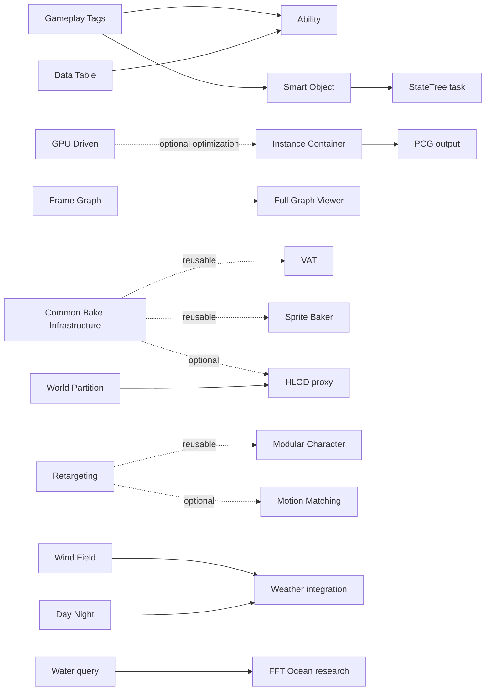

# BamEngine 기능 확장 계획 색인

- 작성일: 2026-11-26
- 기준 브랜치: main / [`2a9a7e0`](https://github.com/Bamtoliya/BamEngine/tree/2a9a7e09378de3b3d6aac6f90d989c233811c1a9)
- 범위: 앞서 추천한 기술·시스템을 **41개 개별 기능 계획서**로 구분. Animation Budget/Sharing, StateTree/Smart Objects, Gameplay Tags/Data Table, World Partition/HLOD, Water/Weather/Wind처럼 독립 구현·검증이 가능한 기능을 분리했다.
- 상태: 조사 기반 제안. 기존 계획을 대체하지 않으며 실행·성능 확인은 하지 않았다.
- 함께 제공하는 기존 문서: `../StylizedRenderingAndSpriteBakingPlan.md` (앞서 작성한 NPR·카툰·3D Pixel Art·Sprite Baker·HD-2D 계획 원본, 이번에 재조사하거나 수정하지 않음).

## 1. 읽는 방법

각 문서는 외부 기술 사례, BamEngine 재사용 후보, 책임 경계, 데이터/실행 알고리즘, 단계별 작업 ID, 검증 기준, **추가 조사 필요 사항**, 출처, 연계 계획을 포함한다. `P1~P4`는 기존 프로젝트 우선순위의 의미를 참고한 제안이며 실제 작업 순서를 확정하지 않는다. 소스 전체 전수 조사나 구현이 아닌 설계 검토이며 명칭은 제안이다.

## 2. 전체 기능 목록

| ID | 기능 계획서 | 분류 | 추천 우선순위·기존 상태 |
| --- | --- | --- | --- |
| FP-01 | [PCG — 절차적 콘텐츠 생성](ProceduralContentGenerationPlan.md) | 제작·월드 | P2 / 신규 |
| FP-02 | [Foliage / Scatter 브러시 및 인스턴스 컨테이너](FoliageScatterPlan.md) | 제작·월드 | P1 / 신규 |
| FP-03 | [Gameplay Ability System — 스킬·속성·상태 효과](GameplayAbilitySystemPlan.md) | 게임플레이 | P2 / 신규 |
| FP-04 | [GPU Driven Rendering — GPU 컬링 및 간접 드로우](GPUDrivenRenderingPlan.md) | 렌더링·성능 | P3 / 기존 M1 확장 |
| FP-05 | [Tween / Sequence — 범용 프로퍼티 애니메이션](TweenSequencePlan.md) | 게임플레이·UI | P1 / 기존 요구 구체화 |
| FP-06 | [GPU Particle / VFX Graph](GPUParticleVFXGraphPlan.md) | 렌더링·VFX | P3 / 기존 GPU 파티클 목표 확장 |
| FP-07 | [VAT — Vertex Animation Texture 베이킹](VertexAnimationTexturePlan.md) | 애니메이션·렌더링 | P2 / 신규 |
| FP-08 | [Animation Budget Allocator — 포즈 평가 예산](AnimationBudgetAllocatorPlan.md) | 애니메이션·성능 | P2 / 신규 |
| FP-09 | [Animation Sharing — 군중 포즈 공유](AnimationSharingPlan.md) | 애니메이션·성능 | P3 / 신규 |
| FP-10 | [Modular Character — 조합형 캐릭터·장비](ModularCharacterSystemPlan.md) | 제작·애니메이션 | P2 / 신규 |
| FP-11 | [StateTree — 계층형 AI 상태·태스크](StateTreeAIPlan.md) | 게임플레이·AI | P2 / 신규 |
| FP-12 | [Smart Objects — 상호작용 슬롯·예약](SmartObjectInteractionPlan.md) | 게임플레이·AI | P2 / 신규 |
| FP-13 | [Motion Matching — 포즈 검색 기반 이동](MotionMatchingPlan.md) | 애니메이션 | P4 / 신규 연구 |
| FP-14 | [Frame Graph — 렌더 패스·GPU 자원 의존성](FrameGraphPlan.md) | 렌더링·성능 | P3 / 기존 프로필 확장 |
| FP-15 | [Temporal Upscaling — FSR/DLSS 연동](TemporalUpscalingPlan.md) | 렌더링·성능 | P3 / 신규 |
| FP-16 | [Water Interaction — 수면·부력·흔적](WaterInteractionPlan.md) | 월드·물리 | P2 / 기존 S6 확장 |
| FP-17 | [Weather System — 날씨·강수·표면 상태](WeatherSystemPlan.md) | 월드·그래픽스 | P2 / 신규 통합 |
| FP-18 | [Global Wind Field — 전역·국소 바람](GlobalWindFieldPlan.md) | 월드·그래픽스 | P2 / 기존 파티클 바람 확장 |
| FP-19 | [World Partition — 공간 단위 씬 스트리밍](WorldPartitionPlan.md) | 월드·성능 | P3 / 기존 씬 스트리밍 확장 |
| FP-20 | [HLOD — 월드 클러스터와 원거리 프록시](HierarchicalLODPlan.md) | 렌더링·성능 | P3 / 신규 |
| FP-21 | [Data Table / Curve Table — 게임 데이터 저작](DataTablePlan.md) | 게임플레이·제작 | P1 / 기존 실전 보강 요구 |
| FP-22 | [Gameplay Tags — 계층형 태그 및 쿼리](GameplayTagsPlan.md) | 게임플레이 | P1 / 신규 |
| FP-23 | [Animation Retargeting / IK Rig — 골격 간 모션 재사용](AnimationRetargetingPlan.md) | 애니메이션·제작 | P2 / 기존 IK·리타게팅 목표 |
| FP-24 | [GPU Texture / Material Baking — 공통 베이커](TextureMaterialBakingPlan.md) | 제작·렌더링 | P2 / 신규 |
| FP-25 | [Day/Night Cycle — 시간·환경 조명](DayNightCyclePlan.md) | 월드·그래픽스 | P2 / 신규 통합 |
| FP-26 | [Destruction — 사전 파쇄 및 물리 파편](DestructionSystemPlan.md) | 월드·물리 | P3 / 신규 |
| FP-27 | [Virtual Texture — 타일 기반 스트리밍](VirtualTexturePlan.md) | 렌더링·성능 | P4 / 신규 연구 |
| FP-28 | [Interactive Mesh Deformation — 눈·모래·풀 흔적](InteractiveMeshDeformationPlan.md) | 월드·렌더링 | P3 / 신규 |
| FP-29 | [SDF Collision — 거리장 충돌 및 VFX](SDFCollisionPlan.md) | 월드·렌더링 | P3 / 신규 |
| FP-30 | [FFT Ocean — 대규모 스펙트럼 파도](FFTOceanSimulationPlan.md) | 월드·렌더링 | P4 / 조건부 연구 |
| FP-31 | [Command Palette — 검색 기반 에디터 명령 실행](CommandPalettePlan.md) | 에디터·UX | P1 / 신규 |
| FP-32 | [Multi-Object Inspector — 다중 선택 일괄 속성 편집](MultiObjectInspectorPlan.md) | 에디터·UX | P1 / 기존 다중 선택 확장 |
| FP-33 | [Property Binding — UI 및 게임 데이터 연결](PropertyBindingPlan.md) | 에디터·게임플레이 | P1 / 신규 |
| FP-34 | [Preset System — 설정 저장·재사용](PresetSystemPlan.md) | 에디터·제작 | P1 / 신규 통합 |
| FP-35 | [Prefab Variant — 상속형 프리팹 및 오버라이드](PrefabVariantPlan.md) | 에디터·제작 | P2 / 기존 Prefab 확장 |
| FP-36 | [Batch Asset Processing — 에셋 일괄 작업](BatchAssetProcessingPlan.md) | 에디터·제작 | P1 / 기존 AssetWorker 확장 |
| FP-37 | [Visual Debugger / Visual Logger — 상태 및 공간 정보 시각화](VisualDebuggerPlan.md) | 에디터·디버깅 | P1 / 기존 Metrics·디버그 확장 |
| FP-38 | [Runtime Inspector — PIE·독립 Client 상태 검사](RuntimeInspectorPlan.md) | 에디터·디버깅 | P1 / 기존 Inspector·PIE 확장 |
| FP-39 | [Replay / Time Travel — 실행 기록 및 재현](ReplayTimeTravelPlan.md) | 에디터·게임플레이 | P2 / 신규 |
| FP-40 | [Render Graph Viewer — 패스·자원 수명 시각화](RenderGraphViewerPlan.md) | 에디터·렌더링 | P2 / Frame Graph 연계 |
| FP-41 | [Game Template — 장르별 시작 프로젝트](GameTemplatePlan.md) | 에디터·제작 | P1 / 신규 |

## 3. 추천 개발 묶음

### A. 즉시 활용 가능한 제작 생산성

기존 Reflection·Archive·Editor/Runtime을 재사용. 게임 템플릿과 디버거는 각 기능의 회귀를 검증하는 기반으로 병행.

[22 Gameplay Tags — 계층형 태그 및 쿼리](GameplayTagsPlan.md) · [21 Data Table / Curve Table — 게임 데이터 저작](DataTablePlan.md) · [05 Tween / Sequence — 범용 프로퍼티 애니메이션](TweenSequencePlan.md) · [31 Command Palette — 검색 기반 에디터 명령 실행](CommandPalettePlan.md) · [32 Multi-Object Inspector — 다중 선택 일괄 속성 편집](MultiObjectInspectorPlan.md) · [34 Preset System — 설정 저장·재사용](PresetSystemPlan.md) · [33 Property Binding — UI 및 게임 데이터 연결](PropertyBindingPlan.md) · [36 Batch Asset Processing — 에셋 일괄 작업](BatchAssetProcessingPlan.md) · [41 Game Template — 장르별 시작 프로젝트](GameTemplatePlan.md) · [37 Visual Debugger / Visual Logger — 상태 및 공간 정보 시각화](VisualDebuggerPlan.md) · [38 Runtime Inspector — PIE·독립 Client 상태 검사](RuntimeInspectorPlan.md)

### B. 콘텐츠 자동 생성 및 캐릭터 제작

Foliage의 instance container부터 검증하고 PCG를 연결. 베이커/리타게팅은 각각 독립 MVP 가능. 기존 NPR/Sprite Baker 계획을 재사용.

[02 Foliage / Scatter 브러시 및 인스턴스 컨테이너](FoliageScatterPlan.md) · [01 PCG — 절차적 콘텐츠 생성](ProceduralContentGenerationPlan.md) · [35 Prefab Variant — 상속형 프리팹 및 오버라이드](PrefabVariantPlan.md) · [24 GPU Texture / Material Baking — 공통 베이커](TextureMaterialBakingPlan.md) · [07 VAT — Vertex Animation Texture 베이킹](VertexAnimationTexturePlan.md) · [23 Animation Retargeting / IK Rig — 골격 간 모션 재사용](AnimationRetargetingPlan.md) · [10 Modular Character — 조합형 캐릭터·장비](ModularCharacterSystemPlan.md)

### C. 게임플레이와 환경 통합

Tags/DataTable 기반 스킬, Smart Object 예약→StateTree 태스크. 날씨·수면은 기존 검증 경로를 확장.

[03 Gameplay Ability System — 스킬·속성·상태 효과](GameplayAbilitySystemPlan.md) · [12 Smart Objects — 상호작용 슬롯·예약](SmartObjectInteractionPlan.md) · [11 StateTree — 계층형 AI 상태·태스크](StateTreeAIPlan.md) · [25 Day/Night Cycle — 시간·환경 조명](DayNightCyclePlan.md) · [18 Global Wind Field — 전역·국소 바람](GlobalWindFieldPlan.md) · [17 Weather System — 날씨·강수·표면 상태](WeatherSystemPlan.md) · [16 Water Interaction — 수면·부력·흔적](WaterInteractionPlan.md) · [39 Replay / Time Travel — 실행 기록 및 재현](ReplayTimeTravelPlan.md)

### D. 규모가 커질 때 성능 최적화

Frame Graph는 기존 프로필 adapter부터; GPU Driven은 독립 prototype 가능. Viewer는 기존 pass 목록부터 구현 가능. HLOD는 셀 스트리밍과 연계.

[14 Frame Graph — 렌더 패스·GPU 자원 의존성](FrameGraphPlan.md) · [40 Render Graph Viewer — 패스·자원 수명 시각화](RenderGraphViewerPlan.md) · [04 GPU Driven Rendering — GPU 컬링 및 간접 드로우](GPUDrivenRenderingPlan.md) · [06 GPU Particle / VFX Graph](GPUParticleVFXGraphPlan.md) · [08 Animation Budget Allocator — 포즈 평가 예산](AnimationBudgetAllocatorPlan.md) · [09 Animation Sharing — 군중 포즈 공유](AnimationSharingPlan.md) · [15 Temporal Upscaling — FSR/DLSS 연동](TemporalUpscalingPlan.md) · [19 World Partition — 공간 단위 씬 스트리밍](WorldPartitionPlan.md) · [20 HLOD — 월드 클러스터와 원거리 프록시](HierarchicalLODPlan.md)

### E. 요구 기반 장기 연구

애니메이션 데이터 확보 및 실제 콘텐츠 병목을 확인한 후 채택. 다른 목표의 필수 선행 조건으로 삼지 않음.

[13 Motion Matching — 포즈 검색 기반 이동](MotionMatchingPlan.md) · [26 Destruction — 사전 파쇄 및 물리 파편](DestructionSystemPlan.md) · [27 Virtual Texture — 타일 기반 스트리밍](VirtualTexturePlan.md) · [28 Interactive Mesh Deformation — 눈·모래·풀 흔적](InteractiveMeshDeformationPlan.md) · [29 SDF Collision — 거리장 충돌 및 VFX](SDFCollisionPlan.md) · [30 FFT Ocean — 대규모 스펙트럼 파도](FFTOceanSimulationPlan.md)

## 4. 핵심 의존 관계와 도입 원칙

- 실전 게임 샘플을 먼저 만들고, 요구가 있는 기능만 선택한다. 현재 `DevelopmentPriorities.md`의 실패·검증 대기 항목을 새 기능이 덮어쓰지 않는다.
- GPU 기능은 DX12 기준 검증 후 SDL GPU 등 백엔드 지원 범위를 분리한다. CPU 폴백이 의미 있는 경우 유지한다.
- 작성 데이터와 생성 결과, 런타임 상태를 구분한다. 기존 Archive·Reflection·ResourceManager·AssetWorker를 우선 재사용한다.
- PCG/GAS/Frame Graph는 서로의 완료를 공통 선행 조건으로 삼지 않는다. 각 기능에 최소 독립 예제를 둔다.
- 기존 문서에 이미 있는 GPU Driven M1, GPU Particle, 리타게팅, UI Tween 요구, 데이터 테이블 요구, 수면 S6 등은 해당 기존 계획을 확장하는 제안이다. 특히 Gerstner 수면의 기존 구현 및 실행 확인을 다시 개발할 필요는 없다.

## 5. 추가 조사·진행 기록 방법

모든 개별 문서 5절에 구현 전 확인할 구체 항목을 남겼다. 범용 기능의 기술 원리만 확인한 경우 제품 수준 지원 여부, 데이터 포맷, 알고리즘의 수치 안정성, SDK 버전·라이선스, 성능·품질 기준은 확정하지 않는다. 현행 소스와 시연 콘텐츠를 먼저 대조한 뒤 계획 수정이 필요하면 원래 계획과 함께 반영한다.

| 상태 | 판정 |
| --- | --- |
| 제안 | 외부 기술 조사와 설계 초안 |
| 코드 반영 | 소스 및 에셋 구현 확인 |
| 빌드 확인 | 해당 구성 및 CTest 기록 |
| 실행 확인 | 대표 씬과 편집·Client 흐름 검증 |
| 성능 확인 | 기준 경로와 동일 조건의 측정 결과 기록 |
| 보류 | 도입 조건 미충족 또는 연구 필요 |

## 6. 문서 배치

ZIP은 `Docs/FeaturePlans/`에 41개 계획서와 색인, `Docs/`에 앞서 작성한 스타일 렌더링 문서를 포함한다. 기존 동일 파일을 덮어쓰기 전에 변경사항을 비교한다. GitHub 저장소를 직접 수정하지 않았다.
