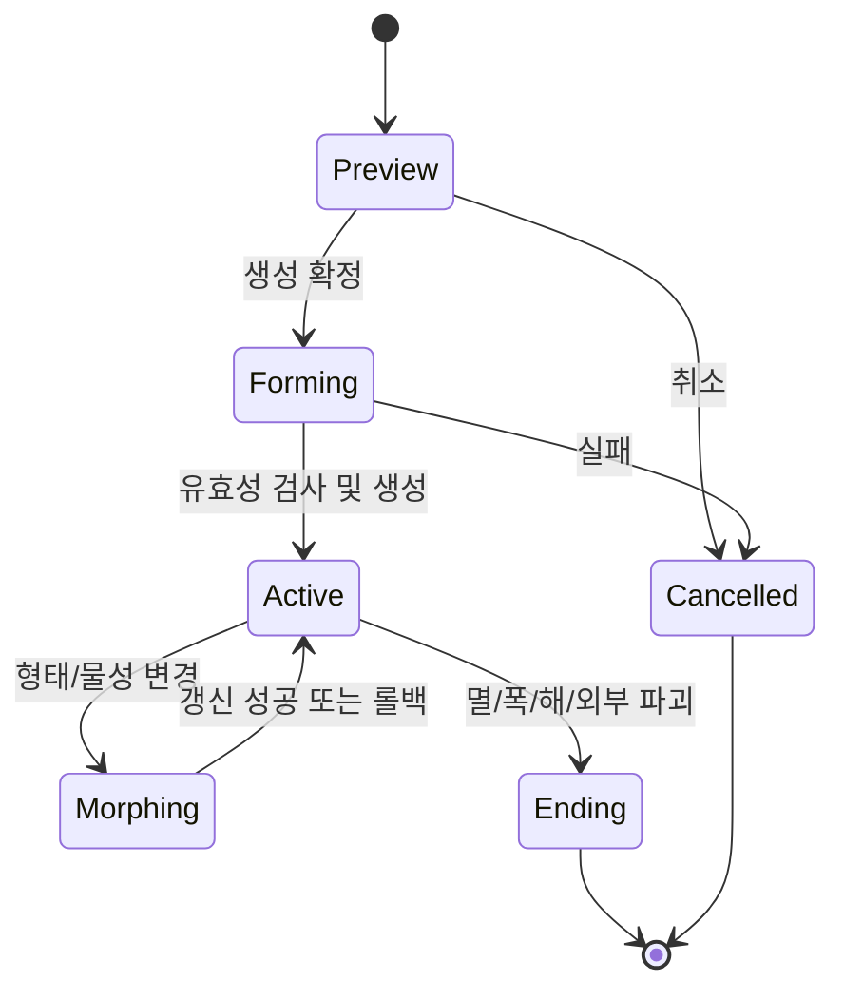

# 결계(結界) — 게임 기획서 및 BamEngine 기술 요구사항

- 버전: v0.3 / 기획 초안
- 작성일: 2026-11-27
- 개발 엔진: BamEngine (C++)
- 참조 코드 스냅샷: [`4b86af9d247f50e97041d474d6e661afc9f954ee`](https://github.com/Bamtoliya/BamEngine/commit/4b86af9d247f50e97041d474d6e661afc9f954ee) (2026-11-27 14:44 KST, 조회 시점의 기본 브랜치 코드 검색 결과)
- 범위: 게임 디자인, 전투·이동 규칙, 시스템 설계, 엔진 격차 분석, 프로토타입 검증 계획
- 상태: 사용자 확정 사항은 고정; 기타 수치·조작·세계관은 검증용 제안.

---

## 1. 게임 개요

**공간에 결계를 만들어 물리 법칙과 영역 효과를 조작하고, 이를 즉석에서 무기·방패·발판·포획 장치로 변환하며 싸우는 3D 실시간 액션 게임.**

만화 《결계사》의 공간 포획, 생성, 멸, 해제와 공중 발판에서 영감을 받되, 원작 캐릭터·설정·미술을 재현하지 않는 독립 IP로 설계한다. 일반적인 마법 스킬과 달리 결계는 생성 이후에도 물리적 객체 또는 효과 볼륨으로 존재한다. 단 하나의 결계도 상황에 따라 역할을 바꿀 수 있다.

| 항목 | 방향 |
|---|---|
| 장르 | 3D 실시간 액션 / 물리 기반 전투 샌드박스 |
| 플레이 | 싱글 플레이 우선 제안 |
| 시점 | 3인칭 어깨 너머 우선 검증, 쿼터뷰 비교 가능 |
| 조작 | 이동·회피·공간 조준·결계 생성·변형·발사·해제 |
| 그래픽 | 기하학적 반투명 결계, 스타일라이즈드/NPR 후보 |
| 차별점 | 사전 정의 콤보가 아니라 물리와 영역 규칙의 상호작용으로 전투 기술 발견 |
| 콘텐츠 | 전투와 이동을 하나의 공간 조작 체계로 해결 |

### 1.1 확정된 설계 원칙

1. 기본 도형을 선택하고 변형하며, 여러 결계를 연결해 새로운 물리적 구조를 만든다. 임의 꼭짓점 모델링 및 실시간 CSG는 필수가 아니다.
2. 결계는 플레이어의 지속 제어 아래 움직일 수도, 제어에서 벗어나 독립적으로 물리·효과를 수행할 수도 있다.
3. 공중 발판, 벽 타기, 비행, 고속 발사, 낙하 방지 등 전투 외 이동에도 동일한 시스템을 적극 사용한다.
4. 전투 중 생성된 결계의 형태와 물리적 성질을 변경할 수 있다. 방벽을 창으로 바꾸어 발사하거나 탄성을 바꿔 도약하는 것이 핵심 경험이다.
5. 실시간 액션 전투, 멸을 이용한 내부 공격, 지속 효과 및 버프·디버프, 결계 사이의 물리·공간·효과 시너지를 모두 포함한다.

### 1.2 디자인 기둥

- **즉각성:** 조준하고 만들어 대응하는 행위가 빠르고 명확하다.
- **재사용:** 생성한 결계를 일회용 스킬처럼 소비하지 않고 변형하고 재배치한다.
- **일관성:** 공격, 방어, 이동이 같은 질량·충돌·효과 규칙을 따른다. 필요한 게임적 예외는 명시한다.
- **창발성:** 플레이어가 규칙을 조합한다. 조합 이름은 설명용이며 별도 스킬 코드를 강제하지 않는다.
- **가독성:** 어떤 결계가 위험하고 어느 방향으로 작동하는지 전투 중 즉시 파악 가능해야 한다.

## 2. 결계의 구성 모델

| 계층 | 정의 | 예시 |
|---|---|---|
| Geometry | 형태, 크기, 회전, 두께, 구조 | 구체, 직육면체, 삼각뿔 |
| Boundary | 실제 접촉·통과 규칙 | 속이 빈 벽, 실체, 선택적 통과, 없음 |
| Physical | 물리적 물성 및 강도 | 질량, 마찰, 탄성, 강성, 내구도 |
| Field | 공간 내부/표면에 적용하는 효과 | 흡인, 감속, 취약, 강화 |
| Control | 위치·속도·형태 제어 및 독립 동작 | 고정, 추종, 발사, 비행 |
| Lifecycle | 생성·유지·변형·종료 상태 | 생성 중, 활성, 붕괴 |
| Resource | 영력, 제어 부하, 축적 에너지 | 유지비, 발사 비용 |
| Ownership | 소유자, 팀, 그룹, 권한 | 아군만 통과, 소유자만 조작 |

형태와 경계와 내부 효과를 독립적으로 선택한다. 같은 구체라도 실체형 타격체, 빈 구형 감옥, 물리 경계 없는 회복장으로 동작할 수 있다. 효과 볼륨은 기본적으로 결계의 변환을 따라가며, 별도 확장 범위는 명시된 효과의 경우만 허용한다.

### 2.1 기본 형태

| 도형 | 활용 | 초기 충돌 표현 |
|---|---|---|
| 직육면체 | 포획, 벽, 발판, 압착 | Box 및 6면 shell |
| 평판 | 방패, 칼날, 발판 | 최소 두께를 가진 Box |
| 구체 | 충돌, 반발, 핀볼, 효과장 | Sphere; 빈 구형 경계는 후속 |
| 삼각뿔/쐐기 | 관통, 방향성 타격, 경사면 | Convex 또는 임시 복합 프록시 |
| 원통 | 기둥, 통로, 구역 분할 | Convex/복합 프록시 |
| 캡슐 | 운반, 충돌, 유선형 투사체 | Capsule |
| 복합 구조 | 날개, 계단, 공성 도구 | 자식 형상 또는 연결체 |

플레이어는 도형 선택 → 위치 및 방향 지정 → 크기/비율 변경 → 연결 순서로 제작한다. 자유 변형의 초기 범위는 축별 스케일, 길이, 두께, 방향 및 도형 전환. 도형 전환은 물리적으로 유효한 중간 형상 또는 안전한 교체로 처리하고, 시각 보간과 물리 상태를 분리한다.

### 2.2 경계 유형

- **Solid:** 내부 공간을 포함한 실체 물체. 공격·발판·방패용.
- **Shell:** 속이 비어 있고 표면만 충돌. 포획·격리용. 초기에는 6개 판으로 직육면체 구성.
- **Field-only:** 물리 경계 없이 효과만 존재.
- **Selective:** 대상 범주에 따라 경계 통과 여부 결정(플레이어, 적, 투사체, 다른 결계, 환경 오브젝트).

생성 시 다른 물체와 겹치는 Solid를 무조건 허용하지 않는다. Shell은 표면 겹침을 검사하고, 내부에 이미 존재하는 대상은 포획 가능하다. 지형을 뚫고 생성하거나 대상의 신체 내부에 실체를 생성하여 즉사시키는 행위는 기본적으로 금지한다.

### 2.3 복합 결계

- 배치 그룹: 여러 결계에 일괄 명령하되 각각 독립된 물리 객체.
- 고정 결합: 여러 결계를 하나의 강체처럼 움직이는 구조. 질량 중심, 관성, 자식 충돌체를 계산한다.
- 연결 결합: 관절 또는 제약조건으로 연결되어 일부 자유도를 가진 구조(후속).
- 영역 조합: 실제 물리 결합 없이 효과만 겹친다.

초기에는 배치 그룹을 먼저 구현한다. 강체 결합에서 CSG로 메시를 합치지 않아도 된다. 결합/분리 시 개별 ID·효과·내구도 보존, 내부 접촉 제외, 겹친 효과의 중복 계산 금지, 운동량 처리 및 비용 재산정을 계약으로 정의한다.

## 3. 결계의 생애와 실시간 조작



Active 상태의 제어 모드는 별도 열거형으로 관리한다.

| 모드 | 행동 | 물리 권위 |
|---|---|---|
| Anchored | 월드 또는 대상 표면에 고정 | Static/Kinematic 또는 앵커 제약 |
| Controlled | 마우스·이동 입력으로 끌기/회전/운반 | 제한된 Kinematic 또는 힘 기반 servo |
| Released | 발사 후 중력·충돌·반발에 따라 이동 | Dynamic |
| Autonomous | 정해진 순환·추종 규칙, 지속 효과 | Kinematic/Dynamic 중 하나 |

한 틱에 위치를 쓰는 권위는 하나만 허용한다. 제어 해제와 발사는 속도 연속성을 유지하며, 이동 중인 결계를 다시 제어할 때 순간 정지나 순간이동 대신 감속 및 속도 한계를 적용한다. Released 결계도 수명·효과·소유권·유지비 규칙을 유지한다.

### 3.1 명령 체계 (가칭)

| 명령 | 동작 |
|---|---|
| 결 | 조준한 공간에 지정 프리셋 생성 |
| 해 | 안전한 해제; 종료 효과는 명시된 경우만 |
| 멸 | 결계 내부 대상에 저항과 출력 기반 피해; 외부 공격과 구분 |
| 폭 | 축적된 에너지를 외부로 방출 |
| 변 | 도형·크기·두께 또는 물성 변경 |
| 이/회 | 결계 이동/회전 |
| 발 | 방향과 속도를 지정하여 독립 발사 |
| 고 | 고정·해제·다시 제어 |
| 연 | 그룹/구조 결합 또는 분리 |

멸은 약한 적에게 처형처럼 느껴질 수 있지만 강한 적은 버티거나 결계를 부순다. 멸 발동 시점의 실제 포획 판정을 사용한다. 단순 중심점 진입은 완전 포획과 동일하지 않다. 결계 벽을 걸친 대상은 부분 피해/실패 중 하나로 처리하되 MVP는 완전 포함만 허용한다. 해와 적의 공격에 의한 파괴, 시간 만료, 폭의 이벤트는 서로 구분한다.

## 4. 물리 및 효과 시스템

### 4.1 물성

| 물성 | 전투/이동 영향 |
|---|---|
| 질량 및 관성 | 충돌과 회전, 운반 및 발사 비용 |
| 내구도/강도 | 충격·압력·결계 간섭을 견딤 |
| 탄성 | 반발, 도탄, 도약 |
| 정적/동적 마찰 | 걷기, 미끄러짐, 제동 |
| 중력 영향 | 부유, 낙하, 비행 |
| 점착 | 적이나 플레이어 부착/운반 (제약조건으로 표현) |
| 투과 규칙 | 팀/대상 종류별 경계 통과 |
| 강성 | 우선 게임 데이터상 변형 저항; 실제 soft body는 불필요 |

전투 중 물성 변경은 공유 PhysicsMaterial 에셋 자체를 수정하는 대신 결계 인스턴스별 오버라이드/프리셋 교체로 처리한다. 질량 변경은 선운동량 보존을 기본으로 제안하고 각운동량은 관성 재계산 후 보정한다. 변경에 의한 추가 에너지는 비용 차감 또는 상한으로 통제한다. 탄성 계수는 기본 0~1; 초과 반발은 별도 에너지 소비 Impulse 효과로 표현한다.

충돌 피해는 게임적 스케일을 적용한 상대 접촉 속도/유효 질량 또는 솔버 충격량 기반으로 계산한다. 예를 들어 `Damage = clamp(k * EffectiveMass * NormalSpeed² * ShapeFactor, 0, MaxDamage)`. 단순히 모든 운동에너지를 체력 피해로 변환하지 않으며, 날카로움은 충돌 방향과 각도에 따른 배율로 구현한다. MVP의 관통은 피해/관통 허용 횟수 기반 게임 규칙으로 시작하고 실제 절단 메시나 재질 파괴는 후속이다. 지속 접촉에 매 틱 피해가 중복되지 않도록 공격 ID·대상 ID·재타격 간격을 둔다.

### 4.2 효과 모델

| 분류 | 효과 |
|---|---|
| 강화/회복 | 공격력, 방어력, 이동 속도, 회복 |
| 약화 | 감속, 취약, 방어 감소, 침묵 |
| 피해 | 지속 피해, 진입 피해, 멸 |
| 역학 | 흡인, 반발, 방향 가속, 중력 보정 |
| 공간 | 격리, 선택적 통과, 후속 전이 |
| 에너지 | 흡수, 축적, 증폭, 폭발 |
| 간섭 | 상대 결계 약화, 강화, 무효화 |

발동 방식: 상시, 진입, 이탈, 주기, 접촉, 명령, 특정 조건, 붕괴. 효과 정의에는 대상 필터(팀/유형/자기 자신 포함 여부), 강도, 지속시간, 중첩 키, 갱신 규칙, 발동 비용을 둔다. 가속장은 방향을 가진 힘 또는 속도 제한 변경으로 구분하며, 감속은 초기 이동 속도 디버프이지 객체별 시간 조작이 아니다.

### 4.3 중첩 규칙

| 효과 | 기본 규칙 (제안) |
|---|---|
| 힘 계열 | 벡터 합산 후 최대 가속도 제한 |
| 이동 속도 | 동일 키는 강한 값 우선; 다른 키는 합/곱 후 범위 제한 |
| 취약/강화 | 카테고리별 합산 및 상한 |
| 주기 피해 | 출처별 제한 및 동일 그룹 중복 제거 |
| 통과 규칙 | 경계마다 독립 평가, 기본은 차단 우선 |
| 간섭/무효화 | 출력 비교; 동률 처리 순서를 고정 |
| 지속시간 | 갱신, 독립 타이머, 최대 스택 중 효과별 정의 |

효과가 유발한 새 효과를 같은 틱에 무제한 재귀 처리하지 않는다. 큐에서 단계적으로 평가하고 출처 ID, 발생 깊이, 틱당 이벤트 수를 제한한다. 영역 이탈/삭제/비활성/씬 전환 시 적용된 modifier를 반드시 제거한다. 동일 복합 그룹의 여러 판이나 트리거가 같은 대상을 만났을 때 그룹 수준에서 중복 제거한다.

## 5. 전투 시너지

| 조합 | 원리 및 결과 | 대응/제한 |
|---|---|---|
| 흡인 → 감속 → 포획 → 멸 | 영역 조합으로 이동 제한 후 내부 피해 | 탈출형/강도 높은 적, 비용 |
| 방패 → 쐐기 → 발사 | 같은 객체의 형태 및 물성 변화 | 변형 시간, 발사 에너지 |
| 구체 + 반발 경계 | 핀볼처럼 도탄하는 타격체 | 속도·재타격·수명 제한 |
| 가속장 × 2 + 쐐기 | 가속 구간을 지나는 투사체 | 속도 상한, 가속장 유지비 |
| 고질량 + 중력 + 넓은 판 | 낙하 충격/압착 | 예고 연출, 회피 |
| 흡인 + 회전판 | 적을 끌어들여 연속 공격 | 적의 외부 공격과 내구도 |
| 점착 + 발사 | 붙잡은 물체/적을 다른 대상에게 투척 | 부착 저항, 최대 질량 |
| 방벽 + 강화장 | 방어와 아군 버프를 동시에 | 면적과 유지비 |
| 흡수 → 축적 → 폭 | 공격을 에너지로 바꿔 반격 | 저장량 제한, 과부하 |
| 탄성판 + 발사 + 감속장 | 공중 도약하면서 적 움직임 제한 | 낙하 위험, 공중 제어비 |
| 복합 판 + 구체 + 회전 | 조립된 구조물을 공격 도구로 활용 | 연결 강도, 관성 |
| 투과 방벽 + 원거리 투사체 | 아군만 통과하는 엄폐 | 상대의 간섭/측면 접근 |

전투 예시: 원거리 적의 공격을 평판으로 막는다. 방패에 사용한 결계를 쐐기 형태로 바꾼 후 발사한다. 동시에 적 뒤에 반발 결계를 만들어 도탄 경로를 만든다. 빠르게 접근하는 적을 감속시키고 직육면체 결계로 포획한다. 발밑에 탄성 발판을 생성해 공중으로 이동하면서 멸을 발동한다. 모든 과정은 동일한 결계 생성·형태 변경·물성 변경·힘·효과·종료 명령으로 성립해야 한다.

## 6. 이동 및 탐험

| 이동 | 조작·상호작용 | 실패/제약 |
|---|---|---|
| 공중 발판 | 조준 또는 발밑 빠른 생성, 접지 | 유효 지지면·수명·공중 생성 비용 |
| 계단/벽 타기 | 발판 연속 배치 또는 점착/벽 표면 추종 | 접촉 유지와 코너 전환, 이동 방향 제한 |
| 비행 | 부유 결계에 탑승하거나 결계 추력을 제어 | 추력·속도·높이·에너지 제한 |
| 고속 발사 | 탄성판/추력장으로 캐릭터 발사 | 속도 제한, 스윕 충돌, 공중 제어 |
| 낙하 방지 | 발밑 발판 또는 반발/감속으로 착지 | 충분한 생성 공간, 비용, 반응 시간 |
| 운반/이동 플랫폼 | 제어 또는 독립 이동 중인 결계에 탑승 | 이동량 상속 및 이탈 속도 규칙 |
| 전투 기동 | 공중 도약 후 조준, 이동 결계와 연속 공격 | 카메라 안정화, 조작 단순화 |

캐릭터 이동 솔버는 KCC를 기본으로 선택한다. 공중 발사 및 탄성판은 강체로 캐릭터를 자동 교체하지 않고 외부 속도/Impulse 요청을 KCC에 전달한다. GroundEntity의 이동·회전 상속과 이탈 속도 규칙을 분리한다. 벽 타기·비행은 Ground/Air/WallAttach/Fly/Launched 등 이동 상태로 명시하고 중력 벡터와 지지면 방향을 분리한다. 생성 중인 발판이나 제거 예정인 결계에 대한 안전한 접지 해제도 필요하다.

## 7. 조작 및 UI/UX

3인칭 카메라를 먼저 시험하되, 정밀 공간 조작이 어려우면 쿼터뷰/자유 조준 모드를 비교한다. 실시간 전투에서 메뉴를 반복 조작하지 않게 한다.

| 입력 예시 (미확정) | 행동 |
|---|---|
| WASD / 마우스 | 이동 / 시점·조준 |
| Space / Shift | 점프 / 회피 |
| 좌클릭 | 선택한 프리셋 즉시 생성; 길게 누르면 미리보기 |
| 우클릭 | 조준한 결계 선택/조작 |
| 휠 | 생성 중 거리 또는 조작 중 크기 (상태별 구분) |
| Q / E / R | 발사 / 멸 / 해제 |
| F | 고정 또는 재제어 |
| 1~5 | 빠른 프리셋 |
| Tab | 형태·물성·효과 빠른 변경 메뉴 |
| 별도 보조 입력 | 발밑 발판 즉시 생성/자유 깊이 조준 |

입력 상태 머신: Default/Aim/Preview/Selected/QuickEdit/GroupSelect. 선택 상태를 화면에 표시하고 메뉴가 입력을 소비한 경우 게임 명령으로 전달하지 않는다. HUD에는 영력, 제어 용량, 선택 결계의 형태·물성·효과·내구도·수명을 표시한다. 결계 미리보기에서 유효 위치/표면 겹침/거리/비용을 표시하고 확정 시 고정 틱에서 재검증한다.

조준 우선순위: 선택 모드에서 아군 결계 ID → 일반 조준 시 지형/대상 raycast → 잠금 대상의 예상 위치 → 자유 공간 깊이 지정. 투명 표면의 GPU picking을 강제하지 않고 물리/논리 형상 raycast를 사용한다. 가려진 결계를 선택하기 위한 순환 선택과 그룹 선택은 후속 검증한다. 공중 이동 중 카메라 지터, 충돌 회피, 빠른 이동 시 FOV 변화, 조준 유지 등을 시험한다.

## 8. 자원, 성장, 적 설계

- 영력: 생성·형태 전환·능동 가속·유지에 소비; 회복 방식 미정.
- 제어 용량: 활성/제어 결계의 가중 합. 큰 구조, 복잡한 효과, 강한 출력을 더 비싸게 한다.
- 내구도: 물리 충격·적 공격·간섭에 의해 감소. 물리 재질의 마찰/탄성과 별개다.
- 에너지 저장량: 반발 증폭 및 폭발의 근원. 충돌 루프가 에너지를 무한 생성하지 않게 한다.
- 성장: 최대 출력·정밀도·제어량·변형 속도·새 도형/효과·프리셋 슬롯을 해금. 숫자 성장보다 새로운 응용 가능성을 중요하게 둔다.

비용 모형(초기 제안): `CreateCost = Base + SurfaceCost * Area + VolumeCost * Volume + MassCost * Mass + EffectCost + ComplexityCost`. 유지비는 모드와 활성 효과에 의존하며, 변형에는 증분 비용 및 짧은 재구성 시간이 발생한다. 실패 시 비용 환불 정책과 영력 고갈 시 자동 해제 우선순위를 명시한다. 모든 숫자는 밸런싱 대상이다.

| 적 | 대응하는 플레이 방식 |
|---|---|
| 고속형 | 예측 배치, 감속, 반발로 경로 제한 |
| 괴력형 | 다중 경계, 강화, 물리적 압착 |
| 중장갑형 | 취약·멸·지속 피해 |
| 군집형 | 흡인, 광역 제어, 도탄 |
| 원거리형 | 방벽, 반사, 가속 투사체 |
| 비행형 | 공중 발판, 공중 포획, 이동 결계 |
| 결계술사형 | 상대 결계와 충돌/간섭, 영역 경쟁 |

초기 보스는 높은 포획 저항과 결계 파괴 능력을 가지며, 특정 순간에만 포획 가능한 약점을 노출한다. 조합 하나만 정답이 되지 않도록 물리/효과/기동 중 최소 두 가지 대응 경로를 제공한다.

세계관·스토리·테마·스테이지 분량은 아직 확정하지 않는다. 최초 프로토타입은 훈련장과 소형 전투 구역으로 구성하고, 기본 루프가 검증된 뒤 봉인/수호/탐험 등의 세계관을 선택한다.

## 9. 그래픽 및 사운드

결계의 핵심 시각 요소는 깨끗한 기하학, 투명한 내부, 뚜렷한 경계선, 힘의 방향을 나타내는 움직임이다. 색상뿐 아니라 모서리 패턴·입자 방향·아이콘으로 효과를 식별한다.

| 상황 | 연출 |
|---|---|
| 생성/변형 | 모서리 먼저 나타남, 면이 닫히고 형태 변화 시 연속적인 이동 |
| 강도/질량 | 경계선 두께와 밀도, 묵직한 가감속 |
| 탄성/충돌 | 접촉 위치의 파동, 면의 국소적인 시각 변형 |
| 흡인/가속 | 입자 수렴, 방향성 흐름 |
| 감속/강화 | 다른 패턴과 리듬으로 상태 구분 |
| 과부하/파괴 | 균열 및 기하학적 파편 |
| 멸/해/폭 | 내부 수축과 섬광 / 부드러운 소거 / 외향 파동 |

기본 primitive mesh와 material parameter로 표현하고, 매 프레임 topology 재생성은 피한다. 물리 표면은 단순하고 안정적인 프록시, 충돌 파동과 미세 변형은 셰이더로 표현한다. 반투명 겹침 정렬, depth test, 모서리 오버드로우, 내부 대상 실루엣, distortion 및 TAA ghosting을 테스트한다. OIT는 일반 alpha/additive 조합으로 해결하지 못하는 경우 후속 검토한다. 공간 오디오와 생성·변형·충돌·파괴 이벤트는 같은 수명 관리에 연동하고 반복 충돌 소리에는 동시 재생 및 빈도 제한을 적용한다.

---

# Part II. BamEngine 기술 조사 및 요구사항

## 10. 조사 범위와 신뢰도

GitHub 연결을 통해 최신 커밋 검색, 기본 브랜치 코드 검색, 고정 SHA의 소스 본문 조회를 진행했다. 코드 검색 결과는 위 SHA를 가리켰으며 최근 선행 커밋 [`59a38b0`](https://github.com/Bamtoliya/BamEngine/commit/59a38b08efa49c8f4b8a59a8f790a56cf471c58e)은 PhysicsMaterial 에셋 도입이다. [`7f5af7f`](https://github.com/Bamtoliya/BamEngine/commit/7f5af7fc87ca73621f3dcc910dc743472cc5ff71)은 RenderPipelineProfile 등 관련 직렬화 보강 기록이다.

**한계:** 실행 환경에서 직접 git clone/ls-remote가 DNS 실패했다. 저장소 전체 트리의 완전한 열거 및 로컬 빌드·실행, DX12/SDL GPU별 런타임 테스트는 수행하지 않았다. GitHub 코드 검색 결과 및 아래 소스 본문을 기반으로 한 정적 조사이며, 검색 누락 가능성이 있다. 특히 검색 결과가 없는 기능은 '미확인'으로 기록하며 부재를 확정하지 않는다. 기존 계획 문서의 과거 진단은 최신 소스와 충돌하면 최신 소스를 우선한다. 저장소에 코드 수정·커밋·푸시하지 않았다.

판정 기준: **확인** = 조회한 구현/선언 범위를 확인; **부분** = 기반이 있으나 결계 요구조건 미충족 또는 검증 필요; **미확인** = 검색 및 조회 범위에서 확인 못함; **신규 게임 로직** = 결계의 독자적인 기능으로 설계할 것.

## 11. 근거 기반 엔진 분석

| ID | 영역 | 판정 및 실제 근거 | 결계 대응 |
|---|---|---|---|
| A01 | 3D 강체 | 확인: [RigidBodyComponent.h](https://github.com/Bamtoliya/BamEngine/blob/4b86af9d247f50e97041d474d6e661afc9f954ee/Engine/Source/Physics/Public/RigidBodyComponent.h) 질량, 선/각속도, 감쇠, 중력 스케일, CCD, 휴면 | 기존 강체 재사용. 제어 전환·질량/관성 갱신 테스트 |
| A02 | Collider | 부분: [ColliderComponent.h](https://github.com/Bamtoliya/BamEngine/blob/4b86af9d247f50e97041d474d6e661afc9f954ee/Engine/Source/Physics/Public/ColliderComponent.h) Box/Sphere/Capsule/Mesh 단일 variant, SetShape/SetOffset/SetSettings의 dirty 처리 | shell 및 복합 형상, convex 쐐기, 런타임 변경 안전성 필요. Mesh가 동적 convex를 지원한다고 추정하지 않음 |
| A03 | 물리 재질 | 확인: [PhysicsMaterial.h L24–81](https://github.com/Bamtoliya/BamEngine/blob/4b86af9d247f50e97041d474d6e661afc9f954ee/Engine/Source/Physics/Public/PhysicsMaterial.h#L24-L81), [PhysicsSystem.cpp L344–430](https://github.com/Bamtoliya/BamEngine/blob/4b86af9d247f50e97041d474d6e661afc9f954ee/Engine/Source/Physics/Private/PhysicsSystem.cpp#L344-L430). 에셋, 마찰/탄성 combine, 솔버 재질 사용 확인 | 공용 에셋 그대로 활용; 인스턴스 오버라이드와 변경 후 캐시/휴면 검증 |
| A04 | 공간 질의/트리거 | 확인: [PhysicsSystem.h](https://github.com/Bamtoliya/BamEngine/blob/4b86af9d247f50e97041d474d6e661afc9f954ee/Engine/Source/Physics/Public/PhysicsSystem.h) Raycast/All, Box/Sphere/Capsule Sweep/OverlapAll, 레이어와 Trigger 필터 | 포획·선택·효과 후보 검색에 활용. 회전 OBB/convex 정확 질의와 완전 포함 판정 추가 |
| A05 | 충돌 이벤트 | 부분: [CollisionCallbackComponent.h L10–42](https://github.com/Bamtoliya/BamEngine/blob/4b86af9d247f50e97041d474d6e661afc9f954ee/Engine/Source/Physics/Public/CollisionCallbackComponent.h#L10-L42), PhysicsSystem.cpp L1410,1460,1900. Enter/Stay/Exit, 접촉점, 법선, 상대속도, 침투깊이. 이벤트에 impulse/자식 shape ID 없음 | 물리 피해·표면 파동·복합 접촉용 이벤트 확장 및 수명 안전성 검증 |
| A06 | CCD | 부분: [PhysicsSystem.cpp L1190–1275](https://github.com/Bamtoliya/BamEngine/blob/4b86af9d247f50e97041d474d6e661afc9f954ee/Engine/Source/Physics/Private/PhysicsSystem.cpp#L1190-L1275) 이동 벡터에 Box/Sphere/Capsule 스윕 및 위치 clamp. 회전은 이후 별도 적분 | 회전/변형/복합·convex CCD, 움직이는 두 결계의 상대 이동, 반복 도탄 및 trigger sweep 검증/확장 |
| A07 | 연결체 | 부분: [JointComponent.h](https://github.com/Bamtoliya/BamEngine/blob/4b86af9d247f50e97041d474d6e661afc9f954ee/Engine/Source/Physics/Public/JointComponent.h) Distance Joint 선언, 앵커, RestLength, raw entity 참조 직렬화 주석 | 고정 복합 강체를 기존 거리 조인트만으로 대체하지 않음. 조인트 저장/복원 및 솔버 상세 검증 |
| A08 | KCC | 부분: [CharacterControllerComponent.h](https://github.com/Bamtoliya/BamEngine/blob/4b86af9d247f50e97041d474d6e661afc9f954ee/Engine/Source/Physics/Public/CharacterControllerComponent.h), [KinematicCharacterSystem.cpp L382–543](https://github.com/Bamtoliya/BamEngine/blob/4b86af9d247f50e97041d474d6e661afc9f954ee/Engine/Source/Physics/Private/KinematicCharacterSystem.cpp#L382-L543). 캡슐, 접지, GroundEntity 위치/회전 상속, Y축 중력 | 플랫폼 기반 재사용. 외부 Impulse, 접촉 이탈 속도, 벽/비행 및 임의 중력, 고속 이동 확장 |
| A09 | 고정 틱 | 부분: [KinematicCharacterSystem.cpp L82–104](https://github.com/Bamtoliya/BamEngine/blob/4b86af9d247f50e97041d474d6e661afc9f954ee/Engine/Source/Physics/Private/KinematicCharacterSystem.cpp#L82-L104) OnUpdate에서 UpdateCharacter; [L899–905](https://github.com/Bamtoliya/BamEngine/blob/4b86af9d247f50e97041d474d6e661afc9f954ee/Engine/Source/Physics/Private/KinematicCharacterSystem.cpp#L899-L905) OnFixedUpdate no-op. PhysicsSystem은 fixed | 이동/결계/접촉 순서를 통일하는 핵심 선행 과제 |
| A10 | 입력 | 부분: [InputActionSettings.h](https://github.com/Bamtoliya/BamEngine/blob/4b86af9d247f50e97041d474d6e661afc9f954ee/Engine/Source/Input/Public/InputActionSettings.h), [ClientGameRuntime.cpp L245–265](https://github.com/Bamtoliya/BamEngine/blob/4b86af9d247f50e97041d474d6e661afc9f954ee/Client/Source/Execution/Private/ClientGameRuntime.cpp#L245-L265) action 평가가 fixed while 앞에 위치 | 입력 래치 및 단일 소비 경로 검증. 이 배치만으로 실제 유실 확정은 금지; 기존 슬라임 계획의 지적을 회귀 테스트로 재현 |
| A11 | 전투 | 부분: [GameplayCombatSystem.cpp](https://github.com/Bamtoliya/BamEngine/blob/4b86af9d247f50e97041d474d6e661afc9f954ee/Engine/Source/Gameplay/Private/GameplayCombatSystem.cpp) OnUpdate, Hitbox/Health, 팀 태그, swing hit 중복 방지, 속도 기반 knockback. Box query는 축정렬, 추가 Health 전체 순회 폴백 | 기존 체력/피해 경로 사용, fixed 명령 피해·주기 효과·회전 형상·대상 필터·중복 제거 개선. 전체 순회 비용 측정 |
| A12 | 효과 시스템 | 미확인: GameplayEffect/StatusEffect 검색 결과 없음; A11은 전투 기반 | GameModule의 modifier/field/stack 시스템부터 작성. 공용화 여부 추후 결정 |
| A13 | 동적 메시 | 확인: [Mesh.h](https://github.com/Bamtoliya/BamEngine/blob/4b86af9d247f50e97041d474d6e661afc9f954ee/Engine/Source/Render/Mesh/Public/Mesh.h), [Mesh.cpp L439–483](https://github.com/Bamtoliya/BamEngine/blob/4b86af9d247f50e97041d474d6e661afc9f954ee/Engine/Source/Render/Mesh/Private/Mesh.cpp#L439-L483) UpdateStreamBufferInPlace, 동일 count/stride/size일 때 UpdateData, 실패/불일치 시 재할당, bounds/geometry version 갱신 | 재구현 금지. shared mesh 변경 방지, 두 RHI의 갱신 및 동적 culling 검증 |
| A14 | 투명/왜곡/VFX | 코드 검색 확인: [RenderPassTypes.h](https://github.com/Bamtoliya/BamEngine/blob/4b86af9d247f50e97041d474d6e661afc9f954ee/Engine/Source/Render/RenderPass/Public/RenderPassTypes.h) ForwardTransparent/Distortion; [VFXBlendAndPassCheck.cpp](https://github.com/Bamtoliya/BamEngine/blob/4b86af9d247f50e97041d474d6e661afc9f954ee/Engine/examples/VFXBlendAndPassCheck.cpp) alpha/additive 경로 테스트 소스 검색 확인 | 전용 결계 머티리얼·모서리·파동·중첩 가독성. 실제 정렬/깊이/RHI 테스트 미실행 |
| A15 | 3인칭 | 코드 검색 확인: [ThirdPersonControllerSystem.cpp](https://github.com/Bamtoliya/BamEngine/blob/4b86af9d247f50e97041d474d6e661afc9f954ee/Engine/Source/Physics/Private/ThirdPersonControllerSystem.cpp), [ThirdPersonControllerComponent.h](https://github.com/Bamtoliya/BamEngine/blob/4b86af9d247f50e97041d474d6e661afc9f954ee/Engine/Source/Physics/Public/ThirdPersonControllerComponent.h) | 기존 기반 조사 후 자유 공간 조준/락온/고속 이동 카메라 추가; 상세 동작 미검증 |
| A16 | 데이터·에디터 | 검색 확인: [DataTable.h](https://github.com/Bamtoliya/BamEngine/blob/4b86af9d247f50e97041d474d6e661afc9f954ee/Engine/Source/Gameplay/Public/DataTable.h), [DataTableEditor.cpp](https://github.com/Bamtoliya/BamEngine/blob/4b86af9d247f50e97041d474d6e661afc9f954ee/Editor/Source/ImGui/ResourceEditor/Private/DataTableEditor.cpp), [PrefabInstanceComponent.h](https://github.com/Bamtoliya/BamEngine/blob/4b86af9d247f50e97041d474d6e661afc9f954ee/Engine/Source/World/Scene/Public/PrefabInstanceComponent.h) | 프리셋/효과 정의 데이터화. 변형·복합 구조·참조의 저장/PIE 복원 왕복 시험 |
| A17 | 예제/회귀 | 검색 확인: [KinematicCharacterCheck.cpp](https://github.com/Bamtoliya/BamEngine/blob/4b86af9d247f50e97041d474d6e661afc9f954ee/Engine/examples/KinematicCharacterCheck.cpp)의 CheckMovingPlatformInheritance, [GameplayCommonCheck.cpp](https://github.com/Bamtoliya/BamEngine/blob/4b86af9d247f50e97041d474d6e661afc9f954ee/Engine/examples/GameplayCommonCheck.cpp) 입력 액션 예제 | 같은 테스트 경로에 결계 케이스 확장. 실행 성공은 미확인 |

### 11.1 기존 슬라임 요구사항과의 공유

[Slime_Engine_Gap_And_Plan_v0.1.md](https://github.com/Bamtoliya/BamEngine/blob/4b86af9d247f50e97041d474d6e661afc9f954ee/Docs/GamePlan/SlimeGame/Slime_Engine_Gap_And_Plan_v0.1.md)는 입력 edge, 고정 틱, 접촉 이벤트, CCD, 동적 메시, 표면 재질을 공통 요구로 다룬다. 최신 소스에는 충돌 이벤트, CCD의 초기 구현, PhysicsMaterial, in-place 메시 갱신이 존재하므로 과거 문서의 '없음' 상태를 그대로 복사하지 않는다. 결계와 슬라임 모두에 필요한 나머지 확장/회귀 테스트를 공통 엔진 작업으로 묶고, 게임별 행동·효과를 분리한다.

## 12. 추가 개발 기술 요구사항 및 우선순위

P0: 첫 플레이 가능한 전투/이동 프로토타입에 필수. P1: 채택된 결계 디자인의 본격적인 확장에 필수. P2: 고급/최적화 또는 검증 후 도입. 아래 이름은 제안 ID이며 실제 클래스·작업 완료 상태가 아니다.

| ID | 우선 | 요구 | 계층 | 선행 | 완료 기준 |
|---|---|---|---|---|---|
| BE-01 | P0 | 입력 edge의 fixed tick 래치, 소비 및 UI 차단 | Engine Input/Runtime | A10 | 30/60/144 FPS, fixed 0/1/N회에서 생성·멸 정확히 1회 |
| BE-02 | P0 | KCC·physics·gameplay fixed phase 및 transform 권위 정의 | Engine Physics/World | BE-01 | 플랫폼·발사와 캐릭터 위치가 프레임률에 따라 달라지지 않음 |
| BE-03 | P0 | Shell 경계 + 내부 효과 볼륨, 생성/변형 안전 검사 | Game + Physics | BE-02 | 6면이 포획, 내부 Trigger와 고유 ID 공유, 표면 겹침 실패 안전 |
| BE-04 | P0 | 공간 조준, OBB 완전 포함 판정, 선택/대상 필터 | Game + Physics | BE-03 | 회전된 포획 결계와 경계 교차 구분 |
| BE-05 | P0 | Controlled/Released/Anchored 전환, 질량/재질 변경 | Game + Physics | BE-02 | 속도 연속, 관성 재계산, 공유 재질 불변, 임의 teleport 없음 |
| BE-06 | P0 | Damage/Effect 명령 큐, modifier, 타이머, 스택 및 출처 | Game + Gameplay | BE-02/04 | 멸/버프/감속/흡인/주기 피해, 이탈/삭제 정리 |
| BE-07 | P0 | 공중 발판·탄성 도약·외부 Impulse 및 낙하 방지 | Game + KCC | BE-02/03/05 | 이동 발판 탑승/이탈·고속 스윕·착지 |
| BE-08 | P0 | 결계 primitive 렌더링, 모서리, 미리보기, 타격 파동 | Game + Render/VFX | BE-03 | 형태/충돌 일치, 투명 다중 겹침에서도 대상 식별 |
| BE-09 | P0 | 충돌 피해 이벤트 및 기존 CCD 회귀 | Game + Physics | BE-05 | 빠른 구체/판의 얇은 벽 관통 방지, 연속 접촉 중복 피해 방지 |
| BE-10 | P0 | 빠른 프리셋, 테스트 씬, 디버그 overlay | Game + Editor | BE-04/06/08 | 프리셋 4~5개, 실시간 전투와 이동 가능 |
| BE-11 | P1 | 복합 collider/강체 및 shape별 ID, solid/shell/trigger 동시 관리 | Engine Physics | BE-03/05/09 | 단일 관성과 질량 중심, self-collision 제외, 자식 접촉 구분 |
| BE-12 | P1 | Convex 쐐기/원통, 정확한 회전 sweep/overlap 및 CCD 확장 | Engine Physics | BE-09/11 | 회전 칼날/고속 쐐기/이동 대상/복합 구조 안전 |
| BE-13 | P1 | 안전한 runtime morph 및 결합/분리 | Game + Physics | BE-11/12 | 변형 중 끼임 정책, 관성·운동량, rollback, 스택 보존 |
| BE-14 | P1 | 벽 타기/비행/고속 이동/임의 up 벡터 | Game + KCC | BE-07/12 | 벽 코너 전환, 비행 한계, 고속 충돌, 착지 안정 |
| BE-15 | P1 | 자동 행동/다중 결계 선택/제어 | Game | BE-05/10/13 | 독립 행동 중 재제어, 일괄 명령, 자원 상한 |
| BE-16 | P1 | 프리셋·Effect·복합 구조 데이터 저장, 편집, undo/PIE | Game + Editor/World | BE-06/11/13 | 저장/로드 및 PIE 왕복, 안정 ID, 마이그레이션 |
| BE-17 | P1 | 물리+효과 디버그/프로파일링 및 RHI 회귀 | Engine + Game | BE-08/09/11 | contact/shape/field/tick/비용 추적, DX12와 SDL GPU 비교 |
| BE-18 | P2 | 전이, 임의 시간 조작, 고급 간섭/관절 | Game + Engine | BE-13/14/15 | 별도 기술 검토 및 충돌/카메라/효과 계약 |
| BE-19 | P2 | OIT/인스턴싱/풀링/복잡한 파괴 연출 최적화 | Render + Game | BE-17 | 실제 프로파일의 병목 기준으로 선택 |

### 12.1 BE-03/11: 속 빈 결계와 복합 충돌체 (핵심 위험)

현재 ColliderComponent는 단일 variant다. MVP는 root barrier의 논리 상태와 여섯 개의 경계 판 엔티티, 별도 Trigger를 관리한다. 초기 Shell은 고정 상태 우선; 판들을 움직이는 경우 독립 강체 6개를 단순 parenting하는 것은 금지한다. 하위 엔티티의 physics 지원 여부를 먼저 검증하고, 필요하면 root의 월드 변환을 별도 프록시로 전달한다. 포획/발판 검증 이후 단일 강체의 복수 shape로 확장한다.

목표 API 개념: `PhysicsBodyHandle`, `ColliderShapeInstance { shapeId, localPose, shape, filter, isTrigger, materialOverride }`. shape별 AABB 및 broadphase 후보, narrowphase, solver contact, query, 이벤트 경로를 함께 확장한다. 그룹의 질량·관성은 solid shape 기여만 포함하고 trigger는 제외한다. shell의 실제 질량 모델은 게임 설계에 따라 판들의 합으로 정한다. 이동하는 shell에 갇힌 대상이 관통하거나 겹쳐 움직이는지 테스트한다. Distance Joint는 고정 결합의 대체가 아니다.

### 12.2 BE-12/13: 형태 변경과 CCD

정확한 convex 충돌 및 스윕을 추가할 경우 기존 Box/Sphere/Capsule의 빠른 경로를 유지한다. convex 지원에 GJK/EPA 또는 SAT 기반 접근을 비교하고, 실제 엔진 math/collision 구현을 추가 조사한 후 결정한다. 현재 코드의 Box CCD는 월드 AABB extent를 사용하고 이동 거리 clamp를 수행한다. 회전 중인 판·확대 중인 경계·두 고속 물체 사이의 상대 운동에 대한 완전한 보장은 확인되지 않았다.

변형 파이프라인: 명령 → 유효 형상 후보 생성 → swept/overlap 점검 → 비용 검증 → 충돌 프록시/질량/관성/재질 갱신 → broadphase 갱신 → 시각 표현 반영. 갱신은 fixed tick 안전 지점에서 원자적으로 처리하고 실패 시 이전 형태/비용 복구. 적과 겹치면 MVP에서 취소하거나 안전한 크기까지 clamp, 의도적 압착은 별도 제한된 접촉 명령으로 처리한다. 시각적으로 변형한 프레임에 충돌이 이전 형상에 남아 있는 상황을 디버그 표시한다.

고속 충돌은 최초 TOI 이후 잔여 시간 처리, 근접/초기 겹침, 움직이는 대상, 반복 도탄을 단계적으로 검증한다. solver가 제공하는 충격량이 없으면 MVP 피해는 접촉 전 상대 속도 기반 근사이며 실제 solver impulse라고 표시하지 않는다. CCD의 회전 및 convex 확장이 지연되면 쐐기 연출은 구체/박스 프록시를 명시적으로 사용하고 정확한 관통 물리로 간주하지 않는다.

### 12.3 BE-01/02: 고정 틱 계약

```text
Render frame: collect input -> UI consumption -> latch gameplay commands
Fixed tick:
  1. Consume commands once; resolve selection/spawn/morph/despawn transactions
  2. Sync transforms / collider proxies; compute active field forces from snapshot
  3. Step rigidbody physics; collect contacts/triggers
  4. Update KCC with platform delta, external velocity, sweep and grounding
  5. Reconcile final field membership; evaluate damage/modifiers/resource/lifetime
  6. Defer entity destruction; publish snapshot and render events
Render update: interpolate visual transforms, camera, VFX, HUD
```

위 순서는 설계 제안이다. KCC가 동적 강체에 힘을 전달하는 경우 현재 틱/다음 틱 반영 정책을 결정하고, 이동 솔버 간 write 충돌 및 1틱 지연을 테스트한다. 입력 이벤트는 순서를 보존한 큐로 래치하고 축 입력은 최신 샘플 사용; 누름/뗌을 같은 틱에 받은 경우도 순서대로 소비한다. Editor PIE와 Client가 같은 경로를 사용하게 한다. 기존 PhysicsSettings/TimeManager의 fixed step 실제 설정을 추가 확인한다.

### 12.4 BE-06: 효과 및 피해 계약

```cpp
// 설계 스케치: 실제 BamEngine API 또는 기존 파일을 의미하지 않음.
struct BarrierDefinition {
    GeometrySpec geometry;
    BoundarySpec boundary;
    PhysicsSpec physics;
    std::vector<EffectSpec> effects;
    ControlSpec control;
    CostSpec cost;
    RenderSpec render;
};
struct BarrierRuntime {
    StableId id, owner, group;
    BarrierLifecycle lifecycle;
    BarrierControlMode mode;
    float integrity, energy, remainingLifetime;
    GeometrySpec activeGeometry;
    PhysicsSpec activePhysics;
    // physics handles, effect membership, target command, revision...
};
struct EffectInstance {
    StableId source, target;
    EffectId definition;
    float remaining, nextTick;
    int stacks;
};
```

EffectDefinition은 데이터, EffectInstance는 런타임 상태로 구분한다. 직접 Health 값을 여러 시스템에서 수정하는 대신 DamageRequest를 공통 처리기로 전달한다. 물리적 충돌/멸/지속 피해/환경 피해의 원인 ID와 소유자, 팀, 타입, 타이밍을 보존한다. KCC의 감속/가속과 RigidBody 힘 전달은 각각 adapter를 둔다. 파괴 예정 객체에 대한 참조는 StableId 또는 유효성 검증된 handle로 접근한다. 신규 게임 코드를 엔진 코어에 무조건 편입하지 않는다.

### 12.5 모듈 경계 (제안)

```text
GameModule / BarrierGame
  BarrierDefinitions, BarrierRegistry, BarrierLifecycleSystem
  BarrierCommandSystem, BarrierGeometrySystem, BarrierControlSystem
  BarrierFieldSystem, BarrierEffectSystem, BarrierCombatAdapter
  BarrierTraversalController, BarrierAimController, BarrierHUD
  BarrierVFX, BarrierDebugTools
Engine shared extensions
  FixedInputQueue / Fixed phase contract
  CompoundCollider + safe mutation / convex queries / CCD
  KCC ExternalMotion / platform and arbitrary-up support
  Runtime material overrides / collision event extensions
  Existing Mesh, rendering, data, scene APIs (reuse)
```

클래스/파일 이름은 예시다. 실제 프로젝트 모듈 경로와 ECS 등록/실행 계약을 확인한 뒤 배치한다. 프리팹은 아트·기본 캐릭터/테스트 씬에 사용하고, 전투 중 생성되는 결계는 런타임 factory와 데이터 프리셋을 우선한다. 직렬화에는 버전, 안정 ID, shape/effect 목록, 연결 구조와 프리셋 참조를 저장한다. GPU/physics handle, 타이머, 콜백, active membership 등 런타임 파생 상태는 기본적으로 저장하지 않는다.

## 13. 프로토타입 개발 단계

| 단계 | 플레이 가능한 결과 | 필수 작업 |
|---|---|---|
| M0 | 고정 틱 및 조준 실험장 | BE-01/02/04의 기반; 테스트 씬과 계측 |
| M1 | 정지 결계로 포획→멸, 방어, 해제 | BE-03/04/06/08, 직육면체 shell/판 |
| M2 | 같은 방벽을 변형·발사, 탄성 반발 및 공중 발판 | BE-05/07/09; Box/Sphere 중심, 쐐기 임시 프록시 명시 |
| M3 | 감속/흡인/가속/강화 및 도탄 조합, 실시간 액션 | BE-06/10; 적 3종과 소형 전투장 |
| M4 | 복합 강체 및 정확한 쐐기·회전·실시간 morph | BE-11/12/13/15 |
| M5 | 벽 타기·비행·고속 이동 및 탐험/복합 전투 | BE-14/16/17; 모든 확정 기둥 구현 검증 |
| M6 | 고급 효과, 보스/콘텐츠 확장, 성능 고도화 | BE-18/19; M5 결과 기반 선택 |

M1~M3가 첫 MVP, M4~M5는 채택된 전체 방향을 구현하는 수직 슬라이스다. MVP에서 제외된 비행/복합 강체를 기획에서 삭제하는 것은 아니다. 멀티플레이, 완전 자유 CSG, soft body, 동적 메시 절단, 객체별 물리 시간 조작은 초기 범위에서 제외한다.

### 13.1 최초 프리셋 (수치 미정)

| 프리셋 | 형태/경계 | 물성 | 효과/명령 |
|---|---|---|---|
| 포획 | 직육면체 shell | 고강도 | 멸, 축소, 해제 |
| 방벽 | 평판 solid | 고강도 | 방어, 전환/발사 |
| 충격체 | 구체 solid | 질량/탄성 | 발사, 도탄 |
| 제어장 | 구체 field-only | 없음 | 감속 또는 흡인 |
| 발판 | 평판 solid | 탄성 조절 | 즉시 생성, 도약 |

처음부터 모든 조합을 메뉴에서 선택하게 하지 않는다. 프리셋에서 형태·물성·효과를 빠르게 바꾸는 최소 조작을 먼저 검증한다.

## 14. 테스트 및 합격 기준

테스트는 기존 Engine/examples 패턴을 조사 후 확장한다. 아래 수치는 합격 목표 제안이며 실제 측정치가 아니다.

| ID | 테스트 | 합격 조건 |
|---|---|---|
| T01 | 30/60/144 FPS에서 입력 edge 및 fixed 0/1/N | 생성/멸/해제가 유실·중복되지 않음 |
| T02 | 회전된 shell 포획 및 경계 걸침 | 내부 완전 포함만 멸; 경계에 걸친 대상과 외부 대상 제외 |
| T03 | 적이 있는 곳에 solid 생성 및 shell 확장 | 금지 겹침은 거부, NaN·순간이동·예상외 즉사 없음 |
| T04 | 충돌 중 형태·질량·재질 변경 | 안전한 실패/성공, 공유 재질 불변, 속도/관성 규칙 만족 |
| T05 | 빠른 결계 vs 얇은 정적 벽/이동 물체 | 목표 속도 구간에서 관통 없음; shape별 기록 |
| T06 | 회전 판, convex, 복합 구조의 연속 충돌 | CCD/solver 안정 및 접촉 ID 정확 |
| T07 | 흡인·감속·가속 중첩 | 규칙대로 합성, 순환/무한 가속 없음 |
| T08 | 효과 진입/이탈/파괴/씬 전환 | stale modifier/handle 및 중복 피해 없음 |
| T09 | 발판 탑승 후 이동·회전·삭제·발사 | 접지 유지, 이탈 시 속도 정책 일관, 끼임 없음 |
| T10 | 고탄성 도약·낙하 방지·벽 코너·비행 | 조작 가능한 속도와 충돌 안정, 상태 전환 오류 없음 |
| T11 | 복합 그룹 결합/분리 및 20회 반복 | 질량/관성 일관, self-collision 없음, ID/효과 누수 없음 |
| T12 | 프리셋/복합 구조 저장·로드·PIE undo | 동작 재현, 잘못된 참조는 안전한 오류 |
| T13 | 다중 투명 결계와 효과·적 혼합 | 경계와 위험 방향이 구분되고 조준 정확 |
| T14 | 16/32/64 활성 결계 + 20 적 부하 계측 | CPU fixed/렌더/GPU 비용 및 쿼리 수 기록, 병목 확인 |
| T15 | 생성/변형/파괴 1,000회 반복 | physics/mesh/effect/asset handle 및 이벤트 누수 없음 |
| T16 | DX12 및 SDL GPU 경로 | 핵심 시각/메시 업데이트/파동 동일성, backend별 실패 기록 |
| T17 | 3개 전투 조합 + 2개 이동 조합 사용자 시험 | 각각 독립 규칙 조합으로 성공, 별도 하드코딩 스킬 불필요 |

성능 목표는 1080p/60 FPS(프레임 16.67ms)를 초기 가설로 두며 특정 하드웨어의 보장치가 아니다. CPU fixed step, query, narrowphase, contact, effect event, GPU transparent pass, draw count, buffer 재할당 수를 별도로 기록한다. 물리 결과는 같은 fixed step/명령 스트림에서 허용오차 내 재현성을 목표로 하되 서로 다른 플랫폼 간 bit-exact 결정성은 요구하지 않는다.

## 15. 주요 위험 및 추가 조사

| 위험 | 완화책 |
|---|---|
| 공간 조준/빠른 편집이 지나치게 복잡 | 프리셋 + context 명령, 조준 보정, 3인칭/쿼터뷰 비교 |
| 복합 collider/회전/변형 충돌이 엔진 범위를 확대 | 정적 shell → primitive 발사 → convex/compound 순서, 가시적 프록시 명시 |
| 동일 물체를 KCC와 강체가 동시에 수정 | fixed phase/권위 계약 및 큐 처리 |
| 물성 변경으로 무한 운동에너지 생성 | 질량/관성 규칙, 속도/충격/에너지 상한 |
| 멸이 모든 전투를 지배 | 완전 포획·저항·출력·비용·타이밍, 적 탈출/파괴 |
| 중첩 VFX가 화면을 가림 | 경계 중심 표현, 패턴, 거리 기반 alpha, 후속 OIT 검토 |
| 효과의 조합 폭발 및 디버깅 난이도 | 상태/이벤트 로그, 중첩 규칙, 출처 ID, 자동 테스트 |
| 기존 엔진 기능 중복 개발 | 슬라임 공통 기술과 통합, 구현 확인된 항목은 회귀/확장으로 관리 |

후속 코드 조사 목록: PhysicsSystem 내부 broadphase/mesh narrowphase와 동적 collider 갱신 전체 경로, Kinematic 이동 순서와 SystemManager phase 등록, InputManager edge 소비 구현 및 Editor PIE, MeshRenderSystem의 dynamic bounds/공유 리소스 정책, DX12/SDL GPU UpdateData 경로, scene serialization variant/안정 참조 codec, VFX/Audio/ShaderGraph 세부 경로, 3인칭 카메라 충돌 및 AI/Navigation 연동. 이 범위는 최신 코드 전수 감사가 수행된 것으로 간주하지 않는다.

## 16. 미확정 기획 및 최종 요약

확정: 기본 도형과 변형, 복합 구조, 독립/능동 제어, 결계 기반 이동, 실시간 물성 변경, 영역 효과와 물리 시너지, 실시간 전투.

미확정: 카메라 최종 시점, 조작 키, 세계관과 캐릭터, 적/스테이지 구성, 영력 수치 및 회복, 실제 도형·효과 해금 순서, 비행의 지속시간/제어 방식. 프로토타입에서 결정한다.

최우선 기술 검증은 새 그래픽 기술의 대량 구현이 아니라 **고정 틱의 정확성, 결계의 물리 경계/내부 효과 분리, 형태·물성의 안전한 런타임 변경, 고속 이동과 캐릭터 접지**다. 기존 BamEngine의 강체·KCC·CCD 초기 구현·물리 재질·동적 메시·전투 컴포넌트를 재사용하고 확장한다. 동일 결계가 방패→쐐기→투사체 또는 방패→탄성 발판으로 변화하는 순간을 첫 번째 핵심 플레이 검증으로 삼는다.
