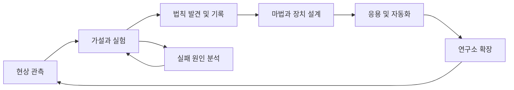
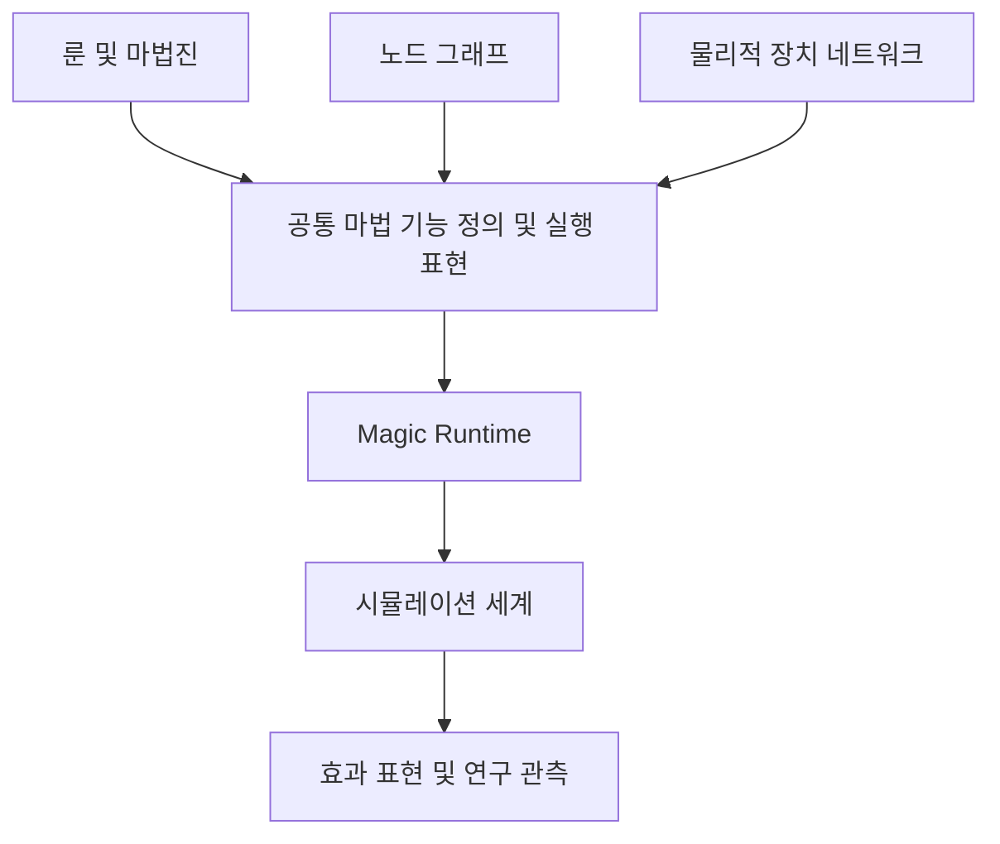
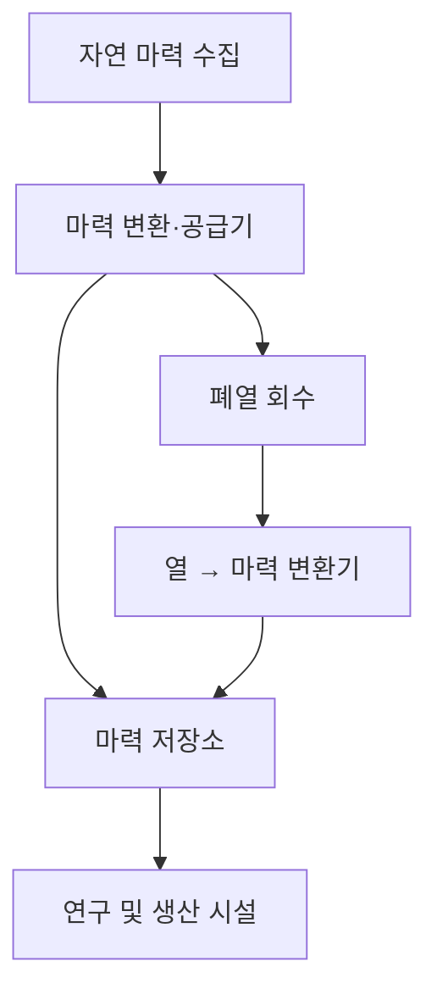
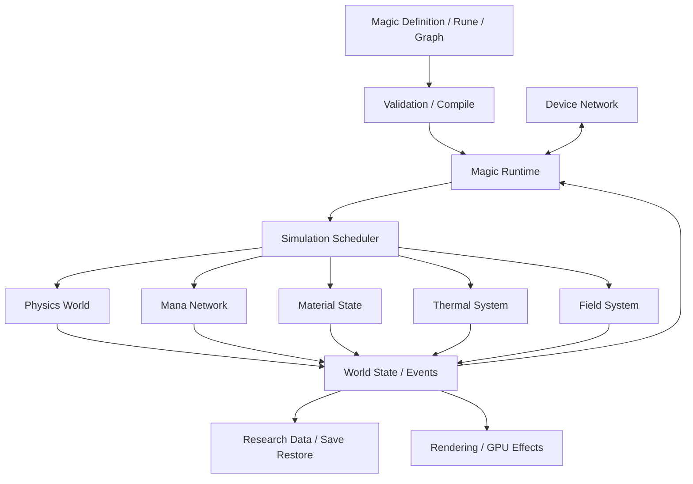

# 마법 연구 시뮬레이터 — 게임 기획서

> 마법을 배우지 말고, 마법을 발견하라.

- **가제:** Arcane Genesis / 마법 연구소
- **문서 버전:** v0.2
- **작성일:** 2026-11-27
- **문서 상태:** 초기 상세 기획 (핵심 방향 확정, 세부 수치 및 구현 방식 검토 필요)
- **개발 엔진:** BamEngine
- **장르:** 3D 물리 샌드박스 / 연구 시뮬레이션 / 마법 공학 / 산업 자동화

---

## 1. 게임 개요

마법을 정해진 기술로 습득하는 대신, 자연현상으로 관찰하고 연구하여 새로운 마법을 직접 만들어 내는 게임이다. 마력은 현실의 역학, 열, 전기, 빛, 물질과 상호작용하는 독자적인 물리적 요소다. 플레이어는 일관된 법칙을 발견하고, 이를 조합해 마법과 장치를 발명하며, 연구 성과를 생산 및 자동화에 활용한다.

작은 연구실에서 시작하여 대규모 마법 산업 시설로 발전한다. 최종적으로는 특정 공간의 마법 및 물리 법칙을 변경하는 고차원 연구에 도달할 수 있다.

### 1.1 확정된 기획 방향

| 항목 | 채택 내용 |
|---|---|
| 마법 설계 | 룬·마법진, 노드 그래프, 물리적 장치 세 방식 모두 지원 |
| 마법 법칙 | 현실 물리 법칙과 독자적인 판타지 법칙의 결합 |
| 플레이 방식 | 캐릭터 직접 조작과 연구용 자유 시점 전환 |
| 연구 자유도 | 법칙 발견 → 구성 요소 조합 → 법칙 재구성의 단계적 확장 |
| 게임 구조 | 연구실 중심의 샌드박스 및 마법 산업·자동화 |

### 1.2 핵심 디자인 원칙

1. **마법을 구현하는 대신 마법이 발생하는 법칙을 구현한다.** 파이어볼, 방벽, 비행 등은 기초 기능을 조합한 결과물이다.
2. 같은 조건에서 가능한 한 같은 결과를 얻을 수 있어야 한다. 실패의 원인을 관찰하고 재현할 수 있도록 한다.
3. 연구의 성장은 캐릭터 레벨보다 플레이어의 지식, 장비, 설계 능력에 기반한다.
4. 연구, 제작, 산업은 공통 시뮬레이션을 사용한다. 수동 실험을 기계화하고 자동화할 수 있어야 한다.
5. 물리적으로 정밀한 재현보다 직관적이고 일관되며 재미있는 상호작용을 우선한다.
6. 실패는 새로운 발견으로 이어질 수 있어야 하며 반복 실험의 부담은 작아야 한다.

### 1.3 목표와 범위

- 단기: 마력의 기본 성질을 이해하고 유용한 마법을 설계한다.
- 중기: 연구소를 확장하고 에너지 공급, 가공, 물류, 실험을 자동화한다.
- 장기: 고출력 마법, 복합 마법 구조, 지역별 법칙 변경을 연구한다.
- 탐험 및 전투는 새로운 연구 재료를 확보하고 연구 결과를 응용하는 확장 콘텐츠로 제안한다. 오픈월드나 전투 중심 RPG는 확정 범위가 아니다.

---

## 2. 핵심 게임플레이 순환



예를 들어 마력을 공급하면 발열하는 광물을 발견한다. 입력량에 따른 발열과 포화 특성을 측정하고 냉각 장치를 설계한다. 안정화된 장치를 열원으로 활용하거나 폐열을 회수한다. 연구 시설의 공급 능력이 개선되면 이전에는 시도할 수 없었던 고출력 실험에 도전한다.

이렇게 연구 결과가 다시 연구 능력을 향상시키는 순환을 만든다.

---

## 3. 마법 물리학

### 3.1 현실 물리 법칙

| 분야 | 시뮬레이션 대상 |
|---|---|
| 역학 | 질량, 힘, 속도, 관성, 충돌, 토크 |
| 중력 | 낙하, 인력, 방향과 크기가 다른 힘 필드 |
| 열역학 | 온도, 열전달, 발열, 냉각, 에너지 변환 |
| 유체역학 | 액체, 기체, 압력, 흐름 |
| 전자기학 | 전기, 전도성, 자기장 |
| 광학 | 빛, 반사, 굴절, 집광 |
| 재료역학 | 강도, 탄성, 파괴 |
| 물질 변화 | 고체·액체·기체, 연소, 결합 및 분리 |

초기에는 강체 물리, 물질별 스칼라 상태, 단순 열전달, 힘 필드를 사용한다. 유체, 전자기장, 파괴 등은 연구 및 성능 검증 후 확장한다.

### 3.2 독자적인 마법 법칙

| 법칙 | 개념 |
|---|---|
| 마력 수지 | 생성·저장·전달·변환·손실을 추적하는 규칙 |
| 마력 밀도 | 일정 영역 내 응집된 마력량 |
| 마력 전도성 | 재료별 전달 효율과 처리 가능한 유량 |
| 마력 저항 | 전달 중 발생하는 손실과 발열 |
| 마력장 | 공간적으로 분포해 물질이나 다른 마법에 영향을 주는 상태 |
| 극성 | 마력 사이의 인력, 척력 및 상쇄 |
| 공명 | 특정 주파수·위상 조건에서 발생하는 증폭 |
| 간섭 | 마력장 중첩 시 나타나는 보강·상쇄 및 불안정성 |
| 안정성 | 마법 구조가 형태와 동작을 유지하는 능력 |
| 포화 | 물질 또는 공간이 수용하거나 전달할 수 있는 마력의 한계 |
| 각인 | 물질에 마법 작동 구조를 기록하는 현상 |
| 위상 | 마력의 진동 상태 및 상호 관계 |

마력은 입자, 장, 전달 가능한 에너지라는 관점으로 표현될 수 있다. 다만 이 세 가지를 실제로 모두 시뮬레이션할지는 마력 물리학 상세 설계에서 결정한다. 초기에는 장치 네트워크의 에너지 수지와 공간 영향 필드를 분리해 구현하는 것을 권장한다.

### 3.3 에너지 변환

마력과 열·운동·전기·빛·화학·위치에너지 사이의 변환을 연구할 수 있다. 변환 효율, 장치 용량, 매개체, 환경 조건에 따라 결과가 달라진다.

초기 모델 제안:

```text
입력 에너지 = 유효 출력 + 손실 + 저장량 변화
변환 출력 = 실제 투입 에너지 × 변환 효율
실제 투입 에너지 = min(공급 가능량, 장치 처리 용량, 요청량)
```

기본 법칙에서는 에너지 회수와 증폭을 반복해 외부 입력 없이 순이득을 얻지 않도록 한다. 공명은 에너지 집중 또는 공급된 에너지의 효율적 전달로 모델링할 수 있다. 고차원 법칙 변경도 별도의 비용, 유지 조건, 적용 범위를 가진다.

마력 단위, 시간 단위, 변환 계수, 밀도 및 안정성 수식은 미확정이며 프로토타입에서 조정한다.

---

## 4. 마법 설계 시스템

세 가지 설계 방식은 동일한 기초 기능과 마력 규칙을 공유하되, 공간적 배치, 물리적 규모, 조작 방식에서 차이를 가진다.

### 4.1 룬 및 마법진

플레이어가 기하학적 구조를 만들고 룬을 배치해 마법을 설계한다.

| 설계 요소 | 기능적 의미의 예시 |
|---|---|
| 룬 종류 | 마력 공급, 변환, 형상, 힘, 감지 등 |
| 위치와 방향 | 영향 영역, 흐름과 힘의 방향 |
| 크기 | 처리 용량과 영향 범위 |
| 간격 | 전달 손실 및 지연 |
| 연결 | 데이터·제어·마력 전달 경로 |
| 대칭 | 안정성 및 힘의 균형 |
| 중첩 | 복합 마법 구성 |
| 순환 | 반복, 피드백, 지속 동작 |

- 종이, 지팡이, 바닥, 벽, 장치 표면에 각인한다.
- 공중에 임시 마법진을 형성하는 직접 시전 방식도 지원 대상으로 둔다.
- 기본 도형, 스냅, 정렬, 회전, 확대, 복사, 그룹화를 제공한다.
- 룬 연결 오류, 공급 부족, 잘못된 방향 등을 시각적으로 확인할 수 있어야 한다.
- 기하학적 규칙은 예측 가능해야 한다. 자유로운 드로잉 인식은 별도의 확장 기능으로 검토한다.

### 4.2 노드 그래프

복잡한 실행 조건, 수치, 연산 및 제어를 편집하는 정밀 설계 도구다.


- 타입이 있는 입출력 포트(에너지, 숫자, 벡터, 대상, 이벤트 등).
- 노드별 파라미터 및 실행 상태 확인.
- 분기, 비교, 지연, 반복, 상태 저장, 피드백 제어.
- 사용자 정의 서브그래프, 재사용 가능한 마법 모듈, 파라미터 노출.
- 연결 검증, 실행 순서 확인, 오류 위치 표시 및 디버그 관측.
- 실행 중 편집은 안전한 틱 경계에서 반영하거나 재시작한다.
- 즉시 순환은 제한하고 상태 저장·지연 노드를 이용하는 피드백은 허용한다.

### 4.3 물리적 장치

실제 연구실 공간에 장비를 배치하고 물리적 연결을 구축한다.

```text
마력 수집기 → 저장 장치 → 열 변환기 → 가공 시설
                    ↑           │
                    └─ 폐열 회수 ┘
```

- 장치 배치, 이동, 회전, 연결, 확장, 해체.
- 마력 관로, 전도체, 제어 신호, 재료 운반 경로.
- 장치별 공간 점유, 처리량, 내구도, 발열, 손실, 저장 한계.
- 룬 또는 사용자 정의 그래프를 장치의 제어 회로로 사용한다.
- 대형 산업 시설은 공간과 장치 처리량의 제약을 가진다. 작은 마법진 하나가 모든 산업 시설을 대체하지 않도록 설계한다.

### 4.4 통합 설계 구조



세 방식의 기능과 데이터 타입을 공유하되, 룬의 기하학적 배치와 장치의 물리적 특성을 별도 메타데이터로 유지한다. 완전한 양방향 변환을 요구하지 않는다. 물리 장치 네트워크는 전용 네트워크 솔버가 담당하고 공통 마법 실행기와 연동하는 구조가 적합하다.

### 4.5 마법의 최소 구성 단위

| 분류 | 구성 요소 예시 |
|---|---|
| 생성 | 마력 공급, 방출, 물질 생성(후반) |
| 변환 | 열, 냉각, 전기, 빛, 운동 |
| 형태 | 점, 선, 평면, 구체, 박스, 곡면 |
| 공간 | 이동, 회전, 크기 변경, 영역 지정 |
| 역학 | 인력, 척력, 토크, 중력 변화 |
| 물질 | 결합, 분리, 경화, 연화 |
| 제어 | 응집, 압축, 분산, 증폭, 감쇠 |
| 저장 | 마력 저장, 충전, 상태 유지 |
| 감지 | 충돌, 거리, 온도, 마력, 속도 |
| 논리 | 비교, 분기, 반복, 지연 |
| 전달 | 연결, 분배, 합류, 방향 전환 |
| 고차원 | 공간 연결, 위상 변경, 지역별 법칙 수정 |

### 4.6 응용 마법 예시

| 결과물 | 조합 예시 |
|---|---|
| 파이어볼 | 마력 공급 + 열 변환 + 구체 응집 + 이동 + 충돌 시 방출 |
| 화염 방벽 | 열 변환 + 평면 영역 + 지속 공급 |
| 충격 반사 방벽 | 평면 + 경화 + 충돌 감지 + 운동에너지 반사 |
| 완충 장치 | 형상 + 탄성 + 충격 감지 + 감쇠 |
| 부유 장치 | 마력 공급 + 수직 힘 + 높이 감지 + 피드백 제어 |
| 자동 온도 조절기 | 온도 감지 + 비교 + 가열·냉각 + 반복 |
| 마법 추진 장치 | 방향 지정 + 운동 변환 + 출력 조절 |

이 결과물은 별도의 완성 스킬로 하드코딩하는 것이 아니라 공통 기능 조합으로 생성하는 것이 목표다.

---

## 5. 연구 및 발견

### 5.1 연구의 세 단계

| 단계 | 역할 | 내용 |
|---|---|---|
| 1. 법칙 발견 | 마법 연구자 | 이미 존재하는 성질을 관측·측정·검증 |
| 2. 법칙 조합 | 마법 공학자 | 발견한 성질과 기능을 조합해 마법 및 장치 발명 |
| 3. 법칙 재구성 | 고차원 마법사 | 제한된 영역에서 물리·마법 법칙을 변경 |

단계는 연구 범위의 확장을 나타낸다. 모든 플레이어에게 동일한 연구 순서를 강제하지 않는다.

### 5.2 연구 진행 방식

1. 미지의 물질 또는 마법 현상 관찰.
2. 실험 재료, 변수, 장치 및 측정 조건 선택.
3. 실험 실행 및 결과 관측.
4. 다른 조건에서 반복하여 비교.
5. 연구 기록에 물질 특성, 법칙, 사용 가능한 기능을 등록.
6. 마법 및 장치 설계에 응용.

연구 포인트를 단순 소비하는 방식은 최소화한다. 필요한 증거를 수집하면 연구 기록과 관련 도구가 확장되도록 한다. 실제 논문 작성이나 수작업 표 정리를 강제하지 않는다.

플레이어가 이미 알고 있는 법칙을 새로운 저장 파일에서 어떻게 처리할지는 별도 검토한다. 지식 해금이 실험을 방해하는 강제 잠금이 되지 않도록 한다.

### 5.3 실험 예시 — 마력 전도성

구리, 철, 마력 수정에 같은 입력을 공급해 출력량과 발열을 비교한다.

| 입력 마력 | 구리 출력 | 철 출력 | 수정 출력 |
|---:|---:|---:|---:|
| 20 | 12 | 8 | 19 |
| 40 | 24 | 16 | 38 |
| 60 | 36 | 24 | 57 |
| 80 | 48 | 32 | 63 |
| 100 | 60 | 40 | 40 |

※ 기획 설명용 가상 데이터. 수정의 고입력 출력 감소는 포화 이후 과부하로 효율이 저하되는 예시다. 실제 수식 및 수치는 미확정이다.

저출력 회로에서는 수정이 유리하지만 높은 출력에서는 구리가 더 안정적일 수 있다. 재료에 일률적인 희귀도 우위를 부여하지 않는다.

### 5.4 연구 기록 및 실험 도구

- 실험 설정, 재료, 마법 정의 버전, 입력값, 환경 조건, 시간별 측정값, 성공·실패 원인 자동 기록.
- 동일 조건 재실행, 변수 변경, 실험 결과 그래프 비교.
- 장치 및 마법 인스턴스의 에너지 수지, 내부 상태, 오류 확인.
- 고급 장비를 이용한 변수 자동 탐색, 반복 측정, 임계값 감지.
- 설계한 마법에 이름을 붙이고 마법서·설계도에 등록하여 재사용.
- 일시정지, 저속·고속 실행, 틱 단위 진행, 실험 구역 저장 및 복원.

완벽한 플랫폼 간 물리 결정성은 전제하지 않는다. 동일 조건에서 게임플레이상 충분히 일관된 결과를 얻는 것을 목표로 하며, 필요한 경우 허용 오차를 정의한다.

---

## 6. 플레이 방식 및 연구실

### 6.1 시점과 조작

| 기능 | 직접 조작 모드 | 연구·건설 모드 |
|---|---|---|
| 캐릭터 이동 | 가능 | 자유 카메라 이동 |
| 마법 시전 | 직접 시전 | 시험 실행 |
| 물체·장비 조작 | 직접 상호작용 | 정밀 배치 및 일괄 편집 |
| 룬·그래프 편집 | 가능 | 가능 |
| 마력장 관측 | 가능 | 상세 관측 및 데이터 분석 |
| 시간 제어 | 제한적 또는 선택적 | 일시정지, 시간 배율, 틱 진행 |
| 자동화 시설 설계 | 제한적 | 주요 설계 방식 |

직접 조작은 WASD 및 마우스 기반을 제안한다. 1인칭과 3인칭 중 기본 시점은 미확정이다. 두 모드는 동일한 월드 상태를 공유한다.

### 6.2 연구소 성장

- **초기:** 책상, 소형 마력 발생기, 저장 장치, 간단한 실험 공간.
- **중기:** 전용 연구실, 격리 실험 챔버, 마력 공급망, 재료 가공 및 자동 제어.
- **후기:** 대규모 발전 시설, 자동 생산 및 물류, 고출력 실험 구역, 복합 연구 설비.
- **고차원:** 부유 연구소, 특수 법칙 구역, 공간 확장 시설 등.

연구소의 구역과 건물 배치는 플레이어가 설계한다. 연구소 확장 비용과 자원 획득 방식은 세부 경제 기획에서 확정한다.

### 6.3 연구 장비

| 장비 | 기능 |
|---|---|
| 마력 발생기·수집기 | 외부 에너지원에서 마력 공급 |
| 마력 저장 장치 | 충전, 방출, 포화 및 용량 관리 |
| 마력 측정기 | 유량, 밀도, 소비량, 손실 관측 |
| 물질 분석기 | 물리적·마법적 특성 분석 |
| 마법진 설계대 | 룬 작성, 연결 및 시험 |
| 실험 챔버 | 위험 현상 격리 및 실험 초기화 |
| 마력 안정화 장치 | 흐름, 응집, 변환 상태 제어 |
| 마법 관측기 | 필드, 온도, 힘 및 내부 상태 시각화 |
| 시험용 골렘·표적 | 힘, 충격, 방어 효과 검증 |
| 자동 기록기 | 측정 및 결과 비교 |
| 자동 실험기 | 변수 순회와 반복 실험 |

---

## 7. 물질 및 재료

물질은 렌더링용 재질(Material)과 별도로 물리적·마법적 성질을 가지며, 필요한 경우 물체 인스턴스의 상태를 추적한다.

| 속성 | 활용 |
|---|---|
| 질량·밀도 | 역학 및 부유 장치 |
| 강도·탄성 | 구조물, 방벽, 충격 흡수 |
| 열용량·열전도성 | 가열, 냉각, 열교환 |
| 전기 전도성 | 전기 마법 및 장치 |
| 마력 전도성·최대 유량 | 공급망 및 회로 |
| 마력 저장 한계 | 축전기 및 결정 |
| 마력 저항·내성 | 마력 차단과 격리 |
| 상변화·반응 조건 | 물질 가공과 변환 |
| 고유 마법 반응 | 특수 광물 및 신규 연구 |

### 7.1 재료 예시

| 재료 | 장점 | 단점 및 특성 |
|---|---|---|
| 구리 | 범용 전기·마력 전달 | 수정 대비 저출력 효율 낮음 |
| 철 | 구조물 및 강도 | 마력 전달 효율 낮음 |
| 마력 수정 | 마력 저장과 저출력 전달 | 취약하고 포화·과부하 가능 |
| 흑요석 | 마력 차단 및 격리 | 전달에 부적합 |
| 부유석 | 마력에 반응하는 유효 중력 | 출력 및 안정성 제어 필요 |

※ 위 특성은 게임 밸런스용 제안이며 실제 물질의 모든 물리적 특성을 의미하지 않는다.

후반에는 합금, 인공 결정, 복합 소재, 룬 각인 소재 등을 연구해 제조한다.

---

## 8. 마법 산업과 자동화

수동으로 수행하던 마법과 실험을 장치화하고 규모를 확장하는 것이 산업 콘텐츠의 핵심이다.

### 8.1 발전 단계

| 단계 | 내용 |
|---|---|
| 수동 연구 | 직접 마력을 공급하고 물질 변환 |
| 기계화 | 발생기, 저장고, 변환기 연결 |
| 자동화 | 센서, 조건, 피드백 회로로 자동 제어 |
| 산업화 | 공급망, 대규모 생산, 재료 운반 |
| 고차원 산업 | 특수 법칙이 적용된 산업 구역 |

### 8.2 시설 구성

| 분류 | 장치 예시 |
|---|---|
| 발전 | 자연 마력 수집기, 열·운동 에너지 변환기 |
| 전달 | 관로, 전도체, 무선 마력 전송기 |
| 저장 | 축전기, 압축 마력 저장소 |
| 가공 | 마법 용광로, 물질 변환기, 결정 성장기 |
| 제어 | 밸브, 분배기, 안정화 장치, 제어 그래프 |
| 감시 | 온도, 압력, 마력, 유량 센서 |
| 물류 | 운반 골렘, 중력 컨베이어, 공간 전송 장치 |
| 안전 | 비상 차단기, 냉각 장치, 방호 결계 |
| 연구 | 자동 실험기, 재료 분석기, 기록 장치 |

### 8.3 자동화 예시 — 폐열 회수



폐열 일부를 회수하여 전체 효율을 높인다. 변환 손실 때문에 외부 공급 없는 영구기관이 되지 않는다.

### 8.4 제어 및 생산 설계

- 장치의 입력·출력 포트, 최대 처리량, 재고와 저장량 표시.
- 에너지 공급 우선순위, 부하 분산, 비상 차단.
- 임계값 조건, 지연, 상태 변화, 사용자 정의 제어 회로.
- 장치 연결 실패, 공급 부족, 과열, 병목 등의 원인 관측.
- 자동화 설계도 복사, 재사용, 확장.
- 재료 흐름은 초기에는 인벤토리 또는 포트 간 논리적 운송부터 시작하고 물리적 운반체로 확장한다.

---

## 9. 실패와 안전 설계

| 실패 현상 | 원인 | 활용 가능성 |
|---|---|---|
| 마력 폭주 | 처리 용량을 초과하는 공급 | 에너지 방출 연구 |
| 마법 붕괴 | 응집력 부족, 공급 중단 | 안정화 구조 연구 |
| 과열 | 발열 누적, 냉각 부족 | 냉각·폐열 회수 연구 |
| 공명 폭주 | 불안정한 피드백 | 제어 및 증폭 연구 |
| 마력 누출 | 연결 불량, 전도 손실 | 차폐·전도체 연구 |
| 역류 | 전달 경로 불균형 | 밸브 및 분배 연구 |
| 결정 파괴 | 저장 한계 초과 | 고용량 저장 연구 |
| 공간 불안정 | 상충하는 영역 법칙 | 고차원 안정화 연구 |
| 연쇄 고장 | 공급망의 장애 전파 | 산업 안전 설계 |

실패는 무작위 확률보다 관찰 가능한 상태 및 규칙에 의해 발생하도록 한다. 격리 챔버, 경고 표시, 실험 복원 기능을 제공한다. 연구실 전체를 잃는 상황이 반복되는 방식은 지양한다.

---

## 10. 고차원 마법 및 응용

### 10.1 법칙 재구성

고차원 마법은 물체 하나에 직접 효과를 주는 것에서 나아가 공간 영역의 규칙을 수정한다.

| 기본 마법 | 고차원 확장 |
|---|---|
| 물체를 들어 올림 | 지역의 중력 방향·크기 변경 |
| 물체를 가열 | 지역 또는 물질의 열전달 성질 변경 |
| 마력 지속 공급 | 지역의 마력 전달 손실 특성 변경 |
| 속도 감소 | 제한된 영역의 시간 흐름 조절 |
| 방벽 생성 | 영역 내 물질 강도 수정 |
| 이동 | 공간 연결 및 포털 |

영역의 우선순위, 중첩 규칙, 유지 비용, 해제 후 복원 규칙을 정의해야 한다. 지역별 시간은 물리 엔진 경계 충돌과 상태 동기화 문제 때문에 별도 기술 검증이 필요하다. 초기에는 개별 시스템의 국소적인 시간 배율이나 제한된 격리 구역부터 검토한다.

### 10.2 응용 분야

- 이동: 부유, 비행, 공중 발판, 고속 이동, 공간 이동.
- 전투 및 방호: 투사체, 결계, 흡수, 반사, 인력·척력.
- 환경: 온도, 흐름, 물질 상태 변경, 제한적 지형 조작.
- 제작: 경화, 연화, 결합, 분리, 재료 합성.
- 인공 생명: 사용자 정의 행동과 제어 회로를 가진 골렘 등.

각 응용 분야는 연구 시스템의 결과로 제공한다. 전투 콘텐츠의 상세 규모는 미확정이다.

---

## 11. 그래픽 및 UX

### 11.1 그래픽 방향 제안

- 단순하고 정돈된 스타일라이즈드 3D 환경과 화려한 절차적 마법 효과의 대비.
- 마력의 밀도, 방향, 흐름, 불안정성을 색, 밝기, 형상, 움직임으로 구분.
- 룬 및 마법진의 기하학적 선과 연결 상태를 명확하게 표현.
- 일반 모드에서는 판타지적인 효과를, 관측 모드에서는 분석용 시각화를 제공.
- 색상에만 의존하지 않고 선의 종류, 화살표, 아이콘, 수치, 패턴을 함께 사용한다.

### 11.2 관측 모드

| 관측 항목 | 표현 방식 |
|---|---|
| 마력 유량 | 흐르는 파티클, 선, 방향 화살표 |
| 마력 밀도 | 볼륨, 등밀도면, 히트맵 |
| 온도 | 표면 히트맵 및 시간 그래프 |
| 힘 | 벡터 필드, 궤적 |
| 연결 상태 | 관로 및 회로 강조, 손실 수치 |
| 공명과 위상 | 파형, 간섭 패턴 |
| 공간 왜곡 | 변형된 격자 및 영역 경계 |
| 안정성 | 경고, 변동성 그래프, 변화 지점 표시 |

### 11.3 편집 및 관측 UX

- 연구 시점의 선택, 다중 선택, 스냅, 기즈모, 복제, 실행 취소·재실행.
- 장치 및 노드의 툴팁, 단위 표시, 현재 상태와 최대 용량 비교.
- 실험 결과의 시간 그래프, 비교, 정지 및 단계별 관측.
- 룬, 노드, 장치의 오류를 공통된 원인 및 위치와 연결.
- 자주 사용하는 마법과 장치를 프리셋으로 저장.
- 게임 플레이 UI와 개발자용 엔진 에디터는 구분하되 그래프, 기즈모, 직렬화 기반 모듈은 가능하면 재사용한다.

---

## 12. BamEngine 기술 요구사항

> **검증 범위:** 이 문서는 현재 대화에서 알려진 BamEngine의 C++ 기반 엔진, DirectX 12/SDL GPU RHI 개발 방향과 기존 렌더링·컴퓨트 셰이더 경험을 참고하였다. 최신 Git 소스코드를 직접 조사하지 않았다. 아래 항목은 필요한 기능 및 제안 우선순위이며, 현재 엔진에 없다는 판정이 아니다. 구현 여부, 완성도, 재사용 가능성은 별도의 코드 감사가 필요하다.

### 12.1 우선순위

- **P0:** 핵심 프로토타입 검증에 필요한 기능.
- **P1:** 연구 및 산업 기본 플레이를 완성하는 기능.
- **P2:** 시뮬레이션 깊이와 표현 확장.
- **P3:** 고차원 및 고난도 확장 기능.

| 시스템 | 우선순위 | 활용 목적 |
|---|:---:|---|
| 범용 노드 그래프 및 런타임 편집기 | P0 | 마법 논리 설계 |
| 그래프 검증 및 실행기/VM | P0 | 상태·이벤트·실행 관리 |
| 마력 공급·저장·전달 기본 모델 | P0 | 에너지 수지 및 변환 |
| 물질 속성 및 인스턴스 상태 | P0 | 재료 반응 |
| Fixed Tick 및 시뮬레이션 스케줄러 | P0 | 반복 가능 실험 |
| 물리 힘 필드·Overlap Query | P0 | 인력, 척력, 중력 효과 |
| 간단한 열 상태 및 변환 | P0 | 열 마법과 측정 |
| 데이터 관측 및 디버그 렌더링 | P0 | 실험 결과 확인 |
| 실험 상태 저장·복원 | P0 | 반복 및 실패 복구 |
| 런타임 선택·배치·자유 카메라 | P0 | 기본 직접 조작과 연구 모드 |
| 마법 정의 에셋 및 버전 관리 | P0 | 저장·재실행·재사용 |
| 룬 및 마법진 편집기 | P1 | 기하학적 설계 |
| 절차적 메시 및 SDF | P1 | 마법 형상과 공간 영역 |
| GPU 파티클·리본·볼륨 효과 | P1 | 마력 흐름 및 효과 표현 |
| 열전달 모델 | P1 | 열교환, 과열, 냉각 |
| 장치 네트워크 및 센서 제어 | P1 | 산업 자동화 |
| 런타임 건설 및 물류 | P1 | 연구소 확장 |
| 서브그래프 및 설계도 | P1 | 모듈화 및 재사용 |
| 공간 분할 및 필드 가속 | P1 | 많은 영향 영역 처리 |
| 파괴·변형 및 물질 상태 변화 | P2 | 실패 및 물질 연구 |
| GPU 필드 시뮬레이션 | P2 | 대규모 마력장 |
| 유체·전기·공명 모델 | P2 | 복합 현상 |
| 포털 및 공간 왜곡 | P3 | 공간 마법 |
| 지역별 법칙 오버라이드 | P3 | 고차원 마법 |
| 지역별 시간 처리 | P3 | 시간 마법 |

### 12.2 권장 구조



개별 솔버가 공통된 상태 및 이벤트를 교환하는 구조를 권장한다. 마법 런타임이 물리 엔진, 열 솔버, 네트워크 내부 구현을 직접 소유하지 않도록 한다.

### 12.3 시스템 경계

| 엔진 공통 기능 | 게임 전용 기능 |
|---|---|
| 그래프 데이터·편집·타입 검증 기반 | 마법 노드 정의 및 룬 문법 |
| 틱 스케줄링 및 이벤트 전달 | 마력 법칙과 에너지 변환 수식 |
| 물리 Query, 힘 적용, 공간 영역 | 부유석·마력 수정 등의 반응 |
| 물질 상태 및 필드 시각화 기반 | 연구 진행, 마법서, 발견 조건 |
| 직렬화, 스냅샷, Undo/Redo | 실험 챔버 및 실험 기록 정책 |
| 런타임 배치 및 기즈모 | 연구소, 마법 장치, 자동화 레시피 |
| RHI, Compute, 파티클 기반 | 게임 전용 마법 이펙트 |

범용 엔진 기능과 게임 규칙을 분리하여 BamEngine이 다른 게임에도 재사용될 수 있도록 한다.

### 12.4 고정 틱 및 상태 교환 제안

```text
1. 입력 및 설계 변경 명령 수집
2. 이전 상태 기반 센서 읽기 / 이벤트 소비
3. 마법 그래프 및 장치 제어 평가
4. 마력 네트워크 수지 및 실제 공급량 결정
5. 변환·열·물질·힘 명령 확정
6. 물리 및 개별 시뮬레이션 진행
7. 상태 확정, 이벤트 생성, 관측 데이터 수집
8. 렌더링용 상태 전달
```

솔버 간 순서와 피드백 지연을 명시한다. 즉시 반복되는 순환 의존성은 제한하고 필요한 경우 별도 제한된 반복 솔버를 사용한다. 실제 업데이트 순서는 기존 엔진 루프와 물리 SDK 연동을 조사한 후 결정한다.

### 12.5 CPU/GPU 분담 및 성능

- CPU: 게임 상태, 그래프 평가, 물리 연동, 장치 네트워크, 에너지 수지, 저장 및 이벤트.
- GPU: 파티클, 볼륨 렌더링, 대규모 시각화, 향후 공간 필드 계산.
- 초기에는 CPU 권위 상태와 GPU 표현을 분리한다. GPU 시각 효과의 결과를 매 프레임 동기 읽기하지 않는다.
- GPU 필드를 실제 게임 로직에 사용할 때는 비동기 읽기와 지연 정책, 백엔드별 Compute 기능을 검증한다.
- 공간 분할, 활성 영역, 휴면 장치, 변경된 네트워크 부분 갱신, 시뮬레이션 LOD를 단계적으로 검토한다.
- 그래프 실행량, 물리 Query 수, 네트워크 갱신 비용, GPU 메모리 및 프레임 타임을 프로파일링한다.
- 그래프 무한 반복, NaN/Inf, 과도한 필드 중첩을 방지할 실행 한도 및 유효성 검증이 필요하다.

### 12.6 데이터 구조 제안

| 데이터 | 책임 |
|---|---|
| MagicDefinition | 마법 그래프·룬·공통 기능과 파라미터 |
| MagicInstance | 실행 상태, 대상, 위치, 마력 사용량, 지속 시간 |
| RuneLayout | 기하학적 배치, 방향, 연결, 매개체 |
| MaterialDefinition | 재료의 기본 물리·마법적 속성 |
| MaterialState | 온도, 저장 마력, 손상 등 개별 상태 |
| DeviceDefinition / Instance | 포트, 용량, 처리 기능 및 실행 상태 |
| ManaNetwork | 에너지 공급·저장·전달 연결 구조 |
| FieldDefinition / Instance | 영역, 방향, 강도, 중첩 규칙 |
| ExperimentSnapshot | 실험 복원에 필요한 상태와 정의 버전 |
| ResearchRecord | 실험 설정, 측정값, 발견 정보 |

이름과 구조는 제안이며 BamEngine의 기존 ECS, 컴포넌트, 리플렉션, 에셋 및 직렬화 구조에 맞춰 변경한다.

### 12.7 실제 코드 감사 시 확인할 항목

- 기존 물리 시스템의 힘 적용, Trigger/Overlap, 공간 Query, Fixed Update 인터페이스.
- RHI 양 백엔드의 Compute, UAV/Storage Buffer, 3D Texture, 리소스 동기화 지원.
- 기존 노드 그래프, 리플렉션, 에셋 저장, 프리팹, 직렬화의 재사용 범위.
- 런타임 및 엔진 에디터의 UI 분리, 뷰포트, 기즈모, 선택 및 명령 시스템.
- 파티클, 절차적 메시, 디버그 렌더링, 볼류메트릭 렌더링 지원 수준.
- 월드 및 실험 단위 상태 저장·복원 가능성.
- 각 기능의 테스트, 성능 한계 및 백엔드 호환성.

---

## 13. 개발 로드맵

세 가지 설계 방식은 최종 목표에 포함되지만, 최초 구현에서는 노드 그래프를 기준으로 공통 실행 구조를 검증하고 룬과 물리 장치를 추가한다.

### Phase 1. 마법 샌드박스 (핵심 MVP)

- [ ] 마력 공급·저장·전달과 기본 에너지 수지.
- [ ] 기본 마법 노드 약 10~15종 및 타입 검사.
- [ ] 열 변환, 인력, 척력, 기본 영향 영역.
- [ ] 노드 그래프 편집기 및 실행 상태 표시.
- [ ] 직접 조작과 기본 자유 카메라 전환.
- [ ] 물리 오브젝트 상호작용, 기본 물질 상태.
- [ ] 간단한 실험 측정 기록 및 초기화.
- [ ] 기본 마법 설계 저장 및 재실행.

**완료 기준:** 공급량과 힘, 열을 변경해 결과 차이를 관측하고 동일 실험을 재실행할 수 있다. 최소 세 가지 서로 다른 마법이 공통 노드의 조합으로 구현된다.

### Phase 2. 연구 시뮬레이터

- [ ] 물질별 마법 전도, 저장, 포화 및 반응 특성.
- [ ] 마력장, 열 분포, 힘 벡터 시각화.
- [ ] 실험 그래프 비교 및 상세 기록.
- [ ] 룬 및 마법진 설계와 공통 실행 구조 연동.
- [ ] 실험 챔버 스냅샷 및 단계별 실행.
- [ ] 연구 진행 및 마법서·발견 기록.

**완료 기준:** 재료 간 차이를 실험으로 발견하고, 룬 및 노드 방식으로 동일한 기본 기능을 활용할 수 있다. 실패 원인을 UI에서 확인할 수 있다.

### Phase 3. 마법 공학과 자동화

- [ ] 물리적 장치 배치와 연결.
- [ ] 마력 공급망, 저장량, 손실, 처리량 관리.
- [ ] 센서와 조건 기반 제어.
- [ ] 열전달·냉각·폐열 회수.
- [ ] 자동 생산 및 초기 물류.
- [ ] 연구소 확장 및 설계도 재사용.

**완료 기준:** 플레이어가 수동 실험을 물리 장치로 자동화하고 공급 부족, 과열, 병목을 관측하여 해결할 수 있다. 룬, 노드, 장치의 세 방식이 모두 실제 플레이에 사용된다.

### Phase 4. 고차원 마법 및 확장

- [ ] 복합 마력장, 공명 및 간섭.
- [ ] 지역별 마법·물리 법칙 변경.
- [ ] 고급 물질 변환, 유체·전기 모델.
- [ ] 공간 연결 및 왜곡.
- [ ] 대규모 산업·자동 연구 최적화.
- [ ] 지역별 시간 처리 기술 검증 및 가능한 범위 구현.

**완료 기준:** 제한된 영역의 법칙을 수정하고 기존 연구 및 산업 시스템과 상호작용시킬 수 있다. 중첩, 저장·복원, 해제 시 상태 일관성을 검증한다.

### 13.1 최초 수직 슬라이스 제안

작은 실험실 한 곳에서 다음 경험을 연속적으로 제공한다.

1. 마력 수정과 구리를 각각 시험한다.
2. 공급량과 출력의 관계를 그래프로 확인한다.
3. 노드 조합으로 물체를 가열하거나 밀어낸다.
4. 높이 센서를 활용해 물체를 일정 높이에 유지한다.
5. 과부하 현상의 원인을 확인하고 공급량 또는 제어 구조를 변경한다.
6. 실험을 저장·복원하고 완성된 마법을 다른 실험에 재사용한다.

이 검증 이후 룬 편집기와 물리 장치 기반 자동화를 추가한다. 초기에는 오픈월드, 전투 AI, 대규모 유체, 지역별 시간, 정밀 전자기 시뮬레이션을 제외한다.

---

## 14. 주요 위험 요소와 대응

| 위험 | 대응 방향 |
|---|---|
| 물리 시스템의 범위 과대 | 스칼라 상태·강체·단순 필드부터 구축 |
| 세 가지 설계 방식의 중복 개발 | 공통 기능 정의, 실행 및 데이터 기반 재사용 |
| 그래프가 일반 프로그래밍만큼 복잡해짐 | 기본 템플릿, 프리셋, 점진적 기능 공개, 관측 UI |
| 마법 실패가 이해되지 않음 | 원인·용량·흐름·상태 변화 시각화 |
| 무한 에너지 순환 및 폭주 | 에너지 수지, 실행 한도, 공급 및 손실 규칙 |
| 연구가 단순 노가다로 변질 | 자동 기록, 변수 실험, 연구 성과의 즉각적인 응용 |
| 산업 시설의 규모와 성능 | 활성 네트워크, 공간 분할, 프로파일링, 시뮬레이션 LOD |
| 스냅샷 복원이 불완전함 | 그래프 상태, RNG, 네트워크, 물리 및 대기 이벤트의 저장 검증 |
| 고차원 법칙 중첩 및 시간 처리 | 제한된 영역부터 적용, 우선순위 및 경계 정책 검증 |
| 범용 엔진이 게임에 종속 | 마법 규칙은 게임 모듈로 분리 |

---

## 15. 후속 상세 기획 및 미확정 사항

| 우선순위 | 문서 주제 | 결정 사항 |
|---|---|---|
| 1 | 마력 물리학 | 단위, 수지, 생성, 변환, 저장, 장, 공명, 안정성 수식 |
| 2 | 마법 최소 단위 및 실행 구조 | 타입, 실행 순서, 상태, 수치 제한, 이벤트, 피드백 |
| 3 | 룬 문법 | 룬 모양, 기하학, 방향, 연결, 중첩, 오류 판정 |
| 4 | 물질 및 반응 | 재료 데이터, 상변화, 복합 소재, 마력 반응 |
| 5 | 연구 진행과 관측 | 해금 조건, 증거, 측정 오차, 기록, 사용자 학습 |
| 6 | 산업 및 자동화 | 네트워크 솔버, 저장, 물류, 생산, 제어 |
| 7 | 캐릭터 조작 | 1·3인칭 선택, 마력 보유량, 직접 시전, 입력 체계 |
| 8 | 세계관·경제 | 마력의 기원, 자원 획득, 연구소 확장 동기, 장기 목표 |
| 9 | 그래픽 상세 | 스타일, 효과 언어, 셰이더, 관측 시각화 |
| 10 | 고차원 마법 | 지역 법칙의 우선순위, 중첩, 비용, 시간 및 공간 기술 검증 |

**권장 다음 작업:** 마력 물리학과 마법 최소 구성 단위를 먼저 설계한다. 이 두 항목이 결정되어야 룬, 그래프, 장치, 물질, 연구 및 자동화가 동일한 규칙으로 동작할 수 있다.

---

## 16. 기획 상태 정리

### 확정

- 세 가지 마법 설계 방식 모두 지원.
- 현실 물리와 판타지 마법 법칙의 결합.
- 직접 조작과 연구용 시점 전환.
- 법칙 발견, 조합, 재구성의 단계적 연구 자유도.
- 연구실 중심 샌드박스 및 마법 산업·자동화.

### 현재 제안 또는 검증 필요

- 가제, 슬로건, 스타일라이즈드 3D 세부 아트 방향, 기본 시점과 입력 구성.
- 세부 연구 장비, 재료, 마법 노드 종류, 에너지 수식 및 밸런스.
- 탐험·전투 범위, 세계관, 자원 수급과 경제.
- 초기 노드 그래프 중심 MVP, CPU/GPU 분담, 세부 기술 우선순위.
- BamEngine 최신 코드 기반 실제 구현 상태 및 기능 중복 여부.

## 17. 결론

이 게임이 제공하려는 핵심 경험은 물리 샌드박스의 예상치 못한 상호작용, 마법을 조합하고 설계하는 공학적 재미, 발견한 기술을 대규모 산업으로 발전시키는 자동화의 재미다.

완성된 마법의 개수를 늘리는 것보다, 하나의 일관된 법칙 아래에서 새로운 현상과 사용법이 만들어지는 시스템을 우선한다.
