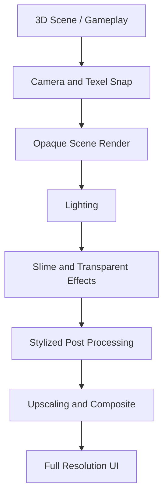

# 슬라임 게임 기획서 초안

| 항목 | 내용 |
| --- | --- |
| 문서 버전 | v0.1 |
| 작성일 | 2026-11-26 |
| 프로젝트명 | Slime Project (가칭) |
| 개발 엔진 | BamEngine |
| 문서 상태 | 초기 방향 설정 / 프로토타입 기획 |
| 그래픽 기반 | 실시간 3D |
| 게임 장르 | 미확정 |

> **핵심 콘셉트:** 평소에는 단순하고 귀여운 형태를 유지하지만, 움직이고 충돌하고 분열하는 순간에는 몰캉함, 질척임, 탄성, 밀도감이 살아나는 슬라임. 슬라임의 신체와 물질적 특성 자체가 그래픽의 정체성이자 게임플레이의 기반이 된다.

---

## 1. 기획 배경 및 목표

슬라임은 단순한 외형을 가지고 있으면서도 흡수, 분열, 합체, 변형 등 일반적인 캐릭터와 구별되는 행동이 가능한 소재이다. 이러한 특성을 활용하여 외형의 다양성이나 복잡한 캐릭터 애니메이션에 의존하기보다는, 하나의 기본 형태가 상황에 따라 역동적으로 변화하는 게임을 기획한다.

BamEngine을 활용하여 실시간 3D 기반으로 개발하며, 별도의 2D 스프라이트 제작을 필수 전제로 하지 않는다. 이후 필요에 따라 저해상도 렌더링을 적용해 픽셀 아트와 유사한 표현으로 발전시킬 수 있다.

초기 목표는 장르나 콘텐츠 규모를 확정하는 것이 아니라, **슬라임을 움직이고, 부딪치고, 분열시키고, 합체시키는 행위 자체가 시각적·조작적 즐거움을 제공하는지 검증하는 것**이다.

### 1.1 핵심 디자인 원칙

1. **단순한 기본형, 역동적인 반응:** 평상시의 외형은 정돈하고, 행동하는 순간에 표현력을 집중한다.
2. **몰캉하지만 탄탄한 신체:** 쉽게 변형되지만 스스로 형태를 유지하며, 움직임에 무게와 복원력이 느껴진다.
3. **질척이는 점액질:** 접촉하고 떨어지는 순간에 달라붙거나 늘어나는 성질을 표현한다.
4. **폭발적인 분열:** 내부 압력이 해방되는 것처럼 순간적으로 강하게 분리된다.
5. **스타일라이즈드 3D:** 실사적 유체 표현을 목표로 하지 않고, 캐릭터성과 가독성을 우선한다.
6. **행동이 곧 개성:** 복잡한 모델과 애니메이션보다 움직임과 물질 특성으로 슬라임의 개성을 표현한다.

### 1.2 기획 범위 및 전제

- 기본 그래픽 방향은 합의된 기획으로 취급한다.
- 구체적인 구현 기술, 수치, 카메라 구도, 프로토타입 구성은 검증을 위한 제안이다.
- 장르, 세계관, 전투 규칙, 성장 시스템, 출시 플랫폼 및 사업화 방식은 아직 확정하지 않는다.
- 초기 개발 규모는 1인 개발을 우선 가정하되, 추후 변경할 수 있다.

---

## 2. 아트 디렉션

### 2.1 시각적 정체성

**Minimal Stylized Viscoelastic Slime** — 미니멀한 형태와 점탄성 있는 움직임을 결합한다.

서로 상반될 수 있는 성질을 상황에 따라 조화롭게 표현해야 한다. 정지 상태에서는 귀엽고 정돈된 생명체로, 이동 시에는 무게를 가진 젤리로, 접촉 시에는 질척이는 점액질로, 분열 시에는 압력이 터져 나오는 물질로 느껴져야 한다.

| 요소 | 목표 | 피해야 할 표현 |
| --- | --- | --- |
| 기본 실루엣 | 둥글고 간결하며 즉시 인식 가능 | 과도한 돌기, 복잡한 형상 |
| 귀여움 | 작은 눈, 단순한 표정, 안정적인 비율 | 지나치게 인간적인 얼굴 |
| 몰캉함 | 힘을 받으면 부드럽게 변형 | 단단한 플라스틱, 무변형 구체 |
| 탄탄함 | 내부가 꽉 차 있고 복원력이 존재 | 빈 풍선, 형태가 없는 물웅덩이 |
| 점성 | 부위별 움직임의 지연과 부드러운 잔진동 | 끊임없이 흔들리는 고무공 |
| 점착성 | 접촉점이 남아 늘어났다가 끊어짐 | 모든 상황에서 긴 실처럼 늘어짐 |
| 광택 | 매끄럽고 정돈된 젖은 표면 | 거울처럼 강한 반사, 과도한 노이즈 |
| 투명도 | 반투명한 인상과 내부 밀도감 | 유리처럼 배경이 선명하게 보임 |
| 분열 | 순간적인 팽창, 반동, 액적 | 단순 복제, 크기만 바뀌는 연출 |

### 2.2 기본 캐릭터 디자인

- 구형 또는 아래쪽이 살짝 퍼진 반구형을 출발점으로 한다. 최종 실루엣은 미정이다.
- 바닥과 접촉하는 부분은 넓게 눌리되 전체적인 볼륨을 잃지 않는다.
- 기본 상태는 하나의 주색과 부드러운 명암, 제한된 하이라이트로 구성한다.
- 눈과 입은 최소한으로 사용하며, 입의 필요 여부는 시안 비교로 결정한다.
- 얼굴 요소는 몸체 변형을 따라가되 과도한 찌그러짐이나 내부 매몰을 방지한다.
- 색상 및 속성별 변형은 기본 실루엣을 유지하면서 재질과 동작으로 차이를 준다.
- 작은 화면에서도 눈과 몸체의 구분, 분열된 개체 수, 이동 방향을 읽을 수 있어야 한다.

### 2.3 재질 방향

물이나 유리보다는 밀도감 있는 젤, 젖은 실리콘, 점탄성 있는 젤리의 중간에 가까운 재질을 지향한다. 실제 투과율이 높아야 한다는 의미는 아니며, 불투명 기반의 가짜 투과광만으로도 충분한 표현이 가능하다.

- 넓고 부드러운 내부 명암과 상대적으로 정돈된 표면 하이라이트를 조합한다.
- 가장자리와 얇은 부위에 투과광 느낌을 주고, 중심부는 색과 밀도감을 유지한다.
- 반사광은 PBR/IBL 기반을 활용하되 강도, 색상, 폭을 아트 방향에 맞게 제어한다.
- 굴절, 실제 반투명 합성, Clear Coat는 필수 기능이 아니며 품질과 비용을 비교한 뒤 선택한다.
- 미세한 표면 노이즈와 내부 기포는 기본형에 과도하게 사용하지 않는다.

### 2.4 시각적 참고 방향

아래는 조사 및 비교를 위한 참고 후보이며, 특정 작품의 캐릭터를 복제하는 것이 목적은 아니다.

| 참고 대상 | 참고할 요소 |
| --- | --- |
| Dragon Quest의 슬라임 | 단순한 실루엣과 캐릭터 인지성 |
| Slime Rancher 시리즈 | 귀여운 볼륨, 색상, 반응형 캐릭터 표현 |
| 실제 젤 및 점액질의 움직임 | 압축, 복원, 늘어짐, 액적 분리 |
| 애니메이션의 Squash & Stretch | 힘의 방향, 타이밍, 질량감 강조 |
| 3D 기반 픽셀 아트 표현 | 저해상도에서의 실루엣, 안정적인 카메라 이동 |

---

## 3. 슬라임 물질 및 동작 시스템

### 3.1 물질적 특성

슬라임의 움직임을 결정하는 주요 특성은 다음과 같다. 초기에는 게임용 정규화 파라미터로 설계하며 실제 물리 단위와 동일하게 취급하지 않는다.

| 특성 | 설명 | 관찰 가능한 변화 |
| --- | --- | --- |
| Elasticity | 변형 후 원래 형태로 돌아오는 성질 | 반동, 복원, 출렁임 |
| Viscosity | 변형이나 흐름에 대한 저항 | 움직임 지연, 늘어짐 지속 시간 |
| Adhesion | 접촉면에 달라붙는 성질 | 바닥·벽·다른 몸체와의 연결 |
| Density | 동일한 부피에서의 질량감 | 관성, 충돌 반응, 이동 감각 |
| Shape Retention | 기본 형태를 유지하는 정도 | 정지 시 퍼짐, 형태 안정성 |
| Damping | 진동 에너지가 감소하는 정도 | 출렁임이 잦아드는 속도 |

점성과 감쇠는 물리적으로 관련될 수 있으나, 초기 아트 제어에서는 별도의 조절 항목으로 두고 결과를 비교한다. 밀도 및 질량 변화가 실제 게임 물리까지 영향을 줄지는 게임 규칙 확정 이후 결정한다.

### 3.2 동작별 연출

| 동작 | 목표 표현 |
| --- | --- |
| 대기 | 안정적인 기본형, 필요 시 미세한 호흡 또는 출렁임 |
| 이동 시작 | 중심부가 먼저 이동하고 후방 몸체가 늦게 따라옴 |
| 이동 중 | 진행 방향으로 기울고, 바닥 접촉부는 점성으로 지연됨 |
| 감속·정지 | 관성으로 앞쪽이 밀려 나갔다가 감쇠 진동을 거쳐 안정화 |
| 방향 전환 | 기존 이동 방향의 변형이 잠시 남고 새로운 방향으로 복원 |
| 점프 | 사전 압축 후 탄성으로 튀어 오르며 접촉부가 짧게 늘어남 |
| 착지 | 수직 압축과 수평 팽창, 이후 탄성 복원 및 작은 액적 |
| 벽 충돌 | 충돌 방향에 따라 국소적으로 찌그러지고 반대쪽으로 팽창 |
| 피격 | 충격 지점 중심의 변형과 반동, 필요 시 일부 점액질 이탈 |
| 분열 | 압축·팽창·폭발·점액질 절단·개별 복원 |
| 합체 | 접촉면 연결, 부드러운 흡수, 질량 증가에 따른 출렁임 |

### 3.3 볼륨 유지

몸체의 형태가 변화해도 질량이 변하지 않는 동작에서는 볼륨이 갑자기 사라지거나 증가하지 않도록 한다. 초기 Squash & Stretch에서는 세 축 스케일의 곱을 1에 가깝게 유지하는 근사를 사용한다.

예를 들어 높이 스케일이 `sy`라면 수평 두 축에 `1 / sqrt(sy)`를 적용하는 방식을 검토한다. 이는 균일한 스케일 변형에 대한 근사이며, 국소 변형이나 SDF 합체에는 별도의 보정이 필요하다.

### 3.4 조작감 원칙

- 이동 입력에 대한 실제 반응은 즉각적이고, 시각적 몸체만 지연되는 방식을 우선 검토한다.
- 관성과 점성이 조작 불편으로 연결되지 않도록 시각 지연과 물리적 지연을 구분한다.
- 분열·합체 연출 중에도 가능한 한 입력을 유지한다. 입력 제한 여부는 장르에 따라 조정한다.
- 과도한 출렁임이 장시간 플레이 시 피로감을 주지 않도록 한다.
- 카메라 흔들림은 선택적인 보조 연출이며 슬라임 자체의 변형을 대신하지 않는다.

---

## 4. 대표 연출: 분열과 합체

### 4.1 분열 (Split)

분열은 프로젝트를 대표하는 시그니처 연출이다. 기존 몸체를 단순히 여러 개의 작은 캐릭터로 치환하지 않고, 하나의 연속된 신체가 순간적으로 폭발하며 분리되는 것처럼 표현한다.

| 단계 | 연출 | 초기 시간 예시 |
| --- | --- | ---: |
| 1. 응축 | 몸체가 낮아지고 내부 에너지가 압축됨 | 100ms |
| 2. 팽창 | 압력이 차오르며 빠르게 부풀어 오름 | 60ms |
| 3. 분리 시작 | 복수의 질량 중심이 생기고 연결부가 형성됨 | 50ms |
| 4. 폭발적 분리 | 각 몸체가 외측으로 급가속하고 액적이 방출됨 | 40ms |
| 5. 점액질 절단 | 가늘어진 연결부가 끊어지며 양쪽으로 수축 | 100ms |
| 6. 안정화 | 개별 몸체가 반동과 출렁임을 거쳐 기본형으로 복원 | 300ms |

전체 약 650ms를 테스트용 시작값으로 사용한다. 실제 동작 시간과 게임플레이상 분리 시점은 별도로 설정할 수 있도록 한다. 각 단계는 필요에 따라 겹쳐서 재생한다.

#### 폭발감 연출 요소

- 압축 단계와 분리 순간의 속도 차이를 크게 준다.
- 중심에서 바깥으로 향하는 명확한 방향성을 갖는다.
- 액적은 크기가 일정하지 않고, 큰 덩어리와 작은 액적을 섞는다.
- 액적은 물처럼 안개 수준으로 미세하게 흩어지기보다는 둥글거나 짧게 늘어난 젤 덩어리에 가깝게 표현한다.
- 화염이나 연기가 기본 분열의 필수 효과가 되지 않도록 한다.
- 분열된 몸체의 볼륨 합계가 분열 전과 일관되어 보이도록 한다.

### 4.2 합체 (Merge)

합체는 분열의 단순 역재생이 아니라 서로 다른 몸체가 접촉하여 하나의 몸체로 흡수되는 과정으로 설계한다.

1. 접촉 및 서로 끌어당기는 미세 변형.
2. 접촉부가 넓어지며 표면이 유기적으로 연결됨.
3. 하나의 몸체로 질량이 이동하고 볼륨이 증가함.
4. 합체 충격에 의한 팽창과 감쇠 진동.
5. 새로운 기본형으로 안정화.

교차면이 뚜렷하게 보이거나 두 메시가 서로 관통하는 모습이 오래 유지되지 않도록 한다. 합체는 분열의 폭발감과 대비되는, 질척하고 묵직한 느낌을 목표로 한다.

### 4.3 질량과 시각 효과의 분리

- 게임플레이에 사용되는 질량은 논리적인 값으로 관리한다.
- 동일 밀도와 유사한 형상이라면 대표 크기는 질량의 세제곱근에 비례하도록 설계할 수 있다.
- 시각 효과용 액적은 논리적인 질량에서 차감하지 않는 장식 효과로 우선 취급한다.
- 추후 회수 가능한 점액질이나 피격 시 질량 손실을 도입한다면 별도의 질량 거래 규칙을 정의한다.
- 분열 및 합체 시 충돌체와 논리 엔티티의 소유권을 전환하는 시점은 명시적으로 관리한다.

---

## 5. 그래픽 구현 방향

### 5.1 구현 전략

처음부터 전체 슬라임을 실제 유체 또는 연체 물리 시뮬레이션으로 구현하지 않는다. 일반적인 메시와 간단한 충돌체를 기반으로 제어 가능한 캐릭터를 구현하고, 분열 및 합체와 같은 특수 동작에 필요한 기술만 단계적으로 도입한다.

게임플레이 물리와 시각적 표현을 분리하되, 충돌 위치나 속도 등의 데이터를 공유하여 두 표현이 일치하도록 한다.

| 계층 | 초기 구현 방향 |
| --- | --- |
| 게임플레이 | 위치, 속도, 질량, 분열·합체 상태, 간단한 충돌체 |
| 동작 제어 | 상태별 변형 목표와 감쇠 스프링, 충돌 이벤트 |
| 기본 표면 | 3D 메시의 절차적 정점 변형 |
| 연결 표면 | SDF Smooth Union / Metaball 또는 연결 메시 후보 |
| 부가 효과 | 메시 파티클, 점액질 스트랜드, 선택적 데칼 |
| 재질 | 스타일라이즈드 조명, Fake SSS, 선택적 투과·굴절 |

### 5.2 절차적 메시 변형

기본 메시 하나를 재사용하면서 속도, 가속도, 충돌 방향, 접촉점, 물질 파라미터에 따라 정점을 변형하는 방식을 우선 검토한다.

- Squash & Stretch: 전체적인 압축과 팽창.
- Spring Dynamics: 출렁임과 복원 과정 제어.
- Directional Deformation: 이동 방향 기반 기울어짐과 몸체 지연.
- Local Deformation: 충돌 지점 주변의 국소 압축 및 변위.
- Ground Constraint: 바닥 아래로 시각적 메시가 관통하는 현상을 완화.
- Normal Update: 변형 후 조명과 하이라이트가 실루엣에 맞게 움직이도록 노멀 처리.

감쇠 스프링의 시간 적분은 프레임레이트에 과도하게 의존하지 않아야 한다. 정점 변형은 깊이, 그림자, 컬링 경계 등 관련 패스와 일치하도록 설계한다.

### 5.3 분열·합체 표면 구현 후보

| 기법 | 장점 | 검토할 한계 |
| --- | --- | --- |
| SDF Raymarching + Smooth Union | 연속적인 표면과 자유로운 분열 연출 | 픽셀 비용, 깊이·그림자 통합, 표면 정보 출력 |
| Metaball / Implicit Surface Mesh | 일반 메시 렌더링 파이프라인 활용 가능 | 메시 추출 비용, 해상도, 토폴로지 변화 |
| Procedural Bridge Mesh | 적은 개체 수에서 제어하기 쉽고 비용이 낮을 수 있음 | 연결부의 자연스러움, 다양한 방향 대응 |
| Morph / Blend Shape | 예측 가능한 연출과 낮은 런타임 부담 | 동적인 분열 방향·개수에 대한 제약 |

SDF 또는 Metaball을 유력한 후보로 두되, 초기 프로토타입에서 단순 연결 메시 방식과 비교한다. 복잡한 기법을 사용했다는 사실보다 연결 표면의 품질과 전체 엔진 통합 비용이 우선이다.

SDF의 Smooth Union은 시각적으로 매끄러운 표면을 생성하지만 자동으로 물리적 볼륨을 보존하지는 않는다. 분열과 합체 시 반지름 또는 필드 계수의 보정 방법을 검토한다.

### 5.4 스타일라이즈드 슬라임 재질 후보

| 기법 | 목적 | 우선순위 |
| --- | --- | --- |
| PBR Specular / IBL | 매끄러운 젖은 표면의 반사 | P0 |
| Fake SSS / Transmission Approximation | 부드럽게 스며드는 내부 빛 | P0 |
| Stylized Highlight | 하이라이트의 크기와 형태 제어 | P0 |
| Fresnel | 시선 각도에 따른 외곽 반사 | P0 |
| Thickness Approximation | 중심부와 얇은 부위의 투과광 차이 | P1 |
| Refraction | 배경이 부분적으로 왜곡되는 젤 표현 | P1 |
| Clear Coat | 별도의 표면 반사층 | 선택 |
| Normal / Roughness Noise | 제한적인 표면 디테일 | 선택 |

우선 불투명 기반 또는 불투명에 가까운 재질로 캐릭터성을 검증한다. 실제 반투명 재질이 필요한 경우 Forward 경로, 정렬, 씬 컬러 샘플링, 자체 겹침, 깊이 처리를 추가 검토한다.

### 5.5 부가적인 점액질 표현

- Mesh Particle: 분열 및 피격 시 튀는 덩어리와 액적.
- Procedural Stretch Mesh: 접촉점에서 늘어나는 점액질 연결부.
- Decal / Surface Effect: 바닥이나 벽에 남는 선택적 흔적.
- Screen Space Fluid Rendering: 다량의 액적이 연결되는 효과의 확장 후보. 깊이·두께 재구성 및 필터링 비용 검토 필요.
- PBD / XPBD: 국소적인 연체 물리 구현이 필요한 경우 비교 대상.
- SPH 등 실제 유체 시뮬레이션: 초기에는 보류. 실시간 제어와 형태 유지 요구를 해결할 필요가 있을 때 재평가한다.

### 5.6 사운드 및 촉각적 보조 연출

그래픽만으로 전달하기 어려운 질척임과 탄성을 사운드로 보완한다. 이동은 과도하게 반복되는 습한 소리를 피하고, 착지는 낮고 부드러운 충격음, 분열은 짧고 탄력적인 파열음, 합체는 점성이 느껴지는 흡수음을 후보로 둔다. 초기에는 간단한 임시 효과음으로 검증하며, 컨트롤러 진동은 선택적 확장 항목이다.

---

## 6. 3D 기반 그래픽 및 저해상도 렌더링

### 6.1 3D를 기본으로 하는 이유

- 현재 2D 스프라이트 기반 콘텐츠 준비가 되어 있지 않다.
- 슬라임의 몸체는 실시간으로 변형되므로 여러 방향과 동작에 대응하는 스프라이트를 제작하는 부담이 크다.
- 3D 메시와 절차적 애니메이션을 공통으로 활용하면 분열, 합체, 속성 변화에 대응하기 쉽다.
- 저해상도 표현 여부를 후단 렌더링 옵션으로 비교할 수 있다.

따라서 별도의 2D 스프라이트를 필수 에셋으로 만들지 않는다. 2D에 가까운 표현을 채택하더라도 동일한 3D 장면을 실시간으로 낮은 해상도에 렌더링하는 방식을 기본으로 한다.

### 6.2 카메라 및 스타일 후보

| 후보 | 장점 | 고려 사항 |
| --- | --- | --- |
| 고정 각도 Orthographic | 텍셀 스냅과 실루엣 유지에 유리 | 원근감이 상대적으로 적음 |
| 탑다운 / 아이소메트릭 계열 | 분열된 개체와 환경을 한눈에 보기 쉬움 | 얼굴, 점착, 높이 표현의 가독성 |
| 측면 Orthographic | 변형 및 점프의 실루엣을 명확하게 전달 | 장르 선택에 따라 이동 자유도 제한 |
| Perspective | 입체감과 깊이 표현 | 깊이에 따른 픽셀 크기 변화 및 안정성 |

초기 샌드박스는 고정 각도 Orthographic 카메라를 우선 후보로 사용한다. 기본형 검수용 자유 카메라도 제공하는 것을 권장한다. 최종 카메라 시점은 게임 장르와 저해상도 테스트 결과에 따라 확정한다.

### 6.3 내부 렌더링 해상도 후보

| 내부 해상도 | FHD 정수 확대 | 특징 |
| --- | ---: | --- |
| 320 × 180 | 6배 | 강한 픽셀 표현, 미세한 점액질 및 표정 손실 우려 |
| 480 × 270 | 4배 | 픽셀 스타일과 형태 가독성의 균형 후보 |
| 640 × 360 | 3배 | 물질 표현과 저해상도 스타일의 균형 후보 |
| 960 × 540 | 2배 | 부드러운 3D 느낌, 비교적 미세한 효과 유지 |
| Native Resolution | 해당 없음 | 물질 표현의 기준 영상 및 품질 비교 |

480 × 270과 640 × 360을 우선 비교한다. 고해상도 기준 화면에서 슬라임의 물질 표현을 먼저 확보한 다음, 저해상도에서 손실되는 요소를 확인한다. 동일 장면과 동일 카메라 구도로 비교해야 한다.

낮은 해상도 자체가 픽셀 아트 스타일을 보장하지는 않는다. 조명, 실루엣, 그림자, 색상, 텍스처 필터링 및 시간적 안정성까지 함께 검토한다.

### 6.4 Pixel Perfect / Texel Perfect Camera

직교 투영 카메라의 전체 수직 월드 범위를 `OrthoHeight`, 내부 렌더 높이를 `RenderHeight`라고 할 때 다음과 같은 텍셀 크기를 사용한다.

```text
WorldUnitsPerTexel = OrthoHeight / RenderHeight
```

- 카메라의 논리적 위치는 연속적인 값으로 유지한다.
- 렌더링 위치는 월드 XYZ 축이 아니라 카메라 Right/Up 축 기준으로 텍셀 격자에 스냅한다.
- 카메라 Forward 방향은 필요한 경우 기존 값을 유지한다.
- 논리 위치와 스냅 위치의 차이는 출력 합성 단계의 서브픽셀 보정 후보로 활용한다.
- 카메라 경계의 빈 영역 노출을 방지하기 위한 overscan 및 크롭 정책을 검토한다.
- 기본 업스케일은 Nearest Sampling과 정수 확대를 우선한다. 보정 방식에 따른 픽셀 경계 흐림은 비교 대상이다.
- 비정수 배율 화면에서는 레터박스, 내부 해상도 변경, 비정수 확대 중 정책을 정한다.

카메라 스냅만으로 움직이는 메시의 실루엣, 그림자, 하이라이트의 모든 픽셀 떨림을 제거할 수는 없다. 오브젝트 움직임과 애니메이션 샘플링, 조명 및 그림자의 안정성은 별도 문제로 검증한다. 물리 좌표 자체는 픽셀 격자에 강제로 스냅하지 않는다.

### 6.5 렌더링 구조 개념



상기 구조는 개념적인 흐름이다. 슬라임의 불투명 또는 반투명 재질 여부에 따라 G-buffer/Forward 패스 배치가 달라질 수 있으며, 실제 BamEngine의 렌더 패스 구조에 맞게 조정한다.

### 6.6 저해상도 표현의 검증 항목

- 이동 시 배경의 픽셀 떨림과 카메라 이동의 부드러움.
- 슬라임의 눈, 몸체 경계, 접촉부 및 연결부의 가독성.
- 분열 액적이 한 프레임만 나타나거나 완전히 사라지는 현상.
- 광택 및 그림자가 카메라 이동에 따라 과도하게 깜빡이는 현상.
- Native Resolution과 저해상도 사이의 아트 품질 차이.
- 화면 종횡비 및 확대 배율 변경 시 일관성.
- UI의 선명도와 월드 공간 UI의 처리 정책.

---

## 7. 게임플레이 확장 방향

본 장은 그래픽 및 물질적 특성으로부터 파생되는 아이디어이며 확정된 게임 규칙은 아니다.

### 7.1 잠재적인 핵심 행동

| 행동 | 게임플레이 가능성 |
| --- | --- |
| 분열 | 다중 개체 조작, 회피, 병력 생성, 분신 활용 |
| 합체 | 힘 집중, 크기 증가, 회복, 능력 결합 |
| 흡수 | 물질 획득, 성장, 능력 또는 재질 변화 |
| 변형 | 좁은 통로 통과, 장애물 극복, 충돌 공격 |
| 점착 | 벽·천장 이동, 적 구속, 환경 퍼즐 |
| 탄성 | 점프, 반동 이동, 충돌 기반 전투 |
| 질량 분배 | 생존 자원과 공격력, 기동성 사이의 선택 |

분열 및 합체가 단순한 시각 연출로만 끝나지 않도록, 이후 장르를 선택할 때 두 행동 중 하나 이상을 반복적인 의사결정에 활용하는 것을 고려한다.

### 7.2 장르 후보

| 장르 | 핵심 재미 | 추가 개발 부담 |
| --- | --- | --- |
| 액션 아레나 | 반동, 충돌, 폭발적 분열과 합체 | 전투·적 AI·카메라 |
| 진화 로그라이트 | 물질 흡수와 능력 조합, 매번 다른 신체 구성 | 성장·콘텐츠·맵 생성·밸런스 |
| 군체 액션 / 전략 | 하나의 질량을 여러 개체로 배분하고 제어 | 다중 개체 AI·명령·군체 이동 |
| 물리 퍼즐 | 점착, 분열, 합체, 변형을 통한 문제 해결 | 레벨 설계·상호작용·물리 규칙 |
| 생존 / 경영 | 슬라임의 역할 분화와 자원 생산 | 경제·생산·장기 진행 시스템 |

샌드박스 검증 후 액션 아레나, 물리 퍼즐, 군체 조작 중 소규모 실험을 먼저 비교한다. 로그라이트는 핵심 조작이 검증된 후 반복 플레이 구조로 확장할 수 있는 후보이다.

### 7.3 물질 기반 슬라임 다양화 (후보)

| 유형 | 주된 특성 | 시각적 차이 | 잠재적 기능 |
| --- | --- | --- | --- |
| 기본 슬라임 | 균형 잡힌 점탄성 | 단순한 기본형 | 균형형 |
| 물 슬라임 | 높은 유동성, 낮은 점성 | 빠른 퍼짐, 약한 형태 유지 | 통과, 확산 |
| 점착 슬라임 | 높은 점성과 점착성 | 길게 늘어지는 연결부 | 접착, 구속 |
| 탄성 슬라임 | 높은 복원력 | 강한 압축 및 반동 | 도약, 충돌 |
| 금속 슬라임 | 높은 밀도와 형태 유지 | 단단한 표면, 적은 변형 | 방어, 무게 |
| 용암 슬라임 | 높은 점성, 내부 발광 | 느린 흐름, 발광 재질 | 지속 피해, 열 |

초기 샌드박스에서는 서로 다른 종류를 모두 제작하기보다 기본·점착·탄성 프리셋을 만들어 공통 모델과 동작 시스템의 차별화 가능성을 확인한다. 종류 및 게임 능력은 미확정이다.

---

## 8. 최초 프로토타입: Slime Sandbox

### 8.1 목적

게임의 본편을 만들기 전 슬라임의 시각적 표현, 물질적 반응, 조작감과 엔진 구현 가능성을 확인한다. 적, 전투, 스테이지, 영구 성장, 복잡한 월드 제작은 최초 검증에서 제외한다.

### 8.2 테스트 환경

| 항목 | 초기 구성 |
| --- | --- |
| 플레이어 | 기본 슬라임 1종, 조절 가능한 물질 프리셋 |
| 공간 | 평지, 벽, 경사면, 단차, 좁은 통로가 있는 테스트 씬 |
| 입력 | 이동, 점프, 분열, 합체, 카메라 및 테스트 옵션 |
| 개체 | 단일 개체 및 다중 개체, 분열·합체 대상 |
| 그래픽 | 기본 3D 재질, 변형, 액적, 연결 표면 |
| 디버그 | 충돌체, 변형값, 질량, 속도, 분열 상태, 렌더링 비용 |
| 비교 모드 | Native / 저해상도, 기본 재질 / 스타일라이즈드 재질 |

### 8.3 개발 단계 및 완료 조건

| 단계 | 작업 | 완료 조건 |
| --- | --- | --- |
| 1. 기본형 | 모델, 얼굴, 재질, 조명 | 정지 화면에서 단순함·귀여움·밀도감이 확보됨 |
| 2. 동작 | 이동, 정지, 점프, 착지, 충돌 | 방향성과 관성이 느껴지고 조작은 즉각적임 |
| 3. 분열·합체 | 연결 표면, 액적, 상태 전환 | 분열은 폭발적이고 합체는 질척이며 자연스러움 |
| 4. 렌더링 | 해상도 옵션, 카메라 스냅, 업스케일 | 저해상도에서 핵심 실루엣과 물질감을 비교 가능 |
| 5. 확장성 | 프리셋, 디버그, 다중 개체 테스트 | 동일 시스템으로 물질 차이를 표현하고 비용을 측정 가능 |
| 6. 장르 실험 | 소규모 액션·퍼즐·군체 플레이 | 반복 행동의 재미와 적합 장르를 평가 가능 |

각 단계는 기간을 확정하지 않고 완료 조건으로 관리한다. 그래픽 기술을 추가하는 일 자체가 목적이 되지 않도록 단계별 결과를 영상 및 실제 플레이로 확인한다.

### 8.4 테스트 및 평가 기준

- [ ] 기본형은 정지 상태에서 단순하고 귀여우며 밀도감이 느껴진다.
- [ ] 이동, 감속, 착지에서 몰캉함과 복원력이 구분된다.
- [ ] 슬라임이 물, 풍선, 단단한 고무공 중 하나처럼만 느껴지지 않는다.
- [ ] 점착 및 늘어짐은 접촉이 발생한 상황에서 자연스럽게 나타난다.
- [ ] 분열은 복제처럼 보이지 않고 순간적인 압력 해방처럼 보인다.
- [ ] 합체 시 메시 교차선, 갑작스러운 소멸, 부피 튐이 두드러지지 않는다.
- [ ] 분열과 합체 후 논리 질량 및 개체 수가 일관되게 유지된다.
- [ ] 시각적 지연으로 인해 조작이 답답해지지 않는다.
- [ ] 저해상도에서도 눈, 개체 수, 핵심 연결부 및 액적을 구분할 수 있다.
- [ ] 카메라 이동 중 불필요한 픽셀 떨림이 과도하지 않다.
- [ ] 다양한 프레임레이트에서 애니메이션 속도와 반응이 크게 달라지지 않는다.
- [ ] 다중 개체에서 GPU/CPU 프레임타임 및 특수 렌더링 비용을 측정할 수 있다.

시각적 평가는 기본형·이동·착지·분열·합체를 동일한 카메라 구도에서 기록한 비교 영상으로 수행한다. 임시 성능 시험은 60 FPS(프레임당 약 16.67ms)를 기준점으로 삼고 1/10/50/100개체의 비용을 비교하는 것을 제안한다. 이는 출시 성능 또는 최종 개체 수 목표가 아니며, 기준 하드웨어와 장면 조건은 추후 명시한다.

---

## 9. BamEngine 적용 및 추가 기능 계획

### 9.1 기존 엔진 기능 활용 후보

| 엔진 기능 | 활용 목적 |
| --- | --- |
| PBR / IBL | 기본 슬라임 재질과 환경 조명 |
| Deferred / Forward | 불투명 환경 및 슬라임 재질 렌더링 |
| RHI | 렌더링 기능의 백엔드 추상화 |
| Render Target / Post Processing | 저해상도 렌더링 및 업스케일 |
| 프리팹 / 컴포넌트 | 슬라임 개체 및 효과 재사용 |
| 에디터 / 속성 편집 | 물질 파라미터, 재질, 프리셋 수정 |
| 파티클 | 분열, 충돌 및 액적 효과 |
| 볼류메트릭 포그 | 이후 환경의 분위기 표현 (초기 필수 아님) |

기존 대화에서 파악한 BamEngine 기능을 기준으로 작성했으며, 최신 저장소 코드와 실제 구현 완료 여부는 본 문서 작성 단계에서 확인하지 않았다. 위 항목은 활용 후보이며 현 시점에 모두 사용할 수 있다고 단정하지 않는다.

### 9.2 우선순위

P0: 최초 품질 검증에 필요. P1: P0 결과의 개선 및 렌더링 비교. P2: 요구가 확인된 이후 확장. 기술 후보 간 대안은 동시에 모두 구현할 필요가 없다.

| 기능 | 우선순위 | 비고 |
| --- | --- | --- |
| Slime 기본 메시 및 재질 | P0 | 외형 기준 수립 |
| Squash & Stretch / Spring Dynamics | P0 | 기본 동작과 물질감 |
| 방향성 정점 변형 | P0 | 이동, 정지, 착지 |
| 기본 충돌체 및 접촉 이벤트 | P0 | 물리와 연출 연결 |
| 분열·합체 상태 제어 | P0 | 논리 질량과 개체 관리 |
| 연속 연결 표면 기술 | P0 | SDF/Metaball/연결 메시 중 선택 |
| Mesh Particle | P0 | 폭발적 분열과 액적 |
| 점액질 스트랜드 | P1 | 연결부 절단 품질 개선 |
| 물질 프리셋 및 에디터 도구 | P1 | 개발 편의 및 다양화 |
| Orthographic Texel Snapping | P1 | 저해상도 아트 검증 |
| Integer Upscaling / Composite | P1 | 픽셀 표현 및 출력 안정성 |
| Thickness / Refraction | P1 | 재질 표현 개선 필요 시 적용 |
| Decal / 흔적 효과 | P1 | 환경 접촉 표현 |
| GPU Instancing 등 다중 개체 최적화 | P2 | 측정된 병목에 따라 적용 |
| Screen Space Fluid | P2 | 대량의 연결 액적이 필요할 경우 |
| PBD / XPBD | P2 | 기본 변형 방식의 한계 확인 후 |
| SPH 등 유체 시뮬레이션 | 보류 | 최초 구현 대상에서 제외 |

### 9.3 데이터 및 컴포넌트 설계 후보

```text
Slime Entity
├── Transform / Collision / Gameplay Controller
├── SlimeBodyComponent
│   └── Mass, MaterialProfile, Split/Merge State
├── SlimeDynamicsComponent
│   └── Elasticity, Viscosity, Damping, Deformation State
├── SlimeRenderComponent
│   └── Mesh, Material, Surface Mode, Visual Parameters
└── SlimeEffectController
    └── Split Burst, Droplets, Strands, Contact Effects
```

명칭과 분리는 개념적 제안이며 실제 엔진의 컴포넌트, 리플렉션, 렌더러 구조에 맞게 조정한다. 물질 프리셋은 데이터 기반으로 구성하되 슬라임 전용 기능을 무조건 범용 엔진 모듈로 확장하지 않는다. 범용화는 재사용 사례가 확인된 이후 진행한다.

---

## 10. 주요 위험 요소 및 대응

| 위험 | 대응 방향 |
| --- | --- |
| 실사 유체처럼 복잡해져 캐릭터성이 감소 | 기본형과 색상을 고정하고 동작 순간에 표현 집중 |
| 부드러움은 있으나 무게감이 없음 | 볼륨 유지, 관성, 복원력, 접촉 반응 조정 |
| 지속적인 흔들림으로 피로감 증가 | 감쇠와 대기 변형 제한, 상태별 강조 |
| 분열이 복제 또는 단순 스케일 변화처럼 보임 | 압축·급가속·연결부·액적의 타이밍을 함께 조정 |
| 연출이 실제 조작을 방해함 | 논리 동작과 시각 애니메이션 분리 |
| SDF 또는 유체 구현이 엔진 개발의 병목이 됨 | 연결 메시 등 단순 대안과 비교 후 채택 |
| 반투명 표면의 정렬·깊이 문제 | 불투명 기반 Fake SSS 우선, 필요 시 전용 패스 |
| 저해상도에서 점액질의 세부 표현 소실 | Native 및 여러 해상도 비교, 효과 크기와 실루엣 조정 |
| 카메라 스냅 후에도 픽셀 떨림이 발생 | 오브젝트·조명·그림자·합성의 시간 안정성 별도 검증 |
| 엔진 범용 기능 개발에 과도한 시간 소모 | 샌드박스에 필요한 최소 기능 우선, 재사용성 검토는 후순위 |

---

## 11. 추가 조사 및 미확정 사항

### 11.1 우선 조사할 기술

| 조사 주제 | 필요한 확인 |
| --- | --- |
| 점탄성 애니메이션 | 감쇠 스프링, 관성 기반 정점 변형, 볼륨 유지 및 노멀 처리 |
| 연결 표면 | SDF Raymarching / Metaball / Procedural Bridge 비교, 비용 및 품질 |
| 점액질 절단 | 스트랜드 길이와 두께 변화, 액적 생성 타이밍, 연결부 복원 |
| 스타일라이즈드 젤 셰이더 | Fake SSS, Thickness, Specular 제어, 투과 및 굴절의 필요성 |
| 저해상도 3D 렌더링 | 직교 카메라 텍셀 스냅, 서브픽셀 합성, 그림자 안정화 |
| BamEngine 통합 | 실제 RHI, 패스 구성, 변형 메시의 그림자·깊이 출력, 인스턴싱 |
| 성능 | 일반 개체와 분열 중 개체의 비용 차이, 최대 동시 개체 수 |

본 문서는 기존 기획 대화를 토대로 작성한 초안으로, 각 기술의 외부 자료 조사와 실제 코드 검증까지 완료한 기술 설계서는 아니다. 기술별 비교 및 구현 명세는 별도 문서로 발전시킨다.

### 11.2 기획 결정 사항

| 항목 | 상태 |
| --- | --- |
| 실시간 3D 기반 | 방향 확정 |
| 미니멀하고 깔끔하며 귀여운 기본형 | 방향 확정 |
| 몰캉함·질척임·탄탄함의 공존 | 방향 확정 |
| 폭발적인 분열 | 방향 확정 |
| 별도 2D 스프라이트 제작을 필수로 하지 않음 | 방향 확정 |
| 픽셀 스타일을 적용할 경우 3D 저해상도 렌더링 사용 | 방향 확정 |
| 합체의 세부 연출과 게임 규칙 | 후보 / 검증 필요 |
| 카메라 각도 및 투영 방식 | 후보 / 검증 필요 |
| 최종 그래픽 스타일 및 내부 해상도 | 미확정 |
| 슬라임의 정확한 기본 형태, 색상, 얼굴 | 미확정 |
| 게임 장르, 조작 대상(개체/군체), 전투·성장 시스템 | 미확정 |
| 세계관, 스테이지, 플레이 시간, 플랫폼, 출시 계획 | 미확정 |

---

## 12. 다음 마일스톤

**Milestone 01 — Slime Visual & Interaction Prototype**

최초 결과물은 완성된 게임이 아니라 단일 테스트 씬에서 기본 슬라임을 직접 움직이고, 점프하고, 충돌시키고, 분열하고, 합체할 수 있는 프로토타입이다.

우선 기본 재질과 단순한 메시 변형을 구현하고, 분열 및 합체의 연결 표면을 비교한 뒤, 저해상도 렌더링과 카메라 스냅을 적용하여 표현 손실을 확인한다. 이 결과를 토대로 게임의 핵심 행동과 장르를 선정한다.

최종적으로 **아무런 전투나 성장 시스템이 없어도 슬라임을 조작하는 것만으로 재미를 느낄 수 있는가**를 최초 기획의 성공 기준으로 삼는다.

---

## 변경 이력

| 버전 | 날짜 | 변경 내용 |
| --- | --- | --- |
| v0.1 | 2026-11-26 | 초기 콘셉트, 아트 디렉션, 물질 및 동작 시스템, 분열·합체 연출, 3D 저해상도 렌더링, 프로토타입 범위와 추가 조사 항목 정의 |
