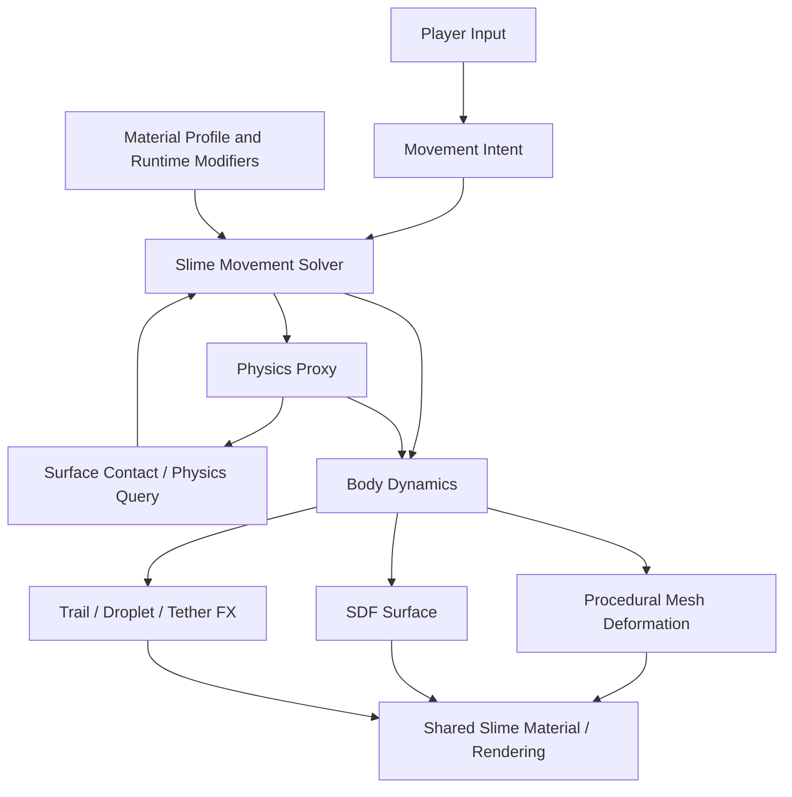

# 슬라임 이동 시스템 기획서

| 항목 | 내용 |
|---|---|
| 문서 버전 | v0.1 |
| 작성일 | 2026-11-26 |
| 상태 | 기획 초안 / 프로토타입 검증 전 |
| 대상 | BamEngine 기반 Full 3D 슬라임 게임 |
| 관련 문서 | `Slime_Game_Design_Draft_v0.1.md`, `Slime_Procedural_Mesh_SDF_Design_v0.1.md` |

> 슬라임은 걷는 캐릭터가 아니라 자신의 물질적 특성을 이용해 공간을 이동하는 캐릭터이다. 움직이고, 튀고, 달라붙고, 늘어나고, 발사되는 행위 자체가 재미있어야 한다.

## 1. 기획 목표 및 범위

### 1.1 핵심 목표

- WASD로 방향을 제어하는 직관적인 3D 이동.
- 평상시에는 단순하고 귀여운 실루엣을 유지하되 움직일 때는 몰캉함, 질척임, 탄성, 밀도감을 전달한다.
- 폴짝거리는 이동과 바닥을 따라 미끄러지는 이동을 모두 지원한다.
- 바닥에서 벽으로, 벽에서 바닥으로 자연스럽게 이동하고 접촉 표면에 점액질을 남긴다.
- 압축에 의한 고탄력 점프, 신장에 의한 새총 발사, 공처럼 연속으로 반발하는 이동을 지원한다.
- 반발하지 않고 충격을 흡수하여 표면에 철썩 붙는 반응도 지원한다.
- 절차적 메시 및 SDF 기반 몸체 표현과 이동 시뮬레이션을 연결한다.
- 전투나 성장 시스템 없이도 이동만으로 재미를 느낄 수 있는 프로토타입을 만든다.

### 1.2 의사결정 상태

| 구분 | 내용 |
|---|---|
| 확정 방향 | WASD, Hopping, Sliding, 벽면 상하 이동, 점액질 흔적, 고탄력 점프, 새총 발사, Bounce와 Splat, 절차적 메시/SDF |
| 초기 제안 | 기본형은 Hopping 중심, 입력에 따른 점착·반발 제어, 접촉면 기반 이동, Space 충전 점프, 마우스 조준 발사 |
| 미확정 | 카메라 방식, 세부 키 바인딩, 이동 모드 선택 방식, 공중 제어량, 천장 이동, 질량과 이동의 밸런스, 점액질의 게임플레이 기능 |
| 범위 제외 | 게임 장르 확정, 전투 규칙, 성장 시스템, 범용 유체 시뮬레이션, 실제 엔진 코드 구현 |

본 문서의 수치와 계산식은 프로토타입 설계 후보이며 검증된 게임 밸런스 또는 엔진 성능 결과가 아니다.

## 2. 이동 디자인 원칙

| 키워드 | 표현 목표 |
|---|---|
| Squishy | 충격에 크게 변형되는 몰캉한 몸체 |
| Sticky | 표면에 달라붙고 떨어질 때 가닥이 늘어남 |
| Bouncy | 반발과 탄성 복원에 의한 통통 튀는 움직임 |
| Stretchy | 신체를 늘려 탄성 에너지를 축적하고 방출 |
| Fluid | 접촉 표면을 따라 부드럽게 흐르는 이동 |
| Cohesive | 심하게 변형되어도 질량과 덩어리감을 유지 |
| Explosive | 충전된 에너지를 순간적으로 방출 |
| Seamless | 이동 방식 사이에 눈에 띄는 순간 전환이 없음 |

이동은 개별 스킬들의 모음이 아니라 공통 물질 특성, 입력 의도, 접촉 상태로부터 파생되는 행동으로 설계한다. 그래픽 변형이 입력 반응을 방해해서는 안 되며, 실제 충돌과 화면에 보이는 몸체의 차이를 최소화한다.

## 3. 물질 특성 및 이동 파라미터

| 파라미터 | 역할 |
|---|---|
| Stiffness | 기준 형태를 복원하려는 힘, 압축/신장 반응 |
| Restitution | 충돌 전후 법선 방향 속도 비율에 대응하는 반발력 |
| Viscosity | 국소 변형 및 몸체 내부 흐름에 대한 저항 |
| Adhesion | 표면에 부착하고 이탈에 저항하는 능력 |
| Damping | 출렁임과 탄성 진동의 감소 |
| Friction | 접촉면 접선 방향 이동 저항 |
| Mass | 관성, 가속, 충돌 및 추진 에너지에 영향 |
| Density | 질량과 기준 부피의 관계 |
| Cohesion | 몸체가 하나의 덩어리로 유지되는 성질 |
| Fluidity | 지속적인 힘에 의해 형태가 흐르는 정도의 게임용 파라미터 |
| MaxStretch | 신체 및 점액질 연결의 최대 허용 신장량 |

Stiffness와 Restitution은 구분한다. 강한 형태 복원력이 반드시 높은 반발을 의미하는 것은 아니다. Viscosity와 Damping, Fluidity 또한 게임용 독립 제어값으로 제공할 수 있지만 효과가 중복되지 않도록 검증한다.

물질의 기본 파라미터, 지형 재질에 의한 보정, 일시적인 플레이어 입력 상태를 구분한다. 물리량과 0~100의 에디터용 정규화 값은 동일한 값으로 취급하지 않고 변환 곡선을 사용한다.

## 4. 조작 체계 (제안)

| 입력 | 기본 행동 |
|---|---|
| WASD | 이동 방향 지정; 표면 상태에 따라 이동 평면 변경 |
| Space 짧게 누르고 놓기 | 일반 점프 |
| Space 누르고 있기 | 몸체 압축 및 탄성 에너지 충전 |
| Space 놓기 | 충전량에 따른 점프 발사 |
| Shift | 고탄력/반발 이동 의도 (후보) |
| Ctrl | 밀착/점착 의도 (후보) |
| RMB Hold | 점착점 설정 및 새총 조준 (후보) |
| RMB Release | 새총 발사 (후보) |
| 입력 없음 | 이동 감속, 관성 변형 및 자연스러운 정지 |

- WASD 대각선 입력은 정규화하여 대각선 속도가 과도하게 높아지지 않도록 한다.
- 기본 지상 이동은 카메라 기준 방향을 후보로 한다. 카메라 방식 확정 후 결정한다.
- Space 짧은 입력과 홀드 충전은 동일한 입력의 해제 시점으로 판별한다. 즉시 점프 방식과의 체감 비교를 별도로 진행한다.
- 이동 방향 전환은 몸체 애니메이션의 종료를 기다리지 않는다.
- Shift/Ctrl/RMB는 확정 키가 아니다. 최초에는 WASD, Space 및 점착 입력만으로 검증할 수 있다.
- 이동 방식 선택은 자동 전환, 직접 입력, 물질 특성 기반 전환을 각각 비교한다. 원치 않는 전환이 발생하지 않도록 입력 우선순위와 히스테리시스를 사용한다.

## 5. 지상 이동

### 5.1 Hopping — 폴짝폴짝 이동

기본 슬라임의 대표적인 이동 방식. 반복적인 작은 점프를 통해 전진한다.

1. WASD 방향으로 몸체 상단과 질량 중심이 기울어진다.
2. 하단이 압축되며 추진 동작을 준비한다.
3. 지면에 추진력을 가해 짧게 도약한다.
4. 공중에서 몸체가 이동 방향을 따라 약간 늘어난다.
5. 착지 시 하단이 퍼지고 상단이 지연되어 따라온다.
6. 이동 입력이 유지되면 다음 도약으로 연결한다.

조절 항목: HopHeight, HopInterval, HopImpulse, GroundAcceleration, AirControl, LandingCompression, RecoveryTime.

작은 홉을 실제 충돌체 도약으로 처리할지, 평탄한 지면에서는 시각적 홉만 적용할지 비교한다. 최초 기준은 실제 도약을 지원하되 지나치게 작은 홉으로 접촉 안정성이 저하되는 경우 시각적 홉을 대안으로 사용한다. 실제 도약의 경우 작은 장애물 통과, 접촉 갱신, 입력 버퍼링이 필요하다.

### 5.2 Sliding — 바닥 밀착 이동

몸체를 낮게 유지하며 표면을 따라 미끄러지거나 흘러가는 이동.

- 이동 방향의 앞부분이 먼저 진행하며 뒤쪽 신체가 관성으로 늦게 따라온다.
- 가속 시 후방으로 늘어나고 급정지 시 전방으로 쏠렸다가 복원된다.
- 접촉면을 따라 연속적인 점액질 흔적을 남긴다.
- 경사면에서는 중력의 접선 성분과 마찰, 입력에 따라 자연스럽게 속도가 변한다.
- 낮은 통로 통과는 시각적 압축만으로 해결하지 않고 실제 충돌 프록시의 변경 및 복원 가능 여부를 확인한다.

조절 항목: SlideSpeed, SlideAcceleration, SlideFriction, BodyHeightRatio, StretchGain, TrailWidth.

| 비교 | Hopping | Sliding |
|---|---|---|
| 지면 접촉 | 반복적으로 이탈 | 지속 접촉 |
| 이동 경로 | 작은 도약 궤적 | 지면을 따라 이동 |
| 방향 전환 | 공중 제어 + 착지 | 접촉면의 가속/마찰 |
| 점액질 | 착지 자국 중심 | 연속적인 자국 |
| 강점 | 작은 장애물 통과, 경쾌함 | 정밀 이동, 좁은 공간 후보 |

### 5.3 이동 전환

Hopping → Sliding은 착지, 점착 입력, 물질 상태 변화 등을 조건으로 한다. Sliding → Hopping은 점착 해제 후 추진 동작으로 자연스럽게 연결한다. 전환 시 속도와 몸체의 변형 상태를 유지하며, 모드 변경만으로 속도를 초기화하지 않는다.

## 6. 표면 이동 (Surface Locomotion)

### 6.1 기본 원리

바닥, 경사면, 벽을 별도 사다리나 지정 경로가 아닌 접촉 가능한 표면으로 정의한다. 접촉면의 단위 법선 N에 대해 입력 방향 D를 접선 평면에 투영한다.

```text
D_surface = D - dot(D, N) * N
```

투영 벡터의 길이가 충분한 경우 방향을 정규화한다. 벽을 정면으로 바라보는 등 투영이 퇴화하는 경우 이전 접선 프레임과 표면 기준 상향/좌우 벡터를 사용한다. 카메라 시점과 조작 방향의 일관성을 우선하며 벽면에서 W/S가 상하 이동, A/D가 좌우 이동이 되도록 하는 방안을 검증한다.

### 6.2 접촉 상태와 전환

| 상황 | 이동 및 시각 반응 |
|---|---|
| 벽 접근 | 전방 몸체가 벽 쪽으로 늘어남 |
| 최초 접촉 | 접촉 부위에 점착력 형성, 국소 변형 |
| 지면 → 벽 | 바닥/벽의 복수 접촉을 유지하며 뒤쪽 몸체가 올라옴 |
| 벽면 이동 | 접선 방향 이동, 벽면 점액질 흔적 |
| 벽면 정지 | 중력 방향으로 약간 처짐, 부착 유지 |
| 벽면 하강 | 입력 및 중력에 따라 제어된 하강 |
| 벽 → 지면 | 바닥 접촉 확보 후 부착 방향을 연속 전환 |
| 벽면 이탈 | 연결된 점액질이 늘어나고 끊어짐 |
| 벽면 점프 | 표면 바깥 방향으로 추진 |

벽면 접촉 시 전체 몸체가 즉시 90도 회전하지 않는다. 앞쪽과 뒤쪽의 접촉점을 분리하고, 몸체 방향과 형태를 보간한다. 단, 충돌 판정에 쓰는 법선을 무조건 보간하면 실제 지형을 침범할 수 있으므로 시각용 법선과 충돌용 법선을 분리한다.

### 6.3 부착 판정 및 중력

- 표면의 부착 허용 여부, 슬라임 점착력, 충돌 속도, 입력 의도, 접촉 지속 시간을 검사한다.
- 부착 시 표면에서 떨어지려는 속도와 가속도를 제약하고, 접선 방향 이동은 허용한다.
- 중력은 접선 성분과 법선 성분으로 분리한다. 점착력과 마찰이 충분하지 않으면 미끄러지거나 이탈한다.
- 접촉 획득/유지/해제 임계값에 차이를 둬 모서리 떨림을 억제한다.
- 외부 모서리에서는 전방 탐색으로 다음 표면을 확보하고, 내부 모서리에서는 기존 접촉과 새 접촉을 함께 평가한다.
- 이동 중인 물체에 부착하는 경우 상대 좌표와 표면 속도를 추적하는 방식은 후속 범위이다.
- 천장 이동은 확장 후보로 남긴다. 초기에는 바닥, 경사면, 수직 벽, 바닥↔벽 전환을 우선한다.

## 7. 고탄력 점프 (Elastic Jump)

### 7.1 동작

Space 입력 유지 동안 몸체를 접촉면 방향으로 압축한다. 압축 시 횡방향 팽창을 적용하여 부피감을 유지한다. 입력 해제 시 탄성 에너지를 방출하여 실제 충돌 프록시를 발사하고 몸체가 빠르게 복원된다.

- 짧은 입력은 낮은 점프, 홀드는 고탄력 점프를 목표로 한다.
- 지면에서는 표면 법선과 이동 의도를 조합한다.
- 벽면에서는 벽 바깥 법선 방향 성분을 확보한다.
- 공중 충전 가능 여부, 최대 충전 유지 시간, 이동 중 충전 속도는 추후 확정한다.
- 충전 중 접촉이 끊어지거나 공간이 부족한 경우 안전하게 취소하거나 제한된 점프로 전환한다.

### 7.2 에너지 모델 (참고)

```text
E = 0.5 * k * x^2
v_launch = sqrt(2 * eta * E / m)
```

k: 탄성 강성, x: 압축량, eta: 전달 효율(0~1), m: 양의 질량. 실제 게임에서는 충전 곡선, 최소/최대 속도, 방향 제어 및 질량 영향의 제한을 추가한다. 이 모델은 내부 에너지 보존을 엄밀하게 시뮬레이션하려는 목적이 아니라 조작감 설계의 출발점이다.

단순 전역 압축의 경우 접촉면 법선 축 스케일 s에 대해 두 접선 축 스케일을 각각 1/sqrt(s)로 보정할 수 있다. 국소 변형과 SDF의 부피 보존은 별도 검증이 필요하다.

## 8. 새총 이동 (Slingshot)

고탄력 점프는 몸체 압축을, 새총은 몸체의 신장을 활용한다.

### 8.1 동작 흐름

1. 부착 가능한 지형에서 Anchor를 획득한다.
2. 몸체 일부를 고정하고 나머지 질량 중심을 움직여 신장한다.
3. 신장량과 조준 방향에 따라 발사 강도를 표시한다.
4. 발사 시 복원력을 전달하고 적절한 타이밍에 Anchor를 해제한다.
5. 점액질 가닥이 끊어지고 액적이 발생한다.
6. 공중 이동, 반발 또는 표면 밀착으로 이어진다.

| 방식 | 특징 / 검증 항목 |
|---|---|
| 단일 Anchor | 복원력은 고정점 방향으로 작용하며 당겨지는 이동에 적합 |
| 이중 Anchor | 두 고정점 사이에서 고무줄처럼 발사, 기하 조건 필요 |
| Slime Tether | 점액질을 연결해 당겨지는 이동, 연결 길이 및 충돌 관리 |
| 방향 지정 발사 | 플레이어 조준 방향으로 게임용 추진력을 적용, 조작성 우선 |

고정점을 해제하기만 하면 단일 Anchor의 반대 방향으로 자동 발사되는 것은 아니다. 고정점에 의해 전달된 복원력이 속도를 만들어낸 뒤 해제하는 방식 또는 명시적인 게임용 발사 임펄스가 필요하다.

초기 프로토타입에서는 단일 Anchor와 방향 지정 발사를 비교한다. 이중 Anchor는 필요성이 확인된 이후 구현한다. Anchor 유효성, 최대 신장, 발사 최대 속도, 접촉면 해제, 끼임과 고속 충돌을 검증한다.

## 9. 충돌 반응 및 반발 이동

### 9.1 충돌 유형

| 유형 | 동작 | 시각 표현 |
|---|---|---|
| Soft Impact | 낮은 충격 흡수 | 작은 출렁임 |
| Bounce | 일반 반발 | 압축 후 복원 |
| Strong Bounce | 고탄력 연속 반발 | 깊은 압축 및 빠른 발사 |
| Splat | 큰 충격 흡수 후 밀착 | 넓게 퍼져 철썩 붙음 |
| Stick | 접촉면 부착 | 접촉 영역이 늘어남 |
| Splash | 일부 액적의 이탈 | 액적과 점액질 가닥 |
| Slide | 접선 방향 이동 | 끌리는 몸체와 흔적 |

Splash는 다른 충돌 반응에 중첩되는 시각 이벤트로도 취급할 수 있다. 반응은 입력, 물질 상태, 접촉 재질, 접근 속도, 충돌 각도를 종합하여 결정한다.

### 9.2 반발 속도 계산 예시

단위 법선 n이 표면 바깥을 향하고, v는 표면에 대한 상대 속도라고 가정한다.

```text
vn = dot(v, n) * n
vt = v - vn
if dot(v, n) < 0:
    v_after = -e * vn + (1 - f) * vt
```

e는 반발 계수, f는 접선 속도 손실을 단순화한 게임용 계수이다. 둘 다 기본적으로 0~1 범위를 사용한다. 움직이는 표면이라면 표면 속도를 다시 더해 월드 속도로 변환한다. 실제 물리 엔진이 반발을 수행할 경우 중복 적용하지 않는다. 여러 접촉의 동시 처리와 관통 보정은 별도로 필요하다.

- 낮은 접근 속도에서는 반복적인 작은 반발을 억제한다.
- 높은 반발 상태에서 공처럼 바닥과 벽을 연속으로 튀어 이동할 수 있다.
- 공중 WASD 제어에는 가속도/속도 제한을 둬 반발의 재미와 조작 안정성을 함께 유지한다.
- 점착 의도가 활성화되면 유효한 표면에서 Splat 또는 Stick으로 전환하여 고속 이동을 제어할 수 있도록 한다.
- 고속 이동은 CCD 또는 swept shape 기반 충돌 검증이 필요하다.

## 10. 점액질 흔적 (Slime Trail)

| 이동 | 흔적 |
|---|---|
| Hopping | 착지 지점의 둥근 점액질 자국 |
| Sliding | 연속적인 끈적한 이동 자국 |
| Wall Climbing | 벽면을 따라 이어지는 흔적 |
| Wall Descending | 중력 방향으로 서서히 처지는 자국 |
| Elastic Jump | 발사 지점의 퍼진 자국과 소량 액적 |
| Slingshot | 늘어난 가닥, 절단된 액적 |
| Bounce | 충돌 지점의 짧은 방사형 흔적 |
| Splat | 넓게 퍼진 웅덩이와 충격 액적 |

### 10.1 구현 방향

- Decal: 착지/충돌 자국 및 표면에 붙은 얇은 점액질.
- Procedural Ribbon Mesh: 연속 이동 흔적과 길게 늘어난 가닥.
- Mesh Particle: 몸체와 분리된 둥근 액적.
- SDF: 몸체와 아직 연결되어 있는 두꺼운 점액질 및 국소적인 연결 표현.
- 거리 기반 샘플링과 접촉 이벤트 기반 생성을 조합하여 프레임률에 따른 흔적 밀도 차이를 줄인다.
- 표면 부착, 법선 오프셋, 모서리 분리, 풀링, 개수 제한, 수명 및 페이드 처리를 적용한다.
- 벽에서 흘러내리는 흔적은 Decal UV 애니메이션 또는 표면을 따르는 메시로 우선 표현한다. 전체 유체 시뮬레이션은 요구하지 않는다.

### 10.2 게임플레이와 질량

초기에는 이동 흔적을 시각 효과로 취급하고 실제 질량에서 차감하지 않는다. 게임플레이용 액적과 분열 질량은 별도의 명시적인 이벤트로 처리한다. 자신의 점액질 위에서의 점착력 변화, 적 방해, 재흡수 등의 기능은 후속 기획 후보로 남긴다.

## 11. 통합 이동 아키텍처



### 11.1 상태 분리

| 계층 | 후보 상태 |
|---|---|
| ContactState | Grounded, Airborne, WallAttached, CornerTransition (CeilingAttached는 확장) |
| LocomotionMode | Idle, Hopping, Sliding, Climbing |
| ActionState | Normal, Charging, Stretching, Launching |
| ImpactReaction | SoftImpact, Bounce, Splat, Stick 등 접촉 이벤트 |
| MaterialState | 기본 물질값 + 런타임 보정값 |

모든 조합을 허용하는 것은 아니다. 예를 들어 Airborne 상태에서 Sliding은 실제 접촉 전까지 허용하지 않는다. CornerTransition 동안 Climbing 또는 Sliding의 연속적인 전환을 처리한다. ImpactReaction은 장기 상태와 별도로 이벤트로 관리한다.

### 11.2 상태 우선순위 초안

1. 강제 이탈, 유효하지 않은 Anchor, 관통 복구 및 안전 처리.
2. 유효한 발사 입력 또는 점프 해제.
3. 충돌 반응과 접촉 획득/상실.
4. 점착, 반발, 일반 이동 의도.
5. 대기 및 시각적 복원.

동일 물리 틱에서 발사와 접촉 반응이 중복 적용되지 않도록 명시적인 전환 규칙을 둔다. 실제 우선순위는 테스트 후 조정한다.

### 11.3 개념 데이터 구조

```cpp
// 실제 BamEngine API에 대응하지 않는 설계 예시.
struct SlimeMovementIntent {
    Vec2 Move;
    bool JumpPressed;
    bool JumpHeld;
    bool JumpReleased;
    bool AdhesionHeld;
    bool BounceHeld;
    bool LaunchHeld;
    bool LaunchReleased;
};

struct SlimeContact {
    bool Valid;
    Vec3 Position;
    Vec3 Normal;
    Vec3 SurfaceVelocity;
    float AdhesionMultiplier;
    float FrictionMultiplier;
};

struct SlimeMovementState {
    ContactState Contact;
    LocomotionMode Mode;
    ActionState Action;
    Vec3 Velocity;
    Vec3 SurfaceForward;
    float Compression;
    float Stretch;
    float Charge;
};
```

입력의 Press/Release는 렌더 프레임에서 수집하고 물리 틱까지 보관하여 유실이나 중복 소비가 없게 한다. 물리 상태를 단일 권위 데이터로 두고 시각 상태는 보간한다.

### 11.4 물리 갱신 흐름 (후보)

```text
입력 수집 및 버퍼링
→ Fixed Tick: 접촉 탐색 / 물질 파라미터 계산
→ 이동 의도 및 유효 상태 전환 결정
→ 힘·속도·제약 계산 및 충돌 처리
→ 접촉 갱신 및 충돌 이벤트 생성
→ Body Dynamics 갱신
→ Render Tick: 시각 보간, 메시/SDF, 흔적 갱신
```

엔진의 기존 물리 업데이트 구조에 맞게 재배치한다. 동적 Rigidbody 방식과 사용자 정의 swept collision controller 방식은 대안이며 두 방식이 동일 위치와 속도를 동시에 제어하지 않게 한다.

## 12. 절차적 메시/SDF 연동

이전 기술 설계의 Shared Body Representation을 사용한다. 외부 슬라임 모델이나 리깅 애니메이션은 필수로 요구하지 않는다.

| 상황 | 몸체 데이터 | 표면 표현 후보 |
|---|---|---|
| Idle / Hopping | 중심, 압축, 제어점 진동 | Procedural Mesh |
| Sliding | 앞/뒤 제어점, 속도, 접촉 법선 | Procedural Mesh |
| Wall Transition | 복수 접촉점, 국소 압축 | Mesh 또는 SDF |
| Elastic Jump | 압축량, 발사 방향, 복원 속도 | Procedural Mesh |
| Slingshot | Anchor, Body Node, 신장 길이 | SDF 또는 연결 메시 |
| Splat | 접촉 위치, 충격량, 퍼짐 | Mesh 또는 SDF |
| Splash / Split | 액적 노드, 이탈 속도 | SDF 및 Mesh Particle |

시뮬레이션에서 렌더링 백엔드를 독립시킨다. 평상시 메시, 복잡한 연결·분리 시 SDF를 사용하는 하이브리드 방식은 초기 후보이며 상시 SDF 대안도 유지한다.

- 질량과 부피는 렌더링 백엔드 전환과 별개로 유지한다.
- 스킨/표면 변형에 따른 법선, 얼굴 위치, 광택의 일관성을 확보한다.
- SDF Smooth Union의 부피 증가 및 Mesh↔SDF 실루엣 차이를 검증한다.
- 충돌 프록시와 화면에 보이는 형상이 지나치게 다르지 않도록 한다.
- 좁은 통로의 충돌체 압축/복원 시 주변 공간을 검사하고 끼임을 방지한다.
- 고속 액적과 얇은 점액질은 저해상도 3D 렌더링에서 사라질 수 있어 최소 가시 폭 또는 해상도별 표현을 검토한다.

## 13. 물질 프리셋 (임시)

모든 수치는 에디터에서 비교하기 위한 0~100 정규화 예시이다. 실제 SI 물리량이나 확정 밸런스 수치가 아니다.

| 특성 | 기본 | 고탄력 | 고점착 | 유동 | 고밀도 | 신축 |
|---|---:|---:|---:|---:|---:|---:|
| Stiffness | 60 | 90 | 40 | 15 | 90 | 70 |
| Restitution | 50 | 95 | 5 | 10 | 20 | 70 |
| Viscosity | 50 | 25 | 80 | 15 | 60 | 40 |
| Adhesion | 50 | 10 | 100 | 35 | 15 | 80 |
| Damping | 50 | 15 | 80 | 70 | 80 | 30 |
| Density | 50 | 40 | 50 | 30 | 100 | 50 |
| Fluidity | 50 | 20 | 55 | 100 | 5 | 40 |
| MaxStretch | 50 | 60 | 75 | 60 | 10 | 100 |

- 기본형: 경쾌한 Hopping 및 균형 잡힌 이동.
- 고탄력형: 높은 점프, 연속 Bounce.
- 고점착형: 벽타기 및 Splat.
- 유동형: Sliding, 낮은 통로 이동 후보.
- 고밀도형: 무거운 관성과 충돌 반응.
- 신축형: 새총, 긴 점액질 연결.

각 프리셋이 별개 캐릭터인지, 하나의 슬라임이 일시적으로 바꾸는 물질 상태인지는 확정하지 않는다.

## 14. 이동 연계 시나리오

| 연계 | 목표 경험 |
|---|---|
| Hopping → Charging → Jump | 높은 장애물 넘기 |
| Sliding → Wall Climbing | 바닥에서 벽으로 끊김 없는 이동 |
| Wall Climbing → Sliding Down | 벽을 따라 부드럽게 하강 |
| Wall Climbing → Elastic Jump | 벽을 박차고 이동 |
| Slingshot → Bounce | 고속 연속 반발 |
| Bounce → Adhesion → Splat | 원하는 표면에서 철썩 붙어 제동 |
| Splat → Sliding | 충격 흡수 후 이동 재개 |
| Launch → Splat → Split | 충돌과 폭발적인 분열 (후속 후보) |

연계 시 이전 속도, 접촉 정보, 압축/신장 상태를 유지한다. 강제로 애니메이션을 초기화하거나 의도치 않은 에너지를 반복 생성하지 않는다. 이동으로 퍼즐, 전투, 탐험을 확장할 수 있지만 이 문서에서는 이동 자체의 재미만 우선 검증한다.

## 15. Slime Movement Playground

실제 게임 콘텐츠 대신 기능 검증용 3D 테스트맵을 제작한다. 동일 구역에서 물질 프리셋을 즉시 변경하고 초기 위치/속도로 재설정할 수 있도록 한다.

| 테스트 구역 | 검증 항목 |
|---|---|
| 평지 및 직선 트랙 | WASD, 대각선, 가감속, Hopping/Sliding |
| 경사면 | 경사 상승/하강, 중력 접선 성분 |
| 수직 벽 | 부착, 상하/좌우 이동 및 이탈 |
| 내·외부 모서리, 곡면 | 연속 접촉 전환, 떨림 및 관통 |
| 계단 | 작은 홉과 장애물 충돌 |
| 좁은 터널 | 시각/충돌체 압축 및 복원 |
| 낙하 탑 | 동일 높이 낙하의 Bounce/Splat 비교 |
| 반발 통로 | 벽 사이 연속 반발, 고속 충돌 |
| 분리된 플랫폼 | 탄성 점프 및 새총 발사 |
| 여러 표면 재질 | 마찰, 부착 허용 및 흔적 |
| 이동 플랫폼 | 상대 속도 및 Anchor 유지 (후속) |
| 흔적 관찰 구역 | 점액질 밀도, 수명, 부착 및 가시성 |

### 15.1 에디터 및 디버깅

- 현재 ContactState, LocomotionMode, ActionState, 활성 충돌 반응 표시.
- 속도, 가속도, 표면 법선/접선, 접촉점, Anchor, 충돌 프록시 시각화.
- 압축량, 신장량, 충전량, 반발력, 점착력, 추정 부피 표시.
- 이동 프리셋 저장/로드 및 실시간 튜닝.
- 점액질 생성 수, 활성 개수, GPU 비용 측정.
- 궤적 표시, 단일 물리 틱 진행, 리셋 및 반복 낙하 테스트.

## 16. 개발 우선순위

| 단계 | 우선순위 | 개발 항목 | 완료 조건 |
|---|---|---|---|
| M0 | P0 | 엔진 입력/물리/렌더링 현황 조사 | 통합 방식 및 위치·속도 권위 데이터 확정 |
| M1 | P0 | WASD 및 기본 충돌 프록시 | 이동, 정지, 대각선, 기본 장애물 충돌 안정화 |
| M2 | P0 | Hopping / Sliding 및 관성 변형 | 두 이동의 시각적/조작상 차이가 분명하고 전환 가능 |
| M3 | P0 | Elastic Jump | 압축 및 발사 강도 조절, 입력 유실 없음 |
| M4 | P0 | Bounce / Splat | 동일 낙하 조건에서 물질 및 입력에 따른 다른 반응 확인 |
| M5 | P1 | Wall Climbing / Corner Transition | 바닥↔벽, 벽면 상승/하강, 이탈이 자연스럽게 연결 |
| M6 | P1 | Slime Trail | 착지/Sliding/벽면 흔적 구분, 개수 및 수명 관리 |
| M7 | P1 | Slingshot | Anchor, 신장, 발사 및 점액질 절단 연출 |
| M8 | P1 | 이동 연계 및 튜닝 | 반발→점착 등 주요 연계가 안정적으로 동작 |
| M9 | P2 | 확장 이동 | 좁은 통로, 다중 접촉, 이동 표면, 천장 후보 |
| M10 | P2 | 분열/합체 연계 | 질량 보존 및 이동·표면 전환 검증 |

P0는 핵심 조작감 검증, P1은 슬라임 고유의 이동 표현 확장, P2는 프로토타입 이후 필요성이 확인된 기능이다. 벽타기와 점액질은 최종 기획의 중요한 요소이므로 단순한 선택 기능으로 간주하지 않는다. 다만 구현 의존성상 기본 이동 이후 진행한다.

## 17. 검증 기준

| 항목 | 검증 방법 및 초기 목표 |
|---|---|
| 입력 반응 | 이동 의도가 다음 물리 틱에 반영되며 시각 애니메이션 때문에 입력이 잠기지 않음 |
| 입력 일관성 | 대각선 속도, 공중 방향 전환, Space 짧은 입력/홀드 구분 테스트 |
| 프레임률 독립 | 30/60/144 FPS에서 같은 고정 물리 틱과 입력으로 궤적 및 이동 거리 비교 |
| 형태 | 압축 시 부피감 유지, 메시 뒤집힘/눈 위치 이탈/눈에 띄는 백엔드 전환 없음 |
| 반발 | 동일 낙하 높이에서 고탄력형의 반발과 고점착형의 밀착이 구분됨 |
| 접촉 | 정지한 벽에서 의도치 않은 이탈·떨림·지형 관통 없음 |
| 전환 | 바닥↔벽 및 Hopping↔Sliding에서 눈에 띄는 위치 순간이동 없음 |
| 고속 이동 | 최대 발사 속도에서 얇은 벽 관통 방지 |
| 부피/질량 | 이동 흔적에 의한 의도치 않은 질량 감소 없음; 부피 오차 측정 |
| 점액질 | 이동 유형별 흔적 구분, 수명 종료 후 제거, 장시간 개수 무한 증가 없음 |
| 저해상도 | 480×270, 640×360 등 후보에서 표정과 변형 및 액적이 읽힘 |
| 성능 | 물리/변형/SDF/Trail의 CPU 및 GPU 비용을 각각 측정; 예산은 측정 후 설정 |

정량 기준(허용 부피 오차, 반응 시간, 충전 시간, 최대 속도 등)은 최초 실측 후 확정한다. 고정 틱 입력 재현은 프레임률 의존성을 검증하기 위한 것이며 물리 엔진의 모든 플랫폼에서의 완전 결정론을 보장하지 않는다.

## 18. 위험 요소 및 대응

| 위험 | 대응 |
|---|---|
| 모든 행동을 독립 FSM으로 만들며 상태 폭증 | 접촉/이동/행동/충돌 이벤트 분리, 유효 조합 명시 |
| 실제 물리 반응이 지나치게 조작하기 어려움 | 물리 기반 계산에 제한된 공중 제어 및 게임용 추진력 추가 |
| 홉으로 인해 이동이 둔해짐 | 빠른 입력 반영, 짧은 홉, 필요 시 시각적 홉 비교 |
| 벽에 붙는 조건이 불안정함 | 다중 탐색, 히스테리시스, 접촉 유지/해제 조건 분리 |
| 물리 프록시와 몸체가 불일치 | 형태 기반 프록시 보정과 통과 전 공간 검사 |
| 새총 발사 방향이 이해하기 어려움 | Anchor 타입 분리, 조준 및 궤적 피드백 |
| 반발과 추진력이 중복됨 | 권위 솔버 단일화, 이벤트 1회 소비 |
| 점액질 표현 비용 증가 | 풀링, 거리 기반 샘플링, 최대 개수 및 수명 제한 |
| SDF를 과도하게 사용함 | 평상시 메시 대안 유지, 실제 GPU 측정 |
| 이동 모드 자동 전환이 원치 않는 동작을 유발 | 직접 제어 우선 및 전환 히스테리시스, 사용자 테스트 |

## 19. 추가 조사 및 미확정 사항

- BamEngine의 현재 입력 시스템, Fixed Update, 물리 API, collision query/CCD 지원 여부 및 RHI 통합 지점.
- Rigidbody 기반 제어와 사용자 정의 캐릭터 이동 솔버의 비교.
- 표면 좌표계의 안정적인 생성 및 모서리에서의 parallel transport 또는 대안.
- 복수 접촉에 대한 접촉 제약, 마찰, 점착 해제 구현.
- Hopping을 실제 작은 도약과 시각적 도약 중 어떤 방식으로 구성할지.
- Space 충전 방식의 조작 지연, Shift/Ctrl/RMB의 역할과 카메라 기반 방향 해석.
- 자동 Hopping/Sliding 전환 조건과 반발·점착 상태의 획득 방식.
- 단일/이중 Anchor의 새총 이동, 에너지 및 조준 방식.
- 실제 이동 속도, 점프 높이, 충전 시간, 공중 제어량, 최대 점착 시간.
- 물질 특성의 게임플레이 노출 범위와 프리셋을 바꾸는 방법.
- 점액질 흔적의 실제 질량 반영, 적과 환경에 미치는 영향.
- 천장 이동 및 이동 플랫폼의 필요성.
- 메시/SDF 전환 시 시각 일관성, 저해상도에서의 얇은 가닥 가시성.

본 초안은 논의된 기획을 정리한 것이며 BamEngine 최신 소스 코드, 물리 엔진 지원 상태, 실제 성능은 직접 검증하지 않았다. 외부 자료 조사나 실험 결과를 확정 근거로 포함하지 않는다.

## 20. 첫 마일스톤 정의

**Slime Movement Playground — 움직이는 행위 자체가 재미있는 슬라임.**

최초 P0 시연에서는 기본 슬라임이 WASD로 폴짝폴짝 이동하고 바닥에 밀착하여 미끄러지며, 몸체를 압축해 높은 곳으로 점프할 수 있어야 한다. 같은 높이에서 떨어졌을 때 고탄력 상태는 통통 튀고 고점착 상태는 표면에 철썩 붙어야 한다.

이후 P1에서 바닥과 벽을 자연스럽게 오가고 점액질을 남기며 몸체를 늘렸다가 새총처럼 발사하는 연계까지 완성한다. 이 과정에서 단순하고 귀여운 기본 모습, 몰캉함과 질척임, 탄탄한 부피감, 순간적인 에너지 방출이라는 기존 아트 방향을 유지한다.

전투 및 성장 기획보다 먼저 이동의 조작감과 시각적 반응을 검증하고, 결과에 따라 장르와 핵심 플레이 루프를 구체화한다.
