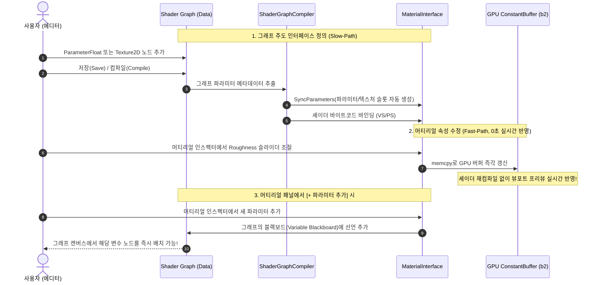
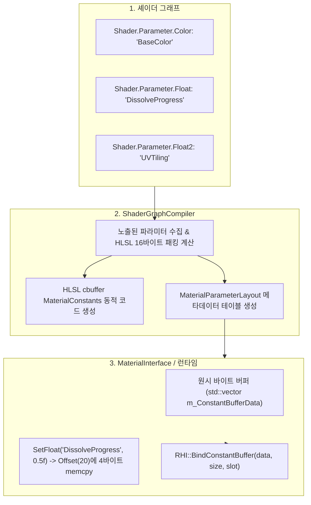
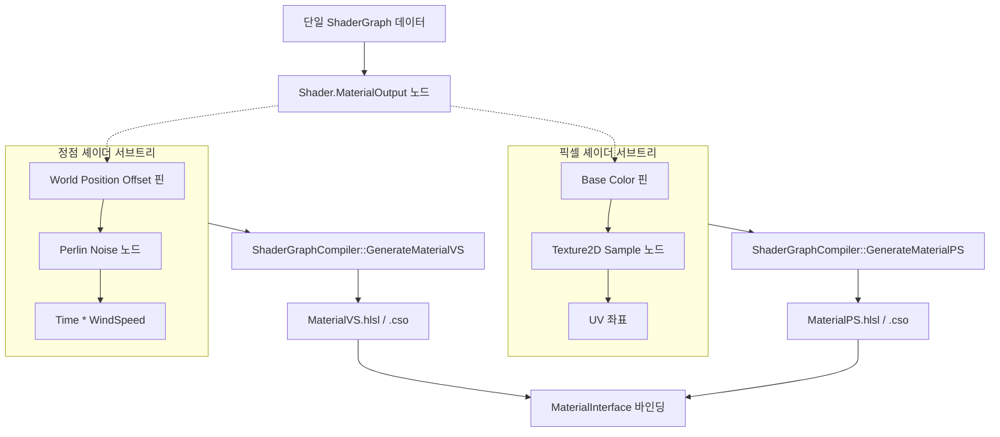
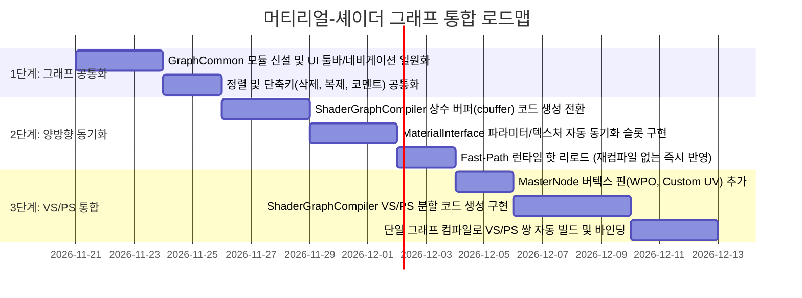

# 머티리얼-셰이더 그래프 동기화, 공통 그래프 구조 및 VS/PS 통합 설계서
(Material-Shader Graph Synchronization, Common Graph Framework & VS/PS Stage Design)

---

## 1. 개요 및 핵심 쟁점

본 문서는 BamEngine의 머티리얼 시스템과 셰이더 그래프 에디터의 고도화를 위해 제기된 4가지 핵심 질문에 대한 심층 조사 결과 및 구조적 설계안을 정의한다.

1. **파라미터 및 텍스처의 동기화 모델 (Synchronization & Source of Truth)**:
   - 마테리얼 속성 패널에서 추가/수정한 파라미터 및 텍스처와 셰이더 그래프의 노드/블랙보드 간의 관계는 어떠해야 하는가?
   - 누가 인터페이스의 진실의 원천(Source of Truth)이며, 실시간 변경(Hot-Reload)은 어떻게 보장되는가?
2. **고정 PBR 구조체 하드코딩 탈피 및 범용 동적 버퍼 레이아웃 (Dynamic ConstantBuffer Layout)**:
   - `baseColor`, `roughness` 등 특정 PBR 변수명에 묶인 48바이트 고정 구조체(`MaterialConstants`)를 어떻게 탈피할 것인가?
   - 커스텀 파라미터(디졸브, UV 스케일, 물결 속도 등)를 임의로 추가해도 C++ 코드 수정 없이 실시간 바인딩되는 범용 아키텍처는 무엇인가?
3. **다중 그래프 패널의 UI/UX 및 기능 공통화 (Common Graph Framework)**:
   - `GraphPanel`(로직 그래프), `MaterialEditorCanvas`(셰이더 그래프), `AnimatorGraphPanel`(애니메이션 FSM) 등 여러 패널에 분산된 노드 에디터 기능을 어떻게 통합·재사용할 것인가?
4. **셰이더/머티리얼 그래프에서의 VS(정점 셰이더) 및 PS(픽셀 셰이더) 통합 작성**:
   - 머티리얼 그래프에서 정점 셰이더(World Position Offset, Custom UV 등)와 픽셀 셰이더(PBR 서피스 셰이딩)를 둘 다 작성할 수 있어야 하는가?
   - 단일 그래프에서 두 셰이더 스테이지를 어떻게 통합하고 컴파일러에서 분할 생성할 것인가?

---

## 2. 파라미터 & 텍스처 동기화 아키텍처

### 2.1 진실의 원천(Single Source of Truth) 원칙

현대 상용 엔진(Unreal Engine의 Material Editor, Unity의 Shader Graph)의 검증된 아키텍처를 분석한 결과는 다음과 같다.

| 구분 | 셰이더 그래프 (Shader Graph) | 머티리얼 (Material / MaterialInstance) |
| :--- | :--- | :--- |
| **핵심 역할** | **인터페이스 정의 (Layout Definition)** | **데이터 바인딩 및 오버라이드 (Value Assignment)** |
| **소유 항목** | 파라미터 이름, 자료형(Float, Color, Texture2D), 기본값(Default), 바인딩 슬롯/오프셋 | 실제 런타임 값(Current Value), 할당된 텍스처 에셋 핸들(Texture Handle) |
| **비유** | C++의 `struct` 클래스 선언부 | `struct`의 인스턴스 변수 메모리 |

> [!IMPORTANT]
> **인터페이스 구조(Layout)의 진실의 원천은 항상 "셰이더 그래프"여야 한다.**
> 셰이더 그래프에 존재하지 않는 파라미터나 텍스처는 컴파일된 HLSL 코드 어디에도 참조되지 않으므로, 머티리얼 속성창에서 독자적으로 추가된 파라미터는 셰이더 그래프에 노드로 연결되지 않는 한 렌더링에 아무런 영향을 줄 수 없다.

### 2.2 양방향 상호작용 및 동기화 메커니즘



#### A. Fast-Path (머티리얼 속성 값 수정 -> 실시간 렌더링)
- **동작**: 머티리얼 인스펙터 패널에서 `BaseColor`를 바꾸거나 `Roughness` 슬라이더를 조작할 때, **셰이더 그래프나 HLSL을 다시 컴파일하지 않는다.**
- **원리**: 컴파일러가 생성한 셰이더 코드는 상수를 하드코딩 인라인하는 대신 `cbuffer MaterialConstants : register(b2)`의 오프셋을 참조하도록 생성된다. 따라서 머티리얼의 파라미터 맵(`m_Parameters`) 값을 수정하면 상수 버퍼 메모리만 업데이트되어 60fps로 매끄럽게 프리뷰에 반영된다.

#### B. Slow-Path (그래프 편집 -> 머티리얼 인터페이스 동기화)
- **동작**: 셰이더 그래프에서 새로운 `Shader.ParameterColor` 노드를 추가하고 이름을 `"TintColor"`로 지정한 뒤 저장하면, 연결된 `Material`의 `m_Parameters`에 자동으로 `"TintColor"` 슬롯이 생성된다.
- **머티리얼 인스펙터 반영**: 머티리얼 에디터의 프로퍼티 테이블에 `"TintColor"` 행이 자동으로 나타나며, 기본값으로 채워진다.

#### C. 머티리얼 패널에서 파라미터/텍스처 추가 시의 처리
- 머티리얼 패널의 `[+ 파라미터 추가]` 버튼을 통해 파라미터를 추가하면:
  1. 셰이더 그래프의 **블랙보드(Blackboard / Variable List)**에 해당 변수 선언이 자동으로 추가된다.
  2. 셰이더 그래프 캔버스 우클릭 메뉴의 `변수(Variables)` 항목에 방금 추가한 파라미터가 등록되어 노드로 꺼내 쓸 수 있다.
  3. 아직 그래프 노드에 연결되지 않은 파라미터는 머티리얼 인스펙터에서 `[미연결 파라미터]` 배지를 표시하여 혼선을 방지한다.

---

### 2.3 고정 파이프라인(PBR Constants) 탈피 및 범용 동적 버퍼 레이아웃 (Dynamic ConstantBuffer Layout) 설계

#### A. 문제 정의: 왜 정적 구조체 하드코딩이 한계에 부딪히는가?
현재 BamEngine의 1단계 Fast-Path 구현은 다음과 같은 고정 결합도를 가진다:
1. **C++ 정적 구조체 종속**: `MaterialConstants`가 `baseColor`, `roughness`, `metallic`, `cavity`, `ao`, `emissiveColor`로 고정된 48바이트 구조체로 정의되어 있다.
2. **커스텀 파라미터 확장 불가**: 아티스트나 프로그래머가 셰이더 그래프에서 물결 속도(`WaveSpeed`), 투명도(`Opacity`), 디졸브 진행도(`DissolveProgress`), UV 타일링(`Tiling`) 등 사용자 정의 파라미터를 추가해도 C++의 `MaterialConstants`에 자리가 없어 GPU로 실시간 전달할 수 없다.
3. **삼중 하드코딩 결합**: C++ 구조체 선언, HLSL `cbuffer MaterialConstants` 코드, C++ 파라미터 복사 람다(`ApplyParameterConstants`) 3곳에 특정 변수명이 중복 하드코딩되어 있어, 툰 셰이딩(Toon)이나 굴절(Glass), 파티클 이펙트 등 다른 셰이딩 모델로 전환할 때마다 엔진 핵심 코드를 뜯어고쳐야 한다.

#### B. 상용 엔진(Unreal, Unity)의 범용 아키텍처: 동적 상수 버퍼 레이아웃
현대 상용 엔진은 C++ 컴파일 타임 구조체에 의존하지 않고, **동적 버퍼 레이아웃(Dynamic Buffer Layout)과 원시 바이트 블롭(Raw Byte Blob)**을 기반으로 동작한다.



#### C. 세부 아키텍처 명세

##### 1. 파라미터 레이아웃 메타데이터 (`MaterialParameterLayout`)
컴파일러가 그래프의 파라미터들을 분석하여 HLSL의 16바이트 정렬 규칙(std140 패킹)에 맞게 오프셋을 배치하고 메타데이터 테이블을 생성한다.

```cpp
struct MaterialParameterEntry
{
    std::string Name;                 // 파라미터 고유명 (예: "DissolveProgress")
    EMaterialParameterType Type;      // Float, Float2, Float3, Float4, Int, Bool 등
    uint32_t Offset;                  // cbuffer 내 바이트 오프셋 (16바이트 패킹 준수)
    uint32_t Size;                    // 크기 (예: Float = 4바이트)
};

struct MaterialBufferLayout
{
    std::vector<MaterialParameterEntry> Entries;
    uint32_t TotalBufferSize = 0;     // 16바이트 배수로 올림된 총 버퍼 크기
    
    const MaterialParameterEntry* Find(const std::string& name) const;
};
```

##### 2. 컴파일러의 HLSL `cbuffer` 자동 조립
`ShaderGraphCompiler`는 고정된 HLSL 문자열 대신, 수집된 레이아웃을 기반으로 HLSL 상수 버퍼 문자열을 동적으로 조립한다.

```hlsl
// [ShaderGraphCompiler가 동적 생성한 HLSL]
cbuffer MaterialConstants : register(b0, space3)
{
    float4 BaseColor;        // offset 0,  size 16
    float  Roughness;        // offset 16, size 4
    float  Metallic;         // offset 20, size 4
    float  DissolveProgress; // offset 24, size 4
    float  WaveSpeed;        // offset 28, size 4
    float2 UVTiling;         // offset 32, size 8
    float2 _pad0;            // offset 40, size 8 (16바이트 정렬 패딩)
};
```

##### 3. 머티리얼 인터페이스의 바이트 블롭(Byte Blob) 저장소
`MaterialInterface`는 고정 구조체(`MaterialConstants`) 대신 동적 메모리 블록을 소유한다.

```cpp
class MaterialInterface
{
public:
    void SetFloat(const std::string& name, float value)
    {
        if (const auto* entry = m_Layout.Find(name); entry && entry->Type == EMaterialParameterType::Float)
        {
            std::memcpy(m_ConstantBufferData.data() + entry->Offset, &value, sizeof(float));
            IncreaseVersion();
            m_IsGpuBufferDirty = true;
        }
    }

    void UpdateGpuConstantBuffer(RHICommandList* rhi, uint32_t slot) const
    {
        if (!m_ConstantBufferData.empty())
        {
            rhi->BindConstantBuffer(m_ConstantBufferData.data(), static_cast<uint32_t>(m_ConstantBufferData.size()), slot);
        }
    }

private:
    MaterialBufferLayout m_Layout;
    std::vector<uint8_t> m_ConstantBufferData; // GPU로 전송할 순수 메모리 블록
};
```

#### D. 단계별 진화 로드맵

| 단계 | 명칭 | 구현 범위 | 효과 및 검증 기준 |
| :--- | :--- | :--- | :--- |
| **Phase 1 (완료)** | **기본 PBR Fast-Path 안정화** | 48바이트 고정 PBR 구조체(`MaterialConstants`) 기반 Fast-Path 실시간 파라미터 반응(60fps) 및 마스터 노드 양방향 동기화 | 셰이더 재컴파일 없이 파라미터 조작 즉시 3D 프리뷰 반응 확인 |
| **Phase 2 (구현 완료: 2026-11-20)** | **동적 cbuffer 코드 생성 및 레이아웃·바이트 블롭 도입** | `ShaderGraphCompiler::BuildMaterialBufferLayout` 기반 16바이트 패킹 오프셋 계산 및 `Variable.Get.*` 동적 `cbuffer` VS/PS 생성, `MaterialInterface`/`MaterialInstance`의 `BuildConstantBufferBlob(vector<uint8>)` 원시 바이트 블롭 GPU 바인딩 | `ShaderGraphCheck` 16바이트 경계 점프(80B)·바이트 블롭 검증 통과 및 에디터 실환경 확인 |
| **Phase 3 (후속 과제)** | **완전 범용화 및 셰이더 리플렉션 연동** | 고정 48바이트 헤더 완전 분리 및 `SPIRV-Cross` / D3D12 리플렉션 교차 검증 | 모든 커스텀 머티리얼 및 셰이딩 모델(Toon, Glass 등)에서 C++ 코드 수정 없는 100% 범용화 |

---

## 3. 다중 그래프 패널 공통 프레임워크 (Common Graph Architecture)

### 3.1 현황 분석

현재 BamEngine 에디터에는 `ax::NodeEditor`를 기반으로 한 3개의 독립적인 그래프 패널이 존재한다.

1. `GraphPanel`: 범용 비주얼 스크립팅 / 로직 그래프
2. `MaterialEditorCanvas`: 머티리얼 셰이더 그래프
3. `AnimatorGraphPanel`: 애니메이션 스테이트 머신(FSM) 및 블렌딩 그래프

각 패널은 `NodeEditorUI.h`를 통해 테마와 핀/헤더 드로잉 일부를 공유하고 있으나, 다음과 같은 핵심 기능들이 중복 구현되어 있다.

- **뷰 제어 및 네비게이션**: `NavigateToContent()`, `ResetView()`, 마우스 휠 클릭 패닝
- **툴바 구성**: Focus Canvas(초점), WireStyle 전환(Curved, Hybrid, Straight), Zoom 상태 표시
- **공통 단축키 및 액션**: 노드 다중 선택, `Delete` 일괄 삭제, 복제(`Ctrl+D`), 코멘트 박스 생성(`C`)
- **노드 정렬(Alignment) 기능**: 상/하/좌/우 정렬, 균등 간격 배치
- **컨텍스트 메뉴**: 빈 캔버스 우클릭 검색 팝업, 노드 우클릭 동작 메뉴

### 3.2 공통화 레이어 설계 (`Editor::GraphCommon`)

```
Editor/Source/ImGui/GraphCommon/
├── Public/
│   ├── GraphCommon.h             # 공통 열거형 및 인터페이스
│   ├── NodeEditorUI.h            # 노드/핀/헤더 드로우 헬퍼 (기존 확장)
│   ├── GraphToolbarLayout.h      # 표준 툴바 헬퍼 (초점, 와이어 스타일, 정렬 등)
│   ├── GraphNavigationHelper.h   # 네비게이션 및 카메라 맞춤 유틸리티
│   └── GraphActionRegistry.h     # 정렬, 복제, 삭제 등 공통 단축키 처리
└── Private/
    ├── NodeEditorUI.cpp
    ├── GraphToolbarLayout.cpp
    ├── GraphNavigationHelper.cpp
    └── GraphActionRegistry.cpp
```

#### 공통화 컴포넌트 명세:

1. **`GraphToolbarLayout`**:
   ```cpp
   // 모든 그래프 패널 상단에서 1줄로 호출하는 표준 툴바
   void DrawStandardGraphToolbar(GraphToolbarContext& ctx);
   // 제공 기능: [노드 추가] [화면 맞춤] [와이어 스타일 토글] [노드 정렬 드롭다운] [그리드 스냅 토글]
   ```
2. **`GraphNavigationHelper`**:
   - 그래프가 처음 열릴 때 노드 크기 계산 완료 후 1회 프레임 딜레이를 거쳐 `NavigateToContent()`를 안전하게 호출하는 상태 머신 일원화.
3. **`GraphNodeAligner`**:
   - 선택된 노드들의 Bounding Box를 계산하여 좌측/우측/상단/하단 정렬 및 수평/수직 균등 배치를 수행하는 순수 수학 유틸리티.
4. **`GraphSearchPopup`**:
   - `EditorUI::DrawSearchBar`를 내장한 노드 생성 검색 팝업 컴포넌트 일원화 (키보드 방향키 탐색, Enter 생성, Esc 닫기 표준화).

---

## 4. 셰이더 그래프에서의 VS(정점) 및 PS(픽셀) 통합 설계

### 4.1 핵심 질문에 대한 결론

> **Q. 셰이더 그래프/마테리얼 그래프에서 VS와 PS를 둘 다 작성할 수 있어야 하는가?**
> **A. 네, 반드시 둘 다 작성할 수 있어야 하며, 상용 엔진과 동일하게 "단일 그래프 내 단일 마스터 노드"에서 통합 관리해야 합니다.**

### 4.2 왜 VS와 PS를 단일 그래프에서 다뤄야 하는가?

1. **정점 변위 애니메이션 (World Position Offset - WPO)**:
   - 바람에 흔들리는 풀/나무 잎사귀, 바다나 강의 파도 물결, 버텍스 기반 디졸브/익스팬션 효과는 정점(Vertex)의 월드 좌표를 변형해야 한다.
   - 이러한 정점 변위는 정점 셰이더(VS)에서 계산되어야만 GPU 연산량이 최소화된다.
2. **Custom UVs (연산 최적화의 핵심)**:
   - 픽셀 셰이더에서 픽셀마다 수행하기에 무거운 복잡한 UV 계산(회전, 삼각함수, 타일링 패닝)을 정점 단계(수만 버텍스)에서 미리 계산하여, GPU의 래스터라이저 하드웨어 보간기(Interpolator)를 통해 픽셀 셰이더(수백만 픽셀)로 넘기면 성능이 대폭 향상된다.
3. **아티스트 작업 흐름(UX)의 단일성**:
   - VS 그래프와 PS 그래프를 별도 파일로 분리하면, 머티리얼 하나를 만들 때마다 두 개의 그래프 에셋을 만들고 파라미터(`WindSpeed`, `WaveHeight`)를 양쪽에 중복 선언해야 한다.
   - 단일 마스터 노드 구조에서는 하나의 그래프에서 동일한 파라미터를 버텍스 변위와 픽셀 컬러에 동시에 연결할 수 있다.

### 4.3 통합 마스터 노드 (`Shader.MaterialOutput`) 핀 레이아웃

```
┌───────────────────────────────────────────────┐
│              Shader.MaterialOutput            │
├───────────────────────────────────────────────┤
│ [VS Stage Inputs]                             │
│   ● World Position Offset  (Float3)           │
│   ● Vertex Normal          (Float3)           │
│   ● Custom UV0             (Float2, implemented)│
│   ● Custom UV1             (Float2, implemented)│
│                                               │
│ [PS Stage Inputs]                             │
│   ● Base Color             (Float4)           │
│   ● Metallic               (Float)            │
│   ● Roughness              (Float)            │
│   ● Normal                 (Float3)           │
│   ● Emissive               (Float3)           │
│   ● Ambient Occlusion (AO) (Float)            │
│   ● Opacity Mask           (Float)            │
└───────────────────────────────────────────────┘
```

### 4.4 컴파일러의 분할 코드 생성 (Split Code Generation)

단일 그래프 데이터로부터 `ShaderGraphCompiler`가 `MaterialVS.hlsl`과 `MaterialPS.hlsl`을 각각 생성한다.
현재 `Custom UV0/1`은 각각 `Shader.TexCoord0/1`과 Float2 덧셈·곱셈으로 메시 좌표를 정점 단계에서 변환하고 별도의 `TEXCOORD0/1`로 보간한다. 핀 미연결 시 해당 메시 좌표를 그대로 사용한다. Assimp 임포터는 UV1이 있으면 보존하고 없으면 UV0을 복사한다. 이전 메시와 v3 모델 스냅샷도 UV0으로 대체하며, 이전에 임포트된 메시에서 원본 UV1을 복구하려면 원본을 다시 임포트해야 한다. 내장 프리미티브와 지형은 UV0을 복사한다. 생성된 GBuffer·ForwardTransparent 머티리얼 셰이더의 diffuse 슬롯 0은 계속 UV0을 사용하며, UV1은 현재 텍스처 샘플에 연결되지 않는다. 범용 Texture Sample 노드는 미구현이다. 빌드·셰이더 컴파일·실환경 검증은 사용자 실행 대기다.

직접 `VertexMaterial`을 기본 생성해 `texCoord`를 나중에 대입하는 메시 제작 코드는 `texCoord1`도 명시해야 한다. 5인자 생성자는 UV0을 UV1 기본값으로 복사하며, 별도 UV1이 있으면 이를 덮어쓴다.



#### 생성되는 HLSL 구조 예시:

**1. `MaterialVS.hlsl` (정점 셰이더):**
```hlsl
#include "shading_flags.hlsli"

cbuffer MaterialConstants : register(b2)
{
    float WindSpeed;
    float3 WindDirection;
};

struct VS_INPUT { float3 Position : POSITION; float3 Normal : NORMAL; float2 TexCoord : TEXCOORD0; };
struct PS_INPUT { float4 Position : SV_POSITION; float3 WorldPos : WORLD_POSITION; float3 Normal : NORMAL; float2 TexCoord : TEXCOORD0; };

PS_INPUT main(VS_INPUT input)
{
    PS_INPUT output;
    
    // 그래프의 [World Position Offset] 핀에 연결된 표현식 삽입
    float3 worldPosOffset = sin(Time * WindSpeed) * WindDirection;
    
    float3 worldPos = mul(float4(input.Position, 1.0f), WorldMatrix).xyz + worldPosOffset;
    output.Position = mul(float4(worldPos, 1.0f), ViewProjectionMatrix);
    output.WorldPos = worldPos;
    output.Normal = mul(input.Normal, (float3x3)WorldMatrix);
    output.TexCoord = input.TexCoord;
    return output;
}
```

**2. `MaterialPS.hlsl` (픽셀 셰이더):**
```hlsl
#include "shading_flags.hlsli"

Texture2D t_BaseColor : register(t0);
SamplerState s_BaseColor : register(s0);

cbuffer MaterialConstants : register(b2)
{
    float WindSpeed; // 공유 상수 버퍼
    float3 WindDirection;
    float RoughnessVal;
    float MetallicVal;
};

struct PS_INPUT { float4 Position : SV_POSITION; float3 WorldPos : WORLD_POSITION; float3 Normal : NORMAL; float2 TexCoord : TEXCOORD0; };
struct PS_OUTPUT { float4 Diffuse : SV_TARGET0; float4 Normal : SV_TARGET1; float4 PBR : SV_TARGET2; float4 Emission : SV_TARGET3; float4 Position : SV_TARGET4; };

PS_OUTPUT main(PS_INPUT input)
{
    PS_OUTPUT output;
    // 그래프의 [Base Color, Roughness, Metallic 등] 핀에 연결된 표현식 삽입
    float4 baseColor = t_BaseColor.Sample(s_BaseColor, input.TexCoord);
    output.Diffuse = baseColor;
    output.PBR = float4(RoughnessVal, MetallicVal, 0.5f, 1.0f);
    ...
    return output;
}
```

---

## 5. 단계별 구현 로드맵



### 상세 추진 계획

1. **Phase 1: `Editor::GraphCommon` 모듈 구축 (공통화)**
   - `GraphPanel`, `MaterialEditorCanvas`, `AnimatorGraphPanel`의 툴바, 줌/팬 네비게이션, 노드 정렬, 코멘트 생성 로직을 공통 라이브러리로 추출.
   - `EditorUI::DrawSearchBar`를 적용한 공통 노드 검색/생성 팝업 구현.

2. **Phase 2: 파라미터 및 텍스처 양방향 동기화 (Fast-Path 완성)**
   - `ShaderGraphCompiler`에서 상수를 하드코딩 리터럴로 인라인하던 방식을 `cbuffer MaterialConstants`와 `Texture2D / SamplerState` 레지스터 바인딩 방식으로 전환.
   - 그래프 컴파일 시 머티리얼 인터페이스에 파라미터와 텍스처 슬롯을 자동 등록하고, 머티리얼 패널에서 값 수정 시 상수 버퍼만 즉각 갱신하도록 구현.

3. **Phase 3: Vertex Stage (VS) & Pixel Stage (PS) 통합**
   - `Shader.MaterialOutput` 노드에 `WorldPositionOffset`, `VertexNormal`, `CustomUV0` 핀 추가.
   - `ShaderGraphCompiler`에 `GenerateGBufferVS` 및 `GenerateGBufferPS`를 도입하여 단일 그래프에서 정점 셰이더와 픽셀 셰이더를 동시에 생성·빌드.

---

## 6. 결론 및 개발 가이드라인 요약

1. **동기화 원칙**:
   - 인터페이스 구조(이름, 타입, 슬롯)는 **셰이더 그래프가 단일 진실의 원천(SSOT)**이다.
   - 머티리얼 인스펙터는 **파라미터 값 오버라이드 및 텍스처 에셋 할당**을 담당하며, 값 변경 시 재컴파일 없이 GPU 버퍼를 핫 업데이트한다.
2. **그래프 공통화**:
   - `NodeEditorUI`를 `GraphCommon`으로 확장하여 툴바, 네비게이션, 정렬, 코멘트, 단축키를 완전히 모듈화하고 3개 패널(`GraphPanel`, `MaterialEditor`, `AnimatorGraph`)에서 일관되게 공유한다.
3. **VS/PS 통합**:
   - 별도 그래프 파일을 나눌 필요 없이 **단일 머티리얼 그래프**의 마스터 노드에 버텍스 핀(WPO 등)과 서피스 핀(PBR)을 함께 배치하고, 컴파일러가 VS와 PS HLSL 코드로 분할 생성하는 현대적 구조를 채택한다.
