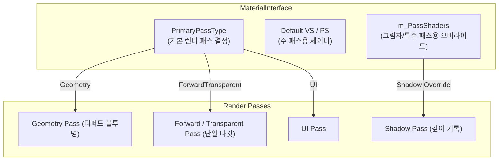

# 머티리얼 기본 렌더 패스(Primary Pass Type) 도입 및 셰이더 파이프라인 정합성 설계

- 작성일: 2026-11-20
- 상태: 구현 완료 및 에디터 실환경 확인 (2026-11-20) — `PrimaryPassType` 데이터 모델·리플렉션·레거시 보정·Shadow 폴백·`ForwardTransparent` PS 생성·에디터 UI 연동 완료
- 공통 기준: [EngineEditorClientGuidelines.md](EngineEditorClientGuidelines.md) 14·19절, [SourceOrganizationGuidelines.md](SourceOrganizationGuidelines.md)
- 선행 문서: [MaterialShaderGraphIntegrationPlan.md](MaterialShaderGraphIntegrationPlan.md), [Shader/BINDING_LAYOUT.md](Shader/BINDING_LAYOUT.md)
- 관련 소스:
  - `Engine/Source/Render/Material/Public/MaterialInterface.h`
  - `Engine/Source/Render/Material/Private/MaterialInterface.cpp`
  - `Editor/Source/ImGui/ResourceEditor/Private/MaterialEditor.cpp`
  - `Engine/Source/Render/Mesh/Private/MeshRenderSystem.cpp`
  - `Engine/Source/Render/Private/Renderer.cpp`
  - `Engine/Source/Render/Shader/Private/ShaderGraphCompiler.cpp`

---

## 1. 배경 및 문제 정의 (Problem Statement)

### 1.1 현상 및 아키텍처 불일치
현재 BamEngine의 머티리얼 시스템은 다음과 같이 구성되어 있다:
1. **기본 셰이더 (Default Shaders)**: `m_VertexShaderHandle`, `m_PixelShaderHandle`
2. **패스별 오버라이드 셰이더 (Pass-Specific Shaders)**: `m_PassShaders` (`ERenderPassType`별 VS/PS 목록)

렌더러가 특정 렌더 패스(예: `ShadowPass`, `GeometryPass`, `ForwardTransparentPass`)를 수행할 때, 머티리얼에게 `GetPixelShader(passType)`을 요청한다.
만약 `m_PassShaders`에 해당 패스 전용 셰이더가 등록되어 있지 않으면, 머티리얼은 Fallback으로 **기본 셰이더(`m_PixelShaderHandle`)**를 반환한다.

그러나 현재 엔진의 기본 픽셀 셰이더(노드 셰이더 그래프로 생성되는 `MaterialPS.cso` 포함)는 **디퍼드 렌더링의 GBuffer(RT0: Albedo, RT1: Normal, RT2: PBR/Roughness/Metallic 등 3개 Render Target)를 출력하도록 고정**되어 있다. 즉, 기본 셰이더가 암묵적으로 `Geometry` 패스 전용으로 취급되고 있다.

### 1.2 잠재 결함 시나리오
- **반투명 머티리얼 오류**:
  - 머티리얼의 `BlendMode`를 `AlphaBlend`(반투명)로 설정하면, `MeshRenderSystem`은 이 객체를 `GeometryPass`가 아닌 `ForwardTransparentPass`로 분류하여 렌더 큐에 제출한다.
  - `ForwardTransparentPass`는 단일 컬러 버퍼(`SV_Target0`)에 알파 블렌딩으로 렌더링하는 패스다.
  - 이 머티리얼의 `m_PassShaders`에 `ForwardTransparent` 패스가 등록되어 있지 않으면, GBuffer용 기본 셰이더(3개 타깃 출력)가 Fallback으로 반환된다.
  - 결과적으로 렌더러 파이프라인 생성 단계(`PrepareMeshPipelineDesc`)에서 렌더 타깃 개수 및 셰이더 인터페이스 불일치 오류(`BAM_LOG(Error, ...)`)가 발생하고 드로우콜이 스킵된다.
- **UI / 포스트프로세스 머티리얼**:
  - UI나 후처리용 머티리얼 역시 주 렌더 대상이 디퍼드 지오메트리가 아님에도 '기본 셰이더'가 GBuffer 규격으로 오인될 수 있는 구조적 모호성이 존재한다.

---

## 2. 해결 방안: 명시적 `Primary Pass Type` (기본 렌더 패스) 도입

머티리얼이 자신의 기본 셰이더가 어느 렌더 패스를 주(Primary) 대상으로 하는지 명시적으로 소유하도록 구조를 확장한다.



### 2.1 개념 모델 비교

| 항목 | 기존 방식 (암묵적 Geometry) | 제안 방식 (`PrimaryPassType` 도입) |
| :--- | :--- | :--- |
| **기본 셰이더의 의미** | 모든 패스의 범용 Fallback (실제론 GBuffer 전용) | **머티리얼이 지정한 주 패스(`PrimaryPassType`) 전용 셰이더** |
| **패스 결정 주체** | 렌더러가 `BlendMode`로만 추정 | 머티리얼이 자신의 주 패스를 데이터로 직접 정의 |
| **타 패스 Fallback 안전성** | 타 패스에서 무조건 GBuffer 셰이더 바인딩 -> 충돌 위험 | 주 패스 외에는 유효한 `m_PassShaders`가 있을 때만 렌더링 |
| **셰이더 그래프 연동** | 무조건 GBuffer HLSL 템플릿 코드 생성 | `PrimaryPassType`에 맞춰 GBuffer형 또는 Forward형 HLSL 생성 |

---

## 3. 세부 설계 사양 (Detailed Specification)

### 3.1 `MaterialInterface` 엔진 코어 확장

```cpp
// MaterialInterface.h
CLASS()
class ENGINE_API MaterialInterface : public Resource
{
    REFLECT_CLASS()
    // ...
public:
    virtual ERenderPassType GetPrimaryPassType() const { return m_PrimaryPassType; }
    virtual void SetPrimaryPassType(ERenderPassType passType) { m_PrimaryPassType = passType; }

protected:
    PROPERTY(EDITABLE, CATEGORY("CATEGORY_PIPELINE"), DISPLAY_NAME("PROP_PRIMARY_PASS_TYPE"))
    ERenderPassType m_PrimaryPassType = { ERenderPassType::Geometry };
};
```

#### 셰이더 조회 로직 개선:
```cpp
Shader* MaterialInterface::GetPixelShader(ERenderPassType passType) const
{
    // 1. 해당 패스 전용 오버라이드가 등록되어 있으면 최우선 반환
    for (const auto& binding : m_PassShaders)
    {
        if (binding.passType == passType && binding.vertexShader.IsValid() && binding.pixelShader.IsValid())
            return binding.pixelShader.Get();
    }

    // 2. 요청된 패스가 머티리얼의 PrimaryPassType과 일치하면 기본 셰이더 반환
    if (passType == m_PrimaryPassType)
        return m_PixelShaderHandle.Get();

    // 3. 규격이 다른 타 패스(예: ShadowPass 등)인데 오버라이드가 없으면 nullptr 반환 (렌더러 기본 셰이더로 안전 대체)
    return nullptr;
}
```

### 3.2 `BlendMode`와의 상호 연동 가이드라인

`PrimaryPassType`과 `BlendMode`의 모순을 방지하기 위해 에디터에서 상호 권장 프리셋을 적용한다:
- `PrimaryPassType == ERenderPassType::Geometry`:
  - 지원 블렌드 모드: `Opaque`, `Masked` (디퍼드 GBuffer 기록)
- `PrimaryPassType == ERenderPassType::ForwardTransparent`:
  - 지원 블렌드 모드: `AlphaBlend`, `Additive`, `NonPremultiplied` (포워드 알파 합성)
- `PrimaryPassType == ERenderPassType::Forward`:
  - 지원 블렌드 모드: `Opaque`, `Masked` (포워드 불투명)
- `PrimaryPassType == ERenderPassType::UI`:
  - 지원 블렌드 모드: `AlphaBlend`, `NonPremultiplied`

### 3.3 에디터 UI (`MaterialEditor`) 레이아웃

[파이프라인 설정] 헤더의 최상단 행에 `기본 렌더 패스 (Primary Pass Type)` 속성 행을 배치한다:

```
[파이프라인 설정]
| 기본 렌더 패스 | [Geometry (디퍼드 지오메트리)  v] | <- 신규 속성 행
| 블렌드 모드    | [불투명 (Opaque)             v] |
| 컬링 모드      | [뒷면 (후면 컬링)             v] |
| 채우기 모드    | [채움 (솔리드)               v] |
| 깊이 모드      | [읽기 및 쓰기                v] |
| 깊이 비교 연산 | [작음 (<)                   v] |
```

- 로캘 키: `MaterialEditor.PrimaryPassType` -> `기본 렌더 패스`
- 콤보 선택지:
  - `MaterialOption.Geometry` -> `지오메트리 (디퍼드)`
  - `MaterialOption.ForwardTransparent` -> `포워드 투명 (반투명)`
  - `MaterialOption.Forward` -> `포워드 (Forward)`
  - `MaterialOption.UI` -> `UI (인터페이스)`
  - `MaterialOption.Custom` -> `사용자 정의 (Custom)`

### 3.4 셰이더 그래프 컴파일러 연동 계획 (`ShaderGraphCompiler`)

향후 Phase 4~5에서 셰이더 그래프 코드 생성 시 머티리얼의 `m_PrimaryPassType`을 참조:
1. `Geometry`: 기존의 `GenerateGBufferMaterialHlsl()`을 호출하여 GBuffer RT0~2 출력 HLSL 생성.
2. `ForwardTransparent`: 신규 `GenerateForwardTransparentHlsl()`을 호출하여 조명 연산 + 단일 `float4 SV_Target0` 출력 HLSL 생성.

---

## 4. 하위 호환성 (Backward Compatibility)

1. **에셋 직렬화**:
   - `MaterialInterface`는 Reflection 및 JSON Archive를 사용하므로, 과거에 작성된 `.bammat.json` 파일에 `m_PrimaryPassType` 필드가 누락되어 있어도 기본값인 `ERenderPassType::Geometry`로 자동 초기화된다.
   - 기존의 모든 씬 및 3D 모델 에셋은 어떠한 변경이나 손실 없이 100% 정상 작동한다.
2. **프리뷰 렌더러**:
   - `MaterialPreviewRenderer`는 기본적으로 `Geometry` 패스를 통해 PBR 구체를 렌더링하므로, 기존 프리뷰 동작에 부정적인 영향을 미치지 않는다.

---

## 5. 단계별 구현 로드맵

1. **Step 1: 데이터 모델 및 리플렉션 확장**
   - `MaterialInterface.h/cpp`에 `m_PrimaryPassType` 속성, Getter/Setter 추가 및 Reflection 매크로 등록.
2. **Step 2: 셰이더 조회 Fallback 정합성 개선**
   - `GetVertexShader()`, `GetPixelShader()`에서 `passType == m_PrimaryPassType` 조건 적용.
3. **Step 3: 에디터 UI 및 로캘 연동**
   - `Editor.MaterialEditor.csv`에 `MaterialEditor.PrimaryPassType` 키 추가.
   - `MaterialEditor.cpp`의 `DrawPipelineSettings()` 테이블 상단에 로캘 연동 콤보 배치.
4. **Step 4: 빌드 및 실환경 테스트**
   - 사용자 직접 빌드 후 머티리얼 에디터에서 기본 렌더 패스 전환 및 저장/재열기 검증.
