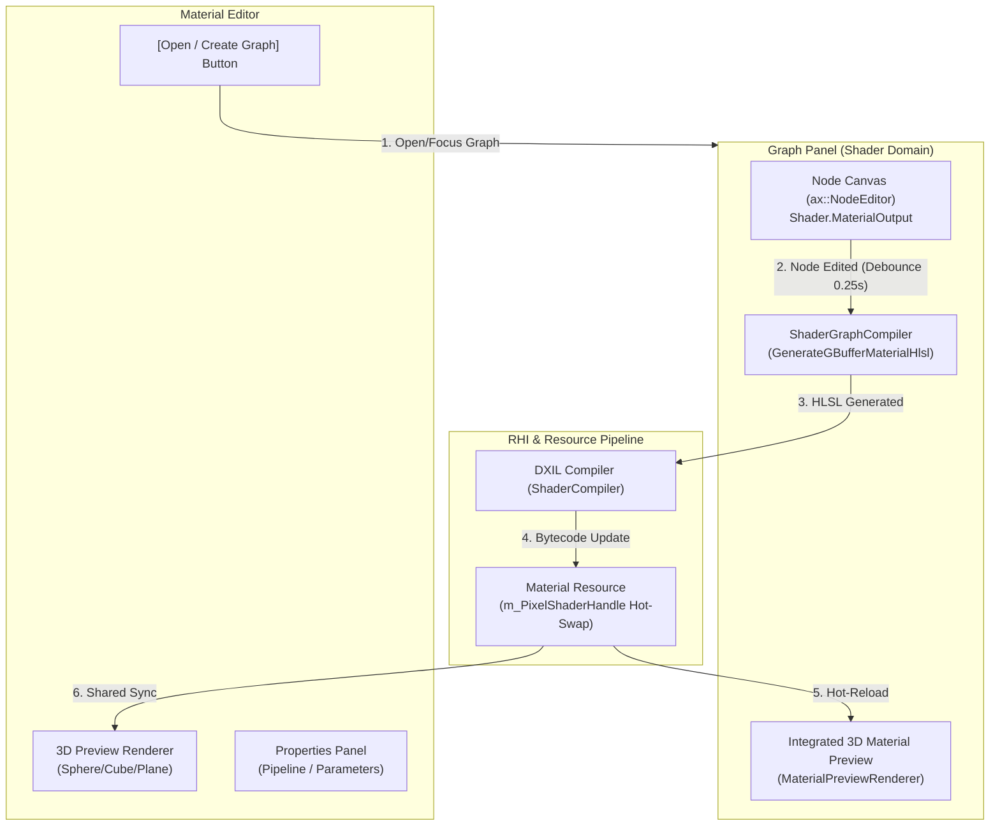

# 머티리얼-셰이더 그래프 통합 및 실시간 3D 프리뷰 개발 계획

- 작성일: 2026-11-19
- 상태: Phase 1~3 및 Step 1~2(언리얼 스타일 머티리얼 에디터 탭 통합 및 단일 3D 프리뷰어 연동) 구현 완료, 빌드 및 실환경 검증 대기
- 공통 기준: [EngineEditorClientGuidelines.md](EngineEditorClientGuidelines.md), [SourceOrganizationGuidelines.md](SourceOrganizationGuidelines.md), [EditorUXTestGuidelines.md](EditorUXTestGuidelines.md)
- 선행 기반: [EngineDevelopmentPlan.md](EngineDevelopmentPlan.md) 9·10절, [GraphFoundation.md](GraphFoundation.md), [GraphPanel.md](GraphPanel.md), [RenderingDevelopmentPlan.md](RenderingDevelopmentPlan.md)
- 통합 우선순위 연결: [DevelopmentPriorities.md](DevelopmentPriorities.md) (머티리얼 및 셰이더 그래프 저작 파이프라인 고도화)
- 관련 소스: `MaterialEditor.cpp`, `MaterialPreviewRenderer.cpp`, `GraphPanel.cpp`, `GraphPanelShader.cpp`, `ShaderGraphCompiler.cpp`

---

## 1. 목적과 비전

현재 BamEngine에는 3D PBR 머티리얼을 편집하고 실시간 3D 구체/큐브로 관찰할 수 있는 `MaterialEditor`와, 노드 기반으로 HLSL을 컴파일할 수 있는 `GraphPanel`(Shader 도메인)이 각각 독립적으로 구현되어 있다.
그러나 머티리얼 에디터에서 노드 그래프로 원클릭 진입하는 연결 통로가 없고, 그래프 패널 내부에서는 2D 평면 쿼드 프리뷰만 제공되어 3D PBR 조명 하이라이트·거칠기·메탈릭 특성을 실시간으로 체감하기 어렵다.

본 계획의 목표는 언리얼 엔진(Unreal Engine)의 **머티리얼 에디터(Material Editor)** 및 유니티의 **셰이더 그래프(Unity Shader Graph)** 와 동등한 수준으로,
머티리얼 에디터에서 노드 그래프로 즉시 진입하고, **3D 실시간 프리뷰(Sphere/Cube)를 직접 확인하면서 셰이더 노드를 저작 및 핫스왑하는 통합 파이프라인**을 구축하는 것이다.

> [!IMPORTANT]
> **설계 핵심 원칙:**
> 1. **에셋 참조와 소유권의 명확성:** 머티리얼 에셋(`.bammat.json`)은 소스 셰이더 그래프(`.bamgraph.json`)의 경로를 소유·참조하며, 그래프 에셋 자체는 독립적인 리소스로 관리되어 다른 머티리얼에서도 재사용될 수 있다.
> 2. **실시간 피드백 루프 (Live Feedback Loop):** 노드 연결이나 파라미터가 수정되면 디바운스(Debounce) 타이머를 통해 HLSL 생성 및 DXIL 메모리 컴파일이 백그라운드에서 수행되고, 3D 머티리얼 프리뷰(`MaterialPreviewRenderer`)에 무중단 핫스왑(Hot-swap)된다.
> 3. **안전성 및 Fallback 보장:** 노드 저작 중 구문 오류나 핀 미연결 상태가 발생해도 렌더러가 크래시되지 않으며, 직전 정상 셰이더(`LastGood`)를 유지하고 에디터 진단 패널에 경고를 표시한다.
> 4. **로캘 및 UI/UX 통일성 준수:** `Docs/EngineEditorClientGuidelines.md` 14·19절에 따라 모든 표시 텍스트는 원본 CSV(`Editor.MaterialEditor.csv`, `Editor.GraphPanel.csv`)에 등록하고, UI 패턴(버튼 순서, 툴바 레이아웃, 아이콘)을 통일한다.

---

## 2. 현재 상태와 갭 분석 (Gap Analysis)

### 2.1 이미 구축된 기반 자산
- **3D 머티리얼 프리뷰어 (`MaterialPreviewRenderer`):** `PreviewViewportWidget` 기반의 독립 씬, 카메라 조작(우클릭 회전/휠 줌), PBR 조명, Sphere/Cube/Plane 메쉬 전환, 자동 회전 기능을 완비함 (`MaterialEditor` 좌측에 탑재).
- **노드 그래프 저작 인프라 (`GraphPanel`):** `ax::NodeEditor` 프레임워크 기반 캔버스, 노드 팔레트, 줌/팬, 실행/정렬/주석 기능 완비. `EGraphDomain::Shader` 모드 지원.
- **PBR 머티리얼 코드 생성기 (`ShaderGraphCompiler`):** `GenerateGBufferMaterialHlsl()`을 통해 `Shader.MaterialOutput` 노드의 BaseColor, Metallic, Roughness, Normal, Emissive, AO 핀을 G-Buffer PBR 픽셀 셰이더 HLSL로 컴파일하는 파이프라인 완비.
- **머티리얼 리소스 구조 (`MaterialInterface`):** Reflection 및 아카이브 직렬화 지원, 파이프라인 상태, 텍스처 바인딩, 파라미터 컨스턴트 버퍼 관리 체계 완비.

### 2.2 남은 핵심 과제
1. **머티리얼-그래프 에셋 연결 부재:** 머티리얼 에셋에 소스 셰이더 그래프 경로 필드가 없으며, 머티리얼 에디터에 그래프 진입 액션/버튼이 없음.
2. **그래프 패널의 3D 프리뷰 부재:** `GraphPanel`의 셰이더 모드는 2D 텍스처 쿼드(`GraphShaderPreview`)만 표시하여 입체적인 PBR 특성을 확인하기 어려움.
3. **실시간 핫스왑 파이프라인 부재:** 노드 수정 시 자동으로 셰이더를 재컴파일하여 프리뷰 머티리얼에 즉각 주입하는 디바운스 메커니즘이 없음.
4. **노출 파라미터 연동 부재:** 그래프 내 `ConstantFloat`, `Color`, `Texture2D` 노드를 "Parameter"로 지정했을 때 머티리얼 프로퍼티 창에 슬라이더로 자동 노출되는 시스템이 연결되지 않음.

---

## 3. 아키텍처 및 워크플로우



---

## 4. 단계별 상세 개발 로드맵

### Phase 1. 머티리얼-그래프 에셋 바인딩 및 원클릭 진입 (Entry Point) [구현 완료: 2026-11-19]
- **목적:** 머티리얼이 자신의 원본 소스 그래프 에셋을 참조하도록 하고, 머티리얼 에디터에서 원클릭으로 셰이더 그래프를 열거나 신규 생성하도록 연결한다.
- **세부 내용:**
  - `MaterialInterface.h`:
    - `PROPERTY(EDITABLE, CATEGORY("CATEGORY_SHADER"), DISPLAY_NAME("PROP_SHADER_GRAPH_PATH"))`
      `string m_ShaderGraphPath = "";` 필드 및 접근자(`GetShaderGraphPath`, `SetShaderGraphPath`) 추가.
    - JsonArchive / BinaryArchive 직렬화 자동 지원 확인.
  - `MaterialEditor.cpp`:
    - `DrawCustomQuickAccess()`: 상단 툴바에 `ICON_FA_DIAGRAM_PROJECT` 아이콘의 [Open Shader Graph] 버튼 추가.
    - `DrawShaderSettings()`: 셰이더 헤더 영역에 그래프 바인딩 슬롯 및 상태별 버튼(`[Create New Graph]`, `[Open Graph]`) 배치.
    - 미생성 시 `Assets/Shaders/Graphs/<MaterialName>.bamgraph.json` 템플릿(기본 `Shader.MaterialOutput` 노드 포함) 자동 생성 팝업 지원.
    - `ImGuiManager::Get().OpenResourceEditor(path)`를 호출하여 해당 그래프를 로드하고 타겟 머티리얼 컨텍스트 바인딩.
- **완료 기준:** 머티리얼 에디터에서 버튼 클릭 시 연결된 `.bamgraph.json`이 `GraphPanel`에 열리고, 저장 후 재시작해도 바인딩 경로가 유지된다.

---

### Phase 2. `GraphPanel` 내 3D 머티리얼 프리뷰 위젯 통합 (3D Preview Dock) [구현 완료: 2026-11-19]
- **목적:** 그래프 패널 단독으로도 2D 쿼드 대신 3D 구체/큐브 실시간 뷰포트를 확인하며 노드를 저작할 수 있게 한다.
- **세부 내용:**
  - `GraphPanel.h` / `GraphPanelShader.cpp`:
    - `ShaderBuildState` 구조체에 `MaterialPreviewRenderer Preview3D` 인스턴스 및 `ResourceHandle<Material> PreviewMaterial` 추가.
    - `OnResourceWindowVisibility()` 및 `Update()` 라이프사이클에 3D 프리뷰 제출(`Submit`) 연동.
  - 프리뷰 뷰포트 UI 배치:
    - `DrawShaderBuildDetails()` 또는 우측 스플릿 창에 `Preview3D.DrawUI()` 배치.
    - 3D 뷰포트 상단/컨텍스트 메뉴에 메쉬 전환(Sphere / Cube / Plane), 마우스 우클릭 카메라 궤도 회전, 마우스 휠 줌, 조명 자동 회전 토글 컨트롤 제공.
- **완료 기준:** `GraphPanel`에서 `EGraphDomain::Shader` 모드일 때 우측 창에 실시간 3D 구체 프리뷰가 렌더링되고 마우스로 자유롭게 회전할 수 있다.

---

### Phase 3. 노드 편집 실시간 핫 컴파일 & 머티리얼 핫스왑 (Live Hot-Reload) [구현 완료: 2026-11-19]
- **목적:** 노드를 연결하거나 파라미터를 바꿀 때마다 버튼을 누르지 않아도 자동으로 컴파일되어 3D 프리뷰에 즉각 반영되는 실시간 피드백 루프를 구축한다.
- **세부 내용:**
  - 디바운스(Debounce) 자동 컴파일:
    - 캔버스 수정 카운터(Revision) 변경 감지 시 `m_CompileCooldown = 0.25f` 설정.
    - 입력이 멈춘 후 0.25초 경과 시 백그라운드 컴파일 트리거.
  - 핫스왑 파이프라인:
    - `ShaderGraphCompiler::GenerateGBufferMaterialHlsl`로 HLSL 생성.
    - `ShaderCompiler::Compile`로 메모리 상에서 DXIL 바이트코드 컴파일.
    - 컴파일 성공 시 `PreviewMaterial`의 픽셀 셰이더를 즉시 교체하고 렌더 파이프라인 캐시 무효화.
    - 바인딩된 원본 `Material` 에셋도 동시에 갱신되어, 도킹된 `MaterialEditor`의 3D 프리뷰도 함께 실시간 반응.
  - 안전성 방어:
    - 컴파일 실패 시 크래시를 방지하고 `LastGood` 바이트코드 유지.
    - 상태 텍스트에 빨간색 에러 배지 표시 및 하단 로그 창에 셰이더 컴파일 에러 라인 출력.
- **완료 기준:** `Shader.Color` 노드의 RGB 값을 바꾸거나 `Roughness` 핀에 노드를 연결할 때, 약 0.3초 내에 우측 3D 구체의 색상과 반사광이 실시간으로 갱신된다.

---

### Phase 4. 노출 파라미터 ↔ 머티리얼 프로퍼티 양방향 연동 & VS/PS 통합 [설계 완료]
- **목적:** 셰이더 노드 중 외부에 노출할 파라미터를 지정하고, 머티리얼 인스펙터 슬라이더와 양방향 동기화하며, 단일 머티리얼 그래프에서 정점(VS, WPO 등) 및 픽셀(PS, PBR) 셰이더를 통합 제어한다.
- **세부 설계 사양 문서:** [MaterialGraphSynchronizationAndStageDesign.md](MaterialGraphSynchronizationAndStageDesign.md)
- **주요 내용:**
  - **양방향 동기화 모델:** 셰이더 그래프를 인터페이스(Layout/SSOT)로 두고, 머티리얼은 런타임 값 오버라이드로 분리. 머티리얼 인스펙터의 파라미터 값 변경 시 셰이더 재컴파일 없이 GPU 상수 버퍼(`MaterialConstants`)만 즉시 갱신하는 Fast-Path 구현.
  - **다중 그래프 패널 공통화:** `GraphPanel`, `MaterialEditorCanvas`, `AnimatorGraphPanel`의 툴바, 줌/팬 네비게이션, 노드 정렬, 단축키 공통 레이어(`Editor::GraphCommon`) 도입.
  - **VS/PS 통합 컴파일:** 단일 마스터 노드에 버텍스 입력 핀(World Position Offset, Custom UV)과 픽셀 입력 핀(PBR)을 함께 배치하고, `ShaderGraphCompiler`에서 `GenerateGBufferVS`와 `GenerateGBufferPS`로 분할 생성하여 한 번에 빌드/바인딩.

---

### Phase 5. 머티리얼 기본 렌더 패스(Primary Pass Type) 도입 및 셰이더 정합성 [설계 완료]
- **목적:** 머티리얼의 기본 셰이더가 디퍼드 `Geometry` 패스를 암묵적으로 전제하는 구조를 해소하고, `ForwardTransparent`(반투명), `UI`, `PostProcess` 등 주 렌더 패스를 머티리얼이 직접 결정할 수 있도록 확장한다.
- **세부 설계 사양 문서:** [MaterialPrimaryPassTypeDesign.md](MaterialPrimaryPassTypeDesign.md)
- **주요 내용:**
  - `MaterialInterface`에 `m_PrimaryPassType` 속성 추가 및 리플렉션 등록.
  - `GetVertexShader()` / `GetPixelShader()` Fallback 정합성 개선.
  - 에디터 파이프라인 설정 상단에 기본 패스 타입 선택 콤보 추가 및 `BlendMode` 권장 프리셋 연동.
  - 셰이더 그래프 컴파일러의 타깃 렌더 패스(GBuffer vs Forward단일 타깃) 코드 생성 연동.

---

## 5. 로캘 키 및 UI/UX 통일성 지침 (지침 14·19절 준수)

규칙에 따라 생성 파일인 JSON 번역본을 직접 수정하지 않고, 원본 CSV 파일에 행을 추가하여 관리한다.

### 5.1 `Editor/Resources/Data/Localization/Editor.MaterialEditor.csv`
```csv
Key,SourceString,Korean,Description
MaterialEditor.OpenShaderGraph,"Open Shader Graph","셰이더 그래프 열기","머티리얼과 연계된 셰이더 그래프를 엽니다."
MaterialEditor.CreateShaderGraph,"Create Shader Graph","새 셰이더 그래프 생성","머티리얼용 새 셰이더 그래프를 생성합니다."
MaterialEditor.ShaderGraphPath,"Shader Graph","셰이더 그래프","머티리얼에 연결된 셰이더 그래프 파일 경로"
MaterialEditor.CreateGraphPrompt,"A shader graph asset does not exist. Do you want to create a new one?","연결된 셰이더 그래프 에셋이 없습니다. 새로 생성하시겠습니까?","그래프 생성 안내 팝업"
```

### 5.2 `Editor/Resources/Data/Localization/Editor.GraphPanel.csv`
```csv
Key,SourceString,Korean,Description
GraphPanel.Preview3D,"3D Material Preview","3D 머티리얼 프리뷰","셰이더 그래프의 3D 머티리얼 실시간 프리뷰"
GraphPanel.LivePreview,"Live Preview","실시간 프리뷰","노드 수정 시 실시간 컴파일 및 프리뷰 갱신 토글"
GraphPanel.TargetMaterial,"Target Material","대상 머티리얼","현재 그래프와 동기화 중인 머티리얼 에셋"
```

---

## 6. 검증 및 테스트 계획

### 6.1 정적 분석 및 안정성 검증
- `MaterialInterface`에 `m_ShaderGraphPath` 추가 후 기존 머티리얼 JSON 에셋과의 하위 호환성 검증 (필드 누락 시 빈 문자열 기본값 처리).
- `GraphPanel` 닫힘 및 도메인 전환 시 `MaterialPreviewRenderer::Free()` 정상 호출 및 GPU 리소스 누수 방지 확인.

### 6.2 사용자 직접 실행 검증 시나리오 (AGENTS.md 2절)
1. **진입 흐름 검증:**
   - 머티리얼 에디터 실행 -> 툴바의 [Open Shader Graph] 클릭 -> 신규 그래프 생성 팝업 -> `GraphPanel`이 열리고 템플릿 노드가 로드되는지 확인.
2. **실시간 3D 프리뷰 검증:**
   - `GraphPanel` 우측의 3D 구체 프리뷰 확인 -> `Shader.Color` 노드의 색상 슬라이더 조절 -> 약 0.3초 후 3D 구체의 색상이 즉시 변경되는지 확인.
3. **오류 내구성 검증:**
   - 노드 링크를 끊어 유효하지 않은 상태를 만들었을 때 크래시 없이 직전 셰이더가 유지되고 진단 로그 창에 컴파일 에러가 표시되는지 확인.
4. **저장 및 재열기 검증:**
   - 그래프와 머티리얼을 저장한 뒤 에디터를 재시작하여 머티리얼을 열었을 때, 연결된 그래프 경로가 온전히 유지되는지 확인.
