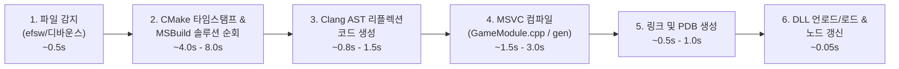

# C++ 모듈 핫리로드 시간 단축 및 빌드 최적화 분석서

- 작성일: 2026-10-30
- 상태: 분석 및 최적화 실행 계획
- 대상: `Projects/GameModule`, `Editor/Source/HotReload`, `Projects/Reflection`
- 관련 문서:
  - [VisualScriptingBlueprintPlan.md](VisualScriptingBlueprintPlan.md) (4.1절 라이브 노드 핫리로드 파이프라인)
  - [BuildConfigurationAndPreprocessing.md](BuildConfigurationAndPreprocessing.md) (빌드 구성 표준)
  - [DevelopmentPriorities.md](DevelopmentPriorities.md) (개발 우선순위)

---

## 1. 개요 및 목표

### 1.1 배경
현재 `Projects/GameModule`에 `FUNCTION(GRAPH_CALLABLE)` 어노테이션을 붙여 C++ 소스를 수정한 뒤 저장하면, `ModuleBuildManager`가 변경을 감지하여 백그라운드에서 빌드(`cmake.exe --build`)를 수행하고 에디터가 DLL을 핫리로드하여 그래프 노드를 실시간으로 갱신한다.

그러나 현재 핫리로드 루프에는 **4~10초 이상의 지연 시간**이 발생하고 있으며, 이는 개발자가 C++ 로직을 수정하고 그래프에서 즉시 확인하는 '라이브 코딩 인터랙션(Live Interaction)'의 흐름을 방해한다.

### 1.2 목표 지표
- **현재 소요 시간:** 약 5초 ~ 12초 (CMake 타임스탬프 갱신 시 15초 이상)
- **1차 단기 목표:** **1.5초 ~ 2.5초** (에디터 중단 없이 즉각적인 체감 개선)
- **2차 궁극적 목표:** **0.5초 ~ 1.0초 미만 (Sub-Second Hot-Reload)**

---

## 2. 병목 구간 상세 분석 (Profiling & Root Cause)

현재 핫리로드 프로세스는 아래 6단계로 이루어지며, 각 단계별 병목 원인은 다음과 같다.



### [병목 1] `cmake.exe --build`와 MSBuild 솔루션 순회 비용 (가장 큰 지연: 4~8초)
- **현상:** `ModuleBuildManager.cpp`에서 `cmake.exe --build <buildDir> --target GameModule` 명령을 실행함.
- **원인:**
  1. CMake는 내부적으로 최상위 솔루션(`BamEngine.sln`)을 대상으로 MSBuild를 구동함.
  2. MSBuild는 `GameModule`뿐만 아니라 솔루션 내의 **20여 개 프로젝트(`.vcxproj`) 전체의 의존성 그래프와 파일 타임스탬프를 순회·평가**함.
  3. `CMakeLists.txt` 타임스탬프가 건드려진 경우, CMake 설정 단계(`generate.stamp`)가 재평가되면서 `vcpkg install` 및 서드파티 패키지 탐색이 재실행되어 **10초 이상의 치명적인 지연**이 발생함.

### [병목 2] 프리컴파일드 헤더(PCH) 부재로 인한 MSVC 컴파일 오버헤드 (1.5~3초)
- **현상:** `GameModule.cpp`와 생성된 `GameModule.gen.cpp` 단 2개의 파일을 컴파일하는데 수 초가 소요됨.
- **원인:**
  1. `Projects/GameModule/CMakeLists.txt`에 PCH 설정이 누락되어 있음.
  2. 매 컴파일마다 `<windows.h>`, `<string>`, `<vector>`, `entt`, `glm`, `Engine_API.h`, `SystemManager.h`, `ReflectionRegistry.h` 등 **수십만 줄의 엔진 및 외부 템플릿 헤더를 처음부터 다시 파싱·인스턴스화**함.

### [병목 3] 리플렉션 생성기(ReflectionGenerator)의 전체 헤더 재파싱 (0.8~1.5초)
- **현상:** 함수 1줄을 수정하더라도 Clang 기반 `ReflectionGenerator.exe`가 동작함.
- **원인:**
  - `GameGameplayLibrary.h` 파일 내에 함수가 수십 개로 늘어날 경우, Clang AST 프론트엔드가 헤더 전체와 include된 엔진 코드를 파싱하는 시간이 비례하여 증가함.
  - 리플렉션과 무관한 일반 로직 함수만 수정한 경우에도 리플렉션 코드 생성이 항상 트리거됨.

### [병목 4] 디바운스 대기 시간 (0.5초)
- **현상:** `CollectReadyFiles(std::chrono::milliseconds(500))`
- **원인:** IDE(Visual Studio, VS Code)의 저장 시 임시 파일 생성 및 파일 쓰기 버퍼 플러시 완료를 기다리기 위해 500ms 동안 대기함.

---

## 3. 단계별 단축 및 최적화 실행 방안

---

### 방안 A. 단기 과제 (Quick Wins: 1.5초 ~ 2초대 달성)

#### 1. MSBuild 직접 타깃팅 및 솔루션 순회 차단 (`/p:BuildProjectReferences=false`)
- **방법:** `cmake.exe --build` 대신, MSBuild를 직접 실행하여 `GameModule.vcxproj`만 핀포인트로 빌드하도록 변경.
  ```powershell
  # 기존 (솔루션 전체 프로젝트 검사로 5초 소모)
  cmake.exe --build <buildDir> --target GameModule --config Debug

  # 개선안 (GameModule.vcxproj 직접 호출 + 종속 프로젝트 순회 차단)
  msbuild.exe out/build/x64-debug/Projects/GameModule/GameModule.vcxproj /p:Configuration=Debug /p:Platform=x64 /p:BuildProjectReferences=false /m /verbosity:minimal
  ```
- **효과:** 엔진 코어가 이미 빌드되어 있는 상태에서 프로젝트 의존성 검사 시간이 **4초 $\rightarrow$ 0.3초**로 급감.

#### 2. GameModule 전용 프리컴파일드 헤더(PCH) 도입
- **방법:** `Projects/GameModule/CMakeLists.txt`에 엔진 공통 PCH 또는 전용 PCH 설정 추가.
  ```cmake
  # Projects/GameModule/CMakeLists.txt
  target_precompile_headers(GameModule PRIVATE
      <vector>
      <string>
      <string_view>
      <unordered_map>
      <functional>
      "Engine_API.h"
      "Logger.h"
      "SystemManager.h"
      "Reflection/ReflectionRegistry.h"
  )
  ```
- **효과:** `GameModule.cpp` 및 `GameModule.gen.cpp`의 MSVC C++ 파싱 시간이 **2.5초 $\rightarrow$ 0.4초**로 단축.

#### 3. 파일 수정 디바운스 타이머 미세 조정 (500ms $\rightarrow$ 150~200ms)
- **방법:** `ModuleBuildManager.cpp`의 디바운스 대기 시간을 500ms에서 200ms로 단축.
- **효과:** 저장 즉시 빌드 시작으로 체감 반응 속도 **300ms 향상**.

---

### 방안 B. 중기 과제 (Sub-Second: 0.8초 ~ 1.2초 달성)

#### 1. Ninja 멀티 제너레이터 전환 검토
- **방법:** Visual Studio MSBuild 제너레이터 대신 `Ninja` 또는 `Ninja Multi-Config` 제너레이터 사용.
- **효과:** Ninja는 C++ 의존성 그래프 검사를 C 언어 수준의 초고속 stat 호출로 처리하므로, 증분 빌드 체크 오버헤드가 **0.05초(50ms)** 미만으로 수렴.

#### 2. 리플렉션 증분 캐싱 (Hash-based Reflection Skipping)
- **방법:**
  - 헤더 내의 `FUNCTION(...)`, `PROPERTY(...)` 등 리플렉션 매크로가 선언된 라인들의 텍스트 해시(SHA256/FNV-1a)를 캐싱.
  - 함수 본문(Body) 내부의 로직만 변경된 경우 `ReflectionGenerator` 호출을 건너뛰고 기존 `GameModule.gen.cpp`를 그대로 링크.
- **효과:** 순수 로직 수정 시 리플렉션 생성 단계(0.8초) 완전 생략.

#### 3. 증분 링크(`/INCREMENTAL`) 최적화
- **방법:** DLL 빌드 시 매번 바이너리를 전체 재링크하는 대신, 함수 점프 테이블(thunk)만 패치하는 MSVC 증분 링크를 극대화.
- **효과:** 링크 시간 0.5초 $\rightarrow$ 0.1초.

---

### 방안 C. 장기 과제 (Live++ 스타일 인메모리 핫패칭: 0.1초 미만)
- DLL 자체를 `FreeLibrary` / `LoadLibrary` 하지 않고, 컴파일된 기계어 바이트(obj)만 읽어 실행 중인 프로세스의 기존 함수 프롤로그에 `jmp` 명령어를 덮어쓰는(Hot-Patching / Hooking) 기술.
- 상태(State) 유지가 완벽하며, 리로드 지연 시간이 사실상 0ms에 수렴함. (추후 대규모 게임플레이 반복 작업 시 도입 고려)

---

## 4. 권장 적용 순서 (Action Items)

| 단계 | 항목 | 난이도 | 예상 단축 효과 | 적용 위치 |
| :--- | :--- | :---: | :---: | :--- |
| **Step 1** | 디바운스 시간 단축 (500ms $\rightarrow$ 200ms) | 하 | -300ms | `Editor/Source/HotReload/Private/ModuleBuildManager.cpp` |
| **Step 2** | `GameModule` PCH 추가 | 하 | -1.5초 ~ 2초 | `Projects/GameModule/CMakeLists.txt` |
| **Step 3** | MSBuild 개별 vcxproj 직접 호출 또는 `/p:BuildProjectReferences=false` | 중 | -3초 ~ 5초 | `Editor/Source/HotReload/Private/ModuleBuildManager.cpp` |
| **Step 4** | 리플렉션 매크로 변경 감지 캐싱 | 중 | -0.8초 | `Projects/GameModule/CMakeLists.txt` |

이상의 최적화가 적용되면, C++ 코드 저장 후 **1.5초 안팎에 에디터 그래프에 노드가 실시간으로 동기화**되는 쾌적한 개발 환경을 얻을 수 있다.
