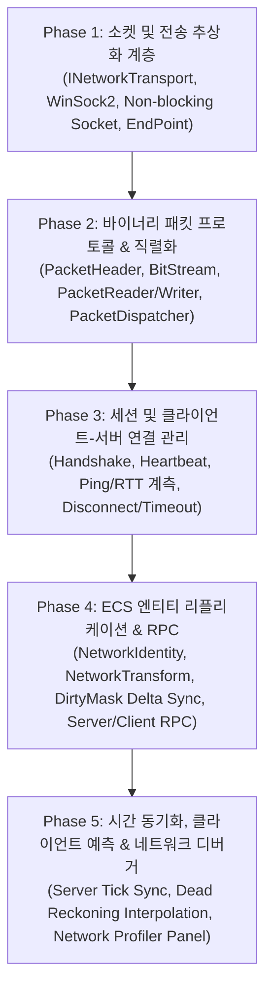

# 네트워크 기반 및 멀티플레이어 개발 계획

- 작성일: 2026-11-01
- 상태: 계획 / 목표 수립
- 공통 기준: [EngineEditorClientGuidelines.md](EngineEditorClientGuidelines.md), [SourceOrganizationGuidelines.md](SourceOrganizationGuidelines.md)
- 선행 기반: [EngineDevelopmentPlan.md](EngineDevelopmentPlan.md) 14절 M, [GraphFoundation.md](GraphFoundation.md), [VisualScriptingBlueprintPlan.md](VisualScriptingBlueprintPlan.md)
- 통합 우선순위 연결: [DevelopmentPriorities.md](DevelopmentPriorities.md) (P3/P4 네트워크 기반 및 규모 확장)

---

## 1. 목적과 비전

BamEngine이 멀티플레이어 게임, 강화학습 시뮬레이터(Python 어댑터 및 원격 통신), V-Tuber/아바타(VMC 모션 추적 패킷 및 외부 방송 연동) 등 다양한 결과물을 원활히 구동하기 위해서는, 견고하고 확장 가능한 **네트워크 통신 기초(Network Foundation)** 가 필수적이다.

본 계획의 목표는 언리얼 엔진의 네트워킹 아키텍처(Replication, RPC, NetDriver)와 유니티의 Netcode를 벤치마크하여, 저수준 소켓 통신부터 상위 ECS(EnTT) 기반 엔티티 복제 및 원격 프로시저 호출(RPC)까지 단계적으로 확장할 수 있는 통합 네트워크 파이프라인을 구축하는 것이다.

> [!IMPORTANT]
> **설계 핵심 원칙:**
> 1. **전송 계층(Transport)의 추상화:** 소켓 구현체(WinSock2, POSIX, 또는 향후 GameNetworkingSockets/ENet/Asio)에 직접 의존하지 않고, 추상화된 전송 인터페이스(`INetworkTransport`)를 통해 엔진 런타임과 네트워크 계층을 격리한다.
> 2. **이원화된 프로토콜 지원 (신뢰성 vs 비신뢰성):**
>    - 게임플레이 동기화(위치, 회전): 빠른 전송과 지연 방지를 위해 비신뢰성 시퀀스 UDP 채널(Unreliable Sequenced)을 기본으로 사용한다.
>    - 중요 이벤트(스폰, 파괴, RPC, 채팅): 패킷 손실 시 재전송을 보장하는 신뢰성 UDP/TCP 채널(Reliable Ordered)을 사용한다.
> 3. **ECS(EnTT) 친화적 증분 리플리케이션 (Delta Replication):**
>    - 모든 컴포넌트의 전체 데이터를 매 프레임 브로드캐스트하지 않는다.
>    - 변경된 필드만 비트 마스크(`DirtyMask`)로 추적하여 최소 크기의 델타 패킷만 전송함으로써 대역폭(Bandwidth)을 극대화한다.
> 4. **권한 중심(Authoritative) 서버 모델:**
>    - 서버가 월드 상태의 유일한 진실의 원천(Source of Truth)이며, 클라이언트는 입력을 송신하고 결과를 예측(Client-Side Prediction)한 뒤 서버 스냅샷에 맞춰 보정(Reconciliation)한다.
> 5. **외부 통신과의 경계 분리:**
>    - 게임 멀티플레이 패킷, VMC 모션 추적 패킷(UDP OSC), 강화학습 IPC(TCP/공유 메모리)는 소켓 인프라를 공유할 수 있으나 세션 계약과 메시지 직렬화는 별도 도메인으로 엄격히 분리한다.

---

## 2. 현재 상태와 갭 분석 (Gap Analysis)

### 2.1 이미 구축된 기반 (Ready)
- **RL 전용 loopback 통신:** `Simulation/RLServer`에 Winsock TCP listen/accept와 개행 요청/응답, `Client --rl`과 Python 어댑터가 있다(2026-11-02 정적 대조). 일반 전송 추상화·게임 세션·리플리케이션 완료를 의미하지 않으며 프로토콜 잔여는 [점검 F09](CodeDocumentationAudit-2026-11-02.md)를 따른다.
- **리플렉션 및 직렬화 기반:** `Engine/Source/Core/Public/Reflection/` 및 `ReflectionArchive`를 통해 C++ 구조체 및 기본 자료형의 직렬화/역직렬화 인프라 구비.
- **ECS 월드 아키텍처:** EnTT 기반 `World`, `Scene`, `Entity` 구조를 통해 컴포넌트 단위의 상태 조회 및 순회가 용이함.
- **비주얼 스크립팅 이벤트 디스패치:** `GraphSystem` 및 `GraphGameplayLibrary`가 구축되어 있어 네트워크 이벤트/RPC의 노드 노출이 용이함.

### 2.2 네트워크 기반 구축을 위해 필요한 핵심 공백 (To-Do)
1. **일반 소켓 전송 계층:** RL 전용 Winsock 경로와 별개로 재사용 가능한 `INetworkTransport`, 논블로킹 I/O 래퍼, 주소 해석(`IpAddress`, `EndPoint`)은 계획 범위다. OS 소켓 사용 자체가 전혀 없다는 의미가 아니다.
2. **바이너리 패킷 스트림:** 엔디안 안전성, 헤더 매직넘버, 패킷 ID, 시퀀스 번호, 체크섬 검증을 수행하는 고속 바이너리 버퍼(`BitStream`, `PacketWriter`, `PacketReader`) 부재.
3. **패킷 디스패처 및 핸들러 테이블:** 수신된 패킷 ID에 따라 등록된 콜백 함수로 역직렬화된 데이터를 전달하는 라우터 부재.
4. **세션 및 연결 관리자:** 서버(Listen/Dedicated) 바인드/리스닝, 클라이언트 접속 요청(Connect), 3-Way 핸드셰이크, 핑/RTT 계측, 하트비트 및 타임아웃 감지 부재.
5. **엔티티 네트워크 식별자 및 복제 컴포넌트:**
   - 네트워크 상에서 고유하게 식별할 `NetworkIdentityComponent`(`NetId`, `OwnerClientId`).
   - 트랜스폼 동기화용 `NetworkTransformComponent`.
6. **RPC (Remote Procedure Call) 매크로 및 디스패치:**
   - `ServerRPC`, `ClientRPC`, `MulticastRPC` 선언 및 매개변수 패킹/호출 인프라 부재.
7. **네트워크 시뮬레이션 및 디버그 도구:**
   - 에디터 내 패킷 손실율(Packet Loss), 지연 시간(Latency/Ping Jitter) 인위적 모의 도구 및 네트워크 트래픽 모니터링 패널 부재.

---

## 3. 단계별 개발 로드맵



---

### Phase 1. 소켓 및 전송 추상화 계층 (Phase 1: Transport Foundation)
- **목적:** OS 플랫폼에 독립적으로 안전하게 바이트 스트림을 송수신할 수 있는 저수준 네트워크 소켓 계층을 구축한다.
- **세부 내용:**
  - `IpAddress` 및 `EndPoint`: IPv4/IPv6 문자열 파싱, 포트 번호 바인딩, sockaddr 구조체 래핑.
  - `INetworkTransport`: 순수 가상 전송 인터페이스 (`Initialize`, `Shutdown`, `Bind`, `Listen`, `Connect`, `Send`, `Receive`, `Close`).
  - `SocketTransport` (WinSock2 기반):
    - 논블로킹(Non-blocking) I/O 모드 (`ioctlsocket(FIONBIO)`).
    - UDP (`SOCK_DGRAM`) 및 TCP (`SOCK_STREAM`) 지원.
    - 소켓 에러 로깅 (`WSAGetLastError()` 안전 변환).
- **완료 기준:** 에코(Echo) 테스트 프로그램을 통해 클라이언트가 서버로 바이트 버퍼를 송신하면, 서버가 이를 수신하여 클라이언트에게 동일하게 반환하고 콘솔에 정상 출력된다.

---

### Phase 2. 바이너리 패킷 프로토콜 및 직렬화 (Phase 2: Packet Protocol & Serialization)
- **목적:** 바이트 데이터를 의미 있는 메시지 구조로 안전하고 효율적으로 변환하는 바이너리 패킷 파이프라인을 구축한다.
- **세부 내용:**
  - **패킷 헤더 (`PacketHeader` - 8바이트 고정):**
    - `Magic` (2바이트): BamEngine 패킷 검증용 고유 식별자 (`0xBA, 0x4D`).
    - `PacketId` (2바이트): 메시지 유형 식별자 (Enum 또는 해시).
    - `PayloadSize` (2바이트): 페이로드 길이 (최대 64KB, 점보 패킷 방지).
    - `SequenceNumber` (2바이트): 패킷 순서 및 유실 감지용 일련번호.
  - **바이너리 스트림 (`PacketWriter`, `PacketReader`):**
    - 기본 타입(int, float, bool, string, Vector3, Quaternion 등) 비트 수준 직렬화.
    - 리틀 엔디안 표준화, 버퍼 오버플로우/경계 검증(`EError::BufferUnderflow`).
  - **패킷 디스패처 (`PacketDispatcher`):**
    - `PacketId`별 핸들러 콜백 함수 등록 (`RegisterHandler<T>(callback)`).
    - 수신된 원시 바이트에서 헤더 검증 후 해당 핸들러로 페이로드 라우팅.
- **완료 기준:** 송신측에서 임의의 구조체(`Vector3`, `string` 등)를 `PacketWriter`로 직렬화하여 전송하고, 수신측 `PacketDispatcher`가 등록된 핸들러에서 정확한 값으로 복원하여 처리한다.

---

### Phase 3. 세션 및 클라이언트-서버 연결 라이프사이클 (Phase 3: Session & Connection Lifecycle)
- **목적:** 실제 다중 접속 환경에서 클라이언트의 접속, 인증, 유지, 정상 종료, 비정상 연결 끊김을 관리하는 엔진 세션 레이어를 구축한다.
- **세부 내용:**
  - **네트워크 모드:** `ENetworkMode::Standalone`, `ENetworkMode::DedicatedServer`, `ENetworkMode::ListenServer`, `ENetworkMode::Client`.
  - **3-Way 핸드셰이크 연결:**
    - `Client -> Server`: `ConnectRequest` (프로토콜 버전, 클라이언트 토큰).
    - `Server -> Client`: `ConnectChallenge` 또는 `ConnectAccept` (할당된 `ClientId`, 서버 틱 레이트).
    - `Client -> Server`: `ConnectAck`.
  - **하트비트 및 RTT(Ping) 계측:**
    - 주기적인 `Ping`/`Pong` 패킷 왕복 시간 계산 및 평활화(Smoothed RTT).
    - 일정 시간(예: 10초) 동안 패킷 미수신 시 타임아웃 연결 해제(`DisconnectReason::TimedOut`).
  - **네트워크 시스템 틱 (`NetworkSystem`):**
    - 엔진 `SystemManager` 루프의 프레임 시작 단계에서 수신 버퍼 폴링(`PollEvents`).
    - 프레임 끝 단계에서 송신 큐 플러시(`FlushSendQueue`).
- **완료 기준:** Dedicated Server 프로세스를 띄우고 두 개의 Client 프로세스가 동시 접속했을 때, 각각 고유한 `ClientId`를 발급받고 RTT가 실시간 측정되며, 정상/강제 종료 시 서버가 이를 감지하여 세션을 정리한다.

---

### Phase 4. ECS 엔티티 리플리케이션 및 RPC (Phase 4: ECS Replication & RPC)
- **목적:** 서버 월드의 엔티티와 컴포넌트 변화를 접속된 모든 클라이언트에게 동기화하고, 원격 함수 호출을 지원한다.
- **세부 내용:**
  - **네트워크 식별자 컴포넌트 (`NetworkIdentityComponent`):**
    - `NetId` (32비트 고유 식별자): 서버가 생성하여 전역 관리, 클라이언트 월드에 동일한 `NetId`를 가진 프록시 엔티티 스폰.
    - `OwnerClientId`: 엔티티 소유 권한을 가진 클라이언트 ID (자신이 소유한 폰/캐릭터 판별).
  - **트랜스폼 리플리케이션 (`NetworkTransformComponent`):**
    - 위치(`Vector3`), 회전(`Quaternion`), 속도(`Vector3`) 동기화.
    - 더티 플래그(`DirtyMask`): 이전 프레임 대비 임계값(Epsilon) 이상 이동했을 때만 동기화 패킷 전송.
  - **원격 프로시저 호출 (RPC System):**
    - `ServerRPC`: 클라이언트가 소유한 엔티티를 통해 서버에 특정 행동 요청 (예: 발사, 상호작용).
    - `ClientRPC`: 서버가 특정 클라이언트 엔티티에 명령 하달 (예: 피격 데미지 UI 팝업).
    - `MulticastRPC`: 서버가 해당 엔티티를 관측 중인 모든 클라이언트에게 브로드캐스트 (예: 폭발 이펙트 재생).
  - **비주얼 스크립팅 연동:**
    - `GraphGameplayLibrary`에 `SendCustomServerEvent`, `IsServer`, `IsLocallyControlled` 노드 노출.
- **완료 기준:** Server에서 큐브 엔티티를 생성하고 위치를 변경하면 Client 화면에서도 동일한 `NetId`를 가진 큐브가 실시간 이동하며, Client에서 키를 누르면 `ServerRPC`를 통해 서버에 이벤트가 도달한다.

---

### Phase 5. 시간 동기화, 클라이언트 예측 및 네트워크 디버거 (Phase 5: Sync, Prediction & Profiler)
- **목적:** 네트워크 지연(Latency) 환경에서도 조작감이 끊기지 않는 부드러운 플레이를 제공하고, 네트워크 품질을 시각화한다.
- **세부 내용:**
  - **서버-클라이언트 틱 동기화:** 서버 틱과 클라이언트 틱 타임스탬프를 보정하여 일관된 델타 타임 유지.
  - **클라이언트 측 예측 (Client-Side Prediction):** 로컬 플레이어 캐릭터는 서버 응답을 기다리지 않고 입력 즉시 이동, 이후 도착한 서버 스냅샷과 오차 발생 시 스무딩 화해(Reconciliation).
  - **원격 엔티티 보간 (Dead Reckoning & Interpolation):** 다른 플레이어 캐릭터의 위치 변화를 버퍼링하여 틱 간격을 부드러운 스플라인/선형 보간으로 렌더링.
  - **에디터 네트워크 프로파일러 패널 (`NetworkProfilerPanel`):**
    - 초당 인바운드/아웃바운드 대역폭(KB/s), 패킷 수(PPS), 핑(RTT), 패킷 손실률 실시간 그래프.
    - 네트워크 시뮬레이션 툴: 인위적인 지연(Lag: 100ms 등) 및 패킷 손실(Packet Drop: 5% 등) 주입 기능.
- **완료 기준:** 150ms의 인위적 지연을 적용한 상태에서도 로컬 캐릭터 조작이 즉각 반응하며, 상대방 캐릭터가 버벅거리지 않고 부드럽게 보간되어 렌더링된다.

---

## 4. 데이터 모델 및 아키텍처 계약

### 4.1 패킷 구조 정의
```cpp
#pragma pack(push, 1)
struct PacketHeader
{
    std::uint16_t Magic = 0xBA4D;       // 'BM' BamEngine Magic
    std::uint16_t PacketId = 0;         // 메시지 타입 ID
    std::uint16_t PayloadSize = 0;      // 페이로드 크기
    std::uint16_t Sequence = 0;         // 시퀀스 번호
};
#pragma pack(pop)

enum class EPacketId : std::uint16_t
{
    // 연결 라이프사이클
    ConnectRequest = 1,
    ConnectAccept = 2,
    HeartbeatPing = 3,
    HeartbeatPong = 4,
    Disconnect = 5,

    // 월드 동기화
    SpawnEntity = 10,
    DestroyEntity = 11,
    SyncTransform = 12,
    RPCMessage = 13
};
```

### 4.2 ECS 네트워크 컴포넌트
```cpp
namespace Engine
{
    using NetId = std::uint32_t;
    constexpr NetId InvalidNetId = 0;

    STRUCT()
    struct NetworkIdentityComponent
    {
        PROPERTY()
        NetId NetworkId = InvalidNetId;

        PROPERTY()
        std::uint32_t OwnerClientId = 0; // 0 = Server Owned

        PROPERTY()
        bool IsServerOnly = false;
    };

    STRUCT()
    struct NetworkTransformComponent
    {
        PROPERTY()
        float SyncRate = 20.0f; // 초당 동기화 횟수 (20Hz)

        PROPERTY()
        float PositionThreshold = 0.01f;

        PROPERTY()
        float RotationThresholdDegrees = 0.5f;

        // 런타임 보간용 버퍼
        Vector3 TargetPosition;
        Quaternion TargetRotation;
        float InterpolationFactor = 0.0f;
    };
}
```

---

## 5. 지침 준수 및 품질 기준

- **로캘 및 입력 규칙 (`EngineEditorClientGuidelines.md` 14절):**
  - 네트워크 관련 에러 메시지(연결 실패, 타임아웃, 버전 불일치) 및 프로파일러 패널 UI는 `Network.*` 로캘 키를 사용한다.
- **메모리 안전성 및 방어적 검증:**
  - 수신된 버퍼의 크기가 패킷 헤더에 선언된 `PayloadSize`보다 작거나 64KB를 초과할 경우 즉각 패킷을 폐기하고 연결 의심 상태로 플래그한다.
  - 역직렬화 도중 버퍼 오버플로우가 발생하지 않도록 읽기 경계(`ReadBuffer`)를 매 바이트 검사한다.
- **성능 목표:**
  - 20Hz 동기화 기준, 엔티티당 트랜스폼 델타 패킷 크기는 16바이트 이내로 억제한다.

---

## 6. 완료 검증 체크리스트

- [ ] **소켓 통신:** TCP 및 UDP 전송 계층을 통해 로컬루프백(`127.0.0.1`) 및 LAN 환경에서 패킷 유실 없이 바이트 스트림이 오가는가?
- [ ] **직렬화 정합성:** 다양한 기본 타입과 사용자 구조체가 직렬화 후 비트 손상 없이 동일한 값으로 역직렬화되는가?
- [ ] **다중 세션 관리:** 복수의 클라이언트가 접속하고 비정상 종료(강제 종료, 케이블 분리 모의)되었을 때 서버가 크래시 없이 타임아웃 처리하는가?
- [ ] **엔티티 스폰/파괴 동기화:** 서버에서 생성한 엔티티가 모든 클라이언트 월드에 동일한 `NetId`로 생성되고, 서버에서 파괴 시 클라이언트에서도 안전하게 제거되는가?
- [ ] **트랜스폼 증분 복제:** 정지해 있는 엔티티는 패킷을 전송하지 않고, 움직이는 엔티티만 변경 사항을 효율적으로 브로드캐스트하는가?
- [ ] **RPC 발송 및 수신:** 클라이언트에서 `ServerRPC`를 호출했을 때 서버 함수가 호출되고, 서버에서 `MulticastRPC` 호출 시 모든 클라이언트가 이벤트를 수신하는가?
