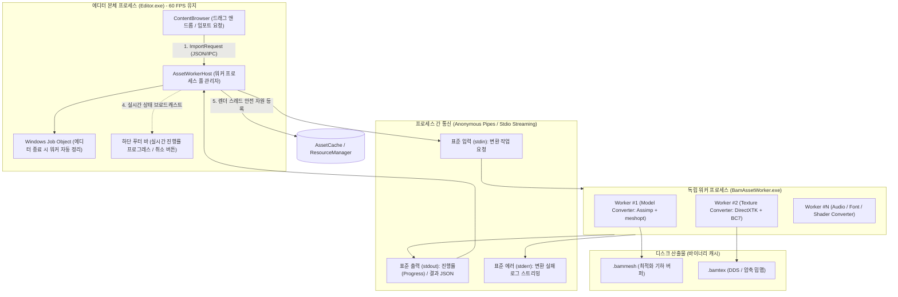

# 독립 워커 프로세스 기반 대용량 에셋 임포트 파이프라인 개발 계획
(Out-of-Process Asset Pipeline & Worker Isolation Plan)

- **작성일** 2026-11-16, 최근 갱신 2026-11-20
- **상태** 3D 썸네일·모델 변환, 독립 텍스처 임포트, 모델 텍스처 베이킹 및 BC7 압축 방식 선택 코드를 반영했다. 사용자가 이전 Debug 빌드와 `AssetWorkerModelCheck`, `AssetWorkerTextureCheck`, `LocalizationAuditUtility` 통과를 보고했다. 이후 텍스처 편집기에서 실제 GPU BC7 압축과 캐시 재사용을 로그로 확인했으나 전체 통합 회귀는 미검증이다. 텍스처 인스펙터 UI는 현재 연결되어 있지 않다.
- **공통 기준**: [EngineEditorClientGuidelines.md](EngineEditorClientGuidelines.md), [BuildConfigurationAndPreprocessing.md](BuildConfigurationAndPreprocessing.md)
- **연계 문서**:
  - [개발 우선순위 (DevelopmentPriorities.md)](DevelopmentPriorities.md) 11절
  - [크래시 진단 및 복원 계획 (CrashHandlingAndRecoveryPlan.md)](CrashHandlingAndRecoveryPlan.md)
  - [에디터 사용성 테스트 지침 (EditorUXTestGuidelines.md)](EditorUXTestGuidelines.md) 4.6절
- **핵심 목표**: 대용량 3D 모델(수백 MB의 FBX/OBJ/GLTF), 고해상도 텍스처(4K/8K BC7 압축), 복합 에셋 일괄 임포트 시 **에디터 메인 렌더 스레드의 60 FPS 무간섭 유지** 및 **임포트 중 OOM(메모리 부족)·크래시로부터 에디터 프로세스를 100% 완전 격리**하는 독립 워커 프로세스 아키텍처를 구축한다.

---

## 1. 배경 및 문제 정의 (Motivation & Problem Definition)

### 1.1 현재 인-프로세스(In-Process) 임포트의 한계
현재 `AssetManager::ImportAsync`는 `std::async(std::launch::async)`를 통해 에디터 프로세스 내부의 백그라운드 스레드에서 에셋 변환을 수행하고 있다. 그러나 상용 수준의 대규모 프로젝트 에셋을 다룰 때 다음과 같은 구조적 한계에 직면한다:

1. **CPU 코어 경합 및 프레임 드랍 (CPU Starvation & Hitching)**:
   - Assimp 기반 FBX 파싱, 정점 탄젠트 공간 생성(`meshoptimizer`), 텍스처 밉맵 생성 및 BC7/ASTC 블록 압축은 모든 가용 CPU 코어를 100% 풀로드로 소모한다.
   - 백그라운드 스레드가 메인 렌더 루프(DirectX 12 커맨드 큐 제출)와 동일한 코어/L3 캐시를 두고 경합하여 뷰포트 조작 시 심각한 프레임 스파이크(10~50ms 지연)를 유발한다.
2. **에디터 힙 메모리 단편화 및 OOM 크래시 전파**:
   - 수백만 폴리곤의 고밀도 메쉬나 8K 텍스처 파싱 시 일시적으로 수 GB의 메모리 할당/해제가 반복된다.
   - 단일 프로세스 힙을 공유하므로 메모리 단편화가 누적되며, 대형 에셋 파싱 중 메모리 부족(`std::bad_alloc`)이나 C++ 예외/접근 위반이 발생하면 **에디터 본체 프로세스가 작업 저장 기회도 없이 동반 종료(Crash-to-Desktop)**된다.
3. **상용 엔진 표준 패턴과의 격차**:
   - Unreal Engine(`ZenServer`, `ShaderCompileWorker`, `CookWorker`), Unity(`Asset Pipeline v2`) 등 상용 엔진은 무거운 컴파일과 에셋 변환을 에디터 본체와 분리된 **외부 독립 서브프로세스(Worker)**로 완전히 격리하여 운영한다.

---

## 2. 전체 아키텍처 개요 (System Architecture)

---

## 3. 세부 설계 (Detailed Design)

### 3.1 독립 CLI 워커 바이너리 (`BamAssetWorker.exe`)
- **프로젝트 위치**: `Tools/AssetWorker/`
- **현재 의존성**: Engine, `BamTools::ModelConverter`, `TextureConverter`, DirectXTex (렌더러 및 ImGui 제외).
- **실행 모드**:
  1. **단발성 썸네일 CLI 모드**:
     `BamAssetWorker.exe --mode thumbnail --source Model.fbx --output Model.png [--resolution 128] [--project-root <dir>]`
  2. **상주형 데몬 모드 (Daemon / Pipe Worker)**:
     `BamAssetWorker.exe --daemon`
     - 현재 `stdin`/`stdout`의 UTF-8 탭 구분 한 줄 프로토콜로 썸네일, 모델 변환, 독립 텍스처 변환 요청을 처리한다. JSON 프로토콜은 구현되어 있지 않다.

### 3.2 IPC 프로토콜 명세 (UTF-8 tab-delimited lines over Standard I/O)

각 요청과 응답은 한 줄이며 필드는 탭(`\t`)으로 구분한다. 줄 경계는 개행(`\n`)이다. 파일 경로는 UTF-8이고, 모델 옵션 필드는 공백 구분 숫자 목록이다.

| 방향 | 형식 | 의미 |
| :--- | :--- | :--- |
| Editor -> Worker | `MODEL_WORKER_VERSION\t1` | 모델 변환 프로토콜 버전 확인 |
| Worker -> Editor | `MODEL_WORKER_VERSION\t1` | 버전 1 지원 응답 |
| Editor -> Worker | `IMPORT_MODEL\t<id>\t<sourceUtf8>\t<snapshotUtf8>\t<options>` | 모델 변환 후 요청별 임시 snapshot 생성 |
| Worker -> Editor | `PROGRESS\t<id>\t1` / `PROGRESS\t<id>\t2` | 변환 시작 / snapshot 기록 완료 |
| Worker -> Editor | `RESULT\t<id>\t1` / `RESULT\t<id>\t0` | 성공 / 실패 |
| Editor -> Worker | `TEXTURE_WORKER_VERSION\t2` | 텍스처 변환 프로토콜 버전 확인 |
| Worker -> Editor | `TEXTURE_WORKER_VERSION\t2` | 버전 2 지원 응답 |
| Editor -> Worker | `IMPORT_TEXTURE\t<id>\t<source>\t<finalBamtex>\t<finalDds>\t<stagedBamtex>\t<stagedDds>\t<format>\t<flags>` | `.bamtex` 및 `.dds`를 요청별 임시 파일로 변환 |
| Worker -> Editor | `PROGRESS\t<id>\t1..4` | 압축 시작, `.bamtex` 저장, DDS 저장, 변환 완료 |
| Worker -> Editor | `BACKEND\t<id>\t<backend>\t<gpuError>` | 실제 압축 방식 또는 캐시 적중, GPU 실패 HRESULT의 부호 없는 정수값 |
| Worker -> Editor | `RESULT\t<id>\t1` / `RESULT\t<id>\t0` | 성공 / 실패 |
| Editor -> Worker | `THUMB\t<id>\t<resolution>\t<sourceUtf8>\t<outputUtf8>` | 썸네일 베이킹 |
| Worker -> Editor | `RESULT\t<id>\t1` / `RESULT\t<id>\t0` | 썸네일 성공 / 실패 |
| Editor -> Worker | `QUIT` | 데몬 종료 요청 |

`IMPORT_MODEL`의 `<options>` 순서는 `FlipUVs`, `ConvertToLeftHanded`, `UniformScale`, `FlipWindingOrder`, `FlipPitch`, `FlipHeading`, `GenerateLODs`, `LODCount`, `TargetError`, 이어서 선택적인 LOD reduction rates다. `IMPORT_TEXTURE`는 `ETextureFormat`과 `ECompressFlags`의 정수 값을 전달한다. 워커는 최종 경로를 리소스 메타데이터에 사용하되 두 파일은 staging 경로에 기록하고, 호스트가 둘 다 성공한 뒤 기존 파일 백업·교체를 처리한다. 실패·취소 시 결과를 게시하지 않는다.

모델 베이킹 UI와 미연결 텍스처 인스펙터 코드에 CPU 표준, CPU 빠른 BC7, GPU BC7 선택을 추가했다. 빠른 방식은 품질이 달라질 수 있으며 GPU 실패 시 CPU 표준으로 폴백하고 HRESULT를 호스트 로그에 남긴다. BC5 등 BC7 이외 형식에는 선택한 방식과 관계없이 CPU 표준을 사용한다. 압축 플래그가 캐시 키에 포함되며, GPU 폴백 결과는 GPU 캐시에 저장하지 않는다. 설정은 재임포트용으로 영속화하지 않는다. DDS 원본 변환은 지원하지 않으며 인스펙터 코드에서 비활성화한다. 이미지 드롭 및 툴바 이미지 임포트는 비동기 경로를 사용한다. 접근 가능한 텍스처 변환 UI와 GPU 재로드 검증 상태는 [작업 흐름 계획](TextureSpriteEditorIntegrationPlan.md)에서 다룬다.

이번 변경의 속도·화질·GPU 장치 호환성, 오류와 취소 시 출력 복구 및 UI 반응성은 실측 전이다. GPU 사용이 CPU보다 빠르다고 보장하지 않으며, 캐시 적중과 실제 압축을 구분해 측정한다.

### 3.3 에디터 측 호스트 (`AssetWorkerHost`)
- **수명주기 및 프로세스 풀 관리**:
  - 현재 구현은 워커 스레드 및 프로세스를 2개로 제한한다. 모델 또는 독립 텍스처 임포트는 동시에 하나만 처리하고 다른 워커는 썸네일을 처리할 수 있다.
- **Windows Job Object 연동 (좀비 프로세스 원천 방지)**:
  - `CreateJobObjectW`를 생성하고 `JOB_OBJECT_LIMIT_KILL_ON_JOB_CLOSE` 플래그를 설정.
  - 에디터가 정상 종료되거나 의도치 않게 크래시되어도, OS가 자식 워커 프로세스들을 100% 즉시 강제 회수.
- **스레드/프로세스 우선순위 격하**:
  - `CREATE_NO_WINDOW | BELOW_NORMAL_PRIORITY_CLASS` 플래그로 스폰하여 에디터 반응성 절대 우선 보장.

### 3.4 장애 격리 및 안전장치 (Fault Isolation & Safety Guard)
1. **OOM / Crash 격리**:
   - 워커 프로세스가 대형 에셋 파싱 중 크래시 또는 OOM으로 종료되어도 에디터는 프로세스와 분리되어 있다. 현재 호스트는 응답 누락·시간 초과를 실패로 처리하고 에디터 로그에 기록한다.
2. **타임아웃 감지 (Hang Guard)**:
   - 모델 변환은 진행 응답 사이 3분, 텍스처 변환은 1시간 제한을 적용하고 초과 시 워커를 종료한다. 텍스처 제한은 사용자가 관찰한 5분대 압축을 근거로 둔 임시 상한이며, 대형 텍스처 실측과 타임아웃·취소 검증 후 재평가해야 한다.
3. **인-프로세스 폴백(Fallback) 보존**:
   - 워커 실행·버전 확인·임시 파일 준비가 불가능하면 기존 인프로세스 모델/텍스처 경로로 폴백한다. 독립 이미지 임포트 요청을 보낸 뒤 변환 실패, 시간 초과, 사용자 취소가 발생하면 실패/취소로 끝내며 결과를 게시하지 않는다.
   - 모델 임포트 중 부수적인 텍스처 베이킹이 실패·시간 초과·취소되면 베이크 산출물은 사용하지 않고 원본 텍스처로 머티리얼을 구성한다. 이는 기존 모델 임포트 동작을 보존하며 모델 임포트 자체를 취소하지 않는다.

### 3.5 대용량 3D 에셋 썸네일 & 프리뷰 베이킹 확장 (3D Thumbnail & Preview Baking — 구현 완료)
- **필요성**:
  - `Sponza.obj`(21MB), `Sponza.bammodel`(1,143개 서브메시 참조), `dragon.bammesh`(198MB), 1,023개 개별 `.bammesh`, 프리팹(`.bamprefab.json`) 등을 에디터 메인 스레드에서 즉시 파싱/렌더링하면 UI가 프리징됨.
  - 이를 에디터 프로세스와 완전히 격리된 독립 워커 프로세스로 위임하여 에디터 메인 스레드 부하 0.0ms를 달성함.
- **독립 헤드리스 썸네일 워커 (`BamAssetWorker.exe`)**:
  - 위치: `Tools/AssetWorker/` (`main.cpp`, `HeadlessThumbnailRasterizer.h/.cpp`)
  - 빌드 의존성: DDS 및 압축 텍스처를 읽는 `HeadlessThumbnailRasterizer`가 DirectXTex를 직접 호출하므로 `BamAssetWorker`에 `Microsoft::DirectXTex`를 직접 링크한다.
  - 지원 포맷: `.bammesh` / `.bammesh.json`, `.bammodel` / `.bammodel.json`, `.obj` / `.fbx` / `.gltf` / `.glb`, `.bamprefab` / `.prefab` / `.json`
  - 단발성 CLI(`--mode thumbnail --source <src> --output <png> [--resolution <dim>] [--project-root <dir>]`) 및 파이프 기반 상주형 데몬(`--daemon`) 지원 (`THUMB\t<id>\t<res>\t<src>\t<dst>` -> `RESULT\t<id>\t<ok>`).
  - RHI/SwapChain 의존성 없는 헤드리스 2x SSAA (`256x256` -> `128x128`) 소프트웨어 PBR 래스터라이저 + 3점 스튜디오 조명 + ACES 톤매핑 + 알베도 텍스처 샘플링(`.bamtex`, `.dds`, `.png`, `.tga`, `.jpg`).
  - 대용량 복합 모델은 최경량 LOD(`.bammesh` LOD2) 우선 선택, 198MB 초대형 단일 메시는 정점 분포/AABB를 유지한 삼각형 스텝 샘플링으로 수십 ms 내에 처리.
- **에디터 호스트 (`AssetWorkerHost`) 및 `AssetCache` 통합**:
  - 위치: `Editor/Source/AssetManager/Worker/` (`AssetWorkerHost.h/.cpp`)
  - `Windows Job Object`(`JOB_OBJECT_LIMIT_KILL_ON_JOB_CLOSE`) + `CREATE_NO_WINDOW | BELOW_NORMAL_PRIORITY_CLASS` + 2개 데몬 프로세스 풀 운영.
  - `AssetCache`는 프리팹에 `_v3`, 다른 에셋에 `_v2` 디스크 캐시 시드를 사용한다. 캐시 미스 시 3D 모델·메시·프리팹 베이킹을 `AssetWorkerHost`로 위임하고, 완료된 PNG를 `m_DecodeWorkers`로 비동기 로드해 GPU 텍스처로 업로드한다. 헤드리스 워커와 인-프로세스 폴백 모두 꺼진 프리팹 렌더러를 제외한다.
  - **대량 썸네일 프레임 방어 최적화**: 2048×2048 썸네일 공용 아틀라스(256슬롯/페이지), `Renderer::GetPreRenderDelegate()` 기반 렌더 프레임 기록 중 무대기(Fence Stall 0회) 부분 텍스처 업로드, LIFO 스케줄링 및 콘텐츠 브라우저 3-채널 `ImDrawListSplitter` 일괄 배칭 연동.

---

### 3.6 모델 임포트 워커 및 독립 텍스처 임포트

- 최종 임포트의 `AssetManager::ImportAsync`가 모델 요청을 검증하고 기존 변환 옵션을 워커에 보낸다. 워커는 `MODEL_WORKER_VERSION`으로 프로토콜 호환을 확인한 뒤 `IMPORT_MODEL`로 Assimp 파싱과 LOD 생성을 수행한다. 경로는 UTF-8로 전달한다.
- 워커는 모델 DDC와 같은 바이너리 형식으로 요청별 임시 파일을 기록한 뒤 성공을 반환한다. 에디터 백그라운드에서 결과를 읽고 기존 `ModelImporter::FinalizeStep`으로 GPU 리소스 등록, 원본 URI 보존, 재임포트 및 저장을 진행한다. 워커는 기존 모델 DDC를 읽을 수 있고 임시 결과만 쓴다. 모델 소스 경로를 UTF-8로 저장하기 위해 DDC 형식을 3으로 올렸다.
- `AssetManager::ImportAsync`의 독립 이미지 임포트는 `TEXTURE_WORKER_VERSION`/`IMPORT_TEXTURE`로 DirectXTex 변환을 위임한다. 워커는 `.bamtex`와 `.dds`를 동일한 요청의 staging 파일로 만들며, 에디터 호스트는 둘 다 성공한 후 기존 산출물 백업을 통해 함께 교체한다. `.bamtex` 기록은 최종 리소스 경로를 보존하고, `TextureImporter`는 인프로세스 폴백에서도 압축 결과 실패를 오류로 반환한다. 텍스처 변환 요청에는 진행률·단계별 1시간 제한·현재 요청 취소·워커 사용 불가 시 폴백을 적용한다.
- 워커와 인프로세스 폴백은 한 번 압축하거나 DDC에서 읽은 바이트로 두 출력을 생성한다. DDS 기록은 2D 단일 이미지의 헤더·밉 레이아웃을 검증한다. 장시간 변환 실패의 종류와 단계별 소요 시간은 호스트 로그에서 구분한다. 사용자가 관련 Debug 워커 검사의 통과를 보고했으며 에디터 통합 검증은 남았다.
- 사용자가 텍스처 검사에서 `PROGRESS 3` 후 접근 위반을 보고했다. DirectXTex의 WIC 팩터리 수명 문제 가능성에 대응하여 MTA 사용을 프로세스 범위로 유지한다. MTA 초기화가 불가능한 스레드에서는 변환을 실패 처리한다. 수정 후 사용자가 테스트 통과를 보고했으나 개별 테스트 출력은 제공되지 않았으며, 크래시 원인은 확정되지 않았다.
- 임포트 변환은 한 번에 하나씩 처리한다. 다른 워커는 썸네일을 처리할 수 있다. 하단 푸터는 변환 단계를 표시하고 현재 요청만 취소한다. 워커 시작·버전 확인·임시 경로 준비에 실패하면 기존 인프로세스 준비를 사용한다. 요청을 보낸 뒤 변환 실패, 단계별 응답 제한 초과 또는 취소가 발생하면 에디터가 결과 게시를 시작하지 않는다.
- 모델 프리뷰는 에디터 백그라운드 스레드에서 원본을 파싱하고 메인 스레드에서 메시·머티리얼 생성을 여러 프레임에 나누어 처리한다. 재임포트 원본 탐색은 로드된 모델의 원본 URI와 같은 폴더의 동명 원본을 우선하고, 필요한 경우 모델 에셋을 읽는다.
- 모델 임포트 중 `BakeTexturesToDDS`는 최종화 전에 내장/외부 텍스처를 수집해 `AssetWorkerHost`로 순차 위임한다. 슬롯별 BC5/BC7·sRGB 설정과 기존 파일명/출력 폴더를 유지하며, 텍스처 베이킹 실패·취소 시 기존 동작처럼 원본 텍스처로 진행한다. 워커를 사용할 수 없으면 인프로세스 변환으로 폴백한다. 모델 자원 등록과 머티리얼 커밋은 모든 요청의 완료 후 진행한다.
- 모델 임포트 시 푸터의 세부 진행률 합산도 반영했다. 모델 임포트에 내장/외부 텍스처 베이킹이 포함되면 모델 워커 변환 단계를 `0.0..0.35`, 순차 `BakeTexturesToDDS` 요청들을 `0.35..0.95` 범위(`1/N..N/N` 구간 분할, 모델 파일명과 `(i/N)` 표시)로 `AssetWorkerHost::ImportProgressScope`를 통해 푸터 진행률 바에 합산하며, 기존 `ModelImport.*` 로캘 키를 재사용한다.

## 4. 단계별 개발 로드맵 (Phased Implementation Roadmap)

| 단계 | 목표 | 주요 작업 내용 | 산출물 |
| :--- | :--- | :--- | :--- |
| **Phase 1** | 독립 CLI 워커 및 썸네일 베이커 구축 *(완료)* | • `Tools/AssetWorker/` CMake 프로젝트 및 `BamAssetWorker.exe` 구축 • 헤드리스 PBR 래스터라이저(`HeadlessThumbnailRasterizer`) 구현 • 모델/메시/원시모델/프리팹 썸네일 단독 CLI & 데몬 모드 구현 | `BamAssetWorker.exe` |
| **Phase 2** | 에디터 호스트 및 썸네일 파이프라인 연동 *(완료)* | • 에디터 내 `AssetWorkerHost` 구축 (Job Object + 데몬 파이프 풀 2개) • `AssetCache` 비동기 워커 위임/폴링 연동 및 프리팹 저장 무효화 연동 • 레거시 `Resources/` -> `Assets/` 리소스 참조 폴백 보강 | `AssetWorkerHost.h/.cpp`, `AssetCache.cpp` |
| **Phase 3** | 모델 워커 소비 검증 및 독립 텍스처 임포트 *(코드 반영, 사용자 보고 워커 검사 통과, 실환경 검증 대기)* | • 모델 변환 및 임시 결과 수신, 푸터 진행률 합산·취소 연결 • snapshot을 실제 소비 API로 읽는 검사 추가 • 독립 텍스처의 DirectXTex 변환, 두 산출물 staging/교체, 진행률·취소 연결 • 모델 임포트 내장/외부 텍스처의 워커 위임 및 진행률 합산 연결 • 에디터 통합 및 대형 에셋 실측 잔여 | `BamAssetWorker`, `AssetWorkerModelCheck`, `AssetWorkerSnapshotCheck`, `AssetWorkerTextureCheck` |
| **Phase 4** | 결함 격리 및 60FPS 무간섭 검증 *(자동화 결함 격리 검사 코드 반영, 빌드/CTest 및 60FPS 실환경 측정 대기)* | • 잘못된 프로토콜·손상 에셋 주입 후 동일 데몬 복구, 기존 `.bamtex`/`.dds` 보존, 강제 종료 후 재시작, 파이프 EOF 및 `JOB_OBJECT_LIMIT_KILL_ON_JOB_CLOSE` 자동화 검사(`AssetWorkerFaultIsolationCheck`) 추가 • 대용량 에셋 일괄 처리 도중 60FPS 유지 및 에디터 UI 취소 실측 대기 | `Tools/AssetWorker/FaultIsolationCheck.py`, `AssetWorkerFaultIsolationCheck` |

---

## 5. 검증 기준 (Pass/Fail Criteria)

### 모델 임포트 1차 검증

- `AssetWorkerModelCheck`에서 버전 응답, 한글·공백 경로의 OBJ 변환, 성공 시 임시 결과 생성, 원본 누락 시 실패 응답을 확인한다. `AssetWorkerSnapshotCheck`가 성공 snapshot을 `ModelConversion::ReadModelSnapshot`으로 읽어 실제 소비 가능한지 검증한다.
- `AssetWorkerTextureCheck`에서 동일 데몬의 연속 요청, BC7 sRGB·BC5·RGBA의 밉맵과 홀수 크기, `.bamtex`/DDS의 메타데이터·바이트 일치, 캐시 재사용과 잘린 캐시 복구, 원본 누락 실패를 확인한다. Editor 통합에서는 장시간 처리, 타임아웃, 기존 출력 파일 보존, 두 출력 교체, 취소 및 워커 사용 불가 폴백을 별도로 확인한다.
- 에디터에서 스킨드 모델과 큰 정적 모델을 각각 임포트한다. 배율·축 보정·LOD 설정, 본·클립, 하위 폴더와 원본 URI, 머티리얼 덮어쓰기 옵션이 기존 경로와 일치하는지 확인한다.
- 변환 진행 중 푸터의 취소를 눌러 변환 결과가 게시되지 않고 기존 파일이 유지되는지 확인한다. 대기 중인 모델 요청과 썸네일 작업이 이어지는지, 재요청이 성공하는지도 확인한다.
- 같은 모델과 옵션으로 워커 사용·미사용 조건의 프레임 간격을 비교한다. 프리뷰 준비, 변환, 에디터의 GPU 등록·저장 구간을 함께 기록한다.
- `AssetWorkerFaultIsolationCheck` (`Tools/AssetWorker/FaultIsolationCheck.py`)에서 잘못된 명령·비유한 옵션(`nan`)·손상 `.gltf`/빈 `.obj`·잘못된 텍스처 포맷/플래그·손상 및 잘린 `.png` 입력이 데몬을 중단시키지 않고 `RESULT 0` 후 동일 데몬에서 후속 정상 모델/텍스처 변환으로 복구되는지, 실패 요청 및 스테이징 실행 중 기존 최종 `.bamtex`/`.dds`가 바이트 단위로 보존되는지, 중도 강제 종료(`TerminateProcess` / `kill`) 후 파이프 EOF 및 새 워커 재시작 복구가 되는지, 부모 파이프 EOF 시 좀비 프로세스 없이 정상 종료되는지, Windows `JOB_OBJECT_LIMIT_KILL_ON_JOB_CLOSE` 핸들 종료 시 블로킹된 데몬이 즉시 정리되는지를 검증한다.
- 2026-11-19 정적 확인에서 워커 명령과 에디터 호출 경로, 푸터의 로캘 키를 대조했다. 2026-11-20 모델 snapshot 소비 검사와 텍스처 워커 코드를 추가하고, 모델 임포트의 내장/외부 텍스처 베이킹도 워커 요청·폴백 경로에 연결했다. 사용자는 Debug 빌드 후 `AssetWorkerModelCheck`, `AssetWorkerTextureCheck`, `LocalizationAuditUtility` 3개 통과를 보고했다. 2026-11-22 모델 임포트 푸터 진행률 합산(`AssetWorkerHost::ImportProgressScope`)과 `AssetWorkerFaultIsolationCheck`를 정적 반영했으며, 해당 변경분의 빌드·CTest(`AssetWorkerModelCheck`, `AssetWorkerTextureCheck`, `AssetWorkerFaultIsolationCheck`) 및 에디터 통합·대형 에셋 60FPS 실측은 사용자 실행 대기 중이다.

### 전체 목표

1. **프레임 무간섭 불변성 (Pass)**:
   - 500MB 이상의 대형 FBX 및 8K 텍스처를 임포트하는 동안, 에디터 3D 뷰포트 조작 시 프레임 드랍이 16.6ms(60FPS) 이하로 유지되어야 함 (`Stuttering 0건`).
2. **프로세스 격리성 (Pass)**:
   - 워커 프로세스 강제 강제종료(`taskkill /F /IM BamAssetWorker.exe`) 시 에디터가 다운되지 않고 적절한 오류 안내 팝업을 띄워야 함.
3. **좀비 프로세스 제로 (Pass)**:
   - 에디터가 작업 도중 강제 종료되더라도 OS 백그라운드에 `BamAssetWorker.exe`가 1개도 잔류하지 않고 즉시 자동 정리되어야 함.
