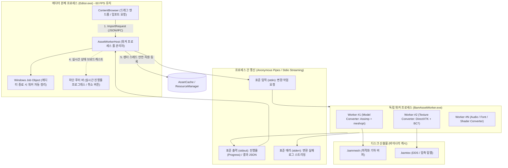

# 독립 워커 프로세스 기반 대용량 에셋 임포트 파이프라인 개발 계획
(Out-of-Process Asset Pipeline & Worker Isolation Plan)

- **작성일**: 2026-11-16
- **상태**: 계획 수립 (Phase 1 설계 단계)
- **공통 기준**: [EngineEditorClientGuidelines.md](EngineEditorClientGuidelines.md), [BuildConfigurationAndPreprocessing.md](BuildConfigurationAndPreprocessing.md)
- **연계 문서**:
  - [개발 우선순위 (DevelopmentPriorities.md)](DevelopmentPriorities.md) 11절
  - [크래시 진단 및 복원 계획 (CrashHandlingAndRecoveryPlan.md)](CrashHandlingAndRecoveryPlan.md)
  - [에디터 사용성 테스트 지침 (EditorUXTestGuidelines.md)](EditorUXTestGuidelines.md) 4.6절
- **핵심 목표**: 대용량 3D 모델(수백 MB의 FBX/OBJ/GLTF), 고해상도 텍스처(4K/8K BC7 압축), 복합 에셋 일괄 임포트 시 **에디터 메인 렌더 스레드의 60 FPS 무간섭 유지** 및 **임포트 중 OOM(메모리 부족)·크래시로부터 에디터 프로세스를 100% 완전 격리**하는 독립 워커 프로세스 아키텍처를 구축한다.

---

## 1. 배경 및 문제 정의 (Motivation & Problem Definition)

### 1.1 현재 인-프로세스(In-Process) 임포트의 한계
현재 `AssetManager::ImportAsync`는 `std::async(std::launch::async)`를 통해 에디터 프로세스 내부의 백그라운드 스레드에서 에셋 변환을 수행하고 있다. 그러나 상용 수준의 대규모 프로젝트 에셋을 다룰 때 다음과 같은 구조적 한계에 직면한다:

1. **CPU 코어 경합 및 프레임 드랍 (CPU Starvation & Hitching)**:
   - Assimp 기반 FBX 파싱, 정점 탄젠트 공간 생성(`meshoptimizer`), 텍스처 밉맵 생성 및 BC7/ASTC 블록 압축은 모든 가용 CPU 코어를 100% 풀로드로 소모한다.
   - 백그라운드 스레드가 메인 렌더 루프(DirectX 12 커맨드 큐 제출)와 동일한 코어/L3 캐시를 두고 경합하여 뷰포트 조작 시 심각한 프레임 스파이크(10~50ms 지연)를 유발한다.
2. **에디터 힙 메모리 단편화 및 OOM 크래시 전파**:
   - 수백만 폴리곤의 고밀도 메쉬나 8K 텍스처 파싱 시 일시적으로 수 GB의 메모리 할당/해제가 반복된다.
   - 단일 프로세스 힙을 공유하므로 메모리 단편화가 누적되며, 대형 에셋 파싱 중 메모리 부족(`std::bad_alloc`)이나 C++ 예외/접근 위반이 발생하면 **에디터 본체 프로세스가 작업 저장 기회도 없이 동반 종료(Crash-to-Desktop)**된다.
3. **상용 엔진 표준 패턴과의 격차**:
   - Unreal Engine(`ZenServer`, `ShaderCompileWorker`, `CookWorker`), Unity(`Asset Pipeline v2`) 등 상용 엔진은 무거운 컴파일과 에셋 변환을 에디터 본체와 분리된 **외부 독립 서브프로세스(Worker)**로 완전히 격리하여 운영한다.

---

## 2. 전체 아키텍처 개요 (System Architecture)



---

## 3. 세부 설계 (Detailed Design)

### 3.1 독립 CLI 워커 바이너리 (`BamAssetWorker.exe`)
- **프로젝트 위치**: `Tools/AssetWorker/`
- **의존성**: `BamTools::ModelConverter`, `TextureConverter`, `Core`, `Archive` (렌더러 및 ImGui 제외한 순수 헤드리스).
- **실행 모드**:
  1. **단발성 CLI 모드 (Batch/One-shot)**:
     `BamAssetWorker.exe --type model --source Hero.fbx --dest Content/Hero.bammesh --preset Default`
  2. **상주형 데몬 모드 (Daemon / Pipe Worker)**:
     `BamAssetWorker.exe --daemon`
     - 프로세스를 띄워둔 채 `stdin`으로 JSON 작업 명세를 연속 수신하고, 완료 시 `stdout`으로 결과를 응답하여 프로세스 스폰 비용(Spawn Overhead) 최소화.

### 3.2 IPC 프로토콜 명세 (JSON over Standard I/O)
- **작업 의뢰 (Editor -> Worker, stdin)**:
  ```json
  {
    "taskId": 1042,
    "type": "Model",
    "sourcePath": "I:/Assets/Dragon.fbx",
    "outputPath": "Content/Models/Dragon.bammesh",
    "options": {
      "generateLOD": true,
      "lodCount": 3,
      "optimizeVertexCache": true,
      "scale": 1.0
    }
  }
  ```
- **진행률 피드백 (Worker -> Editor, stdout)**:
  ```json
  { "taskId": 1042, "status": "Progress", "progress": 0.45, "step": "Generating Tangents" }
  ```
- **완료 보고 (Worker -> Editor, stdout)**:
  ```json
  {
    "taskId": 1042,
    "status": "Success",
    "outputPath": "Content/Models/Dragon.bammesh",
    "generatedSubmeshes": 8,
    "vertexCount": 124500,
    "elapsedMs": 412.5
  }
  ```

### 3.3 에디터 측 호스트 (`AssetWorkerHost`)
- **수명주기 및 프로세스 풀 관리**:
  - 시스템 CPU 코어 수에 맞추어 워커 프로세스 상한 관리 (`MaxWorkers = max(1, CoreCount - 2)`).
  - 에디터 메인 스레드와 렌더 스레드를 보호하기 위해 최소 2개 코어는 비워둠.
- **Windows Job Object 연동 (좀비 프로세스 원천 방지)**:
  - `CreateJobObjectW`를 생성하고 `JOB_OBJECT_LIMIT_KILL_ON_JOB_CLOSE` 플래그를 설정.
  - 에디터가 정상 종료되거나 의도치 않게 크래시되어도, OS가 자식 워커 프로세스들을 100% 즉시 강제 회수.
- **스레드/프로세스 우선순위 격하**:
  - `CREATE_NO_WINDOW | BELOW_NORMAL_PRIORITY_CLASS` 플래그로 스폰하여 에디터 반응성 절대 우선 보장.

### 3.4 장애 격리 및 안전장치 (Fault Isolation & Safety Guard)
1. **OOM / Crash 격리**:
   - 워커 프로세스가 대형 에셋 파싱 중 크래시(`0xC0000005`) 또는 OOM으로 비정상 종료되어도 에디터 프로세스는 살아남으며, `AssetWorkerHost`가 비정상 종료 코드(`ExitCode != 0`)를 수신하여 UI에 `"임포트 실패 (프로세스 오류)"` 알림만 표시.
2. **타임아웃 감지 (Hang Guard)**:
   - 3분 이상 응답이 없는 불량 에셋(무한 루프 등)은 에디터 측에서 워커 프로세스를 안전하게 강제 종료(`TerminateProcess`)하고 타임아웃 처리.
3. **인-프로세스 폴백(Fallback) 보존**:
   - 워커 바이너리가 빌드되지 않았거나 시스템 환경상 서브프로세스 스폰이 제한되는 경우 기존의 `AssetManager::ImportAsync` 인-프로세스 경로로 투명하게 폴백.

---

## 4. 단계별 개발 로드맵 (Phased Implementation Roadmap)

| 단계 | 목표 | 주요 작업 내용 | 산출물 |
| :--- | :--- | :--- | :--- |
| **Phase 1** | 독립 CLI 워커 바이너리 구축 | • `Tools/AssetWorker/` CMake 프로젝트 신설<br>• `ModelConverter`, `TextureConverter` 링크 및 단독 CLI 명령줄 인자 처리기 구현<br>• 단독 실행으로 `.fbx` → `.bammesh`, `.png` → `.bamtex` 무손실 변환 검증 | `BamAssetWorker.exe` (CLI 도구) |
| **Phase 2** | 에디터 호스트 및 파이프 통신 | • 에디터 내 `AssetWorkerHost` 및 `WindowsPipeChannel` 구축<br>• Windows Job Object 바인딩 (`KILL_ON_JOB_CLOSE`) 및 `BELOW_NORMAL_PRIORITY_CLASS` 스폰<br>• JSON 요청/응답 직렬화 및 비동기 완료 수신 파이프라인 연동 | `AssetWorkerHost.h / .cpp` |
| **Phase 3** | 에디터 UI 및 프로그레스 연동 | • 하단 푸터 바에 워커별 실시간 진행률(Progress %) 및 취소(`X`) 버튼 연동<br>• 멀티 파일 드래그 앤 드롭 시 동시 병렬 변환 큐잉 스케줄러 구현<br>• 변환 완료 시 메인 스레드 `AssetCache` / `ThumbnailRenderer` 2ms 타임슬라이스 안전 등록 | 푸터 프로그레스바, 병렬 큐 |
| **Phase 4** | 결함 격리 및 60FPS 무간섭 검증 | • 고의적 OOM/크래시 에셋 주입 시 에디터 무영향 검증<br>• 1GB 이상 초대형 에셋 임포트 도중 에디터 뷰포트 카메라 회전 60FPS 유지 계측<br>• 독립 패키징 빌드 및 배포 파이프라인 연계 | 검증 리포트, 단위 테스트 |

---

## 5. 검증 기준 (Pass/Fail Criteria)

1. **프레임 무간섭 불변성 (Pass)**:
   - 500MB 이상의 대형 FBX 및 8K 텍스처를 임포트하는 동안, 에디터 3D 뷰포트 조작 시 프레임 드랍이 16.6ms(60FPS) 이하로 유지되어야 함 (`Stuttering 0건`).
2. **프로세스 격리성 (Pass)**:
   - 워커 프로세스 강제 강제종료(`taskkill /F /IM BamAssetWorker.exe`) 시 에디터가 다운되지 않고 적절한 오류 안내 팝업을 띄워야 함.
3. **좀비 프로세스 제로 (Pass)**:
   - 에디터가 작업 도중 강제 종료되더라도 OS 백그라운드에 `BamAssetWorker.exe`가 1개도 잔류하지 않고 즉시 자동 정리되어야 함.
