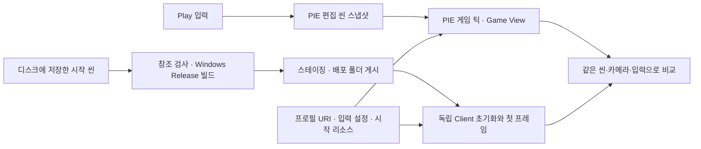

# PIE 첫 실행 지연과 Windows Client 배포 흐름 점검 및 개선 계획

- 작성일 2026-11-19
- 조사 갱신일 2026-11-21
- 상태 · 사용자가 타임라인 리소스 준비 후 첫 Q 멈춤 해소를 확인했다. 컨트롤러 클립 준비 적용 후 첫 PIE의 일반 업데이트가 1012.60ms에서 8.49ms로 감소했다. 첫 로드 비용은 씬 준비 시점에 기록됐다.
- 범위 · Play 입력부터 Game View의 첫 화면·게임 입력, PIE 종료와 씬 복원, Windows x64 Release 내보내기와 독립 Client 실행 비교.

## 1. 평가와 현재 실행 흐름

**Play는 에디터 렌더 프레임에서 씬 전체의 복원 데이터를 캡처한다.** 첫 Play에서만 두드러지는 지연은 캡처 외에 첫 게임 틱과 렌더 초기 비용을 함께 확인해야 한다. PIE와 Client는 Deferred 렌더링 코어를 공유하며 입력, 시스템 등록, 설정 및 초기화 순서에는 호스트별 차이가 있다.



- **PIE.** 툴바와 Play 액션이 `PIEManager::StartPlay()`를 호출한다. 입력 설정을 적용하고 현재 씬을 메모리 Archive에 캡처한다. 성공하면 프리뷰 소리와 선택을 정리하고 Game View의 포커스를 요청한다. 이후 현재 씬으로 게임 틱을 실행한다. Stop에서는 Archive로 복원 후보를 만든 뒤 씬과 문서를 다시 연결한다. [PIEManager](../Editor/Source/PIE/Private/PIEManager.cpp) · [에디터 프레임 루프](../Editor/Source/Application/Private/Application.cpp)
- **배포.** 빌드 패널은 저장된 시작 씬을 선택하고 별도 `x64-client-release`에 `BAMENGINE_WITH_EDITOR=OFF`로 Client와 GameModule을 빌드한다. 패키저는 빌드 후 시작 씬 참조, 런타임 DLL, 매니페스트, 프로필과 셰이더를 검사하고 스테이징한 폴더를 게시한다. 패키지 표식이 있으면 실행 파일 옆을 루트로 사용한다. Client는 설정·리소스·시스템·모듈·시작 씬을 초기화한 후 게임 틱과 화면 제출을 시작한다. [빌드 작업](../Editor/Source/Build/Private/ClientBuildJob.cpp) · [패키저](../Editor/Source/Build/Private/ClientPackage.cpp) · [Client 호스트](../Client/Source/Main.cpp) · [ClientGameRuntime](../Client/Source/Execution/Private/ClientGameRuntime.cpp)
- **검증 기록.** 기존 Windows 기준선에는 Release 빌드와 CTest, Game View의 프로필·리사이즈 확인이 있고, 해당 회차의 Stage 3 재시도와 UI 합성 확인은 기록이 비어 있다. 별도의 2026-11-18 S6-4 기록에는 파도 렌더링을 Game View와 독립 Client에서 비교한 사용자 확인이 있다. 새 기준 씬에서는 입력·오디오·UI·씬 복원까지 같은 빌드에서 다시 확인한다. [프로필 Stage 3 절차](RenderPipelineProfilePlan.md#3단계-수동-검증) · [파도 렌더링 확인 기록](ImplementationLog.md)

## 2. 첫 PIE 프리징 조사

에디터를 새로 실행하고 Game View에 카메라 영상이 표시된 상태에서 첫 Play를 누르면 멈춤이 발생한다. 2026-11-21 `Logs/Editor.log`의 스레드 10884에는 메모리 스냅샷 적용 후 다음 기록이 있다.

- 21:29:51 첫 Play에서 스냅샷은 30.16ms, 첫 게임 업데이트 전체는 **977.34ms**, 렌더 호출은 18.53ms였다. 21:29:52.341에 `RogueKinematicController.bamgraph.json`의 최초 로드 성공이 기록됐다.
- 21:29:58 재진입에서 스냅샷은 30.52ms, 첫 게임 업데이트는 **12.93ms**, 렌더 호출은 17.49ms였다. 21:34:37 재진입의 첫 게임 업데이트는 10.14ms였다.

이 기록에서는 첫 게임 업데이트가 지연의 대부분을 차지한다. 스냅샷도 약 30ms의 별도 비용이 있지만 첫 시도와 재진입에서 비슷했다. 그래프 성공 로그는 파일 로드·역직렬화·검증이 끝난 시점에 찍힌다. 기존 계측은 그 전에 실행된 물리 고정 틱과 다른 시스템을 함께 포함하므로 그래프 로드 자체가 977ms였는지는 확인할 수 없다. [에디터 로그](../Logs/Editor.log#L166693) · [그래프 로드](../Engine/Source/Graph/Private/GraphSystem.cpp)

그래프 준비 적용 후 22:01 세션의 Rogue 그래프는 Play 약 1.9초 전에 경로 조회 0.11ms, 로드 2.38ms로 준비됐다. 첫 Play는 게임 틱 939.84ms 중 고정 1.00ms, 일반 `Update()` 937.55ms, 후속 1.28ms였다. 재진입의 일반 업데이트는 8.66ms였다. 이 재현에서 그래프 파일 로드와 고정 틱은 남은 지연을 설명하지 못한다. 일반 업데이트는 FMOD 갱신, 활성 씬 조회, 시스템별 `OnUpdate()`를 포함한다. [그래프 준비 로그](../Logs/Editor.log#L167002) · [첫 Play와 재진입 로그](../Logs/Editor.log#L167081)

22:18 첫 Play에서 일반 업데이트 1012.60ms 중 **`AnimationSystem::OnUpdate()`가 1007.93ms**였다. FMOD 갱신은 0.01ms, 활성 씬 조회는 표시 정밀도에서 0.00ms였다. 같은 프로세스의 22:28 재진입에서는 AnimationSystem이 5.03ms였다. 컨트롤러 로드와 첫 포즈 평가 비중은 당시 로그에서 분리되지 않았다. [첫 Play 계측](../Logs/Editor.log#L167369) · [재진입 계측](../Logs/Editor.log#L167448)

22:52 새 에디터 세션에서 기준 컨트롤러의 경로 조회·파일 읽기는 1.29ms, 역직렬화·참조 리소스 해석은 912.04ms였다. 이 작업은 첫 Play 전에 끝났다. 22:53 첫 Play의 일반 업데이트는 **8.49ms**, 두 번째는 **8.18ms**였다. 첫 게임 틱 전체는 각각 10.85ms, 10.49ms였다. 첫 Play 요청의 스냅샷은 30.45ms였다. 같은 씬 준비 구간에서 타임라인 작성 모델 `Rig_Medium_General.bammodel`의 로드가 4579.26ms로 기록됐다. 이 값은 작성 모델 한 건의 소요 시간이며 씬 열기 전체 시간은 별도로 측정해야 한다. [씬 준비 계측](../Logs/Editor.log#L168436) · [첫 Play 계측](../Logs/Editor.log#L168522) · [재진입 계측](../Logs/Editor.log#L168600)

### 2.1 Play 입력 프레임의 동기 구간

- 기존 Play는 엔티티·등록 컴포넌트·리소스 참조를 캡처한 뒤 같은 프레임에 JSON 인코딩과 임시 파일 쓰기·이름 변경까지 수행했다. 이 작업은 매번 발생했으므로 첫 시도에만 체감되는 현상의 단독 원인으로 판정할 수 없다. 변경 후에는 같은 `Scene::WriteArchive()`로 만든 Archive를 메모리에 보관하고 Stop에서 직접 읽는다. 현재 편집본을 캡처하므로 미저장 값도 복원 대상이다. 캡처와 입력 설정 적용은 여전히 메인 스레드에서 실행한다. [PIE 시작과 복원](../Editor/Source/PIE/Private/PIEManager.cpp) · [씬 직렬화](../Engine/Source/World/Scene/Private/SceneArchive.cpp)
- Play → Stop → Play에서 미저장 위치나 속성, 문서 이력, 판정 초기화를 확인한다. 캡처가 실패하면 Edit 상태와 엔티티 선택 및 프리뷰가 유지되어야 한다. 메모리 Archive의 수명은 PIE 세션이며 프로세스 비정상 종료 복구는 기존 RecoveryManager 경로에 따른다. [입력 설정](../Editor/Source/Settings/Private/EditorSettingsService.cpp) · [크래시 복구](CrashHandlingAndRecoveryPlan.md)

### 2.2 첫 게임 틱과 렌더 전환의 후보

- **우선 확인 · 게임플레이 리소스 로드와 실행 상태 생성.** 편집 중 Realtime 갱신은 `Presentation`만 실행하고, Play에서는 물리 고정 틱과 `Gameplay`가 추가된다. `GraphSystem`은 첫 사용 시 그래프 JSON을 로드·파싱해 메모리 캐시에 넣고, 엔티티별 실행기를 구성한다. Animator는 컨트롤러를 로드하고 첫 포즈를 평가할 수 있으며, 액션 타임라인은 경로 변경을 감지해 리소스를 요청한다. 첫 `Update()`가 길다면 시스템별로 시간을 나눈 뒤 그래프 파일 로드·실행기 생성·`Event.Start`, Animator 컨트롤러 로드·포즈 평가, 타임라인 캐시 조회·실제 로드를 구분한다. 복제 씬에서 시간이 큰 컴포넌트 하나만 비활성화하거나 제거해 새 프로세스로 비교한다. 그래프 로드가 크면 활성 바인딩의 파일만 기존 `GetOrLoadGraph()`로 미리 준비한다. 엔티티별 실행기와 이벤트 실행은 Play 시점에 둔다. [에디터 프레임 루프](../Editor/Source/Application/Private/Application.cpp) · [그래프 로드와 실행](../Engine/Source/Graph/Private/GraphSystem.cpp) · [Animator 업데이트](../Engine/Source/Animation/Private/AnimationSystem.cpp) · [액션 타임라인 업데이트](../Engine/Source/Animation/Timeline/Private/ActionTimelineSystem.cpp)

- **후속 확인 · 두 뷰포트의 렌더 빈도와 새 PSO.** Scene View와 Game View는 편집 중 포커스와 호버가 없으면 제출을 15 FPS로 제한하고, Play에서는 이 제한을 푼다. 두 뷰가 이미 화면에 있어도 렌더 부하가 달라질 수 있다. 기존 렌더 메모리 캐시에 없는 조합은 D3D12 라이브러리 로드 또는 동기 PSO 생성을 거친다. Game View의 위치와 고정 해상도를 유지하고 Scene View만 표시하거나 숨겨 비교한다. PSO 로드·생성 시간, 패스별 GPU 시간, `WaitForFence()`를 함께 기록해 일회성 비용과 지속 렌더 부하를 구분한다. 지속 부하가 확인되면 비활성 Scene View의 기존 제한을 유지하는 방향을 검토한다. 타깃 재할당은 Play 전후 해상도가 실제로 달라질 때 따로 측정한다. [Scene View 갱신](../Editor/Source/ImGui/ViewportPanel/Private/SceneViewportPanel.cpp) · [Game View 갱신](../Editor/Source/ImGui/ViewportPanel/Private/GameViewportPanel.cpp) · [D3D12 PSO](../Engine/Source/Render/RHI/Platform/DirectX12/Private/DirectX12Pipeline.cpp) · [D3D12 프레임 대기](../Engine/Source/Render/RHI/Platform/DirectX12/Private/DirectX12RHI.cpp)

- **씬에 따라 확인 · 물리 고정 틱과 메시 BVH 생성.** 첫 고정 틱의 충돌·트리거 처리와 일반 `Update()`의 캐릭터 지면 질의를 구분한다. 메시 Raycast는 메시의 가속 구조가 비어 있거나 지오메트리 버전이 바뀌면 `Mesh::GetRaycastBVH()`에서 삼각형을 순회해 생성하고 이후 재사용한다. `BaselineVerification` 저장본의 메시 콜라이더는 `PlaneMesh` 하나여서 복잡한 메시의 BVH 생성은 이 씬에서 우선순위가 낮다. 문제 씬에 복잡한 메시 콜라이더가 있다면 생성된 BVH의 메시·삼각형 수·소요 시간을 기록하고, 복제 씬에서 해당 콜라이더만 단순 형상으로 바꿔 재현한다. [물리 고정 틱](../Engine/Source/Physics/Private/PhysicsSystem.cpp) · [캐릭터 충돌 질의](../Engine/Source/Physics/Private/KinematicCharacterSystem.cpp) · [BVH 생성](../Engine/Source/Render/Mesh/Private/Mesh.cpp) · [기준 씬](../Assets/Scenes/BaselineVerification.bamscene.json)

- **우선순위 낮음 · 입력 설정, 오디오와 에디터 에셋 작업.** `StartPlay()`에서 입력 설정 파일 읽기, 액션 맵 구성, 프리뷰 소리 정지를 각각 측정한다. 에디터를 켠 직후와 콘텐츠 브라우저 썸네일이 안정된 뒤를 비교하고, Play 전 유휴 구간의 긴 프레임과 에셋 완료·업로드 시점도 대조한다. [PIE 시작](../Editor/Source/PIE/Private/PIEManager.cpp) · [에셋 갱신](../Editor/Source/AssetManager/Private/AssetManager.cpp) · [썸네일 작업](../Editor/Source/AssetManager/AssetCache/Private/AssetCache.cpp)

**기존 로그의 단서.** 2026-11-21 `Logs/Editor.log`의 15:08 시작 세션에서 D3D12 Pipeline Library 로드가 기록됐다. `RogueKinematicController.bamgraph.json` 로드 성공은 첫 Play 직후에 한 번 기록됐고 같은 세션의 다음 두 시도에는 해당 기록이 없었다. 두 번째 Play 직전 `BaselineVerification`을 저장한 기록도 있다. 해당 그래프는 약 6KB이며 `Event.Start` 노드가 없다. 로그에는 Play 요청 및 그래프 로드 시작 시각이 없고, `Started Play Mode`는 스냅샷 성공 뒤에 찍힌다. 로그 시각의 간격으로 스냅샷이나 그래프 로드 시간을 산출할 수 없다. [그래프 정의](../Assets/Scripts/RogueKinematicController.bamgraph.json) · [PIE 시작 로그 위치](../Editor/Source/PIE/Private/PIEManager.cpp)

### 2.3 계측과 개선 순서

에디터가 씬을 열 때 활성 `GraphBindingComponent`의 그래프를 기존 GraphSystem 캐시에 준비한다. 씬 열기에 캐시 미스 비용이 포함되며, PIE 첫 틱에서는 캐시를 재사용한다. 캐시 조회 시 파일 수정 시간을 비교하므로 씬을 연 뒤 저장한 그래프도 첫 Play에 반영된다. 엔티티별 실행기 생성과 `Event.Start`는 Play 중에 수행한다. 독립 배포 빌드는 기존 시작 그래프 검증 경로를 사용한다. [씬 진입](../Engine/Source/World/Scene/Private/SceneManager.cpp) · [그래프 캐시](../Engine/Source/Graph/Private/GraphSystem.cpp)

Animator는 첫 업데이트에서 `controllerPath`가 바뀌면 컨트롤러를 동기로 읽고 참조 클립을 해석한다. 기준 씬의 컨트롤러는 서로 다른 `.bamanim` 8개를 참조한다. 에디터 씬 진입 시 기존 컨트롤러 로더를 호출해 그 클립을 리소스 캐시에 준비한다. 씬 로드 때 엔티티 상태를 바꾸지 않으며 첫 틱에서 최신 컨트롤러를 읽어 기존 방식으로 바인딩한다. 준비 비용은 씬 열기에 포함된다. 5ms 이상 걸린 컨트롤러 로드는 `[AnimatorTiming]`의 `resolve/read`, `deserialize/resources`로 구분해 확인한다. [Animator 시스템](../Engine/Source/Animation/Private/AnimationSystem.cpp) · [컨트롤러 로더](../Engine/Source/Animation/Private/AnimatorStateMachine.cpp)

1. **Play 요청 프레임과 첫 게임 틱을 구분한다.** `[PIE] Started Play Mode`의 입력, 캡처, 전환과 `[PIE] First game frame`의 `fixed`, `update`, `late`, 렌더 호출을 비교한다. GraphSystem 로그의 캐시 미스 시간과 엔티티별 실행기 준비 시간을 함께 확인한다. 렌더 값은 CPU에서 호출이 돌아오기까지의 시간이다. GPU 패스 시간과 화면 표시 시각은 별도 측정이 필요하다. [프레임 루프](../Editor/Source/Application/Private/Application.cpp) · [시간 계산](../Engine/Source/Time/Private/TimeManager.cpp)
   - 일반 업데이트가 길면 같은 틱의 `[UpdateTiming]`을 확인한다. 첫 PIE 프레임에만 FMOD 갱신·활성 씬 조회 시간과 5ms 이상 걸린 시스템 이름·시간을 기록한다. [런타임 업데이트](../Engine/Source/Runtime/Private/Runtime.cpp) · [시스템 업데이트](../Engine/Source/World/System/Private/SystemManager.cpp)
2. **보고된 조건을 기준으로 한 변수씩 비교한다.** 같은 저장 씬과 Editor 실행 파일, 도킹, 렌더 해상도를 사용한다. 오른쪽 Game View에 카메라 영상이 표시된 뒤 첫 Play → Stop → 두 번째 Play를 실행한다. 중간에 씬을 편집하거나 저장하지 않고, 첫 1초는 게임 입력을 주지 않는다. 각 비교 조건의 첫 Play는 새 Editor 프로세스에서 재현한다. Scene View 표시 여부, 작은 씬과 문제 씬, 에디터 시작 후 대기 시간, 측정에서 확인된 컴포넌트 하나를 각각 바꿔 비교한다. 요청 전 유휴 1초부터 첫 게임 화면 이후 1초까지 최장 프레임과 50ms 초과 횟수를 기록한다. Metrics 패널은 스파이크 확인에 쓰고, 개별 렌더 패스 판정에는 평활화 전 프레임 값을 사용한다. [Metrics 패스 통계](../Editor/Source/ImGui/MetricsPanel/Private/RenderMetricsWidget.cpp)
3. **메모리 캡처가 길면 씬 크기별로 비교한다.** 현재 ECS의 일관성을 유지하면서 캡처를 여러 프레임에 나눌 수 있는지는 측정 결과에 따라 검토한다.
4. **첫 제출이 무거우면 측정된 경로만 조정.** 실제 크기가 확정되기 전의 중복 타깃 조정을 줄인다. 동일 크기의 기존 타깃을 재사용한다. PSO가 병목이면 기존 D3D12 라이브러리와 공용 디스크립터를 재사용해 필요한 조합만 프레임에 나누어 준비한다. 첫 틱에서 의존 파일 로드가 크면 씬에 필요한 범위만 비차단 준비에 넣는다. GPU 객체 생성과 반영은 현재 RHI의 소유·수명 규칙을 확인해 배치한다. 프레임 예산보다 긴 단일 호출은 호출 안의 단계를 다시 나눈다. [디스크 캐시 계획](DiskCacheDevelopmentPlan.md) · [비동기 열기 계획](ResourceEditorAsyncOpenPlan.md)

- [ ] **성능 판정.** 기준 씬에서 첫 Play·재진입·실패 경로의 최대 프레임과 첫 조작 가능한 화면까지의 시간을 각각 기록한다. 유휴 상태에서 60 FPS에 가까운 검증 환경은 시작 작업이 추가한 50ms 초과 프레임 0회를 초기 목표로 삼는다. 정상 플레이 구간과 첫 화면까지의 총 대기 시간도 전후 비교한다. 씬이 원래 느린 경우 유휴 대비 시작 단계의 추가 비용을 판정한다.
- [ ] **그래프 준비 판정.** 새 Editor에서 `BaselineVerification`을 열 때 Rogue 그래프 로드 로그가 찍히고, 씬이나 그래프 수정 없이 첫 Play를 누르면 같은 파일을 다시 로드하지 않아야 한다. 씬을 연 뒤 그래프를 수정·저장한 별도 시도에서는 최신 동작을 실행해야 한다. 기존 977.34ms와 비교할 때 씬 열기 시간도 함께 기록한다.
- [ ] **상태 판정.** 연속 Play에서 세션이 중복 시작되지 않는다. 저장된 씬, 미저장 변경이 있는 씬과 새 씬을 각각 Play → Stop으로 복원한다. 플레이 중 변경은 원본 씬 파일에 섞이지 않는다.

## 3. Game View와 배포 Client의 일치 점검

### 3.1 설정과 런타임의 차이

- **배포 필수 입력.** `Config/Project.json`의 `RequiredGameplayActions`가 비어 있으면 기존 입력 파일 복사 규칙을 적용한다. 목록이 있으면 `RequiredGameplayActionsScene`으로 정한 시작 씬에 적용하며, 씬 경로가 비어 있으면 모든 시작 씬에 적용한다. 현재 프로젝트는 `BaselineVerification`에 이동·카메라·점프·공격·재시작 액션을 요구한다. 내보내기 전에 Gameplay 맵과 각 필수 액션의 바인딩을 확인하고, 검증한 입력 설정의 바이트를 스테이징에 기록해 게시 전에 일치 여부를 확인한다. [프로젝트 설정](../Config/Project.json) · [패키지 검증](../Editor/Source/Build/Private/ClientPackage.cpp)
- **높음 · 렌더 프로필 누락과 실패 처리.** 프로필 URI가 비어 있으면 Game View는 자체 Deferred 초기화 경로를 쓰고 Windows Client는 레거시 Forward를 쓴다. 비교 기준은 명시된 동일 Deferred 프로필을 사용한다. 잘못된 프로필은 Game View 초기화 실패를 통해 기본 패널·Editor 초기화 실패로 전파될 수 있다. Editor에서는 해당 뷰와 시작 요청에 오류를 표시하고 씬 편집은 계속 가능한 방향을 검토한다. 배포는 프로필·셰이더 검사와 시작 실패 진단을 유지한다. [Game View](../Editor/Source/ImGui/ViewportPanel/Private/GameViewportPanel.cpp) · [패널 초기화](../Editor/Source/ImGui/Private/ImGuiManager.cpp) · [Client 렌더 프로필](../Client/Source/ClientRenderPipeline.cpp)
- **높음 · 개별 시스템 목록.** Editor와 Client는 각각 시스템을 등록하며 `SplineFollowSystem`은 현재 Editor 목록에만 있다. 같은 씬에 스플라인 추종 동작을 넣으면 호스트별로 실행 여부가 달라질 수 있다. 대표 씬에 필요한 시스템과 모듈 목록을 비교하고, 확인한 공통 등록과 순서부터 공유한다. 실패한 `GameModule` 로드가 필요한 플레이를 조용히 빠뜨리지 않도록 실행 로그에 모듈 로드 성공과 주요 바인딩을 확인한다. [Editor 시스템 등록](../Editor/Source/Application/Private/Application.cpp) · [Client 시스템 등록](../Client/Source/Execution/Private/ClientGameRuntime.cpp) · [Client 모듈 로드](../Client/Source/Main.cpp)
- **보통 · 비교 데이터와 렌더 타이밍.** PIE는 현재 편집본, 패키지는 디스크의 지정 씬을 사용한다. Game View는 `Application`의 게임 틱 이전에 뷰포트 제출을 준비하며 Client는 게임 틱 뒤에 제출한다. 카메라 변화, 입력 포커스, UI 합성·출력 크기의 차이를 독립 조건으로 비교하고 같은 설정에서도 재현되는 차이부터 수정한다. [Editor 프레임 순서](../Editor/Source/Application/Private/Application.cpp) · [Client 프레임 순서](../Client/Source/Execution/Private/ClientGameRuntime.cpp)

### 3.2 배포 전 검증과 재현 정보

- `현재 씬 사용`은 저장된 편집 문서를 선택할 때 미저장 상태를 검사한다. 이후 비교에서는 선택 후 씬이나 설정이 바뀌었는지도 확인한다. 빌드 전에 저장 씬·입력·프로필의 필수 항목을 빠르게 점검하고, 빌드 후 게시 전 검증은 생성 셰이더와 실제 스테이징 결과를 기준으로 유지한다. 저장 씬과 프로필, 입력 설정, 빌드 ID 및 런타임 DLL을 패키지 로그에서 식별할 수 있도록 한다. Editor 실행 파일 경로와 빌드 ID도 같이 기록해 이전 바이너리 실행과 구분한다. [빌드 패널](../Editor/Source/ImGui/BuildProfilePanel/Private/BuildProfilePanel.cpp) · [빌드·스테이징 절차](BuildAndPackagingPlan.md)
- 시작 씬 검사 결과와 배포 파일 목록의 범위를 명시한다. 기존 패키저는 허용 확장자의 전체 리소스와 알려진 참조를 복사한다. 우선 대표 씬에 실제 필요한 모델·머티리얼·텍스처·Controller·클립·타임라인·폰트·오디오의 사용처를 확인한다. 바이너리 내부와 동적 로드 참조를 검사하기 전에는 배포 파일을 줄이는 작업을 보류한다.
- [ ] **동등성 판정.** 같은 저장 씬과 명시된 프로필, 카메라, 실제 렌더 픽셀 크기로 Game View와 배포 Client를 비교한다. 이동·점프·카메라 입력, Game View 밖 클릭, UI 버튼과 한글 폰트, FMOD 사운드, 불투명·반투명·그림자·ACES, 창 리사이즈를 각각 확인한다. 기준 씬에 스플라인이나 타임라인을 넣었다면 해당 동작도 확인한다. 그래픽과 입력·오디오를 개별 결과로 남긴다.
- [ ] **독립 실행 판정.** 배포본을 저장소 밖에 게시하고 실행 파일 옆 설정·로그·에셋 루트가 사용되는지 확인한다. 원본 체크아웃에 의존하지 않는 환경에서도 재실행한다. 복사본에서 참조 에셋·입력 설정·필수 셰이더를 각각 누락시켜 진단 위치와 성공·실패 정책을 검증한다. 패키지 교체 취소 및 게시 실패에서는 이전 배포본이 유지된다.
- [ ] **내보내기 입력 판정.** 테스트용 프로젝트에서 `InputActions.json` 또는 `Gameplay/Attack` 바인딩을 빼고 `BaselineVerification` 내보내기를 시도한다. 빌드 전에 원인이 표시되고 기존 게시본을 실행할 수 있어야 한다. 입력을 복구해 다시 내보낸 뒤 저장소 밖에서 Q로 세 번 적중하고 R로 초기화한다. 필수 입력을 선언하지 않은 씬에도 기존 내보내기가 동작하는지 확인한다.

## 4. 검증 순서와 명령

### Windows Client 첫 화면

**정식 배포 전 디자인 교체 필수.** 현재 BamEngine 워드마크와 로딩 표시의 시각 디자인은 개발 중에 임시로 사용한다. BamEngine의 정식 시그니처 시작 화면 디자인을 확정하고 교체한 뒤, 독립 Windows 패키지에서 시작 화면과 게임 씬 전환을 확인해야 이 항목을 완료로 처리한다. 최종 시각 콘셉트는 미정이다.

- Client는 실행 초기에 BamEngine 워드마크와 단계 표시를 자체 Windows 창으로 그린다. 이 창의 메시지 처리는 별도 UI 스레드에서 진행하며, 게임 창·D3D12·리소스·씬은 메인 스레드에서 준비한다. 시작 화면은 Client 실행 파일의 코드로 구성되어 에디터나 별도 배포 에셋을 요구하지 않는다.
- 시작 씬과 그래프 준비 후 게임 창을 표시하고, 시작 화면 아래에서 첫 게임 프레임을 렌더링한다. GPU가 첫 프레임 작업을 끝내면 시작 화면을 닫고 일반 실행 루프에 진입한다. 프레임 시간 기준을 전환 전후에 갱신한다. 게임 초기화가 실패하면 시작 화면을 정리하고 기존 오류를 반환한다. 시작 화면 자체를 표시할 수 없으면 오류를 기록하고 Client 초기화를 계속한다.
- 새 Windows Release 패키지의 `Client.log`에서 `First game frame completed after … ms.`를 확인한다. 첫 실행에는 단계 표시가 움직이는지, 게임 화면으로 넘어갈 때 검은 화면이 보이는지, 전환 뒤 첫 입력이 정상인지 확인한다. 재실행, 다른 DPI·모니터, 그리고 패키지 복사본에서 시작 씬 누락 시 시작 화면이 닫히고 오류가 기록되는 경우도 확인한다. 변경의 실행 검증은 사용자 확인 대기다. [Client 초기화](../Client/Source/Main.cpp) · [시작 화면](../Client/Source/ClientStartupSplash.cpp)

### PIE와 독립 Client 비교

1. 가벼운 기준 씬에 캐릭터 입력·UI·오디오·반투명을 연결한다. 가벼운 씬은 기본 시작 비용과 배포 동등성을, `RaytracingScene3`은 씬 크기와 렌더 부하가 커질 때의 첫 실행 비용을 확인하는 데 사용한다.
2. 먼저 현재 Release Editor로 2절의 첫 Play 계측을 한 뒤, 같은 Editor에서 기준 씬을 저장하고 **씬 참조 검사 → 빌드 및 내보내기**를 수행한다. 배포 작업 진행 중의 CPU·I/O 부하가 PIE 측정에 섞이지 않게 정해진 조건에서 실행한다.
3. 패키지 실행 파일 경로·시작 씬·프로필 URI·입력 파일을 확인하고 3절의 동등성 판정을 수행한다. 첫 Client 기동 지연은 Client 프로세스 시작부터 측정한다. PIE의 Play 요청 시간과 각각의 초기화 항목을 구분해 기록한다.

저장소 루트에서 사용자가 실행할 기존 회귀 검사와 Release Editor 빌드 명령이다.

```powershell
cmake --preset x64-debug -DBUILD_TESTING=ON
cmake --build --preset x64-debug --config Debug --target Editor GameModule RenderPipelineProfileCheck SceneArchiveCheck AssetReferenceCheck InputManagerCheck EditorHistoryCheck ActionTimelinePlaybackCheck AuditLocalization
ctest --preset x64-debug --output-on-failure -R "^(RenderPipelineProfileCheck|SceneArchiveCheck|AssetReferenceCheck|InputManagerCheck|EditorHistoryCheck|ActionTimelinePlaybackCheck|LocalizationAuditUtility)$"
cmake --preset x64-release
cmake --build --preset x64-release --config Release --target Editor GameModule
```

기존 테스트는 프로필·Archive·입력·참조·이력의 회귀를 확인한다. 첫 PIE의 프레임 지연과 패키지 독립 실행은 사용자가 계측과 실환경 시나리오로 확인한다. 이번 점검의 결과는 코드·설정·로그의 정적 근거이며 빌드·CTest·Editor·Client 실행 또는 성능 측정 결과는 아직 없다.
