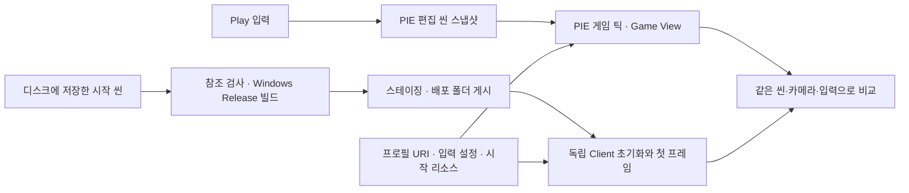

# PIE 첫 실행 지연과 Windows Client 배포 흐름 점검 및 개선 계획

- 작성일 2026-11-19
- 상태 · 현재 호출 경로와 기존 실행 기록을 확인했다. 첫 PIE 프리징의 원인과 개선 효과는 프레임 계측이 필요하다.
- 범위 · Play 입력부터 Game View의 첫 화면·게임 입력, PIE 종료와 씬 복원, Windows x64 Release 내보내기와 독립 Client 실행 비교.

## 1. 평가와 현재 실행 흐름

**PIE의 Play 경로는 에디터 렌더 프레임 안에서 씬 전체를 저장하므로, 메인 스레드를 점유하는 구간이 확인된다.** 이 저장은 매번 실행된다. 첫 실행만 더 느린지는 Game View의 첫 제출, 렌더 타깃 재생성, PSO 캐시 미스와 첫 게임 틱을 분리해 측정해야 한다. 배포 경로는 프로필과 Deferred 렌더링 코어를 공유하지만, 입력 설정과 시스템 등록, 실제 씬 데이터 및 초기화 순서에는 호스트별 차이가 있다.



- **PIE.** 툴바와 Play 액션이 `PIEManager::StartPlay()`를 호출한다. 입력 설정을 읽어 적용하고 프리뷰 소리를 정지한 뒤 선택을 지우고 스냅샷을 저장한다. 성공하면 Play 상태로 바꾸고 이미 초기화된 Game View를 열어 포커스를 요청한다. 이후 현재 씬으로 게임 틱을 실행하고, Stop에서 스냅샷으로 씬을 다시 로드해 문서를 재연결한다. [PIEManager](../Editor/Source/PIE/Private/PIEManager.cpp) · [에디터 프레임 루프](../Editor/Source/Application/Private/Application.cpp)
- **배포.** 빌드 패널은 저장된 시작 씬을 선택하고 별도 `x64-client-release`에 `BAMENGINE_WITH_EDITOR=OFF`로 Client와 GameModule을 빌드한다. 패키저는 빌드 후 시작 씬 참조, 런타임 DLL, 매니페스트, 프로필과 셰이더를 검사하고 스테이징한 폴더를 게시한다. 패키지 표식이 있으면 실행 파일 옆을 루트로 사용한다. Client는 설정·리소스·시스템·모듈·시작 씬을 초기화한 후 게임 틱과 화면 제출을 시작한다. [빌드 작업](../Editor/Source/Build/Private/ClientBuildJob.cpp) · [패키저](../Editor/Source/Build/Private/ClientPackage.cpp) · [Client 호스트](../Client/Source/Main.cpp) · [ClientGameRuntime](../Client/Source/Execution/Private/ClientGameRuntime.cpp)
- **검증 기록.** 기존 Windows 기준선에는 Release 빌드와 CTest, Game View의 프로필·리사이즈 확인이 있고, 해당 회차의 Stage 3 재시도와 UI 합성 확인은 기록이 비어 있다. 별도의 2026-11-18 S6-4 기록에는 파도 렌더링을 Game View와 독립 Client에서 비교한 사용자 확인이 있다. 새 기준 씬에서는 입력·오디오·UI·씬 복원까지 같은 빌드에서 다시 확인한다. [프로필 Stage 3 절차](RenderPipelineProfilePlan.md#3단계-수동-검증) · [파도 렌더링 확인 기록](ImplementationLog.md)

## 2. 첫 PIE 프리징 조사

### 2.1 Play 입력 프레임의 동기 구간

- `Editor UI` 렌더 패스의 콜백에서 ImGui를 그리며 Play 액션을 실행한다. `StartPlay()`는 즉시 `SnapshotScene()`을 호출한다. `SceneManager::SaveScene()`은 현재 씬의 엔티티·등록 컴포넌트·리소스 참조를 순회해 JSON을 구성하고, Archive 인코딩과 임시 파일 쓰기·이름 변경까지 같은 스레드에서 실행한다. 따라서 이 구간이 길어지면 현재 프레임 제출과 다음 입력 처리가 밀린다. [Editor UI 등록](../Editor/Source/Application/Private/Application.cpp) · [씬 저장](../Engine/Source/World/Scene/Private/SceneManager.cpp) · [씬 직렬화](../Engine/Source/World/Scene/Private/SceneArchive.cpp) · [Archive 파일 저장](../Projects/Archive/src/ArchiveInterface.cpp)
- 입력 설정 역직렬화와 액션 맵 구성, 프리뷰 사운드 정지 역시 스냅샷 앞에서 동기로 실행된다. 씬 데이터 크기·파일 쓰기 또는 입력 초기화 중 어느 단계가 주원인인지는 현재 확인되지 않았다. 스냅샷 저장 실패는 Play 진입을 막지만 선택은 이미 지워진 상태다. [PIE 시작](../Editor/Source/PIE/Private/PIEManager.cpp) · [입력 설정](../Editor/Source/Settings/Private/EditorSettingsService.cpp)

### 2.2 최초 화면과 첫 게임 틱의 후보

- **Game View 첫 제출.** 패널과 렌더 프로필은 에디터 초기화에서 생성한다. 표시 중인 프레임에서 `GameViewportPanel::Update()`가 패널 크기를 렌더 해상도에 적용하며, 기존 크기와 다르면 Deferred 타깃과 후처리 타깃을 조정한다. `RenderTarget::Resize()`는 새 텍스처를 생성한다. 숨겨진 Game View는 제출을 건너뛰므로, 처음 표시될 때 할당이나 첫 제출이 집중될 수 있다. [Game View 초기화와 제출](../Editor/Source/ImGui/ViewportPanel/Private/GameViewportPanel.cpp) · [해상도 적용](../Editor/Source/ImGui/ViewportPanel/Private/BaseViewportPanel.cpp) · [렌더 타깃 교체](../Engine/Source/Render/RenderTarget/Private/RenderTarget.cpp)
- **PSO 캐시 미스와 GPU 대기.** 메시 제출에 필요한 파이프라인이 `PipelineManager`에 없으면 렌더 경로에서 생성한다. D3D12 라이브러리에서 해당 조합을 불러오지 못하면 `CreateGraphicsPipelineState()`를 동기로 호출한다. 에디터 시작 로그의 라이브러리 로드는 전체 캐시의 존재를 보여준다. Game View의 패스·재질 조합이 적중했는지와 실제 fence 대기·GPU 실행 시간은 프레임별로 확인해야 한다. [파이프라인 캐시](../Engine/Source/Render/Pipeline/Private/PipelineManager.cpp) · [D3D12 PSO 생성](../Engine/Source/Render/RHI/Platform/DirectX12/Private/DirectX12Pipeline.cpp) · [D3D12 프레임 대기](../Engine/Source/Render/RHI/Platform/DirectX12/Private/DirectX12RHI.cpp)
- **첫 게임 틱.** PIE 전환 후 Gameplay·Presentation의 업데이트와 물리 틱이 실행된다. Animator 컨트롤러, 타임라인과 그래프 등은 상태에 따라 갱신 중 파일을 읽을 수 있다. 참조가 언제 캐시에 들어왔는지에 따라 비용이 달라진다. 긴 시작 프레임의 벽시계 시간이 다음 프레임의 `dt`에 들어가므로 시뮬레이션 점프와 에디터 프리징을 따로 본다. Editor는 프레임당 고정 틱을 제한하고, Windows Client는 남은 고정 틱을 반복한다. [Animator 업데이트](../Engine/Source/Animation/Private/AnimationSystem.cpp) · [GraphSystem](../Engine/Source/Graph/Private/GraphSystem.cpp) · [시간 계산](../Engine/Source/Time/Private/TimeManager.cpp) · [Client 틱](../Client/Source/Execution/Private/ClientGameRuntime.cpp)

2026-11-19 `Logs/Editor.log`에서 D3D12 Pipeline Library 로드, 같은 세션의 첫 Play와 재진입 완료를 확인했다. 현재 로그의 `Started Play Mode`는 스냅샷 성공 뒤에 기록된다. 요청 시각, 스냅샷 단계별 시간, 최초 타깃 조정 및 첫 화면 제출 시각이 없어 이 로그만으로 프리징 원인을 판정할 수 없다.

### 2.3 계측과 개선 순서

1. **요청부터 첫 화면까지 계측.** 한 Play 요청에서 입력 읽기·적용, 사운드 정지, 씬 열거·Archive 구성, 인코딩, 임시 파일 쓰기·게시, Game View 첫 Draw·첫 유효 이미지 제출, 첫 FixedUpdate·Update, 렌더 타깃 조정, PSO 라이브러리 적중/생성, RHI fence 대기 시간을 나누어 기록한다. 시도 ID와 프레임 번호로 연결하고 씬 엔티티 수·스냅샷 바이트·타깃 해상도와 PSO 생성 횟수를 남긴다. 제출과 실제 화면 표시 시각은 구분한다. 프레임 측정은 집계해 출력하고 로그 쓰기 자체의 비용을 함께 확인한다.
2. **한 조건씩 바꿔 재현.** 동일 씬과 Editor 실행 파일로 프로세스 첫 Play와 Stop 후 두 번째 Play, 열린 Game View에서 한 번 그린 경우와 닫혀 있던 경우, 고정 해상도와 자유 크기, 작은 씬과 `RaytracingScene3`을 비교한다. 캐시 유무는 검증용 복사본에서 분리한다. 같은 씬의 입력·로직은 유지한 채 부하가 큰 구성 요소를 한 번에 하나씩 바꾼다. 각 조건을 반복하고 요청 전 유휴 1초, 첫 표시까지, 이후 1초의 최장 프레임과 50ms 초과 횟수를 기록한다.
3. **스냅샷이 무거우면 먼저 분리.** Play는 요청을 등록하고 다음 프레임에 준비 상태가 보이도록 한다. 편집 상태를 확정한 프레임 경계에서 복원에 필요한 씬 데이터를 캡처하고, 독립 데이터의 인코딩과 파일 쓰기는 백그라운드로 옮길 수 있는지 확인한다. 실제 ECS를 읽는 일은 소유 스레드에서 처리한다. 캡처가 병목일 때는 일관된 편집본을 기준으로 한 분할 캡처를 검토한다. 준비 중에는 게임 틱을 시작하지 않고, 성공 시에만 선택과 포커스를 전환한다. 취소·실패 시 씬·선택·이력·미저장 상태를 보존한다. Stop이 사용하는 복원 데이터와 수명도 함께 검증한다. 상태 안내는 기존 로캘 CSV와 공용 UI를 사용한다.
4. **첫 제출이 무거우면 측정된 경로만 조정.** 실제 크기가 확정되기 전의 중복 타깃 조정을 줄인다. 동일 크기의 기존 타깃을 재사용한다. PSO가 병목이면 기존 D3D12 라이브러리와 공용 디스크립터를 재사용해 필요한 조합만 프레임에 나누어 준비한다. 첫 틱에서 의존 파일 로드가 크면 씬에 필요한 범위만 비차단 준비에 넣는다. GPU 객체 생성과 반영은 현재 RHI의 소유·수명 규칙을 확인해 배치한다. 프레임 예산보다 긴 단일 호출은 호출 안의 단계를 다시 나눈다. [디스크 캐시 계획](DiskCacheDevelopmentPlan.md) · [비동기 열기 계획](ResourceEditorAsyncOpenPlan.md)

- [ ] **성능 판정.** 기준 씬에서 첫 Play·재진입·실패 경로의 최대 프레임과 첫 조작 가능한 화면까지의 시간을 각각 기록한다. 유휴 상태에서 60 FPS에 가까운 검증 환경은 시작 작업이 추가한 50ms 초과 프레임 0회를 초기 목표로 삼는다. 정상 플레이 구간과 첫 화면까지의 총 대기 시간도 전후 비교한다. 씬이 원래 느린 경우 유휴 대비 시작 단계의 추가 비용을 판정한다.
- [ ] **상태 판정.** 큰 씬에서도 준비 상태가 먼저 보이고 에디터 입력과 화면이 갱신된다. 저장 실패·취소·연속 Play에서 세션이 중복 시작되지 않는다. 미저장 편집을 포함한 씬이 PIE 종료 후 복원되고, 플레이 중 값이 원본 씬 파일에 섞이지 않는다.

## 3. Game View와 배포 Client의 일치 점검

### 3.1 설정과 런타임의 차이

- **높음 · 배포 입력 누락.** Editor는 `InputActions.json`이 없을 때 이동·점프 등이 포함된 기본 Gameplay 맵을 구성한다. Client는 파일이 없으면 액션 맵을 설정하지 않고 시작하며, 패키저는 파일이 있을 때만 복사한다. 필수 Gameplay 입력이 있는 프로젝트에서 편집기에서는 움직여도 배포본에서는 움직이지 않을 수 있다. 공용 입력 기본값을 엔진의 설정 계약으로 제공하거나 패키지가 요구하는 입력 파일을 검사하고, 배포한 설정의 실제 액션 맵을 두 호스트에서 기록한다. [Editor 입력 설정](../Editor/Source/Settings/Private/EditorSettingsService.cpp) · [Client 입력 설정](../Client/Source/Execution/Private/ClientGameRuntime.cpp) · [패키징 설정 복사](../Editor/Source/Build/Private/ClientPackage.cpp)
- **높음 · 렌더 프로필 누락과 실패 처리.** 프로필 URI가 비어 있으면 Game View는 자체 Deferred 초기화 경로를 쓰고 Windows Client는 레거시 Forward를 쓴다. 비교 기준은 명시된 동일 Deferred 프로필을 사용한다. 잘못된 프로필은 Game View 초기화 실패를 통해 기본 패널·Editor 초기화 실패로 전파될 수 있다. Editor에서는 해당 뷰와 시작 요청에 오류를 표시하고 씬 편집은 계속 가능한 방향을 검토한다. 배포는 프로필·셰이더 검사와 시작 실패 진단을 유지한다. [Game View](../Editor/Source/ImGui/ViewportPanel/Private/GameViewportPanel.cpp) · [패널 초기화](../Editor/Source/ImGui/Private/ImGuiManager.cpp) · [Client 렌더 프로필](../Client/Source/ClientRenderPipeline.cpp)
- **높음 · 개별 시스템 목록.** Editor와 Client는 각각 시스템을 등록하며 `SplineFollowSystem`은 현재 Editor 목록에만 있다. 같은 씬에 스플라인 추종 동작을 넣으면 호스트별로 실행 여부가 달라질 수 있다. 대표 씬에 필요한 시스템과 모듈 목록을 비교하고, 확인한 공통 등록과 순서부터 공유한다. 실패한 `GameModule` 로드가 필요한 플레이를 조용히 빠뜨리지 않도록 실행 로그에 모듈 로드 성공과 주요 바인딩을 확인한다. [Editor 시스템 등록](../Editor/Source/Application/Private/Application.cpp) · [Client 시스템 등록](../Client/Source/Execution/Private/ClientGameRuntime.cpp) · [Client 모듈 로드](../Client/Source/Main.cpp)
- **보통 · 비교 데이터와 렌더 타이밍.** PIE는 현재 편집본, 패키지는 디스크의 지정 씬을 사용한다. Game View는 `Application`의 게임 틱 이전에 뷰포트 제출을 준비하며 Client는 게임 틱 뒤에 제출한다. 카메라 변화, 입력 포커스, UI 합성·출력 크기의 차이를 독립 조건으로 비교하고 같은 설정에서도 재현되는 차이부터 수정한다. [Editor 프레임 순서](../Editor/Source/Application/Private/Application.cpp) · [Client 프레임 순서](../Client/Source/Execution/Private/ClientGameRuntime.cpp)

### 3.2 배포 전 검증과 재현 정보

- `현재 씬 사용`은 저장된 편집 문서를 선택할 때 미저장 상태를 검사한다. 이후 비교에서는 선택 후 씬이나 설정이 바뀌었는지도 확인한다. 빌드 전에 저장 씬·입력·프로필의 필수 항목을 빠르게 점검하고, 빌드 후 게시 전 검증은 생성 셰이더와 실제 스테이징 결과를 기준으로 유지한다. 저장 씬과 프로필, 입력 설정, 빌드 ID 및 런타임 DLL을 패키지 로그에서 식별할 수 있도록 한다. Editor 실행 파일 경로와 빌드 ID도 같이 기록해 이전 바이너리 실행과 구분한다. [빌드 패널](../Editor/Source/ImGui/BuildProfilePanel/Private/BuildProfilePanel.cpp) · [빌드·스테이징 절차](BuildAndPackagingPlan.md)
- 시작 씬 검사 결과와 배포 파일 목록의 범위를 명시한다. 기존 패키저는 허용 확장자의 전체 리소스와 알려진 참조를 복사한다. 우선 대표 씬에 실제 필요한 모델·머티리얼·텍스처·Controller·클립·타임라인·폰트·오디오의 사용처를 확인한다. 바이너리 내부와 동적 로드 참조를 검사하기 전에는 배포 파일을 줄이는 작업을 보류한다.
- [ ] **동등성 판정.** 같은 저장 씬과 명시된 프로필, 카메라, 실제 렌더 픽셀 크기로 Game View와 배포 Client를 비교한다. 이동·점프·카메라 입력, Game View 밖 클릭, UI 버튼과 한글 폰트, FMOD 사운드, 불투명·반투명·그림자·ACES, 창 리사이즈를 각각 확인한다. 기준 씬에 스플라인이나 타임라인을 넣었다면 해당 동작도 확인한다. 그래픽과 입력·오디오를 개별 결과로 남긴다.
- [ ] **독립 실행 판정.** 배포본을 저장소 밖에 게시하고 실행 파일 옆 설정·로그·에셋 루트가 사용되는지 확인한다. 원본 체크아웃에 의존하지 않는 환경에서도 재실행한다. 복사본에서 참조 에셋·입력 설정·필수 셰이더를 각각 누락시켜 진단 위치와 성공·실패 정책을 검증한다. 패키지 교체 취소 및 게시 실패에서는 이전 배포본이 유지된다.

## 4. 검증 순서와 명령

1. 가벼운 기준 씬에 캐릭터 입력·UI·오디오·반투명을 연결한다. 가벼운 씬은 기본 시작 비용과 배포 동등성을, `RaytracingScene3`은 씬 크기와 렌더 부하가 커질 때의 첫 실행 비용을 확인하는 데 사용한다.
2. 먼저 현재 Release Editor로 2절의 첫 Play 계측을 한 뒤, 같은 Editor에서 기준 씬을 저장하고 **씬 참조 검사 → 빌드 및 내보내기**를 수행한다. 배포 작업 진행 중의 CPU·I/O 부하가 PIE 측정에 섞이지 않게 정해진 조건에서 실행한다.
3. 패키지 실행 파일 경로·시작 씬·프로필 URI·입력 파일을 확인하고 3절의 동등성 판정을 수행한다. 첫 Client 기동 지연은 Client 프로세스 시작부터 측정한다. PIE의 Play 요청 시간과 각각의 초기화 항목을 구분해 기록한다.

저장소 루트에서 사용자가 실행할 기존 회귀 검사와 Release Editor 빌드 명령이다.

```powershell
cmake --preset x64-debug -DBUILD_TESTING=ON
cmake --build --preset x64-debug --config Debug --target Editor RenderPipelineProfileCheck SceneArchiveCheck AssetReferenceCheck InputManagerCheck EditorHistoryCheck AuditLocalization
ctest --preset x64-debug --output-on-failure -R "RenderPipelineProfileCheck|SceneArchiveCheck|AssetReferenceCheck|InputManagerCheck|EditorHistoryCheck|LocalizationAuditUtility"
cmake --preset x64-release
cmake --build --preset x64-release --config Release --target Editor
```

기존 테스트는 프로필·Archive·입력·참조·이력의 회귀를 확인한다. 첫 PIE의 프레임 지연과 패키지 독립 실행은 사용자가 계측과 실환경 시나리오로 확인한다. 이번 점검의 결과는 코드·설정·로그의 정적 근거이며 빌드·CTest·Editor·Client 실행 또는 성능 측정 결과는 아직 없다.
