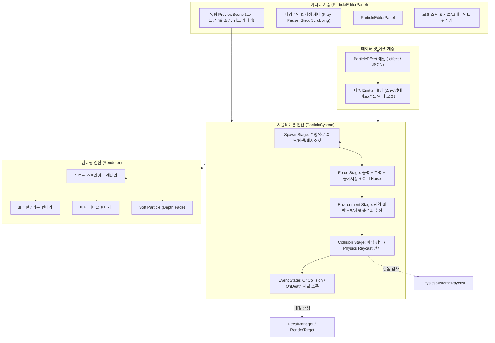

# 모듈형 파티클 & 비주얼 이펙트 시스템 및 에디터 개발 계획 (Modular Particle & VFX System and Editor Plan)

- **작성일:** 2026-11-07
- **상태:** Phase 1 ~ Phase 5 전체 구현 완료
- **공통 기준:** [EngineEditorClientGuidelines.md](EngineEditorClientGuidelines.md), [SourceOrganizationGuidelines.md](SourceOrganizationGuidelines.md)
- **연계 계획:** [EngineDevelopmentPlan.md](EngineDevelopmentPlan.md) 4절(나이아가라형 파티클 시스템), [AnimationTimelineEditorPlan.md](AnimationTimelineEditorPlan.md)(비-PIE 프리뷰 루프 및 타임라인 FX), [DevelopmentPriorities.md](DevelopmentPriorities.md)

---

## 1. 목적과 필요성

1. **물리 및 환경과의 단절 해소:** 기존 파티클 시스템은 공간을 인식하지 못하여 지면이나 벽을 뚫고 지나가며, 바람이나 충격파 등 월드 환경과 상호작용하지 못합니다.
2. **단일 하드코딩 구조의 한계:** 모든 속성이 `ParticleEmitterComponent` 단일 구조체에 집중되어 있어, 복합 이펙트(발사 $\rightarrow$ 충돌 $\rightarrow$ 파편 $\rightarrow$ 연기 $\rightarrow$ 그을음)를 연쇄시키거나 새로운 물리 법칙(컬 노이즈 등)을 모듈식으로 추가하기 어렵습니다.
3. **전용 시각화 저작 도구 부재:** 인스펙터의 수치 입력에만 의존하고 있어, 타임라인을 마우스로 앞뒤로 긁어가며(Scrubbing) 충돌 순간이나 분사 타이밍을 프레임 단위로 미세 조정할 수 있는 독립 에디터가 필요합니다.

본 계획의 목표는 상용 엔진(Unreal Niagara, Unity VFX Graph)의 핵심 아키텍처를 벤치마크하여, **물리 충돌 및 환경 기류 상호작용이 가능한 모듈형 파티클 런타임**과 **독립 프리뷰 뷰포트 및 타임라인 스크러빙을 지원하는 전용 이펙트 에디터(`ParticleEditorPanel`)**를 구축하는 것입니다.

---

## 2. 핵심 아키텍처 및 시스템 흐름

---

## 3. 단계별 상세 개발 로드맵 (Phase 1 ~ Phase 5)

### Phase 1: 물리 충돌 & 반발(Bounce) 및 바닥 상호작용 (구현 완료)
- **목표:** 입자가 지면 및 물리 콜라이더에 부딪혀 튀거나(바운스), 미끄러지거나(슬라이딩), 접촉 시 소멸하는 충돌 역학 완성.
- **주요 작업:**
  1. `EParticleCollisionMode` 열거형 정의: `None`, `FloorPlane`, `PhysicsRaycast`.
  2. `EParticleCollisionResponse` 열거형 정의: `Bounce`, `Slide`, `DieOnContact`, `Stop`.
  3. `ParticleEmitterComponent` 프로퍼티 확장: 반발 계수(`restitution`), 마찰 계수(`friction`), 바닥 높이(`floorHeight`), 프레임당 최대 검사 수(`maxCollisionChecksPerFrame`), 충돌 반경(`collisionRadius`), 최소 바운스 속도 임계치(`minBounceSpeed`).
  4. `ParticleSystem::UpdateEmitter` 적분 루프에 충돌 감지 및 반사 벡터 계산 적용:
     $$\vec{v}' = \vec{v} - (1 + e)(\vec{v} \cdot \vec{N})\vec{N}$$
  5. `FloorPlane` 초경량 고속 충돌 및 `PhysicsSystem::Raycast` 정밀 충돌 연동.
- **완료 기준:** 바닥에 튄 불꽃/파편 입자가 탄성 계수에 따라 서서히 감쇠하며 바닥에 안착하거나 슬라이딩하는 동작 검증 완료.

### Phase 2: 공간 연기 확산 역학 (부력 & 컬 노이즈 & 환경 외력) (구현 완료)
- **목표:** 연기가 위로 피어오르고(부력), 공기 저항으로 뭉게뭉게 퍼지며(드래그), 3D 노이즈를 따라 소용돌이치고(컬 노이즈), 월드 바람에 휘날리는 자연스러운 확산 구현.
- **주요 작업:**
  1. 부력(Buoyancy, $\vec{a}_{\text{buoyancy}} = (0, b, 0)$) 및 공기 저항 감쇠.
  2. 3D 무발산 컬 노이즈(Curl Noise / Turbulence, $\nabla \times \vec{\Psi}$) 벡터장 계산 및 파티클 속도 합성.
  3. 전역 바람(Global Wind, $\vec{w}$)에 의한 상대 공기 저항 가속도 연동.
  4. 시간에 따른 노이즈 장 스크롤 속도(`curlNoiseScrollSpeed`) 지원.
- **완료 기준:** 바닥에서 발생한 연기가 장애물과 기류를 타고 퍼져나가며, 위로 떠오르다 자연스럽게 흩어지는 비주얼 완성.

### Phase 3: 이벤트 방출 기반 경량화 & 충돌 이벤트 큐 (완료 및 리팩터링)
- **목표:** 엔진 코어는 가벼운 물리/역학 적분과 이벤트 방출에 집중하고, 구체적인 시각 효과(스파크/충격파 등)의 조합은 에디터와 모듈형 에셋 영역으로 위임.
- **주요 작업:**
  1. `ParticleEmitterComponent` C++ 하드코딩 변수 다이어트 (컴포넌트 비대화 해소).
  2. 프레임 단위 충돌 이벤트 구조체(`ParticleCollisionEvent`: 접촉 위치 $\vec{P}$, 법선 $\vec{N}$, 속도 $\vec{V}$, 시각 $t$) 정의.
  3. `UpdateEmitter`에서 충돌 발생 시 `collisionEvents` 버퍼에 O(1) 기록 및 매 프레임 `ClearEvents()` 자동 정리.
  4. 다중 이미터 간의 이벤트 체이닝(Parent OnCollision $\rightarrow$ Child Spawn) 및 지면 충격파/스파크 조합은 Phase 4 모듈형 에셋에서 조립하도록 책임 분리.
- **완료 기준:** 컴포넌트가 최소한의 물리 프리미티브와 이벤트 버퍼만 유지하여, 저작 도구(에디터)에서 무한히 확장 가능한 깔끔한 기반 확립.

### Phase 4: 모듈형 아키텍처 및 독립 에셋화 (`ParticleEffect` Asset) (구현 완료)
- **목표:** 단일 컴포넌트 하드코딩 구조에서 나이아가라 스타일의 다중 이미터 조합형 `.bameffect` 에셋 구조로 아키텍처 전환 완료.
- **주요 작업:**
  1. `EResourceType::ParticleEffect` (확장자 `.bameffect`) 에셋 타입 신설 및 `Resource` 계층 편입.
  2. `ParticleEmitterData`: 식별/트리거 체이닝, 방출, 역학(부력/바람/컬노이즈), 물리 충돌, 렌더링(빌보드/지면 디스크) 모듈형 데이터 정의.
  3. `ParticleEffect` 클래스: 다중 이미터 컬렉션 및 `JsonArchive` 기반 입출력(`SaveToFile`, `LoadFromFile`) 완비.
  4. `ParticleEffectComponent` 신설: 씬 엔티티에 에셋을 장착하여 재생 속도, 인스턴스별 RNG/버퍼 격리 실행 지원.
  5. `ParticleSystem`: 2단계 파이프라인(지속 방출/물리 적분 $\rightarrow$ `OnParentCollision` 이벤트 스폰 체이닝) 및 인스턴스 일괄 드로우콜 제출 연동.
  6. 예제 에셋 제작: `Resources/Effect/Explosion_Fireball.bameffect.json` (메인 발사체 $\rightarrow$ 지면 충격파 링 $\rightarrow$ 충돌 스파크 $\rightarrow$ 연기 퍼프 풀 체인).
- **완료 기준:** 여러 프리팹/엔티티에서 동일한 `.bameffect` 에셋을 참조하여 다중 이미터 연쇄 효과를 일관되게 재생 검증.

### Phase 5: 독립 프리뷰 및 전용 이펙트 에디터 (`ParticleEditorPanel`) (구현 완료)
- **목표:** 메인 씬의 방해 없이 이펙트를 실시간으로 편집하고 프레임 단위로 미세 조정하는 독립 저작 도구 구축.
- **주요 작업:**
  1. 격리된 프리뷰 뷰포트(`PreviewViewportWidget`): 메인 씬 오염 없는 독립 오프스크린 씬 (그리드, 스튜디오 라이팅, 마우스 궤도 카메라, Non-PIE 실시간 뷰포트 렌더링).
  2. 타임라인 및 재생 제어기: 상단 툴바에 Play/Pause 토글, Step(+0.033s), 배속 조절(0.1x~3.0x), Restart, 카메라 포커스 리셋, 활성 파티클 통계 출력 완비.
  3. 좌측 이미터 리스트 패널: 이미터 추가/삭제/활성화 토글 및 트리거 모드(Continuous, Collision, Death) 시각화.
  4. 우측 모듈 스택 인스펙터 패널: 식별/트리거 체이닝, 수명/속도, 외력(부력/바람/컬노이즈), 물리 충돌(바운스/마찰/바닥높이), 크기/회전, 색상/머티리얼(리소스 피커 연동).
  5. 에디터 통합 및 리소스 등록: `ResourceEditorInterface` 상속, 에셋 브라우저 더블클릭(`.bameffect`, `.bameffect.json`) 시 자동 오픈 및 `ImGuiManager` 메뉴 등록.
- **완료 기준:** 에디터 패널 안에서 이펙트 제작, 실시간 뷰포트 검증, 디스크 저장 및 씬 배치까지 원스톱 워크플로우 완성.

---

## 4. 로캘 및 단축키 관리 기준

- **로캘 키:** 신규 UI 문구 및 파라미터는 번역 JSON을 직접 수정하지 않고, **`Resources/Data/Localization/Editor.csv` 및 `Engine.csv`에 원본 키를 등록**합니다.
- **단축키 중앙 집중 관리:** 에디터 재생 제어 단축키(Space = Play/Pause, `[` / `]` = Step Frame, R = Restart)는 **`ShortcutManager`(`EditorActionRegistry`)에 액션으로 등록**합니다.

---

## 5. 검증 기준 및 확인 절차

1. **물리 충돌 검증:** 경사면 및 바닥 콜라이더에 파티클을 쏘았을 때 법선 반사가 정확하며, 반발 계수($e=0.5$) 시 튀는 높이가 지수적으로 감소하는지 확인.
2. **연기 컬 노이즈 검증:** 파티클들이 직선으로 뻗지 않고 유기적인 소용돌이를 형성하며, 바닥/벽면 충돌 시 뚫고 나가지 않고 모퉁이를 따라 미끄러지는지 확인.
3. **결정론적 스크러빙 검증:** 시드를 고정했을 때 타임라인을 $t=1.0\text{s}$ 위치로 앞뒤로 스크러빙해도 매번 동일한 위치/형태가 나타나는지 확인.
4. **저장 및 복원 검증:** `.effect` 에셋 저장 후 씬을 재열거나 에디터를 재시작했을 때 모든 모듈과 커브 데이터가 무손실 복원되는지 확인.

## 6. ActionTimeline과 공통 시간축 적용 (2026-11-09)

- 파티클 에디터 하단에 공통 눈금자, 재생 헤드, 트랙 막대, 확대·이동과 구간 편집을 적용했다. 라벨과 막대로 에미터를 선택하고, 연속 방출과 부모 이벤트 트랙은 서로 다른 색과 아이콘으로 표시한다.
- `ParticleEmitterData::emissionStartTime`과 `emissionDuration`, `ParticleEffect`의 전체 길이를 저장한다. 누락된 값은 0이다. 지속 시간 0은 고정 방출 종료가 없고 전체 길이 0은 전체 방출 제한이 없다는 의미다. 비어 있는 과거 파일의 편집기 시간축은 최소 5초다.
- 방출 구간은 새 입자의 생성만 제한한다. 연속 방출 및 기존 부모 충돌 이벤트에 적용하며, 이미 생성된 입자는 자신의 수명대로 적분한다. 부모 사망 트리거는 별도 런타임 검증/구현 대상이다.
- 새 단축키 기본값은 ActionTimeline과 동일한 Space, 좌/우, Home/End, Ctrl+L, F, Delete다. Ctrl+Z/Y, Ctrl+S도 파티클 편집기 문맥에 등록한다.
- 사용자 검증은 기존 파일 재생과 새 파일 저장/재열기, 종료 경계에서 신규 방출만 멈추는지, 부모 참조가 있는 에미터 삭제 후 Undo, 0.5×/1×/2× 배속, 동일 시간 앞뒤 탐색, 좁은 도킹 폭·큰 배율에서 조작 가능 여부를 포함한다. 실행 확인은 남아 있다.
