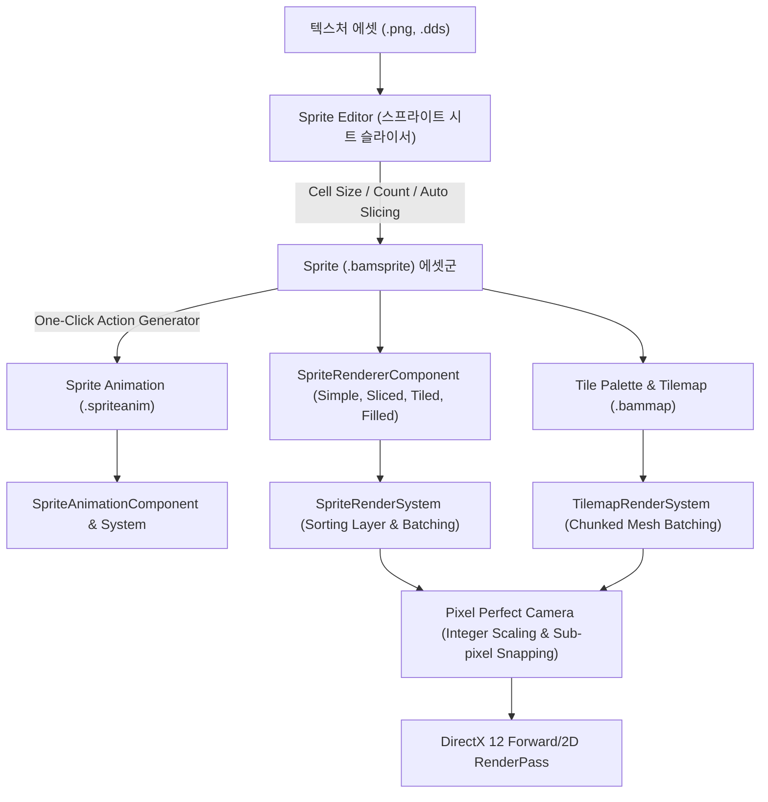

# 스프라이트 및 2D 시스템 개발 계획 (Sprite & 2D System Plan)

- 작성일: 2026-11-08
- 상태: 계획 수립 및 1단계 착수 준비
- 선행 조건: `Sprite`, `SpriteAnimation`, `SpriteRendererComponent`, `SpriteAnimationSystem` 기본 구조 기구축 완료
- 대상 모듈: `Engine/Source/Resource/Sprite`, `Engine/Source/System/Render`, `Engine/Source/Core/Components/Render`, `Editor/Source/ImGui/ResourceEditor`, `Editor/Source/ImGui/TilemapEditor`
- 연관 문서: [EngineDevelopmentPlan.md 14절 L](EngineDevelopmentPlan.md), [DevelopmentPriorities.md](DevelopmentPriorities.md), [EngineEditorClientGuidelines.md](EngineEditorClientGuidelines.md)

---

## 1. 비전 및 아키텍처 목표

상용 엔진(Unity 2D, Unreal Paper2D, Godot)의 검증된 2D 워크플로를 BamEngine의 데이터 지향 ECS 아키텍처와 DirectX 12 렌더 파이프라인에 통합한다. 단순한 평면 텍스처 그리기를 넘어, **스프라이트 시트 슬라이싱 $\rightarrow$ 원클릭 애니메이션 연동 $\rightarrow$ 9-Slice UI/배경 $\rightarrow$ 픽셀 퍼펙트 렌더링 $\rightarrow$ 대규모 고속 타일맵**으로 이어지는 완전한 2D 콘텐츠 제작 파이프라인을 구축한다.



---

## 2. 세부 개발 단계 (Phase 1 ~ Phase 5)

---

### Phase 1: 스프라이트 시트 슬라이싱 및 원클릭 애니메이션 생성 (Sprite Slicer & Auto-Action)

#### 1.1 해결하려는 문제
- 현재는 단일 텍스처를 통째로 쓰거나 코드로만 UV 영역(`m_Region`)을 설정해야 함.
- 횡스크롤 캐릭터 스프라이트 시트(예: 4행 8열 캐릭터 텍스처)를 가져왔을 때, 각 프레임을 일일이 좌표로 자르고 애니메이션으로 조립하는 과정이 불가능하거나 극도로 번거로움.

#### 1.2 핵심 설계 및 구현 명세
1. **스프라이트 에디터(`SpriteEditor`) 인터랙티브 UI 구축**:
   - 중앙 프리뷰 캔버스: 텍스처 줌/팬, 슬라이스된 사각 영역(Rect) 와이어프레임 및 피벗(Pivot) 크로스헤어 시각화.
   - 사각 영역 상호작용: 캔버스에서 마우스 드래그로 영역 생성, 모서리 핸들 드래그로 리사이즈, 다중 선택/이동/삭제.
2. **3대 슬라이싱 알고리즘 (`SpriteSlicingService`)**:
   - **Grid by Cell Size**: 고정 픽셀 너비/높이(예: $32 \times 32$, $64 \times 64$)로 좌상단부터 우하단까지 균등 격자 분할.
   - **Grid by Cell Count**: 행/열 개수(예: 4행 8열)를 지정하여 텍스처 전체 해상도를 균등 분할.
   - **Automatic (알파 연결 요소 검출)**: 텍스처 CPU 픽셀 데이터(RGBA8)를 순회하며 투명하지 않은 픽셀(Alpha > Threshold) 클러스터를 Flood-Fill(BFS)로 탐색하여 개별 스프라이트의 AABB를 자동 추출.
3. **일괄 스프라이트 생성 및 에셋 영속화**:
   - `[Apply Slices]`: 슬라이스된 각 영역을 `TextureName_0`, `TextureName_1` 등의 독립 `.bamsprite` 에셋으로 일괄 저장 및 콘텐츠 브라우저 자동 등록.
4. **원클릭 애니메이션 클립 생성 위저드 (Auto Action Generator)**:
   - "스프라이트 시트에서 애니메이션 생성" 팝업 모달 제공.
   - 옵션:
     - **단일 클립 생성**: 선택된 슬라이스들을 순서대로 담은 `.spriteanim` 1개 생성.
     - **행 단위 분할 클립 생성 (Row-based Multi-Clip)**: 예: 1행은 `Player_Idle`, 2행은 `Player_Walk`, 3행은 `Player_Attack`, 4행은 `Player_Die`로 자동 분할 및 4개 애니메이션 파일 일괄 추출.
     - 기본 FPS(예: 12.0) 및 재생 모드(Loop/Once) 지정.

---

### Phase 2: 스프라이트 렌더링 모드 확장 (Sliced, Tiled, Filled, Sorting Layer)

#### 2.1 해결하려는 문제
- [`SpriteRenderSystem.cpp`](file:///i:/BamtoliyaGithub/BamEngine/Engine/Source/System/Render/Private/SpriteRenderSystem.cpp)의 `drawMode != ESpriteDrawMode::Simple` 스킵 해제.
- UI 배경 박스나 대화창처럼 가로세로로 늘어나야 하는 오브젝트가 단순 스케일 시 모서리가 찌그러짐 (9-Slice 필수).
- 체력바, 스킬 쿨타임 원형 게이지 등 절차적 채우기 렌더링의 부재.
- 2D 평면에서 깊이 버퍼(Z-Buffer) 부동소수점 오차로 인한 깜빡임(Z-Fighting)을 방지하고 명시적 레이어 순서를 보장할 필요성.

#### 2.2 핵심 설계 및 구현 명세
1. **스프라이트 보더 인셋(Border Insets) 추가**:
   - `Sprite` 클래스에 `vec4 m_Border = { left, right, top, bottom }` 픽셀 단위 인셋 추가.
   - `SpriteEditor`에서 4방향 보더 가이드라인을 드래그하여 조절 가능.
2. **9-Slice (Sliced 모드) 정점 생성 알고리즘**:
   - 기존 4정점 쿼드 대신, 가로 4열 $\times$ 세로 4행 = **16개 정점 및 9개 사각 패치(54개 인덱스)** 동적 생성.
   - 모서리 4개: 원본 픽셀 비율 유지.
   - 변 4개: 수평/수직으로 늘어남.
   - 중앙 1개: 가로세로 모두 늘어남.
3. **Tiled 모드**:
   - 지정된 크기가 스프라이트 원본 크기보다 클 때, 텍스처를 늘리지 않고 UV 반복(Tiling)을 통해 바둑판식으로 쿼드 반복 생성.
4. **Filled 모드 (진행도 0.0 ~ 1.0)**:
   - `Horizontal`: 좌 $\rightarrow$ 우 또는 우 $\rightarrow$ 좌 수평 컷.
   - `Vertical`: 하 $\rightarrow$ 상 또는 상 $\rightarrow$ 하 수직 컷.
   - `Radial360`: 중심점 기준 시계방향/반시계방향 부채꼴 각도 클리핑 (삼각형 팬 분할).
5. **2D 정렬 레이어 (Sorting Layer & Order in Layer)**:
   - `SpriteRendererComponent`에 `int32 sortingLayerID = 0`, `int32 orderInLayer = 0` 추가.
   - 렌더러 제출 시 드로우 커맨드를 `(sortingLayerID << 32) | (orderInLayer << 16) | depthKey` 64비트 정렬 키로 정렬하여 결정론적 렌더 순서 보장.

---

### Phase 3: 픽셀 퍼펙트 카메라 및 서브픽셀 스냅 (Pixel Perfect Camera)

#### 3.1 해결하려는 문제
- 픽셀 아트 기반 2D 게임에서 카메라가 부드럽게 이동(Smooth follow)할 때, 화면 픽셀과 텍스처 픽셀이 $1:1$ 정수비로 매칭되지 않아 스프라이트가 미세하게 떨리거나 찌그러지는 현상(Sub-pixel Jittering & Shimmering) 발생.
- 화면 해상도(예: 1080p, 1440p, 4K)가 변할 때 픽셀 크기가 일정하지 않고 왜곡되는 현상.

#### 3.2 핵심 설계 및 구현 명세
1. **`PixelPerfectCameraComponent` 신설**:
   ```cpp
   STRUCT(COMPONENT)
   struct PixelPerfectCameraComponent {
       REFLECT_BODY()
       int32 referenceWidth = 320;      // 기준 가상 해상도 가로 (예: 320x180)
       int32 referenceHeight = 180;     // 기준 가상 해상도 세로
       f32 assetsPPU = 16.0f;           // 기본 픽셀 아트 PPU (1 Unit = 16 픽셀)
       bool upscaleRT = true;           // 가상 저해상도 렌더타깃에 렌더 후 정수배 업스케일
       bool cropFrameX = false;         // 레터박스/필러박스 강제 여부
       bool cropFrameY = false;
   };
   ```
2. **정수 줌 배율(Integer Scale) 자동 계산**:
   - 뷰포트 해상도 $(W_v, H_v)$와 기준 해상도 $(W_{ref}, H_{ref})$ 비교:
     $$\text{Zoom} = \max\left(1, \min\left(\lfloor W_v / W_{ref} \rfloor, \lfloor H_v / H_{ref} \rfloor\right)\right)$$
   - 카메라의 `OrthographicSize`를 정수 줌 배율에 완벽히 동기화:
     $$\text{OrthoSize} = \frac{H_v}{2 \times \text{PPU} \times \text{Zoom}}$$
3. **서브픽셀 카메라 스내핑 (Sub-pixel Position Snapping)**:
   - 카메라의 실제 뷰 행렬(View Matrix)을 계산할 때, 카메라의 월드 위치를 1 픽셀 단위 격자($\frac{1}{\text{PPU}}$)로 내림(Snap):
     $$X_{snapped} = \frac{\lfloor X_{world} \times \text{PPU} + 0.5 \rfloor}{\text{PPU}}$$
   - 이를 통해 카메라가 서브픽셀 단위로 이동하더라도 텍스처 텍셀 경계가 화면 픽셀 경계와 항상 완벽히 정렬되어 지터링 0% 달성.
4. **포인트 필터링(Point Filtering) 보장**:
   - 픽셀 퍼펙트 패스에서는 텍스처 샘플러를 강제로 `Point / Clamp` 모드로 바인딩하여 픽셀 경계가 흐려지지 않고 날카롭게 렌더링되도록 보장.

---

### Phase 4: 2D 타일맵 시스템 (Chunked Tilemap & Tile Palette)

#### 4.1 해결하려는 문제
- 수천 개의 타일(예: $100 \times 100$ 맵 = 10,000개 타일)을 개별 엔티티/컴포넌트로 생성하면 메모리 낭비와 10,000번의 드로우콜로 인해 FPS가 10 미만으로 폭락함.
- 직관적인 씬 뷰포트 타일 페인팅(브러시, 지우개, 박스 필) 저작 도구 부재.

#### 4.2 핵심 설계 및 구현 명세
1. **타일 데이터 구조**:
   - `Tile` 에셋 (`.bamtile`): `ResourceHandle<Sprite>`, 2D 충돌 타입(`None`, `GridBox`, `Custom2D`), 색상 틴트.
   - `TilemapChunk` ($16 \times 16$ 타일 블록):
     - 동적 메시 정점 버퍼 1개 소유 (최대 256개 쿼드 = 1,024 버텍스).
     - 타일 변경 시 해당 청크의 정점 버퍼만 재생성(Dirty flag 관리).
2. **`TilemapComponent` 및 `GridComponent`**:
   - `vec2 cellSize = { 1.0f, 1.0f }` (타일 1칸의 월드 크기).
   - `std::unordered_map<uint64_t, TilemapChunk> chunks`: 스파스(Sparse) 2D 그리드 저장소 (무한 맵 확장 가능).
   - 타일 좌표 $\leftrightarrow$ 월드 좌표 변환: `CellToWorld(int x, int y)`, `WorldToCell(vec3 worldPos)`.
3. **`TilemapRenderSystem` 초고속 배치 렌더링**:
   - 화면 절두체(Frustum)에 들어오는 활성 청크만 선별.
   - 청크당 1회의 드로우콜로 제출하여 10만 개 타일도 50개 미만의 드로우콜로 60 FPS 유지.
4. **에디터 타일 팔레트 창 (`TilePalettePanel`)**:
   - 에디터 상단 메뉴 `Window -> Panels -> 2D -> Tile Palette`.
   - 스프라이트 시트/타일셋 텍스처를 그리드로 표시하고 타일 선택.
   - 도구 툴바: **페인트 브러시(B)**, **지우개(E)**, **박스 채우기(U)**, **타일 스포이트(I)**.
   - 씬 뷰포트 오버레이: 마우스 커서 위치에 실시간 타일 그리드 스냅 가이드 및 미리보기 표시.

---

### Phase 5: 스프라이트 아틀라스 및 런타임 드로우콜 배칭 (Sprite Atlas & Batching)

#### 5.1 해결하려는 문제
- 씬에 여러 종류의 스프라이트(몬스터, 아이템, UI)가 등장할 때 텍스처가 다르면 텍스처 바인딩 전환으로 인해 인스턴스 배칭이 깨지고 드로우콜이 증가함.

#### 5.2 핵심 설계 및 구현 명세
1. **스프라이트 아틀라스 에셋 (`SpriteAtlas`)**:
   - 여러 낱개 텍스처를 MaxRects 알고리즘을 통해 1장의 대형 텍스처($2048 \times 2048$ 등)로 자동 패킹.
   - 패킹된 아틀라스 내 UV 좌표 맵 자동 생성.
2. **동적 스프라이트 배치 렌더러 (`SpriteBatcher`)**:
   - 동일한 머티리얼/아틀라스를 공유하는 스프라이트들을 하나의 동적 버텍스 버퍼에 모아 **1회의 `DrawIndexed`로 일괄 제출**.

---

## 3. 우선순위별 구현 로드맵 및 일정

| 단계 | 항목 | 주요 목표 | 상태 |
| :--- | :--- | :--- | :---: |
| **Phase 1** | **SpriteEditor & Auto-Action** | 스프라이트 시트 3대 슬라이서 (Size/Count/Auto), 일괄 에셋 생성, 원클릭 애니메이션 클립 위저드 | **착수** |
| **Phase 2** | **Sprite 렌더링 모드 확장** | Sliced(9-Slice), Tiled, Filled, 2D Sorting Layer & Order in Layer | 대기 |
| **Phase 3** | **Pixel Perfect Camera** | 레퍼런스 해상도/PPU 자동 줌, 서브픽셀 카메라 스냅, 정수배 렌더링 | 대기 |
| **Phase 4** | **2D Tilemap System** | Chunked Tilemap Mesh Batching, Tile Palette 저작 도구 | 대기 |
| **Phase 5** | **Sprite Atlas & Batcher** | MaxRects 패킹, 런타임 동적 스프라이트 배칭 최적화 | 대기 |

---

## 4. 완료 기준 및 검증 방법

1. **Phase 1 완료 기준**:
   - 다중 프레임 스프라이트 시트 텍스처(`.png`)를 `SpriteEditor`에서 열고, $32 \times 32$ Grid Cell Size 또는 $4 \times 8$ Cell Count로 슬라이싱 시 정확한 구획선이 생성된다.
   - `[Create Animation from Slices]` 버튼 클릭 시 프레임 순서가 올바른 `.spriteanim` 에셋이 즉시 생성되며, `SpriteAnimationEditor`에서 60 FPS로 재생된다.
2. **Phase 2 완료 기준**:
   - 9-Slice가 적용된 스프라이트의 가로세로 스케일을 늘려도 모서리 픽셀이 1:1 비율을 유지한다.
   - Filled 모드에서 슬라이더(0.0~1.0) 조작 시 체력바/원형 게이지가 부드럽게 잘린다.
3. **Phase 3 완료 기준**:
   - 카메라를 천천히 이동시켜도 픽셀 경계의 떨림(Shimmering/Jittering)이 완전히 사라진다.
4. **Phase 4 완료 기준**:
   - 타일 팔레트에서 타일을 찍어 뷰포트에 그릴 수 있으며, $100 \times 100$ 크기의 타일맵에서도 드로우콜이 50회 미만으로 유지된다.
