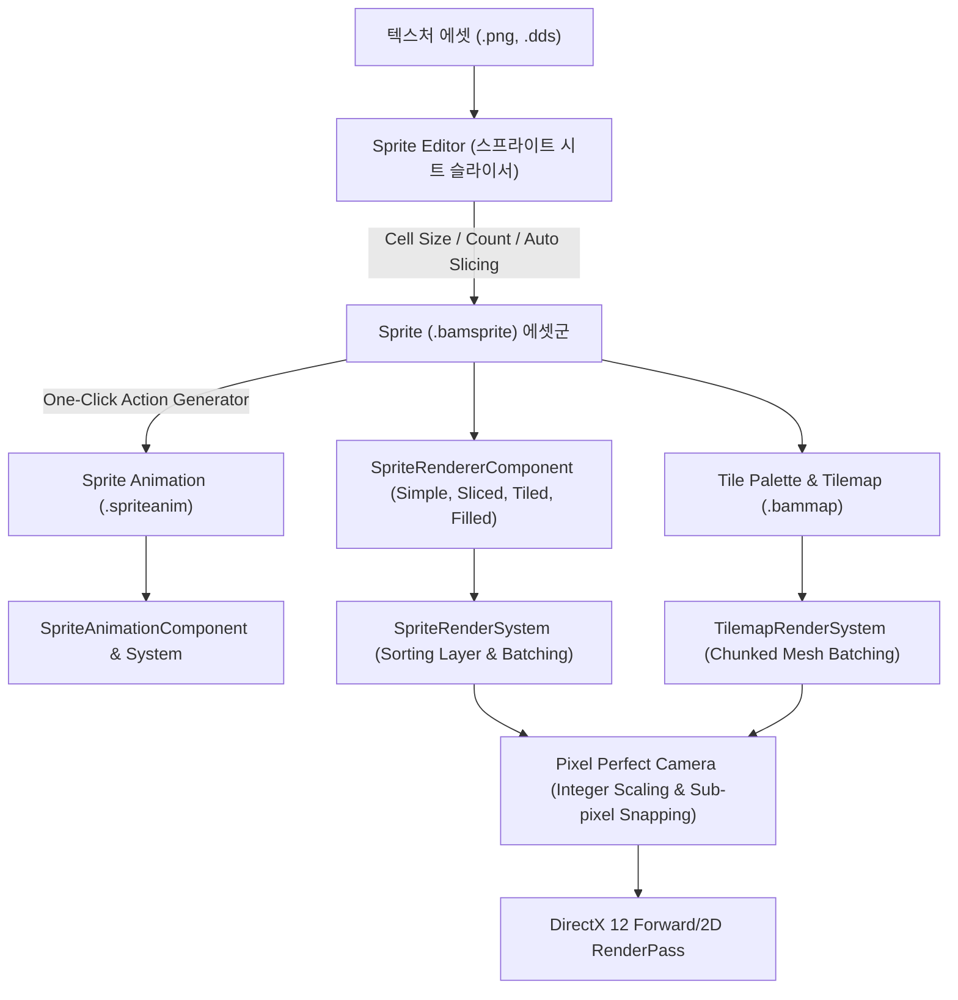

# 스프라이트 및 2D 시스템 개발 계획 (Sprite & 2D System Plan)

- 작성일: 2026-11-08 (최종 갱신: 2026-11-09)
- 상태는 단계별 로드맵을 따른다. Phase 5는 아틀라스 배치 계산과 CPU 버킷 기반이 있으며, 실제 렌더 제출 연결과 성능 검증을 계획한다.
- 선행 조건: `Sprite`, `SpriteAnimation`, `SpriteRendererComponent`, `SpriteAnimationSystem` 기본 구조 기구축 완료
- 대상 모듈은 `Engine/Source/Sprite`, `Engine/Source/Tilemap`, `Engine/Source/Render`, `Editor/Source/ImGui/ResourceEditor`, `Editor/Source/ImGui/TilemapEditor`다.
- 연관 문서: [EngineDevelopmentPlan.md 14절 L](EngineDevelopmentPlan.md), [DevelopmentPriorities.md](DevelopmentPriorities.md), [EngineEditorClientGuidelines.md](EngineEditorClientGuidelines.md)

---

## 1. 비전 및 아키텍처 목표

상용 엔진(Unity 2D, Unreal Paper2D, Godot)의 검증된 2D 워크플로를 BamEngine의 데이터 지향 ECS 아키텍처와 DirectX 12 렌더 파이프라인에 통합한다. 단순한 평면 텍스처 그리기를 넘어, **스프라이트 시트 슬라이싱 $\rightarrow$ 원클릭 애니메이션 연동 $\rightarrow$ 9-Slice UI/배경 $\rightarrow$ 픽셀 퍼펙트 렌더링 $\rightarrow$ 대규모 고속 타일맵**으로 이어지는 완전한 2D 콘텐츠 제작 파이프라인을 구축한다.

---

## 2. 세부 개발 단계 (Phase 1 ~ Phase 5)

---

### Phase 1: 스프라이트 시트 슬라이싱 및 원클릭 애니메이션 생성 (Sprite Slicer & Auto-Action)

#### 1.1 해결하려는 문제
- 현재는 단일 텍스처를 통째로 쓰거나 코드로만 UV 영역(`m_Region`)을 설정해야 함.
- 횡스크롤 캐릭터 스프라이트 시트(예: 4행 8열 캐릭터 텍스처)를 가져왔을 때, 각 프레임을 일일이 좌표로 자르고 애니메이션으로 조립하는 과정이 불가능하거나 극도로 번거로움.

#### 1.2 핵심 설계 및 구현 명세
1. **스프라이트 에디터(`SpriteEditor`) 인터랙티브 UI 구축**:
   - 중앙 프리뷰 캔버스: 텍스처 줌/팬, 슬라이스된 사각 영역(Rect) 와이어프레임 및 피벗(Pivot) 크로스헤어 시각화.
   - 사각 영역 상호작용: 캔버스에서 마우스 드래그로 영역 생성, 모서리 핸들 드래그로 리사이즈, 다중 선택/이동/삭제.
2. **3대 슬라이싱 알고리즘 (`SpriteSlicingService`)**:
   - **Grid by Cell Size**: 고정 픽셀 너비/높이(예: $32 \times 32$, $64 \times 64$)로 좌상단부터 우하단까지 균등 격자 분할.
   - **Grid by Cell Count**: 행/열 개수(예: 4행 8열)를 지정하여 텍스처 전체 해상도를 균등 분할.
   - **Automatic (알파 연결 요소 검출)**: 텍스처 CPU 픽셀 데이터(RGBA8)를 순회하며 투명하지 않은 픽셀(Alpha > Threshold) 클러스터를 Flood-Fill(BFS)로 탐색하여 개별 스프라이트의 AABB를 자동 추출.
3. **일괄 스프라이트 생성 및 에셋 영속화**:
   - `[Apply Slices]`: 슬라이스된 각 영역을 `TextureName_0`, `TextureName_1` 등의 독립 `.bamsprite` 에셋으로 일괄 저장 및 콘텐츠 브라우저 자동 등록.
4. **원클릭 애니메이션 클립 생성 위저드 (Auto Action Generator)**:
   - "스프라이트 시트에서 애니메이션 생성" 팝업 모달 제공.
   - 옵션:
     - **단일 클립 생성**: 선택된 슬라이스들을 순서대로 담은 `.spriteanim` 1개 생성.
     - **행 단위 분할 클립 생성 (Row-based Multi-Clip)**: 예: 1행은 `Player_Idle`, 2행은 `Player_Walk`, 3행은 `Player_Attack`, 4행은 `Player_Die`로 자동 분할 및 4개 애니메이션 파일 일괄 추출.
     - 기본 FPS(예: 12.0) 및 재생 모드(Loop/Once) 지정.

#### 1.3 저장 실패와 재시도

- 저장 전에 슬라이스와 클립의 출력 이름을 검사한다. 경로 구분자가 포함된 이름과 같은 파일을 가리키는 일괄 출력은 오류로 표시한다.
- 슬라이스 파일의 쓰기가 성공한 뒤 해당 리소스를 메모리에 반영한다. 모든 슬라이스를 저장하고 유효한 리소스 핸들을 확보한 뒤 미저장 표시를 지운다. 첫 실패에서 중단하고 클립 생성은 시작하지 않는다.
- 단일·행별 클립 생성은 저장한 슬라이스의 핸들을 사용한다. 모든 클립 파일의 쓰기가 성공하면 성공 알림을 표시하고 생성 창을 닫는다. 중간 실패 시 실패한 출력 이름을 알리고 생성 창과 입력값을 유지한다. 앞서 성공한 파일은 디스크에 남으며 재시도 시 기존 출력 경로를 다시 사용한다.
- 에디터 확인은 일반 저장, 확장자가 붙은 슬라이스 이름, 단일·행별 클립의 프레임 참조, 중복 이름, 두 번째 슬라이스 쓰기 실패, 행별 클립 쓰기 실패 후 재시도를 포함한다. `SpriteSlicingCheck`는 슬라이싱 알고리즘을 확인하며 에디터 저장·모달 동작은 별도로 확인한다.

---

### 1.5 2D 이펙트 시스템 연동 (2D Flipbook & Particle Effects)

2D 게임에서 타격, 폭발, 스킬 연출을 담당하는 2대 이펙트 파이프라인을 스프라이트 및 파티클 시스템과 통합한다.

1. **스프라이트 플립북 원샷 이펙트 (Sprite Flipbook Effect)**:
   - `SpriteAnimationComponent`에 완료 시 동작 플래그 지원:
     - `autoDeactivateOnFinish`: 단발성 이펙트 재생 완료 시 `FlagComponent`를 비활성화하여 오브젝트 풀링 지원.
     - `autoDestroyOnFinish`: 단발성 이펙트 재생 완료 시 씬에서 엔티티 자동 안전 파괴(Clean-up).
   - 슬라이스 위저드로 추출된 `.spriteanim` 에셋을 원샷 이펙트 엔티티에 장착하여 원클릭 2D 이펙트 완성.
2. **2D 평면 파티클 및 Sub-UV 플립북 (2D Plane Particle & Sub-UV)**:
   - `ParticleEmitterComponent` 및 `ParticleEffect`:
     - `billboardMode == ESpriteBillboardMode::None` 시 카메라를 향한 3D 빌보드 대신 2D 게임 평면(XY 평면, Z=0, Z축 회전)에 정확히 밀착 렌더링.
     - Sub-UV (Flipbook Texture Sheet) 애니메이션: `subUVColumns`, `subUVRows`, `subUVCycles`를 기반으로 파티클 수명 동안 텍스처 시트의 프레임을 부드럽게 넘기는 절차적 2D 파티클 이펙트 지원.

---

### Phase 2: 스프라이트 렌더링 모드 확장 (Sliced, Tiled, Filled, Sorting Layer)

#### 2.1 해결하려는 문제
- [`SpriteRenderSystem.cpp`](file:///i:/BamtoliyaGithub/BamEngine/Engine/Source/System/Render/Private/SpriteRenderSystem.cpp)의 `drawMode != ESpriteDrawMode::Simple` 스킵 해제.
- UI 배경 박스나 대화창처럼 가로세로로 늘어나야 하는 오브젝트가 단순 스케일 시 모서리가 찌그러짐 (9-Slice 필수).
- 체력바, 스킬 쿨타임 원형 게이지 등 절차적 채우기 렌더링의 부재.
- 2D 평면에서 깊이 버퍼(Z-Buffer) 부동소수점 오차로 인한 깜빡임(Z-Fighting)을 방지하고 명시적 레이어 순서를 보장할 필요성.

#### 2.2 핵심 설계 및 구현 명세
1. **스프라이트 보더 인셋(Border Insets) 추가**:
   - `Sprite` 클래스에 `vec4 m_Border = { left, right, top, bottom }` 픽셀 단위 인셋 추가.
   - `SpriteEditor`에서 4방향 보더 가이드라인을 드래그하여 조절 가능.
2. **9-Slice (Sliced 모드) 정점 생성 알고리즘**:
   - 기존 4정점 쿼드 대신, 가로 4열 $\times$ 세로 4행 = **16개 정점 및 9개 사각 패치(54개 인덱스)** 동적 생성.
   - 모서리 4개: 원본 픽셀 비율 유지.
   - 변 4개: 수평/수직으로 늘어남.
   - 중앙 1개: 가로세로 모두 늘어남.
3. **Tiled 모드**:
   - 지정된 크기가 스프라이트 원본 크기보다 클 때, 텍스처를 늘리지 않고 UV 반복(Tiling)을 통해 바둑판식으로 쿼드 반복 생성.
4. **Filled 모드 (진행도 0.0 ~ 1.0)**:
   - `Horizontal`: 좌 $\rightarrow$ 우 또는 우 $\rightarrow$ 좌 수평 컷.
   - `Vertical`: 하 $\rightarrow$ 상 또는 상 $\rightarrow$ 하 수직 컷.
   - `Radial360`: 중심점 기준 시계방향/반시계방향 부채꼴 각도 클리핑 (삼각형 팬 분할).
5. **2D 정렬 레이어 (Sorting Layer & Order in Layer)**:
   - `SpriteRendererComponent`에 `int32 sortingLayerID = 0`, `int32 orderInLayer = 0` 추가.
   - 정렬 필드는 선언되어 있다. 현재 `SpriteDrawCommand`에는 이 필드가 없으며 `Renderer::RenderSprite()`는 전달받은 `sortType`으로 정렬하지 않는다. 레이어·깊이·동일 순위의 순서를 명시적으로 적용하는 작업은 Phase 5에서 다룬다.

---

### Phase 3: 픽셀 퍼펙트 카메라 및 서브픽셀 스냅 (Pixel Perfect Camera) [구현 완료]

#### 3.1 해결하려는 문제
- 픽셀 아트 기반 2D 게임에서 카메라가 부드럽게 이동(Smooth follow)할 때, 화면 픽셀과 텍스처 픽셀이 $1:1$ 정수비로 매칭되지 않아 스프라이트가 미세하게 떨리거나 찌그러지는 현상(Sub-pixel Jittering & Shimmering) 발생.
- 화면 해상도(예: 1080p, 1440p, 4K)가 변할 때 픽셀 크기가 일정하지 않고 왜곡되는 현상.

#### 3.2 핵심 설계 및 구현 명세 (구현 완료)
1. **`PixelPerfectCameraComponent` 구현**:
   - `assetsPPU`: 기본 픽셀 아트 PPU (1 Unit당 픽셀 수, 기본 16)
   - `refResolutionX`, `refResolutionY`: 기준 가상 해상도 가로/세로 (예: $320 \times 180$)
   - `snapSubpixel`: 서브픽셀 위치 스냅으로 카메라 이동 시 떨림 방지
   - `upscaleRT`: 가상 저해상도 렌더타깃 여부 및 정수배 업스케일
   - `cropFrameX`, `cropFrameY`: X/Y축 필러박스/레터박스 정수비 크롭 여부
   - `currentZoom`: 실시간 계산된 정수 줌 배율 ($1\times, 2\times, 3\times \dots$)
2. **정수 줌 배율(Integer Scale) 자동 계산 및 OrthographicSize 완벽 동기화**:
   - 뷰포트 해상도 $(W_v, H_v)$와 기준 해상도 $(W_{ref}, H_{ref})$ 비교:
     $$\text{Zoom} = \max\left(1, \min\left(\lfloor W_v / W_{ref} \rfloor, \lfloor H_v / H_{ref} \rfloor\right)\right)$$
   - 카메라의 `OrthographicSize`를 정수 줌 배율에 완벽히 동기화:
     $$\text{OrthoSize} = \frac{H_v}{\text{PPU} \times \text{Zoom}}$$
3. **서브픽셀 카메라 스내핑 (Sub-pixel Position Snapping)**:
   - 화면 픽셀 단위 격자($\frac{1}{\text{PPU} \times \text{Zoom}}$)로 카메라의 월드 위치를 내림(Snap):
     $$\text{effectivePPU} = \text{PPU} \times \text{Zoom}$$
     $$X_{snapped} = \frac{\lfloor X_{world} \times \text{effectivePPU} + 0.5 \rfloor}{\text{effectivePPU}}$$
     $$Y_{snapped} = \frac{\lfloor Y_{world} \times \text{effectivePPU} + 0.5 \rfloor}{\text{effectivePPU}}$$
   - 카메라가 임의의 부동소수점 좌표로 부드럽게 이동하더라도 화면 픽셀 경계와 항상 완벽히 정렬되어 서브픽셀 지터링(Jittering & Shimmering) 0% 달성.
4. **크롭 프레임 및 투영 행렬 연동**:
   - `cropFrameX`, `cropFrameY` 옵션에 따라 정수비 바운드 고정 및 에디터 뷰포트(`GameViewportPanel`) 실시간 해상도 연동 완료.
   - 단위 테스트 `PixelPerfectCameraCheck`를 통해 5대 시나리오 자동 검증 완료.

---

### Phase 4: 2D 타일맵 시스템 (Chunked Tilemap & Tile Palette) [구현 완료]

#### 4.1 해결하려는 문제
- 타일을 개별 엔티티로 생성할 때 발생하는 관리 비용을 청크 데이터로 줄인다. 현행 렌더 제출은 타일마다 수행되며 드로우 수 최적화는 Phase 5에서 검증한다.
- 직관적인 씬 뷰포트 타일 페인팅(브러시, 지우개, 박스 필) 저작 도구 부재.

#### 4.2 핵심 설계 및 구현 명세 (구현 완료)
1. **타일 데이터 구조 및 청크 시스템**:
   - `TileCell`: `ResourceHandle<Sprite>`, 틴트 컬러(`vec4 color`).
   - `TilemapChunk` ($16 \times 16$ 타일 블록): 64비트 정수 청크 키(`MakeChunkKey(cx, cy)`) 기반 스파스(Sparse) 맵 관리로 무한 좌표계 타일맵 지원.
   - `SavedTile` 및 `SyncSavedTiles()` / `RestoreFromSavedTiles()`: 씬 직렬화/역직렬화 및 런타임 청크 자동 복원 지원.
2. **`TilemapComponent` 및 그리드 좌표 변환**:
   - `vec2 cellSize`: 타일 1칸의 월드 크기.
   - 좌표 변환: `CellToWorld(int x, int y)`, `WorldToCell(vec2 worldPos)` 완벽 지원 (음수 좌표계 대응).
   - 리플렉션 레지스트리 등록 완료 (`Rendering` 카테고리).
3. **`TilemapRenderSystem` 및 머티리얼/메시 fallback**:
   - `TilemapComponent` 기본 쿼드 메시(`Builtin/Quad`) 및 스프라이트 머티리얼(`SpriteMaterial`) 자동 연동.
   - 청크 순회 기반 렌더링 파이프라인.
4. **에디터 타일 팔레트 창 (`TilePalettePanel`)**:
   - 에디터 상단 메뉴 `Window -> Panels -> 2D -> Tile Palette`.
   - 도구 툴바: **페인트 브러시(B)**, **지우개(E)**, **박스 채우기(U)**, **타일 스포이트(I)**.
   - 텍스처/스프라이트 드래그 앤 드롭 및 썸네일 그리드 뷰.
5. **씬 뷰포트 인터랙티브 타일 페인팅 연동 (`SceneViewportPanel`)**:
   - 레이-타일맵 평면 교차점 계산 및 실시간 마우스 커서 스냅 그리드 렌더링.
   - 스프라이트 반투명(알파 0.5f) 실시간 배치 프리뷰 렌더링.
   - 뷰포트 마우스 좌클릭 드래그 기반 실시간 페인팅, 지우기, 사각형 박스 영역 채우기, 스포이트.
   - 단축키: `B`(Paint), `E`(Erase), `U`(BoxFill), `I`(Picker).
   - `TilemapCheck`는 `ResourceManager`에 등록된 테스트 스프라이트로 좌표 변환, 청크 분할, 타일 삭제, 저장 데이터 동기화·복원을 검사한다. 2026-11-10 사용자 Debug CTest에서 통과했다.

---

### Phase 5. 스프라이트 아틀라스 및 드로우콜 배칭

#### 5.1 현재 경로와 목표

- `SpriteRenderSystem`과 `TilemapRenderSystem`은 뷰포트 패스별로 `SpriteDrawCommand`를 제출한다. `Renderer::RenderSprite()`는 연속된 머티리얼·메시·텍스처의 일부 바인딩을 재사용하고, 각 명령의 상수 버퍼와 `DrawIndexed()`를 개별 제출한다. 타일 청크는 저장과 순회 단위로 쓰인다.
- `SpriteAtlas::PackMaxRects()`는 사각형 배치와 UV를 계산한다. `Initialize()`에서 조회용 인덱스를 구성하며, 픽셀 합성·텍스처 생성·스프라이트 제출 연동은 남아 있다. `SpriteBatcher`는 머티리얼·텍스처·패스별 CPU 정점·인덱스 버킷을 만들고, `Flush()`에서 이를 정리한다. `SpriteAtlasCheck`의 100개 쿼드 → 2개 버킷은 CPU 검사 시나리오의 기대값이다. 실제 RHI 드로우 절감은 미측정이다.
- 먼저 이미 한 시트를 공유하는 쿼드를 묶어 제출한다. 이후 여러 텍스처가 같은 상태의 배치를 자주 끊는 경우에 아틀라스로 그 경계를 줄인다. 3D 반복 메시는 기존 `Renderer::RenderMeshes()`의 메시·머티리얼 인스턴싱과 [렌더링 계획 S3](RenderingDevelopmentPlan.md#s3-정적-메시-인스턴싱과-기본-lod)를 따른다.

#### 5.2 패스별 스프라이트 인스턴싱

1. **기준 계측.** 한 뷰포트에서 같은 시트·머티리얼의 기본 쿼드, 텍스처만 다른 쿼드, 머티리얼·블렌드가 다른 쿼드, 밀집 타일맵을 각각 측정한다. `RenderSprite()` 호출마다 입력 명령 수, 실제 드로우 수와 업로드 바이트를 기록한다. 패스 CPU·GPU 시간은 기존 `RHIFrameMetrics`로 함께 비교한다.
2. **기본 쿼드부터 연결.** `RenderSprite()` 안에서 현재 제출 순서를 유지하면서 동일한 패스·뷰포트, 호환 파이프라인, 머티리얼 인스턴스, 메시·인덱스 범위, 텍스처·샘플러 상태가 연속된 명령을 묶는다. 최초에는 DX12 Geometry 패스의 기본 쿼드와 불투명·마스크 스프라이트 셰이더 조합을 대상으로 한다. 인스턴스마다 월드 행렬·틴트·UV·피킹 ID를 전달하고, 기존 `BindInstanceBuffer()`와 `DrawIndexedInstanced()`로 한 번에 그린다. 스프라이트용 인스턴스 레이아웃과 stride는 C++과 셰이더에서 맞추고, 슬롯은 기존 `t0, space2` 계약을 따른다. [셰이더 바인딩 레이아웃](Shader/BINDING_LAYOUT.md)
3. **순서와 실패 처리.** 겹치는 투명 스프라이트는 기존 개별 경로에 둔다. 확장 전 레이어·Order in Layer와 카메라별 깊이 순서 및 동률 처리 규칙을 확정하고, 정렬된 순서 안에서 연속 구간만 묶는다. `A → B → A`에서 B가 다른 블렌드 상태라면 A 두 구간을 합치기 위해 순서를 바꾸지 않는다. 다른 머티리얼 인스턴스는 같은 베이스 머티리얼을 사용해도 상수와 상태가 다를 수 있으므로 분리한다. 미지원 백엔드·셰이더·메시와 업로드 용량 부족 시에는 드로우 기록 전에 기존 경로로 전환한다. 큰 배치는 업로드 용량에 맞춰 나누고, 이미 기록한 구간은 다시 그리지 않는다.
4. **타일맵·기타 모드 확인.** 타일맵도 같은 명령 제출 경로를 쓰므로 기본 쿼드 배칭을 먼저 확인한다. CPU 타일 순회·재제출 비용이 남을 때만 화면 밖 청크 제외나 변경된 청크 데이터의 재생성을 검토한다. Sliced·Tiled·Filled와 사용자 셰이더는 개별 경로에서 화면을 보존하고, 기존 검증을 통과한 조합부터 배칭 대상에 넣는다.

#### 5.3 아틀라스 텍스처 생성과 사용

1. **같은 조건으로 샘플링할 이미지부터 묶는다.** 기존 스프라이트 시트는 현재 텍스처와 UV를 사용한다. 여러 이미지가 혼용되어 텍스처 전환이 병목인 경우, 같은 포맷·색 공간·샘플러·밉 정책의 입력을 기존 `SpriteAtlas::PackMaxRects()`에 넣는다. 한 페이지에 들어가지 않는 경우 페이지별로 배치를 나누고 크기·메모리 예산을 기록한다.
2. **에디터 임포트 또는 명시적 재생성에서 픽셀과 메타데이터를 완성한다.** 원본 스프라이트 키와 아틀라스 페이지·픽셀 영역을 연결한다. 패딩과 가장자리 복제로 인접 영역 번짐을 방지하며, 밉과 필터링은 실제로 검사한 조합부터 지원한다. 에셋을 다시 읽은 뒤 엔트리 조회가 재구성되는지 확인한다. 재임포트가 실패하면 마지막 성공 결과를 보존하고, 페이지 교체와 기존 GPU 참조 해제 시점을 분리한다.
3. **런타임 제출에서 텍스처와 UV를 함께 결정한다.** 새 페이지와 변환된 UV를 같은 결과로 전달하고, 원본 픽셀 크기·피벗·PPU·테두리·스프라이트 식별자는 보존한다. 매핑 누락·재생성 중에는 원본 경로를 사용한다. 시트의 부분 영역, 좌우·상하 반전과 애니메이션 프레임 전환을 확인한다. 아틀라스 이웃을 샘플링할 수 있는 반복 UV 모드는 별도 정책이 검증될 때까지 원본 경로를 사용한다.

#### 5.4 완료 기준

- 같은 패스·뷰포트에서 N개가 한 번의 업로드에 들어가고 상태가 같으면 실제 스프라이트 드로우 1회를 목표로 한다. 상태가 달라지거나 용량을 초과하면 연속 구간 또는 업로드 단위로 분리한다. 아틀라스의 추가 효과는 배칭만 적용한 기준과 따로 비교한다.
- 동일 씬·카메라·해상도에서 전후 드로우 수, CPU 제출·GPU 패스 시간, 프레임 시간 p50·p95·p99, 업로드량·메모리를 기록한다. Editor Scene/Game View, PIE, Client의 지원 경로와 폴백을 확인한다. 드로우 감소가 CPU 작업이나 업로드 비용을 과도하게 늘리는지도 확인한다.
- `SpriteAtlasCheck`로 배치·UV·버킷과 용량 경계를 검사하고, 실제 화면에서 위치·틴트·피킹·투명 겹침·타일 편집·재임포트 결과를 비교한다. 콘텐츠 브라우저의 ImGui 드로우는 [ImGui 계획 14-D](ImGuiDevelopmentPlan.md#콘텐츠-브라우저-썸네일-드로우콜-최적화)에서 별도로 검증한다.

---

## 3. 우선순위별 구현 로드맵 및 일정

| 단계 | 항목 | 주요 목표 | 상태 |
| :--- | :--- | :--- | :---: |
| **Phase 1** | **SpriteEditor & Auto-Action** | 스프라이트 시트 3대 슬라이서 (Size/Count/Auto), 일괄 에셋 생성, 원클릭 애니메이션 클립 위저드 | **[구현 완료]** (SpriteSlicingService, 단위 테스트 및 SpriteEditor 연동) |
| **Phase 2** | **Sprite 렌더링 모드 확장** | Sliced(9-Slice), Tiled, Filled, 2D Sorting Layer & Order in Layer | **[모드 구현]** (정렬 필드의 제출 연결은 Phase 5에서 진행) |
| **Phase 3** | **Pixel Perfect Camera** | 레퍼런스 해상도/PPU 자동 줌, 서브픽셀 카메라 스냅, 정수배 렌더링 | **[구현 완료]** (PixelPerfectCameraComponent, CameraSystem 연동 및 단위 테스트) |
| **Phase 4** | **2D Tilemap System** | Chunked Tilemap Mesh Batching, Tile Palette 저작 도구 | **[구현 완료]** (TilemapComponent, TilePalettePanel, SceneViewportPanel 페인팅 및 TilemapCheck) |
| **Phase 5** | **Sprite Atlas & Batcher** | MaxRects 패킹, 런타임 스프라이트 배칭 | **[기반 구현]** (실제 렌더 제출·아틀라스 생성 연결 및 실측 대기) |

---

## 4. 완료 기준 및 검증 방법

1. **Phase 1 완료 기준**:
   - 다중 프레임 스프라이트 시트 텍스처(`.png`)를 `SpriteEditor`에서 열고, $32 \times 32$ Grid Cell Size 또는 $4 \times 8$ Cell Count로 슬라이싱 시 정확한 구획선이 생성된다.
   - `[Create Animation from Slices]` 버튼 클릭 시 프레임 순서가 올바른 `.spriteanim` 에셋이 즉시 생성되며, `SpriteAnimationEditor`에서 60 FPS로 재생된다.
2. **Phase 2 완료 기준**:
   - 9-Slice가 적용된 스프라이트의 가로세로 스케일을 늘려도 모서리 픽셀이 1:1 비율을 유지한다.
   - Filled 모드에서 슬라이더(0.0~1.0) 조작 시 체력바/원형 게이지가 부드럽게 잘린다.
3. **Phase 3 완료 기준**:
   - 카메라를 천천히 이동시켜도 픽셀 경계의 떨림(Shimmering/Jittering)이 완전히 사라진다.
4. **Phase 4 완료 기준**:
   - 타일 팔레트에서 타일을 찍어 뷰포트에 그릴 수 있다. $100 \times 100$ 타일맵의 드로우 수와 프레임 시간은 Phase 5의 비교 장면에서 기록한다.
5. **Phase 5 완료 기준**:
   - [Phase 5.4](#54-완료-기준)의 실제 RHI 드로우, 패스 비용 및 시각적 회귀 검증을 완료한다.
