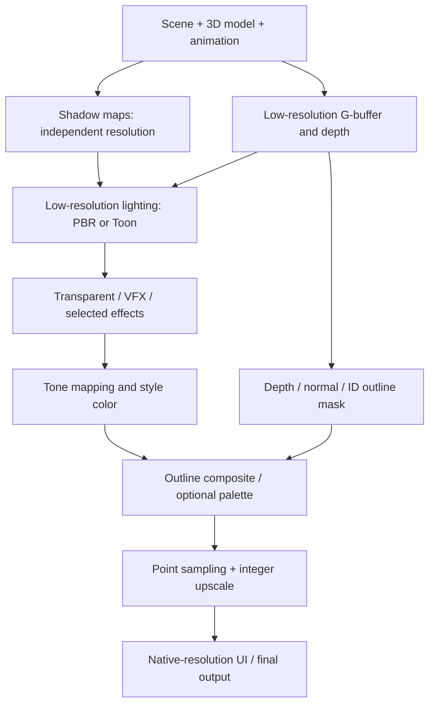
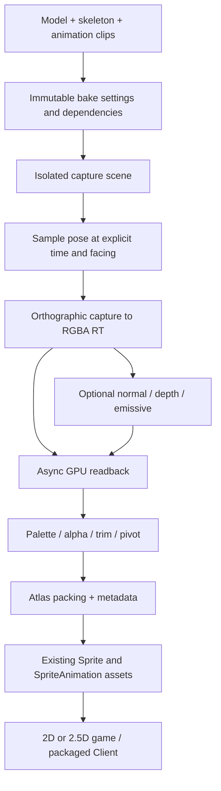

# NPR·카툰 렌더링 및 3D-to-2D 스프라이트 제작 파이프라인 개발 계획

- 작성일: 2026-11-26
- 상태: 기술 조사 및 신규 개발 제안 / 구현·빌드·GPU 실행 미수행
- 대상: BamEngine Engine / Editor / Client (우선 Windows·DirectX 12)
- 조사 기준: `main` 커밋 [`2a9a7e09`](https://github.com/Bamtoliya/BamEngine/tree/2a9a7e09378de3b3d6aac6f90d989c233811c1a9)
- 권장 위치: `Docs/StylizedRenderingAndSpriteBakingPlan.md`
- 연계 계획: [RenderingDevelopmentPlan.md](RenderingDevelopmentPlan.md), [EngineDevelopmentPlan.md](EngineDevelopmentPlan.md), [SpriteAnd2DSystemPlan.md](SpriteAnd2DSystemPlan.md), [MaterialShaderGraphIntegrationPlan.md](MaterialShaderGraphIntegrationPlan.md), [MaterialPrimaryPassTypeDesign.md](MaterialPrimaryPassTypeDesign.md), [RenderPipelineProfilePlan.md](RenderPipelineProfilePlan.md), [DevelopmentPriorities.md](DevelopmentPriorities.md)
- 공통 지침: [EngineEditorClientGuidelines.md](EngineEditorClientGuidelines.md), [Shader/BINDING_LAYOUT.md](Shader/BINDING_LAYOUT.md)

> 본 문서는 기존 PBR 렌더러를 대체하거나 모든 게임에 동일한 스타일을 강제하기 위한 계획이 아니다. 기존 3D 모델·애니메이션·2D Sprite·머티리얼 시스템을 재사용하여 서로 다른 표현 방식과 제작 방식을 선택할 수 있도록 확장한다. 아래의 신규 타입, 패스, 파일 확장자, 수치 및 우선순위는 설계 후보이며 현행 구현으로 오인하지 않는다.

## 1. 목표 및 기술 분류

사용자가 제시한 표현 방식은 서로 연관되어 있으나 동일한 기술은 아니다. 특히 3D 데이터를 2D 에셋으로 변환하는 작업과 매 프레임 3D를 2D처럼 표현하는 렌더링을 분리해야 한다.

| 기술 | 입력 | 최종 결과 | 게임 실행 중 3D 모델 필요 | 주요 목적 |
| --- | --- | --- | --- | --- |
| NPR / Stylized Rendering | 3D 메시·재질·조명 | 일러스트·애니메이션풍 이미지 | 필요 | 사실성 대신 형태·색·가독성 강조 |
| Cel / Toon Shading | 3D 모델 | 불연속 명암과 윤곽선 | 필요 | 카툰, 애니메이션풍 3D |
| Real-time 3D Pixel Art | 3D 씬 | 저해상도 픽셀풍 화면 | 필요 | 실시간 3D 조명·카메라와 픽셀 미학 결합 |
| Pre-rendered Sprite Baking | 3D 모델·애니메이션 | PNG/Atlas 및 SpriteAnimation | 불필요(순수 2D 재생 시) | 3D 제작 생산성과 저렴한 2D 재생 결합 |
| Dynamic Render-to-Sprite | 3D 모델·애니메이션 | 실시간 RT를 사용하는 2D Quad | 필요 | 장비·외형 변경이 많은 2D/2.5D 캐릭터 |
| Hybrid 2D/3D (HD-2D 계열) | 2D Sprite + 3D 환경 | 깊이·조명·카메라를 가진 2.5D 장면 | 환경에 필요 | 2D 캐릭터와 입체 환경의 공존 |
| Impostor / Billboard | 3D 모델 또는 다방향 이미지 | 시점 의존 Quad | 원거리 경로에서는 생략 가능 | LOD 비용 절감, 방향별 표현 |

NPR은 비사실적 표현 전체를 포괄하는 개념이고 Cel Shading은 그 하위 기법이다. 픽셀 아트는 단순히 해상도를 낮추는 효과가 아니라 형태·팔레트·픽셀 격자·시간 안정성을 통제하는 시각 설계이다. HD-2D는 Square Enix의 표현 명칭이며 엔진 내부 일반 기능명은 `Hybrid2D3D` 등으로 구분한다.

### 1.1 최종 결과물

1. **NPR 머티리얼:** PBR과 같은 씬에서 Toon, Unlit 및 선택적 스타일 머티리얼을 사용한다.
2. **3D Pixel Art 프로필:** 3D 모델·스키닝·조명을 유지하면서 저해상도 렌더링과 정수배 확대를 제공한다.
3. **Sprite Baker:** 3D 모델·클립·조명·방향을 입력하고 Atlas 및 기존 SpriteAnimation을 자동 생성한다.
4. **2.5D 캐릭터 경로:** 생성 Sprite를 기존 2D 게임과 3D 환경에서 재생한다.
5. **후속 기능:** 실시간 Render-to-Sprite 캐시, 방향별 Impostor, VRM MToon 호환 및 고급 일러스트 효과를 필요에 따라 확장한다.

## 2. 산업 사례와 참고 기술

| 사례 | 확인된 특징 | BamEngine에 얻을 시사점 |
| --- | --- | --- |
| Guilty Gear Xrd (Arc System Works, GDC 2015) [R1] | 3D 모델로 2D 애니메이션의 외형을 추구한 제작·렌더링 접근 | 아트 디렉션, 법선, 선 제어, 포즈 설계와 셰이더를 함께 관리 |
| Hi-Fi RUSH (Tango Gameworks, GDC 2024) [R2] | 커스텀 UE4 기반 디퍼드 툰 렌더링, 캐릭터와 환경의 스타일 통합 | 기존 Deferred 경로 안에서도 Toon 조명과 별도 특수 패스를 설계할 수 있음 |
| Dead Cells (Motion Twin, 2018 개발자 기고) [R3] | 3D 모델·애니메이션을 저해상도, AA 없는 2D 프레임으로 제작 | 실제 게임 실행과 제작 원본을 분리; 프레임별 픽셀 깜박임 검증 필수 |
| Octopath Traveler / II (Square Enix) [R4] | 픽셀 스프라이트와 3D 그래픽의 결합 | 저해상도 캐릭터와 고해상도 3D 환경·조명을 별도 정책으로 합성 |
| David Holland의 3D Pixel Art Rendering (2024) [R5] | 저해상도 3D 렌더링과 픽셀 단위 외곽/표면 엣지 표현의 실험 | 깊이·법선 기반 1픽셀 선, 조명·카메라 안정화의 실용 참고 |
| ProPixelizer [R6] | 저해상도 RT 및 카메라/객체 정렬, 선택적 픽셀화 | 전체 화면 픽셀화와 객체별 픽셀 크기를 분리; 1차는 직교 카메라로 제한 |
| VRM 1.0 MToon [R7] | 명암 경계, 림, MatCap, 월드/화면 공간 외곽선의 명시적 재질 규격 | 장기 VTuber 목표의 재질 요구를 지금 설계에 반영하되 VRM 지원과 구분 |
| Blender Sprite Sheet Maker [R8] | 3D-to-2D 스프라이트 시트 생성 및 픽셀화 도구 | 생성 설정과 미리보기, 방향·클립별 출력에 대한 제작 UX 참고 |

최근에는 실시간 툰 스타일, 픽셀화된 3D, 2D/3D 혼합 및 자동 스프라이트 생성 도구가 동시에 발전하고 있다. 특정 스타일이 2026년 전체 시장에서 가장 유행한다는 정량적 통계는 이번 조사에 포함하지 않았다. 위 사례는 구현 원리와 제작 흐름에 대한 참고이며 개별 게임의 비공개 내부 구조까지 동일하다고 가정하지 않는다.

## 3. 현행 BamEngine 기반과 차이

다음은 조사 기준 커밋에서 확인한 소스 및 설계 문서이다. 파일의 존재나 공개 API만으로 실제 실행을 검증한 것으로 보지 않는다.

| 기존 기반 | 확인 내용 | 추가 개발 범위 |
| --- | --- | --- |
| [DeferredSceneRenderer.cpp](../Engine/Source/Render/Pipeline/Private/DeferredSceneRenderer.cpp) | 기존 공용 디퍼드 렌더러 | Toon 조명 분기, NPR 합성, 픽셀화 패스 |
| [MaterialInterface.h](../Engine/Source/Render/Material/Public/MaterialInterface.h) / [PrimaryPassType](MaterialPrimaryPassTypeDesign.md) | 머티리얼·주 패스·패스 오버라이드 설계 | ShadingModel 식별자 및 스타일 파라미터 |
| [ShaderGraphCompiler.cpp](../Engine/Source/Graph/Shader/Private/ShaderGraphCompiler.cpp) | 셰이더 그래프 컴파일러 | Toon 출력·Ramp·Mask 등 도메인 검증 |
| [RenderPipelineProfile.h](../Engine/Source/Render/Pipeline/Public/RenderPipelineProfile.h) | 버전 1, 패스 ID/Type/Inputs, 단일 선택적 Resolution, Output | 명시적 저해상도 정책 및 패스 입력/출력 계약 |
| [PostProcessPipeline.cpp](../Engine/Source/Render/PostProcess/Private/PostProcessPipeline.cpp) | 기존 후처리 파이프라인 | AA·톤매핑·스타일 패스 순서 제어 |
| [PixelPerfectCameraComponent.h](../Engine/Source/Camera/Public/PixelPerfectCameraComponent.h) | PPU 16, 기준 320×180, 스냅·업스케일·크롭·줌 필드 | 3D 직교 카메라 정렬, 3D RT 및 깊이 정합 확인 |
| [SpriteAtlas.h](../Engine/Source/Sprite/Public/SpriteAtlas.h) | MaxRects, RGBA8 픽셀 결합, 기본 padding 2, 영역/UV 메타데이터 | 일괄 베이크, 동기화된 부가 맵, 트림·피벗 데이터 연결 |
| [SpriteAnimation.h](../Engine/Source/Sprite/Public/SpriteAnimation.h) | ResourceHandle<Sprite> 프레임, duration 가중치, FPS, Loop/Once/PingPong | 3D 클립 샘플링 결과를 기존 형식으로 자동 저장 |
| [ModelEditor.cpp](../Editor/Source/ImGui/ResourceEditor/Private/ModelEditor.cpp) / [SpriteEditor.cpp](../Editor/Source/ImGui/ResourceEditor/Private/SpriteEditor.cpp) | 모델 및 스프라이트 제작 도구 | Sprite Baker 진입·미리보기·생성 이력 UI |
| [AnimationTimelinePanel.cpp](../Editor/Source/ImGui/TimelinePanel/Private/AnimationTimelinePanel.cpp) | 애니메이션 타임라인 도구 | 베이크 구간/이벤트 편집 연계 |
| [DirectX12RHI.cpp](../Engine/Source/Render/RHI/Platform/DirectX12/Private/DirectX12RHI.cpp) | DX12 RHI 구현 | 비동기 캡처, row pitch·fence 처리 재사용 여부 검토 |
| [TextureConverter](../Tools/Converters/TextureConverter) / [IBLManager](../Engine/Source/Render/IBL) | 텍스처 도구 및 환경 조명 자원 | PNG·데이터 맵 출력, 기존 캡처 경로의 공통화 검토 |

기존 `PixelPerfectCameraComponent`, `SpriteAtlas`, `SpriteAnimation`을 대체하는 신규 2D 시스템을 만들 이유는 없다. 신규 기능은 이들을 연결하는 제작 파이프라인 및 렌더링 정책에 집중한다. 최근 HDR 환경맵 캡처 구현이 존재하더라도 투명 알파 캡처, RGBA8 출력, 다중 프레임 readback까지 동일 계약을 갖는지는 별도 검증한다.

## 4. NPR / Toon Rendering 구현

### 4.1 Shading Model과 Render Pass 분리

`PrimaryPassType`은 어느 패스에서 어떤 출력 계약을 사용해야 하는지 결정한다. `ShadingModel`은 해당 표면을 어떻게 조명할지 결정한다. 두 개념을 동일 enum에 섞지 않는다.

```cpp
// 설계 예시: 실제 타입명과 ABI는 기존 MaterialInterface 및 GPU 레이아웃 확인 후 확정.
enum class EShadingModel : uint8_t
{
    PBR = 0,
    Unlit,
    Toon
};

struct ToonMaterialParams
{
    float3 shadeColor;
    float threshold;
    float softness;
    float specularThreshold;
    float rimPower;
    float rimStrength;
    float outlineWidth;
};
```

위 구조체는 개념적 CPU 데이터 예시다. C++/HLSL 구조체 패딩과 정렬, reflection 등록, 기존 enum 직렬화 값, GPU 버퍼 ABI를 별도로 맞춘다. 신규 필드는 기존 에셋에 PBR 기본값을 적용한다. 재질 type/index 경로가 현재 G-buffer에 존재하는지 재확인하고 가능하면 재사용한다. 타입 태그가 필요해도 임의로 기존 MRT의 유효 비트를 덮어쓰지 않는다.

| 방식 | 장점 | 단점 | 권장 |
| --- | --- | --- | --- |
| 기존 G-buffer + Toon 조명 분기 | 그림자·Tiled Lighting·깊이·피킹 공통 활용 | 재질 데이터 분기와 GPU 버퍼 비용 | 1차 채택 |
| Forward Toon 전용 패스 | 표면별 자유도가 높음, 헤어·얼굴 특수 처리 용이 | 불투명 깊이·그림자·AO·동시 조명 계약 필요 | 특수 재질 후속 |
| 전체 화면 색상 양자화 | 빠른 프로토타입 | 물체·조명 의미를 잃고 원하는 명암 분리가 어려움 | 후처리 스타일 옵션으로 제한 |

### 4.2 Diffuse Ramp / Cel Band

기본 방식은 N·L을 이용하여 명암 경계를 결정하고 색상 Ramp 또는 명시적인 밝은색/그림자색을 선택하는 것이다. 최종 장면 전체에 `floor`를 적용하는 방식과 달리 재질별 예술적 통제가 가능하다.

```hlsl
// 예시: N과 L은 동일 공간의 단위 벡터. 색상은 linear RGB.
float3 EvaluateToonDiffuse(float3 N, float3 L,
                           float3 litColor, float3 shadeColor,
                           float threshold, float softness,
                           float visibility)
{
    float ndl = dot(N, L); // [-1, 1], threshold도 같은 범위
    float band = softness > 0.0
        ? smoothstep(threshold - softness, threshold + softness, ndl)
        : step(threshold, ndl);
    band *= saturate(visibility);
    return lerp(shadeColor, litColor, band);
}
```

- 2톤·3톤·다단계 Ramp, 그림자색 텍스처, 명암 경계 이동 Mask, 아트별 조명 강도 지원.
- Ramp는 조명 좌표/마스크의 데이터 의미와 RGB 색상 의미를 분리한다. 색상 Ramp는 sRGB 입력 시 linear로 디코딩하고 마스크는 linear 데이터로 읽는다.
- 경계 softness를 명시적으로 제어한다. 픽셀 미학을 원하면 경계를 단단하게 하고, 고해상도 Toon에서는 `fwidth` 기반 최소 폭을 옵션으로 둘 수 있다.
- 방향광을 첫 key light로 선정하고 나머지 광원은 보조 색 또는 별도 밴드로 처리하는 정책을 실험한다. 모든 광원의 그림자색을 단순 합산하면 그림자부가 과도하게 밝아질 수 있으므로 기본 ambient/shade 항은 한 번만 계산한다.
- PBR IBL과 GI를 그대로 Toon에 적용할지, 지정된 환경색/저주파 광량으로 제한할지 재질별 정책을 둔다. 물리 기반 에너지 보존과 예술적 색 통제는 다른 목표다.

### 4.3 특수 표현

| 표현 | 핵심 계산 또는 데이터 | 주의점 | 우선순위 |
| --- | --- | --- | --- |
| Toon Specular | N·H 임계값 또는 별도 Specular Ramp | 광원 크기, 반사 경계의 시간 떨림 | 1차 |
| Rim Light | `pow(saturate(1-dot(N,V)), power)` + 선택적 밴드/마스크 | 모든 윤곽이 동일하게 빛나지 않도록 광원·색 제어 | 1차 |
| MatCap | 뷰 공간 법선으로 2D 텍스처 조회 | 실제 월드 조명과 독립, 좌표계·Y축 확인 | 2차 |
| Custom Normal | 메시/정점 법선·스타일 노멀 별도 데이터 | 스키닝·노멀 매핑·그림자 법선과 구분 | 2차 |
| Face Shadow Map/SDF | 머리 로컬 좌우·전방 기준 광원 방향과 얼굴 마스크 비교 | 좌우 대칭, 머리 회전, 수직 광원, UV·아트 원본 필요 | 2차 |
| Hair Highlight | UV/탄젠트 기반 방향성 하이라이트, 마스크 | 헤어 카드/알파 테스트와 합성 순서 | 2차 |
| Halftone / Screentone | 스크린·UV 기반 점/선 패턴, 명암 연계 | 모아레, 움직임, 패턴 공간 선택 | 3차 |
| Cross-hatching | 명암에 따른 선 밀도·방향 | 원거리 앨리어싱, 시간 안정성 | 3차 |
| Painterly | 붓 텍스처, 색 경계, 선택적 필터 | 디테일 손실과 필터 비용 | 연구 |

Face SDF는 일반적인 월드 공간 signed distance field 볼륨을 의미하지 않는다. 얼굴 그림자 경계를 예술적으로 조절하는 2D 데이터맵 접근을 의미하며 각 에셋에 맞게 저작해야 한다. Guilty Gear풍 결과를 셰이더 하나로 자동 달성한다는 목표는 세우지 않는다.

### 4.4 Outline / Line Art

| 방식 | 원리 | 장점 | 한계 |
| --- | --- | --- | --- |
| Inverted Hull | 외곽용 메시를 법선/별도 방향으로 확장하고 앞면 컬링 | 캐릭터별 선 폭과 색 제어 | 메시 경계·스케일·스키닝, 추가 제출 |
| Screen-space Depth/Normal | 이웃 픽셀의 깊이·법선 차이 검출 | 씬 전체 공통 효과, 내부 선 가능 | 가려짐·깊이 경계·노멀 노이즈 |
| Object/Material ID | 이웃 ID 비교 | 접촉 물체, 선택적 스타일 경계 제어 | 안정 ID의 저장 공간·동일 객체 내부 경계 한계 |
| Texture/Geometry Line | 아티스트가 선을 직접 저작 | 의도된 얼굴·의상 디테일 | 자동 추출 불가, 콘텐츠 작업 필요 |

초기에는 Screen-space Outline을 구현하고 depth 및 normal edge를 분리하여 파라미터를 제공한다. 깊이는 비선형 장치 깊이를 그대로 비교하기보다 view-space 깊이 또는 일관된 재구성값을 사용한다. Reversed-Z 여부와 배경 clear 값을 RHI 계약에서 확인한다. 법선은 같은 좌표 공간에서 `1-dot(N0,N1)` 등으로 비교한다. 외곽/내부 선의 색과 폭을 각각 제어하며 PBR 물체가 무조건 검은 선으로 둘러싸이지 않게 한다.

```hlsl
// 4-neighbor 예시. 실제 패스에는 경계 clamp와 배경/유효 픽셀 처리가 필요.
float RelativeDepthEdge(float z0, float z1)
{
    return abs(z1 - z0) / max(abs(z0), 1e-4);
}
float NormalEdge(float3 n0, float3 n1)
{
    return 1.0 - clamp(dot(n0, n1), -1.0, 1.0);
}
```

Inverted Hull은 선택적 캐릭터 고급 기능으로 도입한다. 화면 공간 선 폭을 원하면 clip.w를 고려한 투영 기반 오프셋이 필요하며 월드 공간 단위와 혼용하지 않는다. 원본 메시의 split normal, UV seam, 음수 스케일, 스키닝, 비균일 스케일을 시험하고 필요하면 별도 smooth outline normal을 저작한다. 오브젝트 ID는 렌더 프레임 안에서 안정적인 값을 사용하고 Editor 선택 상태와 스타일 마스크를 혼합하지 않는다.

### 4.5 그래프 및 Editor 연결

- MaterialEditor에 Shading Model, Ramp, Shadow Color, Outline, Rim, Specular, MatCap 그룹을 제공한다.
- ShaderGraph의 제안 노드: `Shader.ToonOutput`, `Shader.LightRamp`, `Shader.RimMask`, `Shader.ShadowShift`, `Shader.MatCap`, `Shader.FaceShadowMask`. 실제 노드 이름과 핀은 기존 그래프 도메인 계약에 맞춘다.
- G-buffer 재질 그래프에는 화면 조명 결과를 직접 읽는 노드를 무조건 허용하지 않는다. 재질 파라미터 생성과 Lighting Pass 평가를 구분한다.
- 프리뷰의 모델·회전 광원·Outline·배경·저해상도 설정을 Game View/Client와 공유한다. 실패 시 LastGood 셰이더 유지 원칙을 따른다.

## 5. Real-time 3D Pixel Art Rendering

### 5.1 저해상도 렌더링의 올바른 순서

풀 해상도 화면에 픽셀화 필터를 적용하는 방법도 있지만, 깊이·법선·조명·윤곽선이 동일 픽셀 격자를 쓰도록 실제 저해상도 렌더 타깃에서 장면을 그리는 것이 1차 목표다.



위 다이어그램은 논리적 순서다. HDR 공간에서 윤곽을 합성하는 옵션과 display-referred 팔레트/윤곽 합성 옵션을 분리한다. 실제 패스 이름, 톤매핑 위치, SRGB RTV/SRV 형식은 기존 Profile과 `PostProcessPipeline`에 맞춘다. 그림자맵은 저해상도 뷰포트와 같은 크기일 필요가 없다. 깊이·법선·조명 버퍼의 픽셀 격자는 맞추되 각 그림자·GI 내부 해상도는 별도로 제어한다.

### 5.2 기준 해상도 및 출력 정책

| 내부 해상도 | 예시 출력 | 정수배 | 목표 표현 |
| --- | --- | --- | --- |
| 320×180 | 1920×1080 | 6× | 강한 레트로 픽셀 |
| 480×270 | 1920×1080 | 4× | 액션·RPG 중간 해상도 |
| 640×360 | 1920×1080 | 3× | 섬세한 픽셀풍 3D |
| 960×540 | 1920×1080 | 2× | 현대적인 저해상도 표현 |

`k = floor(min(outputWidth / internalWidth, outputHeight / internalHeight))`가 1 이상이면 `k`배 Point 확대 후 중앙 배치한다. 남는 영역은 letterbox/pillarbox 처리한다. 출력 창이 기준 해상도보다 작으면 `k=0`을 사용하지 말고 지원되는 낮은 기준 해상도 또는 명시적 fractional downscale 정책을 선택한다. 분수배에서는 픽셀 크기가 불균일할 수 있음을 표시한다.

- Game View와 독립 Client의 기준 해상도·aspect·viewport rect를 동일한 데이터로 관리한다.
- Editor Gizmo와 일반 UI는 최종 출력 해상도로 유지한다. 게임 UI에는 Pixel UI/Native UI를 선택할 수 있다.
- 피킹 및 UI 입력은 letterbox 오프셋, 정수배, 저해상도 좌표 변환을 적용한다. 잘린 영역을 게임 입력으로 전달하지 않는다.
- 1920×1080 대비 320×180은 픽셀 수 1/36, 640×360은 1/9이다. 이는 픽셀 처리량 비교일 뿐 전체 GPU 시간이나 FPS가 그 비율로 개선된다는 뜻은 아니다.

### 5.3 Pixel Perfect 3D Camera

직교 카메라의 보이는 세로 높이가 `H_world`, 내부 세로 해상도가 `H_px`이면 픽셀당 월드 단위는 `u = H_world / H_px`다. `OrthographicSize`가 반높이인지 전체 높이인지 기존 카메라 정의를 확인한다.

```cpp
// 개념 코드: R/U는 단위 카메라 right/up 축, 기준 원점은 고정한다.
float u = orthoVisibleHeight / float(internalHeight);
Vec3 rel = cameraPos - gridOrigin;
float x = Dot(rel, cameraRight);
float y = Dot(rel, cameraUp);
Vec3 renderCameraPos = cameraPos
    + cameraRight * (Round(x / u) * u - x)
    + cameraUp    * (Round(y / u) * u - y);
```

- 게임 시뮬레이션의 실제 Transform은 변경하지 않는다. 렌더용 뷰 변환만 스냅한다.
- 월드 X/Y 축이 아니라 카메라 Right/Up 축에서 격자를 계산한다. 고정된 isometric camera도 대응 가능하다.
- 피벗·홀짝 해상도·픽셀 센터를 고려하고 움직임이 없는 동안 이미지가 불필요하게 바뀌지 않는지 검사한다.
- 카메라 각도 변경, 원근 투영 및 캐릭터 회전/스키닝 자체는 실루엣이 변하므로 완전한 픽셀 안정성을 보장하지 않는다.
- 후속으로 객체별 렌더 위치 스냅, 카메라 subpixel offset의 최종 합성 보정, 선택적 픽셀 확장을 실험한다. 실제 물리·피킹 위치와의 허용 오차를 명시한다.
- `PixelPerfectCameraComponent`의 PPU·기준 해상도·줌 정책을 3D에서도 재사용할 수 있는지 점검한다. 2D 카메라 기존 동작에 회귀를 만들지 않는다.

### 5.4 팔레트, 디더링, AA, 조명

- Toon Ramp: 표면의 명암 단계를 제어한다.
- Palette Quantization: 최종 스타일 색을 팔레트에서 고른다. 단순 RGB 균등 양자화와 지정 팔레트 최근접 검색은 다른 기능이다. 후속으로 perceptual color distance 및 LUT를 사용한다.
- Ordered Dithering: Bayer 4×4 등 고정 행렬을 사용한다. 좌표를 저해상도 픽셀 공간에 고정하며 프레임별 랜덤 패턴은 기본값으로 사용하지 않는다. 팔레트 오차와 실제 이웃 대비를 평가한다.
- TAA/TSR 및 projection jitter는 엄격한 픽셀 프로필에서는 기본 비활성화한다. FXAA, MSAA, Motion Blur, DoF, Bloom은 픽셀 형태를 흐릴 수 있어 선택 옵션으로 제공한다. 의도된 부드러운 픽셀풍에 사용할 수 있지만 기본과 구분한다.
- 텍스처 Point Sampling과 mipmap은 다른 정책이다. 픽셀 에셋은 Point/제한된 mip을 사용하고 3D 환경 텍스처는 거리·앨리어싱에 맞게 필터링할 수 있다. 전체 샘플러를 일괄 교체하지 않는다.
- 1픽셀 Outline은 저해상도에서 계산하고 확대한다. 고해상도에서 선을 1픽셀로 그린 후 축소하는 방식과 결과가 다르다.

### 5.5 색 공간과 HDR/SDR 계약

NPR·픽셀 아트에서는 팔레트 색 보존이 특히 중요하다. 엔진 내부 HDR과 Windows HDR 출력은 별개다.

1. 텍스처 색상 입력은 올바른 sRGB → Linear 변환, normal/mask/ID는 데이터 공간 유지.
2. 조명은 선형 HDR에서 수행하고, 팔레트 기반 표시색 보정은 선택한 tone mapping 이후의 display-referred 공간에서 정의한다.
3. 엄격한 팔레트 모드에서는 팔레트 값과 출력 인코딩을 일치시키며 ACES의 색상 변화가 의도와 맞는지 시험한다. Toon 전용 Neutral/고정 Exposure 프로필은 옵션이다.
4. 최종 sRGB/Rec.709용 인코딩을 한 번만 수행한다. sRGB RTV 하드웨어 변환과 수동 감마를 중복하지 않는다.
5. 에디터 프리뷰, Client, PNG 저장 결과, SDR OBS 캡처를 동일 색 패치로 비교한다. 색·알파는 분리 검증한다.

## 6. 3D 모델·애니메이션 → 2D Sprite Baking

### 6.1 목표와 파이프라인

사용자가 요청한 3D로 애니메이션을 재생하고 저해상도로 렌더링하여 실제 2D 스프라이트로 사용하는 기능이다. 게임 실행 중 3D 모델을 계속 평가하는 기능과 구분한다.



### 6.2 베이크 설정 데이터 (제안)

| 설정 | 1차 권장값 | 설명 |
| --- | --- | --- |
| Model / Animation Clips | 선택 | 기존 모델·애니메이션 리소스 참조 |
| Frame Width / Height | 64×64 | 32/64/96/128 등 편집 가능 |
| Capture FPS | 12 | 8~24 등; 게임 TickRate와 독립 |
| Directions | 8 | 1/4/8/16 및 사용자 각도 후속 |
| Camera Projection | Orthographic | 화면 형태 일관성 |
| Camera Pitch / Yaw Offset | 사용자 지정 | Side 0°, top-down/isometric은 고정 각도 프리셋 |
| Pixels Per Unit | 기존 2D PPU 사용 | 월드 크기와 픽셀 크기 일관성 |
| Framing / Pivot | Fixed bounds + root/feet | 프레임별 자동 정규화 금지 |
| Root Motion | In-place 기본 | 이동량 보존 정책 별도 |
| Background | Transparent | 바닥 미포함, 그림자 별도 옵션 |
| Lighting | 고정 key/fill preset | 카메라 상대 또는 월드 고정 정책 |
| Style | Toon/PBR/Unlit + pixel preset | 공용 머티리얼을 재사용 |
| Output | PNG Atlas + 기존 Sprite/Animation | JSON 매니페스트, Normal 등은 후속 |

설정 에셋 후보 `SpriteBakeProfile` / `.bamspritebake.json`은 기존 Resource 타입과 충돌 여부를 확인한 뒤 도입한다. 설정 원본과 생성 에셋을 분리하며, 런타임은 원칙적으로 생성 Sprite와 Animation만 읽는다.

### 6.3 시간 샘플링과 방향

가변 DeltaTime으로 애니메이션을 진행하면서 화면을 저장하면 실행 FPS에 따라 결과가 달라진다. 절대 시각을 사용하여 포즈를 평가한다.

```cpp
// 루프 클립의 개념적인 시간 샘플링
int N = std::max(1, int(std::ceil(duration * captureFPS)));
for (int direction = 0; direction < directionCount; ++direction)
{
    float yaw = yawOffset + 360.0f * direction / directionCount;
    for (int i = 0; i < N; ++i)
    {
        double t = duration * double(i) / double(N); // [0, duration)
        EvaluatePoseAtTime(clip, t);
        CaptureFrame(direction, i, yaw);
    }
}
```

- 루프는 끝 프레임과 처음 프레임의 중복을 피한다. 정확한 클립 길이를 보존하려면 출력 FPS를 `N/duration`으로 설정하거나 기존 `frameDuration` 가중치를 사용한다. UI에는 요청 FPS와 실제 FPS를 표시한다.
- Once 애니메이션은 끝 포즈 포함 여부와 마지막 프레임 지속 시간을 명시한다. FPS 간격, clip time, duration을 별도 저장한다.
- 방향은 모델 회전 또는 카메라 회전 중 하나를 선택한다. 조명, 그림자, normal 출력 기준과 방향 데이터의 handedness를 고정한다. 0도 방향의 정의와 각도 증가 방향을 매니페스트에 남긴다.
- 인게임 액션 이벤트/타격 프레임은 렌더 프레임과 분리된 원본 시간을 보존하고 필요 시 2D 이벤트 형식으로 변환한다. 베이크 중 실제 게임플레이 이벤트나 오디오를 발동하지 않는다.
- 애니메이션 블렌딩, 장비 조합, IK, 물리 보조는 초기 베이크의 필수 기능이 아니다. 비결정적 시뮬레이션이 필요하면 고정 seed와 고정 step/warm-up 정책을 별도 정의한다.

### 6.4 고정 카메라, Root Motion, Pivot

프레임마다 모델을 화면 중앙에 맞추거나 크기를 자동 조정하면 재생 중 캐릭터가 떨리거나 늘어난다.

- 베이크 전에 대상 클립·방향별 포즈 경계를 평가하고 전체 union bounds를 계산한다. 스키닝된 경계 또는 보수적인 margin을 사용한다.
- 동일 캐릭터의 클립 묶음 전체에 공통 직교 크기·기준 피벗을 적용한다. 공격 무기나 도약 포즈에 여백을 확보한다.
- PPU 고정 모드에서는 `orthoHeight = frameHeight / PPU`를 사용하고 모델이 잘리면 해상도/PPU/여백을 수정하도록 경고한다. 자동 프레이밍을 선택하면 유효 PPU가 바뀔 수 있으므로 기록한다.
- Root Motion 제거는 수평 이동만 제거할지 전체 translation/rotation을 제거할지 명확히 한다. 제자리 걷기와 점프 높이는 별개의 요구다.
- Root/feet 기준 좌표를 투영하여 공통 피벗을 만든다. 트림은 이 피벗을 보존하며 `trimmedPivot = originalPivot - trimTopLeft`로 계산한다. 피벗이 트림 영역 밖에 있더라도 표현 가능한지 확인한다.
- Mirror 최적화는 장비·비대칭 문양·normal 방향·좌우 손·이벤트의 의미가 유지될 때만 허용한다.

### 6.5 RGBA 캡처 및 GPU Readback

DX12에서 GPU 텍스처의 CPU 접근은 Readback Heap과 복사·Fence 완료를 필요로 한다 [R9]. Editor 스레드에서 프레임마다 GPU 전체를 기다리는 구조는 피한다.

1. 전용 Capture Scene/Camera와 출력 RT를 생성한다. Editor의 활성 씬, TimeManager 상태, 선택 객체, 머티리얼 원본을 수정하지 않는다.
2. 컬러 RT에는 투명 배경과 명시적 alpha coverage를 사용한다. 기존 Deferred Lighting이 alpha=1을 강제하는 경우 별도 coverage/mask 합성 경로를 마련한다.
3. 렌더 패스 종료 후 CopySource 전환 및 `CopyTextureRegion`으로 Readback Buffer를 기록한다. 기존 RHI에 범용 readback이 있다면 우선 재사용하고, 없으면 소유권과 완료 토큰을 명시한 추상화를 추가한다.
4. `GetCopyableFootprints`의 실제 RowPitch로 각 행을 복사한다. `width*bytesPerPixel`과 GPU RowPitch를 혼동하지 않는다. 포맷별 subresource 및 정렬 규칙을 따른다 [R10].
5. Fence 완료 전 Map 데이터를 사용하거나 해당 RT/readback 슬롯을 재사용하지 않는다. RHI의 지연 해제 경로와 연결한다.
6. CPU 작업자는 변환·PNG 인코딩·패킹을 수행할 수 있지만 GPU 명령 기록/리소스 생성은 현행 엔진의 스레드 소유권 계약을 지킨다.
7. 제출 수, readback ring 슬롯, 메모리 한도를 설정하고 backpressure를 적용한다. 취소 시 이미 제출한 GPU 작업을 안전하게 회수하되 출력 에셋은 게시하지 않는다.

`RGBA8` 컬러 프레임을 64×64×8방향×24프레임으로 생성하면 트림·padding 없는 원본 픽셀은 3,145,728 bytes (3 MiB)다. 같은 해상도에서 normal/depth/emissive를 각각 RGBA8로 추가하면 원본 합계는 12 MiB가 된다. 실제 Atlas padding, 페이지 여유, 압축, GPU row pitch, readback 및 캐시 메모리는 별도다.

### 6.6 저해상도 캡처 품질 선택

| 모드 | 설명 | 장점 | 단점 |
| --- | --- | --- | --- |
| Native Pixel | 최종 크기로 직접 렌더, AA off | 의도적인 날카로운 픽셀 | 얇은 실루엣의 깜박임 |
| Supersampled Bake | 2×/4× 렌더 후 면적/box 기반 축소, 선택적 alpha·팔레트 정리 | 작은 형태의 안정성 개선 가능 | 흐린 경계, 혼합색 발생 가능 |
| Artist Cleanup | 자동 생성 후 프레임 수정 | 가장 높은 형태 제어 | 작업량 및 재베이크 충돌 |

Native Pixel과 Supersampled 결과를 같은 크기로 미리보기한다. 알파 임계값은 최종 결과의 실루엣을 변경하므로 사용자 옵션으로 제공한다. 부분 투명도 지원 시 straight/premultiplied alpha를 명시하고 합성·export 계약을 맞춘다. 필터링 시 투명 경계 색 번짐을 피하기 위해 linear premultiplied 처리 후 필요한 형식으로 변환한다.

### 6.7 Atlas 생성 및 기존 에셋 연동

1. 프레임별 고정 키: `character/clip/direction/frame` (표시 이름과 안정 ID 분리).
2. 투명 여백 트림 → 원본 크기, trim offset, pivot, direction, 시간 및 프레임 duration 보존.
3. 기존 `SpriteAtlas::PackMaxRects`, `BakeAtlasPixels`를 이용해 패킹. 초기에는 회전 패킹 비활성화, 페이지 초과 시 다중 Atlas로 분할.
4. 기존 Sprite 생성·저장 경로로 UV 영역과 Pivot/PPU를 연결하고 방향별 `SpriteAnimation`을 생성한다. 실제 Sprite 파일 포맷과 피벗 지원 범위 확인 후 변환 어댑터를 둔다.
5. Padding은 2픽셀 기본값에서 시작하고 필터링·mipmap 사용 시 edge extrusion 및 충분한 여백을 추가한다. 기존 `BakeAtlasPixels`가 extrusion을 수행하는지는 확인 후 필요 시 확장한다.
6. Normal/depth 등 부가 맵은 컬러와 **완전히 동일한 atlas rect, 회전, trim, padding**으로 결합한다. 독립 패킹 금지.
7. 파일 쓰기 임시 디렉터리와 manifest validation 완료 후 원자적 게시 또는 rollback을 수행한다. 기존 사용자의 수동 수정 파일을 무단 덮어쓰지 않는다.

```json
{
  "schemaVersion": 1,
  "sourceModel": "Project://Models/Hero.glb",
  "clip": "Walk",
  "directionCount": 8,
  "yawOffsetDegrees": 0,
  "requestedFps": 12,
  "actualFps": 12,
  "pixelsPerUnit": 16,
  "alphaMode": "Straight",
  "colorSpace": "sRGB",
  "atlasPages": ["Project://Sprites/Hero/Walk_0.png"],
  "frames": [
    {
      "direction": 0, "frame": 0, "timeSeconds": 0.0,
      "durationSeconds": 0.0833333333, "page": 0,
      "rect": [2, 2, 40, 56], "originalSize": [64, 64],
      "trimOffset": [12, 4], "originalPivot": [32, 60],
      "trimmedPivot": [20, 56]
    }
  ]
}
```

위 JSON은 설계 예시(단일 프레임만 표시)이며 현행 BamEngine의 실제 저장 포맷이라고 주장하지 않는다. Rect는 top-left 기준 픽셀 단위이며 pivot의 정규화 여부는 기존 Sprite 계약으로 변환한다.

### 6.8 부가 맵과 동적 2D 조명 (후속)

| 출력 | 용도 | 제약 |
| --- | --- | --- |
| Color (sRGB) | 기본 Sprite | 완전 조명 베이크 / unlit albedo 선택 |
| Normal (linear data) | 2D 또는 3D 동적 조명 | 카메라/스프라이트 로컬 법선 공간 정의, 회전 시 변환 |
| Depth/Height (linear) | 깊이 보정, 국소 패럴랙스 | 범위·단위·배경·정밀도 정의 |
| Emissive / Material Mask | 발광, 팔레트 치환, 특수 효과 | 색/데이터 의미 분리 |
| Shadow Mask | 별도 바닥 그림자, 연출 | 컬러 알파와 구분 |

완전히 조명된 컬러에 다시 동적 조명을 적용하면 이중 조명이 발생할 수 있다. 동적 조명용은 Albedo/Normal 기반 출력 모드를 따로 제공한다. 깊이 맵은 완전한 3D 메시를 복원하지 않으며 시점 변화 및 가려진 면에는 한계가 있다.

## 7. 3D 환경에서 2D처럼 보이는 표현 및 2.5D 합성

### 7.1 세 가지 구성

- **실시간 3D Toon / Anime:** 실제 3D 모델이 카메라와 조명을 받으며 2D 일러스트처럼 보인다. 필요하면 캐릭터 포즈만 12/15/24fps로 양자화하되 입력·물리·카메라 업데이트는 독립 유지한다.
- **실시간 3D Pixel Art:** 저해상도 G-buffer와 픽셀 스냅으로 환경 전체가 픽셀풍이다. 자유 카메라가 필요한 경우 원근에 따른 픽셀 변화를 감수한다.
- **2D Sprite in 3D World:** 기존 2D Sprite 또는 베이크 Sprite를 3D 공간의 Quad로 배치한다. 배경은 고해상도 PBR/Toon일 수도 있고 픽셀화될 수도 있다. HD-2D 계열의 혼합 표현에 해당한다.

### 7.2 Billboard 및 방향별 애니메이션

- Spherical billboard는 카메라를 완전히 향하고, cylindrical billboard는 지정 up 축을 유지한다. 쿼터뷰 캐릭터는 cylindrical 또는 고정 카메라 각도 프리셋부터 시작한다.
- Sprite의 피벗을 실제 엔티티 위치에 고정한다. 화면상 크기가 아니라 월드 크기/PPU를 기준으로 Quad를 만든다.
- 이동 또는 바라보는 방향을 카메라 기준 각도로 변환하고 `directionIndex = round(relativeYaw / sectorAngle) mod directionCount`로 방향을 고른다. 0/360도 wrap 및 경계 hysteresis를 적용한다. 원본 방향 정의와 회전 부호를 검증한다.
- 방향 전환 시 현재 클립의 정규화 재생 시간을 보존한다. 단순 방향 변경이 걷기 애니메이션을 매번 초기화하지 않도록 한다.
- alpha mask sprite는 깊이 쓰기를 허용하고 투명 픽셀을 discard한다. alpha blend sprite는 정렬·깊이 쓰기 정책을 별도로 두며 반투명 겹침을 시험한다.
- 3D 그림자, occlusion, 지형 높이, 피킹, 물리 collider는 Quad 외형과 독립 계약을 갖는다. 그림자용 Quad 또는 별도 proxy mesh는 품질에 따라 선택한다.

### 7.3 Dynamic Render-to-Sprite (조건부 후속)

장비 조합, 실시간 의상 색상, 커스터마이징 때문에 사전 베이크 프레임 수가 폭발할 경우 3D를 오프스크린 RT에 렌더하여 Sprite처럼 재생한다.

- 캐릭터별 RT 또는 atlas tile에 렌더하고 UI/2D/3D Quad에서 샘플링한다. GPU→CPU readback 없이 GPU 리소스만 연결한다.
- 캐시 키: model/material/equipment revision, clip, sampled pose frame, direction, camera/lighting/style revision, output size. 같은 키의 결과 재사용.
- 12fps pose capture 등 갱신 빈도를 제한하고 화면 밖 캐릭터는 갱신하지 않는다. 지연 프레임은 마지막 정상 결과를 사용한다.
- RT 수·atlas occupancy·draw count·GPU 시간·eviction을 MetricsPanel에서 계측한다.
- 이전 프레임에서 샘플링 중인 tile을 덮어쓰지 않는다. Fence 및 frame slot에 맞춘 갱신 정책을 사용한다.
- 동일 모델/포즈를 직접 3D로 렌더한 비용과 비교한다. 오프스크린 캡처 비용 때문에 동적 Sprite가 항상 더 빠른 것은 아니다.

다방향 Impostor는 원거리 LOD가 필요해지는 시점에 별도 연구한다. 투명 픽셀의 오버드로우, 방향 전환 팝, 그림자·깊이 불일치 및 카메라 각도 한계를 실제 씬에서 평가한다.

## 8. BamEngine 아키텍처 적용 제안

```text
Engine/
  Source/Render/Material/       # ShadingModel / Toon parameters
  Source/Render/Pipeline/       # NPR outline / pixel resolution policy
  Source/Render/PostProcess/    # palette / display-space stylization
  Source/Camera/                # render-only pixel snapping
  Source/Sprite/                # existing Sprite/Atlas/Animation extensions
  Source/Render/RHI/            # common async readback contract if needed
Editor/
  Source/ImGui/ResourceEditor/  # Toon controls / Sprite Baker UI
  Source/ ...                   # capture job orchestration (ownership review)
Tools/
  ...                           # optional headless bake CLI / encoding worker
Engine/Resources/Shader/hlsl/   # shared Toon and outline shader includes/passes
Engine/Resources/RenderPipelines/ # opt-in pixel-art profile
```

디렉터리는 제안이며 기존 소유 모듈을 우선한다. 신규 코드를 무조건 한 곳에 몰아넣거나 기존 디렉터리 이동을 선행하지 않는다.

### 8.1 공통 렌더 계약

- 기존 Deferred 기본 Profile의 동작을 유지한다. Toon은 per-material 선택, pixel resolution은 per-camera/per-view 선택, palette는 per-profile 선택으로 서로 독립한다.
- 제안 프리셋: `PBRDefault`, `Toon`, `PixelArt3D`, `SpriteCapture`. 별도 엔진을 만들지 않고 동일 RenderPipeline 기반의 구성 및 패스 조합을 이용한다.
- 기존 `RenderPipelinePassProfile.Resolution`이 단일 uint32인 상태에서는 가로·세로 픽셀 정책을 추정해 덮어쓰지 않는다. 필요하면 `ReferenceWidth/Height`, scale mode와 버전 마이그레이션을 명시적으로 추가한다.
- Profile validation은 해상도, 형식, pass dependency, missing resource, unsupported backend를 검증한다. 순환·호환 불가·누락 입력은 명확히 실패하거나 문서화된 기본 프로필로 폴백한다.
- 신규 GPU 바인딩과 Material Buffer는 [BINDING_LAYOUT](Shader/BINDING_LAYOUT.md)을 함께 갱신한다. PSO 캐시 키에는 영향을 주는 포맷·shader·depth/cull/배합 상태가 포함되어야 한다.
- ShaderGraph, Scene/Game View, Material Preview, Client, Sprite Capture는 동일 재질 평가와 색 공간 계약을 공유한다.
- 초기 DX12 검증이 끝나기 전 SDL GPU/WebGPU/Native Vulkan/Metal 기능 동등성을 주장하지 않는다. 미지원 backend에는 capability 검사와 명시적 폴백을 둔다.

### 8.2 Sprite Baker Editor UX

진입점은 ModelEditor의 `Bake Sprites` 버튼과 Content Browser의 모델/애니메이션 컨텍스트 액션을 우선 검토한다. 별도 ResourceEditor UI는 기존 공용 프리뷰/문서 수명주기를 사용한다.

```text
┌─────────────────────────────────────────────────────────────────┐
│ Sprite Baker  [Load Preset] [Save Preset] [Preview] [Bake] [Cancel] │
├──────────────────┬────────────────────────┬─────────────────────┤
│ Model / Clips    │ 3D Preview             │ Capture Settings    │
│ - Idle           │                        │ Resolution / PPU    │
│ - Walk           │ Pixel Preview 1x / 6x  │ Camera / Directions │
│ - Attack         │ Pivot / Bounds Overlay │ FPS / Root Motion   │
│                  │                        │ Toon / Alpha / Maps │
├──────────────────┴────────────────────────┴─────────────────────┤
│ Timeline / Direction Selector / Atlas Preview / Output Warnings   │
└─────────────────────────────────────────────────────────────────┘
```

- 클립 복수 선택, 방향 변경, 재생/일시정지/프레임 이동, 원본 3D와 결과 2D 비교.
- 1:1 픽셀 미리보기, 정수배 확대, 체크보드 배경, 알파 채널·노멀·피벗·트림·공통 경계 보기.
- 출력 전 예상 프레임 수, Atlas 페이지·메모리, 기존 파일 충돌을 표시한다.
- job 상태: Queued → Capturing → Readback → Encoding → Packing → Publishing → Completed / Failed / Cancelled.
- 선택 에셋이 삭제·재임포트되거나 창을 닫아도 명시적 소유권과 job 토큰으로 안전하게 처리한다.
- 재베이크는 source model/clip/material/settings/shader version fingerprint를 사용하여 dirty 여부를 판별한다. 결과 캐시는 프로젝트 생성 에셋과 구분한다.
- 사용자 수정/원본 생성 프레임을 구분하고 re-bake 시 보존·덮어쓰기 정책을 묻는다. PNG와 manifest의 부분 성공을 최종 완료로 표시하지 않는다.
- 한/영 Localization CSV와 기존 공용 UI 패턴, Undo/Redo, 저장 실패 보호를 따른다.

## 9. 단계별 구현 계획 및 우선순위

기존 통합 우선순위 문서의 확정 작업을 대체하지 않는다. 아래는 신규 스타일링 트랙 안의 상대 우선순위다. 서로 독립인 NPR/Pixel/Sprite Bake를 필요에 따라 병행할 수 있다.

| ID | 개발 항목 | 선행 | 완료 기준 | 상태 |
| --- | --- | --- | --- | --- |
| ST-0 | 기준 비교 씬과 계약 조사 | 없음 | PBR 기준 캡처·계측, G-buffer/색/재질/카메라 계약 확인 | 계획 |
| ST-1 | Toon Material + 2/3-tone Ramp | ST-0 | PBR/Toon 동시 렌더, 그림자·프리뷰·저장 복원 | 계획 |
| ST-2 | Depth/Normal Outline 및 Rim | ST-1 일부 | 두 선 종류 제어, PBR 선택적 제외, skinned mesh 시험 | 계획 |
| PX-1 | 3D 저해상도 RT + Point 정수배 확대 | ST-0 | Game View/Client 일치, UI/피킹 좌표 및 창 크기 검증 | 계획 |
| PX-2 | 직교 카메라 픽셀 스냅 | PX-1 | 고정 장면에서 subpixel 이동 시 격자 안정성 | 계획 |
| PX-3 | 팔레트·디더링·AA 정책 | PX-1 | 색 공간과 픽셀 크기 일관성, 프레임 떨림 검사 | 계획 |
| SB-1 | 정적 모델 1프레임 RGBA Capture | ST-0 | 투명 PNG 저장, 비동기 readback, 원본과 프리뷰 일치 | 계획 |
| SB-2 | 클립 절대시간 평가 + 고정 프레이밍 | SB-1 | Walk/Attack/Jump 고정 pivot·FPS·loop 검사 | 계획 |
| SB-3 | 4/8방향 Atlas + SpriteAnimation | SB-2 | 기존 Sprite/Animation을 바로 재생하고 패키징 | 계획 |
| SB-4 | Sprite Baker UI + 안전한 재베이크 | SB-3 | 미리보기·취소·출력 충돌·재실행 복원 | 계획 |
| HY-1 | 2D/3D Billboard와 방향별 재생 | SB-3 | 3D 환경 가림·피킹·방향 전환·그림자 확인 | 계획 |
| ST-3 | Inverted Hull / Face SDF / MatCap / Hair | ST-1~2 | 실제 스타일 캐릭터에서 선택적 적용 | 후속 |
| SB-5 | Normal/Depth/Emissive 보조 맵 | SB-3 | Atlas 정렬 및 이중 조명 방지 | 후속 |
| HY-2 | Dynamic Sprite RT / Impostor | HY-1 | 직접 3D와 비교하여 품질·성능 이득 확인 | 조건부 |
| ST-4 | MToon 호환 / 고급 일러스트 표현 | ST-3 | 규격 항목별 호환성 및 VRM 에셋 검증 | 장기 |

### 9.1 첫 결과물 권장 순서

- **첫 번째:** 기존 PBR 씬에 Toon 재질 1종과 Outline을 추가한다. 신규 렌더러를 통째로 만드는 작업은 피한다.
- **두 번째:** 동일 씬을 320×180/640×360 프로필로 실행하고 PixelPerfectCamera를 3D 직교 경로에 연결한다.
- **세 번째:** 하나의 모델에서 Idle/Walk/Attack을 64×64, 8방향으로 베이크하고 기존 SpriteAnimation으로 실제 2D 씬에서 재생한다.
- **네 번째:** 같은 Sprite를 3D 지형 또는 실내에 배치하여 HD-2D 계열 데모를 구성한다.

이 네 결과물을 달성하면 사용자 요청의 핵심은 완료된 것으로 볼 수 있다. Face SDF, VRM, 동적 Sprite, 고급 Impostor는 전체 기능의 선행 조건이 아니다.

## 10. 검증 계획 및 완료 기준

신규 검사 타깃명은 제안이다. 기존 `PixelPerfectCameraCheck`, `SpriteAtlasCheck`, `ShaderGraphCheck`, `RenderPipelineProfileCheck`를 우선 확장한다. GPU 결과 비교와 실제 Editor UX는 별도 실행 검증한다.

| 검증 | 조건 및 판정 |
| --- | --- |
| Shading model | 기존 PBR 에셋 저장/복원 및 기준 이미지 불변, PBR/Toon 혼합 씬 정상 |
| Toon ramp | N·L 경계값, softness 0, shade 색상, 복수 광원, 그림자·림 및 마스크 확인 |
| Outline | 배경/깊이·normal 경계, 투명/Masked, skinned mesh, 창 크기 변경 및 검은 화면 없음 |
| Pixel upscale | 320×180 → 1080p에서 6×, 640×360 → 1080p에서 3×; 각 원본 픽셀이 동일한 출력 블록으로 대응 |
| Pixel snap | 고정 조명/포즈/직교 카메라에서 한 스냅 셀 내부의 이동은 동일한 저해상도 이미지를 유지하고 셀 이동 시 예상 픽셀 이동 |
| 입력/피킹 | letterbox, DPI, resize, 다중 뷰포트에서 지정 객체와 UI 좌표 일치 |
| Bake sampling | 1/4/8방향, Loop/Once, 짧은 클립, 비정수 프레임 길이, 마지막 프레임, 0도/360도 wrap |
| Framing/Pivot | Idle→Walk→Attack에서 동일 root pivot, 클리핑 없음 또는 명시적 경고, trim 후 위치 보존 |
| Alpha/Color | 투명 배경 알파 0, 불투명 내부 알파 1, 밝은/어두운 배경 합성에서 halo 없음, sRGB 중복 변환 없음 |
| Atlas | Rect 비겹침, padding, 페이지 분할, 유효 UV, 동기화된 보조 맵, Asset 재로드 정상 |
| Job safety | 취소·저장 실패·원본 삭제·재베이크·장치 오류에서 미완성 파일 게시 없음, GPU lifetime 위반 없음 |
| Client | Editor 없이 생성 Sprite/Animation과 Toon/Pixel Profile 실행, `.bampak` 의존성 수집 및 로드 |
| Fallback | 미지원 RHI에서 명확한 경고 또는 문서화된 기본 동작 |

### 10.1 비교 씬 및 계측

- `StylizedRenderingLab` (제안): 구/큐브/캐릭터, PBR/Toon 혼합, 방향광 회전, 다수 점광원, skinned mesh, 나무/헤어 알파, 반투명 VFX, 카메라 이동.
- `SpriteBakeLab` (제안): 1/4/8방향 캐릭터, 루프/단발 클립, 큰 공격 범위, root motion, 비대칭 장비, 트림 전후 겹쳐 보기.
- `Hybrid2D3DLab` (제안): 3D 지형·계단·벽, 가려짐, 깊이/알파, 방향 전환, 저해상도 캐릭터와 native UI.
- MetricsPanel로 CPU/GPU pass time, draw calls, VRAM, readback 대기, bake throughput, peak memory를 비교한다. RTX 4090은 첫 개발 측정 환경일 뿐 최소 사양이 아니다.
- 시간 안정성은 동일한 카메라 경로·pose 시퀀스에서 움직이지 않는 영역의 픽셀 변화율과 경계 떨림을 확인한다. 장면 자체가 변하는 픽셀을 오류로 간주하지 않는다.
- 베이크 결정성은 동일 입력·설정·빌드·장치에서 반복 생성한 픽셀 데이터와 metadata를 비교한다. 서로 다른 GPU/드라이버 사이의 bitwise 동일성을 일반적으로 보장하지 않는다.

### 10.2 최종 체크리스트

- [ ] 기존 PBR Profile과 2D Sprite 경로에 기능 회귀가 없다.
- [ ] 동일 Toon 재질을 Editor 프리뷰, Scene/Game View, 독립 Client에서 표현한다.
- [ ] 저해상도 3D 출력이 지정 해상도·정수배·카메라 스냅 정책을 준수한다.
- [ ] 기존 모델과 애니메이션만 선택하여 수동 이미지 편집 없이 Sprite/Atlas/Animation을 생성한다.
- [ ] 생성물에 원본 3D 모델이 없어도 순수 2D 런타임으로 재생 가능하고, 3D 환경 Billboard에도 배치할 수 있다.
- [ ] 비동기 GPU 캡처 및 CPU 작업이 취소·종료·파일 실패에 안전하다.
- [ ] 검증 환경·패스 비용·메모리·미지원 조건을 ImplementationLog에 기록한다.
- [ ] 새 파일 및 의존성이 `.bampak` 패키징과 Shipping Client에 올바르게 포함된다.

## 11. 결론

BamEngine의 기존 렌더러와 2D 제작 기반을 고려할 때, NPR과 3D Pixel Art는 렌더링 확장이고 Sprite Baking은 제작 도구 확장이다. 세 기능은 서로 공유되는 머티리얼 및 캡처 계약을 사용하지만 어느 하나가 다른 기능의 필수 조건은 아니다.

가장 효율적인 방향은 **기존 PBR/Deferred 유지 → Toon 재질 → 저해상도 3D Profile → 결정적 Sprite Baker → 2D/3D 혼합 데모**다. 특히 Sprite Baker는 현재 SpriteAtlas 및 SpriteAnimation을 재사용하므로 사용자에게 직접적인 콘텐츠 제작 생산성 향상을 제공할 수 있다. MToon 규격을 참조해 장기 VTuber 목표와의 중복 투자를 줄이되 전용 VRM 로더 및 추적 시스템까지 완료된 것으로 간주하지 않는다.

## 12. 조사 출처

아래 자료는 2026-11-26 조사 기준이다. 기술 예제와 구현 계약은 본 문서의 설계 제안이며 외부 코드의 복사본이 아니다. 외부 구현을 실제 도입할 경우 개별 라이선스와 버전, 에셋 사용 조건을 확인한다.

| ID | 출처 | 참고 범위 |
| --- | --- | --- |
| R1 | [Arc System Works: Guilty Gear Xrd's Art Style, GDC 2015](https://www.arcsystemworks.com/guilty-gear-xrds-art-style-the-x-factor-between-2d-and-3d-talk-from-gdc-2015-is-now-available-online/) / [GDC Vault](https://www.gdcvault.com/play/1022031/GuiltyGearXrd-s-Art-Style-The) | 3D로 2D 애니메이션 표현, 아트/기술 협업 |
| R2 | [GDC 2024: 3D Toon Rendering in Hi-Fi RUSH](https://www.gdcvault.com/play/1034251/3D-Toon-Rendering-in-Hi%0A%0A) / [발표 영상](https://www.youtube.com/watch?v=gdBACyIOCtc) | Deferred Toon, 특수 조명과 얼굴 그림자 |
| R3 | [Thomas Vasseur / Motion Twin: Art Design Deep Dive — Using a 3D pipeline for 2D animation in Dead Cells (2018)](https://www.gamedeveloper.com/production/art-design-deep-dive-using-a-3d-pipeline-for-2d-animation-in-i-dead-cells-i-) | 3D 애니메이션의 저해상도 Sprite 제작 |
| R4 | [Square Enix: Octopath Traveler I and II](https://www.square-enix-games.com/en_US/news/octopath-traveler-i-and-ii-now-available-current-console-platforms) | 2D 픽셀 Sprite와 3D 환경 결합 |
| R5 | [David Holland: 3D Pixel Art Rendering](https://www.davidhol.land/articles/3d-pixel-art-rendering/) | 저해상도 렌더, 엣지·하이라이트 |
| R6 | [ProPixelizer: Pixelisation Controls](https://propixelizer.github.io/docs/usage/pixelization/) / [Eliminating Pixel Creep](https://propixelizer.github.io/docs/usage/eliminate-pixel-creep/) | 픽셀 크기와 카메라/객체 스냅, 원근 한계 |
| R7 | [VRMC_materials_mtoon-1.0 공식 규격](https://github.com/vrm-c/vrm-specification/blob/master/specification/VRMC_materials_mtoon-1.0/README.md) | Toon 파라미터, MatCap, Rim, Outline |
| R8 | [Blender Extensions: Sprite Sheet Maker](https://extensions.blender.org/add-ons/sprite-sheet-maker/) | 3D-to-2D Sprite 제작 도구 |
| R9 | [Microsoft Learn: Read back data via a buffer](https://learn.microsoft.com/en-us/windows/win32/direct3d12/readback-data-using-heaps) | Readback Heap 및 GPU Fence |
| R10 | [Microsoft Learn: Uploading texture data through buffers](https://learn.microsoft.com/en-us/windows/win32/direct3d12/upload-and-readback-of-texture-data) / [GetCopyableFootprints](https://learn.microsoft.com/en-us/windows/win32/api/d3d12/nf-d3d12-id3d12device-getcopyablefootprints) | 텍스처 복사 및 row pitch |
| R11 | [Godot Engine: Multiple resolutions](https://docs.godotengine.org/en/stable/tutorials/rendering/multiple_resolutions.html) | 가상 해상도, 정수 확대, 2D/3D 해상도 분리 |
| R12 | [Unity 6.1: Sprite Atlas reference](https://docs.unity.cn/6000.1/Documentation/Manual/sprite/atlas/sprite-atlas-reference.html) | Atlas padding, 회전/패킹 정책 |

BamEngine 조사 기준 및 기존 계획은 3절 링크를 참조한다. 이번 문서는 레포지토리에 반영하지 않았으며 신규 소스 구현·컴파일·실행·성능 실측을 수행하지 않았다.
