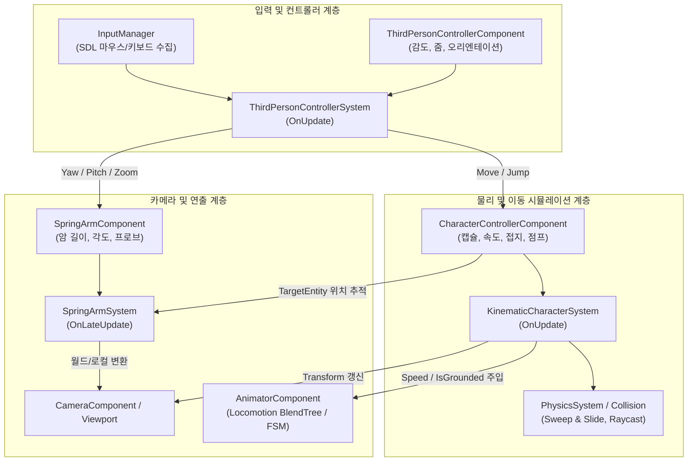

# 3인칭 캐릭터 및 스프링암 카메라 시스템 개발 계획

## 1. 개요 및 목적

- **목적**: 키네마틱 캐릭터 컨트롤러(KCC)를 기반으로, 3인칭 시점의 플레이어 이동, 스프링암(SpringArm) 카메라 제어, 지형/장애물 물리 상호작용 및 캐릭터 애니메이션(Locomotion)을 통합한 완결형 3인칭 캐릭터 시스템을 구축한다.
- **배경**:
  - 기존 BamEngine은 키네마틱 캐릭터 이동(KCC)의 기본 알고리즘만 존재하여, 실제 게임플레이가 가능한 3인칭 카메라 조작(오빗 회전, 휠 줌, 충돌 프로브) 및 사용자 입력 처리가 분리되어 있었다.
  - 리플렉션 기반 엔티티 타깃팅, 씬 직렬화/역직렬화(PIE 스냅샷 보존), 프레임 레이트 동기화(지터 방지), 애니메이터 연동을 하나의 표준화된 파이프라인으로 연결한다.

---

## 2. 시스템 아키텍처

### 2.1 주요 컴포넌트 역할
1. **`CharacterControllerComponent` (`Engine/Source/Core/Public/Components/Physics/CharacterControllerComponent.h`)**:
   - 캐릭터의 충돌 캡슐, 질량 중심 오프셋, 속도(`Velocity`), 이동 입력(`MoveInput`), 접지 여부(`IsGrounded`) 등 물리 시뮬레이션 상태를 보관.
2. **`ThirdPersonControllerComponent` (`Engine/Source/Core/Public/Components/Physics/ThirdPersonControllerComponent.h`)**:
   - 마우스 감도, 휠 줌 감도, 스프링암 엔티티 참조(`SpringArmEntity`), 이동 방향 몸체 회전(`OrientRotationToMovement`), 달리기 배율(`SprintMultiplier`).
   - `REQUIRE_COMPONENTS(TransformComponent, WorldTransformComponent, CharacterControllerComponent)` 메타데이터로 원클릭 의존성 보장.
3. **`SpringArmComponent` (`Engine/Source/Core/Public/Components/Camera/SpringArmComponent.h`)**:
   - 카메라 붐 길이(`TargetArmLength`), 피벗 오프셋, 회전각(`Pitch`, `Yaw`), 장애물 충돌 검사(`DoCollisionTest`, `ProbeRadius`), 지연 보간(`CameraLag`).

---

## 3. 개발 로드맵 및 진행 현황

### [x] Phase 1: 3인칭 조작 및 스프링암 카메라 기반 구축 (완료)
- `ThirdPersonControllerComponent`, `SpringArmComponent` 정의 및 리플렉션/직렬화 등록.
- `ThirdPersonControllerSystem`, `SpringArmSystem` 생성 및 `Application.cpp` 시스템 등록.
- 마우스 우클릭 오빗 회전, 마우스 휠 줌, WASD 평면 이동, Space 점프, Shift 달리기.
- 이동 방향으로 몸체 자동 회전 (`OrientRotationToMovement`).
- 에디터 뷰포트 디버그 렌더링 (`DebugRenderer.cpp`): 피벗 점, 붐 가이드 라인, 충돌 프로브 구체.

### [x] Phase 2: KCC 물리 안정화 및 카메라 동기화 (완료)
- **3D 충돌체 스케일/회전 미반영 버그 해결**:
  - `PhysicsSystem::TestColliderHit`의 BoundingBox `[-halfSize, halfSize]` 중심 좌표 정상화 및 구체 스케일 반영.
  - `KinematicCharacterSystem::SweepCharacter`의 scaled AABB 변환 정상화.
- **지면 감지 및 착지 알고리즘 정상화**:
  - `DetectGround`의 공중 조기 흡착(Hard Snap) 제거: 지면 걷기 중 접지 유지와 공중 낙하 착지를 엄격히 분리하여 체공 중 바닥으로 순간이동하는 현상 방지.
  - 발바닥 오프셋(`footOffset`) 계산으로 중심 피벗 메시(구체 등)가 바닥에 파묻히는 현상 해결.
  - 수평 스윕 시 발바닥 여유 마진 적용으로 밟고 있는 바닥 패널과의 수평 마찰 걸림(Stuck) 방지.
- **화면 및 카메라 지터(떨림) 완벽 제거**:
  - `KinematicCharacterSystem`을 고정 물리(`OnFixedUpdate`)에서 프레임 동기화(`OnUpdate`)로 전환하여 렌더 루프 및 모니터 주사율과 1:1 일치.
- **계층 구조 카메라 좌표 변환 및 프로브-프러스텀 위치 일치**:
  - 부모 엔티티가 있는 카메라에 대해 부모 역행렬(`invParent`)을 통한 로컬 좌표 변환 적용.
  - 부모가 있는 자식 엔티티에 `TransformSystem::UpdateRootWorld`를 무조건 호출하여 부모 변환이 무시되고 로컬 좌표가 월드로 덮어씌워지던 버그 수정.
  - `TransformSystem::TryComposeWorld` 및 `camWorld.CommitWorld`를 통해 부모 행렬을 올바르게 결합하여 스프링암 프로브 구체와 뷰포트 카메라 프러스텀의 위치 불일치 완벽 해소.

### [ ] Phase 3: 애니메이션 시스템(Locomotion) 연동 (진행 중)
- **물리 상태의 애니메이터 자동 바인딩**:
  - `KinematicCharacterSystem`에서 본인 또는 자식 스켈레탈 메시의 `AnimatorComponent` 자동 탐색.
  - `Locomotion.animator` 표준 파라미터(`Speed`, `IsGrounded`, `Jump`) 실시간 주입.
- **스켈레탈 캐릭터 모델 배치 및 검증**:
  - 구체 대신 실제 3D 캐릭터 모델(`CesiumMan` 또는 여우 모델 등)을 셋업하여 Idle $\rightarrow$ Walk $\rightarrow$ Run $\rightarrow$ Jump 모션 확인.

### [ ] Phase 4: 게임플레이 고도화 (예정)
- 카메라 충돌 시 벽면 관통 방지 부드러운 줌인/줌아웃 보간.
- 발소리 애니메이션 노티파이(AnimNotify) 및 오디오 시스템 연동.
- 턱/계단 오르기(`StepOffset`) 및 급경사면 미끄러짐 연출 보강.
