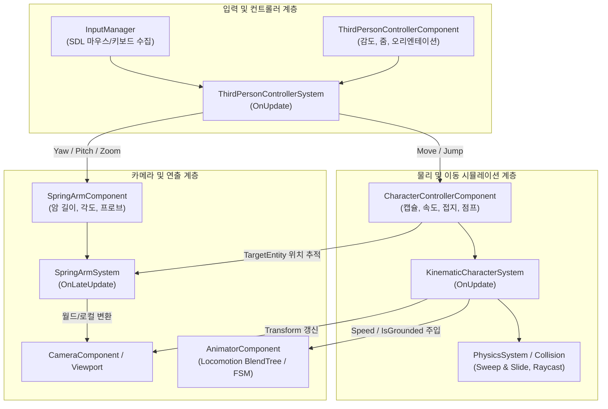

# 3인칭 캐릭터 및 스프링암 카메라 시스템 개발 계획

## 1. 개요 및 목적

- **목적**: 키네마틱 캐릭터 컨트롤러(KCC)를 기반으로, 3인칭 시점의 플레이어 이동, 스프링암(SpringArm) 카메라 제어, 지형/장애물 물리 상호작용 및 캐릭터 애니메이션(Locomotion)을 통합한 완결형 3인칭 캐릭터 시스템을 구축한다.
- **배경**:
  - 기존 BamEngine은 키네마틱 캐릭터 이동(KCC)의 기본 알고리즘만 존재하여, 실제 게임플레이가 가능한 3인칭 카메라 조작(오빗 회전, 휠 줌, 충돌 프로브) 및 사용자 입력 처리가 분리되어 있었다.
  - 리플렉션 기반 엔티티 타깃팅, 씬 직렬화/역직렬화(PIE 스냅샷 보존), 프레임 레이트 동기화(지터 방지), 애니메이터 연동을 하나의 표준화된 파이프라인으로 연결한다.

---

## 2. 시스템 아키텍처

### 2.1 주요 컴포넌트 역할
1. **`CharacterControllerComponent` (`Engine/Source/Core/Public/Components/Physics/CharacterControllerComponent.h`)**:
   - 캐릭터의 충돌 캡슐, 질량 중심 오프셋, 속도(`Velocity`), 이동 입력(`MoveInput`), 접지 여부(`IsGrounded`) 등 물리 시뮬레이션 상태를 보관.
2. **`ThirdPersonControllerComponent` (`Engine/Source/Core/Public/Components/Physics/ThirdPersonControllerComponent.h`)**:
   - 마우스 감도, 휠 줌 감도, 스프링암 엔티티 참조(`SpringArmEntity`), 이동 방향 몸체 회전(`OrientRotationToMovement`), 달리기 배율(`SprintMultiplier`).
   - `REQUIRE_COMPONENTS(TransformComponent, WorldTransformComponent, CharacterControllerComponent)` 메타데이터로 원클릭 의존성 보장.
3. **`SpringArmComponent` (`Engine/Source/Core/Public/Components/Camera/SpringArmComponent.h`)**:
   - 카메라 붐 길이(`TargetArmLength`), 피벗 오프셋, 회전각(`Pitch`, `Yaw`), 장애물 충돌 검사(`DoCollisionTest`, `ProbeRadius`), 지연 보간(`CameraLag`).

---

## 3. 개발 로드맵 및 진행 현황

### [x] Phase 1: 3인칭 조작 및 스프링암 카메라 기반 구축 (완료)
- `ThirdPersonControllerComponent`, `SpringArmComponent` 정의 및 리플렉션/직렬화 등록.
- `ThirdPersonControllerSystem`, `SpringArmSystem` 생성 및 `Application.cpp` 시스템 등록.
- 마우스 우클릭 오빗 회전, 마우스 휠 줌, WASD 평면 이동, Space 점프, Shift 달리기.
- 이동 방향으로 몸체 자동 회전 (`OrientRotationToMovement`).
- 에디터 뷰포트 디버그 렌더링 (`DebugRenderer.cpp`): 피벗 점, 붐 가이드 라인, 충돌 프로브 구체.

### [x] Phase 2: KCC 물리 안정화 및 카메라 동기화 (완료)
- **3D 충돌체 스케일/회전 미반영 버그 해결**:
  - `PhysicsSystem::TestColliderHit`의 BoundingBox `[-halfSize, halfSize]` 중심 좌표 정상화 및 구체 스케일 반영.
  - `KinematicCharacterSystem::SweepCharacter`의 scaled AABB 변환 정상화.
- **지면 감지 및 착지 알고리즘 정상화**:
  - `DetectGround`의 공중 조기 흡착(Hard Snap) 제거: 지면 걷기 중 접지 유지와 공중 낙하 착지를 엄격히 분리하여 체공 중 바닥으로 순간이동하는 현상 방지.
  - 발바닥 오프셋(`footOffset`) 계산으로 중심 피벗 메시(구체 등)가 바닥에 파묻히는 현상 해결.
  - 수평 스윕 시 발바닥 여유 마진 적용으로 밟고 있는 바닥 패널과의 수평 마찰 걸림(Stuck) 방지.
- **화면 및 카메라 지터(떨림) 완벽 제거**:
  - `KinematicCharacterSystem`을 고정 물리(`OnFixedUpdate`)에서 프레임 동기화(`OnUpdate`)로 전환하여 렌더 루프 및 모니터 주사율과 1:1 일치.
- **계층 구조 카메라 좌표 변환 및 프로브-프러스텀 위치 일치**:
  - 부모 엔티티가 있는 카메라에 대해 부모 역행렬(`invParent`)을 통한 로컬 좌표 변환 적용.
  - 부모가 있는 자식 엔티티에 `TransformSystem::UpdateRootWorld`를 무조건 호출하여 부모 변환이 무시되고 로컬 좌표가 월드로 덮어씌워지던 버그 수정.
  - `TransformSystem::TryComposeWorld` 및 `camWorld.CommitWorld`를 통해 부모 행렬을 올바르게 결합하여 스프링암 프로브 구체와 뷰포트 카메라 프러스텀의 위치 불일치 완벽 해소.

### [x] Phase 3: 애니메이션 시스템(Locomotion) 연동 (완료)
- **물리 상태의 애니메이터 자동 바인딩**:
  - `KinematicCharacterSystem`에서 본인 또는 자식 스켈레탈 메시의 `AnimatorComponent` 자동 탐색.
  - `Locomotion.animator` 표준 파라미터(`Speed`, `IsGrounded`, `Jump`) 실시간 주입.
  - 이동 속도 연동 재생 배속(`ScalePlayRateWithSpeed`, `MinPlayRate`, `MaxPlayRate`) 적용으로 발 미끄러짐(Foot Sliding) 방지 및 인스펙터 실시간 조절 연동.
  - 신규 프로퍼티에 `ALLOW_MISSING` 어노테이션을 부여하여 기존 씬 역직렬화 하위 호환성 확보.
- **1D 블렌드 트리 및 위상 동기화(Phase Matching)**:
  - `AnimationEvaluator::EvaluateBlendTree1D`에서 두 클립의 길이가 달라도 발걸음 주기(Normalized Time)를 일치시켜 LERP 합성.
  - 루프 래핑 시 뒷다리 차기 모션의 조기 잘림을 막고 자연스러운 순환을 위해 마지막 0.05초 구간 0초 포즈와의 미세 Slerp/Mix 루프 스무딩 적용.
  - `AnimState`에 `LoopBlendDuration` 설정 프로퍼티 추가 및 리플렉션/직렬화 연동.
- **상태 머신 전이 히스테리시스 안정화**:
  - `Idle`(`Fox_Survey`) $\leftrightarrow$ `Move`(`Walk` ~ `Run` BlendTree1D) 구조 개편.
  - 방향 전환 시 감속으로 인한 0초 튕김을 막기 위해 가속 전이(`Speed > 0.3`)와 감속 전이(`Speed < 0.15`) 간 임계값 히스테리시스 적용.
- **스켈레탈 캐릭터 모델 배치 및 검증**:
  - 여우(`Fox.glb`) 모델을 셋업하여 Idle $\rightarrow$ Walk $\rightarrow$ Run 및 Shift 달리기 시 모션 블렌딩 검증 완료.

### [x] Phase 4: 지형·장애물 물리 상호작용 및 고도화 (완료 및 관측 이슈 기록)
- **회전된 경사로(OBB) 캡슐 스윕 지원**:
  - `KinematicCharacterSystem::SweepCharacter`에서 회전된 박스(`isRotated`)에 대해 외접 AABB 대신 `Collision::Sweep(charCap, direction, closestDist, localBox, colliderWorld, tempHit)`를 호출하여 $30^\circ, 45^\circ, 60^\circ$ 경사면과의 정밀 OBB 충돌 검사 수행.
- **평면 기하학 기반 지면 안착 헬퍼 `CalculateGroundContactY` 도입**:
  - 경사 평면 방정식 $\vec{n} \cdot (C - P_{hit}) = R$을 역산하여, 바닥 구가 경사면에 완벽히 접촉하는 중심 높이를 계산하도록 통합. Sweep 접점과 Ray 접점의 수평 오프셋으로 인한 프레임 간 14cm 높이 요동(덜컹거림) 원천 해소.
- **완만한 경사면 접선 속도 투영 (Slope Tangent Movement)**:
  - 걸을 수 있는 경사면($\le 45^\circ$) 이동 시 속도를 지면 법선에 투영($\vec{v} - \vec{n}(\vec{v}\cdot\vec{n})$)하여 경사면을 따라 대각선 아래/위로 직접 이동하게 하여, 하강 시 발이 공중에 떠서 덜컹거리는 문제 해결.
- **골짜기/틈새 슬라이딩 (Crevice / Valley Sliding) 및 Depenetration**:
  - 마주보는 두 벽($\vec{n}_1 \cdot \vec{n}_2 < -0.01$) 사이에 끼였을 때 두 벽의 외적 벡터 $\vec{d} = \vec{n}_1 \times \vec{n}_2$(골짜기 교선) 또는 평행 통로 방향으로 이동 방향을 자동 정렬하여 1.0m 좁은 틈새에서도 막힘 없이 빠져나올 수 있도록 처리.
- **급경사면 미끄러짐(Slope Sliding) 및 법선 왜곡 해소**:
  - $60^\circ$ 경사로 등 한계 각도 초과 시 중력 투영 가속도(`slideAccel`) 적용 및 3차원 미끄러짐 이동.
  - 하향 스윕 시 `(0, 1, 0)` 오염 법선 대신 `raySlope > 5°` 시 순수 기하학적 레이캐스트 법선 최우선 채택.
  - 가파른 각도($75^\circ$ 이상) 대응 레이 사거리 확장(`rayDist ≈ 2.1m`).
  - 점프 상승 중(`Velocity.y > 0.05f`) 지면 재흡착 방지로 온전한 점프 궤적 보장.
  - 평지 전환 시 `glm::mix` 관성 감속 보간.

---

## 4. 최종 관측 현상 및 기술적 과제 (Known Issues & Residual Observations)

사용자 실환경 테스트(`SimpleTests` 씬)를 통해 마지막으로 확인된 물리 상호작용 이슈 및 향후 최적화 방향:

1. **점프 후 바닥 재착지 시 과도한 거리에서의 조기 흡착 (Early Snapping on Jump Descent)**:
   - **현상**: 점프 정점을 지나 아래로 낙하할 때, 발바닥이 바닥에 거의 닿기 전(공중 약 0.5~1m 높이)에서 바닥으로 순간이동하듯 너무 일찍 달라붙어 착지하는 현상.
   - **원인 분석**: 급경사면 검출을 위해 확장한 레이캐스트 사거리(`rayDist ≈ 2.1m`) 및 `DetectGround` 스냅 마진이 체공 낙하 상태에서도 활성화되어, 높은 고도에서 바닥이 조기 감지되어 착지 확정이 이루어짐.
   - **수정 반영 (2026-11-19)** 공중 낙하 중에는 이번 프레임의 수직 이동 범위 안에 지지면이 들어온 경우에만 착지한다. 박스·구·캡슐은 하향 스윕 이동 거리를 사용하고, 메시·지형 레이는 캡슐의 지지 높이로 환산해 같은 거리 제한을 적용한다. 접지 중 계단을 내려갈 때는 기존의 `SkinWidth + max(StepOffset + 0.05m, 0.35m)` 범위를 사용한다. 사용자는 중간 확인에서 평지 점프가 의도대로 동작한다고 보고했다.

2. **30도 경사로(Ramp) 보행 시 메시 파고듦 (30 Deg Ramp Penetration)**:
   - **현상**: $30^\circ$ 완만한 경사로를 걸어서 오르내릴 때 발바닥이 경사로 표면 안쪽으로 미세하게 파고드는 현상 관측.
   - **원인 분석**: 경사면 접선 속도 이동(`kcc.Velocity * dt`) 시 캡슐 바닥의 스킨 여유 두께(`SkinWidth`)가 경사각에 의해 상쇄되거나, 프레임 이동량에 따른 MTD(Minimum Translation Distance) 침투 보정이 단일 프레임에서 지연됨.
   - **수정 반영 (2026-11-19)** 비균일 배율을 가진 박스와 캡슐의 접촉 거리 계산을 수정하고, 지지면 검사에서 얕은 침투를 위로 보정한다. 계단과 완만한 램프의 반복 왕복 검증 결과는 아직 기록되지 않았다.

3. **45도 및 60도 경사로 끝단 평지 진입 시 '탁' 하고 붙는 부자연스러움 (Abrupt Ramp-to-Floor Transition)**:
   - **현상**: 가파른 경사로를 미끄러져 내려오다가 경사로 끝부분(바닥면과의 접점)을 통과할 때, '탁' 하고 뚝 떨어지듯 바닥에 거칠게 달라붙는 부자연스러운 착지 현상 관측.
   - **원인 분석**: 경사로 판자 자체의 두께(0.2m)로 인한 바닥과의 수직 단차(Step)와, $60^\circ$ 경사면 접촉 상태에서 $0^\circ$ 평지 접촉 상태로 급격히 전환되면서 Y 높이 흡착(`CalculateGroundContactY`)이 1프레임만에 순간적으로 적용되어 발생하는 단차 충격.
   - **해결 방안**: 경사로 끝단과 바닥면 사이의 법선 보간(Normal Slerp / Curvature Damping)을 적용하거나, 전환 프레임에서 수직 높이 흡착 시 최대 수직 속도 제한(Vertical Snap Clamping)을 적용하여 연착륙(Soft Landing) 유도.
   - **수정 반영 (2026-11-22, 정적 구현 완료 · 빌드/CTest/실환경 검증 대기)**: `KinematicCharacterSystem::UpdateCharacter`의 접지/Step-Down 스냅 경로(`applyGroundSnap`)에 경사면($\ge 5^\circ$)에서 더 완만한 걸을 수 있는 면/평지로 내려설 때 프레임당 수직 스냅 속도 제한(`3.5m/s`, 최소 보정 `0.005m`)과 스냅 비율에 따른 `GroundNormal`/`GroundAngle` 점진 보간을 추가했다. `KinematicCharacterCheck`에는 `CheckRampToFloorSoftLanding`(45° 내리막 끝단·30° 측면 단차 전환, 60/120Hz) 및 `CheckMovingPlatformInheritance`(이동·Y축 회전 플랫폼 상속, 60/120Hz) 회귀 테스트를 추가했다. (리플렉션 `PROPERTY` 추가 없이 구현해 `Engine.csv` 변경은 없다.)

### 조기 착지 회귀 확인

- `KinematicCharacterCheck`는 60Hz와 120Hz의 갱신 간격에서 메시 평지와 박스 바닥을 확인한다. 점프 정점 뒤에도 떨어지는 동안 공중 상태를 유지하고, 이번 프레임에 바닥에 닿을 때만 접지와 위치가 함께 확정돼야 한다. 박스 가장자리처럼 중심 레이가 빗나가도 발밑에 스윕 접촉이 있으면 착지해야 한다. 0.25m 아래는 접지 스냅을 허용하고 0.8m 아래는 낙하를 시작하는지도 확인한다.
- `SimpleTests`에서 Rogue로 제자리 점프와 이동 점프를 한 번씩 실행한다. 접촉까지 낙하가 이어지고, 평지에 닿는 프레임에 캡슐과 접지 상태가 함께 전환되는지 확인한다. 낮은 계단 하강, 경사로 진입과 급경사 미끄러짐, 무빙 플랫폼은 회귀 확인 대상이다.

### 경사 보행과 미끄러짐 회귀 확인

- 2026-11-19 사용자 예비 확인에서 평지 점프는 의도대로 보였고, 오르막에서 지지면을 잃거나 급경사에서 미끄러짐이 불안정했다. 경사면의 법선 방향으로 실제 이탈하는 경우에 접지를 해제하도록 바꿨다. 급경사 접촉 중에는 입력과 중력을 포함한 속도를 접선으로 투영하고, 현재 경사면에만 작은 접촉 유지 여유를 둔다.
- `KinematicCharacterCheck`는 30°와 45° 경사로에서 오르막 이동 중 접지와 캡슐 간격이 유지되는지 검사한다. 60°에서는 오르막 입력 중에도 내려가고, 대각선 하강 입력에서 면을 이탈하지 않는지 확인한다. 기존 박스·메시 평지 점프 검사를 함께 수행한다.
- `SimpleTests`에서 30°와 45° 경사로를 평지에서 걸어 올라가고, 60° 경사로 위에서는 입력을 놓거나 오르막 입력을 유지한다. 30°·45°에서는 걷는 동안 접지가 유지되고, 60°에서는 경사면을 따라 내려가야 한다. 제자리 점프와 이동 점프도 다시 확인한다.

### 계단·램프 침투 회귀 확인

- `SimpleTests`의 계단과 램프 박스는 높이 배율이 `0.2`다. 계단의 회전 판정에 스케일이 섞여 회전 스윕을 타던 경로를 고쳤다. 회전 박스 충돌은 직교 축의 크기에만 배율을 적용해 캡슐 반지름과 이동 거리를 월드 단위로 유지한다. 전단이 있는 박스의 캡슐 충돌은 보수적인 월드 AABB를 사용한다.
- 계단 오르기와 하강은 같은 지지면 검사로 높이를 구한다. 경사 이동 중 충돌 캡슐을 인위적으로 들어 올리던 처리를 제거하고, 지지면 검사의 음수 낙하 거리로 얕은 침투를 위로 보정한다. 발밑에 높은 단이 남아 있으면 중앙 레이로 확인한 낮은 단보다 높은 단을 우선한다.
- `CollisionGeometryCheck`는 30° 회전과 비균일 배율이 있는 박스의 접촉 깊이·법선·스윕 거리를 확인한다. `KinematicCharacterCheck`는 메시 바닥에서 0.2m 계단 네 개를 왕복하고, 하강 중 캡슐이 아직 지지하는 단의 윗면 아래로 들어가지 않는지 확인한다.
- 실환경에서는 `Stair_Step_1`에서 상단 플랫폼까지 왕복하고, 30°·45° 램프를 평지에서 진입해 왕복한다. 캡슐과 콜라이더를 함께 보면서 하강 시 발밑에서 상판이 벗어난 뒤 다음 단으로 내려가는지, 같은 램프를 반복해서 오르내려도 높이 오차가 쌓이지 않는지 확인한다. 60° 미끄러짐과 평지 점프 착지도 함께 확인한다.

### 램프 진입 정지와 점프 충돌 회귀 확인

- 걸을 수 있는 경사로에서 이동 입력을 놓으면 접선 속도를 0으로 만든다. 계단 오르기 보정은 현재 프레임에 이동 입력이 있는 경우에만 실행한다. 급경사에서 접촉할 때는 남은 오르막 속도 성분을 제거한다.
- 공중의 벽 밀어내기와 방향 보정은 수평면에 제한한다. 지지면 스윕은 지지할 수 없는 법선을 가진 후보 때문에 검사 범위를 줄이지 않는다. 가까운 레이 히트가 아랫면이나 내부 접촉이라 지지면으로 쓸 수 없으면 후속 히트도 검사한다. 착지는 이번 프레임의 낙하 범위를 사용한다.
- `KinematicCharacterCheck`는 평지에서 30° 램프에 진입한 뒤 입력 해제, 램프 측면에 닿는 공중 이동, 뒤집힌 메시 면 아래의 바닥 착지를 검사한다. `SimpleTests`에서는 램프 시작부에서 키를 놓자마자 멈추고, 램프 옆면·아랫면에 닿으며 점프한 뒤 평지 또는 램프에 착지해야 한다.

### 급경사 미끄러짐에서 평지로 전환

- 사용자 재확인에서 램프에 점프해 접촉한 후 떨어질 때 지면 관통이 남았다. 급경사 이동은 이동 루프에서 높이를 낮추고 공중 착지 단계를 사용하지 않으므로, 이동 루프 뒤 도착 XZ에서 이동 전후 높이 사이의 지지면을 확인한다. 접근한 지지면에서 하강을 제한하고, 걸을 수 있는 평지에 도달하면 그 프레임에 접지 상태와 지지 엔티티를 갱신한다.
- `KinematicCharacterCheck`는 60° 경사로에 낙하한 뒤 경사로의 하단을 가로지르는 메시 바닥으로 이동하는 장면을 30Hz·60Hz·120Hz 간격으로 확인한다. 경사 접촉을 거친 뒤 바닥 상단에서 착지하며 발이 바닥 아래로 들어간 프레임이 없어야 한다.
- `SimpleTests`에서 램프를 향해 이동하며 점프해 옆면에 닿은 뒤 떨어지는 동작을 반복한다. 평지에 닿으면 캡슐이 접지 상태로 전환되고 더 떨어지지 않아야 한다.
- 2026-11-19 사용자 실환경 재확인에서 램프에 점프해 접촉한 뒤 평지에 착지하는 동작이 의도대로 동작했다고 보고했다. 램프 진입 후 정지, 계단 왕복, 무빙 플랫폼은 별도 결과가 기록되지 않았다. `KinematicCharacterCheck`와 `CollisionGeometryCheck`의 CTest 실행 결과도 확인되지 않았다.
