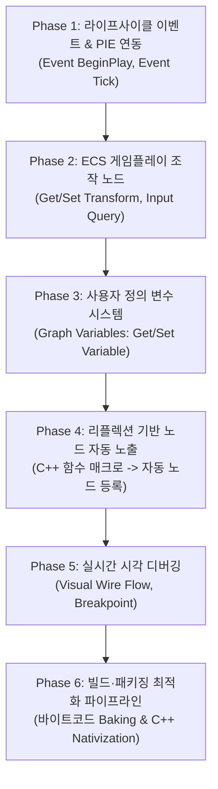

# 비주얼 스크립팅과 블루프린트 개발 계획

- 작성일: 2026-10-29
- 상태: 계획 / 목표 수립
- 공통 기준: [EngineEditorClientGuidelines.md](EngineEditorClientGuidelines.md)
- 선행 기반: [GraphFoundation.md](GraphFoundation.md), [GraphExecution.md](GraphExecution.md), [GraphReflection.md](GraphReflection.md), [GraphPanel.md](GraphPanel.md)
- 통합 우선순위 연결: [DevelopmentPriorities.md](DevelopmentPriorities.md)

---

## 1. 목적과 비전

현재 BamEngine에 구축된 공통 노드 그래프 기반(`GraphFoundation`)과 가상 머신 실행기(`GraphExecutor`), 노드 에디터(`GraphPanel`)를 확장하여, **언리얼 엔진의 블루프린트(Blueprint)와 동등한 수준의 게임플레이 비주얼 스크립팅 시스템**을 구축하는 것을 목표로 한다.

프로그래머뿐만 아니라 기획자와 아티스트가 C++ 코드 작성이나 재컴파일 없이, 에디터 상에서 노드를 배치하고 연결하는 것만으로 캐릭터 이동, 상호작용, 게임 로직, UI 연동을 완결할 수 있는 제작 환경을 제공한다.

> [!IMPORTANT]
> **이원화 파이프라인 원칙 (에디터 생산성 vs 패키징 런타임 성능):**
> - **에디터(PIE) 환경:** 실시간 수정, 핫 리로드, 와이어 흐름 시각화 및 중단점 디버깅을 위해 가상 머신 인터프리터(`GraphExecutor`) 기반으로 유연하게 동작한다.
> - **최종 빌드 & 패키징(Release Client) 환경:** 인터프리팅에 따른 동적 디스패치 및 핀 조회 오버헤드를 제거하기 위해, 최적화된 런타임 포맷(바이너리 바이트코드 베이킹 또는 C++ 네이티비제이션)으로 포장(Bake/Compile)하여 네이티브 수준의 고성능 실행을 보장한다.

---

## 2. 현재 상태와 블루프린트 수준 간의 격차 (Gap Analysis)

### 2.1 이미 구축된 기반 (준비 완료)
- **그래프 기초 데이터 모델 (`GraphFoundation`):** 노드(`GraphNode`), 핀(`GraphPin`), 연결선(`GraphLink`)의 생성, 삭제, 순환 검사, JSON 직렬화 및 역직렬화 완비.
- **실행 엔진 (`GraphExecutor`):** 실행선(`Execution`)을 순차적으로 처리하는 태스크 큐 기반 가상 머신, 예산(`budget`) 제한을 통한 무한 루프 방지, 실행 트레이스(`GraphTraceEvent`) 로깅 완비.
- **노드 에디터 UI (`GraphPanel`):** ImNodes 기반의 노드 캔버스, 와이어 드래그 앤 드롭 연결, 노드 팔레트 검색, 핀 타입별 색상 구분 지원.
- **C++ 리플렉션 연동 (`GraphReflection`):** 네이티브 C++ 함수 정보를 바인딩하여 노드에서 동적으로 호출(`Invoke`)할 수 있는 기반 구비.

### 2.2 언리얼 블루프린트 완성을 위해 결여된 4대 핵심 요소
1. **엔진 라이프사이클 이벤트 및 PIE 자동 디스패치 부재:**
   - 현재는 에디터 UI 버튼으로 `Update`를 수동 1회 실행하는 수준에 머물러 있음.
   - 게임 실행(PIE) 시 `Event BeginPlay`, 매 프레임 `Event Tick(DeltaTime)`이 엔티티 그래프로 자동 전달되는 파이프라인이 없음.
2. **엔티티 및 ECS 컴포넌트 접근(Get/Set) 노드 부재:**
   - 현재 노드는 순수 수학·벡터·논리 연산 위주로 구성되어 있음.
   - 엔티티의 `TransformComponent`(위치, 회전, 스케일), `Physics`, `Audio`, `Input`을 읽고 쓰는 게임플레이 노드가 없음.
3. **그래프 사용자 정의 변수(Graph Variables / Blackboard) 시스템 부재:**
   - 엔티티 인스턴스마다 고유하게 유지해야 하는 변수(`HP`, `MoveSpeed`, `IsAlive` 등)를 선언하고, `Get/Set` 노드로 접근하는 기능이 없음.
4. **리플렉션 기반 게임플레이 API 자동 노출 파이프라인 부재:**
   - C++ 함수를 추가할 때마다 수동으로 노드 정의를 등록해야 하는 번거로움이 존재함.

---

## 3. 단계별 개발 로드맵

### Phase 1. 라이프사이클 이벤트 노드와 PIE 자동 디스패치 (P1)
- **목적:** 게임 실행 중 씬의 엔티티들이 스스로 생각하고 프레임마다 동작하는 생명력을 부여한다.
- **세부 내용:**
  - `Event.BeginPlay`: 씬이 시작되거나 엔티티가 스폰될 때 1회 실행 핀 트리거.
  - `Event.Tick`: 매 프레임 실행 핀 트리거 및 `DeltaTime(Float)` 출력 핀 제공.
  - `ScriptSystem` 또는 `GraphSystem`을 구축하여, PIE 활성화 상태에서 `GraphBindingComponent`를 가진 엔티티들의 그래프에 프레임 델타 타임을 주입하고 `GraphExecutor::Tick()`을 자동 구동.
- **완료 기준:** 에디터에서 플레이(`Play`) 버튼을 누르면 큐브에 연결된 그래프의 `Event Tick`이 콘솔 로그를 매 프레임 출력한다.

### Phase 2. ECS 게임플레이 조작 및 입력 노드 (P1)
- **목적:** 수학 계산 결과가 실제 화면 속 오브젝트의 이동과 입력 반응으로 나타나게 한다.
- **세부 내용:**
  - `Self (Object)` 핀: 그래프가 부착된 엔티티 자기 자신을 가리키는 핀.
  - **Transform 제어 노드:**
    - `Get Entity Location / Rotation / Scale`
    - `Set Entity Location / Rotation / Scale`
    - `Add World Offset`, `Add Local Rotation`
  - **Input 노드:**
    - `Is Key Pressed`, `Get Axis (Horizontal / Vertical)`
  - **Entity 생명주기 노드:**
    - `Spawn Entity From Prefab`, `Destroy Entity`
- **완료 기준:** 키보드 방향키를 누르면 큐브가 씬 내에서 회전하고 전진하는 블루프린트 액터를 오직 그래프 노드만으로 구현할 수 있다.

### Phase 3. 그래프 사용자 정의 변수(Graph Variables) 시스템 (P2)
- **목적:** 오브젝트마다 독립된 상태(체력, 속도, 상태 플래그)를 그래프 안에서 관리한다.
- **세부 내용:**
  - 에디터 `GraphPanel` 좌측에 [Variables] 관리 창 추가 (변수 추가, 이름 변경, 타입 지정: Bool, Int, Float, Vector3, Object).
  - 변수를 캔버스로 드래그 앤 드롭 시 `Get [변수명]`(순수 데이터 노드) 및 `Set [변수명]`(실행 핀 포함 노드) 자동 생성.
  - `GraphExecutor` 인스턴스 내부에 엔티티별 독립적인 가변 변수 저장소(`VariableStorage`) 연결.
- **완료 기준:** 피격 시 `HP` 변수를 차감하고, `Branch` 노드를 통해 `HP <= 0`일 때 엔티티를 파괴하는 로직이 동작한다.

### Phase 4. 리플렉션 기반 노드 자동 노출 (`BlueprintCallable`) (P2)
- **목적:** C++로 작성된 신규 기능과 컴포넌트가 코드 추가 없이 즉시 블루프린트 노드로 등록되도록 자동화한다.
- **세부 내용:**
  - 리플렉션 어노테이션 `GRAPH_FUNCTION` 또는 `META("BlueprintCallable", true)` 확장.
  - 엔진 초기화 시 `GraphRegistry`가 리플렉션 메타데이터를 순회하여, 대상 C++ 함수의 파라미터를 입력 핀으로, 반환값을 출력 핀으로 변환한 노드 정의를 자동 생성.
  - 대상 모듈: 오디오 재생(`PlaySound`), 파티클 재생, 물리 힘 가하기(`AddForce`), UI 텍스트 변경 등.
- **완료 기준:** C++로 작성한 `AudioComponent::PlaySound()` 함수가 에디터 노드 팔레트에 자동으로 나타나고 그래프에서 즉시 호출된다.

#### 4.1 C++ 핫리로드 기반 라이브 노드·핀 동적 동기화 목표 (Live Node & Pin Hot-Reload Pipeline)
- **최종 사용자 경험 목표 (UX Goal):**
  - 개발자가 C++ 코드(`GameModule` 등)에서 새로운 `FUNCTION(GRAPH_CALLABLE)` 함수를 추가하거나 기존 함수의 매개변수(핀)를 변경하고 **Visual Studio에서 빌드(`Ctrl+Shift+B`)만 누르면**:
  - **에디터를 재시작할 필요 없이(Zero-Restart)**,
  - 1) **그래프 에디터 우클릭 팔레트**에 새로운 노드가 즉시 검색 및 배치 가능한 상태로 실시간 등장한다.
  - 2) **이미 캔버스에 배치되어 있던 기존 노드**에도 추가된 매개변수 핀이 실시간으로 쏙 생겨나며, 기본값(`GRAPH_PIN_DEFAULT`)이 자동으로 채워진다.

- **구조적 변경 및 아키텍처 파이프라인 (4단계 목표):**
  1. **모듈 핫리로드 이벤트와 리플렉션 델타 갱신 (Hot-Reload $\rightarrow$ Reflection Re-scan):**
     - `ModuleHotReloadManager`가 DLL 리로드를 완료하면 `OnPostHotReload` 콜백을 통해 리플렉션 레지스트리(`ReflectionRegistry`)에 새 DLL의 메타데이터를 통보.
     - 리플렉션 시스템이 변경된 함수 심볼과 메타데이터 목록을 추출하여 엔진 코어에 전달.
  2. **스키마 핫스왑 지원 (`GraphRegistry::RegisterOrUpdate`):**
     - 현재 `GraphRegistry::Register`는 기존에 등록된 노드 타입이 존재하면 `DuplicateType` 에러를 반환하며 등록을 거부함.
     - 핫리로드 발생 시 기존 노드 정의(`GraphNodeDefinition`)의 함수 포인터와 핀 구성을 제자리에서 안전하게 덮어쓸 수 있는 `RegisterOrUpdate` API 구축.
  3. **노드 인스턴스 핀 자동 조정 (Live Pin Reconciliation & Migration):**
     - 현재 열려 있는 그래프 문서(`GraphDocument`)와 씬에 로드된 그래프 에셋들을 순회하며 스키마 변경 사항을 동기화:
       - **새 핀 추가 시:** 기존 노드 인스턴스에 새 핀을 생성하고, C++ 매크로에 정의된 `GRAPH_PIN_DEFAULT` 기본값을 즉시 주입.
       - **핀 삭제 / 타입 변경 시:** 유효하지 않게 된 와이어(`GraphLink`)를 안전하게 끊어 댕글링(Dangling) 참조 및 가상머신 크래시를 방지하고, 에디터에 경고 진단(`Diagnostic`) 표기.
  4. **`GraphPanel` UI 캔버스 실시간 리프레시 (UI Canvas Sync):**
     - `GraphPanel`이 핫리로드 알림을 수신하면:
       - 우클릭 노드 검색 팔레트 캐시(`m_NodeCandidates`)를 즉시 재생성.
       - ImNodes의 노드 뷰(`NodeView`)를 재계산하여 새 핀에 고유 ID를 할당하고 캔버스에 즉시 렌더링.
     - 실행 중이던 가상 머신(`GraphExecutor`)은 실행을 멈추지 않고, 캐싱된 함수 포인터(`m_Functions`)만 원자적으로 교체하여 끊김 없는 라이브 코딩 경험 제공.

### Phase 5. 실시간 와이어 흐름 디버깅과 중단점 (P3)
- **목적:** 언리얼 엔진 블루프린트의 핵심 경험인 "실행 흐름 시각화"를 구현하여 디버깅 편의성을 극대화한다.
- **세부 내용:**
  - `GraphExecutor`의 `m_Trace` 로그 이벤트를 활용하여, 방금 신호가 지나간 링크 와이어를 에디터에서 주황색/노란색 펄스 애니메이션으로 렌더링.
  - 노드 중단점(Breakpoint) 토글 기능 및 스텝 실행(F10/F11) 지원.
  - 특정 노드의 출력 핀 위로 마우스를 올렸을 때 런타임 현재 값(Watch Value Tooltip) 표시.
- **완료 기준:** 게임 플레이 도중 그래프 에디터를 보았을 때 데이터와 실행선이 흐르는 과정을 시각적으로 확인하고 중단점에서 멈출 수 있다.

### Phase 6. 빌드·패키징 최적화 파이프라인 (Graph Nativization & Cooked Baking) (P3)
- **목적:** 에디터의 유연한 비주얼 저작 환경을 유지하되, 최종 배포(Client) 패키지에서는 VM 인터프리터 오버헤드를 완전히 배제하고 네이티브에 준하는 극대화된 런타임 성능을 달성한다.
- **세부 내용:**
  - **1단계: 그래프 최적화 (Graph Optimizer)**
    - 연결되지 않은 데드 노드 제거(DCE), 컴파일 타임 상수 폴딩(Constant Folding), 순수 수학 연산의 인라인화.
  - **2단계: 최적화된 패키징 포장 (Baking & Nativization)**
    - **바이트코드 베이킹 (Cooked Bytecode Baking):** 런타임 JSON 파싱과 문자열 기반 핀 검색을 제거하고, 연속적인 메모리 블록의 플랫 바이트코드 바이너리 포맷(`.bgb - Bam Graph Binary`)으로 쿡(Cook)하여 캐시 지역성과 로딩 속도를 극대화.
    - **C++ 네이티비제이션 (Blueprint Nativization / AOT Transpiler):** 복잡하거나 매 프레임 높은 연산량을 요구하는 그래프를 C++ 소스 코드로 자동 변환(트랜스파일)하여 배포용 Client 프로젝트 빌드 시 네이티브 머신 코드로 컴파일 링크.
  - **3단계: 패키징 빌드 프로필 분리 (`BuildAndPackagingPlan.md` 연계)**
    - 에디터 및 개발(Debug/Development) 환경: `GraphExecutor` 기반 가상 머신 인터프리팅 구동 (시각 디버깅 및 트레이스 제공).
    - 릴리즈 배포(Shipping/Release) 환경: 베이크된 고속 바이트코드 디스패처 또는 네이티비제이션된 C++ 직접 호출로 자동 대체.
- **완료 기준:** 최종 패키징된 독립 실행 Client에서 수백 개의 엔티티가 비주얼 스크립트 로직을 동시에 실행할 때, 가상 머신 해석 비용 없이 부드러운 프레임 레이트를 유지한다.

---

## 4. 아키텍처 원칙 및 제약사항

1. **엔진-에디터 의존성 분리 유지 (`EngineEditorClientGuidelines.md`):**
   - 그래프 런타임 코어(`Graph`, `GraphExecutor`, `GraphRegistry`)는 절대 ImGui, ImNodes, 에디터 패널 코드를 참조하지 않는다.
   - 디버깅용 트레이스 정보는 데이터 이벤트 큐(`GraphTraceEvent`) 형태로만 공급하며, 렌더링 방식은 에디터가 결정한다.
2. **동적 메모리 할당 최소화 및 가비지 방지:**
   - `Tick` 이벤트는 매 프레임 수십~수백 개의 엔티티에서 실행될 수 있으므로, 태스크 큐와 변수 컨테이너는 사전 예약(Reserve) 및 풀링(Pooling)을 원칙으로 한다.
3. **무한 루프 및 런타임 안전장치:**
   - 상호 순환 참조나 잘못된 루프로 엔진 메인 스레드가 멈추는 것을 방지하기 위해, 현재 `GraphExecutor`에 구현된 스텝 예산(`budget`) 초과 시 즉시 실행을 중단하고 에디터에 경고 진단을 출력하는 정책을 유지한다.
4. **이원화 실행 전략 (Editor Flexibility vs Packaged Performance):**
   - 에디터(PIE) 환경은 개발 생산성(수정 즉시 반영, 트레이스 시각화)을 위해 인터프리터 기반 가상 머신(`GraphExecutor`)을 기본으로 한다.
   - 패키징(Release/Shipping) 환경에서는 인터프리터 비용(동적 디스패치, 문자열 기반 핀 검색, 박싱/언박싱)을 허용하지 않고, 컴파일 타임 최적화/네이티비제이션을 통해 순수 네이티브 코드 수준의 실행 성능을 달성하도록 설계한다.

---

## 5. 최종 완료 기준 (Definition of Done)

- [ ] C++ 코드 작성 없이, 에디터 상에서 노드 배치만으로 **"플레이어 입력 처리 $\rightarrow$ 액터 이동/회전 $\rightarrow$ 애니메이션/사운드 트리거 $\rightarrow$ 상태 변수 갱신"**의 전체 게임플레이 루프를 제작할 수 있다.
- [ ] 씬에 배치된 서로 다른 액터 인스턴스들이 동일한 그래프 에셋을 공유하더라도, 각자의 변수(위치, 체력 등)가 독립적으로 격리되어 동작한다.
- [ ] PIE 실행 도중 노드 그래프 창에서 실행선 흐름과 변수 상태를 실시간으로 관찰하고 디버깅할 수 있다.
- [ ] 최종 빌드 및 패키징 시 노드 그래프가 베이킹(Baking) 또는 C++ 네이티비제이션(Nativization)을 거쳐 패키징되며, 스탠드얼론 클라이언트에서 가상 머신 인터프리팅 오버헤드 없이 고성능으로 구동된다.
