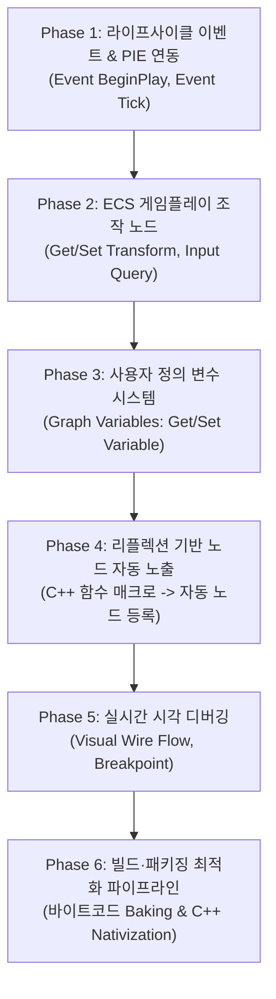

# 비주얼 스크립팅과 블루프린트 개발 계획

- 작성일: 2026-10-29 (최종 갱신: 2026-11-01)
- 상태: Phase 1~4 구현 완료 / Phase 5~6 진행 및 확장 대기
- 공통 기준: [EngineEditorClientGuidelines.md](EngineEditorClientGuidelines.md)
- 선행 기반: [GraphFoundation.md](GraphFoundation.md), [GraphExecution.md](GraphExecution.md), [GraphReflection.md](GraphReflection.md), [GraphPanel.md](GraphPanel.md)
- 핫리로드 최적화: [ModuleHotReloadOptimization.md](ModuleHotReloadOptimization.md)
- 통합 우선순위 연결: [DevelopmentPriorities.md](DevelopmentPriorities.md)

---

## 1. 목적과 비전

현재 BamEngine에 구축된 공통 노드 그래프 기반(`GraphFoundation`)과 가상 머신 실행기(`GraphExecutor`), 노드 에디터(`GraphPanel`)를 확장하여, **언리얼 엔진의 블루프린트(Blueprint)와 동등한 수준의 게임플레이 비주얼 스크립팅 시스템**을 구축하는 것을 목표로 한다.

프로그래머뿐만 아니라 기획자와 아티스트가 C++ 코드 작성이나 재컴파일 없이, 에디터 상에서 노드를 배치하고 연결하는 것만으로 캐릭터 이동, 상호작용, 게임 로직, UI 연동을 완결할 수 있는 제작 환경을 제공한다.

> [!IMPORTANT]
> **이원화 파이프라인 원칙 (에디터 생산성 vs 패키징 런타임 성능):**
> - **에디터(PIE) 환경:** 실시간 수정, 핫 리로드, 와이어 흐름 시각화 및 중단점 디버깅을 위해 가상 머신 인터프리터(`GraphExecutor`) 기반으로 유연하게 동작한다.
> - **최종 빌드 & 패키징(Release Client) 환경:** 인터프리팅에 따른 동적 디스패치 및 핀 조회 오버헤드를 제거하기 위해, 최적화된 런타임 포맷(바이너리 바이트코드 베이킹 또는 C++ 네이티비제이션)으로 포장(Bake/Compile)하여 네이티브 수준의 고성능 실행을 보장한다.

---

## 2. 현재 상태와 블루프린트 수준 간의 격차 (Gap Analysis)

### 2.1 이미 구축된 기반 (준비 완료)
- **그래프 기초 데이터 모델 (`GraphFoundation`):** 노드(`GraphNode`), 핀(`GraphPin`), 연결선(`GraphLink`)의 생성, 삭제, 순환 검사, JSON 직렬화 및 역직렬화 완비.
- **실행 엔진 (`GraphExecutor`):** 실행선(`Execution`)을 순차적으로 처리하는 태스크 큐 기반 가상 머신, 예산(`budget`) 제한을 통한 무한 루프 방지, 실행 트레이스(`GraphTraceEvent`) 로깅 완비.
- **노드 에디터 UI (`GraphPanel`):** imgui-node-editor 기반의 블루프린트 캔버스, 자유로운 줌/패닝, 와이어 드래그 앤 드롭 연결, 노드 팔레트 검색, 핀 타입별 색상 구분 및 실시간 실행선 흐름 펄스(`ed::Flow`) 지원.
- **C++ 리플렉션 연동 (`GraphReflection`):** 네이티브 C++ 함수 정보를 바인딩하여 노드에서 동적으로 호출(`Invoke`)할 수 있는 기반 구비.

### 2.2 언리얼 블루프린트 완성을 위해 기구현된 핵심 기반 (구축 완료)
1. **엔진 라이프사이클 이벤트 및 PIE 자동 디스패치 (Phase 1 완료):**
   - `Event.Start`(BeginPlay) 및 `Event.Update`(Tick) 구현 완료.
   - `GraphSystem`이 활성 씬의 `GraphBindingComponent` 엔티티마다 프레임 델타 타임을 주입하고 틱 실행 디스패치.
2. **엔티티 및 ECS 컴포넌트 접근(Get/Set) 노드 (Phase 2 완료):**
   - `GraphActorLibrary` 및 `GraphGameplayLibrary`를 통해 `TransformComponent` 조작, `Input` 질의 노드 완비.
3. **그래프 사용자 정의 변수(Graph Variables) 시스템 (Phase 3 완료):**
   - `GraphVariable` 데이터 구조 및 캔버스 Get/Set 노드, 엔티티별 독립 실행기 내 변수 격리 보관 완비.
4. **리플렉션 기반 게임플레이 API 자동 노출 및 핫리로드 파이프라인 (Phase 4 완료):**
   - `FUNCTION(GRAPH_CALLABLE)` 어노테이션 기반 노드 자동 등록.
   - `ModuleId` 기반 일괄 언레지스터, 노드 핀 인스턴스 자동 동기화(`Reconcile`), 1.5초대 C++ 핫리로드 구축.
   - `GraphSystem::ReloadReflectedNodes`를 통한 런타임 핫스왑(Phase 4.3) 및 엔티티 0-크래시 보장 완비.

---

## 3. 단계별 개발 로드맵

### Phase 1. 라이프사이클 이벤트 노드와 PIE 자동 디스패치 (P1)
- **목적:** 게임 실행 중 씬의 엔티티들이 스스로 생각하고 프레임마다 동작하는 생명력을 부여한다.
- **세부 내용:**
  - `Event.BeginPlay`: 씬이 시작되거나 엔티티가 스폰될 때 1회 실행 핀 트리거.
  - `Event.Tick`: 매 프레임 실행 핀 트리거 및 `DeltaTime(Float)` 출력 핀 제공.
  - `ScriptSystem` 또는 `GraphSystem`을 구축하여, PIE 활성화 상태에서 `GraphBindingComponent`를 가진 엔티티들의 그래프에 프레임 델타 타임을 주입하고 `GraphExecutor::Tick()`을 자동 구동.
- **완료 기준:** 에디터에서 플레이(`Play`) 버튼을 누르면 큐브에 연결된 그래프의 `Event Tick`이 콘솔 로그를 매 프레임 출력한다.

### Phase 2. ECS 게임플레이 조작 및 입력 노드 (P1)
- **목적:** 수학 계산 결과가 실제 화면 속 오브젝트의 이동과 입력 반응으로 나타나게 한다.
- **세부 내용:**
  - `Self (Object)` 핀: 그래프가 부착된 엔티티 자기 자신을 가리키는 핀.
  - **Transform 제어 노드:**
    - `Get Entity Location / Rotation / Scale`
    - `Set Entity Location / Rotation / Scale`
    - `Add World Offset`, `Add Local Rotation`
  - **Input 노드:**
    - `Is Key Pressed`, `Get Axis (Horizontal / Vertical)`
  - **Entity 생명주기 노드:**
    - `Spawn Entity From Prefab`, `Destroy Entity`
- **완료 기준:** 키보드 방향키를 누르면 큐브가 씬 내에서 회전하고 전진하는 블루프린트 액터를 오직 그래프 노드만으로 구현할 수 있다.

### Phase 3. 그래프 사용자 정의 변수(Graph Variables) 시스템 (P2)
- **목적:** 오브젝트마다 독립된 상태(체력, 속도, 상태 플래그)를 그래프 안에서 관리한다.
- **세부 내용:**
  - 에디터 `GraphPanel` 좌측에 [Variables] 관리 창 추가 (변수 추가, 이름 변경, 타입 지정: Bool, Int, Float, Vector3, Object).
  - 변수를 캔버스로 드래그 앤 드롭 시 `Get [변수명]`(순수 데이터 노드) 및 `Set [변수명]`(실행 핀 포함 노드) 자동 생성.
  - `GraphExecutor` 인스턴스 내부에 엔티티별 독립적인 가변 변수 저장소(`VariableStorage`) 연결.
- **완료 기준:** 피격 시 `HP` 변수를 차감하고, `Branch` 노드를 통해 `HP <= 0`일 때 엔티티를 파괴하는 로직이 동작한다.

### Phase 4. 리플렉션 기반 노드 자동 노출 (`BlueprintCallable`) (P2)
- **목적:** C++로 작성된 신규 기능과 컴포넌트가 코드 추가 없이 즉시 블루프린트 노드로 등록되도록 자동화한다.
- **세부 내용:**
  - 리플렉션 어노테이션 `GRAPH_FUNCTION` 또는 `META("BlueprintCallable", true)` 확장.
  - 엔진 초기화 시 `GraphRegistry`가 리플렉션 메타데이터를 순회하여, 대상 C++ 함수의 파라미터를 입력 핀으로, 반환값을 출력 핀으로 변환한 노드 정의를 자동 생성.
  - 대상 모듈: 오디오 재생(`PlaySound`), 파티클 재생, 물리 힘 가하기(`AddForce`), UI 텍스트 변경 등.
- **완료 기준:** C++로 작성한 `AudioComponent::PlaySound()` 함수가 에디터 노드 팔레트에 자동으로 나타나고 그래프에서 즉시 호출된다.

#### 4.1 C++ 핫리로드 기반 라이브 노드·핀 동적 동기화 (완료)
- **최종 사용자 경험 목표 (UX Goal 달성):**
  - 개발자가 C++ 코드(`GameModule` 등)에서 새로운 `FUNCTION(GRAPH_CALLABLE)` 함수를 추가하거나 기존 함수의 매개변수(핀)를 변경하고 저장하면:
  - **에디터를 재시작할 필요 없이(Zero-Restart)**,
  - 1) **그래프 에디터 우클릭 팔레트**에 새로운 노드가 즉시 검색 및 배치 가능한 상태로 실시간 등장.
  - 2) **이미 캔버스에 배치되어 있던 기존 노드**에도 추가된 매개변수 핀이 실시간으로 쏙 생겨나며, 기본값(`GRAPH_PIN_DEFAULT`)이 자동으로 주입됨.
  - 3) **삭제된 핀의 와이어는 안전하게 자동 연결 해제**되어 댕글링 포인터 및 런타임 크래시를 방지함.

- **핫리로드 성능 및 시간 단축 최적화 세부 분석:** [ModuleHotReloadOptimization.md](ModuleHotReloadOptimization.md)
  - MSBuild `/p:BuildProjectReferences=false` 적용, `GameModule` PCH 추가, 디바운스 200ms 단축으로 리로드 시간 1.5초대 달성.

- **구현 완료된 아키텍처 파이프라인:**
  1. **ModuleId 기반 소유자 태깅 및 일괄 해제 (`reflection::Registry`):**
     - `Projects/Reflection` 라이브러리에 `ModuleId` 개념을 도입하여 모듈 언로드 시 `UnregisterModule`로 100% 안전하게 심볼 제거.
     - 핫리로드 시 이전 DLL 심볼 잔존으로 인한 `DuplicateFreeFunction` (error 13) 원천 해결.
  2. **스키마 핫스왑 지원 (`GraphRegistry::RegisterOrUpdate` & `ClearReflectedNodes`):**
     - 이전 리플렉션 노드를 안전하게 제거하고 새 DLL의 최신 노드 정의로 덮어쓰는 핫스왑 파이프라인 구축.
  3. **노드 인스턴스 핀 자동 조정 (`Graph::Reconcile`):**
     - 캔버스 내 노드의 신규 핀에 기본값 주입 및 삭제된 핀에 연결된 링크를 원자적으로 정리.
  4. **`GraphPanel` UI 캔버스 실시간 리프레시:**
     - `PostReloadCallback` 수신 시 `Reconcile` 및 `BuildDocumentViews`를 순차 호출하여 캔버스 실시간 동기화.

#### 4.2 블루프린트 에디터 UI/UX 고도화 및 편의성 작업 (imgui-node-editor 기반)
- **목적:** 언리얼 엔진 블루프린트 수준의 직관적이고 미려한 노드 저작 환경(가로 흐름, 밀착형 헤더, 그룹 박스, 정밀 피벗, 정렬 도구, 리디렉트 노드)을 구축한다.
- **세부 내용 및 작업 항목:**
  1. **완료된 기반 작업 (Completed):**
     - **블루프린트 코멘트 그룹 박스 (Comment Box / Grouping - 단축키 `C`):**
       - `Core.Comment` 노드 정의에 크기(`Size`, Float2) 핀 등록 및 `SetInputValue` 검증 통과.
       - `GraphDocument::CommentTexts` 맵을 통한 안전한 문자열 주석 관리 (`GraphValue` static_assert 방지).
       - 다중 노드 선택 후 `C` 키 입력 시 Bounding Box 자동 계산(패딩 포함) 및 코멘트 상자 생성.
       - 코멘트 헤더 더블클릭 시 인라인 텍스트 편집(`ImGui::InputText`) 지원.
       - `ed::Group(size)` 연동으로 코멘트 상자 드래그 시 내부 노드 자석식 일괄 이동 및 우측 하단 크기 조절(Resize) 완비.
       - 코멘트 노드를 일반 노드보다 먼저 렌더링하는 2-Pass 분리로 전면 노드 클릭/와이어 연결 완벽 보장.
     - **노드 에디터 프레임워크 전환:** 기존 `imnodes`에서 언리얼 블루프린트 1:1 클론에 특화된 `imgui-node-editor` (Thedmd)로 마이그레이션 완료 (CMake `FetchContent_Declare(bam_imgui_node_editor)`).
     - **자유로운 캔버스 내비게이션:** 무한 줌인/줌아웃(Zoom) 및 우클릭 패닝, `NavigateToContent()` 맞춤 뷰 지원.
     - **실시간 실행선 펄스 흐름 (`ed::Flow`):** 게임 로직 실행 시 신호가 통과한 와이어에 애니메이션 펄스를 자동 재생.
     - **상단 Exec 통과 + 하단 데이터 2열 분할 레이아웃:** `Exec In`과 `Exec Out`을 최상단 행에 좌우로 마주보게 배치하여 실행 흐름이 수평으로 직진하게 만들고, 하단에 데이터 핀을 2열로 배치하여 노드가 계단식으로 우하향 처지는 현상을 근본적으로 해결.
     - **노드 Bounding Box 밀착형 헤더 배경:** 노드 크기별 오차 없이 `ed::GetNodeBackgroundDrawList`로 외곽 테두리에 100% 밀착되는 상단 둥근 헤더 채우기 및 카테고리별 테마 색상(이벤트: 레드, 함수: 블루, 수학/순수: 그린, 변수: 청록/오렌지) 적용.
     - **ImGui ID 스택 충돌 해결:** 노드 레벨(`node.Id`) 및 핀 레벨(`pin.Key`) 격리와 `##ResetPin`, `##UsePin` 식별자 부여로 "기본값으로 복원" 버튼의 ID 중복(Duplicate ID) 경고 박멸.
     - **툴팁 좌표계 정규화:** 캔버스 줌/패닝 행렬 왜곡을 방지하기 위해 툴팁을 `ed::Suspend()` / `ed::Resume()`으로 래핑하여 마우스 커서 바로 아래에 정확히 팝업되도록 개선.

  2. **완료 및 최근 구현된 고도화 작업 (Completed & Enhanced):**
     - **노드 고무줄 늘어남 및 핀 치우침 원천 박멸 (2열 컬럼 Group 분할 레이아웃):**
       - 기존 `ImGui::SetCursorPosX`의 전역 윈도우 좌표 오염 및 캔버스 스크롤 왜곡 버그 완전 제거.
       - 좌측 입력 컬럼(`BeginGroup`)과 우측 출력 컬럼(`BeginGroup`)으로 분할하고, 좌측 컬럼의 실제 폭(`ImGui::GetItemRectSize().x`)을 측정하여 남는 공간만큼 우측 컬럼을 밀어붙여 `then ▶`, `result` 등 모든 Out 핀이 노드의 오른쪽 테두리에 100% 밀착 정렬.
     - **언리얼 블루프린트 1:1 와이어 자동 교체 (Replace Connection):**
       - 이미 연결된 입력 핀(In)이나 단일 실행 출력(Exec Out)에 새 와이어를 연결할 경우, 기존 링크를 안전하게 먼저 끊고 새 와이어로 원자적 교체.
     - **Electronic Nodes 플러그인 스타일 와이어 렌더링 (하이브리드 모드):**
       - Exec 실행선: 반듯한 직선(`LinkStrength = 0.0f`) + 두께 2.8px로 메인 로직 버스선 강조.
       - Data 데이터선: 부드러운 곡선(`LinkStrength = 100.0f`) + 두께 1.8px로 데이터 흐름 분리.
       - 툴바 토글 버튼(`Wire: All Curved` / `Wire: Electronic` / `Wire: All Straight`)을 통해 전체 곡선, 하이브리드, 전체 직선 3단계 실시간 전환 지원.
     - **리디렉트 / 꺾임점 노드 (Reroute / Knot Node) 완성:**
       - 와이어 위 마우스 좌클릭 더블클릭(`InputManager::Get().IsMouseButtonDoubleClicked`) 시 해당 마우스 위치에 즉시 정확히 생성.
       - `InsertRerouteNodeOnLink`의 위치 유실 원인이었던 불필요한 `BuildDocumentViews` 제거.
       - 네모난 테두리 및 배경 박스(`SelNodeBorder`, `NodeBg`)를 100% 투명화하여 이동 시 오직 원형 점 하나만 매끄럽게 드래그 이동.
       - 점의 좌측 모서리(In 핀)와 우측 모서리(Out 핀)를 분할하고 `ed::PinPivotRect(dotCenter, dotCenter)`를 적용하여, 들어오고 나가는 모든 와이어가 점의 정중앙에서 하나로 완벽하게 연결.
       - 빈 캔버스에 단독으로 배치된 리루트 노드 허브 기능 및 Out 핀에서 여러 번 와이어를 뽑아내는 1:N 다중 분기(Multi-Link Fan-out) 완비.
     - **마우스 미들클릭(휠 클릭) 캔버스 화면 이동(Pan) 활성화:**
       - `config.NavigateButtonIndex = 2` 설정으로 안내 문구 및 언리얼 표준에 맞춘 휠 클릭 드래그 캔버스 이동 활성화.
     - **프로젝트 지침 14절 준수 (InputManager 일원화):**
       - 와이어 더블클릭, 단축키 및 스크린 좌표 처리를 ImGui 직접 호출에서 `Engine::InputManager` 단일 원천으로 일원화.
     - **노드 다중 선택 자동 정렬 도구 (Alignment & Distribution Tools):**
       - `Shift + W/S/A/D` 상/하/좌/우 정렬 및 `Shift + H/V` 수평/수직 균등 분배 지원.
     - **노드·와이어 컨텍스트 메뉴 (Node & Wire Context Menus):**
       - 노드 우클릭: 복제(`Ctrl+D`), 코멘트 그룹 박스 생성(`C`), 모든 연결 해제(`Break All Pin Links`), 정렬 서브메뉴.
       - 와이어 우클릭: `Add Reroute Node`, `Break Link`.
     - **그래프 패널 상단 도구 모음 윈도우 메뉴바 리팩터링 (2026-11-01 구현 완료):**
       - [ImGuiDevelopmentPlan.md](ImGuiDevelopmentPlan.md) 18절에 따라 기존 2단 버튼 나열을 제거하고 `ImGuiWindowFlags_MenuBar` 기반 상단 드롭다운 메뉴바(`File`, `Edit`, `View`, `Mode`, `Debug/Build`)와 1줄 퀵 액세스 툴바로 정리하여 캔버스 공간을 확보함.
     - **리소스 피커(`ResourcePicker.h`) 최적화 (2026-11-01 구현 완료):**
       - 매 프레임 디스크 파일 탐색을 제거하고 팝업 오픈 시(`isAppearing`) 1회 캐싱 및 템플릿 인자 `T`별 호환 확장자(`IsResourceExtensionCompatible<T>`) 컴파일 타임 필터링 적용 완료.
     - **`String` 핀 타입(`EGraphPinType::String`) 완전 지원 (2026-11-01 구현 완료):**
       - `GraphValue`에 `std::string` 추가, 리플렉션 함수 `std::string` 인자·반환값 자동 매핑, `Core.String` 리터럴 및 `Core.Reroute.String` 리루트 노드, `GraphValueArchiveAdapter` 직렬화, `GraphPanel` `ImGui::InputText` 편집 및 마젠타 색상 핀 연동 완료 (`SetAnimatorFloat` 등 문자열 인자 노드 지원).

  3. **다음 우선순위 목표 작업 (Next Goals):**
     - **핀 컨텍스트 메뉴 및 와이어 고급 탐색:** 핀 우클릭 시 `Break Links to Pin`, `Reset to Default`, `Promote to Variable` (변수로 승격), 와이어 우클릭 시 `Jump to Source/Target Node` 및 `Watch Value` 감시값 고정.
       - **목적:** 빈 캔버스 우클릭 메뉴와 분리하여, 마우스 커서 아래의 노드·선(와이어)·핀 대상별 즉각적인 조작 편의성을 제공하고 언리얼 엔진 블루프린트와 동일한 편집 워크플로우 지원.
       - **세부 내용:**
         1. **노드 컨텍스트 메뉴 (Node Context Menu):**
            - 노드 헤더 또는 본문 우클릭 시 호출 (dd::GetHoveredNode()).
            - **복사 / 잘라내기 / 붙여넣기 / 복제** (`Copy / Cut / Paste / Duplicate` - `Ctrl+C/X/V/D`): 선택된 노드 및 연결 와이어를 클립보드로 직렬화/역직렬화하여 원하는 위치에 복제.
            - **노드 삭제** (`Delete`): 선택 노드 및 연결된 모든 링크 안전하게 일괄 제거.
            - **모든 연결 해제** (`Break All Pin Links`): 해당 노드의 모든 In/Out 핀에 연결된 와이어 일괄 분리.
            - **중단점 토글** (`Toggle Breakpoint` - `F9`): 런타임/PIE 디버깅용 중단점 설정/해제.
            - **노드 정렬 서브메뉴** (`Alignment`): 다중 노드 선택 시 상/하/좌/우 정렬(`Shift+W/S/A/D`) 및 수평/수직 균등 분배(`Shift+H/V`).
         2. **와이어(링크) 컨텍스트 메뉴 (Wire / Link Context Menu):**
            - 연결선(와이어) 우클릭 시 호출 (dd::GetHoveredLink()).
            - **리디렉트 노드 삽입** (`Add Reroute Node`): 클릭한 와이어 좌표에 해당 핀 타입의 `Core.Reroute` 노드 자동 생성 및 와이어 양방향 분할 연결.
            - **와이어 분리/삭제** (`Break Link`): 해당 와이어 연결 해제.
            - **양끝 노드로 캔버스 이동** (`Jump to Source Node / Jump to Target Node`): 장거리 연결 시 와이어의 시작 노드 또는 끝 노드로 부드러운 화면 패닝.
            - **실시간 디버그 감시값 고정** (`Watch Value`): 데이터 와이어인 경우 해당 선을 통과하는 실시간 런타임 값을 캔버스 상에 핀 태그로 상시 시각화.
         3. **핀 컨텍스트 메뉴 (Pin Context Menu):**
            - 개별 핀 우클릭 시 호출 (dd::GetHoveredPin()).
            - **이 핀의 모든 연결 해제** (`Break Links to [PinName]`): 해당 핀에 꽂힌 와이어만 선별적 해제.
            - **기본값으로 복원** (`Reset to Default`): 오버라이드된 입력값을 스키마 기본값으로 롤백.
            - **변수로 승격** (`Promote to Variable`): 해당 핀의 타입과 일치하는 그래프 변수를 자동 생성하고 Get/Set 연결.
       - **완료 기준:** 노드나 와이어 위에서 우클릭했을 때 캔버스 생성 메뉴가 아닌 대상 전용 팝업 메뉴가 뜨며, Reroute 삽입·연결 해제·삭제·복제 기능이 마우스 하나로 즉시 수행된다.

#### 4.3 엔진 런타임(GraphSystem) 핫스왑 및 엔티티 0-크래시 보장 (완료)
- **목적:** 에디터 패널뿐만 아니라 실제 게임 루프(PIE)를 구동하는 `GraphSystem`과 씬 내 엔티티의 `GraphRuntimeState`를 핫리로드와 동기화하여, 게임 플레이 중 C++ 코드 수정 시 댕글링 함수 포인터로 인한 `0xC0000005 Access Violation` 크래시를 원천 차단한다.
- **구현 내용 (완료):**
  1. `GraphSystem::ReloadReflectedNodes()`: 모듈 핫리로드 시 엔진 전역 `GraphRegistry`의 리플렉션 노드를 갱신하고, 구버전 템플릿 그래프 캐시(`m_GraphCache`)를 초기화.
  2. `GraphRuntimeState` 인스턴스 핫스왑: 활성 씬 엔티티들이 보관 중인 기존 변수(`oldVariables`)와 실행 상태(`wasStarted`)를 보존하며, 새 DLL의 리플렉션 심볼로 `executor.Load` 후 변수 값을 완벽 복원.
  3. `Application.cpp` 콜백 연동: `HotReloadManager::Get().GetModuleReloader().RegisterPostReloadCallback`에 `graphSystem->ReloadReflectedNodes(activeScenes)`를 연결하여 모듈 리로드 시 자동으로 런타임 핫스왑 트리거.
- **완료 기준 달성:** PIE 플레이 도중 C++ 함수 로직이나 파라미터를 변경해도 게임이 꺼지지 않고 씬의 큐브 엔티티가 새로운 C++ 로직을 즉시 실행한다.

### Phase 5. 실시간 와이어 흐름 디버깅과 중단점 (P3)
- **목적:** 언리얼 엔진 블루프린트의 핵심 경험인 "실행 흐름 시각화"를 구현하여 디버깅 편의성을 극대화한다.
- **세부 내용:**
  - `GraphExecutor`의 `m_Trace` 로그 이벤트를 활용하여, 방금 신호가 지나간 링크 와이어를 에디터에서 주황색/노란색 펄스 애니메이션으로 렌더링.
  - 노드 중단점(Breakpoint) 토글 기능 및 스텝 실행(F10/F11) 지원.
  - 특정 노드의 출력 핀 위로 마우스를 올렸을 때 런타임 현재 값(Watch Value Tooltip) 표시.
- **완료 기준:** 게임 플레이 도중 그래프 에디터를 보았을 때 데이터와 실행선이 흐르는 과정을 시각적으로 확인하고 중단점에서 멈출 수 있다.

### Phase 6. 빌드·패키징 최적화 파이프라인 (Graph Nativization & Cooked Baking) (P3)
- **목적:** 에디터의 유연한 비주얼 저작 환경을 유지하되, 최종 배포(Client) 패키지에서는 VM 인터프리터 오버헤드를 완전히 배제하고 네이티브에 준하는 극대화된 런타임 성능을 달성한다.
- **세부 내용:**
  - **1단계: 그래프 최적화 (Graph Optimizer)**
    - 연결되지 않은 데드 노드 제거(DCE), 컴파일 타임 상수 폴딩(Constant Folding), 순수 수학 연산의 인라인화.
  - **2단계: 최적화된 패키징 포장 (Baking & Nativization)**
    - **바이트코드 베이킹 (Cooked Bytecode Baking):** 런타임 JSON 파싱과 문자열 기반 핀 검색을 제거하고, 연속적인 메모리 블록의 플랫 바이트코드 바이너리 포맷(`.bgb - Bam Graph Binary`)으로 쿡(Cook)하여 캐시 지역성과 로딩 속도를 극대화.
    - **C++ 네이티비제이션 (Blueprint Nativization / AOT Transpiler):** 복잡하거나 매 프레임 높은 연산량을 요구하는 그래프를 C++ 소스 코드로 자동 변환(트랜스파일)하여 배포용 Client 프로젝트 빌드 시 네이티브 머신 코드로 컴파일 링크.
  - **3단계: 패키징 빌드 프로필 분리 (`BuildAndPackagingPlan.md` 연계)**
    - 에디터 및 개발(Debug/Development) 환경: `GraphExecutor` 기반 가상 머신 인터프리팅 구동 (시각 디버깅 및 트레이스 제공).
    - 릴리즈 배포(Shipping/Release) 환경: 베이크된 고속 바이트코드 디스패처 또는 네이티비제이션된 C++ 직접 호출로 자동 대체.
- **완료 기준:** 최종 패키징된 독립 실행 Client에서 수백 개의 엔티티가 비주얼 스크립트 로직을 동시에 실행할 때, 가상 머신 해석 비용 없이 부드러운 프레임 레이트를 유지한다.

---

## 4. 아키텍처 원칙 및 제약사항

1. **엔진-에디터 의존성 분리 유지 (`EngineEditorClientGuidelines.md`):**
   - 그래프 런타임 코어(`Graph`, `GraphExecutor`, `GraphRegistry`)는 절대 ImGui, ImNodes, 에디터 패널 코드를 참조하지 않는다.
   - 디버깅용 트레이스 정보는 데이터 이벤트 큐(`GraphTraceEvent`) 형태로만 공급하며, 렌더링 방식은 에디터가 결정한다.
2. **동적 메모리 할당 최소화 및 가비지 방지:**
   - `Tick` 이벤트는 매 프레임 수십~수백 개의 엔티티에서 실행될 수 있으므로, 태스크 큐와 변수 컨테이너는 사전 예약(Reserve) 및 풀링(Pooling)을 원칙으로 한다.
3. **무한 루프 및 런타임 안전장치:**
   - 상호 순환 참조나 잘못된 루프로 엔진 메인 스레드가 멈추는 것을 방지하기 위해, 현재 `GraphExecutor`에 구현된 스텝 예산(`budget`) 초과 시 즉시 실행을 중단하고 에디터에 경고 진단을 출력하는 정책을 유지한다.
4. **이원화 실행 전략 (Editor Flexibility vs Packaged Performance):**
   - 에디터(PIE) 환경은 개발 생산성(수정 즉시 반영, 트레이스 시각화)을 위해 인터프리터 기반 가상 머신(`GraphExecutor`)을 기본으로 한다.
   - 패키징(Release/Shipping) 환경에서는 인터프리터 비용(동적 디스패치, 문자열 기반 핀 검색, 박싱/언박싱)을 허용하지 않고, 컴파일 타임 최적화/네이티비제이션을 통해 순수 네이티브 코드 수준의 실행 성능을 달성하도록 설계한다.

---

## 5. 최종 완료 기준 (Definition of Done)

- [ ] C++ 코드 작성 없이, 에디터 상에서 노드 배치만으로 **"플레이어 입력 처리 $\rightarrow$ 액터 이동/회전 $\rightarrow$ 애니메이션/사운드 트리거 $\rightarrow$ 상태 변수 갱신"**의 전체 게임플레이 루프를 제작할 수 있다.
- [ ] 씬에 배치된 서로 다른 액터 인스턴스들이 동일한 그래프 에셋을 공유하더라도, 각자의 변수(위치, 체력 등)가 독립적으로 격리되어 동작한다.
- [ ] PIE 실행 도중 노드 그래프 창에서 실행선 흐름과 변수 상태를 실시간으로 관찰하고 디버깅할 수 있다.
- [ ] 최종 빌드 및 패키징 시 노드 그래프가 베이킹(Baking) 또는 C++ 네이티비제이션(Nativization)을 거쳐 패키징되며, 스탠드얼론 클라이언트에서 가상 머신 인터프리팅 오버헤드 없이 고성능으로 구동된다.
