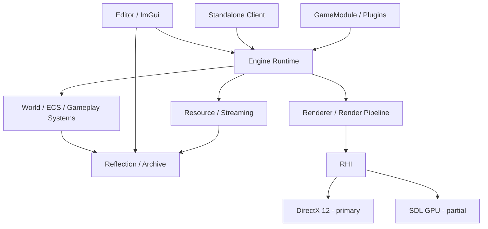

# BamEngine

[한국어](README.md) | [English](README.en.md)

[](https://isocpp.org/)
[](https://cmake.org/)
[](https://github.com/microsoft/vcpkg)
[](Engine/Source/Render/RHI)
[](CMakePresets.json)
[](Docs/DevelopmentPriorities.md)

**BamEngine** is a custom C++ 2D/3D game engine and editor. It brings together a DirectX 12 renderer, EnTT-based ECS, custom Reflection and Archive libraries, content-authoring tools, and a standalone game client.

The immediate goal is a shared foundation for creating and shipping games. Long-term goals extend to AI reinforcement-learning simulation and 2D/3D avatar runtime and authoring tools.

## Demo

<!-- Replace YOUTUBE_VIDEO_ID with the uploaded video's ID to enable the thumbnail and link.
[](https://www.youtube.com/watch?v=YOUTUBE_VIDEO_ID)
-->
> Main demo video will be added here.

## Features

The following features have implementation paths in the repository. See [Current Status](#current-status) and the linked design documents for verification coverage and limitations.

### Rendering and Graphics

| Area | Implementation scope |
| --- | --- |
| Rendering architecture | DirectX 12 RHI, partial SDL GPU backend, deferred/forward rendering, render passes and targets, shared render pipeline profiles |
| Materials and lighting | PBR, IBL, HDR, directional/point-light shadows, tiled light culling, material flags and shader graphs |
| Advanced rendering | DXR shadows and reflections, BLAS/TLAS, probe GI, TAA and motion vectors, ambient occlusion, deferred decals |
| Environment and post-processing | Atmospheric scattering, volumetric-cloud resources, auto exposure, depth of field, tone mapping, distortion, HDR environment capture |
| Performance and GPU resources | Mesh instancing, screen-size LOD, GPU skinning, PSO cache, dynamic buffers, fence-based deferred release, GPU heap pages, CPU/GPU pass timing, VRAM and descriptor metrics |

### Game Runtime

| Area | Implementation scope |
| --- | --- |
| World and execution | EnTT ECS, scene/entity hierarchy, persistent IDs, fixed/update/late update, game-module DLLs |
| Physics and characters | 2D/3D collision queries, raycast/sweep/overlap, triggers, kinematic character controller |
| Animation and sequencing | Skeletal animation, animator state machines, blend trees, action timelines, camera tracks, splines |
| 2D and UI | Sprite atlases and animation, tilemaps and autotiling, pixel-perfect camera, canvas/rect transforms, UI widgets and layout |
| Game systems | Input, FMOD audio and mixer, save games, runtime settings, scene streaming, NavGrid/NavMesh and AI perception |
| Scripting | Logic graph execution, reflection-backed nodes, execution budgets and debugging |
| Networking | Socket transport, packet protocol, connections/sessions, ECS replication and RPC foundations (production multiplayer validation pending) |

### Editor and Authoring

| Area | Implementation scope |
| --- | --- |
| Scene authoring | Scene/Game View, hierarchy, inspector, multi-selection, gizmos, picking, Play In Editor |
| Editing data | Reflection-backed property editing, undo/redo, dirty-state tracking, prefab creation, isolated editing and instance overrides |
| Content creation | Content browser, resource picker, model/texture import and previews, sprite slicing, tile palette |
| Graphs and timelines | Logic, animator and shader graphs, material editing, action/animation timelines and VFX authoring |
| Terrain | Heightmaps and terrain data, layer editing, terrain material graphs, navigation baking and overlays |
| Developer tools | Project hub, project/game-module management, shortcuts and settings, Korean/English localization, metrics panel, editor plugins |
| Build and delivery | Windows client build/export, selective asset packaging, .bampak, shipping configuration |

### Reflection and Data Pipeline

- Clang-based C++ reflection generation from CLASS, STRUCT, ENUM, PROPERTY and FUNCTION annotations.
- Independent [Reflection](Projects/Reflection), [Archive](Projects/Archive) and [ReflectionArchive](Projects/ReflectionArchive) libraries integrated with the engine and editor.
- Shared type metadata for inspectors, ECS components, scene/prefab persistence, graphs and editing history.
- ResourceHandle (index + generation), Engine:// and Project:// virtual URIs, asynchronous loading, preloading, streaming and a separate AssetWorker process.
- CMake-based HLSL compilation to DXIL/SPIR-V, localization CSV-to-JSON conversion and code generation.

### AI Reinforcement Learning (in development)

- Headless CartPole environment and [Gymnasium-compatible Python adapter](Tools/RL/bam_gym_env.py).
- SceneRLEnvironment, VectorizedRLEnvironment, external control server and reset/step interfaces.
- Observation, action, reward and termination contracts, curriculum and save-game integration foundations.
- End-to-end training, policy playback and parallel-environment stability remain under validation.

## Architecture



- **Engine** owns runtime systems and rendering/resource contracts.
- **Editor** owns scene and asset authoring, property editing, debugging, building and packaging.
- **Client** hosts games without the editor.
- **GameModule / Plugins** provide extension points for game-specific code and tools.

See the [architecture overview](Docs/Technical/Architecture.en.md) and [Engine/Editor/Client guidelines](Docs/EngineEditorClientGuidelines.md).

## Project Structure

```text
BamEngine/
├── Engine/         # Runtime, rendering, ECS, built-in resources
├── Editor/         # Content authoring and development tools
├── Client/         # Standalone game host and Web preview
├── Projects/       # Reflection, Archive, GameModule, plugins
├── Tools/          # AssetWorker, converters, RL adapter, scripts
├── Assets/         # Project asset location
├── Config/         # Project configuration
├── Plugins/        # Plugin examples
├── Docs/           # Guides, architecture, plans, verification records
└── CMakeLists.txt
```

## Tech Stack and Environment

| Area | Technology |
| --- | --- |
| Language/build | C++20 baseline, selected C++23 targets, CMake 3.21+, vcpkg manifest |
| Development | Windows, Visual Studio 18 2026, MSVC, Windows SDK |
| Graphics/shaders | DirectX 12, SDL3 GPU, HLSL, DXC, Vulkan SDK, glslang, SPIRV-Tools, SPIRV-Cross |
| ECS/math/data | EnTT, GLM, Glaze, fmt, LZ4 |
| Editor | Dear ImGui, ImGuizmo, imnodes, Qt6 Widgets |
| Assets | Assimp, DirectXTex, stb, meshoptimizer, efsw |
| Codegen/audio | LLVM/Clang 20.1.8, Python 3, FMOD SDK |

Before configuring, prepare vcpkg, LLVM/Clang libraries and resource directory, DXC/Vulkan SDK, and local FMOD SDK files. The Windows presets currently use I:/vcpkg/scripts/buildsystems/vcpkg.cmake for CMAKE_TOOLCHAIN_FILE; adjust it for your installation. See [Getting Started](Docs/UserGuide/GettingStarted.en.md) and [CMakePresets.json](CMakePresets.json).

## Build and Run

### Editor

```powershell
git clone --recursive https://github.com/Bamtoliya/BamEngine.git
cd BamEngine
cmake --preset x64-debug
cmake --build --preset x64-debug --target Editor
.\out\build\x64-debug\bin\Debug\Editor.exe
```

Run from the repository root. Windows Ninja presets (x64-ninja-debug and x64-ninja-release) are also available. See the [Reflection/Archive build guide](Docs/ReflectionArchiveBuild.md) for independent library builds and installation.

### Client and Shipping

The Editor Build Profile can build and export a Windows client to a deployment folder. Editor-free shipping uses BAMENGINE_WITH_EDITOR=OFF and BAMENGINE_SHIPPING=ON. See the [build and packaging plan](Docs/BuildAndPackagingPlan.md) for .bampak and launch policies.

### Selected Checks

```powershell
cmake --preset x64-debug -DBAMENGINE_BUILD_REFLECTION_CHECK=ON -DBAMENGINE_BUILD_GRAPH_CHECK=ON -DBUILD_TESTING=ON
cmake --build --preset x64-debug --target SceneReflectionCheck SceneArchiveCheck GpuHeapPageAllocatorCheck TemporalAACheck
ctest --test-dir out/build/x64-debug -C Debug -R '^(SceneReflection|SceneArchive|GpuHeapPageAllocator|TemporalAA)Check$' --output-on-failure
```

These commands illustrate selected checks; they do not replace the full suite or manual GPU/UI testing.

## Current Status

**As of 2026-11-25 · Work in progress**

| Area | Status |
| --- | --- |
| Windows / DirectX 12 | Primary development and validation path |
| 2D/3D game creation and editor | Core authoring features implemented; real-game and regression validation ongoing |
| Standalone Windows shipping client | Build, export and launch recorded as verified on 2026-11-25 |
| .bampak packaging | Loading without loose original Assets recorded as verified on 2026-11-25 |
| HDR environment capture | Execution recorded as verified on 2026-11-25 |
| SDL GPU | Partial backend; feature parity including instancing and compute not established |
| Web / WebGPU | Independent web preview and shader-conversion draft; full Wasm client and WebGPU renderer unfinished |
| Native Vulkan / Metal | Stubs; Linux/macOS presets do not establish platform support |
| AI reinforcement learning | Environment, external control and vectorization foundations; recorded RLSimulationCheck failure and follow-up validation |
| VTuber / model and rig authoring | Long-term goals; VRM, tracking, lip sync, 2D deformation, broadcasting and specialized authoring unfinished |

A user-confirmed x64-ninja-debug build and 44/44 CTest pass was recorded on 2026-11-20. It does not establish that all subsequent changes or GPU/UI workflows pass. See [Development Priorities](Docs/DevelopmentPriorities.md) (section 11) and [Implementation Log](Docs/ImplementationLog.md) for current checks, failures and pending manual validation.

## Development Direction

- Game creation: real 2D/3D content, editing-data protection, runtime stability and deployment validation.
- Graphics: GPU-driven rendering, advanced culling, probe GI quality/performance and backend coverage. Mesh shaders and virtualized geometry remain conditional research goals.
- Reinforcement learning: scene-based environments, external training, parallel execution and policy playback validation.
- Avatar and authoring: long-term VRM, tracking, lip sync, 2D deformation, broadcast output, mesh/rig and weight editing.

The design documents below define scope and priorities.

## Documentation

| Document | Purpose |
| --- | --- |
| [Documentation index](Docs/README.en.md) | User and developer documentation entry point |
| [Getting Started](Docs/UserGuide/GettingStarted.en.md) · [Editor Workflow](Docs/UserGuide/EditorWorkflow.en.md) | Setup, builds and authoring |
| [Architecture](Docs/Technical/Architecture.en.md) · [Scene Persistence](Docs/Technical/ScenePersistence.en.md) | Internal structure and data contracts |
| [Engine Development Plan](Docs/EngineDevelopmentPlan.md) · [Rendering Development Plan](Docs/RenderingDevelopmentPlan.md) | Final goals and graphics roadmap |
| [Editor Development Plan](Docs/ImGuiDevelopmentPlan.md) · [Build and Packaging](Docs/BuildAndPackagingPlan.md) | Authoring and delivery |
| [Development Priorities](Docs/DevelopmentPriorities.md) · [Implementation Log](Docs/ImplementationLog.md) | Current tasks, validation and remaining work |
| [Reflection Integration](Docs/EngineReflectionIntegration.md) · [Reflection/Archive Build](Docs/ReflectionArchiveBuild.md) | Code generation and independent libraries |

Detailed development plans are primarily written in Korean.

## Contributing and License

Issues and pull requests are welcome. Follow the existing C++ style, module boundaries and [project guidelines](Docs/EngineEditorClientGuidelines.md). Discuss significant design changes first.

The repository does not currently declare a root-level project license. Confirm licensing before redistribution or commercial use; third-party libraries retain their respective licenses.
