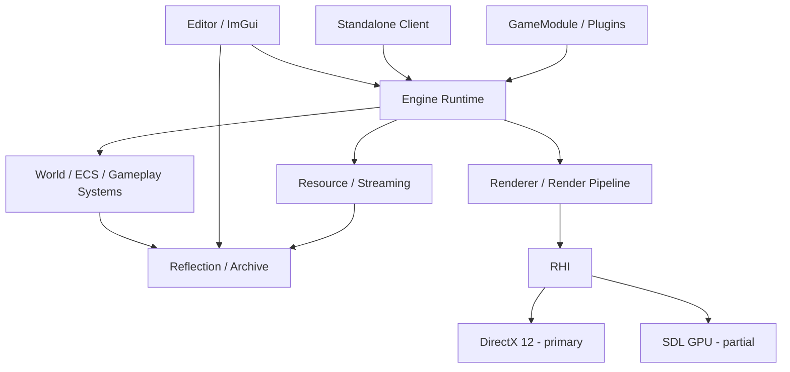

# BamEngine

[한국어](README.md) | [English](README.en.md)

[](https://isocpp.org/)
[](https://cmake.org/)
[](https://github.com/microsoft/vcpkg)
[](Engine/Source/Render/RHI)
[](CMakePresets.json)
[](Docs/DevelopmentPriorities.md)

**BamEngine**은 C++ 기반의 자체 개발 2D·3D 게임 엔진 및 에디터입니다. DirectX 12 렌더링, EnTT 기반 ECS, 자체 Reflection·Archive 라이브러리, 콘텐츠 제작 도구와 독립 실행 Client를 하나의 개발 환경으로 연결합니다.

게임을 제작하고 배포할 수 있는 공통 기반을 먼저 구축하고, 장기적으로 AI 강화학습 시뮬레이션과 2D·3D 아바타 실행·제작 도구까지 확장하는 것을 목표로 합니다.

## 시연 영상

https://github.com/user-attachments/assets/905b768b-487f-4b3b-8b1d-44f6cb54f924

> 메인 시연 영상 추가 예정.

## 주요 기능

아래 기능은 현재 저장소에 구현 경로가 있는 기능입니다. 세부 기능별 실행 검증 및 미지원 범위는 [현재 개발 상태](#현재-개발-상태)와 각 설계 문서를 참고하세요.

### 렌더링 및 그래픽스

| 영역 | 구현 범위 |
| --- | --- |
| 렌더링 구조 | DirectX 12 RHI, 부분 구현 SDL GPU 백엔드, Deferred / Forward, RenderPass·RenderTarget·공용 렌더 파이프라인 프로필 |
| 재질 및 조명 | PBR, IBL, HDR, 방향·점광원 그림자, Tiled Light Culling, 재질 플래그 및 셰이더 그래프 |
| 고급 렌더링 | DXR 기반 그림자·반사, BLAS/TLAS, Probe GI, TAA 및 모션 벡터, Ambient Occlusion, 디퍼드 데칼 |
| 환경 및 후처리 | 대기 산란, 볼류메트릭 구름 관련 리소스, 자동 노출, 피사계 심도, 톤 매핑, 디스토션, HDR 환경맵 캡처 |
| 성능 및 GPU 자원 | 메시 인스턴싱, 화면 크기 기반 LOD, GPU 스키닝, PSO 캐시, Dynamic Buffer, Fence 기반 지연 해제, GPU Heap Page 관리, CPU/GPU 패스 계측, VRAM·디스크립터 통계 |

### 게임 런타임

| 영역 | 구현 범위 |
| --- | --- |
| 월드 및 실행 | EnTT ECS, Scene·Entity 계층, Persistent ID, FixedUpdate / Update / LateUpdate, 게임 모듈 DLL |
| 물리 및 캐릭터 | 2D·3D 충돌 질의, Raycast·Sweep·Overlap, Trigger, Kinematic Character Controller |
| 애니메이션 및 시퀀스 | 스켈레탈 애니메이션, Animator 상태 머신, Blend Tree, 액션 타임라인, 카메라 트랙, 스플라인 |
| 2D 및 UI | Sprite Atlas·Animation, 타일맵·오토타일, Pixel Perfect Camera, Canvas·RectTransform, UI 위젯·레이아웃 |
| 게임 시스템 | 입력, FMOD 오디오·믹서, SaveGame, 런타임 설정, 씬 스트리밍, NavGrid/NavMesh 및 AI Perception |
| 스크립팅 | Logic 그래프 실행, Reflection 기반 노드, 실행 예산 및 디버깅 |
| 네트워크 | 소켓 전송, 패킷 프로토콜, 연결·세션, ECS 복제 및 RPC 기반 (실전 멀티플레이 검증은 후속) |

### 에디터 및 제작 도구

| 영역 | 구현 범위 |
| --- | --- |
| 씬 제작 | Scene/Game View, Hierarchy, Inspector, 다중 선택, Gizmo, 피킹, PIE |
| 편집 데이터 | Reflection 기반 속성 편집, Undo/Redo, 미저장 변경 추적, Prefab 생성·격리 편집·인스턴스 오버라이드 |
| 콘텐츠 제작 | Content Browser, Resource Picker, 모델·텍스처 임포트 및 미리보기, 스프라이트 슬라이싱, Tile Palette |
| 그래프 및 타임라인 | Logic·Animator·Shader 그래프, 머티리얼 편집, 액션·애니메이션 타임라인, VFX 제작 |
| 지형 | 하이트맵 및 지형 데이터, 레이어 편집, 지형 머티리얼 그래프, 내비게이션 베이크·오버레이 |
| 개발 도구 | Project Hub, 프로젝트/게임 모듈 관리, 단축키·설정, 한/영 현지화, MetricsPanel, 에디터 플러그인 |
| 빌드 및 배포 | Windows Client 빌드·내보내기, 선택적 리소스 패키징, .bampak, Shipping 구성 |

### Reflection 및 데이터 파이프라인

- Clang 기반 C++ Reflection 코드 생성: CLASS, STRUCT, ENUM, PROPERTY, FUNCTION 어노테이션을 분석하여 C++ 메타데이터를 생성합니다.
- 독립 라이브러리인 [Reflection](Projects/Reflection), [Archive](Projects/Archive), [ReflectionArchive](Projects/ReflectionArchive)를 엔진과 에디터에 통합합니다.
- 타입 메타데이터를 Inspector, ECS 컴포넌트, 씬·프리팹 저장/복원, 그래프 및 편집 이력에 재사용합니다.
- ResourceHandle(index + generation), Engine:// 및 Project:// 가상 URI, 비동기 로딩·프리로딩·스트리밍, 별도 AssetWorker 프로세스를 활용합니다.
- CMake 기반 셰이더 컴파일(HLSL → DXIL / SPIR-V), 현지화 CSV → JSON 및 코드 생성 자동화를 제공합니다.

### AI 강화학습 (개발 중)

- Headless CartPole 환경과 Gymnasium 호환 Python 어댑터([bam_gym_env.py](Tools/RL/bam_gym_env.py)).
- SceneRLEnvironment, VectorizedRLEnvironment, 외부 제어 서버 및 reset/step 인터페이스.
- 관측·행동·보상·종료 상태, 커리큘럼 및 SaveGame 연동 기반.
- 전체 학습·정책 재생과 병렬 환경 안정성은 검증 중입니다.

## 아키텍처



- **Engine**은 실행 시스템과 렌더링·리소스 계약을 담당합니다.
- **Editor**는 씬·에셋 제작, 속성 편집, 디버깅, 빌드·패키징을 담당합니다.
- **Client**는 에디터 없이 게임을 실행하는 호스트입니다.
- **GameModule / Plugins**는 게임별 기능 및 도구의 확장 경로입니다.

자세한 설계는 [기술 아키텍처](Docs/Technical/Architecture.md) 및 [Engine·Editor·Client 지침](Docs/EngineEditorClientGuidelines.md)을 참고하세요.

## 프로젝트 구조

```text
BamEngine/
├── Engine/         # Runtime, rendering, ECS, built-in resources
├── Editor/         # Content authoring and development tools
├── Client/         # Standalone game host and Web preview
├── Projects/       # Reflection, Archive, GameModule, plugins
├── Tools/          # AssetWorker, converters, RL adapter, scripts
├── Assets/         # Project asset location
├── Config/         # Project configuration
├── Plugins/        # Plugin examples
├── Docs/           # Guides, architecture, plans, verification records
└── CMakeLists.txt
```

## 기술 스택 및 개발 환경

| 구분 | 기술 |
| --- | --- |
| 언어·빌드 | C++20 기반 / 일부 C++23 타깃, CMake 3.21+, vcpkg manifest |
| 개발 환경 | Windows, Visual Studio 18 2026, MSVC, Windows SDK |
| 그래픽스·셰이더 | DirectX 12, SDL3 GPU, HLSL, DXC, Vulkan SDK, glslang, SPIRV-Tools, SPIRV-Cross |
| ECS·수학·데이터 | EnTT, GLM, Glaze, fmt, LZ4 |
| 에디터 | Dear ImGui, ImGuizmo, imnodes, Qt6 Widgets |
| 에셋 | Assimp, DirectXTex, stb, meshoptimizer, efsw |
| 코드 생성·오디오 | LLVM/Clang 20.1.8, Python 3, FMOD SDK |

빌드 전 vcpkg 설치 경로, LLVM/Clang 라이브러리와 resource 디렉터리, DXC/Vulkan SDK 및 로컬 FMOD SDK를 준비해야 합니다. 현재 Windows 프리셋의 CMAKE_TOOLCHAIN_FILE은 I:/vcpkg/scripts/buildsystems/vcpkg.cmake를 사용하므로 환경에 맞게 조정하세요. 상세 요구사항은 [시작하기](Docs/UserGuide/GettingStarted.md)와 [CMakePresets.json](CMakePresets.json)을 참고합니다.

## 빌드 및 실행

### Editor

```powershell
git clone --recursive https://github.com/Bamtoliya/BamEngine.git
cd BamEngine
cmake --preset x64-debug
cmake --build --preset x64-debug --target Editor
.\out\build\x64-debug\bin\Debug\Editor.exe
```

위 명령은 저장소 루트에서 실행합니다. Windows Ninja 프리셋(x64-ninja-debug, x64-ninja-release)도 제공됩니다. 독립 Reflection·Archive 모듈의 구성과 설치는 [별도 빌드 가이드](Docs/ReflectionArchiveBuild.md)를 참고하세요.

### Client 및 Shipping

Editor의 Build Profile에서 Windows Client를 빌드하고 배포 폴더로 내보낼 수 있습니다. 에디터 없는 Shipping 구성은 BAMENGINE_WITH_EDITOR=OFF 및 BAMENGINE_SHIPPING=ON을 사용합니다. .bampak 패키징 및 실행 정책은 [빌드·패키징 계획](Docs/BuildAndPackagingPlan.md)을 참고하세요.

### 선택 검사

```powershell
cmake --preset x64-debug -DBAMENGINE_BUILD_REFLECTION_CHECK=ON -DBAMENGINE_BUILD_GRAPH_CHECK=ON -DBUILD_TESTING=ON
cmake --build --preset x64-debug --target SceneReflectionCheck SceneArchiveCheck GpuHeapPageAllocatorCheck TemporalAACheck
ctest --test-dir out/build/x64-debug -C Debug -R '^(SceneReflection|SceneArchive|GpuHeapPageAllocator|TemporalAA)Check$' --output-on-failure
```

이 명령은 대표 검사 타깃의 실행 예시이며 전체 검사나 GPU·UI 수동 테스트를 대신하지 않습니다.

## 현재 개발 상태

**2026-11-25 기준 · WIP**

| 구분 | 상태 |
| --- | --- |
| Windows / DirectX 12 | 주력 개발·검증 경로 |
| 2D·3D 게임 제작 및 에디터 | 핵심 제작 기능 구현, 실제 게임 제작과 회귀 검증 진행 |
| Windows 독립 Shipping Client | 2026-11-25 빌드·내보내기·구동 확인 기록 |
| .bampak 패키징 | 2026-11-25 원본 Assets 없이 팩 로딩 확인 기록 |
| HDR 환경맵 캡처 | 2026-11-25 실행 확인 기록 |
| SDL GPU | 부분 구현; 인스턴싱·Compute 등 기능 동등성 미확보 |
| Web / WebGPU | 독립 Web 프리뷰 및 셰이더 변환 경로 초안; 실제 Wasm Client와 전체 WebGPU 렌더링 미완료 |
| Native Vulkan / Metal | 스텁; Linux/macOS 프리셋이 실제 플랫폼 지원을 의미하지 않음 |
| AI 강화학습 | 환경·외부 제어·벡터화 기반 구현; RLSimulationCheck 실패 기록 및 후속 검증 |
| VTuber / 모델·리깅 제작 | 장기 목표; VRM, 추적, 립싱크, 2D 변형·방송 및 전문 제작 도구 미완료 |

2026-11-20의 x64-ninja-debug 빌드 및 CTest 44/44 통과는 당시 기록입니다. 이후 변경까지 모두 검증됐다는 의미는 아닙니다. 최신 수동 확인, 실패 및 검증 대기 항목은 [통합 개발 우선순위 11절](Docs/DevelopmentPriorities.md#11-현재-작업-트리-기준-우선순위-재평가-2026-11-14-갱신)과 [구현 기록](Docs/ImplementationLog.md)을 참고하세요.

## 개발 방향

현재는 기능 확장과 게임 제작 검증을 병행하는 단계입니다.

- 게임 제작: 실제 2D·3D 콘텐츠 제작, 편집 데이터 보호, 런타임 안정성, 배포 경로 검증.
- 그래픽스: GPU Driven Rendering, 고급 컬링, Probe GI 품질·성능, 백엔드 지원 범위 개선. Mesh Shader·가상화 지오메트리 등은 조건부 연구 목표입니다.
- 강화학습: Scene 기반 환경, 외부 학습, 병렬 실행, 정책 재생 검증.
- 아바타·제작 도구: VRM·추적·립싱크·2D 변형·방송 출력, 모델·리깅·웨이트 편집으로 장기 확장.

세부 범위와 우선순위는 아래 계획 문서를 기준으로 관리합니다.

## 문서

| 문서 | 내용 |
| --- | --- |
| [문서 색인](Docs/README.md) | 사용자 및 개발자 문서 진입점 |
| [시작하기](Docs/UserGuide/GettingStarted.md) · [에디터 기본 작업](Docs/UserGuide/EditorWorkflow.md) | 설치·빌드·제작 흐름 |
| [아키텍처](Docs/Technical/Architecture.md) · [씬 저장](Docs/Technical/ScenePersistence.md) | 내부 구조 및 데이터 계약 |
| [엔진 개발 계획](Docs/EngineDevelopmentPlan.md) · [렌더링 개발 계획](Docs/RenderingDevelopmentPlan.md) | 최종 목표 및 렌더링 로드맵 |
| [에디터 개발 계획](Docs/ImGuiDevelopmentPlan.md) · [빌드·패키징](Docs/BuildAndPackagingPlan.md) | 제작 도구 및 배포 |
| [통합 개발 우선순위](Docs/DevelopmentPriorities.md) · [구현 기록](Docs/ImplementationLog.md) | 현재 작업·검증·남은 과제 |
| [Reflection 엔진 통합](Docs/EngineReflectionIntegration.md) · [Reflection/Archive 빌드](Docs/ReflectionArchiveBuild.md) | 코드 생성 및 독립 모듈 |

## 기여 및 라이선스

이슈와 PR을 환영합니다. 기존 C++ 코드 스타일과 모듈 경계, [공통 지침](Docs/EngineEditorClientGuidelines.md)을 따라 주세요. 큰 변경은 설계와 목표를 먼저 논의합니다.

현재 저장소 루트에 프로젝트 라이선스 파일이 명시되어 있지 않습니다. 재배포 또는 상업적 이용 전 라이선스 정책을 확인해야 하며, 외부 라이브러리에는 각 라이선스가 적용됩니다.
